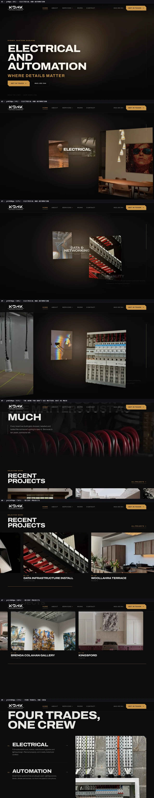
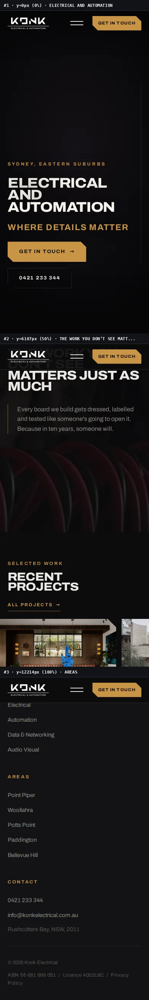

# UI Design System & Master Generation Blueprint: konkelectrical-com

> **Konk Electrical · Eastern Suburbs Electricians, Sydney** (https://konkelectrical.com/) — Electrical and automation specialists for high-end homes across Sydney's Eastern Suburbs. Lighting, smart home, data and audio visual, wi...





---

## 1. Executive Visual Persona & Design Archetype

- **Brand Essence & Persona**: **Konk Electrical · Eastern Suburbs Electricians, Sydney** (`https://konkelectrical.com/`). Electrical and automation specialists for high-end homes across Sydney's Eastern Suburbs. Lighting, smart home, data and audio visual, wi...
- **Capture Provenance**: Live browser capture (`tier1_fast`, HTTP `200`, captured `2026-11-24`).
- **Visual Archetype**: **High-Contrast Obsidian / Atmospheric Design System (`#0b0b0c` canvas, `#f6f3ec` ink, `#0068a0` accent)**.
- **Anti-AI-Slop Differentiators**:
  - **Live-Computed Chromatic Polarity**: Anchors the viewport in `#0b0b0c` (live computed `body` `background-color` (`computed_styles.json`)) paired with `#f6f3ec` primary typography and `#0068a0` accents.
  - **Grounded Typographic Hierarchy**: Uses `Archivo` across display (`ELECTRICAL AND AUTOMATION`) and body copy.
  - **Calibrated Spatial Grid & Motion**: Combines `1440px` container bounds (`gap: 34.56px`, padding `var(--gutter)`) with `cubic-bezier(.22,1,.36,1)` easing and Three.js / WebGL Canvas Pipeline.

---

## 2. Spatial Architecture & Modular Grid Mathematics

### Viewport Allocation & Container Geometry
- **Captured Journey Filmstrips**: Desktop `1280×6624px` (`assets/desktop-journey.webp`, `8` keyframes up to `y=14400px` / doc `20749px`), Mobile `390×2616px` (`assets/mobile-journey.webp`, `3` keyframes).
- **Master Container Bounds**: `1440px` (full-bleed `100%` desktop stage measured on `1440px` viewport).
- **Canvas Lateral Padding & Spacing**: `var(--gutter)` lateral canvas padding with `34.56px` grid gap.
- **Border Radius Scale**: `2px`, `50%`, `40px`, `100%`.

### Responsive Breakpoint Architecture
- **Desktop Layout**: Multi-column CSS Grid / Flexbox layout at `1440px` (`max-width: 1440px`, `gap: 34.56px`).
- **Mobile Layout**: Single-column vertical stack at `390px` viewport width with `var(--gutter)` horizontal padding.
- **Extracted CSS Media Queries**: `@media (prefers-reduced-motion:reduce)`, `@media (width<=1080px)`, `@media (width<=560px)`, `@media (width<=900px)`.

---

## 3. Color System, Materiality & Atmospheric Lighting

### Semantic Palette & Source Grounding
| Semantic Role | Ground-Truth Value | Extracted Live / CSS Source |
|---|---|---|
| **Primary Canvas Substrate** | `#0b0b0c` | live computed `body` `background-color` (`computed_styles.json`) |
| **Primary Typography Ink** | `#f6f3ec` | live computed `h1` `color` (`computed_styles.json`) |
| **Elevated Surface / Card Substrate** | `#121214` | live computed `footer` `background-color` (`computed_styles.json`) |
| **Interactive Accent / Highlight** | `#0068a0` | `.sbi-feed-block-cta-btn { background: #0068a0 }` |
| **Secondary / Muted Copy** | `#808080` | live computed `hr` `color` (`computed_styles.json`) |
| **Structural Hairline Border** | `#26262a` | `.kv { border-top: #26262a }` |
| **Variable Token (`--cc-bone`)** | `#f2f0eb` | `var(--cc-bone)` in `:root` |
| **Variable Token (`--cc-steel`)** | `#8c8a84` | `var(--cc-steel)` in `:root` |
| **Variable Token (`--cc-red`)** | `#c89446` | `var(--cc-red)` in `:root` |
| **Variable Token (`--cc-gold`)** | `#e7b96f` | `var(--cc-gold)` in `:root` |
| **Variable Token (`--ink-3`)** | `#17171a` | `var(--ink-3)` in `:root` |
| **Variable Token (`--brass-dim`)** | `#8a6733` | `var(--brass-dim)` in `:root` |
| **Variable Token (`--bronze`)** | `#5b4a33` | `var(--bronze)` in `:root` |
| **Variable Token (`--text`)** | `#e9e7e2` | `var(--text)` in `:root` |

### Sanitized Root CSS Variables (`ui-ux.md` Ground Truth)
| Variable Name | Extracted Value | Semantic Role |
|---|---|---|
| `--cc-ink` | `#0B0B0C` | Typography Ink Token |
| `--cc-bone` | `#F2F0EB` | Color / Atmospheric Token |
| `--cc-steel` | `#8C8A84` | Color / Atmospheric Token |
| `--cc-red` | `#C89446` | Color / Atmospheric Token |
| `--cc-gold` | `#E7B96F` | Color / Atmospheric Token |
| `--cc-font-display` | `'Archivo', sans-serif` | Typography / Scale Token |
| `--ink` | `#0b0b0c` | Typography Ink Token |
| `--ink-2` | `#121214` | Typography Ink Token |
| `--ink-3` | `#17171a` | Typography Ink Token |
| `--hair` | `#26262a` | Color / Atmospheric Token |
| `--paper` | `#f2f0eb` | Canvas / Surface Token |
| `--brass` | `#c89446` | Color / Atmospheric Token |
| `--brass-hi` | `#e7b96f` | Color / Atmospheric Token |
| `--brass-dim` | `#8a6733` | Color / Atmospheric Token |
| `--bronze` | `#5b4a33` | Color / Atmospheric Token |
| `--text` | `#e9e7e2` | Typography Ink Token |

---

## 4. Typographic Scale & Editorial Hierarchy

### Font Family Stacks
- **Display Typography**: `Archivo`.
- **Primary Body Stack**: `Archivo`.
- **Technical / Metadata Stack**: not declared in live computed styles (uses primary stack / `ui-monospace`).

### Typographic Scale & Rules (Live Computed & Stylesheet Grounded)
- **Hero Display (`H1`)**: live computed `h1` (`font-size: 96.48px`, `line-height: 82.9728px`, `font-weight: 800`, `letter-spacing: -3.3768px`); CSS variables `--cc-font-display: 'Archivo', sans-serif`.
- **Section Heading (`H2`)**: live computed `h2` (`font-size: 118.4px`, `line-height: 101.824px`, `font-weight: 800`, `letter-spacing: -4.144px`).
- **Body Copy**: live computed `body` (`font-size: 17px`, `line-height: 27.2px`, `font-weight: 400`); rule `p` (`font-size: clamp(1.02rem,1.25vw,1.16rem)`, `line-height: 1.7`).
- **Metadata & Navigation Labels**: live computed `nav/a` (`font-size: 17px`, `line-height: 27.2px`, `font-weight: 400`).

---

## 5. Choreographed Motion & Interaction Physics

### Primary Easing Curves
- **Extracted Timing Functions**: `cubic-bezier(.22,1,.36,1)`, `cubic-bezier(.65,0,.35,1)`.

### Per-Element Transition & Choreography Rules
- **Selector `.btn`**: `transition: background .25s var(--ease) , transform .25s var(--ease)` extracted from `konkelectrical-com` stylesheet.
- **Selector `.btn .arw`**: `transition: transform .3s var(--ease)` extracted from `konkelectrical-com` stylesheet.
- **Selector `.rise.in`**: `transition: opacity .9s var(--ease) , transform .9s var(--ease)` extracted from `konkelectrical-com` stylesheet.
- **Extracted Easing Curve (`cubic-bezier(.22,1,.36,1)`)**: Governs interactive state transitions across `<header.hdr>` and `<section.cc-page-home>`.
- **Runtime Interaction Engine**: Integrates Three.js / WebGL Canvas Pipeline with `prefers-reduced-motion: reduce` fallback guards.
### Measured Runtime Scroll & Interaction Telemetry (`behavioral_journey_v2`)
- **Scroll Driver Mode**: `native` (max document height `20749px`, deepest scrollY reached `14400px` across `8` desktop keyframes).
- **Detected Scroll / Motion Libraries**: Native browser scroll / standard CSS transitions.
- **Nav / Drawer Probe**: Tested trigger `SERVICES ▾` (diff `1.555`, below state-capture threshold).
- **Hover Physics (`primary_cta` · `GET IN TOUCH →`)**: `backgroundColor`: `rgb(200, 148, 70)` -> `rgb(231, 185, 111)` (`transition-duration: 0.25s, 0.25s`, `timing: cubic-bezier(0.22, 1, 0.36, 1), cubic-bezier(0.22, 1, 0.36, 1)`).
- **Interactive Control Probe (`carousel_next` · `Next video`)**: Triggered visual diff `28.928` (attr ` -> `, captured in `assets/state-interactive.webp`).
- **Route Transition Architecture**: First internal navigation (`/work/`) measured as `MPA` in `1933ms`.

---

## 6. Component Wireframe & Structural DOM Map

### Visual Layout Schematic — Desktop (`1440px`, Grounded in `dom.html` & Landmark Bounding Boxes)
```
┌────────────────────────────────────────────────────────────────────────┐
│ DESKTOP VIEWPORT (1440px) — Konk Electrical · Eastern Suburbs Electric │
│ ====================================================================== │
│ [ <header.hdr> (1440x90px)            | Home · About · Electrical ·  ] │
│ ---------------------------------------------------------------------- │
│ | HERO STAGE: <section.tf> (w=1440px)                                | │
│ | H1: ELECTRICAL AND AUTOMATION                                      | │
│ | Substrate: #0b0b0c | Ink: #f6f3ec | Accent: #0068a0                | │
│ ---------------------------------------------------------------------- │
│ | SHOWCASE GRID (<section.cc-page-home>) max-w: 1440px               | │
│ | +------------------------------+  +------------------------------+ | │
│ | | Data & Networking            |  | Audio Visual                 | | │
│ | +------------------------------+  +------------------------------+ | │
│ ---------------------------------------------------------------------- │
│ | DETAIL MODULE (<section.konk-load>) — Send an enquiry              | │
│ ---------------------------------------------------------------------- │
│ [ FOOTER (<footer.ftr>        ) | https://konkelectrical.com/          │
└────────────────────────────────────────────────────────────────────────┘
```

### Visual Layout Schematic — Mobile Reflow (`390px`)
```
┌────────────────────────────────────────────────────────────────────────┐
│ MOBILE VIEWPORT REFLOW (390px) — Single-Column Stack (gap: 34.56px)    │
│ ====================================================================== │
│ [ HEADER BAR (<header.hdr>            ) | Compact Menu (390px)         │
│ ---------------------------------------------------------------------- │
│ | HERO STAGE (<section.tf>) — 390px Vertical Lead                    | │
│ | H1: ELECTRICAL AND AUTOMATION                                      | │
│ ---------------------------------------------------------------------- │
│ | SHOWCASE STACK (<section.cc-page-home>) — 1-Col Stack              | │
│ | [ Item 1: Data & Networking                                      ] | │
│ | [ Item 2: Audio Visual                                           ] | │
│ ---------------------------------------------------------------------- │
│ | DETAIL STACK (<section.konk-load>) — 1-Col (Send an enquiry)       | │
│ ---------------------------------------------------------------------- │
│ [ FOOTER (<footer.ftr>        ) | Stacked 390px Colophon               │
└────────────────────────────────────────────────────────────────────────┘
```

### Granular DOM Region Breakdown
1. **Brand Header & Navigation Bar (<header.hdr> — `konkelectrical-com`)**:
   - Landmark `<header class="hdr">` (`1440x90px`) hosting `Konk Electrical · Eastern Suburbs El` navigation (`Home · About · Electrical · Automation · Data & Networking`), DOM attributes (`data-section="header"`, `data-label="Header"`, `data-locked`, `data-header`), and stylesheet rule `after { box-sizing:border-box }`.
2. **Hero Stage & Focal Lead (<section.tf> — `ELECTRICAL AND AUTOMATION`)**:
   - Landmark `<section class="tf">` presenting display lead `ELECTRICAL AND AUTOMATION` and copy excerpt *"From repairs and alterations to complete renovations, new builds "* over `#0b0b0c` canvas and `#f6f3ec` ink.
3. **Primary Showcase & Content Grid (<section.cc-page-home> — `Data & Networking`)**:
   - Landmark `<section class="cc-page-home">` rendering section `Data & Networking` with copy *"Effortless control"*, asset references (`xfavicon.png,qv=1793266697.pagesp...`, `A.fonts.css,,qv==1793266697+style...`, `xkonk-logo-white.png,qv=179326669... (Konk Electrical)`, `xkonk-logo-white.png,qv=179326669... (Konk Electrical)`), and grid rule `html { -webkit-text-size-adjust:100%;scroll-behavior:smooth }`.
4. **Interactive Detail & Feature Matrix (<section.konk-load> — `Audio Visual`)**:
   - Landmark `<section class="konk-load">` framing `Audio Visual` and `Send an enquiry` (*"Lighting, climate, security and entertainment through one intuiti"*) with `#121214` surface cards, `#0068a0` accents, and `video { display:block;max-width:100% }`.
5. **Colophon & Global Directory Footer (<footer.ftr> — `https://konkelectrical.com/`)**:
   - Landmark `<footer class="ftr">` anchoring `Konk Electrical · Eastern Suburb` footer links (`Home · About · Electrical · Automation · Data & Networking`), copy *"Structured cabling and whole-home Wi-Fi that keeps every dev"*, and `#26262a` structural dividers.
### Full Vertical Scroll Sequence (Desktop `1440×900` Keyframes)
- **Step 01** (`y=0px`, `0%`): Active landmark `ELECTRICAL AND AUTOMATION` · sticky/fixed elements: `2`
- **Step 02** (`y=850px`, `4%`): Active landmark `ELECTRICAL AND AUTOMATION` · sticky/fixed elements: `2`
- **Step 03** (`y=3400px`, `17%`): Active landmark `ELECTRICAL AND AUTOMATION` · sticky/fixed elements: `2`
- **Step 04** (`y=5950px`, `30%`): Active landmark `ELECTRICAL AND AUTOMATION` · sticky/fixed elements: `2`
- **Step 05** (`y=8500px`, `43%`): Active landmark `THE WORK YOU DON’T SEE MATTERS JUST AS MUCH` · sticky/fixed elements: `2`
- **Step 06** (`y=11050px`, `56%`): Active landmark `RECENT PROJECTS` · sticky/fixed elements: `2`
- **Step 07** (`y=13600px`, `69%`): Active landmark `RECENT PROJECTS` · sticky/fixed elements: `2`
- **Step 08** (`y=14400px`, `73%`): Active landmark `FOUR TRADES, ONE CREW` · sticky/fixed elements: `2`

### Multi-Page Internal Route Map
- **Listing Route (`/work/`)**: `https://konkelectrical.com/work/` — H1: `PROJECTS ACROSS SYDNEY`, scrollHeight `4239px`, transition `MPA` (`1933ms`)
- **Detail Route (`/work/tamarama-house/`)**: `https://konkelectrical.com/work/tamarama-house/` — H1: `TAMARAMA HOUSE`, scrollHeight `7860px`, transition `direct` (`1517ms`)
- **About Route (`/about/`)**: `https://konkelectrical.com/about/` — H1: `THE STORY BEHIND KONK`, scrollHeight `7667px`, transition `direct` (`1826ms`)

---

## 7. Master Zero-Shot AI Generation Prompt

```markdown
# Master Zero-Shot Frontend Generation Prompt: konkelectrical-com (Konk Electrical · Eastern Suburbs Electricians, Sydney)

You are a principal frontend architect and design systems engineer. Build a complete, production-ready web application replicating the exact design system, DOM landmarks, typographic hierarchy, color tokens, and motion physics of `konkelectrical-com` (**Konk Electrical · Eastern Suburbs Electricians, Sydney** — `https://konkelectrical.com/`).

### 1. Visual Archetype & Anti-AI-Slop Mandates
- **Archetype**: High-Contrast Obsidian / Atmospheric Design System (`#0b0b0c` canvas, `#f6f3ec` ink, `#0068a0` accent).
- **Identity & Domain Context**: Electrical and automation specialists for high-end homes across Sydney's Eastern Suburbs. Lighting, smart home, data and audio visual, wi...
- **Primary Substrate**: `#0b0b0c` (live computed `body` `background-color` (`computed_styles.json`)), **Primary Ink**: `#f6f3ec`, **Accent / Highlight**: `#0068a0`.
- **Site-Specific Differentiators**:
  - **Live-Computed Chromatic Polarity**: Anchors the viewport in `#0b0b0c` (live computed `body` `background-color` (`computed_styles.json`)) paired with `#f6f3ec` primary typography and `#0068a0` accents.
  - **Grounded Typographic Hierarchy**: Uses `Archivo` across display (`ELECTRICAL AND AUTOMATION`) and body copy.
  - **Calibrated Spatial Grid & Motion**: Combines `1440px` container bounds (`gap: 34.56px`, padding `var(--gutter)`) with `cubic-bezier(.22,1,.36,1)` easing and Three.js / WebGL Canvas Pipeline.

### 2. Ground-Truth CSS Variables (`:root` Token Contract)
Declare and consume these exact custom properties extracted from `konkelectrical-com` in your global stylesheet:

:root {
  /* Konk Electrical · Eastern Suburbs Electricians, Sydney (konkelectrical-com) — Live-Grounded CSS Variables */
  --cc-ink: #0B0B0C; /* Typography Ink Token (konkelectrical-com) */
  --cc-bone: #F2F0EB; /* Color / Atmospheric Token (konkelectrical-com) */
  --cc-steel: #8C8A84; /* Color / Atmospheric Token (konkelectrical-com) */
  --cc-red: #C89446; /* Color / Atmospheric Token (konkelectrical-com) */
  --cc-gold: #E7B96F; /* Color / Atmospheric Token (konkelectrical-com) */
  --cc-font-display: 'Archivo', sans-serif; /* Typography / Scale Token (konkelectrical-com) */
  --ink: #0b0b0c; /* Typography Ink Token (konkelectrical-com) */
  --ink-2: #121214; /* Typography Ink Token (konkelectrical-com) */
  --ink-3: #17171a; /* Typography Ink Token (konkelectrical-com) */
  --hair: #26262a; /* Color / Atmospheric Token (konkelectrical-com) */
  --paper: #f2f0eb; /* Canvas / Surface Token (konkelectrical-com) */
  --brass: #c89446; /* Color / Atmospheric Token (konkelectrical-com) */
  --brass-hi: #e7b96f; /* Color / Atmospheric Token (konkelectrical-com) */
  --brass-dim: #8a6733; /* Color / Atmospheric Token (konkelectrical-com) */
  --bronze: #5b4a33; /* Color / Atmospheric Token (konkelectrical-com) */
  --text: #e9e7e2; /* Typography Ink Token (konkelectrical-com) */
}

### 3. Semantic Color & Materiality Contract
Map every surface, ink, and border strictly to these source-grounded tokens:
- **Primary Canvas Substrate**: `#0b0b0c` — grounded in live computed `body` `background-color` (`computed_styles.json`)
- **Primary Typography Ink**: `#f6f3ec` — grounded in live computed `h1` `color` (`computed_styles.json`)
- **Elevated Surface / Card Substrate**: `#121214` — grounded in live computed `footer` `background-color` (`computed_styles.json`)
- **Interactive Accent / Highlight**: `#0068a0` — grounded in `.sbi-feed-block-cta-btn { background: #0068a0 }`
- **Secondary / Muted Copy**: `#808080` — grounded in live computed `hr` `color` (`computed_styles.json`)
- **Structural Hairline Border**: `#26262a` — grounded in `.kv { border-top: #26262a }`
- **Variable Token (`--cc-bone`)**: `#f2f0eb` — grounded in `var(--cc-bone)` in `:root`
- **Variable Token (`--cc-steel`)**: `#8c8a84` — grounded in `var(--cc-steel)` in `:root`
- **Variable Token (`--cc-red`)**: `#c89446` — grounded in `var(--cc-red)` in `:root`
- **Variable Token (`--cc-gold`)**: `#e7b96f` — grounded in `var(--cc-gold)` in `:root`
- **Variable Token (`--ink-3`)**: `#17171a` — grounded in `var(--ink-3)` in `:root`
- **Variable Token (`--brass-dim`)**: `#8a6733` — grounded in `var(--brass-dim)` in `:root`
- **Variable Token (`--bronze`)**: `#5b4a33` — grounded in `var(--bronze)` in `:root`
- **Variable Token (`--text`)**: `#e9e7e2` — grounded in `var(--text)` in `:root`

### 4. Spatial Grid, Container Bounds & Responsive Breakpoints
- **Desktop Viewport Reference**: `1280×6624px` (multi-frame vertical journey filmstrip (6624px), `1440px` standard desktop width).
- **Mobile Viewport Reference**: `390×2616px` (multi-frame vertical journey filmstrip (2616px), `390px` standard mobile width).
- **Container Max-Width**: `1440px` (full-bleed `100%` desktop stage measured on `1440px` viewport)
- **Padding & Gutters**: `var(--gutter)` lateral canvas padding with `34.56px` grid gap
- **Desktop Grid**: Multi-column CSS Grid / Flexbox layout at `1440px` (`max-width: 1440px`, `gap: 34.56px`)
- **Mobile Adaptation**: Single-column vertical stack at `390px` viewport width with `var(--gutter)` horizontal padding
- **Media Queries**: `@media (prefers-reduced-motion:reduce)`, `@media (width<=1080px)`, `@media (width<=560px)`, `@media (width<=900px)`
- **Corner Radii**: `2px`, `50%`, `40px`, `100%`

### 5. Typography & Editorial Scale Contract
- **Display Font Stack**: `Archivo`
- **Body Font Stack**: `Archivo`
- **Monospace / Technical Font Stack**: not declared in live computed styles (uses primary stack / `ui-monospace`)
- **H1 Display Rule**: live computed `h1` (`font-size: 96.48px`, `line-height: 82.9728px`, `font-weight: 800`, `letter-spacing: -3.3768px`); CSS variables `--cc-font-display: 'Archivo', sans-serif`
- **H2 Section Rule**: live computed `h2` (`font-size: 118.4px`, `line-height: 101.824px`, `font-weight: 800`, `letter-spacing: -4.144px`)
- **Body Copy Rule**: live computed `body` (`font-size: 17px`, `line-height: 27.2px`, `font-weight: 400`); rule `p` (`font-size: clamp(1.02rem,1.25vw,1.16rem)`, `line-height: 1.7`)
- **Metadata & Index Rule**: live computed `nav/a` (`font-size: 17px`, `line-height: 27.2px`, `font-weight: 400`)

### 6. Component Hierarchy, Verbatim Copy & Real DOM Landmarks
Scaffold `konkelectrical-com` (`Konk Electrical · Eastern Suburbs Electricians, Sydney`) with these exact structural regions, extracted copy, and CSS rules from `dom.html`:
1. **Brand Header & Navigation Bar (<header.hdr> — `konkelectrical-com`)**:
   - DOM & Selectors: Landmark `<header class="hdr">` (`1440x90px`) hosting `Konk Electrical · Eastern Suburbs El` navigation (`Home · About · Electrical · Automation · Data & Networking`), DOM attributes (`data-section="header"`, `data-label="Header"`, `data-locked`, `data-header`), and stylesheet rule `after { box-sizing:border-box }`.
   - Responsive Contract: Header `Brand Header & Navigation Bar (<header.hdr> — `konkelectrical-com`)` (`konkelectrical-com`) adapts across `@media (prefers-reduced-motion:reduce)`, `@media (width<=1080px)`, `@media (width<=560px)`, `@media (width<=900px)` with `cubic-bezier(.22,1,.36,1)`, `cubic-bezier(.65,0,.35,1)` transitions and links `Home · About · Electrical · Automation · Data & Networking`.
2. **Hero Stage & Focal Lead (<section.tf> — `ELECTRICAL AND AUTOMATION`)**:
   - DOM & Selectors: Landmark `<section class="tf">` presenting display lead `ELECTRICAL AND AUTOMATION` and copy excerpt *"From repairs and alterations to complete renovations, new builds "* over `#0b0b0c` canvas and `#f6f3ec` ink.
   - Responsive Contract: Hero stage (`1280×6624px` desktop / `390×2616px` mobile) sets `#0b0b0c` background with `#f6f3ec` headline `ELECTRICAL AND AUTOMATION`.
3. **Primary Showcase & Content Grid (<section.cc-page-home> — `Data & Networking`)**:
   - DOM & Selectors: Landmark `<section class="cc-page-home">` rendering section `Data & Networking` with copy *"Effortless control"*, asset references (`xfavicon.png,qv=1793266697.pagesp...`, `A.fonts.css,,qv==1793266697+style...`, `xkonk-logo-white.png,qv=179326669... (Konk Electrical)`, `xkonk-logo-white.png,qv=179326669... (Konk Electrical)`), and grid rule `html { -webkit-text-size-adjust:100%;scroll-behavior:smooth }`.
   - Responsive Contract: Showcase grid `Primary Showcase & Content Grid (<section.cc-page-home> — `Data & Networking`)` applies Multi-column CSS Grid / Flexbox layout at `1440px` (`max-width: 1440px`, `gap: 34.56px`) on desktop and Single-column vertical stack at `390px` viewport width with `var(--gutter)` horizontal padding on mobile.
4. **Interactive Detail & Feature Matrix (<section.konk-load> — `Audio Visual`)**:
   - DOM & Selectors: Landmark `<section class="konk-load">` framing `Audio Visual` and `Send an enquiry` (*"Lighting, climate, security and entertainment through one intuiti"*) with `#121214` surface cards, `#0068a0` accents, and `video { display:block;max-width:100% }`.
   - Responsive Contract: Detail module `Interactive Detail & Feature Matrix (<section.konk-load> — `Audio Visual`)` uses `2px`, `50%`, `40px`, `100%` radii, `#0068a0` highlights, and assets (xfavicon.png,qv=1793266697.pagesp..., A.fonts.css,,qv==1793266697+style..., xkonk-logo-white.png,qv=179326669... (Konk Electrical)).
5. **Colophon & Global Directory Footer (<footer.ftr> — `https://konkelectrical.com/`)**:
   - DOM & Selectors: Landmark `<footer class="ftr">` anchoring `Konk Electrical · Eastern Suburb` footer links (`Home · About · Electrical · Automation · Data & Networking`), copy *"Structured cabling and whole-home Wi-Fi that keeps every dev"*, and `#26262a` structural dividers.
   - Responsive Contract: Footer `Colophon & Global Directory Footer (<footer.ftr> — `https://konkelectrical.com/`)` aligns to `1440px` (full-bleed `100%` desktop stage measured on `1440px` viewport) with `var(--gutter)` lateral canvas padding with `34.56px` grid gap and attributes (data-section="header", data-label="Header", data-locked).

#### Verbatim DOM Copy Excerpts (`dom.html`)
- Copy Excerpt 1: *"From repairs and alterations to complete renovations, new builds and large-scale c..."*
- Copy Excerpt 2: *"Effortless control"*
- Copy Excerpt 3: *"Lighting, climate, security and entertainment through one intuitive system."*
- Copy Excerpt 4: *"Structured cabling and whole-home Wi-Fi that keeps every device connected."*

### 7. Motion, Extracted Stylesheet Rules & Interaction Choreography
- **Primary Easing Functions**: `cubic-bezier(.22,1,.36,1)`, `cubic-bezier(.65,0,.35,1)`
- **Extracted Stylesheet Rules (`konkelectrical-com`)**:
- `after { box-sizing:border-box }`
- `html { -webkit-text-size-adjust:100%;scroll-behavior:smooth }`
- `video { display:block;max-width:100% }`
- `button { font:inherit;color:inherit;background:none;border:0;cursor:pointer }`
- `selection { background:var(--brass);color:var(--ink) }`
- **Per-Selector Transition Rules**:
- **Selector `.btn`**: `transition: background .25s var(--ease) , transform .25s var(--ease)` extracted from `konkelectrical-com` stylesheet.
- **Selector `.btn .arw`**: `transition: transform .3s var(--ease)` extracted from `konkelectrical-com` stylesheet.
- **Selector `.rise.in`**: `transition: opacity .9s var(--ease) , transform .9s var(--ease)` extracted from `konkelectrical-com` stylesheet.
- **Extracted Easing Curve (`cubic-bezier(.22,1,.36,1)`)**: Governs interactive state transitions across `<header.hdr>` and `<section.cc-page-home>`.
- **Runtime Interaction Engine**: Integrates Three.js / WebGL Canvas Pipeline with `prefers-reduced-motion: reduce` fallback guards.
### 7b. Full-Page Scroll Choreography, Interactive States & Multi-Page Routes
- **Scroll Mechanics**: Implement `native` vertical progression up to `20749px` across 8 distinct viewport chapters.
- **Vertical Chapter Sequence**: ELECTRICAL AND AUTOMATION (0%) -> ELECTRICAL AND AUTOMATION (4%) -> ELECTRICAL AND AUTOMATION (17%) -> ELECTRICAL AND AUTOMATION (30%) -> THE WORK YOU DON’T SEE MATT... (43%) -> RECENT PROJECTS (56%) -> RECENT PROJECTS (69%) -> FOUR TRADES, ONE CREW (73%).
- **Hover Micro-Interaction (`primary_cta`)**: Animate `backgroundColor` with `0.25s, 0.25s cubic-bezier(0.22, 1, 0.36, 1), cubic-bezier(0.22, 1, 0.36, 1)`.
- **Multi-Page Routes**: Scaffold internal routes `/work/` (listing, MPA), `/work/tamarama-house/` (detail, direct), `/about/` (about, direct) sharing the global header/footer shell and design tokens.

### 8. Technical Deliverables
- Implement in Next.js (App Router) with TypeScript and Tailwind CSS consuming the `:root` custom properties defined above for `konkelectrical-com`.
- Reproduce both the `1440px` desktop architecture and `390px` mobile breakpoint transitions, preserving semantic HTML5 landmarks (`<header>`, `<nav>`, `<main>`, `<section>`, `<footer>`) and `prefers-reduced-motion` accessibility guards.
```
---

## 8. Full-Page Scroll Journey, Interactive States & Subpage Inventory

### Desktop Scroll Keyframes (`1440×900` WebP)
| Step | Scroll Y | Progress | Active Landmark / Section | Sticky/Fixed | Visual Asset |
| :---: | :---: | :---: | :--- | :---: | :--- |
| `#01` | `0px` | `0%` | ELECTRICAL AND AUTOMATION | `2` | [desktop-step-01.webp](assets/desktop-step-01.webp) |
| `#02` | `850px` | `4%` | ELECTRICAL AND AUTOMATION | `2` | [desktop-step-02.webp](assets/desktop-step-02.webp) |
| `#03` | `3400px` | `17%` | ELECTRICAL AND AUTOMATION | `2` | [desktop-step-03.webp](assets/desktop-step-03.webp) |
| `#04` | `5950px` | `30%` | ELECTRICAL AND AUTOMATION | `2` | [desktop-step-04.webp](assets/desktop-step-04.webp) |
| `#05` | `8500px` | `43%` | THE WORK YOU DON’T SEE MATTERS JUST AS MUCH | `2` | [desktop-step-05.webp](assets/desktop-step-05.webp) |
| `#06` | `11050px` | `56%` | RECENT PROJECTS | `2` | [desktop-step-06.webp](assets/desktop-step-06.webp) |
| `#07` | `13600px` | `69%` | RECENT PROJECTS | `2` | [desktop-step-07.webp](assets/desktop-step-07.webp) |
| `#08` | `14400px` | `73%` | FOUR TRADES, ONE CREW | `2` | [desktop-step-08.webp](assets/desktop-step-08.webp) |

### Mobile Condensed Keyframes (`390×844` WebP)
| Step | Scroll Y | Progress | Active Landmark | Visual Asset |
| :---: | :---: | :---: | :--- | :--- |
| `#01` | `0px` | `0%` | ELECTRICAL AND AUTOMATION | [mobile-step-01.webp](assets/mobile-step-01.webp) |
| `#02` | `6107px` | `50%` | THE WORK YOU DON’T SEE MATTERS JUST AS MUCH | [mobile-step-02.webp](assets/mobile-step-02.webp) |
| `#03` | `12214px` | `100%` | AREAS | [mobile-step-03.webp](assets/mobile-step-03.webp) |

### Interactive UI State Captures (`1440×900` WebP)
| State Type | Trigger / Observation | Visual Asset |
| :--- | :--- | :--- |
| `interactive_control` | Control `carousel_next` (`Next video`, diff `28.928`) | [state-interactive.webp](assets/state-interactive.webp) |

### Internal Subpage Filmstrips (`1080px` Wide WebP)
| # | Template | Route URL | H1 / Title | Scroll Height | Transition | Filmstrip Asset |
| :-: | :---: | :--- | :--- | :---: | :---: | :--- |
| `1` | `listing` | `https://konkelectrical.com/work/` | PROJECTS ACROSS SYDNEY | `4239px` | `MPA` (`1933ms`) | [subpage-01-work.webp](assets/subpage-01-work.webp) |
| `2` | `detail` | `https://konkelectrical.com/work/tamarama-house/` | TAMARAMA HOUSE | `7860px` | `direct` (`1517ms`) | [subpage-02-work-tamarama-house.webp](assets/subpage-02-work-tamarama-house.webp) |
| `3` | `about` | `https://konkelectrical.com/about/` | THE STORY BEHIND KONK | `7667px` | `direct` (`1826ms`) | [subpage-03-about.webp](assets/subpage-03-about.webp) |

