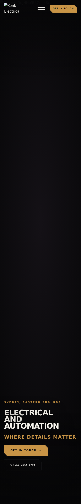

# UI Design System & Master Generation Blueprint: konkelectrical-com

> **Konk Electrical · Eastern Suburbs Electricians, Sydney** (https://konkelectrical.com/) — Electrical and automation specialists for high-end homes across Sydney's Eastern Suburbs. Lighting, smart home, data and audio visual, wi...


---

## 1. Executive Visual Persona & Design Archetype

- **Brand Essence & Persona**: **Konk Electrical · Eastern Suburbs Electricians, Sydney** (`https://konkelectrical.com/`). Electrical and automation specialists for high-end homes across Sydney's Eastern Suburbs. Lighting, smart home, data and audio visual, wi...
- **Visual Archetype**: **High-Contrast Obsidian / Atmospheric Design System (`#0b0b0c` canvas, `#f2f0eb` ink, `#26262a` accent)**.
- **Anti-AI-Slop Differentiators**:
  - **Source-Grounded Chromatic Polarity**: Anchors the viewport in `#0b0b0c` (`var(--ink)` in `:root`) paired with `#f2f0eb` primary typography and `#26262a` accents.
  - **Extracted Typographic Hierarchy**: Pairs `Archivo` for display copy (`Electrical`) with `Open\ Sans` and not declared in static CSS (uses primary stack / `ui-monospace`).
  - **Calibrated Spatial Grid & Motion**: Combines `640px` container bounds (`gap: 20px`, padding `12px`) with `cubic-bezier(.22,1,.36,1)` easing and Three.js / WebGL Canvas Pipeline.

---

## 2. Spatial Architecture & Modular Grid Mathematics



### Viewport Allocation & Container Geometry
- **Captured Viewport Dimensions**: Desktop `1440×20749px` (`assets/desktop.png`, full-page scroll capture), Mobile `390×2400px` (`assets/mobile.png`, capped at 2400px multi-section capture).
- **Master Container Bounds**: `640px` extracted from `konkelectrical-com` stylesheet.
- **Canvas Lateral Padding & Spacing**: `12px` lateral canvas padding with `20px` grid gap.
- **Border Radius Scale**: `100%`, `50%`, `40px`, `4px`.

### Responsive Breakpoint Architecture
- **Desktop Layout**: Multi-column CSS Grid / Flexbox layout at `1440px` (`max-width: 640px`, `gap: 20px`).
- **Mobile Layout**: Single-column vertical stack at `390px` viewport width with `12px` horizontal padding.
- **Extracted CSS Media Queries**: `@media (prefers-reduced-motion:reduce)`, `@media (min-width:480px)`, `@media (max-width:640px)`, `@media (max-width:480px)`.

---

## 3. Color System, Materiality & Atmospheric Lighting

### Semantic Palette & Source Grounding
| Semantic Role | Ground-Truth Value | Extracted CSS Source / Selector |
|---|---|---|
| **Primary Canvas Substrate** | `#0b0b0c` | `var(--ink)` in `:root` |
| **Primary Typography Ink** | `#121214` | `var(--ink-2)` in `:root` |
| **Elevated Surface / Card Substrate** | `#17171a` | `var(--ink-3)` in `:root` |
| **Interactive Accent / Highlight** | `#26262a` | `var(--hair)` in `:root` |
| **Secondary / Muted Copy** | `#f2f0eb` | `var(--paper)` in `:root` |
| **Structural Hairline Border** | `#c89446` | `var(--brass)` in `:root` |
| **Variable Token (`--brass-hi`)** | `#e7b96f` | `var(--brass-hi)` in `:root` |
| **Variable Token (`--brass-dim`)** | `#8a6733` | `var(--brass-dim)` in `:root` |
| **Variable Token (`--bronze`)** | `#5b4a33` | `var(--bronze)` in `:root` |
| **Variable Token (`--text`)** | `#e9e7e2` | `var(--text)` in `:root` |
| **Variable Token (`--text-dim`)** | `#8c8a84` | `var(--text-dim)` in `:root` |
| **Variable Token (`--text-faint`)** | `#55534e` | `var(--text-faint)` in `:root` |

### Sanitized Root CSS Variables (`ui-ux.md` Ground Truth)
| Variable Name | Extracted Value | Semantic Role |
|---|---|---|
| `--ink` | `#0b0b0c` | Typography Ink Token |
| `--ink-2` | `#121214` | Typography Ink Token |
| `--ink-3` | `#17171a` | Typography Ink Token |
| `--hair` | `#26262a` | Color / Atmospheric Token |
| `--paper` | `#f2f0eb` | Canvas / Surface Token |
| `--brass` | `#c89446` | Color / Atmospheric Token |
| `--brass-hi` | `#e7b96f` | Color / Atmospheric Token |
| `--brass-dim` | `#8a6733` | Color / Atmospheric Token |
| `--bronze` | `#5b4a33` | Color / Atmospheric Token |
| `--text` | `#e9e7e2` | Typography Ink Token |
| `--text-dim` | `#8c8a84` | Typography Ink Token |
| `--text-faint` | `#55534e` | Typography Ink Token |
| `--s1` | `4px` | Dimension / Scale Token |
| `--s2` | `8px` | Dimension / Scale Token |
| `--s3` | `12px` | Dimension / Scale Token |
| `--s4` | `16px` | Dimension / Scale Token |

---

## 4. Typographic Scale & Editorial Hierarchy

### Font Family Stacks
- **Display Typography**: `Archivo`.
- **Primary Body Stack**: `Open\ Sans`.
- **Technical / Metadata Stack**: not declared in static CSS (uses primary stack / `ui-monospace`).

### Typographic Scale & Rules (Extracted from Stylesheet & Variables)
- **Hero Display (`H1`)**: CSS variables `--cc-font-display: 'Archivo', sans-serif`.
- **Section Heading (`H2`)**: not explicitly declared on tag in static CSS (stylesheet font-size ladder: `12px`, `48px`, `24px`, `20px`, `14px`).
- **Body Copy**: rule `p` (`font-size: 13px`, `line-height: 1.3`).
- **Metadata & Navigation Labels**: not explicitly declared on tag in static CSS (stylesheet font-size ladder: `12px`, `48px`, `24px`, `20px`, `14px`).

---

## 5. Choreographed Motion & Interaction Physics

### Primary Easing Curves
- **Extracted Timing Functions**: `cubic-bezier(.22,1,.36,1)`, `cubic-bezier(.65,0,.35,1)`.

### Per-Element Transition & Choreography Rules
- **Selector `#sb_instagram #sbi_images .sbi_item`**: `transition: all var(--sb-duration-500) ease` extracted from `konkelectrical-com` stylesheet.
- **Selector `#sb_instagram .sbi_photo img`**: `transition: -webkit-transform var(--sb-duration-500) ease-in-out` extracted from `konkelectrical-com` stylesheet.
- **Selector `.sb_instagram_header a`**: `transition: color var(--sb-duration-500) ease` extracted from `konkelectrical-com` stylesheet.
- **Extracted Easing Curve (`cubic-bezier(.22,1,.36,1)`)**: Governs interactive state transitions across `<header.hdr>` and `<section.cc-page-home>`.
- **Runtime Interaction Engine**: Integrates Three.js / WebGL Canvas Pipeline with `prefers-reduced-motion: reduce` fallback guards.

---

## 6. Component Wireframe & Structural DOM Map

### Visual Layout Schematic (Grounded in `dom.html` — `1440px` Desktop & `390px` Mobile Reflow)
```
┌────────────────────────────────────────────────────────────────────────┐
│ DESKTOP VIEWPORT (1440px) — Konk Electrical · Eastern Suburbs Electric │
│ ====================================================================== │
│ [ <header.hdr>             | Home · About · Electrical · Automation ]  │
│ ---------------------------------------------------------------------- │
│ | HERO STAGE: <section.tf>                                         |   │
│ | H1: Electrical                                                   |   │
│ | Substrate: #0b0b0c    | Ink: #f2f0eb    | Accent: #26262a        |   │
│ ---------------------------------------------------------------------- │
│ | SHOWCASE GRID (<section.cc-page-home>    ) max-w: 640px          |   │
│ | +------------------------------+  +------------------------------+ | │
│ | | Automation                   |  | Data & Networking            | | │
│ | +------------------------------+  +------------------------------+ | │
│ ---------------------------------------------------------------------- │
│ | MOBILE VIEWPORT REFLOW (390px) — Single-Column Stack (gap: 20px  ) | │
│ | [<header.hdr>] -> [<section.tf>] -> [<section.cc-page-h] |           │
│ ---------------------------------------------------------------------- │
│ [ FOOTER (<footer.ftr>          ) | https://konkelectrical.com/        │
└────────────────────────────────────────────────────────────────────────┘
```

### Granular DOM Region Breakdown
1. **Brand Header & Navigation Bar (<header.hdr> — `konkelectrical-com`)**:
   - Landmark `<header class="hdr">` hosting `Konk Electrical · Eastern Suburbs El` navigation (`Home · About · Electrical · Automation · Data & Networking`), DOM attributes (`data-section="header"`, `data-label="Header"`, `data-locked`, `data-header`), and stylesheet rule `.sbi_lightbox button:focus-visible { outline:2px solid var(--sb-focus-ring)!important;outline-offset:2px!impo... }`.
2. **Hero Stage & Focal Lead (<section.tf> — `Electrical`)**:
   - Landmark `<section class="tf">` presenting display lead `Electrical` and copy excerpt *"05 Data & Networking"* over `#0b0b0c` canvas and `#f2f0eb` ink.
3. **Primary Showcase & Content Grid (<section.cc-page-home> — `Automation`)**:
   - Landmark `<section class="cc-page-home">` rendering section `Automation` with copy *"info@konkelectrical.com.au"*, asset references (`xfavicon.png,qv=1793266697.pagesp...`, `A.fonts.css,,qv==1793266697+style...`, `xkonk-logo-white.png,qv=179326669... (Konk Electrical)`, `xkonk-logo-white.png,qv=179326669... (Konk Electrical)`), and grid rule `sb_instagram { -webkit-box-sizing:border-box;-moz-box-sizing:border-box;box-sizing:bord... }`.
4. **Interactive Detail & Feature Matrix (<section.konk-load> — `Data & Networking`)**:
   - Landmark `<section class="konk-load">` framing `Data & Networking` and `Audio Visual` (*"From repairs and alterations to complete renovations, new builds "*) with `#17171a` surface cards, `#26262a` accents, and `sb_instagram:after { clear:both;content:"";display:table }`.
5. **Colophon & Global Directory Footer (<footer.ftr> — `https://konkelectrical.com/`)**:
   - Landmark `<footer class="ftr">` anchoring `Konk Electrical · Eastern Suburb` footer links (`Home · About · Electrical · Automation · Data & Networking`), copy *"Effortless control"*, and `#c89446` structural dividers.

---

## 7. Master Zero-Shot AI Generation Prompt

```markdown
# Master Zero-Shot Frontend Generation Prompt: konkelectrical-com (Konk Electrical · Eastern Suburbs Electricians, Sydney)

You are a principal frontend architect and design systems engineer. Build a complete, production-ready web application replicating the exact design system, DOM landmarks, typographic hierarchy, color tokens, and motion physics of `konkelectrical-com` (**Konk Electrical · Eastern Suburbs Electricians, Sydney** — `https://konkelectrical.com/`).

### 1. Visual Archetype & Anti-AI-Slop Mandates
- **Archetype**: High-Contrast Obsidian / Atmospheric Design System (`#0b0b0c` canvas, `#f2f0eb` ink, `#26262a` accent).
- **Identity & Domain Context**: Electrical and automation specialists for high-end homes across Sydney's Eastern Suburbs. Lighting, smart home, data and audio visual, wi...
- **Primary Substrate**: `#0b0b0c` (`var(--ink)` in `:root`), **Primary Ink**: `#f2f0eb`, **Accent / Highlight**: `#26262a`.
- **Site-Specific Differentiators**:
  - **Source-Grounded Chromatic Polarity**: Anchors the viewport in `#0b0b0c` (`var(--ink)` in `:root`) paired with `#f2f0eb` primary typography and `#26262a` accents.
  - **Extracted Typographic Hierarchy**: Pairs `Archivo` for display copy (`Electrical`) with `Open\ Sans` and not declared in static CSS (uses primary stack / `ui-monospace`).
  - **Calibrated Spatial Grid & Motion**: Combines `640px` container bounds (`gap: 20px`, padding `12px`) with `cubic-bezier(.22,1,.36,1)` easing and Three.js / WebGL Canvas Pipeline.

### 2. Ground-Truth CSS Variables (`:root` Token Contract)
Declare and consume these exact custom properties extracted from `konkelectrical-com` in your global stylesheet:

:root {
  /* Konk Electrical · Eastern Suburbs Electricians, Sydney (konkelectrical-com) — Ground-Truth Extracted CSS Variables */
  --ink: #0b0b0c; /* Typography Ink Token (konkelectrical-com) */
  --ink-2: #121214; /* Typography Ink Token (konkelectrical-com) */
  --ink-3: #17171a; /* Typography Ink Token (konkelectrical-com) */
  --hair: #26262a; /* Color / Atmospheric Token (konkelectrical-com) */
  --paper: #f2f0eb; /* Canvas / Surface Token (konkelectrical-com) */
  --brass: #c89446; /* Color / Atmospheric Token (konkelectrical-com) */
  --brass-hi: #e7b96f; /* Color / Atmospheric Token (konkelectrical-com) */
  --brass-dim: #8a6733; /* Color / Atmospheric Token (konkelectrical-com) */
  --bronze: #5b4a33; /* Color / Atmospheric Token (konkelectrical-com) */
  --text: #e9e7e2; /* Typography Ink Token (konkelectrical-com) */
  --text-dim: #8c8a84; /* Typography Ink Token (konkelectrical-com) */
  --text-faint: #55534e; /* Typography Ink Token (konkelectrical-com) */
  --s1: 4px; /* Dimension / Scale Token (konkelectrical-com) */
  --s2: 8px; /* Dimension / Scale Token (konkelectrical-com) */
  --s3: 12px; /* Dimension / Scale Token (konkelectrical-com) */
  --s4: 16px; /* Dimension / Scale Token (konkelectrical-com) */
}

### 3. Semantic Color & Materiality Contract
Map every surface, ink, and border strictly to these source-grounded tokens:
- **Primary Canvas Substrate**: `#0b0b0c` — grounded in `var(--ink)` in `:root`
- **Primary Typography Ink**: `#121214` — grounded in `var(--ink-2)` in `:root`
- **Elevated Surface / Card Substrate**: `#17171a` — grounded in `var(--ink-3)` in `:root`
- **Interactive Accent / Highlight**: `#26262a` — grounded in `var(--hair)` in `:root`
- **Secondary / Muted Copy**: `#f2f0eb` — grounded in `var(--paper)` in `:root`
- **Structural Hairline Border**: `#c89446` — grounded in `var(--brass)` in `:root`
- **Variable Token (`--brass-hi`)**: `#e7b96f` — grounded in `var(--brass-hi)` in `:root`
- **Variable Token (`--brass-dim`)**: `#8a6733` — grounded in `var(--brass-dim)` in `:root`
- **Variable Token (`--bronze`)**: `#5b4a33` — grounded in `var(--bronze)` in `:root`
- **Variable Token (`--text`)**: `#e9e7e2` — grounded in `var(--text)` in `:root`
- **Variable Token (`--text-dim`)**: `#8c8a84` — grounded in `var(--text-dim)` in `:root`
- **Variable Token (`--text-faint`)**: `#55534e` — grounded in `var(--text-faint)` in `:root`

### 4. Spatial Grid, Container Bounds & Responsive Breakpoints
- **Desktop Viewport Reference**: `1440×20749px` (full-page scroll capture, `1440px` standard desktop width).
- **Mobile Viewport Reference**: `390×2400px` (capped at 2400px multi-section capture, `390px` standard mobile width).
- **Container Max-Width**: `640px` extracted from `konkelectrical-com` stylesheet
- **Padding & Gutters**: `12px` lateral canvas padding with `20px` grid gap
- **Desktop Grid**: Multi-column CSS Grid / Flexbox layout at `1440px` (`max-width: 640px`, `gap: 20px`)
- **Mobile Adaptation**: Single-column vertical stack at `390px` viewport width with `12px` horizontal padding
- **Media Queries**: `@media (prefers-reduced-motion:reduce)`, `@media (min-width:480px)`, `@media (max-width:640px)`, `@media (max-width:480px)`
- **Corner Radii**: `100%`, `50%`, `40px`, `4px`

### 5. Typography & Editorial Scale Contract
- **Display Font Stack**: `Archivo`
- **Body Font Stack**: `Open\ Sans`
- **Monospace / Technical Font Stack**: not declared in static CSS (uses primary stack / `ui-monospace`)
- **H1 Display Rule**: CSS variables `--cc-font-display: 'Archivo', sans-serif`
- **H2 Section Rule**: not explicitly declared on tag in static CSS (stylesheet font-size ladder: `12px`, `48px`, `24px`, `20px`, `14px`)
- **Body Copy Rule**: rule `p` (`font-size: 13px`, `line-height: 1.3`)
- **Metadata & Index Rule**: not explicitly declared on tag in static CSS (stylesheet font-size ladder: `12px`, `48px`, `24px`, `20px`, `14px`)

### 6. Component Hierarchy, Verbatim Copy & Real DOM Landmarks
Scaffold `konkelectrical-com` (`Konk Electrical · Eastern Suburbs Electricians, Sydney`) with these exact structural regions, extracted copy, and CSS rules from `dom.html`:
1. **Brand Header & Navigation Bar (<header.hdr> — `konkelectrical-com`)**:
   - DOM & Selectors: Landmark `<header class="hdr">` hosting `Konk Electrical · Eastern Suburbs El` navigation (`Home · About · Electrical · Automation · Data & Networking`), DOM attributes (`data-section="header"`, `data-label="Header"`, `data-locked`, `data-header`), and stylesheet rule `.sbi_lightbox button:focus-visible { outline:2px solid var(--sb-focus-ring)!important;outline-offset:2px!impo... }`.
   - Responsive Contract: Header `Brand Header & Navigation Bar (<header.hdr> — `konkelectrical-com`)` (`konkelectrical-com`) adapts across `@media (prefers-reduced-motion:reduce)`, `@media (min-width:480px)`, `@media (max-width:640px)`, `@media (max-width:480px)` with `cubic-bezier(.22,1,.36,1)`, `cubic-bezier(.65,0,.35,1)` transitions and links `Home · About · Electrical · Automation · Data & Networking`.
2. **Hero Stage & Focal Lead (<section.tf> — `Electrical`)**:
   - DOM & Selectors: Landmark `<section class="tf">` presenting display lead `Electrical` and copy excerpt *"05 Data & Networking"* over `#0b0b0c` canvas and `#f2f0eb` ink.
   - Responsive Contract: Hero stage (`1440×20749px` desktop / `390×2400px` mobile) sets `#0b0b0c` background with `#f2f0eb` headline `Electrical`.
3. **Primary Showcase & Content Grid (<section.cc-page-home> — `Automation`)**:
   - DOM & Selectors: Landmark `<section class="cc-page-home">` rendering section `Automation` with copy *"info@konkelectrical.com.au"*, asset references (`xfavicon.png,qv=1793266697.pagesp...`, `A.fonts.css,,qv==1793266697+style...`, `xkonk-logo-white.png,qv=179326669... (Konk Electrical)`, `xkonk-logo-white.png,qv=179326669... (Konk Electrical)`), and grid rule `sb_instagram { -webkit-box-sizing:border-box;-moz-box-sizing:border-box;box-sizing:bord... }`.
   - Responsive Contract: Showcase grid `Primary Showcase & Content Grid (<section.cc-page-home> — `Automation`)` applies Multi-column CSS Grid / Flexbox layout at `1440px` (`max-width: 640px`, `gap: 20px`) on desktop and Single-column vertical stack at `390px` viewport width with `12px` horizontal padding on mobile.
4. **Interactive Detail & Feature Matrix (<section.konk-load> — `Data & Networking`)**:
   - DOM & Selectors: Landmark `<section class="konk-load">` framing `Data & Networking` and `Audio Visual` (*"From repairs and alterations to complete renovations, new builds "*) with `#17171a` surface cards, `#26262a` accents, and `sb_instagram:after { clear:both;content:"";display:table }`.
   - Responsive Contract: Detail module `Interactive Detail & Feature Matrix (<section.konk-load> — `Data & Networking`)` uses `100%`, `50%`, `40px`, `4px` radii, `#26262a` highlights, and assets (xfavicon.png,qv=1793266697.pagesp..., A.fonts.css,,qv==1793266697+style..., xkonk-logo-white.png,qv=179326669... (Konk Electrical)).
5. **Colophon & Global Directory Footer (<footer.ftr> — `https://konkelectrical.com/`)**:
   - DOM & Selectors: Landmark `<footer class="ftr">` anchoring `Konk Electrical · Eastern Suburb` footer links (`Home · About · Electrical · Automation · Data & Networking`), copy *"Effortless control"*, and `#c89446` structural dividers.
   - Responsive Contract: Footer `Colophon & Global Directory Footer (<footer.ftr> — `https://konkelectrical.com/`)` aligns to `640px` extracted from `konkelectrical-com` stylesheet with `12px` lateral canvas padding with `20px` grid gap and attributes (data-section="header", data-label="Header", data-locked).

#### Verbatim DOM Copy Excerpts (`dom.html`)
- Copy Excerpt 1: *"05 Data & Networking"*
- Copy Excerpt 2: *"info@konkelectrical.com.au"*
- Copy Excerpt 3: *"From repairs and alterations to complete renovations, new builds and large-scale c..."*
- Copy Excerpt 4: *"Effortless control"*

### 7. Motion, Extracted Stylesheet Rules & Interaction Choreography
- **Primary Easing Functions**: `cubic-bezier(.22,1,.36,1)`, `cubic-bezier(.65,0,.35,1)`
- **Extracted Stylesheet Rules (`konkelectrical-com`)**:
- `.sbi_lightbox button:focus-visible { outline:2px solid var(--sb-focus-ring)!important;outline-offset:2px!impo... }`
- `sb_instagram { -webkit-box-sizing:border-box;-moz-box-sizing:border-box;box-sizing:bord... }`
- `sb_instagram:after { clear:both;content:"";display:table }`
- `sb_instagram.sbi_fixed_height { overflow:hidden;overflow-y:auto }`
- `sb_instagram .sbi_header_link { -webkit-box-shadow:none;box-shadow:none }`
- **Per-Selector Transition Rules**:
- **Selector `#sb_instagram #sbi_images .sbi_item`**: `transition: all var(--sb-duration-500) ease` extracted from `konkelectrical-com` stylesheet.
- **Selector `#sb_instagram .sbi_photo img`**: `transition: -webkit-transform var(--sb-duration-500) ease-in-out` extracted from `konkelectrical-com` stylesheet.
- **Selector `.sb_instagram_header a`**: `transition: color var(--sb-duration-500) ease` extracted from `konkelectrical-com` stylesheet.
- **Extracted Easing Curve (`cubic-bezier(.22,1,.36,1)`)**: Governs interactive state transitions across `<header.hdr>` and `<section.cc-page-home>`.
- **Runtime Interaction Engine**: Integrates Three.js / WebGL Canvas Pipeline with `prefers-reduced-motion: reduce` fallback guards.

### 8. Technical Deliverables
- Implement in Next.js (App Router) with TypeScript and Tailwind CSS consuming the `:root` custom properties defined above for `konkelectrical-com`.
- Reproduce both the `1440px` desktop architecture and `390px` mobile breakpoint transitions, preserving semantic HTML5 landmarks (`<header>`, `<nav>`, `<main>`, `<section>`, `<footer>`) and `prefers-reduced-motion` accessibility guards.
```
