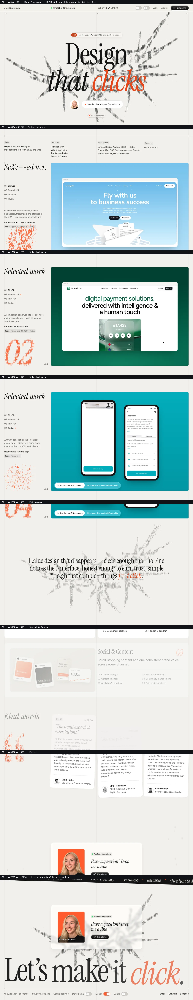
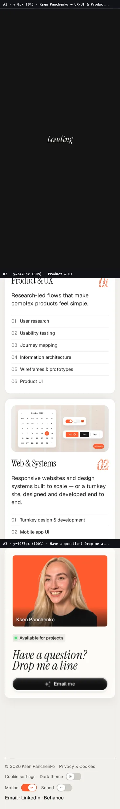

# UI Design System & Master Generation Blueprint: ksenpanchenko-com

> **Ksen Panchenko — UX/UI & Product Designer in Dublin · FinTech & SaaS** (https://ksenpanchenko.com/) — Ksen (Kseniia) Panchenko, independent UX/UI & Product Designer in Dublin: websites, products and design systems for FinTech and SaaS — pl...





---

## 1. Executive Visual Persona & Design Archetype

- **Brand Essence & Persona**: **Ksen Panchenko — UX/UI & Product Designer in Dublin · FinTech & SaaS** (`https://ksenpanchenko.com/`). Ksen (Kseniia) Panchenko, independent UX/UI & Product Designer in Dublin: websites, products and design systems for FinTech and SaaS — pl...
- **Capture Provenance**: Live browser capture (`tier1_fast`, HTTP `200`, captured `2026-11-24`).
- **Visual Archetype**: **Light-Gallery WebGL / Canvas Interactive Experience (`#f1f0ec` / `#c63a10`)**.
- **Anti-AI-Slop Differentiators**:
  - **Live-Computed Chromatic Polarity**: Anchors the viewport in `#f1f0ec` (live computed `body` `background-color` (`computed_styles.json`)) paired with `#000000` primary typography and `#c63a10` accents.
  - **Grounded Typographic Hierarchy**: Uses `GeistSans` across display (`Ksen Panchenko — UX/UI & Product Des`) and body copy, paired with `JetBrains Mono` for monospace/code.
  - **Calibrated Spatial Grid & Motion**: Combines `1376px` container bounds (`gap: normal 16px`, padding `32px`) with `cubic-bezier(.16,1,.3,1)` easing and Lenis Smooth Scroll (`data-lenis`), HTML5 `<canvas>` Interactive Viewport Surface.

---

## 2. Spatial Architecture & Modular Grid Mathematics

### Viewport Allocation & Container Geometry
- **Captured Journey Filmstrips**: Desktop `1280×6624px` (`assets/desktop-journey.webp`, `8` keyframes up to `y=7265px` / doc `8165px`), Mobile `390×2616px` (`assets/mobile-journey.webp`, `3` keyframes).
- **Master Container Bounds**: `1376px` (measured widest bounded `<section>` landmark width on `1440px` desktop).
- **Canvas Lateral Padding & Spacing**: `32px` lateral canvas padding with `normal 16px` grid gap.
- **Border Radius Scale**: `100px`, `4px`, `14px`, `999px`.

### Responsive Breakpoint Architecture
- **Desktop Layout**: Multi-column CSS Grid / Flexbox layout at `1440px` (`max-width: 1376px`, `gap: normal 16px`).
- **Mobile Layout**: Single-column vertical stack at `390px` viewport width with `32px` horizontal padding.
- **Extracted CSS Media Queries**: `@media (prefers-reduced-motion:reduce)`, `@media (max-width:1023px)`, `@media (min-width:768px) and (max-width:1023px)`, `@media (max-width:767px)`.

---

## 3. Color System, Materiality & Atmospheric Lighting

### Semantic Palette & Source Grounding
| Semantic Role | Ground-Truth Value | Extracted Live / CSS Source |
|---|---|---|
| **Primary Canvas Substrate** | `#f1f0ec` | live computed `body` `background-color` (`computed_styles.json`) |
| **Primary Typography Ink** | `#000000` | live computed `button` `color` (`computed_styles.json`) |
| **Elevated Surface / Card Substrate** | `#ffffff` | `.sw__win { background: #ffffff }` |
| **Interactive Accent / Highlight** | `#c63a10` | `var(--color-text-accent-strong)` in `:root` |
| **Secondary / Muted Copy** | `#141414` | live computed `p` `color` (`computed_styles.json`) |
| **Structural Hairline Border** | `#e3e2de` | `.sw__bar { border-bottom: #e3e2de }` |
| **Variable Token (`--color-neutral-50`)** | `#f4f1ec` | `var(--color-neutral-50)` in `:root` |
| **Variable Token (`--color-neutral-400`)** | `#a8a8a6` | `var(--color-neutral-400)` in `:root` |
| **Variable Token (`--color-neutral-500`)** | `#6b6b6b` | `var(--color-neutral-500)` in `:root` |
| **Variable Token (`--color-neutral-800`)** | `#2b2b2b` | `var(--color-neutral-800)` in `:root` |
| **Variable Token (`--color-orange-500`)** | `#ff5c2e` | `var(--color-orange-500)` in `:root` |
| **Variable Token (`--color-orange-600`)** | `#e8461a` | `var(--color-orange-600)` in `:root` |
| **Variable Token (`--color-green-500`)** | `#4dd973` | `var(--color-green-500)` in `:root` |

### Sanitized Root CSS Variables (`ui-ux.md` Ground Truth)
| Variable Name | Extracted Value | Semantic Role |
|---|---|---|
| `--color-neutral-0` | `#ffffff` | Brand / Palette Token |
| `--color-neutral-50` | `#f4f1ec` | Brand / Palette Token |
| `--color-neutral-100` | `#f1f0ec` | Brand / Palette Token |
| `--color-neutral-400` | `#a8a8a6` | Brand / Palette Token |
| `--color-neutral-500` | `#6b6b6b` | Brand / Palette Token |
| `--color-neutral-800` | `#2b2b2b` | Brand / Palette Token |
| `--color-neutral-950` | `#141414` | Brand / Palette Token |
| `--color-orange-500` | `#ff5c2e` | Brand / Palette Token |
| `--color-orange-600` | `#e8461a` | Brand / Palette Token |
| `--color-green-500` | `#4dd973` | Brand / Palette Token |
| `--font-family-serif` | `var(--font-serif-loaded,"Instrument Serif"),Georgia,serif` | Typography / Scale Token |
| `--font-family-sans` | `"Geist",system-ui,sans-serif` | Typography / Scale Token |
| `--font-family-mono` | `"JetBrains Mono",ui-monospace,monospace` | Typography / Scale Token |
| `--space-0` | `0px` | Layout / Spatial Grid Token |
| `--space-4` | `4px` | Layout / Spatial Grid Token |
| `--space-8` | `8px` | Layout / Spatial Grid Token |

---

## 4. Typographic Scale & Editorial Hierarchy

### Font Family Stacks
- **Display Typography**: `GeistSans`.
- **Primary Body Stack**: `GeistSans`.
- **Technical / Metadata Stack**: `JetBrains Mono`.

### Typographic Scale & Rules (Live Computed & Stylesheet Grounded)
- **Hero Display (`H1`)**: live computed `h1` (`font-size: 32px`, `line-height: normal`, `font-weight: 400`); CSS variables `--type-display-size: 220px`, `--type-display-line-height: 198px`, `--type-display-letter-spacing: -6.6px`.
- **Section Heading (`H2`)**: live computed `h2` (`font-size: 36px`, `line-height: 38px`, `font-weight: 400`).
- **Body Copy**: live computed `body` (`font-size: 16px`, `line-height: normal`, `font-weight: 400`); CSS variables `--type-body-lead-size: 24px`, `--type-body-lead-line-height: 31.2px`, `--type-body-lead-letter-spacing: 0px`; rule `p` (`font-size: 14px`, `line-height: 20px`).
- **Metadata & Navigation Labels**: live computed `nav/a` (`font-size: 16px`, `line-height: normal`, `font-weight: 400`); CSS variables `--font-family-mono: "JetBrains Mono",ui-monospace,monospace`, `--type-display-letter-spacing: -6.6px`, `--type-heading-large-letter-spacing: 0px`.

---

## 5. Choreographed Motion & Interaction Physics

### Primary Easing Curves
- **Extracted Timing Functions**: `cubic-bezier(.16,1,.3,1)`, `cubic-bezier(0.215,0.61,0.355,1)`, `cubic-bezier(0.645,0.045,0.355,1)`.

### Per-Element Transition & Choreography Rules
- **Selector `.sw__reel`**: `transition: opacity .55s var(--ease-out),visibility 0s .55s` extracted from `ksenpanchenko-com` stylesheet.
- **Selector `.sw__reel.is-active`**: `transition: opacity .55s var(--ease-out) .08s,visibility 0s` extracted from `ksenpanchenko-com` stylesheet.
- **Selector `.cs-next__reel) .sw__reel img`**: `transition: none` extracted from `ksenpanchenko-com` stylesheet.
- **Extracted Easing Curve (`cubic-bezier(.16,1,.3,1)`)**: Governs interactive state transitions across `<header.nav>` and `<section.sw>`.
- **Runtime Interaction Engine**: Integrates Lenis Smooth Scroll (`data-lenis`), HTML5 `<canvas>` Interactive Viewport Surface with `prefers-reduced-motion: reduce` fallback guards.
### Measured Runtime Scroll & Interaction Telemetry (`behavioral_journey_v2`)
- **Scroll Driver Mode**: `native` (max document height `8165px`, deepest scrollY reached `7265px` across `8` desktop keyframes).
- **Detected Scroll / Motion Libraries**: `Lenis`, `WebGL/Canvas`.
- **Hover Physics (`primary_cta` · `kseniia.uiuxdesigner@gmail.com`)**: Computed transition `0.8s, 0.8s` / `cubic-bezier(0.215, 0.61, 0.355, 1), cubic-bezier(0.215, 0.61, 0.355, 1)` (no static color/transform shift captured at rest).
- **Theme Toggle Probe**: Detected `Dark theme` (no body background diff).
- **Route Transition Architecture**: First internal navigation (`/work`) measured as `SPA` in `2992ms`.

---

## 6. Component Wireframe & Structural DOM Map

### Visual Layout Schematic — Desktop (`1440px`, Grounded in `dom.html` & Landmark Bounding Boxes)
```
┌────────────────────────────────────────────────────────────────────────┐
│ DESKTOP VIEWPORT (1440px) — Ksen Panchenko — UX/UI & Product Designer  │
│ ====================================================================== │
│ [ <header.nav> (1440x56px)            | Work · About                 ] │
│ ---------------------------------------------------------------------- │
│ | HERO STAGE: <section.hero> (w=1440px)                              | │
│ | H1: Ksen Panchenko — UX/UI & Product Designer in Dubl...           | │
│ | Substrate: #f1f0ec | Ink: #000000 | Accent: #c63a10                | │
│ ---------------------------------------------------------------------- │
│ | SHOWCASE GRID (<section.sw>) max-w: 1376px                         | │
│ | +------------------------------+  +------------------------------+ | │
│ | | Selected work                |  | Product & UX                 | | │
│ | +------------------------------+  +------------------------------+ | │
│ ---------------------------------------------------------------------- │
│ | DETAIL MODULE (<section.philo>) — Web & Systems                    | │
│ ---------------------------------------------------------------------- │
│ [ FOOTER (<footer.footer>     ) | https://ksenpanchenko.com/           │
└────────────────────────────────────────────────────────────────────────┘
```

### Visual Layout Schematic — Mobile Reflow (`390px`)
```
┌────────────────────────────────────────────────────────────────────────┐
│ MOBILE VIEWPORT REFLOW (390px) — Single-Column Stack (gap: normal 1)   │
│ ====================================================================== │
│ [ HEADER BAR (<header.nav>            ) | Compact Menu (390px)         │
│ ---------------------------------------------------------------------- │
│ | HERO STAGE (<section.hero>) — 390px Vertical Lead                  | │
│ | H1: Ksen Panchenko — UX/UI & Product Designer in Dubl...           | │
│ ---------------------------------------------------------------------- │
│ | SHOWCASE STACK (<section.sw>) — 1-Col Stack                        | │
│ | [ Item 1: Selected work                                          ] | │
│ | [ Item 2: Product & UX                                           ] | │
│ ---------------------------------------------------------------------- │
│ | DETAIL STACK (<section.philo>) — 1-Col (Web & Systems)             | │
│ ---------------------------------------------------------------------- │
│ [ FOOTER (<footer.footer>     ) | Stacked 390px Colophon               │
└────────────────────────────────────────────────────────────────────────┘
```

### Granular DOM Region Breakdown
1. **Brand Header & Navigation Bar (<header.nav> — `ksenpanchenko-com`)**:
   - Landmark `<header class="nav">` (`1440x56px`) hosting `Ksen Panchenko — UX/UI & Product Des` navigation (`Work · About`), DOM attributes (`data-precedence="next"`, `data-precedence="next"`, `data-precedence="next"`, `data-end="1"`), and stylesheet rule `.sw__reel.is-active { opacity:1;visibility:visible;transition:opacity .55s var(--ease-out) .08... }`.
2. **Hero Stage & Focal Lead (<section.hero> — `Ksen Panchenko — UX/UI & Product D`)**:
   - Landmark `<section class="hero">` presenting display lead `Ksen Panchenko — UX/UI & Product Designer in Dubl...` and copy excerpt *"Available for projects"* over `#f1f0ec` canvas and `#000000` ink.
3. **Primary Showcase & Content Grid (<section.sw> — `Selected work`)**:
   - Landmark `<section class="sw">` rendering section `Selected work` with copy *"Gold London Design Awards 2026 · Emerald24 · UI Design"*, asset references (`7cb8e1b9ab81be17-s.p.woff2`, `dbccb4a9e22cbf0d-s.p.woff2`, `e872e3f251959e82-s.p.woff2`, `kseniia-cutout.webp`), and grid rule `.sw__reel img { position:absolute;inset:0;width:100%;height:100%;object-fit:cover;opacit... }`.
4. **Interactive Detail & Feature Matrix (<section.philo> — `Product & UX`)**:
   - Landmark `<section class="philo">` framing `Product & UX` and `Web & Systems` (*"London Design Awards 2026 · Emerald24 · UI Design"*) with `#ffffff` surface cards, `#c63a10` accents, and `.sw__reel.is-active .sw__win { translate:0 0 }`.
5. **Colophon & Global Directory Footer (<footer.footer> — `https://ksenpanchenko.com/`)**:
   - Landmark `<footer class="footer">` anchoring `Ksen Panchenko — UX/UI & Product` footer links (`Work · About`), copy *"Ksen Panchenko — UX/UI & Product Designer in Dublin."*, and `#e3e2de` structural dividers.
### Full Vertical Scroll Sequence (Desktop `1440×900` Keyframes)
- **Step 01** (`y=0px`, `0%`): Active landmark `Ksen Panchenko — UX/UI & Product Designer in Dubl...` · sticky/fixed elements: `2`
- **Step 02** (`y=850px`, `12%`): Active landmark `Selected work` · sticky/fixed elements: `2`
- **Step 03** (`y=1700px`, `23%`): Active landmark `Selected work` · sticky/fixed elements: `2`
- **Step 04** (`y=3400px`, `47%`): Active landmark `Selected work` · sticky/fixed elements: `2`
- **Step 05** (`y=4250px`, `58%`): Active landmark `Philosophy` · sticky/fixed elements: `2`
- **Step 06** (`y=5950px`, `82%`): Active landmark `Social & Content` · sticky/fixed elements: `1`
- **Step 07** (`y=6800px`, `94%`): Active landmark `Footer` · sticky/fixed elements: `1`
- **Step 08** (`y=7265px`, `100%`): Active landmark `Have a question? Drop me a line` · sticky/fixed elements: `1`

### Multi-Page Internal Route Map
- **Listing Route (`/work`)**: `https://ksenpanchenko.com/work` — H1: `Work`, scrollHeight `3565px`, transition `SPA` (`2992ms`)
- **Detail Route (`/work/emerald24`)**: `https://ksenpanchenko.com/work/emerald24` — H1: `Emerald24`, scrollHeight `8483px`, transition `direct` (`1233ms`)
- **About Route (`/about`)**: `https://ksenpanchenko.com/about` — H1: `I’m Ksen — a UX/UI & Product Designer. I design w...`, scrollHeight `6375px`, transition `direct` (`1090ms`)

---

## 7. Master Zero-Shot AI Generation Prompt

```markdown
# Master Zero-Shot Frontend Generation Prompt: ksenpanchenko-com (Ksen Panchenko — UX/UI & Product Designer in Dublin · FinTech & SaaS)

You are a principal frontend architect and design systems engineer. Build a complete, production-ready web application replicating the exact design system, DOM landmarks, typographic hierarchy, color tokens, and motion physics of `ksenpanchenko-com` (**Ksen Panchenko — UX/UI & Product Designer in Dublin · FinTech & SaaS** — `https://ksenpanchenko.com/`).

### 1. Visual Archetype & Anti-AI-Slop Mandates
- **Archetype**: Light-Gallery WebGL / Canvas Interactive Experience (`#f1f0ec` / `#c63a10`).
- **Identity & Domain Context**: Ksen (Kseniia) Panchenko, independent UX/UI & Product Designer in Dublin: websites, products and design systems for FinTech and SaaS — pl...
- **Primary Substrate**: `#f1f0ec` (live computed `body` `background-color` (`computed_styles.json`)), **Primary Ink**: `#000000`, **Accent / Highlight**: `#c63a10`.
- **Site-Specific Differentiators**:
  - **Live-Computed Chromatic Polarity**: Anchors the viewport in `#f1f0ec` (live computed `body` `background-color` (`computed_styles.json`)) paired with `#000000` primary typography and `#c63a10` accents.
  - **Grounded Typographic Hierarchy**: Uses `GeistSans` across display (`Ksen Panchenko — UX/UI & Product Des`) and body copy, paired with `JetBrains Mono` for monospace/code.
  - **Calibrated Spatial Grid & Motion**: Combines `1376px` container bounds (`gap: normal 16px`, padding `32px`) with `cubic-bezier(.16,1,.3,1)` easing and Lenis Smooth Scroll (`data-lenis`), HTML5 `<canvas>` Interactive Viewport Surface.

### 2. Ground-Truth CSS Variables (`:root` Token Contract)
Declare and consume these exact custom properties extracted from `ksenpanchenko-com` in your global stylesheet:

:root {
  /* Ksen Panchenko — UX/UI & Product Designer in Dublin · FinTech & SaaS (ksenpanchenko-com) — Live-Grounded CSS Variables */
  --color-neutral-0: #ffffff; /* Brand / Palette Token (ksenpanchenko-com) */
  --color-neutral-50: #f4f1ec; /* Brand / Palette Token (ksenpanchenko-com) */
  --color-neutral-100: #f1f0ec; /* Brand / Palette Token (ksenpanchenko-com) */
  --color-neutral-400: #a8a8a6; /* Brand / Palette Token (ksenpanchenko-com) */
  --color-neutral-500: #6b6b6b; /* Brand / Palette Token (ksenpanchenko-com) */
  --color-neutral-800: #2b2b2b; /* Brand / Palette Token (ksenpanchenko-com) */
  --color-neutral-950: #141414; /* Brand / Palette Token (ksenpanchenko-com) */
  --color-orange-500: #ff5c2e; /* Brand / Palette Token (ksenpanchenko-com) */
  --color-orange-600: #e8461a; /* Brand / Palette Token (ksenpanchenko-com) */
  --color-green-500: #4dd973; /* Brand / Palette Token (ksenpanchenko-com) */
  --font-family-serif: var(--font-serif-loaded,"Instrument Serif"),Georgia,serif; /* Typography / Scale Token (ksenpanchenko-com) */
  --font-family-sans: "Geist",system-ui,sans-serif; /* Typography / Scale Token (ksenpanchenko-com) */
  --font-family-mono: "JetBrains Mono",ui-monospace,monospace; /* Typography / Scale Token (ksenpanchenko-com) */
  --space-0: 0px; /* Layout / Spatial Grid Token (ksenpanchenko-com) */
  --space-4: 4px; /* Layout / Spatial Grid Token (ksenpanchenko-com) */
  --space-8: 8px; /* Layout / Spatial Grid Token (ksenpanchenko-com) */
}

### 3. Semantic Color & Materiality Contract
Map every surface, ink, and border strictly to these source-grounded tokens:
- **Primary Canvas Substrate**: `#f1f0ec` — grounded in live computed `body` `background-color` (`computed_styles.json`)
- **Primary Typography Ink**: `#000000` — grounded in live computed `button` `color` (`computed_styles.json`)
- **Elevated Surface / Card Substrate**: `#ffffff` — grounded in `.sw__win { background: #ffffff }`
- **Interactive Accent / Highlight**: `#c63a10` — grounded in `var(--color-text-accent-strong)` in `:root`
- **Secondary / Muted Copy**: `#141414` — grounded in live computed `p` `color` (`computed_styles.json`)
- **Structural Hairline Border**: `#e3e2de` — grounded in `.sw__bar { border-bottom: #e3e2de }`
- **Variable Token (`--color-neutral-50`)**: `#f4f1ec` — grounded in `var(--color-neutral-50)` in `:root`
- **Variable Token (`--color-neutral-400`)**: `#a8a8a6` — grounded in `var(--color-neutral-400)` in `:root`
- **Variable Token (`--color-neutral-500`)**: `#6b6b6b` — grounded in `var(--color-neutral-500)` in `:root`
- **Variable Token (`--color-neutral-800`)**: `#2b2b2b` — grounded in `var(--color-neutral-800)` in `:root`
- **Variable Token (`--color-orange-500`)**: `#ff5c2e` — grounded in `var(--color-orange-500)` in `:root`
- **Variable Token (`--color-orange-600`)**: `#e8461a` — grounded in `var(--color-orange-600)` in `:root`
- **Variable Token (`--color-green-500`)**: `#4dd973` — grounded in `var(--color-green-500)` in `:root`

### 4. Spatial Grid, Container Bounds & Responsive Breakpoints
- **Desktop Viewport Reference**: `1280×6624px` (multi-frame vertical journey filmstrip (6624px), `1440px` standard desktop width).
- **Mobile Viewport Reference**: `390×2616px` (multi-frame vertical journey filmstrip (2616px), `390px` standard mobile width).
- **Container Max-Width**: `1376px` (measured widest bounded `<section>` landmark width on `1440px` desktop)
- **Padding & Gutters**: `32px` lateral canvas padding with `normal 16px` grid gap
- **Desktop Grid**: Multi-column CSS Grid / Flexbox layout at `1440px` (`max-width: 1376px`, `gap: normal 16px`)
- **Mobile Adaptation**: Single-column vertical stack at `390px` viewport width with `32px` horizontal padding
- **Media Queries**: `@media (prefers-reduced-motion:reduce)`, `@media (max-width:1023px)`, `@media (min-width:768px) and (max-width:1023px)`, `@media (max-width:767px)`
- **Corner Radii**: `100px`, `4px`, `14px`, `999px`

### 5. Typography & Editorial Scale Contract
- **Display Font Stack**: `GeistSans`
- **Body Font Stack**: `GeistSans`
- **Monospace / Technical Font Stack**: `JetBrains Mono`
- **H1 Display Rule**: live computed `h1` (`font-size: 32px`, `line-height: normal`, `font-weight: 400`); CSS variables `--type-display-size: 220px`, `--type-display-line-height: 198px`, `--type-display-letter-spacing: -6.6px`
- **H2 Section Rule**: live computed `h2` (`font-size: 36px`, `line-height: 38px`, `font-weight: 400`)
- **Body Copy Rule**: live computed `body` (`font-size: 16px`, `line-height: normal`, `font-weight: 400`); CSS variables `--type-body-lead-size: 24px`, `--type-body-lead-line-height: 31.2px`, `--type-body-lead-letter-spacing: 0px`; rule `p` (`font-size: 14px`, `line-height: 20px`)
- **Metadata & Index Rule**: live computed `nav/a` (`font-size: 16px`, `line-height: normal`, `font-weight: 400`); CSS variables `--font-family-mono: "JetBrains Mono",ui-monospace,monospace`, `--type-display-letter-spacing: -6.6px`, `--type-heading-large-letter-spacing: 0px`

### 6. Component Hierarchy, Verbatim Copy & Real DOM Landmarks
Scaffold `ksenpanchenko-com` (`Ksen Panchenko — UX/UI & Product Designer in Dublin · FinTech & SaaS`) with these exact structural regions, extracted copy, and CSS rules from `dom.html`:
1. **Brand Header & Navigation Bar (<header.nav> — `ksenpanchenko-com`)**:
   - DOM & Selectors: Landmark `<header class="nav">` (`1440x56px`) hosting `Ksen Panchenko — UX/UI & Product Des` navigation (`Work · About`), DOM attributes (`data-precedence="next"`, `data-precedence="next"`, `data-precedence="next"`, `data-end="1"`), and stylesheet rule `.sw__reel.is-active { opacity:1;visibility:visible;transition:opacity .55s var(--ease-out) .08... }`.
   - Responsive Contract: Header `Brand Header & Navigation Bar (<header.nav> — `ksenpanchenko-com`)` (`ksenpanchenko-com`) adapts across `@media (prefers-reduced-motion:reduce)`, `@media (max-width:1023px)`, `@media (min-width:768px) and (max-width:1023px)`, `@media (max-width:767px)` with `cubic-bezier(.16,1,.3,1)`, `cubic-bezier(0.215,0.61,0.355,1)`, `cubic-bezier(0.645,0.045,0.355,1)` transitions and links `Work · About`.
2. **Hero Stage & Focal Lead (<section.hero> — `Ksen Panchenko — UX/UI & Product D`)**:
   - DOM & Selectors: Landmark `<section class="hero">` presenting display lead `Ksen Panchenko — UX/UI & Product Designer in Dubl...` and copy excerpt *"Available for projects"* over `#f1f0ec` canvas and `#000000` ink.
   - Responsive Contract: Hero stage (`1280×6624px` desktop / `390×2616px` mobile) sets `#f1f0ec` background with `#000000` headline `Ksen Panchenko — UX/UI & Product Designer in Dubl...`.
3. **Primary Showcase & Content Grid (<section.sw> — `Selected work`)**:
   - DOM & Selectors: Landmark `<section class="sw">` rendering section `Selected work` with copy *"Gold London Design Awards 2026 · Emerald24 · UI Design"*, asset references (`7cb8e1b9ab81be17-s.p.woff2`, `dbccb4a9e22cbf0d-s.p.woff2`, `e872e3f251959e82-s.p.woff2`, `kseniia-cutout.webp`), and grid rule `.sw__reel img { position:absolute;inset:0;width:100%;height:100%;object-fit:cover;opacit... }`.
   - Responsive Contract: Showcase grid `Primary Showcase & Content Grid (<section.sw> — `Selected work`)` applies Multi-column CSS Grid / Flexbox layout at `1440px` (`max-width: 1376px`, `gap: normal 16px`) on desktop and Single-column vertical stack at `390px` viewport width with `32px` horizontal padding on mobile.
4. **Interactive Detail & Feature Matrix (<section.philo> — `Product & UX`)**:
   - DOM & Selectors: Landmark `<section class="philo">` framing `Product & UX` and `Web & Systems` (*"London Design Awards 2026 · Emerald24 · UI Design"*) with `#ffffff` surface cards, `#c63a10` accents, and `.sw__reel.is-active .sw__win { translate:0 0 }`.
   - Responsive Contract: Detail module `Interactive Detail & Feature Matrix (<section.philo> — `Product & UX`)` uses `100px`, `4px`, `14px`, `999px` radii, `#c63a10` highlights, and assets (7cb8e1b9ab81be17-s.p.woff2, dbccb4a9e22cbf0d-s.p.woff2, e872e3f251959e82-s.p.woff2).
5. **Colophon & Global Directory Footer (<footer.footer> — `https://ksenpanchenko.com/`)**:
   - DOM & Selectors: Landmark `<footer class="footer">` anchoring `Ksen Panchenko — UX/UI & Product` footer links (`Work · About`), copy *"Ksen Panchenko — UX/UI & Product Designer in Dublin."*, and `#e3e2de` structural dividers.
   - Responsive Contract: Footer `Colophon & Global Directory Footer (<footer.footer> — `https://ksenpanchenko.com/`)` aligns to `1376px` (measured widest bounded `<section>` landmark width on `1440px` desktop) with `32px` lateral canvas padding with `normal 16px` grid gap and attributes (data-precedence="next", data-precedence="next", data-precedence="next").

#### Verbatim DOM Copy Excerpts (`dom.html`)
- Copy Excerpt 1: *"Available for projects"*
- Copy Excerpt 2: *"Gold London Design Awards 2026 · Emerald24 · UI Design"*
- Copy Excerpt 3: *"London Design Awards 2026 · Emerald24 · UI Design"*
- Copy Excerpt 4: *"Ksen Panchenko — UX/UI & Product Designer in Dublin."*

### 7. Motion, Extracted Stylesheet Rules & Interaction Choreography
- **Primary Easing Functions**: `cubic-bezier(.16,1,.3,1)`, `cubic-bezier(0.215,0.61,0.355,1)`, `cubic-bezier(0.645,0.045,0.355,1)`
- **Extracted Stylesheet Rules (`ksenpanchenko-com`)**:
- `.sw__reel.is-active { opacity:1;visibility:visible;transition:opacity .55s var(--ease-out) .08... }`
- `.sw__reel img { position:absolute;inset:0;width:100%;height:100%;object-fit:cover;opacit... }`
- `.sw__reel.is-active .sw__win { translate:0 0 }`
- `.sw__bar i { width:clamp(4px,.75cqw,8px);height:clamp(4px,.75cqw,8px);border-radius:9... }`
- `.sw__screen { position:relative;aspect-ratio:1600/906 }`
- **Per-Selector Transition Rules**:
- **Selector `.sw__reel`**: `transition: opacity .55s var(--ease-out),visibility 0s .55s` extracted from `ksenpanchenko-com` stylesheet.
- **Selector `.sw__reel.is-active`**: `transition: opacity .55s var(--ease-out) .08s,visibility 0s` extracted from `ksenpanchenko-com` stylesheet.
- **Selector `.cs-next__reel) .sw__reel img`**: `transition: none` extracted from `ksenpanchenko-com` stylesheet.
- **Extracted Easing Curve (`cubic-bezier(.16,1,.3,1)`)**: Governs interactive state transitions across `<header.nav>` and `<section.sw>`.
- **Runtime Interaction Engine**: Integrates Lenis Smooth Scroll (`data-lenis`), HTML5 `<canvas>` Interactive Viewport Surface with `prefers-reduced-motion: reduce` fallback guards.
### 7b. Full-Page Scroll Choreography, Interactive States & Multi-Page Routes
- **Scroll Mechanics**: Implement `native` vertical progression up to `8165px` across 8 distinct viewport chapters using Lenis, WebGL/Canvas.
- **Vertical Chapter Sequence**: Ksen Panchenko — UX/UI & Pr... (0%) -> Selected work (12%) -> Selected work (23%) -> Selected work (47%) -> Philosophy (58%) -> Social & Content (82%) -> Footer (94%) -> Have a question? Drop me a... (100%).
- **Multi-Page Routes**: Scaffold internal routes `/work` (listing, SPA), `/work/emerald24` (detail, direct), `/about` (about, direct) sharing the global header/footer shell and design tokens.

### 8. Technical Deliverables
- Implement in Next.js (App Router) with TypeScript and Tailwind CSS consuming the `:root` custom properties defined above for `ksenpanchenko-com`.
- Reproduce both the `1440px` desktop architecture and `390px` mobile breakpoint transitions, preserving semantic HTML5 landmarks (`<header>`, `<nav>`, `<main>`, `<section>`, `<footer>`) and `prefers-reduced-motion` accessibility guards.
```
---

## 8. Full-Page Scroll Journey, Interactive States & Subpage Inventory

### Desktop Scroll Keyframes (`1440×900` WebP)
| Step | Scroll Y | Progress | Active Landmark / Section | Sticky/Fixed | Visual Asset |
| :---: | :---: | :---: | :--- | :---: | :--- |
| `#01` | `0px` | `0%` | Ksen Panchenko — UX/UI & Product Designer in... | `2` | [desktop-step-01.webp](assets/desktop-step-01.webp) |
| `#02` | `850px` | `12%` | Selected work | `2` | [desktop-step-02.webp](assets/desktop-step-02.webp) |
| `#03` | `1700px` | `23%` | Selected work | `2` | [desktop-step-03.webp](assets/desktop-step-03.webp) |
| `#04` | `3400px` | `47%` | Selected work | `2` | [desktop-step-04.webp](assets/desktop-step-04.webp) |
| `#05` | `4250px` | `58%` | Philosophy | `2` | [desktop-step-05.webp](assets/desktop-step-05.webp) |
| `#06` | `5950px` | `82%` | Social & Content | `1` | [desktop-step-06.webp](assets/desktop-step-06.webp) |
| `#07` | `6800px` | `94%` | Footer | `1` | [desktop-step-07.webp](assets/desktop-step-07.webp) |
| `#08` | `7265px` | `100%` | Have a question? Drop me a line | `1` | [desktop-step-08.webp](assets/desktop-step-08.webp) |

### Mobile Condensed Keyframes (`390×844` WebP)
| Step | Scroll Y | Progress | Active Landmark | Visual Asset |
| :---: | :---: | :---: | :--- | :--- |
| `#01` | `0px` | `0%` | Ksen Panchenko — UX/UI & Product Designer... | [mobile-step-01.webp](assets/mobile-step-01.webp) |
| `#02` | `2478px` | `50%` | Product & UX | [mobile-step-02.webp](assets/mobile-step-02.webp) |
| `#03` | `4957px` | `100%` | Have a question? Drop me a line | [mobile-step-03.webp](assets/mobile-step-03.webp) |

### Internal Subpage Filmstrips (`1080px` Wide WebP)
| # | Template | Route URL | H1 / Title | Scroll Height | Transition | Filmstrip Asset |
| :-: | :---: | :--- | :--- | :---: | :---: | :--- |
| `1` | `listing` | `https://ksenpanchenko.com/work` | Work | `3565px` | `SPA` (`2992ms`) | [subpage-01-work.webp](assets/subpage-01-work.webp) |
| `2` | `detail` | `https://ksenpanchenko.com/work/emerald24` | Emerald24 | `8483px` | `direct` (`1233ms`) | [subpage-02-work-emerald24.webp](assets/subpage-02-work-emerald24.webp) |
| `3` | `about` | `https://ksenpanchenko.com/about` | I’m Ksen — a UX/UI & Product Designer... | `6375px` | `direct` (`1090ms`) | [subpage-03-about.webp](assets/subpage-03-about.webp) |

