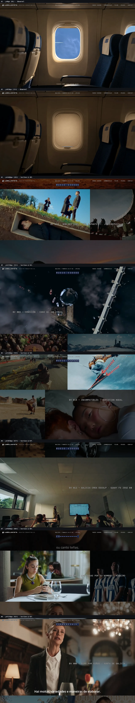
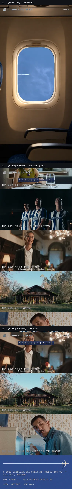

# UI Design System & Master Generation Blueprint: labellavista-es

> **LABELLAVISTA — Creative production co.** (https://labellavista.es/) — LABELLAVISTA is a creative production co. based in Galicia and Madrid: music videos, commercials and films, shot wherever the story is.





---

## 1. Executive Visual Persona & Design Archetype

- **Brand Essence & Persona**: **LABELLAVISTA — Creative production co.** (`https://labellavista.es/`). LABELLAVISTA is a creative production co. based in Galicia and Madrid: music videos, commercials and films, shot wherever the story is.
- **Capture Provenance**: Live browser capture (`tier1_fast`, HTTP `200`, captured `2026-11-24`).
- **Visual Archetype**: **High-Contrast Obsidian / Atmospheric Design System (`#2f4a8a` canvas, `#ffffff` ink, `#e2d6c0` accent)**.
- **Anti-AI-Slop Differentiators**:
  - **Live-Computed Chromatic Polarity**: Anchors the viewport in `#2f4a8a` (live computed `html` `background-color` (`computed_styles.json`)) paired with `#ffffff` primary typography and `#e2d6c0` accents.
  - **Grounded Typographic Hierarchy**: Uses `Archivo` across display (`LABELLAVISTA`) and body copy, paired with `DM Mono` for monospace/code.
  - **Calibrated Spatial Grid & Motion**: Combines `1440px` container bounds (`gap: 24px`, padding `24px`) with `cubic-bezier(.16,1,.3,1)` easing and Lenis Smooth Scroll (`data-lenis`).

---

## 2. Spatial Architecture & Modular Grid Mathematics

### Viewport Allocation & Container Geometry
- **Captured Journey Filmstrips**: Desktop `1280×6624px` (`assets/desktop-journey.webp`, `8` keyframes up to `y=5350px` / doc `6685px`), Mobile `390×2616px` (`assets/mobile-journey.webp`, `3` keyframes).
- **Master Container Bounds**: `1440px` (full-bleed `100%` desktop stage measured on `1440px` viewport).
- **Canvas Lateral Padding & Spacing**: `24px` lateral canvas padding with `24px` grid gap.
- **Border Radius Scale**: `2px`, `50%`, `7%`.

### Responsive Breakpoint Architecture
- **Desktop Layout**: Multi-column CSS Grid / Flexbox layout at `1440px` (`max-width: 1440px`, `gap: 24px`).
- **Mobile Layout**: Single-column vertical stack at `390px` viewport width with `24px` horizontal padding.
- **Extracted CSS Media Queries**: `@media (min-width:1440px)`, `@media (max-width:760px)`, `@media (max-width:1299px)`, `@media (max-width:1239px)`.

---

## 3. Color System, Materiality & Atmospheric Lighting

### Semantic Palette & Source Grounding
| Semantic Role | Ground-Truth Value | Extracted Live / CSS Source |
|---|---|---|
| **Primary Canvas Substrate** | `#2f4a8a` | live computed `html` `background-color` (`computed_styles.json`) |
| **Primary Typography Ink** | `#ffffff` | live computed `nav` `color` (`computed_styles.json`) |
| **Elevated Surface / Card Substrate** | `#000000` | live computed `section` `background-color` (`computed_styles.json`) |
| **Interactive Accent / Highlight** | `#e2d6c0` | live computed `a` `color` (`computed_styles.json`) |
| **Secondary / Muted Copy** | `#e2d6c0` | live computed `p` `color` (`computed_styles.json`) |
| **Structural Hairline Border** | `#65749a` | `var(--line)` in `:root` (`e2d6c04d`) |
| **Variable Token (`--black`)** | `#0a0a0a` | `var(--black)` in `:root` |
| **Variable Token (`--paper`)** | `#eee9de` | `var(--paper)` in `:root` |
| **Variable Token (`--ink`)** | `#111111` | `var(--ink)` in `:root` |
| **Variable Token (`--blue-lift`)** | `#6e8fd6` | `var(--blue-lift)` in `:root` |

### Sanitized Root CSS Variables (`ui-ux.md` Ground Truth)
| Variable Name | Extracted Value | Semantic Role |
|---|---|---|
| `--black` | `#0a0a0a` | Canvas / Surface Token |
| `--paper` | `#eee9de` | Canvas / Surface Token |
| `--ink` | `#111` | Typography Ink Token |
| `--white` | `#fff` | Canvas / Surface Token |
| `--blue` | `#2f4a8a` | Color / Atmospheric Token |
| `--blue-lift` | `#6e8fd6` | Color / Atmospheric Token |
| `--cream` | `#e2d6c0` | Color / Atmospheric Token |
| `--font-sans` | `var(--font-archivo), system-ui, -apple-system, "Segoe UI", sans-serif` | Typography / Scale Token |
| `--font-mono` | `var(--font-dm-mono), ui-monospace, "Courier New", monospace` | Typography / Scale Token |
| `--display` | `clamp(64px, 9vw, 160px)` | Dimension / Scale Token |
| `--section` | `clamp(32px, 2.8vw, 40px)` | Dimension / Scale Token |
| `--body` | `clamp(15px, 1.1vw, 17px)` | Dimension / Scale Token |
| `--ui` | `11px` | Dimension / Scale Token |
| `--margin` | `24px` | Layout / Spatial Grid Token |
| `--gutter` | `24px` | Layout / Spatial Grid Token |
| `--bar` | `48px` | Dimension / Scale Token |

---

## 4. Typographic Scale & Editorial Hierarchy

### Font Family Stacks
- **Display Typography**: `Archivo`.
- **Primary Body Stack**: `Archivo`.
- **Technical / Metadata Stack**: `DM Mono`.

### Typographic Scale & Rules (Live Computed & Stylesheet Grounded)
- **Hero Display (`H1`)**: live computed `h1` (`font-size: 31.68px`, `line-height: 44.352px`, `font-weight: 700`); CSS variables `--display: clamp(64px, 9vw, 160px)`.
- **Section Heading (`H2`)**: observed font-size ladder: `31.68px`, `15.84px`, `12px`, `var(--body)`, `var(--ui)`.
- **Body Copy**: live computed `body` (`font-size: 15.84px`, `line-height: 22.176px`, `font-weight: 400`); CSS variables `--body: clamp(15px, 1.1vw, 17px)`.
- **Metadata & Navigation Labels**: live computed `nav/a` (`font-size: 15.84px`, `line-height: 22.176px`, `font-weight: 400`); CSS variables `--font-mono: var(--font-dm-mono), ui-monospace, "Courier New", monospace`, `--font-dm-mono: "DM Mono", "DM Mono Fallback"`.

---

## 5. Choreographed Motion & Interaction Physics

### Primary Easing Curves
- **Extracted Timing Functions**: `cubic-bezier(.16,1,.3,1)`, `cubic-bezier(.7,0,.2,1)`, `cubic-bezier(.55,0,.1,1)`.

### Per-Element Transition & Choreography Rules
- **Selector `.u--quiet:after`**: `transition: transform .7s var(--ease)` extracted from `labellavista-es` stylesheet.
- **Selector `.bar`**: `transition: transform .4s var(--ease), background-color .3s var(--ease), b...` extracted from `labellavista-es` stylesheet.
- **Selector `.cabin__lit`**: `transition: opacity .7s cubic-bezier(.16,1,.3,1)` extracted from `labellavista-es` stylesheet.
- **Extracted Easing Curve (`cubic-bezier(.16,1,.3,1)`)**: Governs interactive state transitions across `<header.bar>` and `<section.reel:nth(2)>`.
- **Runtime Interaction Engine**: Integrates Lenis Smooth Scroll (`data-lenis`) with `prefers-reduced-motion: reduce` fallback guards.
### Measured Runtime Scroll & Interaction Telemetry (`behavioral_journey_v2`)
- **Scroll Driver Mode**: `native+wheel` (max document height `6685px`, deepest scrollY reached `5350px` across `8` desktop keyframes).
- **Detected Scroll / Motion Libraries**: `Lenis`.
- **Route Transition Architecture**: First internal navigation (`/work/christian-nodal-se-feliz-x-mi`) measured as `direct` in `511ms`.

---

## 6. Component Wireframe & Structural DOM Map

### Visual Layout Schematic — Desktop (`1440px`, Grounded in `dom.html` & Landmark Bounding Boxes)
```
┌────────────────────────────────────────────────────────────────────────┐
│ DESKTOP VIEWPORT (1440px) — LABELLAVISTA — Creative production co.     │
│ ====================================================================== │
│ [ <header.bar> (1440x48px)            | MUSIC VIDEOS · COMMERCIALS · ] │
│ ---------------------------------------------------------------------- │
│ | HERO STAGE: <section.reel> (w=1440px)                              | │
│ | H1: LABELLAVISTA                                                   | │
│ | Substrate: #2f4a8a | Ink: #ffffff | Accent: #e2d6c0                | │
│ ---------------------------------------------------------------------- │
│ | SHOWCASE GRID (<section.reel:nth(2)>) max-w: 1440px                | │
│ | +------------------------------+  +------------------------------+ | │
│ | | BV 009 SÉ FELIZ X MI · Chris |  | BV 013 Non Sei Como · The Ra | | │
│ | +------------------------------+  +------------------------------+ | │
│ ---------------------------------------------------------------------- │
│ | DETAIL MODULE (<section.reel:nth(3)>) — · The Rapants ft. Joe      | │
│ ---------------------------------------------------------------------- │
│ [ FOOTER (<footer.foot>       ) | https://labellavista.es/             │
└────────────────────────────────────────────────────────────────────────┘
```

### Visual Layout Schematic — Mobile Reflow (`390px`)
```
┌────────────────────────────────────────────────────────────────────────┐
│ MOBILE VIEWPORT REFLOW (390px) — Single-Column Stack (gap: 24px)       │
│ ====================================================================== │
│ [ HEADER BAR (<header.bar>            ) | Compact Menu (390px)         │
│ ---------------------------------------------------------------------- │
│ | HERO STAGE (<section.reel>) — 390px Vertical Lead                  | │
│ | H1: LABELLAVISTA                                                   | │
│ ---------------------------------------------------------------------- │
│ | SHOWCASE STACK (<section.reel:nth(2)>) — 1-Col Stack               | │
│ | [ Item 1: BV 009 SÉ FELIZ X MI · Christian Nodal                 ] | │
│ | [ Item 2: BV 013 Non Sei Como · The Rapants ft. Joe Crepús       ] | │
│ ---------------------------------------------------------------------- │
│ | DETAIL STACK (<section.reel:nth(3)>) — 1-Col (· The Rapants ft. )  | │
│ ---------------------------------------------------------------------- │
│ [ FOOTER (<footer.foot>       ) | Stacked 390px Colophon               │
└────────────────────────────────────────────────────────────────────────┘
```

### Granular DOM Region Breakdown
1. **Brand Header & Navigation Bar (<header.bar> — `labellavista-es`)**:
   - Landmark `<header class="bar">` (`1440x48px`) hosting `LABELLAVISTA — Creative production c` navigation (`MUSIC VIDEOS · COMMERCIALS · FILMS · STUDIO · CONTACT`), DOM attributes (`data-cover`, `data-precedence="next"`, `data-room="dark"`, `data-hidden="false"`), and stylesheet rule `hivo_8c2be2a3-module__iX1fDW__cla... { font-family:Archivo,Archivo Fallback;font-style:normal }`.
2. **Hero Stage & Focal Lead (<section.reel> — `LABELLAVISTA`)**:
   - Landmark `<section class="reel">` presenting display lead `LABELLAVISTA` and copy excerpt *"BV 009 SÉ FELIZ X MI · Christian Nodal"* over `#2f4a8a` canvas and `#ffffff` ink.
3. **Primary Showcase & Content Grid (<section.reel:nth(2)> — `BV 009 SÉ FELIZ X MI · Christian N`)**:
   - Landmark `<section class="reel">` rendering section `BV 009 SÉ FELIZ X MI · Christian Nodal` with copy *"BV 013 Non Sei Como · The Rapants ft. Joe Crepúsculo"*, asset references (`21ca8f3f56c22ca2-s.p.1cp9-4nby68j...`, `36363bfb06833f56-s.p.38hmww4cj4vm...`, `cabin-window.webp`, `cabin-shade.webp`), and grid rule `chivo_8c2be2a3-module__iX1fDW__va... { --font-archivo:"Archivo", "Archivo Fallback" }`.
4. **Interactive Detail & Feature Matrix (<section.reel:nth(3)> — `BV 013 Non Sei Como · The Rapants `)**:
   - Landmark `<section class="reel">` framing `BV 013 Non Sei Como · The Rapants ft. Joe Crepús` and `· The Rapants ft. Joe Crepúsculo` (*"· The Rapants ft. Joe Crepúsculo"*) with `#000000` surface cards, `#e2d6c0` accents, and `mono_685a951c-module__v6oBuq__cla... { font-family:DM Mono,DM Mono Fallback;font-style:normal;font-weight:400 }`.
5. **Colophon & Global Directory Footer (<footer.foot> — `https://labellavista.es/`)**:
   - Landmark `<footer class="foot ui">` anchoring `LABELLAVISTA — Creative producti` footer links (`MUSIC VIDEOS · COMMERCIALS · FILMS · STUDIO · CONTACT`), copy *"BV 008 AMÉ · Christian Nodal"*, and `#65749a` structural dividers.
### Full Vertical Scroll Sequence (Desktop `1440×900` Keyframes)
- **Step 01** (`y=0px`, `0%`): Active landmark `Showreel` · sticky/fixed elements: `3`
- **Step 02** (`y=850px`, `15%`): Active landmark `Showreel` · sticky/fixed elements: `2`
- **Step 03** (`y=1600px`, `28%`): Active landmark `Section @ 28%` · sticky/fixed elements: `2`
- **Step 04** (`y=2350px`, `41%`): Active landmark `Section @ 41%` · sticky/fixed elements: `2`
- **Step 05** (`y=3100px`, `54%`): Active landmark `Section @ 54%` · sticky/fixed elements: `2`
- **Step 06** (`y=3850px`, `67%`): Active landmark `Section @ 67%` · sticky/fixed elements: `2`
- **Step 07** (`y=4600px`, `80%`): Active landmark `Section @ 80%` · sticky/fixed elements: `2`
- **Step 08** (`y=5350px`, `92%`): Active landmark `Section @ 92%` · sticky/fixed elements: `2`

### Multi-Page Internal Route Map
- **Detail Route (`/work/christian-nodal-se-feliz-x-mi`)**: `https://labellavista.es/work/christian-nodal-se-feliz-x-mi` — H1: `SÉ FELIZ X MI`, scrollHeight `4925px`, transition `direct` (`511ms`)
- **About Route (`/studio`)**: `https://labellavista.es/studio` — H1: `Studio`, scrollHeight `900px`, transition `direct` (`613ms`)
- **Detail Route (`/work/the-rapants-ft-joe-crepusculo-non-sei-como`)**: `https://labellavista.es/work/the-rapants-ft-joe-crepusculo-non-sei-como` — H1: `NON SEI COMO`, scrollHeight `4925px`, transition `direct` (`277ms`)

---

## 7. Master Zero-Shot AI Generation Prompt

```markdown
# Master Zero-Shot Frontend Generation Prompt: labellavista-es (LABELLAVISTA — Creative production co.)

You are a principal frontend architect and design systems engineer. Build a complete, production-ready web application replicating the exact design system, DOM landmarks, typographic hierarchy, color tokens, and motion physics of `labellavista-es` (**LABELLAVISTA — Creative production co.** — `https://labellavista.es/`).

### 1. Visual Archetype & Anti-AI-Slop Mandates
- **Archetype**: High-Contrast Obsidian / Atmospheric Design System (`#2f4a8a` canvas, `#ffffff` ink, `#e2d6c0` accent).
- **Identity & Domain Context**: LABELLAVISTA is a creative production co. based in Galicia and Madrid: music videos, commercials and films, shot wherever the story is.
- **Primary Substrate**: `#2f4a8a` (live computed `html` `background-color` (`computed_styles.json`)), **Primary Ink**: `#ffffff`, **Accent / Highlight**: `#e2d6c0`.
- **Site-Specific Differentiators**:
  - **Live-Computed Chromatic Polarity**: Anchors the viewport in `#2f4a8a` (live computed `html` `background-color` (`computed_styles.json`)) paired with `#ffffff` primary typography and `#e2d6c0` accents.
  - **Grounded Typographic Hierarchy**: Uses `Archivo` across display (`LABELLAVISTA`) and body copy, paired with `DM Mono` for monospace/code.
  - **Calibrated Spatial Grid & Motion**: Combines `1440px` container bounds (`gap: 24px`, padding `24px`) with `cubic-bezier(.16,1,.3,1)` easing and Lenis Smooth Scroll (`data-lenis`).

### 2. Ground-Truth CSS Variables (`:root` Token Contract)
Declare and consume these exact custom properties extracted from `labellavista-es` in your global stylesheet:

:root {
  /* LABELLAVISTA — Creative production co. (labellavista-es) — Live-Grounded CSS Variables */
  --black: #0a0a0a; /* Canvas / Surface Token (labellavista-es) */
  --paper: #eee9de; /* Canvas / Surface Token (labellavista-es) */
  --ink: #111; /* Typography Ink Token (labellavista-es) */
  --white: #fff; /* Canvas / Surface Token (labellavista-es) */
  --blue: #2f4a8a; /* Color / Atmospheric Token (labellavista-es) */
  --blue-lift: #6e8fd6; /* Color / Atmospheric Token (labellavista-es) */
  --cream: #e2d6c0; /* Color / Atmospheric Token (labellavista-es) */
  --font-sans: var(--font-archivo), system-ui, -apple-system, "Segoe UI", sans-serif; /* Typography / Scale Token (labellavista-es) */
  --font-mono: var(--font-dm-mono), ui-monospace, "Courier New", monospace; /* Typography / Scale Token (labellavista-es) */
  --display: clamp(64px, 9vw, 160px); /* Dimension / Scale Token (labellavista-es) */
  --section: clamp(32px, 2.8vw, 40px); /* Dimension / Scale Token (labellavista-es) */
  --body: clamp(15px, 1.1vw, 17px); /* Dimension / Scale Token (labellavista-es) */
  --ui: 11px; /* Dimension / Scale Token (labellavista-es) */
  --margin: 24px; /* Layout / Spatial Grid Token (labellavista-es) */
  --gutter: 24px; /* Layout / Spatial Grid Token (labellavista-es) */
  --bar: 48px; /* Dimension / Scale Token (labellavista-es) */
}

### 3. Semantic Color & Materiality Contract
Map every surface, ink, and border strictly to these source-grounded tokens:
- **Primary Canvas Substrate**: `#2f4a8a` — grounded in live computed `html` `background-color` (`computed_styles.json`)
- **Primary Typography Ink**: `#ffffff` — grounded in live computed `nav` `color` (`computed_styles.json`)
- **Elevated Surface / Card Substrate**: `#000000` — grounded in live computed `section` `background-color` (`computed_styles.json`)
- **Interactive Accent / Highlight**: `#e2d6c0` — grounded in live computed `a` `color` (`computed_styles.json`)
- **Secondary / Muted Copy**: `#e2d6c0` — grounded in live computed `p` `color` (`computed_styles.json`)
- **Structural Hairline Border**: `#65749a` — grounded in `var(--line)` in `:root` (`e2d6c04d`)
- **Variable Token (`--black`)**: `#0a0a0a` — grounded in `var(--black)` in `:root`
- **Variable Token (`--paper`)**: `#eee9de` — grounded in `var(--paper)` in `:root`
- **Variable Token (`--ink`)**: `#111111` — grounded in `var(--ink)` in `:root`
- **Variable Token (`--blue-lift`)**: `#6e8fd6` — grounded in `var(--blue-lift)` in `:root`

### 4. Spatial Grid, Container Bounds & Responsive Breakpoints
- **Desktop Viewport Reference**: `1280×6624px` (multi-frame vertical journey filmstrip (6624px), `1440px` standard desktop width).
- **Mobile Viewport Reference**: `390×2616px` (multi-frame vertical journey filmstrip (2616px), `390px` standard mobile width).
- **Container Max-Width**: `1440px` (full-bleed `100%` desktop stage measured on `1440px` viewport)
- **Padding & Gutters**: `24px` lateral canvas padding with `24px` grid gap
- **Desktop Grid**: Multi-column CSS Grid / Flexbox layout at `1440px` (`max-width: 1440px`, `gap: 24px`)
- **Mobile Adaptation**: Single-column vertical stack at `390px` viewport width with `24px` horizontal padding
- **Media Queries**: `@media (min-width:1440px)`, `@media (max-width:760px)`, `@media (max-width:1299px)`, `@media (max-width:1239px)`
- **Corner Radii**: `2px`, `50%`, `7%`

### 5. Typography & Editorial Scale Contract
- **Display Font Stack**: `Archivo`
- **Body Font Stack**: `Archivo`
- **Monospace / Technical Font Stack**: `DM Mono`
- **H1 Display Rule**: live computed `h1` (`font-size: 31.68px`, `line-height: 44.352px`, `font-weight: 700`); CSS variables `--display: clamp(64px, 9vw, 160px)`
- **H2 Section Rule**: observed font-size ladder: `31.68px`, `15.84px`, `12px`, `var(--body)`, `var(--ui)`
- **Body Copy Rule**: live computed `body` (`font-size: 15.84px`, `line-height: 22.176px`, `font-weight: 400`); CSS variables `--body: clamp(15px, 1.1vw, 17px)`
- **Metadata & Index Rule**: live computed `nav/a` (`font-size: 15.84px`, `line-height: 22.176px`, `font-weight: 400`); CSS variables `--font-mono: var(--font-dm-mono), ui-monospace, "Courier New", monospace`, `--font-dm-mono: "DM Mono", "DM Mono Fallback"`

### 6. Component Hierarchy, Verbatim Copy & Real DOM Landmarks
Scaffold `labellavista-es` (`LABELLAVISTA — Creative production co.`) with these exact structural regions, extracted copy, and CSS rules from `dom.html`:
1. **Brand Header & Navigation Bar (<header.bar> — `labellavista-es`)**:
   - DOM & Selectors: Landmark `<header class="bar">` (`1440x48px`) hosting `LABELLAVISTA — Creative production c` navigation (`MUSIC VIDEOS · COMMERCIALS · FILMS · STUDIO · CONTACT`), DOM attributes (`data-cover`, `data-precedence="next"`, `data-room="dark"`, `data-hidden="false"`), and stylesheet rule `hivo_8c2be2a3-module__iX1fDW__cla... { font-family:Archivo,Archivo Fallback;font-style:normal }`.
   - Responsive Contract: Header `Brand Header & Navigation Bar (<header.bar> — `labellavista-es`)` (`labellavista-es`) adapts across `@media (min-width:1440px)`, `@media (max-width:760px)`, `@media (max-width:1299px)`, `@media (max-width:1239px)` with `cubic-bezier(.16,1,.3,1)`, `cubic-bezier(.7,0,.2,1)`, `cubic-bezier(.55,0,.1,1)` transitions and links `MUSIC VIDEOS · COMMERCIALS · FILMS · STUDIO · CONTACT`.
2. **Hero Stage & Focal Lead (<section.reel> — `LABELLAVISTA`)**:
   - DOM & Selectors: Landmark `<section class="reel">` presenting display lead `LABELLAVISTA` and copy excerpt *"BV 009 SÉ FELIZ X MI · Christian Nodal"* over `#2f4a8a` canvas and `#ffffff` ink.
   - Responsive Contract: Hero stage (`1280×6624px` desktop / `390×2616px` mobile) sets `#2f4a8a` background with `#ffffff` headline `LABELLAVISTA`.
3. **Primary Showcase & Content Grid (<section.reel:nth(2)> — `BV 009 SÉ FELIZ X MI · Christian N`)**:
   - DOM & Selectors: Landmark `<section class="reel">` rendering section `BV 009 SÉ FELIZ X MI · Christian Nodal` with copy *"BV 013 Non Sei Como · The Rapants ft. Joe Crepúsculo"*, asset references (`21ca8f3f56c22ca2-s.p.1cp9-4nby68j...`, `36363bfb06833f56-s.p.38hmww4cj4vm...`, `cabin-window.webp`, `cabin-shade.webp`), and grid rule `chivo_8c2be2a3-module__iX1fDW__va... { --font-archivo:"Archivo", "Archivo Fallback" }`.
   - Responsive Contract: Showcase grid `Primary Showcase & Content Grid (<section.reel:nth(2)> — `BV 009 SÉ FELIZ X MI · Christian N`)` applies Multi-column CSS Grid / Flexbox layout at `1440px` (`max-width: 1440px`, `gap: 24px`) on desktop and Single-column vertical stack at `390px` viewport width with `24px` horizontal padding on mobile.
4. **Interactive Detail & Feature Matrix (<section.reel:nth(3)> — `BV 013 Non Sei Como · The Rapants `)**:
   - DOM & Selectors: Landmark `<section class="reel">` framing `BV 013 Non Sei Como · The Rapants ft. Joe Crepús` and `· The Rapants ft. Joe Crepúsculo` (*"· The Rapants ft. Joe Crepúsculo"*) with `#000000` surface cards, `#e2d6c0` accents, and `mono_685a951c-module__v6oBuq__cla... { font-family:DM Mono,DM Mono Fallback;font-style:normal;font-weight:400 }`.
   - Responsive Contract: Detail module `Interactive Detail & Feature Matrix (<section.reel:nth(3)> — `BV 013 Non Sei Como · The Rapants `)` uses `2px`, `50%`, `7%` radii, `#e2d6c0` highlights, and assets (21ca8f3f56c22ca2-s.p.1cp9-4nby68j..., 36363bfb06833f56-s.p.38hmww4cj4vm..., cabin-window.webp).
5. **Colophon & Global Directory Footer (<footer.foot> — `https://labellavista.es/`)**:
   - DOM & Selectors: Landmark `<footer class="foot ui">` anchoring `LABELLAVISTA — Creative producti` footer links (`MUSIC VIDEOS · COMMERCIALS · FILMS · STUDIO · CONTACT`), copy *"BV 008 AMÉ · Christian Nodal"*, and `#65749a` structural dividers.
   - Responsive Contract: Footer `Colophon & Global Directory Footer (<footer.foot> — `https://labellavista.es/`)` aligns to `1440px` (full-bleed `100%` desktop stage measured on `1440px` viewport) with `24px` lateral canvas padding with `24px` grid gap and attributes (data-cover, data-precedence="next", data-room="dark").

#### Verbatim DOM Copy Excerpts (`dom.html`)
- Copy Excerpt 1: *"BV 009 SÉ FELIZ X MI · Christian Nodal"*
- Copy Excerpt 2: *"BV 013 Non Sei Como · The Rapants ft. Joe Crepúsculo"*
- Copy Excerpt 3: *"· The Rapants ft. Joe Crepúsculo"*
- Copy Excerpt 4: *"BV 008 AMÉ · Christian Nodal"*

### 7. Motion, Extracted Stylesheet Rules & Interaction Choreography
- **Primary Easing Functions**: `cubic-bezier(.16,1,.3,1)`, `cubic-bezier(.7,0,.2,1)`, `cubic-bezier(.55,0,.1,1)`
- **Extracted Stylesheet Rules (`labellavista-es`)**:
- `hivo_8c2be2a3-module__iX1fDW__cla... { font-family:Archivo,Archivo Fallback;font-style:normal }`
- `chivo_8c2be2a3-module__iX1fDW__va... { --font-archivo:"Archivo", "Archivo Fallback" }`
- `mono_685a951c-module__v6oBuq__cla... { font-family:DM Mono,DM Mono Fallback;font-style:normal;font-weight:400 }`
- `mono_685a951c-module__v6oBuq__var... { --font-dm-mono:"DM Mono", "DM Mono Fallback" }`
- `one_e945b21b-module__TcUEra__clas... { font-family:Alfa Slab One,Alfa Slab One Fallback;font-style:normal;font-... }`
- **Per-Selector Transition Rules**:
- **Selector `.u--quiet:after`**: `transition: transform .7s var(--ease)` extracted from `labellavista-es` stylesheet.
- **Selector `.bar`**: `transition: transform .4s var(--ease), background-color .3s var(--ease), b...` extracted from `labellavista-es` stylesheet.
- **Selector `.cabin__lit`**: `transition: opacity .7s cubic-bezier(.16,1,.3,1)` extracted from `labellavista-es` stylesheet.
- **Extracted Easing Curve (`cubic-bezier(.16,1,.3,1)`)**: Governs interactive state transitions across `<header.bar>` and `<section.reel:nth(2)>`.
- **Runtime Interaction Engine**: Integrates Lenis Smooth Scroll (`data-lenis`) with `prefers-reduced-motion: reduce` fallback guards.
### 7b. Full-Page Scroll Choreography, Interactive States & Multi-Page Routes
- **Scroll Mechanics**: Implement `native+wheel` vertical progression up to `6685px` across 8 distinct viewport chapters using Lenis.
- **Vertical Chapter Sequence**: Showreel (0%) -> Showreel (15%) -> Section @ 28% (28%) -> Section @ 41% (41%) -> Section @ 54% (54%) -> Section @ 67% (67%) -> Section @ 80% (80%) -> Section @ 92% (92%).
- **Multi-Page Routes**: Scaffold internal routes `/work/christian-nodal-se-feliz-x-mi` (detail, direct), `/studio` (about, direct), `/work/the-rapants-ft-joe-crepusculo-non-sei-como` (detail, direct) sharing the global header/footer shell and design tokens.

### 8. Technical Deliverables
- Implement in Next.js (App Router) with TypeScript and Tailwind CSS consuming the `:root` custom properties defined above for `labellavista-es`.
- Reproduce both the `1440px` desktop architecture and `390px` mobile breakpoint transitions, preserving semantic HTML5 landmarks (`<header>`, `<nav>`, `<main>`, `<section>`, `<footer>`) and `prefers-reduced-motion` accessibility guards.
```
---

## 8. Full-Page Scroll Journey, Interactive States & Subpage Inventory

### Desktop Scroll Keyframes (`1440×900` WebP)
| Step | Scroll Y | Progress | Active Landmark / Section | Sticky/Fixed | Visual Asset |
| :---: | :---: | :---: | :--- | :---: | :--- |
| `#01` | `0px` | `0%` | Showreel | `3` | [desktop-step-01.webp](assets/desktop-step-01.webp) |
| `#02` | `850px` | `15%` | Showreel | `2` | [desktop-step-02.webp](assets/desktop-step-02.webp) |
| `#03` | `1600px` | `28%` | Section @ 28% | `2` | [desktop-step-03.webp](assets/desktop-step-03.webp) |
| `#04` | `2350px` | `41%` | Section @ 41% | `2` | [desktop-step-04.webp](assets/desktop-step-04.webp) |
| `#05` | `3100px` | `54%` | Section @ 54% | `2` | [desktop-step-05.webp](assets/desktop-step-05.webp) |
| `#06` | `3850px` | `67%` | Section @ 67% | `2` | [desktop-step-06.webp](assets/desktop-step-06.webp) |
| `#07` | `4600px` | `80%` | Section @ 80% | `2` | [desktop-step-07.webp](assets/desktop-step-07.webp) |
| `#08` | `5350px` | `92%` | Section @ 92% | `2` | [desktop-step-08.webp](assets/desktop-step-08.webp) |

### Mobile Condensed Keyframes (`390×844` WebP)
| Step | Scroll Y | Progress | Active Landmark | Visual Asset |
| :---: | :---: | :---: | :--- | :--- |
| `#01` | `0px` | `0%` | Showreel | [mobile-step-01.webp](assets/mobile-step-01.webp) |
| `#02` | `2926px` | `50%` | Section @ 90% | [mobile-step-02.webp](assets/mobile-step-02.webp) |
| `#03` | `3252px` | `100%` | Footer | [mobile-step-03.webp](assets/mobile-step-03.webp) |

### Internal Subpage Filmstrips (`1080px` Wide WebP)
| # | Template | Route URL | H1 / Title | Scroll Height | Transition | Filmstrip Asset |
| :-: | :---: | :--- | :--- | :---: | :---: | :--- |
| `1` | `detail` | `https://labellavista.es/work/christian-nodal-se-feliz-x-mi` | SÉ FELIZ X MI | `4925px` | `direct` (`511ms`) | [subpage-01-work-christian-nodal-se-feliz-x-mi.webp](assets/subpage-01-work-christian-nodal-se-feliz-x-mi.webp) |
| `2` | `about` | `https://labellavista.es/studio` | Studio | `900px` | `direct` (`613ms`) | [subpage-02-studio.webp](assets/subpage-02-studio.webp) |
| `3` | `detail` | `https://labellavista.es/work/the-rapants-ft-joe-crepusculo-non-sei-como` | NON SEI COMO | `4925px` | `direct` (`277ms`) | [subpage-03-work-the-rapants-ft-joe-crepusculo-n.webp](assets/subpage-03-work-the-rapants-ft-joe-crepusculo-n.webp) |

