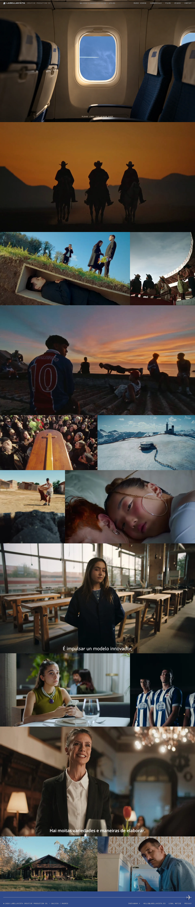
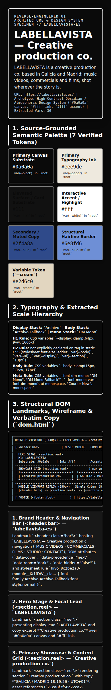

# UI Design System & Master Generation Blueprint: labellavista-es

> **LABELLAVISTA — Creative production co.** (https://labellavista.es/) — LABELLAVISTA is a creative production co. based in Galicia and Madrid: music videos, commercials and films, shot wherever the story is.



---

## 1. Executive Visual Persona & Design Archetype

- **Brand Essence & Persona**: **LABELLAVISTA — Creative production co.** (`https://labellavista.es/`). LABELLAVISTA is a creative production co. based in Galicia and Madrid: music videos, commercials and films, shot wherever the story is.
- **Visual Archetype**: **High-Contrast Obsidian / Atmospheric Design System (`#0a0a0a` canvas, `#fff` ink, `#fff` accent)**.
- **Anti-AI-Slop Differentiators**:
  - **Source-Grounded Chromatic Polarity**: Anchors the viewport in `#0a0a0a` (`var(--black)` in `:root`) paired with `#fff` primary typography and `#fff` accents.
  - **Extracted Typographic Hierarchy**: Pairs `Archivo` for display copy (`LABELLAVISTA`) with `Archivo Fallback` and `DM Mono`.
  - **Calibrated Spatial Grid & Motion**: Combines `760px` container bounds (`gap: 24px`, padding `6px`) with `cubic-bezier(.16,1,.3,1)` easing and Lenis Smooth Scroll (`data-lenis`).

---

## 2. Spatial Architecture & Modular Grid Mathematics



### Viewport Allocation & Container Geometry
- **Captured Viewport Dimensions**: Desktop `1440×6685px` (`assets/desktop.png`, full-page scroll capture), Mobile `390×2400px` (`assets/mobile.png`, capped at 2400px multi-section capture).
- **Master Container Bounds**: `760px` extracted from `labellavista-es` stylesheet.
- **Canvas Lateral Padding & Spacing**: `6px` lateral canvas padding with `24px` grid gap.
- **Border Radius Scale**: `2px`, `50%`, `7%`.

### Responsive Breakpoint Architecture
- **Desktop Layout**: Multi-column CSS Grid / Flexbox layout at `1440px` (`max-width: 760px`, `gap: 24px`).
- **Mobile Layout**: Single-column vertical stack at `390px` viewport width with `6px` horizontal padding.
- **Extracted CSS Media Queries**: `@media (min-width:1440px)`, `@media (max-width:760px)`, `@media (max-width:1299px)`, `@media (max-width:1239px)`.

---

## 3. Color System, Materiality & Atmospheric Lighting

### Semantic Palette & Source Grounding
| Semantic Role | Ground-Truth Value | Extracted CSS Source / Selector |
|---|---|---|
| **Primary Canvas Substrate** | `#0a0a0a` | `var(--black)` in `:root` |
| **Primary Typography Ink** | `#eee9de` | `var(--paper)` in `:root` |
| **Elevated Surface / Card Substrate** | `#111` | `var(--ink)` in `:root` |
| **Interactive Accent / Highlight** | `#fff` | `var(--white)` in `:root` |
| **Secondary / Muted Copy** | `#2f4a8a` | `var(--blue)` in `:root` |
| **Structural Hairline Border** | `#6e8fd6` | `var(--blue-lift)` in `:root` |
| **Variable Token (`--cream`)** | `#e2d6c0` | `var(--cream)` in `:root` |

### Sanitized Root CSS Variables (`ui-ux.md` Ground Truth)
| Variable Name | Extracted Value | Semantic Role |
|---|---|---|
| `--font-archivo` | `"Archivo", "Archivo Fallback"` | Typography / Scale Token |
| `--font-dm-mono` | `"DM Mono", "DM Mono Fallback"` | Typography / Scale Token |
| `--font-slab` | `"Alfa Slab One", "Alfa Slab One Fallback"` | Typography / Scale Token |
| `--black` | `#0a0a0a` | Canvas / Surface Token |
| `--paper` | `#eee9de` | Canvas / Surface Token |
| `--ink` | `#111` | Typography Ink Token |
| `--white` | `#fff` | Canvas / Surface Token |
| `--blue` | `#2f4a8a` | Color / Atmospheric Token |
| `--blue-lift` | `#6e8fd6` | Color / Atmospheric Token |
| `--cream` | `#e2d6c0` | Color / Atmospheric Token |
| `--font-sans` | `var(--font-archivo), system-ui, -apple-system, "Segoe UI", sans-serif` | Typography / Scale Token |
| `--font-mono` | `var(--font-dm-mono), ui-monospace, "Courier New", monospace` | Typography / Scale Token |
| `--display` | `clamp(64px, 9vw, 160px)` | Dimension / Scale Token |
| `--section` | `clamp(32px, 2.8vw, 40px)` | Dimension / Scale Token |
| `--body` | `clamp(15px, 1.1vw, 17px)` | Dimension / Scale Token |
| `--ui` | `11px` | Dimension / Scale Token |

---

## 4. Typographic Scale & Editorial Hierarchy

### Font Family Stacks
- **Display Typography**: `Archivo`.
- **Primary Body Stack**: `Archivo Fallback`.
- **Technical / Metadata Stack**: `DM Mono`.

### Typographic Scale & Rules (Extracted from Stylesheet & Variables)
- **Hero Display (`H1`)**: CSS variables `--display: clamp(64px, 9vw, 160px)`.
- **Section Heading (`H2`)**: not explicitly declared on tag in static CSS (stylesheet font-size ladder: `var(--body)`, `var(--ui)`, `var(--display)`, `var(--section)`, `13px`).
- **Body Copy**: CSS variables `--body: clamp(15px, 1.1vw, 17px)`.
- **Metadata & Navigation Labels**: CSS variables `--font-dm-mono: "DM Mono", "DM Mono Fallback"`, `--font-mono: var(--font-dm-mono), ui-monospace, "Courier New", monospace`.

---

## 5. Choreographed Motion & Interaction Physics

### Primary Easing Curves
- **Extracted Timing Functions**: `cubic-bezier(.16,1,.3,1)`, `cubic-bezier(.7,0,.2,1)`, `cubic-bezier(.55,0,.1,1)`.

### Per-Element Transition & Choreography Rules
- **Selector `.u--quiet:after`**: `transition: transform .7s var(--ease)` extracted from `labellavista-es` stylesheet.
- **Selector `.bar`**: `transition: transform .4s var(--ease), background-color .3s var(--ease), b...` extracted from `labellavista-es` stylesheet.
- **Selector `.cabin__lit`**: `transition: opacity .7s cubic-bezier(.16,1,.3,1)` extracted from `labellavista-es` stylesheet.
- **Extracted Easing Curve (`cubic-bezier(.16,1,.3,1)`)**: Governs interactive state transitions across `<header.bar>` and `<section.reel>`.
- **Runtime Interaction Engine**: Integrates Lenis Smooth Scroll (`data-lenis`) with `prefers-reduced-motion: reduce` fallback guards.

---

## 6. Component Wireframe & Structural DOM Map

### Visual Layout Schematic (Grounded in `dom.html` — `1440px` Desktop & `390px` Mobile Reflow)
```
┌────────────────────────────────────────────────────────────────────────┐
│ DESKTOP VIEWPORT (1440px) — LABELLAVISTA — Creative production co.     │
│ ====================================================================== │
│ [ <header.bar>             | MUSIC VIDEOS · COMMERCIALS · FILMS · S ]  │
│ ---------------------------------------------------------------------- │
│ | HERO STAGE: <section.reel>                                       |   │
│ | H1: LABELLAVISTA                                                 |   │
│ | Substrate: #0a0a0a    | Ink: #fff       | Accent: #fff           |   │
│ ---------------------------------------------------------------------- │
│ | SHOWCASE GRID (<section.reel>            ) max-w: 760px          |   │
│ | +------------------------------+  +------------------------------+ | │
│ | | Creative production co.      |  | GALICIA / MADRID 18:19:56 ·  | | │
│ | +------------------------------+  +------------------------------+ | │
│ ---------------------------------------------------------------------- │
│ | MOBILE VIEWPORT REFLOW (390px) — Single-Column Stack (gap: 24px  ) | │
│ | [<header.bar>] -> [<section.reel>] -> [<section.reel>] |             │
│ ---------------------------------------------------------------------- │
│ [ FOOTER (<footer.foot>         ) | https://labellavista.es/           │
└────────────────────────────────────────────────────────────────────────┘
```

### Granular DOM Region Breakdown
1. **Brand Header & Navigation Bar (<header.bar> — `labellavista-es`)**:
   - Landmark `<header class="bar">` hosting `LABELLAVISTA — Creative production c` navigation (`MUSIC VIDEOS · COMMERCIALS · FILMS · STUDIO · CONTACT`), DOM attributes (`data-cover`, `data-precedence="next"`, `data-room="dark"`, `data-hidden="false"`), and stylesheet rule `hivo_8c2be2a3-module__iX1fDW__cla... { font-family:Archivo,Archivo Fallback;font-style:normal }`.
2. **Hero Stage & Focal Lead (<section.reel> — `LABELLAVISTA`)**:
   - Landmark `<section class="reel">` presenting display lead `LABELLAVISTA` and copy excerpt *"Creative production co."* over `#0a0a0a` canvas and `#fff` ink.
3. **Primary Showcase & Content Grid (<section.reel> — `Creative production co.`)**:
   - Landmark `<section class="reel">` rendering section `Creative production co.` with copy *"GALICIA / MADRID 18:19:56 · UTC+01"*, asset references (`21ca8f3f56c22ca2-s.p.1cp9-4nby68j...`, `36363bfb06833f56-s.p.38hmww4cj4vm...`, `cabin-window.webp`, `cabin-shade.webp`), and grid rule `chivo_8c2be2a3-module__iX1fDW__va... { --font-archivo:"Archivo", "Archivo Fallback" }`.
4. **Interactive Detail & Feature Matrix (<section.reel> — `GALICIA / MADRID 18:19:56 · UTC+01`)**:
   - Landmark `<section class="reel">` framing `GALICIA / MADRID 18:19:56 · UTC+01` and `( 01 ) Music videos` (*"( 01 ) Music videos"*) with `#111` surface cards, `#fff` accents, and `mono_685a951c-module__v6oBuq__cla... { font-family:DM Mono,DM Mono Fallback;font-style:normal;font-weight:400 }`.
5. **Colophon & Global Directory Footer (<footer.foot> — `https://labellavista.es/`)**:
   - Landmark `<footer class="foot ui">` anchoring `LABELLAVISTA — Creative producti` footer links (`MUSIC VIDEOS · COMMERCIALS · FILMS · STUDIO · CONTACT`), copy *"( 02 ) Commercials"*, and `#6e8fd6` structural dividers.

---

## 7. Master Zero-Shot AI Generation Prompt

```markdown
# Master Zero-Shot Frontend Generation Prompt: labellavista-es (LABELLAVISTA — Creative production co.)

You are a principal frontend architect and design systems engineer. Build a complete, production-ready web application replicating the exact design system, DOM landmarks, typographic hierarchy, color tokens, and motion physics of `labellavista-es` (**LABELLAVISTA — Creative production co.** — `https://labellavista.es/`).

### 1. Visual Archetype & Anti-AI-Slop Mandates
- **Archetype**: High-Contrast Obsidian / Atmospheric Design System (`#0a0a0a` canvas, `#fff` ink, `#fff` accent).
- **Identity & Domain Context**: LABELLAVISTA is a creative production co. based in Galicia and Madrid: music videos, commercials and films, shot wherever the story is.
- **Primary Substrate**: `#0a0a0a` (`var(--black)` in `:root`), **Primary Ink**: `#fff`, **Accent / Highlight**: `#fff`.
- **Site-Specific Differentiators**:
  - **Source-Grounded Chromatic Polarity**: Anchors the viewport in `#0a0a0a` (`var(--black)` in `:root`) paired with `#fff` primary typography and `#fff` accents.
  - **Extracted Typographic Hierarchy**: Pairs `Archivo` for display copy (`LABELLAVISTA`) with `Archivo Fallback` and `DM Mono`.
  - **Calibrated Spatial Grid & Motion**: Combines `760px` container bounds (`gap: 24px`, padding `6px`) with `cubic-bezier(.16,1,.3,1)` easing and Lenis Smooth Scroll (`data-lenis`).

### 2. Ground-Truth CSS Variables (`:root` Token Contract)
Declare and consume these exact custom properties extracted from `labellavista-es` in your global stylesheet:

:root {
  /* LABELLAVISTA — Creative production co. (labellavista-es) — Ground-Truth Extracted CSS Variables */
  --font-archivo: "Archivo", "Archivo Fallback"; /* Typography / Scale Token (labellavista-es) */
  --font-dm-mono: "DM Mono", "DM Mono Fallback"; /* Typography / Scale Token (labellavista-es) */
  --font-slab: "Alfa Slab One", "Alfa Slab One Fallback"; /* Typography / Scale Token (labellavista-es) */
  --black: #0a0a0a; /* Canvas / Surface Token (labellavista-es) */
  --paper: #eee9de; /* Canvas / Surface Token (labellavista-es) */
  --ink: #111; /* Typography Ink Token (labellavista-es) */
  --white: #fff; /* Canvas / Surface Token (labellavista-es) */
  --blue: #2f4a8a; /* Color / Atmospheric Token (labellavista-es) */
  --blue-lift: #6e8fd6; /* Color / Atmospheric Token (labellavista-es) */
  --cream: #e2d6c0; /* Color / Atmospheric Token (labellavista-es) */
  --font-sans: var(--font-archivo), system-ui, -apple-system, "Segoe UI", sans-serif; /* Typography / Scale Token (labellavista-es) */
  --font-mono: var(--font-dm-mono), ui-monospace, "Courier New", monospace; /* Typography / Scale Token (labellavista-es) */
  --display: clamp(64px, 9vw, 160px); /* Dimension / Scale Token (labellavista-es) */
  --section: clamp(32px, 2.8vw, 40px); /* Dimension / Scale Token (labellavista-es) */
  --body: clamp(15px, 1.1vw, 17px); /* Dimension / Scale Token (labellavista-es) */
  --ui: 11px; /* Dimension / Scale Token (labellavista-es) */
}

### 3. Semantic Color & Materiality Contract
Map every surface, ink, and border strictly to these source-grounded tokens:
- **Primary Canvas Substrate**: `#0a0a0a` — grounded in `var(--black)` in `:root`
- **Primary Typography Ink**: `#eee9de` — grounded in `var(--paper)` in `:root`
- **Elevated Surface / Card Substrate**: `#111` — grounded in `var(--ink)` in `:root`
- **Interactive Accent / Highlight**: `#fff` — grounded in `var(--white)` in `:root`
- **Secondary / Muted Copy**: `#2f4a8a` — grounded in `var(--blue)` in `:root`
- **Structural Hairline Border**: `#6e8fd6` — grounded in `var(--blue-lift)` in `:root`
- **Variable Token (`--cream`)**: `#e2d6c0` — grounded in `var(--cream)` in `:root`

### 4. Spatial Grid, Container Bounds & Responsive Breakpoints
- **Desktop Viewport Reference**: `1440×6685px` (full-page scroll capture, `1440px` standard desktop width).
- **Mobile Viewport Reference**: `390×2400px` (capped at 2400px multi-section capture, `390px` standard mobile width).
- **Container Max-Width**: `760px` extracted from `labellavista-es` stylesheet
- **Padding & Gutters**: `6px` lateral canvas padding with `24px` grid gap
- **Desktop Grid**: Multi-column CSS Grid / Flexbox layout at `1440px` (`max-width: 760px`, `gap: 24px`)
- **Mobile Adaptation**: Single-column vertical stack at `390px` viewport width with `6px` horizontal padding
- **Media Queries**: `@media (min-width:1440px)`, `@media (max-width:760px)`, `@media (max-width:1299px)`, `@media (max-width:1239px)`
- **Corner Radii**: `2px`, `50%`, `7%`

### 5. Typography & Editorial Scale Contract
- **Display Font Stack**: `Archivo`
- **Body Font Stack**: `Archivo Fallback`
- **Monospace / Technical Font Stack**: `DM Mono`
- **H1 Display Rule**: CSS variables `--display: clamp(64px, 9vw, 160px)`
- **H2 Section Rule**: not explicitly declared on tag in static CSS (stylesheet font-size ladder: `var(--body)`, `var(--ui)`, `var(--display)`, `var(--section)`, `13px`)
- **Body Copy Rule**: CSS variables `--body: clamp(15px, 1.1vw, 17px)`
- **Metadata & Index Rule**: CSS variables `--font-dm-mono: "DM Mono", "DM Mono Fallback"`, `--font-mono: var(--font-dm-mono), ui-monospace, "Courier New", monospace`

### 6. Component Hierarchy, Verbatim Copy & Real DOM Landmarks
Scaffold `labellavista-es` (`LABELLAVISTA — Creative production co.`) with these exact structural regions, extracted copy, and CSS rules from `dom.html`:
1. **Brand Header & Navigation Bar (<header.bar> — `labellavista-es`)**:
   - DOM & Selectors: Landmark `<header class="bar">` hosting `LABELLAVISTA — Creative production c` navigation (`MUSIC VIDEOS · COMMERCIALS · FILMS · STUDIO · CONTACT`), DOM attributes (`data-cover`, `data-precedence="next"`, `data-room="dark"`, `data-hidden="false"`), and stylesheet rule `hivo_8c2be2a3-module__iX1fDW__cla... { font-family:Archivo,Archivo Fallback;font-style:normal }`.
   - Responsive Contract: Header `Brand Header & Navigation Bar (<header.bar> — `labellavista-es`)` (`labellavista-es`) adapts across `@media (min-width:1440px)`, `@media (max-width:760px)`, `@media (max-width:1299px)`, `@media (max-width:1239px)` with `cubic-bezier(.16,1,.3,1)`, `cubic-bezier(.7,0,.2,1)`, `cubic-bezier(.55,0,.1,1)` transitions and links `MUSIC VIDEOS · COMMERCIALS · FILMS · STUDIO · CONTACT`.
2. **Hero Stage & Focal Lead (<section.reel> — `LABELLAVISTA`)**:
   - DOM & Selectors: Landmark `<section class="reel">` presenting display lead `LABELLAVISTA` and copy excerpt *"Creative production co."* over `#0a0a0a` canvas and `#fff` ink.
   - Responsive Contract: Hero stage (`1440×6685px` desktop / `390×2400px` mobile) sets `#0a0a0a` background with `#fff` headline `LABELLAVISTA`.
3. **Primary Showcase & Content Grid (<section.reel> — `Creative production co.`)**:
   - DOM & Selectors: Landmark `<section class="reel">` rendering section `Creative production co.` with copy *"GALICIA / MADRID 18:19:56 · UTC+01"*, asset references (`21ca8f3f56c22ca2-s.p.1cp9-4nby68j...`, `36363bfb06833f56-s.p.38hmww4cj4vm...`, `cabin-window.webp`, `cabin-shade.webp`), and grid rule `chivo_8c2be2a3-module__iX1fDW__va... { --font-archivo:"Archivo", "Archivo Fallback" }`.
   - Responsive Contract: Showcase grid `Primary Showcase & Content Grid (<section.reel> — `Creative production co.`)` applies Multi-column CSS Grid / Flexbox layout at `1440px` (`max-width: 760px`, `gap: 24px`) on desktop and Single-column vertical stack at `390px` viewport width with `6px` horizontal padding on mobile.
4. **Interactive Detail & Feature Matrix (<section.reel> — `GALICIA / MADRID 18:19:56 · UTC+01`)**:
   - DOM & Selectors: Landmark `<section class="reel">` framing `GALICIA / MADRID 18:19:56 · UTC+01` and `( 01 ) Music videos` (*"( 01 ) Music videos"*) with `#111` surface cards, `#fff` accents, and `mono_685a951c-module__v6oBuq__cla... { font-family:DM Mono,DM Mono Fallback;font-style:normal;font-weight:400 }`.
   - Responsive Contract: Detail module `Interactive Detail & Feature Matrix (<section.reel> — `GALICIA / MADRID 18:19:56 · UTC+01`)` uses `2px`, `50%`, `7%` radii, `#fff` highlights, and assets (21ca8f3f56c22ca2-s.p.1cp9-4nby68j..., 36363bfb06833f56-s.p.38hmww4cj4vm..., cabin-window.webp).
5. **Colophon & Global Directory Footer (<footer.foot> — `https://labellavista.es/`)**:
   - DOM & Selectors: Landmark `<footer class="foot ui">` anchoring `LABELLAVISTA — Creative producti` footer links (`MUSIC VIDEOS · COMMERCIALS · FILMS · STUDIO · CONTACT`), copy *"( 02 ) Commercials"*, and `#6e8fd6` structural dividers.
   - Responsive Contract: Footer `Colophon & Global Directory Footer (<footer.foot> — `https://labellavista.es/`)` aligns to `760px` extracted from `labellavista-es` stylesheet with `6px` lateral canvas padding with `24px` grid gap and attributes (data-cover, data-precedence="next", data-room="dark").

#### Verbatim DOM Copy Excerpts (`dom.html`)
- Copy Excerpt 1: *"Creative production co."*
- Copy Excerpt 2: *"GALICIA / MADRID 18:19:56 · UTC+01"*
- Copy Excerpt 3: *"( 01 ) Music videos"*
- Copy Excerpt 4: *"( 02 ) Commercials"*

### 7. Motion, Extracted Stylesheet Rules & Interaction Choreography
- **Primary Easing Functions**: `cubic-bezier(.16,1,.3,1)`, `cubic-bezier(.7,0,.2,1)`, `cubic-bezier(.55,0,.1,1)`
- **Extracted Stylesheet Rules (`labellavista-es`)**:
- `hivo_8c2be2a3-module__iX1fDW__cla... { font-family:Archivo,Archivo Fallback;font-style:normal }`
- `chivo_8c2be2a3-module__iX1fDW__va... { --font-archivo:"Archivo", "Archivo Fallback" }`
- `mono_685a951c-module__v6oBuq__cla... { font-family:DM Mono,DM Mono Fallback;font-style:normal;font-weight:400 }`
- `mono_685a951c-module__v6oBuq__var... { --font-dm-mono:"DM Mono", "DM Mono Fallback" }`
- `one_e945b21b-module__TcUEra__clas... { font-family:Alfa Slab One,Alfa Slab One Fallback;font-style:normal;font-... }`
- **Per-Selector Transition Rules**:
- **Selector `.u--quiet:after`**: `transition: transform .7s var(--ease)` extracted from `labellavista-es` stylesheet.
- **Selector `.bar`**: `transition: transform .4s var(--ease), background-color .3s var(--ease), b...` extracted from `labellavista-es` stylesheet.
- **Selector `.cabin__lit`**: `transition: opacity .7s cubic-bezier(.16,1,.3,1)` extracted from `labellavista-es` stylesheet.
- **Extracted Easing Curve (`cubic-bezier(.16,1,.3,1)`)**: Governs interactive state transitions across `<header.bar>` and `<section.reel>`.
- **Runtime Interaction Engine**: Integrates Lenis Smooth Scroll (`data-lenis`) with `prefers-reduced-motion: reduce` fallback guards.

### 8. Technical Deliverables
- Implement in Next.js (App Router) with TypeScript and Tailwind CSS consuming the `:root` custom properties defined above for `labellavista-es`.
- Reproduce both the `1440px` desktop architecture and `390px` mobile breakpoint transitions, preserving semantic HTML5 landmarks (`<header>`, `<nav>`, `<main>`, `<section>`, `<footer>`) and `prefers-reduced-motion` accessibility guards.
```
