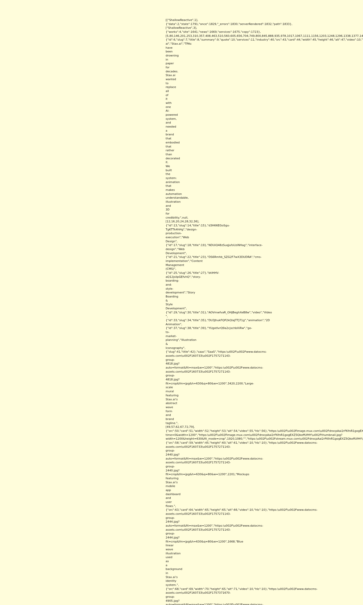
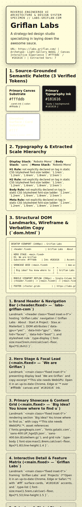

# UI Design System & Master Generation Blueprint: labs-griflan-com

> **Griflan Labs** (https://labs.griflan.com/) — A strategy-led design studio specializing in laying down the awesome sauce.



---

## 1. Executive Visual Persona & Design Archetype

- **Brand Essence & Persona**: **Griflan Labs** (`https://labs.griflan.com/`). A strategy-led design studio specializing in laying down the awesome sauce.
- **Visual Archetype**: **Light-Gallery WebGL / Canvas Interactive Experience (`#fffddb` / `#181616`)**.
- **Anti-AI-Slop Differentiators**:
  - **Source-Grounded Chromatic Polarity**: Anchors the viewport in `#fffddb` (`.caret-ink { color: #fffddb }`) paired with `#181616` primary typography and `#181616` accents.
  - **Extracted Typographic Hierarchy**: Pairs `Roboto Mono` for display copy (`We are Griflan`) with `sans` and `Roboto Mono`.
  - **Calibrated Spatial Grid & Motion**: Combines `45rem` container bounds (`gap: 1rem`, padding `1.5rem`) with `cubic-bezier(.4,0,.2,1)` easing and Three.js / WebGL Canvas Pipeline.

---

## 2. Spatial Architecture & Modular Grid Mathematics



### Viewport Allocation & Container Geometry
- **Captured Viewport Dimensions**: Desktop `1440×2400px` (`assets/desktop.png`, capped at 2400px multi-section capture), Mobile `390×2400px` (`assets/mobile.png`, capped at 2400px multi-section capture).
- **Master Container Bounds**: `45rem` extracted from `labs-griflan-com` stylesheet.
- **Canvas Lateral Padding & Spacing**: `1.5rem` lateral canvas padding with `1rem` grid gap.
- **Border Radius Scale**: `1rem`, `2rem`, `.5rem`, `.8rem`.

### Responsive Breakpoint Architecture
- **Desktop Layout**: Multi-column CSS Grid / Flexbox layout at `1440px` (`max-width: 45rem`, `gap: 1rem`).
- **Mobile Layout**: Single-column vertical stack at `390px` viewport width with `1.5rem` horizontal padding.
- **Extracted CSS Media Queries**: `@media (min-width:1000px),(min-width:650px)and (orientation:land...`, `@media (prefers-reduced-motion:reduce)`, `@media (max-height:559.98px),(max-width:799.98px)`.

---

## 3. Color System, Materiality & Atmospheric Lighting

### Semantic Palette & Source Grounding
| Semantic Role | Ground-Truth Value | Extracted CSS Source / Selector |
|---|---|---|
| **Primary Canvas Substrate** | `#fffddb` | `.caret-ink { color: #fffddb }` |
| **Primary Typography Ink** | `#181616` | `body { background: #181616 }` |
| **Elevated Surface / Card Substrate** | `#fff` | `body { color: #fff }` |

### Sanitized Root CSS Variables (`ui-ux.md` Ground Truth)
| Variable Name | Extracted Value | Semantic Role |
|---|---|---|
| `--floor` | `min(8px,.75vw)` | Dimension / Scale Token |
| `--glass-fill` | `rgba(0,0,0,.4)` | Color / Atmospheric Token |
| `--size` | `390` | Layout / Spatial Grid Token |
| `--dim` | `rgb(64 63 55)` | Color / Atmospheric Token |
| `--calm` | `rgb(93 91 81)` | Color / Atmospheric Token |
| `--pill-w` | `400px` | Dimension / Scale Token |
| `--gap` | `8px` | Layout / Spatial Grid Token |
| `--tw-border-spacing-x` | `0` | Layout / Spatial Grid Token |
| `--tw-border-spacing-y` | `0` | Layout / Spatial Grid Token |
| `--tw-translate-x` | `0` | Design System Custom Token |
| `--tw-translate-y` | `0` | Design System Custom Token |
| `--tw-rotate` | `0` | Design System Custom Token |
| `--tw-skew-x` | `0` | Design System Custom Token |
| `--tw-skew-y` | `0` | Design System Custom Token |
| `--labs-griflan-com-bg` | `#fffddb` | Canvas Substrate (from `.caret-ink { color: #fffddb }`) |
| `--labs-griflan-com-ink` | `#181616` | Primary Typography Ink (stylesheet-derived) |

---

## 4. Typographic Scale & Editorial Hierarchy

### Font Family Stacks
- **Display Typography**: `Roboto Mono`.
- **Primary Body Stack**: `sans`.
- **Technical / Metadata Stack**: `Roboto Mono`.

### Typographic Scale & Rules (Extracted from Stylesheet & Variables)
- **Hero Display (`H1`)**: not explicitly declared on tag in static CSS (stylesheet font-size ladder: `1.1rem`, `1.2rem`, `1.6rem`, `1.8rem`, `2.5rem`).
- **Section Heading (`H2`)**: not explicitly declared on tag in static CSS (stylesheet font-size ladder: `1.1rem`, `1.2rem`, `1.6rem`, `1.8rem`, `2.5rem`).
- **Body Copy**: not explicitly declared on tag in static CSS (stylesheet font-size ladder: `1.1rem`, `1.2rem`, `1.6rem`, `1.8rem`, `2.5rem`).
- **Metadata & Navigation Labels**: not explicitly declared on tag in static CSS (stylesheet font-size ladder: `1.1rem`, `1.2rem`, `1.6rem`, `1.8rem`, `2.5rem`).

---

## 5. Choreographed Motion & Interaction Physics

### Primary Easing Curves
- **Extracted Timing Functions**: `cubic-bezier(.4,0,.2,1)`, `cubic-bezier(0,0,.2,1)`.

### Per-Element Transition & Choreography Rules
- **Selector `.transition-colors`**: `transition: .15s` extracted from `labs-griflan-com` stylesheet.
- **Selector `.duration-\[\.35s\]`**: `transition: .35s` extracted from `labs-griflan-com` stylesheet.
- **Selector `.ease-out`**: `transition: cubic-bezier(.4,0,.2,1)` extracted from `labs-griflan-com` stylesheet.
- **Extracted Easing Curve (`cubic-bezier(.4,0,.2,1)`)**: Governs interactive state transitions across `<header.fixed>` and `<main.fixed>`.
- **Runtime Interaction Engine**: Integrates Three.js / WebGL Canvas Pipeline with `prefers-reduced-motion: reduce` fallback guards.

---

## 6. Component Wireframe & Structural DOM Map

### Visual Layout Schematic (Grounded in `dom.html` — `1440px` Desktop & `390px` Mobile Reflow)
```
┌────────────────────────────────────────────────────────────────────────┐
│ DESKTOP VIEWPORT (1440px) — Griflan Labs                               │
│ ====================================================================== │
│ [ <header.fixed>           | Griflan Labs · About · Start A Project ]  │
│ ---------------------------------------------------------------------- │
│ | HERO STAGE: <main.fixed>                                         |   │
│ | H1: We are Griflan                                               |   │
│ | Substrate: #fffddb    | Ink: #181616    | Accent: #181616        |   │
│ ---------------------------------------------------------------------- │
│ | SHOWCASE GRID (<main.fixed>              ) max-w: 45rem          |   │
│ | +------------------------------+  +------------------------------+ | │
│ | | Big idea? You know where to  |  | Griflan Labs                 | | │
│ | +------------------------------+  +------------------------------+ | │
│ ---------------------------------------------------------------------- │
│ | MOBILE VIEWPORT REFLOW (390px) — Single-Column Stack (gap: 1rem  ) | │
│ | [<header.fixed>] -> [<main.fixed>] -> [<main.fixed>] |               │
│ ---------------------------------------------------------------------- │
│ [ FOOTER (<footer.grid>         ) | https://labs.griflan.com/          │
└────────────────────────────────────────────────────────────────────────┘
```

### Granular DOM Region Breakdown
1. **Brand Header & Navigation Bar (<header.fixed> — `labs-griflan-com`)**:
   - Landmark `<header class="fixed inset-x-0">` hosting `Griflan Labs` navigation (`Griflan Labs · About · Start A Project · Stax.ai · Mailerbot`), DOM attributes (`data-gpu="yes"`, `data-hid="gpu"`, `data-hid="faces"`, `data-hid="boot"`), and stylesheet rule `.type-display { font-size:max(5rem,min(calc(var(--floor, 8px)*5),8vh)) }`.
2. **Hero Stage & Focal Lead (<main.fixed> — `We are Griflan`)**:
   - Landmark `<main class="fixed inset-0">` presenting display lead `We are Griflan` and copy excerpt *"This site needs WebGPU. Open it in an up-to-date Chrome, Edge or "* over `#fffddb` canvas and `#181616` ink.
3. **Primary Showcase & Content Grid (<main.fixed> — `Big idea? You know where to find u`)**:
   - Landmark `<main class="fixed inset-0">` rendering section `Big idea? You know where to find us.` with copy *"This site needs WebGPU."*, asset references (`fonts.googleapis.com`, `fonts.gstatic.com`, `sans-400.UP_hgoQ5.json`, `sans-400.bin.B1ole0wm.gz`), and grid rule `.type-body { font-size:max(1.8rem,calc(var(--floor, 8px)*1.8));line-height:1.4 }`.
4. **Interactive Detail & Feature Matrix (<main.fixed> — `Griflan Labs`)**:
   - Landmark `<main class="fixed inset-0">` framing `Griflan Labs` and `Projects` (*"Open it in an up-to-date Chrome, Edge or Safari."*) with `#fff` surface cards, `#181616` accents, and `.type-list { font-size:max(1.5rem,calc(var(--floor, 8px)*1.5));line-height:1.5 }`.
5. **Colophon & Global Directory Footer (<footer.grid> — `https://labs.griflan.com/`)**:
   - Landmark `<footer class="grid">` anchoring `Griflan Labs` footer links (`Griflan Labs · About · Start A Project · Stax.ai · Mailerbot`), copy *"Griflan Labs is an experimental, bird’s-eye view of our work"*, and `#181616` structural dividers.

---

## 7. Master Zero-Shot AI Generation Prompt

```markdown
# Master Zero-Shot Frontend Generation Prompt: labs-griflan-com (Griflan Labs)

You are a principal frontend architect and design systems engineer. Build a complete, production-ready web application replicating the exact design system, DOM landmarks, typographic hierarchy, color tokens, and motion physics of `labs-griflan-com` (**Griflan Labs** — `https://labs.griflan.com/`).

### 1. Visual Archetype & Anti-AI-Slop Mandates
- **Archetype**: Light-Gallery WebGL / Canvas Interactive Experience (`#fffddb` / `#181616`).
- **Identity & Domain Context**: A strategy-led design studio specializing in laying down the awesome sauce.
- **Primary Substrate**: `#fffddb` (`.caret-ink { color: #fffddb }`), **Primary Ink**: `#181616`, **Accent / Highlight**: `#181616`.
- **Site-Specific Differentiators**:
  - **Source-Grounded Chromatic Polarity**: Anchors the viewport in `#fffddb` (`.caret-ink { color: #fffddb }`) paired with `#181616` primary typography and `#181616` accents.
  - **Extracted Typographic Hierarchy**: Pairs `Roboto Mono` for display copy (`We are Griflan`) with `sans` and `Roboto Mono`.
  - **Calibrated Spatial Grid & Motion**: Combines `45rem` container bounds (`gap: 1rem`, padding `1.5rem`) with `cubic-bezier(.4,0,.2,1)` easing and Three.js / WebGL Canvas Pipeline.

### 2. Ground-Truth CSS Variables (`:root` Token Contract)
Declare and consume these exact custom properties extracted from `labs-griflan-com` in your global stylesheet:

:root {
  /* Griflan Labs (labs-griflan-com) — Ground-Truth Extracted CSS Variables */
  --floor: min(8px,.75vw); /* Dimension / Scale Token (labs-griflan-com) */
  --glass-fill: rgba(0,0,0,.4); /* Color / Atmospheric Token (labs-griflan-com) */
  --size: 390; /* Layout / Spatial Grid Token (labs-griflan-com) */
  --dim: rgb(64 63 55); /* Color / Atmospheric Token (labs-griflan-com) */
  --calm: rgb(93 91 81); /* Color / Atmospheric Token (labs-griflan-com) */
  --pill-w: 400px; /* Dimension / Scale Token (labs-griflan-com) */
  --gap: 8px; /* Layout / Spatial Grid Token (labs-griflan-com) */
  --tw-border-spacing-x: 0; /* Layout / Spatial Grid Token (labs-griflan-com) */
  --tw-border-spacing-y: 0; /* Layout / Spatial Grid Token (labs-griflan-com) */
  --tw-translate-x: 0; /* Design System Custom Token (labs-griflan-com) */
  --tw-translate-y: 0; /* Design System Custom Token (labs-griflan-com) */
  --tw-rotate: 0; /* Design System Custom Token (labs-griflan-com) */
  --tw-skew-x: 0; /* Design System Custom Token (labs-griflan-com) */
  --tw-skew-y: 0; /* Design System Custom Token (labs-griflan-com) */
  --labs-griflan-com-bg: #fffddb; /* Canvas Substrate (from `.caret-ink { color: #fffddb }`) (labs-griflan-com) */
  --labs-griflan-com-ink: #181616; /* Primary Typography Ink (stylesheet-derived) (labs-griflan-com) */
}

### 3. Semantic Color & Materiality Contract
Map every surface, ink, and border strictly to these source-grounded tokens:
- **Primary Canvas Substrate**: `#fffddb` — grounded in `.caret-ink { color: #fffddb }`
- **Primary Typography Ink**: `#181616` — grounded in `body { background: #181616 }`
- **Elevated Surface / Card Substrate**: `#fff` — grounded in `body { color: #fff }`

### 4. Spatial Grid, Container Bounds & Responsive Breakpoints
- **Desktop Viewport Reference**: `1440×2400px` (capped at 2400px multi-section capture, `1440px` standard desktop width).
- **Mobile Viewport Reference**: `390×2400px` (capped at 2400px multi-section capture, `390px` standard mobile width).
- **Container Max-Width**: `45rem` extracted from `labs-griflan-com` stylesheet
- **Padding & Gutters**: `1.5rem` lateral canvas padding with `1rem` grid gap
- **Desktop Grid**: Multi-column CSS Grid / Flexbox layout at `1440px` (`max-width: 45rem`, `gap: 1rem`)
- **Mobile Adaptation**: Single-column vertical stack at `390px` viewport width with `1.5rem` horizontal padding
- **Media Queries**: `@media (min-width:1000px),(min-width:650px)and (orientation:land...`, `@media (prefers-reduced-motion:reduce)`, `@media (max-height:559.98px),(max-width:799.98px)`
- **Corner Radii**: `1rem`, `2rem`, `.5rem`, `.8rem`

### 5. Typography & Editorial Scale Contract
- **Display Font Stack**: `Roboto Mono`
- **Body Font Stack**: `sans`
- **Monospace / Technical Font Stack**: `Roboto Mono`
- **H1 Display Rule**: not explicitly declared on tag in static CSS (stylesheet font-size ladder: `1.1rem`, `1.2rem`, `1.6rem`, `1.8rem`, `2.5rem`)
- **H2 Section Rule**: not explicitly declared on tag in static CSS (stylesheet font-size ladder: `1.1rem`, `1.2rem`, `1.6rem`, `1.8rem`, `2.5rem`)
- **Body Copy Rule**: not explicitly declared on tag in static CSS (stylesheet font-size ladder: `1.1rem`, `1.2rem`, `1.6rem`, `1.8rem`, `2.5rem`)
- **Metadata & Index Rule**: not explicitly declared on tag in static CSS (stylesheet font-size ladder: `1.1rem`, `1.2rem`, `1.6rem`, `1.8rem`, `2.5rem`)

### 6. Component Hierarchy, Verbatim Copy & Real DOM Landmarks
Scaffold `labs-griflan-com` (`Griflan Labs`) with these exact structural regions, extracted copy, and CSS rules from `dom.html`:
1. **Brand Header & Navigation Bar (<header.fixed> — `labs-griflan-com`)**:
   - DOM & Selectors: Landmark `<header class="fixed inset-x-0">` hosting `Griflan Labs` navigation (`Griflan Labs · About · Start A Project · Stax.ai · Mailerbot`), DOM attributes (`data-gpu="yes"`, `data-hid="gpu"`, `data-hid="faces"`, `data-hid="boot"`), and stylesheet rule `.type-display { font-size:max(5rem,min(calc(var(--floor, 8px)*5),8vh)) }`.
   - Responsive Contract: Header `Brand Header & Navigation Bar (<header.fixed> — `labs-griflan-com`)` (`labs-griflan-com`) adapts across `@media (min-width:1000px),(min-width:650px)and (orientation:land...`, `@media (prefers-reduced-motion:reduce)`, `@media (max-height:559.98px),(max-width:799.98px)` with `cubic-bezier(.4,0,.2,1)`, `cubic-bezier(0,0,.2,1)` transitions and links `Griflan Labs · About · Start A Project · Stax.ai · Mailerbot`.
2. **Hero Stage & Focal Lead (<main.fixed> — `We are Griflan`)**:
   - DOM & Selectors: Landmark `<main class="fixed inset-0">` presenting display lead `We are Griflan` and copy excerpt *"This site needs WebGPU. Open it in an up-to-date Chrome, Edge or "* over `#fffddb` canvas and `#181616` ink.
   - Responsive Contract: Hero stage (`1440×2400px` desktop / `390×2400px` mobile) sets `#fffddb` background with `#181616` headline `We are Griflan`.
3. **Primary Showcase & Content Grid (<main.fixed> — `Big idea? You know where to find u`)**:
   - DOM & Selectors: Landmark `<main class="fixed inset-0">` rendering section `Big idea? You know where to find us.` with copy *"This site needs WebGPU."*, asset references (`fonts.googleapis.com`, `fonts.gstatic.com`, `sans-400.UP_hgoQ5.json`, `sans-400.bin.B1ole0wm.gz`), and grid rule `.type-body { font-size:max(1.8rem,calc(var(--floor, 8px)*1.8));line-height:1.4 }`.
   - Responsive Contract: Showcase grid `Primary Showcase & Content Grid (<main.fixed> — `Big idea? You know where to find u`)` applies Multi-column CSS Grid / Flexbox layout at `1440px` (`max-width: 45rem`, `gap: 1rem`) on desktop and Single-column vertical stack at `390px` viewport width with `1.5rem` horizontal padding on mobile.
4. **Interactive Detail & Feature Matrix (<main.fixed> — `Griflan Labs`)**:
   - DOM & Selectors: Landmark `<main class="fixed inset-0">` framing `Griflan Labs` and `Projects` (*"Open it in an up-to-date Chrome, Edge or Safari."*) with `#fff` surface cards, `#181616` accents, and `.type-list { font-size:max(1.5rem,calc(var(--floor, 8px)*1.5));line-height:1.5 }`.
   - Responsive Contract: Detail module `Interactive Detail & Feature Matrix (<main.fixed> — `Griflan Labs`)` uses `1rem`, `2rem`, `.5rem`, `.8rem` radii, `#181616` highlights, and assets (fonts.googleapis.com, fonts.gstatic.com, sans-400.UP_hgoQ5.json).
5. **Colophon & Global Directory Footer (<footer.grid> — `https://labs.griflan.com/`)**:
   - DOM & Selectors: Landmark `<footer class="grid">` anchoring `Griflan Labs` footer links (`Griflan Labs · About · Start A Project · Stax.ai · Mailerbot`), copy *"Griflan Labs is an experimental, bird’s-eye view of our work"*, and `#181616` structural dividers.
   - Responsive Contract: Footer `Colophon & Global Directory Footer (<footer.grid> — `https://labs.griflan.com/`)` aligns to `45rem` extracted from `labs-griflan-com` stylesheet with `1.5rem` lateral canvas padding with `1rem` grid gap and attributes (data-gpu="yes", data-hid="gpu", data-hid="faces").

#### Verbatim DOM Copy Excerpts (`dom.html`)
- Copy Excerpt 1: *"This site needs WebGPU. Open it in an up-to-date Chrome, Edge or Safari."*
- Copy Excerpt 2: *"This site needs WebGPU."*
- Copy Excerpt 3: *"Open it in an up-to-date Chrome, Edge or Safari."*
- Copy Excerpt 4: *"Griflan Labs is an experimental, bird’s-eye view of our work, a fresh way to show..."*

### 7. Motion, Extracted Stylesheet Rules & Interaction Choreography
- **Primary Easing Functions**: `cubic-bezier(.4,0,.2,1)`, `cubic-bezier(0,0,.2,1)`
- **Extracted Stylesheet Rules (`labs-griflan-com`)**:
- `.type-display { font-size:max(5rem,min(calc(var(--floor, 8px)*5),8vh)) }`
- `.type-body { font-size:max(1.8rem,calc(var(--floor, 8px)*1.8));line-height:1.4 }`
- `.type-list { font-size:max(1.5rem,calc(var(--floor, 8px)*1.5));line-height:1.5 }`
- `.type-label { font-size:max(1.4rem,calc(var(--floor, 8px)*1.4)) }`
- `.type-micro { font-family:Roboto Mono,ui-monospace,monospace;font-weight:500;line-heig... }`
- **Per-Selector Transition Rules**:
- **Selector `.transition-colors`**: `transition: .15s` extracted from `labs-griflan-com` stylesheet.
- **Selector `.duration-\[\.35s\]`**: `transition: .35s` extracted from `labs-griflan-com` stylesheet.
- **Selector `.ease-out`**: `transition: cubic-bezier(.4,0,.2,1)` extracted from `labs-griflan-com` stylesheet.
- **Extracted Easing Curve (`cubic-bezier(.4,0,.2,1)`)**: Governs interactive state transitions across `<header.fixed>` and `<main.fixed>`.
- **Runtime Interaction Engine**: Integrates Three.js / WebGL Canvas Pipeline with `prefers-reduced-motion: reduce` fallback guards.

### 8. Technical Deliverables
- Implement in Next.js (App Router) with TypeScript and Tailwind CSS consuming the `:root` custom properties defined above for `labs-griflan-com`.
- Reproduce both the `1440px` desktop architecture and `390px` mobile breakpoint transitions, preserving semantic HTML5 landmarks (`<header>`, `<nav>`, `<main>`, `<section>`, `<footer>`) and `prefers-reduced-motion` accessibility guards.
```
