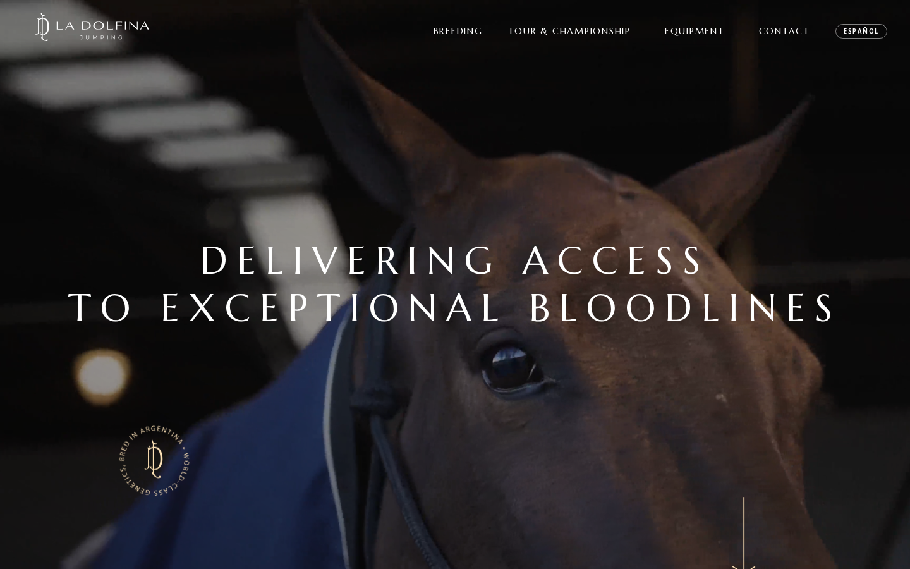

# UI Design System & Master Generation Blueprint: ladolfinajumping-com

> **La Dolfina Jumping. World class genetics, breed in Argentina** (https://ladolfinajumping.com/) — We are dedicated to create the finest show jumping horses through our cutting-edge breeding program in Argentina by sourcing and importin...



---

## 1. Executive Visual Persona & Design Archetype

- **Brand Essence & Persona**: **La Dolfina Jumping. World class genetics, breed in Argentina** (`https://ladolfinajumping.com/`). We are dedicated to create the finest show jumping horses through our cutting-edge breeding program in Argentina by sourcing and importin...
- **Capture Provenance**: Live browser capture (`tier1_fast`, HTTP `200`, captured `2026-11-23`).
- **Visual Archetype**: **Light-Substrate Editorial & Modular Grid System (`#ffffff` canvas, `#000000` ink, `#fbe0b6` accent)**.
- **Anti-AI-Slop Differentiators**:
  - **Live-Computed Chromatic Polarity**: Anchors the viewport in `#ffffff` (live computed `main` `background-color` (`computed_styles.json`)) paired with `#000000` primary typography and `#fbe0b6` accents.
  - **Grounded Typographic Hierarchy**: Pairs `Marcellus` for display copy (`DELIVERING ACCESS TO EXCEPTIONAL BLO`) with `Dualis Lite` and not declared in live computed styles (uses primary stack / `ui-monospace`).
  - **Calibrated Spatial Grid & Motion**: Combines `1680px` container bounds (`gap: 10px`, padding `45vw`) with `cubic-bezier(.4,0,.2,1)` easing and Lenis Smooth Scroll (`data-lenis`), Three.js / WebGL Canvas Pipeline.

---

## 2. Spatial Architecture & Modular Grid Mathematics


### Viewport Allocation & Container Geometry
- **Captured Viewport Dimensions**: Desktop `1440×900px` (`assets/desktop.png`, single-viewport 100vh live capture (900px)), Mobile `390×844px` (`assets/mobile.png`, single-viewport 100vh live capture (844px)).
- **Master Container Bounds**: `1680px` (non-`@media` desktop container stylesheet rule).
- **Canvas Lateral Padding & Spacing**: `45vw` lateral canvas padding with `10px` grid gap.
- **Border Radius Scale**: `100px`, `99px`, `50px`, `100%`.

### Responsive Breakpoint Architecture
- **Desktop Layout**: Multi-column CSS Grid / Flexbox layout at `1440px` (`max-width: 1680px`, `gap: 10px`).
- **Mobile Layout**: Single-column vertical stack at `390px` viewport width with `45vw` horizontal padding.
- **Extracted CSS Media Queries**: `@media (max-width: 600px)`, `@media (min-width: 600px)`, `@media (min-width: 1024px)`, `@media (min-width: 1256px)`.

---

## 3. Color System, Materiality & Atmospheric Lighting

### Semantic Palette & Source Grounding
| Semantic Role | Ground-Truth Value | Extracted Live / CSS Source |
|---|---|---|
| **Primary Canvas Substrate** | `#ffffff` | live computed `main` `background-color` (`computed_styles.json`) |
| **Primary Typography Ink** | `#000000` | live computed `main` `color` (`computed_styles.json`) |
| **Elevated Surface / Card Substrate** | `#f3f3f3` | `.loader__progress:before { background-color: #f3f3f3 }` |
| **Interactive Accent / Highlight** | `#fbe0b6` | `var(--color-primary)` in `:root` |
| **Secondary / Muted Copy** | `#c7bcac` | live computed `p` `color` (`computed_styles.json`) |
| **Structural Hairline Border** | `#be7e21` | `.cursor-dot { border: #be7e21 }` |
| **Variable Token (`--color-secondary`)** | `#0a1b2e` | `var(--color-secondary)` in `:root` |
| **Variable Token (`--color-p`)** | `#475768` | `var(--color-p)` in `:root` |
| **Variable Token (`--color-dark-strong`)** | `#0d1620` | `var(--color-dark-strong)` in `:root` |
| **Variable Token (`--color-footer`)** | `#162638` | `var(--color-footer)` in `:root` |
| **Variable Token (`--form-brdr`)** | `#efe7dc` | `var(--form-brdr)` in `:root` |
| **Variable Token (`--swiper-theme-color`)** | `#007aff` | `var(--swiper-theme-color)` in stylesheet |

### Sanitized Root CSS Variables (`ui-ux.md` Ground Truth)
| Variable Name | Extracted Value | Semantic Role |
|---|---|---|
| `--font-primary` | `"Noto Sans Display", sans-serif` | Brand / Palette Token |
| `--font-tertiary` | `"Marcellus", "Dualis Lite", "Noto Sans Display", sans-serif` | Typography / Scale Token |
| `--color-primary` | `#fbe0b6` | Brand / Palette Token |
| `--color-secondary` | `#0a1b2e` | Brand / Palette Token |
| `--color-tertiary` | `#be7e21` | Brand / Palette Token |
| `--color-quaternary` | `#c7bcac` | Brand / Palette Token |
| `--color-form` | `rgb(175, 145, 95)` | Brand / Palette Token |
| `--color-p` | `#475768` | Brand / Palette Token |
| `--color-dark-strong` | `#0d1620` | Canvas / Surface Token |
| `--color-footer` | `#162638` | Brand / Palette Token |
| `--form-brdr` | `2px solid #efe7dc` | Color / Atmospheric Token |
| `--font-secondary` | `"Alpine Script"` | Brand / Palette Token |
| `--swiper-theme-color` | `#007aff` | Brand / Palette Token |
| `--swiper-navigation-size` | `44px` | Layout / Spatial Grid Token |
| `--ladolfinajumping-bg` | `#ffffff` | Canvas Substrate (from live computed `main` `background-color` (`computed_styles.json`)) |
| `--ladolfinajumping-ink` | `#000000` | Primary Typography Ink (computed-derived) |

---

## 4. Typographic Scale & Editorial Hierarchy

### Font Family Stacks
- **Display Typography**: `Marcellus`.
- **Primary Body Stack**: `Dualis Lite`.
- **Technical / Metadata Stack**: not declared in live computed styles (uses primary stack / `ui-monospace`).

### Typographic Scale & Rules (Live Computed & Stylesheet Grounded)
- **Hero Display (`H1`)**: live computed `h1` (`font-size: 60px`, `line-height: 75px`, `font-weight: 400`, `letter-spacing: 15px`); rule `h1` (`letter-spacing: .25em`).
- **Section Heading (`H2`)**: live computed `h2` (`font-size: 60px`, `line-height: 72px`, `font-weight: 400`, `letter-spacing: 7.5px`).
- **Body Copy**: live computed `body` (`font-size: 16px`, `line-height: normal`, `font-weight: 400`); rule `p` (`font-weight: 500`).
- **Metadata & Navigation Labels**: live computed `nav/a` (`font-size: 16px`, `line-height: normal`, `font-weight: 400`).

---

## 5. Choreographed Motion & Interaction Physics

### Primary Easing Curves
- **Extracted Timing Functions**: `cubic-bezier(.4,0,.2,1)`.

### Per-Element Transition & Choreography Rules
- **Selector `.o-btn`**: `transition: .35s` extracted from `ladolfinajumping-com` stylesheet.
- **Selector `.o-btn:before`**: `transition: .35s` extracted from `ladolfinajumping-com` stylesheet.
- **Selector `.o-close`**: `transition: .5s` extracted from `ladolfinajumping-com` stylesheet.
- **Extracted Easing Curve (`cubic-bezier(.4,0,.2,1)`)**: Governs interactive state transitions across `<header.header>` and `<section.record__header>`.
- **Runtime Interaction Engine**: Integrates Lenis Smooth Scroll (`data-lenis`), Three.js / WebGL Canvas Pipeline, Swiper Touch Carousel Engine with `prefers-reduced-motion: reduce` fallback guards.

---

## 6. Component Wireframe & Structural DOM Map

### Visual Layout Schematic — Desktop (`1440px`, Grounded in `dom.html` & Landmark Bounding Boxes)
```
┌────────────────────────────────────────────────────────────────────────┐
│ DESKTOP VIEWPORT (1440px) — La Dolfina Jumping. World class genetics,  │
│ ====================================================================== │
│ [ <header.header> (1440x900px)        | Breeding Cría · Saddles · Br ] │
│ ---------------------------------------------------------------------- │
│ | HERO STAGE: <article.modal__wrapper> (w=1440px)                    | │
│ | H1: DELIVERING ACCESS TO EXCEPTIONAL BLOODLINES                    | │
│ | Substrate: #ffffff | Ink: #000000 | Accent: #fbe0b6                | │
│ ---------------------------------------------------------------------- │
│ | SHOWCASE GRID (<section.record__header>) max-w: 1680px             | │
│ | +------------------------------+  +------------------------------+ | │
│ | | La Dolfina Balouna           |  | Premium studs                | | │
│ | +------------------------------+  +------------------------------+ | │
│ ---------------------------------------------------------------------- │
│ | DETAIL MODULE (<section.record__title>) — Casallco                 | │
│ ---------------------------------------------------------------------- │
│ [ FOOTER (<footer.footer>     ) | https://ladolfinajumping.com/        │
└────────────────────────────────────────────────────────────────────────┘
```

### Visual Layout Schematic — Mobile Reflow (`390px`)
```
┌────────────────────────────────────────────────────────────────────────┐
│ MOBILE VIEWPORT REFLOW (390px) — Single-Column Stack (gap: 10px)       │
│ ====================================================================== │
│ [ HEADER BAR (<header.header>         ) | Compact Menu (390px)         │
│ ---------------------------------------------------------------------- │
│ | HERO STAGE (<article.modal__wrapper>) — 390px Vertical Lead        | │
│ | H1: DELIVERING ACCESS TO EXCEPTIONAL BLOODLINES                    | │
│ ---------------------------------------------------------------------- │
│ | SHOWCASE STACK (<section.record__heade) — 1-Col Stack              | │
│ | [ Item 1: La Dolfina Balouna                                     ] | │
│ | [ Item 2: Premium studs                                          ] | │
│ ---------------------------------------------------------------------- │
│ | DETAIL STACK (<section.record__title>) — 1-Col (Casallco)          | │
│ ---------------------------------------------------------------------- │
│ [ FOOTER (<footer.footer>     ) | Stacked 390px Colophon               │
└────────────────────────────────────────────────────────────────────────┘
```

### Granular DOM Region Breakdown
1. **Brand Header & Navigation Bar (<header.header> — `ladolfinajumping-com`)**:
   - Landmark `<header class="header has--bg-darken">` (`1440x900px`) hosting `La Dolfina Jumping. World class gene` navigation (`Breeding Cría · Saddles · Bridles · Monturas · Cabezadas`), DOM attributes (`data-speed="0.5"`, `data-transition="opacity-in"`, `data-speed="0.25"`, `data-transition="opacity-scale-in-group"`), and stylesheet rule `after { box-sizing:border-box }`.
2. **Hero Stage & Focal Lead (<article.modal__wrapper> — `DELIVERING ACCESS TO EXCEPTIONAL B`)**:
   - Landmark `<article class="modal__wrapper record">` presenting display lead `DELIVERING ACCESS TO EXCEPTIONAL BLOODLINES` and copy excerpt *"LA DOLFINA JUMPING IS A CUTTING-EDGE BREEDING PROGRAM CREATED BY "* over `#ffffff` canvas and `#000000` ink.
3. **Primary Showcase & Content Grid (<section.record__header> — `La Dolfina Balouna`)**:
   - Landmark `<section class="record__header">` rendering section `La Dolfina Balouna` with copy *"La Dolfina Balouna"*, asset references (`289546863693632`, `fbevents.js`, `gtm.js`, `favicon.png`), and grid rule `html { height:auto;font-size:16px }`.
4. **Interactive Detail & Feature Matrix (<section.record__title> — `Premium studs`)**:
   - Landmark `<section class="record__title main">` framing `Premium studs` and `Casallco` (*"Information & details are coming soon."*) with `#f3f3f3` surface cards, `#fbe0b6` accents, and `html.lenis { height:auto;scroll-behavior:initial }`.
5. **Colophon & Global Directory Footer (<footer.footer> — `https://ladolfinajumping.com/`)**:
   - Landmark `<footer class="footer bg-white">` anchoring `La Dolfina Jumping. World class ` footer links (`Breeding Cría · Saddles · Bridles · Monturas · Cabezadas`), copy *"La Dolfina Jumping Balouna Gama Z Balou du Rouet Baloubet Du"*, and `#be7e21` structural dividers.

---

## 7. Master Zero-Shot AI Generation Prompt

```markdown
# Master Zero-Shot Frontend Generation Prompt: ladolfinajumping-com (La Dolfina Jumping. World class genetics, breed in Argentina)

You are a principal frontend architect and design systems engineer. Build a complete, production-ready web application replicating the exact design system, DOM landmarks, typographic hierarchy, color tokens, and motion physics of `ladolfinajumping-com` (**La Dolfina Jumping. World class genetics, breed in Argentina** — `https://ladolfinajumping.com/`).

### 1. Visual Archetype & Anti-AI-Slop Mandates
- **Archetype**: Light-Substrate Editorial & Modular Grid System (`#ffffff` canvas, `#000000` ink, `#fbe0b6` accent).
- **Identity & Domain Context**: We are dedicated to create the finest show jumping horses through our cutting-edge breeding program in Argentina by sourcing and importin...
- **Primary Substrate**: `#ffffff` (live computed `main` `background-color` (`computed_styles.json`)), **Primary Ink**: `#000000`, **Accent / Highlight**: `#fbe0b6`.
- **Site-Specific Differentiators**:
  - **Live-Computed Chromatic Polarity**: Anchors the viewport in `#ffffff` (live computed `main` `background-color` (`computed_styles.json`)) paired with `#000000` primary typography and `#fbe0b6` accents.
  - **Grounded Typographic Hierarchy**: Pairs `Marcellus` for display copy (`DELIVERING ACCESS TO EXCEPTIONAL BLO`) with `Dualis Lite` and not declared in live computed styles (uses primary stack / `ui-monospace`).
  - **Calibrated Spatial Grid & Motion**: Combines `1680px` container bounds (`gap: 10px`, padding `45vw`) with `cubic-bezier(.4,0,.2,1)` easing and Lenis Smooth Scroll (`data-lenis`), Three.js / WebGL Canvas Pipeline.

### 2. Ground-Truth CSS Variables (`:root` Token Contract)
Declare and consume these exact custom properties extracted from `ladolfinajumping-com` in your global stylesheet:

:root {
  /* La Dolfina Jumping. World class genetics, breed in Argentina (ladolfinajumping-com) — Live-Grounded CSS Variables */
  --font-primary: "Noto Sans Display", sans-serif; /* Brand / Palette Token (ladolfinajumping-com) */
  --font-tertiary: "Marcellus", "Dualis Lite", "Noto Sans Display", sans-serif; /* Typography / Scale Token (ladolfinajumping-com) */
  --color-primary: #fbe0b6; /* Brand / Palette Token (ladolfinajumping-com) */
  --color-secondary: #0a1b2e; /* Brand / Palette Token (ladolfinajumping-com) */
  --color-tertiary: #be7e21; /* Brand / Palette Token (ladolfinajumping-com) */
  --color-quaternary: #c7bcac; /* Brand / Palette Token (ladolfinajumping-com) */
  --color-form: rgb(175, 145, 95); /* Brand / Palette Token (ladolfinajumping-com) */
  --color-p: #475768; /* Brand / Palette Token (ladolfinajumping-com) */
  --color-dark-strong: #0d1620; /* Canvas / Surface Token (ladolfinajumping-com) */
  --color-footer: #162638; /* Brand / Palette Token (ladolfinajumping-com) */
  --form-brdr: 2px solid #efe7dc; /* Color / Atmospheric Token (ladolfinajumping-com) */
  --font-secondary: "Alpine Script"; /* Brand / Palette Token (ladolfinajumping-com) */
  --swiper-theme-color: #007aff; /* Brand / Palette Token (ladolfinajumping-com) */
  --swiper-navigation-size: 44px; /* Layout / Spatial Grid Token (ladolfinajumping-com) */
  --ladolfinajumping-bg: #ffffff; /* Canvas Substrate (from live computed `main` `background-color` (`computed_styles.json`)) (ladolfinajumping-com) */
  --ladolfinajumping-ink: #000000; /* Primary Typography Ink (computed-derived) (ladolfinajumping-com) */
}

### 3. Semantic Color & Materiality Contract
Map every surface, ink, and border strictly to these source-grounded tokens:
- **Primary Canvas Substrate**: `#ffffff` — grounded in live computed `main` `background-color` (`computed_styles.json`)
- **Primary Typography Ink**: `#000000` — grounded in live computed `main` `color` (`computed_styles.json`)
- **Elevated Surface / Card Substrate**: `#f3f3f3` — grounded in `.loader__progress:before { background-color: #f3f3f3 }`
- **Interactive Accent / Highlight**: `#fbe0b6` — grounded in `var(--color-primary)` in `:root`
- **Secondary / Muted Copy**: `#c7bcac` — grounded in live computed `p` `color` (`computed_styles.json`)
- **Structural Hairline Border**: `#be7e21` — grounded in `.cursor-dot { border: #be7e21 }`
- **Variable Token (`--color-secondary`)**: `#0a1b2e` — grounded in `var(--color-secondary)` in `:root`
- **Variable Token (`--color-p`)**: `#475768` — grounded in `var(--color-p)` in `:root`
- **Variable Token (`--color-dark-strong`)**: `#0d1620` — grounded in `var(--color-dark-strong)` in `:root`
- **Variable Token (`--color-footer`)**: `#162638` — grounded in `var(--color-footer)` in `:root`
- **Variable Token (`--form-brdr`)**: `#efe7dc` — grounded in `var(--form-brdr)` in `:root`
- **Variable Token (`--swiper-theme-color`)**: `#007aff` — grounded in `var(--swiper-theme-color)` in stylesheet

### 4. Spatial Grid, Container Bounds & Responsive Breakpoints
- **Desktop Viewport Reference**: `1440×900px` (single-viewport 100vh live capture (900px), `1440px` standard desktop width).
- **Mobile Viewport Reference**: `390×844px` (single-viewport 100vh live capture (844px), `390px` standard mobile width).
- **Container Max-Width**: `1680px` (non-`@media` desktop container stylesheet rule)
- **Padding & Gutters**: `45vw` lateral canvas padding with `10px` grid gap
- **Desktop Grid**: Multi-column CSS Grid / Flexbox layout at `1440px` (`max-width: 1680px`, `gap: 10px`)
- **Mobile Adaptation**: Single-column vertical stack at `390px` viewport width with `45vw` horizontal padding
- **Media Queries**: `@media (max-width: 600px)`, `@media (min-width: 600px)`, `@media (min-width: 1024px)`, `@media (min-width: 1256px)`
- **Corner Radii**: `100px`, `99px`, `50px`, `100%`

### 5. Typography & Editorial Scale Contract
- **Display Font Stack**: `Marcellus`
- **Body Font Stack**: `Dualis Lite`
- **Monospace / Technical Font Stack**: not declared in live computed styles (uses primary stack / `ui-monospace`)
- **H1 Display Rule**: live computed `h1` (`font-size: 60px`, `line-height: 75px`, `font-weight: 400`, `letter-spacing: 15px`); rule `h1` (`letter-spacing: .25em`)
- **H2 Section Rule**: live computed `h2` (`font-size: 60px`, `line-height: 72px`, `font-weight: 400`, `letter-spacing: 7.5px`)
- **Body Copy Rule**: live computed `body` (`font-size: 16px`, `line-height: normal`, `font-weight: 400`); rule `p` (`font-weight: 500`)
- **Metadata & Index Rule**: live computed `nav/a` (`font-size: 16px`, `line-height: normal`, `font-weight: 400`)

### 6. Component Hierarchy, Verbatim Copy & Real DOM Landmarks
Scaffold `ladolfinajumping-com` (`La Dolfina Jumping. World class genetics, breed in Argentina`) with these exact structural regions, extracted copy, and CSS rules from `dom.html`:
1. **Brand Header & Navigation Bar (<header.header> — `ladolfinajumping-com`)**:
   - DOM & Selectors: Landmark `<header class="header has--bg-darken">` (`1440x900px`) hosting `La Dolfina Jumping. World class gene` navigation (`Breeding Cría · Saddles · Bridles · Monturas · Cabezadas`), DOM attributes (`data-speed="0.5"`, `data-transition="opacity-in"`, `data-speed="0.25"`, `data-transition="opacity-scale-in-group"`), and stylesheet rule `after { box-sizing:border-box }`.
   - Responsive Contract: Header `Brand Header & Navigation Bar (<header.header> — `ladolfinajumping-com`)` (`ladolfinajumping-com`) adapts across `@media (max-width: 600px)`, `@media (min-width: 600px)`, `@media (min-width: 1024px)`, `@media (min-width: 1256px)` with `cubic-bezier(.4,0,.2,1)` transitions and links `Breeding Cría · Saddles · Bridles · Monturas · Cabezadas`.
2. **Hero Stage & Focal Lead (<article.modal__wrapper> — `DELIVERING ACCESS TO EXCEPTIONAL B`)**:
   - DOM & Selectors: Landmark `<article class="modal__wrapper record">` presenting display lead `DELIVERING ACCESS TO EXCEPTIONAL BLOODLINES` and copy excerpt *"LA DOLFINA JUMPING IS A CUTTING-EDGE BREEDING PROGRAM CREATED BY "* over `#ffffff` canvas and `#000000` ink.
   - Responsive Contract: Hero stage (`1440×900px` desktop / `390×844px` mobile) sets `#ffffff` background with `#000000` headline `DELIVERING ACCESS TO EXCEPTIONAL BLOODLINES`.
3. **Primary Showcase & Content Grid (<section.record__header> — `La Dolfina Balouna`)**:
   - DOM & Selectors: Landmark `<section class="record__header">` rendering section `La Dolfina Balouna` with copy *"La Dolfina Balouna"*, asset references (`289546863693632`, `fbevents.js`, `gtm.js`, `favicon.png`), and grid rule `html { height:auto;font-size:16px }`.
   - Responsive Contract: Showcase grid `Primary Showcase & Content Grid (<section.record__header> — `La Dolfina Balouna`)` applies Multi-column CSS Grid / Flexbox layout at `1440px` (`max-width: 1680px`, `gap: 10px`) on desktop and Single-column vertical stack at `390px` viewport width with `45vw` horizontal padding on mobile.
4. **Interactive Detail & Feature Matrix (<section.record__title> — `Premium studs`)**:
   - DOM & Selectors: Landmark `<section class="record__title main">` framing `Premium studs` and `Casallco` (*"Information & details are coming soon."*) with `#f3f3f3` surface cards, `#fbe0b6` accents, and `html.lenis { height:auto;scroll-behavior:initial }`.
   - Responsive Contract: Detail module `Interactive Detail & Feature Matrix (<section.record__title> — `Premium studs`)` uses `100px`, `99px`, `50px`, `100%` radii, `#fbe0b6` highlights, and assets (289546863693632, fbevents.js, gtm.js).
5. **Colophon & Global Directory Footer (<footer.footer> — `https://ladolfinajumping.com/`)**:
   - DOM & Selectors: Landmark `<footer class="footer bg-white">` anchoring `La Dolfina Jumping. World class ` footer links (`Breeding Cría · Saddles · Bridles · Monturas · Cabezadas`), copy *"La Dolfina Jumping Balouna Gama Z Balou du Rouet Baloubet Du"*, and `#be7e21` structural dividers.
   - Responsive Contract: Footer `Colophon & Global Directory Footer (<footer.footer> — `https://ladolfinajumping.com/`)` aligns to `1680px` (non-`@media` desktop container stylesheet rule) with `45vw` lateral canvas padding with `10px` grid gap and attributes (data-speed="0.5", data-transition="opacity-in", data-speed="0.25").

#### Verbatim DOM Copy Excerpts (`dom.html`)
- Copy Excerpt 1: *"LA DOLFINA JUMPING IS A CUTTING-EDGE BREEDING PROGRAM CREATED BY ADOLFO CAMBIASO A..."*
- Copy Excerpt 2: *"La Dolfina Balouna"*
- Copy Excerpt 3: *"Information & details are coming soon."*
- Copy Excerpt 4: *"La Dolfina Jumping Balouna Gama Z Balou du Rouet Baloubet Du Rouet Galoubet A Mesa..."*

### 7. Motion, Extracted Stylesheet Rules & Interaction Choreography
- **Primary Easing Functions**: `cubic-bezier(.4,0,.2,1)`
- **Extracted Stylesheet Rules (`ladolfinajumping-com`)**:
- `after { box-sizing:border-box }`
- `html { height:auto;font-size:16px }`
- `html.lenis { height:auto;scroll-behavior:initial }`
- `.lenis.lenis-smooth { scroll-behavior:auto }`
- `.scroll-container { height:100vh;overflow-y:scroll }`
- **Per-Selector Transition Rules**:
- **Selector `.o-btn`**: `transition: .35s` extracted from `ladolfinajumping-com` stylesheet.
- **Selector `.o-btn:before`**: `transition: .35s` extracted from `ladolfinajumping-com` stylesheet.
- **Selector `.o-close`**: `transition: .5s` extracted from `ladolfinajumping-com` stylesheet.
- **Extracted Easing Curve (`cubic-bezier(.4,0,.2,1)`)**: Governs interactive state transitions across `<header.header>` and `<section.record__header>`.
- **Runtime Interaction Engine**: Integrates Lenis Smooth Scroll (`data-lenis`), Three.js / WebGL Canvas Pipeline, Swiper Touch Carousel Engine with `prefers-reduced-motion: reduce` fallback guards.

### 8. Technical Deliverables
- Implement in Next.js (App Router) with TypeScript and Tailwind CSS consuming the `:root` custom properties defined above for `ladolfinajumping-com`.
- Reproduce both the `1440px` desktop architecture and `390px` mobile breakpoint transitions, preserving semantic HTML5 landmarks (`<header>`, `<nav>`, `<main>`, `<section>`, `<footer>`) and `prefers-reduced-motion` accessibility guards.
```
