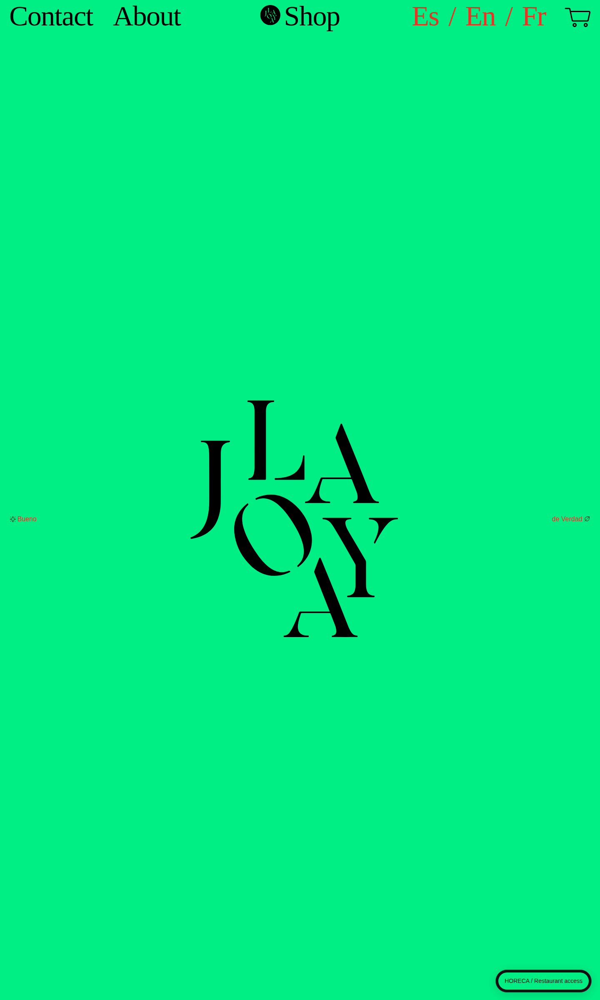
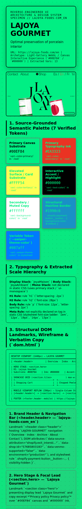

# UI Design System & Master Generation Blueprint: lajoya-foods-com_en

> **LAJOYA GOURMET** (https://lajoya-foods.com/en) — Optimal preservation of porcelain interior



---

## 1. Executive Visual Persona & Design Archetype

- **Brand Essence & Persona**: **LAJOYA GOURMET** (`https://lajoya-foods.com/en`). Optimal preservation of porcelain interior
- **Visual Archetype**: **Light-Gallery WebGL / Canvas Interactive Experience (`#00EF84` / `#000000`)**.
- **Anti-AI-Slop Differentiators**:
  - **Source-Grounded Chromatic Polarity**: Anchors the viewport in `#00EF84` (`var(--color-primary)` in `:root`) paired with `#000000` primary typography and `#000000` accents.
  - **Extracted Typographic Hierarchy**: Pairs `JoyaMaison` for display copy (`Lajoya Gourmet`) with `JoyaAmbiant` and not declared in static CSS (uses primary stack / `ui-monospace`).
  - **Calibrated Spatial Grid & Motion**: Combines `1200px` container bounds (`gap: 24px`, padding `24px`) with `cubic-bezier(.65,.05,.36,1)` easing and Lenis Smooth Scroll (`data-lenis`), Three.js / WebGL Canvas Pipeline.

---

## 2. Spatial Architecture & Modular Grid Mathematics



### Viewport Allocation & Container Geometry
- **Captured Viewport Dimensions**: Desktop `1440×2400px` (`assets/desktop.png`, capped at 2400px multi-section capture), Mobile `390×2400px` (`assets/mobile.png`, capped at 2400px multi-section capture).
- **Master Container Bounds**: `1200px` extracted from `lajoya-foods-com_en` stylesheet.
- **Canvas Lateral Padding & Spacing**: `24px` lateral canvas padding with `24px` grid gap.
- **Border Radius Scale**: `4px`, `22px`, `8px`, `6px`.

### Responsive Breakpoint Architecture
- **Desktop Layout**: Multi-column CSS Grid / Flexbox layout at `1440px` (`max-width: 1200px`, `gap: 24px`).
- **Mobile Layout**: Single-column vertical stack at `390px` viewport width with `24px` horizontal padding.
- **Extracted CSS Media Queries**: `@media screen and (forced-colors:active)`, `@media screen and (width<=750px)`, `@media (max-width:700px)`, `@media (prefers-reduced-motion:reduce)`.

---

## 3. Color System, Materiality & Atmospheric Lighting

### Semantic Palette & Source Grounding
| Semantic Role | Ground-Truth Value | Extracted CSS Source / Selector |
|---|---|---|
| **Primary Canvas Substrate** | `#00EF84` | `var(--color-primary)` in `:root` |
| **Primary Typography Ink** | `#EA3323` | `var(--color-secondary)` in `:root` |
| **Elevated Surface / Card Substrate** | `#FFFF54` | `var(--color-tertiary)` in `:root` |
| **Interactive Accent / Highlight** | `#000000` | `var(--text-color)` in `:root` |
| **Secondary / Muted Copy** | `#ffffff` | `var(--background-color)` in `:root` |
| **Structural Hairline Border** | `#1990c6` | `.shopify-payment-button__button... { background-color: #1990c6 }` |
| **Variable Token (`--swiper-theme-color`)** | `#007aff` | `var(--swiper-theme-color)` in stylesheet |

### Sanitized Root CSS Variables (`ui-ux.md` Ground Truth)
| Variable Name | Extracted Value | Semantic Role |
|---|---|---|
| `--color-primary` | `#00EF84` | Brand / Palette Token |
| `--color-secondary` | `#EA3323` | Brand / Palette Token |
| `--color-tertiary` | `#FFFF54` | Brand / Palette Token |
| `--font-primary` | `"Maison Neue"` | Brand / Palette Token |
| `--font-support` | `"Ambiant Light Spiky"` | Typography / Scale Token |
| `--font-support-s` | `"Ambiant Light Sans"` | Typography / Scale Token |
| `--text-reveal-bleed` | `.2em` | Typography Ink Token |
| `--space` | `4vw` | Layout / Spatial Grid Token |
| `--star-direction` | `reverse` | Design System Custom Token |
| `--height` | `790` | Layout / Spatial Grid Token |
| `--background` | `#ea3323` | Canvas / Surface Token |
| `--text-color` | `#000000` | Typography Ink Token |
| `--background-color` | `#ffffff` | Canvas / Surface Token |
| `--swiper-theme-color` | `#007aff` | Brand / Palette Token |
| `--lajoya-foods-com-bg` | `#00EF84` | Canvas Substrate (from `var(--color-primary)` in `:root`) |
| `--lajoya-foods-com-ink` | `#000000` | Primary Typography Ink (stylesheet-derived) |

---

## 4. Typographic Scale & Editorial Hierarchy

### Font Family Stacks
- **Display Typography**: `JoyaMaison`.
- **Primary Body Stack**: `JoyaAmbiant`.
- **Technical / Metadata Stack**: not declared in static CSS (uses primary stack / `ui-monospace`).

### Typographic Scale & Rules (Extracted from Stylesheet & Variables)
- **Hero Display (`H1`)**: rule `h1` (`letter-spacing: -2px`).
- **Section Heading (`H2`)**: rule `h2` (`font-size: 28px`).
- **Body Copy**: rule `p` (`font-size: 12px`, `letter-spacing: 2px`).
- **Metadata & Navigation Labels**: not explicitly declared on tag in static CSS (stylesheet font-size ladder: `1em`, `12px`, `19px`, `14px`, `13px`).

---

## 5. Choreographed Motion & Interaction Physics

### Primary Easing Curves
- **Extracted Timing Functions**: `cubic-bezier(.65,.05,.36,1)`, `cubic-bezier(.1,0,.3,1)`, `cubic-bezier(.215,.61,.355,1)`.

### Per-Element Transition & Choreography Rules
- **Selector `.shopify-payment-button__button`**: `transition: background .2s ease-in-out` extracted from `lajoya-foods-com_en` stylesheet.
- **Selector `.swiper-wrapper`**: `transition: var(--swiper-wrapper-transition-timing-function,initial)` extracted from `lajoya-foods-com_en` stylesheet.
- **Selector `.swiper-pagination`**: `transition: .3s opacity` extracted from `lajoya-foods-com_en` stylesheet.
- **Extracted Easing Curve (`cubic-bezier(.65,.05,.36,1)`)**: Governs interactive state transitions across `<header.header>` and `<section.tiles>`.
- **Runtime Interaction Engine**: Integrates Lenis Smooth Scroll (`data-lenis`), Three.js / WebGL Canvas Pipeline, Swiper Touch Carousel Engine, Barba.js Page Transition Router with `prefers-reduced-motion: reduce` fallback guards.

---

## 6. Component Wireframe & Structural DOM Map

### Visual Layout Schematic (Grounded in `dom.html` — `1440px` Desktop & `390px` Mobile Reflow)
```
┌────────────────────────────────────────────────────────────────────────┐
│ DESKTOP VIEWPORT (1440px) — LAJOYA GOURMET                             │
│ ====================================================================== │
│ [ <header.header>          | Overview · Index · Archive · About · C ]  │
│ ---------------------------------------------------------------------- │
│ | HERO STAGE: <section.hero>                                       |   │
│ | H1: Lajoya Gourmet                                               |   │
│ | Substrate: #00EF84    | Ink: #000000    | Accent: #000000        |   │
│ ---------------------------------------------------------------------- │
│ | SHOWCASE GRID (<section.tiles>           ) max-w: 1200px         |   │
│ | +------------------------------+  +------------------------------+ | │
│ | | Shopping Cart                |  | Chopped Peeled Tomato Choppe | | │
│ | +------------------------------+  +------------------------------+ | │
│ ---------------------------------------------------------------------- │
│ | MOBILE VIEWPORT REFLOW (390px) — Single-Column Stack (gap: 24px  ) | │
│ | [<header.header>] -> [<section.hero>] -> [<section.tiles>] |         │
│ ---------------------------------------------------------------------- │
│ [ FOOTER (<footer.header--mobile) | https://lajoya-foods.com/en        │
└────────────────────────────────────────────────────────────────────────┘
```

### Granular DOM Region Breakdown
1. **Brand Header & Navigation Bar (<header.header> — `lajoya-foods-com_en`)**:
   - Landmark `<header class="header">` hosting `LAJOYA GOURMET` navigation (`Overview · Index · Archive · About · Contact`), DOM attributes (`data-source-attribution="shopify.exit_intersti..."`, `data-shop-id="57685803183"`, `data-venmo-supported="false"`, `data-environment="production"`), and stylesheet rule `.shopify-payment-button__button--... { visibility:hidden }`.
2. **Hero Stage & Focal Lead (<section.hero> — `Lajoya Gourmet`)**:
   - Landmark `<section class="hero">` presenting display lead `Lajoya Gourmet` and copy excerpt *"Privacy policy Privacy policy"* over `#00EF84` canvas and `#000000` ink.
3. **Primary Showcase & Content Grid (<section.tiles> — `Shopping Cart`)**:
   - Landmark `<section class="tiles">` rendering section `Shopping Cart` with copy *"Terms of service Terms of service"*, asset references (`171ed732002c6631efbca8f91.js`, `klaviyo.js`, `1349771745561073`, `fbevents.js`), and grid rule `opify-payment-button__button--unb... { background-color:1990c6;padding:1em 2em }`.
4. **Interactive Detail & Feature Matrix (<section.tiles> — `Chopped Peeled Tomato Chopped Peel`)**:
   - Landmark `<section class="tiles">` framing `Chopped Peeled Tomato Chopped Peeled Tomato Chopp...` and `Whole Peeled Tomato Whole Peeled Tomato Whole Pee...` (*"Legal notice Legal notice"*) with `#FFFF54` surface cards, `#000000` accents, and `ptions.shopify-payment-button__sk... { width:50%;margin-left:25%;margin-right:25%;border-radius:4px!important;h... }`.
5. **Colophon & Global Directory Footer (<footer.header--mobile> — `https://lajoya-foods.com/en`)**:
   - Landmark `<footer class="header--mobile">` anchoring `LAJOYA GOURMET` footer links (`Overview · Index · Archive · About · Contact`), copy *"© LaJoya 2026 © LaJoya 2026"*, and `#1990c6` structural dividers.

---

## 7. Master Zero-Shot AI Generation Prompt

```markdown
# Master Zero-Shot Frontend Generation Prompt: lajoya-foods-com_en (LAJOYA GOURMET)

You are a principal frontend architect and design systems engineer. Build a complete, production-ready web application replicating the exact design system, DOM landmarks, typographic hierarchy, color tokens, and motion physics of `lajoya-foods-com_en` (**LAJOYA GOURMET** — `https://lajoya-foods.com/en`).

### 1. Visual Archetype & Anti-AI-Slop Mandates
- **Archetype**: Light-Gallery WebGL / Canvas Interactive Experience (`#00EF84` / `#000000`).
- **Identity & Domain Context**: Optimal preservation of porcelain interior
- **Primary Substrate**: `#00EF84` (`var(--color-primary)` in `:root`), **Primary Ink**: `#000000`, **Accent / Highlight**: `#000000`.
- **Site-Specific Differentiators**:
  - **Source-Grounded Chromatic Polarity**: Anchors the viewport in `#00EF84` (`var(--color-primary)` in `:root`) paired with `#000000` primary typography and `#000000` accents.
  - **Extracted Typographic Hierarchy**: Pairs `JoyaMaison` for display copy (`Lajoya Gourmet`) with `JoyaAmbiant` and not declared in static CSS (uses primary stack / `ui-monospace`).
  - **Calibrated Spatial Grid & Motion**: Combines `1200px` container bounds (`gap: 24px`, padding `24px`) with `cubic-bezier(.65,.05,.36,1)` easing and Lenis Smooth Scroll (`data-lenis`), Three.js / WebGL Canvas Pipeline.

### 2. Ground-Truth CSS Variables (`:root` Token Contract)
Declare and consume these exact custom properties extracted from `lajoya-foods-com_en` in your global stylesheet:

:root {
  /* LAJOYA GOURMET (lajoya-foods-com_en) — Ground-Truth Extracted CSS Variables */
  --color-primary: #00EF84; /* Brand / Palette Token (lajoya-foods-com_en) */
  --color-secondary: #EA3323; /* Brand / Palette Token (lajoya-foods-com_en) */
  --color-tertiary: #FFFF54; /* Brand / Palette Token (lajoya-foods-com_en) */
  --font-primary: "Maison Neue"; /* Brand / Palette Token (lajoya-foods-com_en) */
  --font-support: "Ambiant Light Spiky"; /* Typography / Scale Token (lajoya-foods-com_en) */
  --font-support-s: "Ambiant Light Sans"; /* Typography / Scale Token (lajoya-foods-com_en) */
  --text-reveal-bleed: .2em; /* Typography Ink Token (lajoya-foods-com_en) */
  --space: 4vw; /* Layout / Spatial Grid Token (lajoya-foods-com_en) */
  --star-direction: reverse; /* Design System Custom Token (lajoya-foods-com_en) */
  --height: 790; /* Layout / Spatial Grid Token (lajoya-foods-com_en) */
  --background: #ea3323; /* Canvas / Surface Token (lajoya-foods-com_en) */
  --text-color: #000000; /* Typography Ink Token (lajoya-foods-com_en) */
  --background-color: #ffffff; /* Canvas / Surface Token (lajoya-foods-com_en) */
  --swiper-theme-color: #007aff; /* Brand / Palette Token (lajoya-foods-com_en) */
  --lajoya-foods-com-bg: #00EF84; /* Canvas Substrate (from `var(--color-primary)` in `:root`) (lajoya-foods-com_en) */
  --lajoya-foods-com-ink: #000000; /* Primary Typography Ink (stylesheet-derived) (lajoya-foods-com_en) */
}

### 3. Semantic Color & Materiality Contract
Map every surface, ink, and border strictly to these source-grounded tokens:
- **Primary Canvas Substrate**: `#00EF84` — grounded in `var(--color-primary)` in `:root`
- **Primary Typography Ink**: `#EA3323` — grounded in `var(--color-secondary)` in `:root`
- **Elevated Surface / Card Substrate**: `#FFFF54` — grounded in `var(--color-tertiary)` in `:root`
- **Interactive Accent / Highlight**: `#000000` — grounded in `var(--text-color)` in `:root`
- **Secondary / Muted Copy**: `#ffffff` — grounded in `var(--background-color)` in `:root`
- **Structural Hairline Border**: `#1990c6` — grounded in `.shopify-payment-button__button... { background-color: #1990c6 }`
- **Variable Token (`--swiper-theme-color`)**: `#007aff` — grounded in `var(--swiper-theme-color)` in stylesheet

### 4. Spatial Grid, Container Bounds & Responsive Breakpoints
- **Desktop Viewport Reference**: `1440×2400px` (capped at 2400px multi-section capture, `1440px` standard desktop width).
- **Mobile Viewport Reference**: `390×2400px` (capped at 2400px multi-section capture, `390px` standard mobile width).
- **Container Max-Width**: `1200px` extracted from `lajoya-foods-com_en` stylesheet
- **Padding & Gutters**: `24px` lateral canvas padding with `24px` grid gap
- **Desktop Grid**: Multi-column CSS Grid / Flexbox layout at `1440px` (`max-width: 1200px`, `gap: 24px`)
- **Mobile Adaptation**: Single-column vertical stack at `390px` viewport width with `24px` horizontal padding
- **Media Queries**: `@media screen and (forced-colors:active)`, `@media screen and (width<=750px)`, `@media (max-width:700px)`, `@media (prefers-reduced-motion:reduce)`
- **Corner Radii**: `4px`, `22px`, `8px`, `6px`

### 5. Typography & Editorial Scale Contract
- **Display Font Stack**: `JoyaMaison`
- **Body Font Stack**: `JoyaAmbiant`
- **Monospace / Technical Font Stack**: not declared in static CSS (uses primary stack / `ui-monospace`)
- **H1 Display Rule**: rule `h1` (`letter-spacing: -2px`)
- **H2 Section Rule**: rule `h2` (`font-size: 28px`)
- **Body Copy Rule**: rule `p` (`font-size: 12px`, `letter-spacing: 2px`)
- **Metadata & Index Rule**: not explicitly declared on tag in static CSS (stylesheet font-size ladder: `1em`, `12px`, `19px`, `14px`, `13px`)

### 6. Component Hierarchy, Verbatim Copy & Real DOM Landmarks
Scaffold `lajoya-foods-com_en` (`LAJOYA GOURMET`) with these exact structural regions, extracted copy, and CSS rules from `dom.html`:
1. **Brand Header & Navigation Bar (<header.header> — `lajoya-foods-com_en`)**:
   - DOM & Selectors: Landmark `<header class="header">` hosting `LAJOYA GOURMET` navigation (`Overview · Index · Archive · About · Contact`), DOM attributes (`data-source-attribution="shopify.exit_intersti..."`, `data-shop-id="57685803183"`, `data-venmo-supported="false"`, `data-environment="production"`), and stylesheet rule `.shopify-payment-button__button--... { visibility:hidden }`.
   - Responsive Contract: Header `Brand Header & Navigation Bar (<header.header> — `lajoya-foods-com_en`)` (`lajoya-foods-com_en`) adapts across `@media screen and (forced-colors:active)`, `@media screen and (width<=750px)`, `@media (max-width:700px)`, `@media (prefers-reduced-motion:reduce)` with `cubic-bezier(.65,.05,.36,1)`, `cubic-bezier(.1,0,.3,1)`, `cubic-bezier(.215,.61,.355,1)` transitions and links `Overview · Index · Archive · About · Contact`.
2. **Hero Stage & Focal Lead (<section.hero> — `Lajoya Gourmet`)**:
   - DOM & Selectors: Landmark `<section class="hero">` presenting display lead `Lajoya Gourmet` and copy excerpt *"Privacy policy Privacy policy"* over `#00EF84` canvas and `#000000` ink.
   - Responsive Contract: Hero stage (`1440×2400px` desktop / `390×2400px` mobile) sets `#00EF84` background with `#000000` headline `Lajoya Gourmet`.
3. **Primary Showcase & Content Grid (<section.tiles> — `Shopping Cart`)**:
   - DOM & Selectors: Landmark `<section class="tiles">` rendering section `Shopping Cart` with copy *"Terms of service Terms of service"*, asset references (`171ed732002c6631efbca8f91.js`, `klaviyo.js`, `1349771745561073`, `fbevents.js`), and grid rule `opify-payment-button__button--unb... { background-color:1990c6;padding:1em 2em }`.
   - Responsive Contract: Showcase grid `Primary Showcase & Content Grid (<section.tiles> — `Shopping Cart`)` applies Multi-column CSS Grid / Flexbox layout at `1440px` (`max-width: 1200px`, `gap: 24px`) on desktop and Single-column vertical stack at `390px` viewport width with `24px` horizontal padding on mobile.
4. **Interactive Detail & Feature Matrix (<section.tiles> — `Chopped Peeled Tomato Chopped Peel`)**:
   - DOM & Selectors: Landmark `<section class="tiles">` framing `Chopped Peeled Tomato Chopped Peeled Tomato Chopp...` and `Whole Peeled Tomato Whole Peeled Tomato Whole Pee...` (*"Legal notice Legal notice"*) with `#FFFF54` surface cards, `#000000` accents, and `ptions.shopify-payment-button__sk... { width:50%;margin-left:25%;margin-right:25%;border-radius:4px!important;h... }`.
   - Responsive Contract: Detail module `Interactive Detail & Feature Matrix (<section.tiles> — `Chopped Peeled Tomato Chopped Peel`)` uses `4px`, `22px`, `8px`, `6px` radii, `#000000` highlights, and assets (171ed732002c6631efbca8f91.js, klaviyo.js, 1349771745561073).
5. **Colophon & Global Directory Footer (<footer.header--mobile> — `https://lajoya-foods.com/en`)**:
   - DOM & Selectors: Landmark `<footer class="header--mobile">` anchoring `LAJOYA GOURMET` footer links (`Overview · Index · Archive · About · Contact`), copy *"© LaJoya 2026 © LaJoya 2026"*, and `#1990c6` structural dividers.
   - Responsive Contract: Footer `Colophon & Global Directory Footer (<footer.header--mobile> — `https://lajoya-foods.com/en`)` aligns to `1200px` extracted from `lajoya-foods-com_en` stylesheet with `24px` lateral canvas padding with `24px` grid gap and attributes (data-source-attribution="shopify.exit_intersti...", data-shop-id="57685803183", data-venmo-supported="false").

#### Verbatim DOM Copy Excerpts (`dom.html`)
- Copy Excerpt 1: *"Privacy policy Privacy policy"*
- Copy Excerpt 2: *"Terms of service Terms of service"*
- Copy Excerpt 3: *"Legal notice Legal notice"*
- Copy Excerpt 4: *"© LaJoya 2026 © LaJoya 2026"*

### 7. Motion, Extracted Stylesheet Rules & Interaction Choreography
- **Primary Easing Functions**: `cubic-bezier(.65,.05,.36,1)`, `cubic-bezier(.1,0,.3,1)`, `cubic-bezier(.215,.61,.355,1)`
- **Extracted Stylesheet Rules (`lajoya-foods-com_en`)**:
- `.shopify-payment-button__button--... { visibility:hidden }`
- `opify-payment-button__button--unb... { background-color:1990c6;padding:1em 2em }`
- `ptions.shopify-payment-button__sk... { width:50%;margin-left:25%;margin-right:25%;border-radius:4px!important;h... }`
- `shopify-payment-button__button--b... { z-index:1;flex-direction:column;display:flex;position:relative }`
- `on__button--branded .shopify-clea... { flex-direction:column!important;flex:1!important;display:flex!important }`
- **Per-Selector Transition Rules**:
- **Selector `.shopify-payment-button__button`**: `transition: background .2s ease-in-out` extracted from `lajoya-foods-com_en` stylesheet.
- **Selector `.swiper-wrapper`**: `transition: var(--swiper-wrapper-transition-timing-function,initial)` extracted from `lajoya-foods-com_en` stylesheet.
- **Selector `.swiper-pagination`**: `transition: .3s opacity` extracted from `lajoya-foods-com_en` stylesheet.
- **Extracted Easing Curve (`cubic-bezier(.65,.05,.36,1)`)**: Governs interactive state transitions across `<header.header>` and `<section.tiles>`.
- **Runtime Interaction Engine**: Integrates Lenis Smooth Scroll (`data-lenis`), Three.js / WebGL Canvas Pipeline, Swiper Touch Carousel Engine, Barba.js Page Transition Router with `prefers-reduced-motion: reduce` fallback guards.

### 8. Technical Deliverables
- Implement in Next.js (App Router) with TypeScript and Tailwind CSS consuming the `:root` custom properties defined above for `lajoya-foods-com_en`.
- Reproduce both the `1440px` desktop architecture and `390px` mobile breakpoint transitions, preserving semantic HTML5 landmarks (`<header>`, `<nav>`, `<main>`, `<section>`, `<footer>`) and `prefers-reduced-motion` accessibility guards.
```
