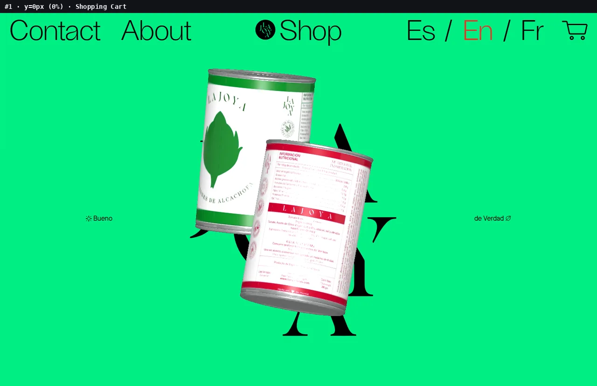
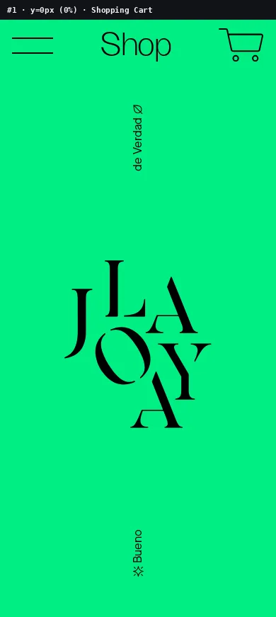

# UI Design System & Master Generation Blueprint: lajoya-foods-com_en

> **LAJOYA GOURMET** (https://lajoya-foods.com/en) — Optimal preservation of porcelain interior





---

## 1. Executive Visual Persona & Design Archetype

- **Brand Essence & Persona**: **LAJOYA GOURMET** (`https://lajoya-foods.com/en`). Optimal preservation of porcelain interior
- **Capture Provenance**: Live browser capture (`tier1_fast`, HTTP `200`, captured `2026-11-24`).
- **Visual Archetype**: **Light-Gallery WebGL / Canvas Interactive Experience (`#00ef84` / `#ea3323`)**.
- **Anti-AI-Slop Differentiators**:
  - **Live-Computed Chromatic Polarity**: Anchors the viewport in `#00ef84` (live computed `body` `background-color` (`computed_styles.json`)) paired with `#000000` primary typography and `#ea3323` accents.
  - **Grounded Typographic Hierarchy**: Pairs `Ambiant Light Sans` for display copy (`Lajoya Gourmet`) with `Maison Neue`.
  - **Calibrated Spatial Grid & Motion**: Combines `83rem` container bounds (`gap: 2.4rem`, padding `22px`) with `cubic-bezier(.65,.05,.36,1)` easing and Lenis Smooth Scroll (`data-lenis`), Three.js / WebGL Canvas Pipeline.

---

## 2. Spatial Architecture & Modular Grid Mathematics

### Viewport Allocation & Container Geometry
- **Captured Journey Filmstrips**: Desktop `1280×828px` (`assets/desktop-journey.webp`, `1` keyframes up to `y=0px` / doc `900px`), Mobile `390×872px` (`assets/mobile-journey.webp`, `1` keyframes).
- **Master Container Bounds**: `83rem` (non-`@media` desktop container stylesheet rule).
- **Canvas Lateral Padding & Spacing**: `22px` lateral canvas padding with `2.4rem` grid gap.
- **Border Radius Scale**: `50%`, `10px`, `100%`, `8px`.

### Responsive Breakpoint Architecture
- **Desktop Layout**: Multi-column CSS Grid / Flexbox layout at `1440px` (`max-width: 83rem`, `gap: 2.4rem`).
- **Mobile Layout**: Single-column vertical stack at `390px` viewport width with `22px` horizontal padding.
- **Extracted CSS Media Queries**: `@media (max-width:1024px)`, `@media (min-width:1025px)`, `@media (max-width:1023px)`, `@media (min-width:1024px)`.

---

## 3. Color System, Materiality & Atmospheric Lighting

### Semantic Palette & Source Grounding
| Semantic Role | Ground-Truth Value | Extracted Live / CSS Source |
|---|---|---|
| **Primary Canvas Substrate** | `#00ef84` | live computed `body` `background-color` (`computed_styles.json`) |
| **Primary Typography Ink** | `#000000` | live computed `h1` `color` (`computed_styles.json`) |
| **Elevated Surface / Card Substrate** | `#ffffff` | `var(--background-color)` in `:root` |
| **Interactive Accent / Highlight** | `#ea3323` | `.header__button-cart-quantity { background-color: #ea3323 }` |
| **Secondary / Muted Copy** | `#ea3323` | `var(--color-secondary)` in `:root` |
| **Structural Hairline Border** | `#ffffff` | `on.loading>.loading-overlay__sp... { stroke: #ffffff }` |
| **Variable Token (`--color-tertiary`)** | `#ffff54` | `var(--color-tertiary)` in `:root` |
| **Variable Token (`--swiper-theme-color`)** | `#007aff` | `var(--swiper-theme-color)` in stylesheet |

### Sanitized Root CSS Variables (`ui-ux.md` Ground Truth)
| Variable Name | Extracted Value | Semantic Role |
|---|---|---|
| `--color-primary` | `#00EF84` | Brand / Palette Token |
| `--color-secondary` | `#EA3323` | Brand / Palette Token |
| `--color-tertiary` | `#FFFF54` | Brand / Palette Token |
| `--font-primary` | `"Maison Neue"` | Brand / Palette Token |
| `--font-support` | `"Ambiant Light Spiky"` | Typography / Scale Token |
| `--font-support-s` | `"Ambiant Light Sans"` | Typography / Scale Token |
| `--text-reveal-bleed` | `.2em` | Typography Ink Token |
| `--space` | `4vw` | Layout / Spatial Grid Token |
| `--star-direction` | `reverse` | Design System Custom Token |
| `--height` | `790` | Layout / Spatial Grid Token |
| `--background` | `#ea3323` | Canvas / Surface Token |
| `--text-color` | `#000000` | Typography Ink Token |
| `--background-color` | `#ffffff` | Canvas / Surface Token |
| `--swiper-theme-color` | `#007aff` | Brand / Palette Token |
| `--lajoya-foods-com-bg` | `#00ef84` | Canvas Substrate (from live computed `body` `background-color` (`computed_styles.json`)) |
| `--lajoya-foods-com-ink` | `#000000` | Primary Typography Ink (computed-derived) |

---

## 4. Typographic Scale & Editorial Hierarchy

### Font Family Stacks
- **Display Typography**: `Ambiant Light Sans`.
- **Primary Body Stack**: `Maison Neue`.
- **Technical / Metadata Stack**: not declared in live computed styles (uses primary stack / `ui-monospace`).

### Typographic Scale & Rules (Live Computed & Stylesheet Grounded)
- **Hero Display (`H1`)**: live computed `h1` (`font-size: 68px`, `line-height: 68px`, `font-weight: 400`, `letter-spacing: -1.5px`).
- **Section Heading (`H2`)**: live computed `h3 (primary section heading)` (`font-size: 68px`, `line-height: 48px`, `font-weight: 400`).
- **Body Copy**: live computed `body` (`font-size: 10px`, `line-height: 10px`, `font-weight: 400`).
- **Metadata & Navigation Labels**: live computed `nav/a` (`font-size: 68px`, `line-height: 68px`, `font-weight: 400`, `letter-spacing: -1.5px`).

---

## 5. Choreographed Motion & Interaction Physics

### Primary Easing Curves
- **Extracted Timing Functions**: `cubic-bezier(.65,.05,.36,1)`, `cubic-bezier(.1,0,.3,1)`, `cubic-bezier(.215,.61,.355,1)`.

### Per-Element Transition & Choreography Rules
- **Selector `.swiper-wrapper`**: `transition: var(--swiper-wrapper-transition-timing-function,initial)` extracted from `lajoya-foods-com_en` stylesheet.
- **Selector `.swiper-pagination`**: `transition: .3s opacity` extracted from `lajoya-foods-com_en` stylesheet.
- **Selector `n-bullets-dynamic .swiper-paginat...`**: `transition: .2s transform,.2s top` extracted from `lajoya-foods-com_en` stylesheet.
- **Extracted Easing Curve (`cubic-bezier(.65,.05,.36,1)`)**: Governs interactive state transitions across `<header.header>` and `<section.tiles>`.
- **Runtime Interaction Engine**: Integrates Lenis Smooth Scroll (`data-lenis`), Three.js / WebGL Canvas Pipeline, Swiper Touch Carousel Engine, Barba.js Page Transition Router with `prefers-reduced-motion: reduce` fallback guards.
### Measured Runtime Scroll & Interaction Telemetry (`behavioral_journey_v2`)
- **Scroll Driver Mode**: `wheel` (max document height `900px`, deepest scrollY reached `0px` across `1` desktop keyframes).
- **Detected Scroll / Motion Libraries**: `WebGL/Canvas`.

---

## 6. Component Wireframe & Structural DOM Map

### Visual Layout Schematic — Desktop (`1440px`, Grounded in `dom.html` & Landmark Bounding Boxes)
```
┌────────────────────────────────────────────────────────────────────────┐
│ DESKTOP VIEWPORT (1440px) — LAJOYA GOURMET                             │
│ ====================================================================== │
│ [ <header.header> (1440x92px)         | Contact · About · Shop · Sho ] │
│ ---------------------------------------------------------------------- │
│ | HERO STAGE: <section.hero> (w=1440px)                              | │
│ | H1: Lajoya Gourmet                                                 | │
│ | Substrate: #00ef84 | Ink: #000000 | Accent: #ea3323                | │
│ ---------------------------------------------------------------------- │
│ | SHOWCASE GRID (<section.tiles>) max-w: 83rem                       | │
│ | +------------------------------+  +------------------------------+ | │
│ | | Chopped Peeled Tomato Choppe |  | Whole Peeled Tomato Whole Pe | | │
│ | +------------------------------+  +------------------------------+ | │
│ ---------------------------------------------------------------------- │
│ | DETAIL MODULE (<section.tiles:nth(2)>) — Artichoke Hearts Arti     | │
│ ---------------------------------------------------------------------- │
│ [ FOOTER (<footer.header--mobi) | https://lajoya-foods.com/en          │
└────────────────────────────────────────────────────────────────────────┘
```

### Visual Layout Schematic — Mobile Reflow (`390px`)
```
┌────────────────────────────────────────────────────────────────────────┐
│ MOBILE VIEWPORT REFLOW (390px) — Single-Column Stack (gap: 2.4rem)     │
│ ====================================================================== │
│ [ HEADER BAR (<header.header>         ) | Compact Menu (390px)         │
│ ---------------------------------------------------------------------- │
│ | HERO STAGE (<section.hero>) — 390px Vertical Lead                  | │
│ | H1: Lajoya Gourmet                                                 | │
│ ---------------------------------------------------------------------- │
│ | SHOWCASE STACK (<section.tiles>) — 1-Col Stack                     | │
│ | [ Item 1: Chopped Peeled Tomato Chopped Peeled Tomato Chopp...   ] | │
│ | [ Item 2: Whole Peeled Tomato Whole Peeled Tomato Whole Pee...   ] | │
│ ---------------------------------------------------------------------- │
│ | DETAIL STACK (<section.tiles:nth(2)>) — 1-Col (Artichoke Hearts A) | │
│ ---------------------------------------------------------------------- │
│ [ FOOTER (<footer.header--mobi) | Stacked 390px Colophon               │
└────────────────────────────────────────────────────────────────────────┘
```

### Granular DOM Region Breakdown
1. **Brand Header & Navigation Bar (<header.header> — `lajoya-foods-com_en`)**:
   - Landmark `<header class="header">` (`1440x92px`) hosting `LAJOYA GOURMET` navigation (`Contact · About · Shop · Shop Shop`), DOM attributes (`data-source-attribution="shopify.exit_intersti..."`, `data-shop-id="57685803183"`, `data-venmo-supported="false"`, `data-environment="production"`), and stylesheet rule `root { --swiper-theme-color:007aff }`.
2. **Hero Stage & Focal Lead (<section.hero> — `Lajoya Gourmet`)**:
   - Landmark `<section class="hero">` presenting display lead `Lajoya Gourmet` and copy excerpt *"Chopped Peeled Tomato"* over `#00ef84` canvas and `#000000` ink.
3. **Primary Showcase & Content Grid (<section.tiles> — `Chopped Peeled Tomato Chopped Peel`)**:
   - Landmark `<section class="tiles">` rendering section `Chopped Peeled Tomato Chopped Peeled Tomato Chopp...` with copy *"Whole Peeled Tomato"*, asset references (`171ed732002c6631efbca8f91.js`, `klaviyo.js`, `1349771745561073`, `fbevents.js`), and grid rule `host { position:relative;display:block;margin-left:auto;margin-right:auto;z-ind... }`.
4. **Interactive Detail & Feature Matrix (<section.tiles:nth(2)> — `Whole Peeled Tomato Whole Peeled T`)**:
   - Landmark `<section class="tiles">` framing `Whole Peeled Tomato Whole Peeled Tomato Whole Pee...` and `Artichoke Hearts Artichoke Hearts Artichoke Heart...` (*"Optimal preservation of porcelain interior"*) with `#ffffff` surface cards, `#ea3323` accents, and `.swiper { margin-left:auto;margin-right:auto;position:relative;overflow:hidden;lis... }`.
5. **Colophon & Global Directory Footer (<footer.header--mobile> — `https://lajoya-foods.com/en`)**:
   - Landmark `<footer class="header--mobile">` anchoring `LAJOYA GOURMET` footer links (`Contact · About · Shop · Shop Shop`), copy *"Extra virgin olive oil"*, and `#ffffff` structural dividers.
### Full Vertical Scroll Sequence (Desktop `1440×900` Keyframes)
- **Step 01** (`y=0px`, `0%`): Active landmark `Shopping Cart` · sticky/fixed elements: `3`

---

## 7. Master Zero-Shot AI Generation Prompt

```markdown
# Master Zero-Shot Frontend Generation Prompt: lajoya-foods-com_en (LAJOYA GOURMET)

You are a principal frontend architect and design systems engineer. Build a complete, production-ready web application replicating the exact design system, DOM landmarks, typographic hierarchy, color tokens, and motion physics of `lajoya-foods-com_en` (**LAJOYA GOURMET** — `https://lajoya-foods.com/en`).

### 1. Visual Archetype & Anti-AI-Slop Mandates
- **Archetype**: Light-Gallery WebGL / Canvas Interactive Experience (`#00ef84` / `#ea3323`).
- **Identity & Domain Context**: Optimal preservation of porcelain interior
- **Primary Substrate**: `#00ef84` (live computed `body` `background-color` (`computed_styles.json`)), **Primary Ink**: `#000000`, **Accent / Highlight**: `#ea3323`.
- **Site-Specific Differentiators**:
  - **Live-Computed Chromatic Polarity**: Anchors the viewport in `#00ef84` (live computed `body` `background-color` (`computed_styles.json`)) paired with `#000000` primary typography and `#ea3323` accents.
  - **Grounded Typographic Hierarchy**: Pairs `Ambiant Light Sans` for display copy (`Lajoya Gourmet`) with `Maison Neue`.
  - **Calibrated Spatial Grid & Motion**: Combines `83rem` container bounds (`gap: 2.4rem`, padding `22px`) with `cubic-bezier(.65,.05,.36,1)` easing and Lenis Smooth Scroll (`data-lenis`), Three.js / WebGL Canvas Pipeline.

### 2. Ground-Truth CSS Variables (`:root` Token Contract)
Declare and consume these exact custom properties extracted from `lajoya-foods-com_en` in your global stylesheet:

:root {
  /* LAJOYA GOURMET (lajoya-foods-com_en) — Live-Grounded CSS Variables */
  --color-primary: #00EF84; /* Brand / Palette Token (lajoya-foods-com_en) */
  --color-secondary: #EA3323; /* Brand / Palette Token (lajoya-foods-com_en) */
  --color-tertiary: #FFFF54; /* Brand / Palette Token (lajoya-foods-com_en) */
  --font-primary: "Maison Neue"; /* Brand / Palette Token (lajoya-foods-com_en) */
  --font-support: "Ambiant Light Spiky"; /* Typography / Scale Token (lajoya-foods-com_en) */
  --font-support-s: "Ambiant Light Sans"; /* Typography / Scale Token (lajoya-foods-com_en) */
  --text-reveal-bleed: .2em; /* Typography Ink Token (lajoya-foods-com_en) */
  --space: 4vw; /* Layout / Spatial Grid Token (lajoya-foods-com_en) */
  --star-direction: reverse; /* Design System Custom Token (lajoya-foods-com_en) */
  --height: 790; /* Layout / Spatial Grid Token (lajoya-foods-com_en) */
  --background: #ea3323; /* Canvas / Surface Token (lajoya-foods-com_en) */
  --text-color: #000000; /* Typography Ink Token (lajoya-foods-com_en) */
  --background-color: #ffffff; /* Canvas / Surface Token (lajoya-foods-com_en) */
  --swiper-theme-color: #007aff; /* Brand / Palette Token (lajoya-foods-com_en) */
  --lajoya-foods-com-bg: #00ef84; /* Canvas Substrate (from live computed `body` `background-color` (`computed_styles.json`)) (lajoya-foods-com_en) */
  --lajoya-foods-com-ink: #000000; /* Primary Typography Ink (computed-derived) (lajoya-foods-com_en) */
}

### 3. Semantic Color & Materiality Contract
Map every surface, ink, and border strictly to these source-grounded tokens:
- **Primary Canvas Substrate**: `#00ef84` — grounded in live computed `body` `background-color` (`computed_styles.json`)
- **Primary Typography Ink**: `#000000` — grounded in live computed `h1` `color` (`computed_styles.json`)
- **Elevated Surface / Card Substrate**: `#ffffff` — grounded in `var(--background-color)` in `:root`
- **Interactive Accent / Highlight**: `#ea3323` — grounded in `.header__button-cart-quantity { background-color: #ea3323 }`
- **Secondary / Muted Copy**: `#ea3323` — grounded in `var(--color-secondary)` in `:root`
- **Structural Hairline Border**: `#ffffff` — grounded in `on.loading>.loading-overlay__sp... { stroke: #ffffff }`
- **Variable Token (`--color-tertiary`)**: `#ffff54` — grounded in `var(--color-tertiary)` in `:root`
- **Variable Token (`--swiper-theme-color`)**: `#007aff` — grounded in `var(--swiper-theme-color)` in stylesheet

### 4. Spatial Grid, Container Bounds & Responsive Breakpoints
- **Desktop Viewport Reference**: `1280×828px` (single-viewport 100vh live capture (900px), `1440px` standard desktop width).
- **Mobile Viewport Reference**: `390×872px` (full-page live capture (872px), `390px` standard mobile width).
- **Container Max-Width**: `83rem` (non-`@media` desktop container stylesheet rule)
- **Padding & Gutters**: `22px` lateral canvas padding with `2.4rem` grid gap
- **Desktop Grid**: Multi-column CSS Grid / Flexbox layout at `1440px` (`max-width: 83rem`, `gap: 2.4rem`)
- **Mobile Adaptation**: Single-column vertical stack at `390px` viewport width with `22px` horizontal padding
- **Media Queries**: `@media (max-width:1024px)`, `@media (min-width:1025px)`, `@media (max-width:1023px)`, `@media (min-width:1024px)`
- **Corner Radii**: `50%`, `10px`, `100%`, `8px`

### 5. Typography & Editorial Scale Contract
- **Display Font Stack**: `Ambiant Light Sans`
- **Body Font Stack**: `Maison Neue`
- **Monospace / Technical Font Stack**: not declared in live computed styles (uses primary stack / `ui-monospace`)
- **H1 Display Rule**: live computed `h1` (`font-size: 68px`, `line-height: 68px`, `font-weight: 400`, `letter-spacing: -1.5px`)
- **H2 Section Rule**: live computed `h3 (primary section heading)` (`font-size: 68px`, `line-height: 48px`, `font-weight: 400`)
- **Body Copy Rule**: live computed `body` (`font-size: 10px`, `line-height: 10px`, `font-weight: 400`)
- **Metadata & Index Rule**: live computed `nav/a` (`font-size: 68px`, `line-height: 68px`, `font-weight: 400`, `letter-spacing: -1.5px`)

### 6. Component Hierarchy, Verbatim Copy & Real DOM Landmarks
Scaffold `lajoya-foods-com_en` (`LAJOYA GOURMET`) with these exact structural regions, extracted copy, and CSS rules from `dom.html`:
1. **Brand Header & Navigation Bar (<header.header> — `lajoya-foods-com_en`)**:
   - DOM & Selectors: Landmark `<header class="header">` (`1440x92px`) hosting `LAJOYA GOURMET` navigation (`Contact · About · Shop · Shop Shop`), DOM attributes (`data-source-attribution="shopify.exit_intersti..."`, `data-shop-id="57685803183"`, `data-venmo-supported="false"`, `data-environment="production"`), and stylesheet rule `root { --swiper-theme-color:007aff }`.
   - Responsive Contract: Header `Brand Header & Navigation Bar (<header.header> — `lajoya-foods-com_en`)` (`lajoya-foods-com_en`) adapts across `@media (max-width:1024px)`, `@media (min-width:1025px)`, `@media (max-width:1023px)`, `@media (min-width:1024px)` with `cubic-bezier(.65,.05,.36,1)`, `cubic-bezier(.1,0,.3,1)`, `cubic-bezier(.215,.61,.355,1)` transitions and links `Contact · About · Shop · Shop Shop`.
2. **Hero Stage & Focal Lead (<section.hero> — `Lajoya Gourmet`)**:
   - DOM & Selectors: Landmark `<section class="hero">` presenting display lead `Lajoya Gourmet` and copy excerpt *"Chopped Peeled Tomato"* over `#00ef84` canvas and `#000000` ink.
   - Responsive Contract: Hero stage (`1280×828px` desktop / `390×872px` mobile) sets `#00ef84` background with `#000000` headline `Lajoya Gourmet`.
3. **Primary Showcase & Content Grid (<section.tiles> — `Chopped Peeled Tomato Chopped Peel`)**:
   - DOM & Selectors: Landmark `<section class="tiles">` rendering section `Chopped Peeled Tomato Chopped Peeled Tomato Chopp...` with copy *"Whole Peeled Tomato"*, asset references (`171ed732002c6631efbca8f91.js`, `klaviyo.js`, `1349771745561073`, `fbevents.js`), and grid rule `host { position:relative;display:block;margin-left:auto;margin-right:auto;z-ind... }`.
   - Responsive Contract: Showcase grid `Primary Showcase & Content Grid (<section.tiles> — `Chopped Peeled Tomato Chopped Peel`)` applies Multi-column CSS Grid / Flexbox layout at `1440px` (`max-width: 83rem`, `gap: 2.4rem`) on desktop and Single-column vertical stack at `390px` viewport width with `22px` horizontal padding on mobile.
4. **Interactive Detail & Feature Matrix (<section.tiles:nth(2)> — `Whole Peeled Tomato Whole Peeled T`)**:
   - DOM & Selectors: Landmark `<section class="tiles">` framing `Whole Peeled Tomato Whole Peeled Tomato Whole Pee...` and `Artichoke Hearts Artichoke Hearts Artichoke Heart...` (*"Optimal preservation of porcelain interior"*) with `#ffffff` surface cards, `#ea3323` accents, and `.swiper { margin-left:auto;margin-right:auto;position:relative;overflow:hidden;lis... }`.
   - Responsive Contract: Detail module `Interactive Detail & Feature Matrix (<section.tiles:nth(2)> — `Whole Peeled Tomato Whole Peeled T`)` uses `50%`, `10px`, `100%`, `8px` radii, `#ea3323` highlights, and assets (171ed732002c6631efbca8f91.js, klaviyo.js, 1349771745561073).
5. **Colophon & Global Directory Footer (<footer.header--mobile> — `https://lajoya-foods.com/en`)**:
   - DOM & Selectors: Landmark `<footer class="header--mobile">` anchoring `LAJOYA GOURMET` footer links (`Contact · About · Shop · Shop Shop`), copy *"Extra virgin olive oil"*, and `#ffffff` structural dividers.
   - Responsive Contract: Footer `Colophon & Global Directory Footer (<footer.header--mobile> — `https://lajoya-foods.com/en`)` aligns to `83rem` (non-`@media` desktop container stylesheet rule) with `22px` lateral canvas padding with `2.4rem` grid gap and attributes (data-source-attribution="shopify.exit_intersti...", data-shop-id="57685803183", data-venmo-supported="false").

#### Verbatim DOM Copy Excerpts (`dom.html`)
- Copy Excerpt 1: *"Chopped Peeled Tomato"*
- Copy Excerpt 2: *"Whole Peeled Tomato"*
- Copy Excerpt 3: *"Optimal preservation of porcelain interior"*
- Copy Excerpt 4: *"Extra virgin olive oil"*

### 7. Motion, Extracted Stylesheet Rules & Interaction Choreography
- **Primary Easing Functions**: `cubic-bezier(.65,.05,.36,1)`, `cubic-bezier(.1,0,.3,1)`, `cubic-bezier(.215,.61,.355,1)`
- **Extracted Stylesheet Rules (`lajoya-foods-com_en`)**:
- `root { --swiper-theme-color:007aff }`
- `host { position:relative;display:block;margin-left:auto;margin-right:auto;z-ind... }`
- `.swiper { margin-left:auto;margin-right:auto;position:relative;overflow:hidden;lis... }`
- `.swiper-vertical>.swiper-wrapper { flex-direction:column }`
- `.swiper-wrapper { transform:translate3d(0px,0,0) }`
- **Per-Selector Transition Rules**:
- **Selector `.swiper-wrapper`**: `transition: var(--swiper-wrapper-transition-timing-function,initial)` extracted from `lajoya-foods-com_en` stylesheet.
- **Selector `.swiper-pagination`**: `transition: .3s opacity` extracted from `lajoya-foods-com_en` stylesheet.
- **Selector `n-bullets-dynamic .swiper-paginat...`**: `transition: .2s transform,.2s top` extracted from `lajoya-foods-com_en` stylesheet.
- **Extracted Easing Curve (`cubic-bezier(.65,.05,.36,1)`)**: Governs interactive state transitions across `<header.header>` and `<section.tiles>`.
- **Runtime Interaction Engine**: Integrates Lenis Smooth Scroll (`data-lenis`), Three.js / WebGL Canvas Pipeline, Swiper Touch Carousel Engine, Barba.js Page Transition Router with `prefers-reduced-motion: reduce` fallback guards.
### 7b. Full-Page Scroll Choreography, Interactive States & Multi-Page Routes
- **Scroll Mechanics**: Implement `wheel` vertical progression up to `900px` across 1 distinct viewport chapters using WebGL/Canvas.
- **Vertical Chapter Sequence**: Shopping Cart (0%).

### 8. Technical Deliverables
- Implement in Next.js (App Router) with TypeScript and Tailwind CSS consuming the `:root` custom properties defined above for `lajoya-foods-com_en`.
- Reproduce both the `1440px` desktop architecture and `390px` mobile breakpoint transitions, preserving semantic HTML5 landmarks (`<header>`, `<nav>`, `<main>`, `<section>`, `<footer>`) and `prefers-reduced-motion` accessibility guards.
```
---

## 8. Full-Page Scroll Journey, Interactive States & Subpage Inventory

### Desktop Scroll Keyframes (`1440×900` WebP)
| Step | Scroll Y | Progress | Active Landmark / Section | Sticky/Fixed | Visual Asset |
| :---: | :---: | :---: | :--- | :---: | :--- |
| `#01` | `0px` | `0%` | Shopping Cart | `3` | [desktop-step-01.webp](assets/desktop-step-01.webp) |

### Mobile Condensed Keyframes (`390×844` WebP)
| Step | Scroll Y | Progress | Active Landmark | Visual Asset |
| :---: | :---: | :---: | :--- | :--- |
| `#01` | `0px` | `0%` | Shopping Cart | [mobile-step-01.webp](assets/mobile-step-01.webp) |

