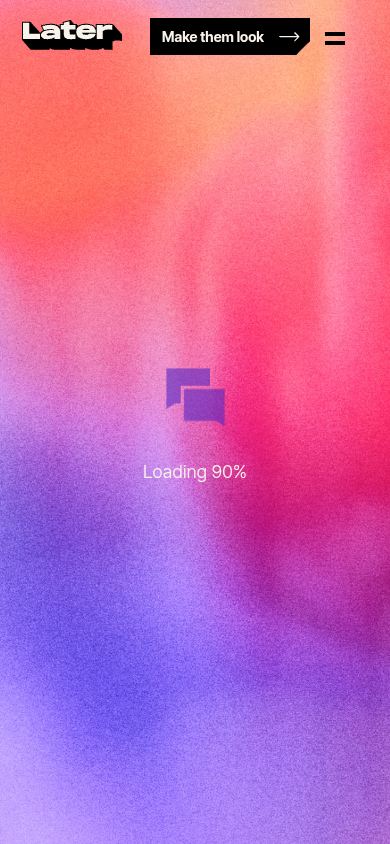

# UI Design System & Master Generation Blueprint: later-com_made-you-look

> **Made You Look: Campaigns so good you break the algorithm.** (https://later.com/made-you-look/) — Meet the creators shaping culture through bold ideas and obsessive craft—and see how brands partner with them to build standout influence...


---

## 1. Executive Visual Persona & Design Archetype

- **Brand Essence & Persona**: **Made You Look: Campaigns so good you break the algorithm.** (`https://later.com/made-you-look/`). Meet the creators shaping culture through bold ideas and obsessive craft—and see how brands partner with them to build standout influence...
- **Capture Provenance**: Live browser capture (`tier2_webgl`, HTTP `200`, captured `2026-11-23`).
- **Visual Archetype**: **Light-Substrate Editorial & Modular Grid System (`#f8f2ea` canvas, `#000000` ink, `#0057ff` accent)**.
- **Anti-AI-Slop Differentiators**:
  - **Live-Computed Chromatic Polarity**: Anchors the viewport in `#f8f2ea` (live computed `body` `background-color` (`computed_styles.json`)) paired with `#000000` primary typography and `#0057ff` accents.
  - **Grounded Typographic Hierarchy**: Pairs `Super X sans Display` for display copy (`Campaigns so good you break the algo`) with `Inter Tight` and not declared in live computed styles (uses primary stack / `ui-monospace`).
  - **Calibrated Spatial Grid & Motion**: Combines `80rem` container bounds (`gap: 8px`, padding `9px`) with `cubic-bezier(0,0,.2,1)` easing and Lenis Smooth Scroll (`data-lenis`), Three.js / WebGL Canvas Pipeline.

---

## 2. Spatial Architecture & Modular Grid Mathematics



### Viewport Allocation & Container Geometry
- **Captured Viewport Dimensions**: Desktop `1440×900px` (`assets/desktop.png`, single-viewport 100vh live capture (900px)), Mobile `390×844px` (`assets/mobile.png`, single-viewport 100vh live capture (844px)).
- **Master Container Bounds**: `80rem` (non-`@media` desktop container stylesheet rule).
- **Canvas Lateral Padding & Spacing**: `9px` lateral canvas padding with `8px` grid gap.
- **Border Radius Scale**: `5px`, `8px`, `28px`, `40px`.

### Responsive Breakpoint Architecture
- **Desktop Layout**: Multi-column CSS Grid / Flexbox layout at `1440px` (`max-width: 80rem`, `gap: 8px`).
- **Mobile Layout**: Single-column vertical stack at `390px` viewport width with `9px` horizontal padding.
- **Extracted CSS Media Queries**: `@media (prefers-reduced-motion:no-preference)`, `@media screen and (max-width:325px)`, `@media screen and (-ms-high-contrast:active)`, `@media screen and (max-width:656px)`.

---

## 3. Color System, Materiality & Atmospheric Lighting

### Semantic Palette & Source Grounding
| Semantic Role | Ground-Truth Value | Extracted Live / CSS Source |
|---|---|---|
| **Primary Canvas Substrate** | `#f8f2ea` | live computed `body` `background-color` (`computed_styles.json`) |
| **Primary Typography Ink** | `#000000` | live computed `main` `color` (`computed_styles.json`) |
| **Elevated Surface / Card Substrate** | `#f3f4f5` | `var(--grey-bg)` in `:root` |
| **Interactive Accent / Highlight** | `#0057ff` | `var(--highlight-purple)` in `:root` |
| **Secondary / Muted Copy** | `#239dff` | `var(--purple-secondary)` in `:root` |
| **Structural Hairline Border** | `#a075ff` | `var(--outline-color)` in `:root` |

### Sanitized Root CSS Variables (`ui-ux.md` Ground Truth)
| Variable Name | Extracted Value | Semantic Role |
|---|---|---|
| `--delay` | `0ms` | Motion / Easing Token |
| `--scrollbar-width` | `0px` | Layout / Spatial Grid Token |
| `--outline-width` | `0.25rem` | Layout / Spatial Grid Token |
| `--outline-color` | `#a075ff` | Brand / Palette Token |
| `--outline-offset` | `0.375rem` | Elevation / Border Token |
| `--0-5` | `0.25rem` | Dimension / Scale Token |
| `--1-5` | `0.75rem` | Dimension / Scale Token |
| `--2-5` | `1.25rem` | Dimension / Scale Token |
| `--3-5` | `1.75rem` | Dimension / Scale Token |
| `--10` | `5rem` | Dimension / Scale Token |
| `--11` | `5.5rem` | Dimension / Scale Token |
| `--12` | `6rem` | Dimension / Scale Token |
| `--13` | `6.5rem` | Dimension / Scale Token |
| `--14` | `7rem` | Dimension / Scale Token |
| `--15` | `7.5rem` | Dimension / Scale Token |
| `--20` | `10rem` | Dimension / Scale Token |

---

## 4. Typographic Scale & Editorial Hierarchy

### Font Family Stacks
- **Display Typography**: `Super X sans Display`.
- **Primary Body Stack**: `Inter Tight`.
- **Technical / Metadata Stack**: not declared in live computed styles (uses primary stack / `ui-monospace`).

### Typographic Scale & Rules (Live Computed & Stylesheet Grounded)
- **Hero Display (`H1`)**: CSS variables `--h1-2xl: 3.5rem`, `--h1-xl: 3.125rem`, `--h1-l: 2.5rem`; rule `h1` (`font-size: 5rem`).
- **Section Heading (`H2`)**: live computed `h2` (`font-size: 144px`, `line-height: 136.8px`, `font-weight: 800`, `letter-spacing: 0.72px`); CSS variables `--h2: 2.125rem`, `--h2-s: 1.875rem`, `--text-2xl: 1.25rem`; rule `h2` (`font-size: 13px`, `line-height: 15px`, `font-weight: 500`).
- **Body Copy**: live computed `body` (`font-size: 16px`, `line-height: 20px`, `font-weight: 400`); CSS variables `--font-body: Inter Tight,Helvetica Neue,Helvetica,Arial,sans-serif`, `--body-line-height: 1.5`, `--body-letter-spacing: 0.01em`; rule `p` (`line-height: 18px`).
- **Metadata & Navigation Labels**: live computed `nav/a` (`font-size: 16px`, `line-height: 20px`, `font-weight: 400`); CSS variables `--text-xs: 0.875rem`, `--heading-letter-spacing: 0.005em`, `--body-letter-spacing: 0.01em`.

---

## 5. Choreographed Motion & Interaction Physics

### Primary Easing Curves
- **Extracted Timing Functions**: `cubic-bezier(0,0,.2,1)`, `cubic-bezier(.4,0,1,1)`, `cubic-bezier(.05,0,0,1)`.

### Per-Element Transition & Choreography Rules
- **Selector `edia (prefers-reduced-motion:no-p...`**: `transition: opacity .25s cubic-bezier(0,0,.2,1)` extracted from `later-com_made-you-look` stylesheet.
- **Selector `.html5-video-player a`**: `transition: color .1s cubic-bezier(0,0,.2,1)` extracted from `later-com_made-you-look` stylesheet.
- **Selector `.html5-video-player a:hover`**: `transition: color .1s cubic-bezier(0,0,.2,1)` extracted from `later-com_made-you-look` stylesheet.
- **Extracted Easing Curve (`cubic-bezier(0,0,.2,1)`)**: Governs interactive state transitions across `<header.lenis>` and `<section.NnFvv:nth(2)>`.
- **Runtime Interaction Engine**: Integrates Lenis Smooth Scroll (`data-lenis`), Three.js / WebGL Canvas Pipeline with `prefers-reduced-motion: reduce` fallback guards.

---

## 6. Component Wireframe & Structural DOM Map

### Visual Layout Schematic — Desktop (`1440px`, Grounded in `dom.html` & Landmark Bounding Boxes)
```
┌────────────────────────────────────────────────────────────────────────┐
│ DESKTOP VIEWPORT (1440px) — Made You Look: Campaigns so good you break │
│ ====================================================================== │
│ [ <header.lenis> (1440px)             | halo perez-gallardo · Timoth ] │
│ ---------------------------------------------------------------------- │
│ | HERO STAGE: <section.NnFvv> (w=1440px)                             | │
│ | H1: Campaigns so good you break the algorithm.                     | │
│ | Substrate: #f8f2ea | Ink: #000000 | Accent: #0057ff                | │
│ ---------------------------------------------------------------------- │
│ | SHOWCASE GRID (<section.NnFvv:nth(2)>) max-w: 80rem                | │
│ | +------------------------------+  +------------------------------+ | │
│ | | Made you look                |  | halo perez-gallardo          | | │
│ | +------------------------------+  +------------------------------+ | │
│ ---------------------------------------------------------------------- │
│ | DETAIL MODULE (<section.NnFvv:nth(3)>) — Timothy Goodman           | │
│ ---------------------------------------------------------------------- │
│ [ FOOTER (<footer.vWCKd>      ) | https://later.com/made-you-look/     │
└────────────────────────────────────────────────────────────────────────┘
```

### Visual Layout Schematic — Mobile Reflow (`390px`)
```
┌────────────────────────────────────────────────────────────────────────┐
│ MOBILE VIEWPORT REFLOW (390px) — Single-Column Stack (gap: 8px)        │
│ ====================================================================== │
│ [ HEADER BAR (<header.lenis>          ) | Compact Menu (390px)         │
│ ---------------------------------------------------------------------- │
│ | HERO STAGE (<section.NnFvv>) — 390px Vertical Lead                 | │
│ | H1: Campaigns so good you break the algorithm.                     | │
│ ---------------------------------------------------------------------- │
│ | SHOWCASE STACK (<section.NnFvv:nth(2)>) — 1-Col Stack              | │
│ | [ Item 1: Made you look                                          ] | │
│ | [ Item 2: halo perez-gallardo                                    ] | │
│ ---------------------------------------------------------------------- │
│ | DETAIL STACK (<section.NnFvv:nth(3)>) — 1-Col (Timothy Goodman)    | │
│ ---------------------------------------------------------------------- │
│ [ FOOTER (<footer.vWCKd>      ) | Stacked 390px Colophon               │
└────────────────────────────────────────────────────────────────────────┘
```

### Granular DOM Region Breakdown
1. **Brand Header & Navigation Bar (<header.lenis> — `later-com_made-you-look`)**:
   - Landmark `<header class="lenis">` (`1440px`) hosting `Made You Look: Campaigns so good you` navigation (`halo perez-gallardo · Timothy Goodman · Jeremy Jankowski · Megna Paula · Julian McCleary`), DOM attributes (`data-root="true"`, `data-gatsby-head="true"`, `data-gatsby-head="true"`, `data-gatsby-head="true"`), and stylesheet rule `.html5-video-player.ytp-fullscree... { -webkit-transition:opacity .25s cubic-bezier(0,0,.2,1);transition:opacit... }`.
2. **Hero Stage & Focal Lead (<section.NnFvv> — `Campaigns so good you break the al`)**:
   - Landmark `<section class="NnFvv">` presenting display lead `Campaigns so good you break the algorithm.` and copy excerpt *"That’s what happens when brands stop chasing trends and start wor"* over `#f8f2ea` canvas and `#000000` ink.
3. **Primary Showcase & Content Grid (<section.NnFvv:nth(2)> — `Made you look`)**:
   - Landmark `<section class="NnFvv">` rendering section `Made you look` with copy *"At Later, we help brands partner with those creators—bringing tog"*, asset references (`InterTight-VariableFont_wght.woff2`, `superx-extrabold.woff2`, `superx-semibold.woff2`, `rss.xml`), and grid rule `.ytp-contextmenu { -ms-high-contrast-adjust:none;forced-color-adjust:none }`.
4. **Interactive Detail & Feature Matrix (<section.NnFvv:nth(3)> — `halo perez-gallardo`)**:
   - Landmark `<section class="NnFvv">` framing `halo perez-gallardo` and `Timothy Goodman` (*"Because breakthrough campaigns aren’t louder. They’re more credib"*) with `#f3f4f5` surface cards, `#0057ff` accents, and `.ytp-big-mode { font-size:17px }`.
5. **Colophon & Global Directory Footer (<footer.vWCKd> — `https://later.com/made-you-look/`)**:
   - Landmark `<footer class="vWCKd">` anchoring `Made You Look: Campaigns so good` footer links (`halo perez-gallardo · Timothy Goodman · Jeremy Jankowski · Megna Paula · Julian McCleary`), copy *"Learn more about Later's services"*, and `#a075ff` structural dividers.

---

## 7. Master Zero-Shot AI Generation Prompt

```markdown
# Master Zero-Shot Frontend Generation Prompt: later-com_made-you-look (Made You Look: Campaigns so good you break the algorithm.)

You are a principal frontend architect and design systems engineer. Build a complete, production-ready web application replicating the exact design system, DOM landmarks, typographic hierarchy, color tokens, and motion physics of `later-com_made-you-look` (**Made You Look: Campaigns so good you break the algorithm.** — `https://later.com/made-you-look/`).

### 1. Visual Archetype & Anti-AI-Slop Mandates
- **Archetype**: Light-Substrate Editorial & Modular Grid System (`#f8f2ea` canvas, `#000000` ink, `#0057ff` accent).
- **Identity & Domain Context**: Meet the creators shaping culture through bold ideas and obsessive craft—and see how brands partner with them to build standout influence...
- **Primary Substrate**: `#f8f2ea` (live computed `body` `background-color` (`computed_styles.json`)), **Primary Ink**: `#000000`, **Accent / Highlight**: `#0057ff`.
- **Site-Specific Differentiators**:
  - **Live-Computed Chromatic Polarity**: Anchors the viewport in `#f8f2ea` (live computed `body` `background-color` (`computed_styles.json`)) paired with `#000000` primary typography and `#0057ff` accents.
  - **Grounded Typographic Hierarchy**: Pairs `Super X sans Display` for display copy (`Campaigns so good you break the algo`) with `Inter Tight` and not declared in live computed styles (uses primary stack / `ui-monospace`).
  - **Calibrated Spatial Grid & Motion**: Combines `80rem` container bounds (`gap: 8px`, padding `9px`) with `cubic-bezier(0,0,.2,1)` easing and Lenis Smooth Scroll (`data-lenis`), Three.js / WebGL Canvas Pipeline.

### 2. Ground-Truth CSS Variables (`:root` Token Contract)
Declare and consume these exact custom properties extracted from `later-com_made-you-look` in your global stylesheet:

:root {
  /* Made You Look: Campaigns so good you break the algorithm. (later-com_made-you-look) — Live-Grounded CSS Variables */
  --delay: 0ms; /* Motion / Easing Token (later-com_made-you-look) */
  --scrollbar-width: 0px; /* Layout / Spatial Grid Token (later-com_made-you-look) */
  --outline-width: 0.25rem; /* Layout / Spatial Grid Token (later-com_made-you-look) */
  --outline-color: #a075ff; /* Brand / Palette Token (later-com_made-you-look) */
  --outline-offset: 0.375rem; /* Elevation / Border Token (later-com_made-you-look) */
  --0-5: 0.25rem; /* Dimension / Scale Token (later-com_made-you-look) */
  --1-5: 0.75rem; /* Dimension / Scale Token (later-com_made-you-look) */
  --2-5: 1.25rem; /* Dimension / Scale Token (later-com_made-you-look) */
  --3-5: 1.75rem; /* Dimension / Scale Token (later-com_made-you-look) */
  --10: 5rem; /* Dimension / Scale Token (later-com_made-you-look) */
  --11: 5.5rem; /* Dimension / Scale Token (later-com_made-you-look) */
  --12: 6rem; /* Dimension / Scale Token (later-com_made-you-look) */
  --13: 6.5rem; /* Dimension / Scale Token (later-com_made-you-look) */
  --14: 7rem; /* Dimension / Scale Token (later-com_made-you-look) */
  --15: 7.5rem; /* Dimension / Scale Token (later-com_made-you-look) */
  --20: 10rem; /* Dimension / Scale Token (later-com_made-you-look) */
}

### 3. Semantic Color & Materiality Contract
Map every surface, ink, and border strictly to these source-grounded tokens:
- **Primary Canvas Substrate**: `#f8f2ea` — grounded in live computed `body` `background-color` (`computed_styles.json`)
- **Primary Typography Ink**: `#000000` — grounded in live computed `main` `color` (`computed_styles.json`)
- **Elevated Surface / Card Substrate**: `#f3f4f5` — grounded in `var(--grey-bg)` in `:root`
- **Interactive Accent / Highlight**: `#0057ff` — grounded in `var(--highlight-purple)` in `:root`
- **Secondary / Muted Copy**: `#239dff` — grounded in `var(--purple-secondary)` in `:root`
- **Structural Hairline Border**: `#a075ff` — grounded in `var(--outline-color)` in `:root`

### 4. Spatial Grid, Container Bounds & Responsive Breakpoints
- **Desktop Viewport Reference**: `1440×900px` (single-viewport 100vh live capture (900px), `1440px` standard desktop width).
- **Mobile Viewport Reference**: `390×844px` (single-viewport 100vh live capture (844px), `390px` standard mobile width).
- **Container Max-Width**: `80rem` (non-`@media` desktop container stylesheet rule)
- **Padding & Gutters**: `9px` lateral canvas padding with `8px` grid gap
- **Desktop Grid**: Multi-column CSS Grid / Flexbox layout at `1440px` (`max-width: 80rem`, `gap: 8px`)
- **Mobile Adaptation**: Single-column vertical stack at `390px` viewport width with `9px` horizontal padding
- **Media Queries**: `@media (prefers-reduced-motion:no-preference)`, `@media screen and (max-width:325px)`, `@media screen and (-ms-high-contrast:active)`, `@media screen and (max-width:656px)`
- **Corner Radii**: `5px`, `8px`, `28px`, `40px`

### 5. Typography & Editorial Scale Contract
- **Display Font Stack**: `Super X sans Display`
- **Body Font Stack**: `Inter Tight`
- **Monospace / Technical Font Stack**: not declared in live computed styles (uses primary stack / `ui-monospace`)
- **H1 Display Rule**: CSS variables `--h1-2xl: 3.5rem`, `--h1-xl: 3.125rem`, `--h1-l: 2.5rem`; rule `h1` (`font-size: 5rem`)
- **H2 Section Rule**: live computed `h2` (`font-size: 144px`, `line-height: 136.8px`, `font-weight: 800`, `letter-spacing: 0.72px`); CSS variables `--h2: 2.125rem`, `--h2-s: 1.875rem`, `--text-2xl: 1.25rem`; rule `h2` (`font-size: 13px`, `line-height: 15px`, `font-weight: 500`)
- **Body Copy Rule**: live computed `body` (`font-size: 16px`, `line-height: 20px`, `font-weight: 400`); CSS variables `--font-body: Inter Tight,Helvetica Neue,Helvetica,Arial,sans-serif`, `--body-line-height: 1.5`, `--body-letter-spacing: 0.01em`; rule `p` (`line-height: 18px`)
- **Metadata & Index Rule**: live computed `nav/a` (`font-size: 16px`, `line-height: 20px`, `font-weight: 400`); CSS variables `--text-xs: 0.875rem`, `--heading-letter-spacing: 0.005em`, `--body-letter-spacing: 0.01em`

### 6. Component Hierarchy, Verbatim Copy & Real DOM Landmarks
Scaffold `later-com_made-you-look` (`Made You Look: Campaigns so good you break the algorithm.`) with these exact structural regions, extracted copy, and CSS rules from `dom.html`:
1. **Brand Header & Navigation Bar (<header.lenis> — `later-com_made-you-look`)**:
   - DOM & Selectors: Landmark `<header class="lenis">` (`1440px`) hosting `Made You Look: Campaigns so good you` navigation (`halo perez-gallardo · Timothy Goodman · Jeremy Jankowski · Megna Paula · Julian McCleary`), DOM attributes (`data-root="true"`, `data-gatsby-head="true"`, `data-gatsby-head="true"`, `data-gatsby-head="true"`), and stylesheet rule `.html5-video-player.ytp-fullscree... { -webkit-transition:opacity .25s cubic-bezier(0,0,.2,1);transition:opacit... }`.
   - Responsive Contract: Header `Brand Header & Navigation Bar (<header.lenis> — `later-com_made-you-look`)` (`later-com_made-you-look`) adapts across `@media (prefers-reduced-motion:no-preference)`, `@media screen and (max-width:325px)`, `@media screen and (-ms-high-contrast:active)`, `@media screen and (max-width:656px)` with `cubic-bezier(0,0,.2,1)`, `cubic-bezier(.4,0,1,1)`, `cubic-bezier(.05,0,0,1)` transitions and links `halo perez-gallardo · Timothy Goodman · Jeremy Jankowski · Megna Paula · Julian McCleary`.
2. **Hero Stage & Focal Lead (<section.NnFvv> — `Campaigns so good you break the al`)**:
   - DOM & Selectors: Landmark `<section class="NnFvv">` presenting display lead `Campaigns so good you break the algorithm.` and copy excerpt *"That’s what happens when brands stop chasing trends and start wor"* over `#f8f2ea` canvas and `#000000` ink.
   - Responsive Contract: Hero stage (`1440×900px` desktop / `390×844px` mobile) sets `#f8f2ea` background with `#000000` headline `Campaigns so good you break the algorithm.`.
3. **Primary Showcase & Content Grid (<section.NnFvv:nth(2)> — `Made you look`)**:
   - DOM & Selectors: Landmark `<section class="NnFvv">` rendering section `Made you look` with copy *"At Later, we help brands partner with those creators—bringing tog"*, asset references (`InterTight-VariableFont_wght.woff2`, `superx-extrabold.woff2`, `superx-semibold.woff2`, `rss.xml`), and grid rule `.ytp-contextmenu { -ms-high-contrast-adjust:none;forced-color-adjust:none }`.
   - Responsive Contract: Showcase grid `Primary Showcase & Content Grid (<section.NnFvv:nth(2)> — `Made you look`)` applies Multi-column CSS Grid / Flexbox layout at `1440px` (`max-width: 80rem`, `gap: 8px`) on desktop and Single-column vertical stack at `390px` viewport width with `9px` horizontal padding on mobile.
4. **Interactive Detail & Feature Matrix (<section.NnFvv:nth(3)> — `halo perez-gallardo`)**:
   - DOM & Selectors: Landmark `<section class="NnFvv">` framing `halo perez-gallardo` and `Timothy Goodman` (*"Because breakthrough campaigns aren’t louder. They’re more credib"*) with `#f3f4f5` surface cards, `#0057ff` accents, and `.ytp-big-mode { font-size:17px }`.
   - Responsive Contract: Detail module `Interactive Detail & Feature Matrix (<section.NnFvv:nth(3)> — `halo perez-gallardo`)` uses `5px`, `8px`, `28px`, `40px` radii, `#0057ff` highlights, and assets (InterTight-VariableFont_wght.woff2, superx-extrabold.woff2, superx-semibold.woff2).
5. **Colophon & Global Directory Footer (<footer.vWCKd> — `https://later.com/made-you-look/`)**:
   - DOM & Selectors: Landmark `<footer class="vWCKd">` anchoring `Made You Look: Campaigns so good` footer links (`halo perez-gallardo · Timothy Goodman · Jeremy Jankowski · Megna Paula · Julian McCleary`), copy *"Learn more about Later's services"*, and `#a075ff` structural dividers.
   - Responsive Contract: Footer `Colophon & Global Directory Footer (<footer.vWCKd> — `https://later.com/made-you-look/`)` aligns to `80rem` (non-`@media` desktop container stylesheet rule) with `9px` lateral canvas padding with `8px` grid gap and attributes (data-root="true", data-gatsby-head="true", data-gatsby-head="true").

#### Verbatim DOM Copy Excerpts (`dom.html`)
- Copy Excerpt 1: *"That’s what happens when brands stop chasing trends and start working with creator..."*
- Copy Excerpt 2: *"At Later, we help brands partner with those creators—bringing together trusted ins..."*
- Copy Excerpt 3: *"Because breakthrough campaigns aren’t louder. They’re more credible."*
- Copy Excerpt 4: *"Learn more about Later's services"*

### 7. Motion, Extracted Stylesheet Rules & Interaction Choreography
- **Primary Easing Functions**: `cubic-bezier(0,0,.2,1)`, `cubic-bezier(.4,0,1,1)`, `cubic-bezier(.05,0,0,1)`
- **Extracted Stylesheet Rules (`later-com_made-you-look`)**:
- `.html5-video-player.ytp-fullscree... { -webkit-transition:opacity .25s cubic-bezier(0,0,.2,1);transition:opacit... }`
- `.ytp-contextmenu { -ms-high-contrast-adjust:none;forced-color-adjust:none }`
- `.ytp-big-mode { font-size:17px }`
- `.ytp-autohide { cursor:none }`
- `.html5-video-player a:hover { color:fff;-webkit-transition:color .1s cubic-bezier(0,0,.2,1);transition... }`
- **Per-Selector Transition Rules**:
- **Selector `edia (prefers-reduced-motion:no-p...`**: `transition: opacity .25s cubic-bezier(0,0,.2,1)` extracted from `later-com_made-you-look` stylesheet.
- **Selector `.html5-video-player a`**: `transition: color .1s cubic-bezier(0,0,.2,1)` extracted from `later-com_made-you-look` stylesheet.
- **Selector `.html5-video-player a:hover`**: `transition: color .1s cubic-bezier(0,0,.2,1)` extracted from `later-com_made-you-look` stylesheet.
- **Extracted Easing Curve (`cubic-bezier(0,0,.2,1)`)**: Governs interactive state transitions across `<header.lenis>` and `<section.NnFvv:nth(2)>`.
- **Runtime Interaction Engine**: Integrates Lenis Smooth Scroll (`data-lenis`), Three.js / WebGL Canvas Pipeline with `prefers-reduced-motion: reduce` fallback guards.

### 8. Technical Deliverables
- Implement in Next.js (App Router) with TypeScript and Tailwind CSS consuming the `:root` custom properties defined above for `later-com_made-you-look`.
- Reproduce both the `1440px` desktop architecture and `390px` mobile breakpoint transitions, preserving semantic HTML5 landmarks (`<header>`, `<nav>`, `<main>`, `<section>`, `<footer>`) and `prefers-reduced-motion` accessibility guards.
```
