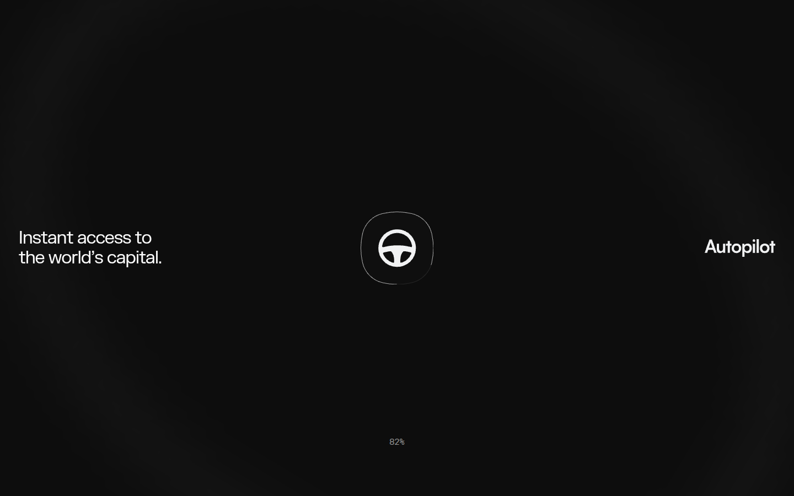

# UI Design System & Master Generation Blueprint: launch-joinautopilot-com

> **Home** (https://launch.joinautopilot.com) — Instant access to the world's capital. Become a Pilot and launch your first fund in minutes. Join top performers managing $1.2B+ in assets.



---

## 1. Executive Visual Persona & Design Archetype

- **Brand Essence & Persona**: **Home** (`https://launch.joinautopilot.com`). Instant access to the world's capital. Become a Pilot and launch your first fund in minutes. Join top performers managing $1.2B+ in assets.
- **Capture Provenance**: Live browser capture (`tier2_webgl`, HTTP `200`, captured `2026-11-23`).
- **Visual Archetype**: **Dark-Substrate WebGL / Canvas Interactive Experience (`#0d0d0d` / `#0082f3`)**.
- **Anti-AI-Slop Differentiators**:
  - **Live-Computed Chromatic Polarity**: Anchors the viewport in `#0d0d0d` (live computed `body` `background-color` (`computed_styles.json`)) paired with `#f1f2f3` primary typography and `#0082f3` accents.
  - **Grounded Typographic Hierarchy**: Pairs `FKGrotesk` for display copy (`Autopilot`) with `FKGrotesk` and not declared in live computed styles (uses primary stack / `ui-monospace`).
  - **Calibrated Spatial Grid & Motion**: Combines `1376px` container bounds (`gap: 8.00007px`, padding `9px`) with `cubic-bezier(.47,0,.745,.715)` easing and Lenis Smooth Scroll (`data-lenis`), Three.js / WebGL Canvas Pipeline.

---

## 2. Spatial Architecture & Modular Grid Mathematics


### Viewport Allocation & Container Geometry
- **Captured Viewport Dimensions**: Desktop `1440×900px` (`assets/desktop.png`, single-viewport 100vh live capture (900px)), Mobile `390×844px` (`assets/mobile.png`, single-viewport 100vh live capture (844px)).
- **Master Container Bounds**: `1376px` (measured widest bounded `<section>` landmark width on `1440px` desktop).
- **Canvas Lateral Padding & Spacing**: `9px` lateral canvas padding with `8.00007px` grid gap.
- **Border Radius Scale**: `14.0001px`, `3px`, `100%`, `50%`.

### Responsive Breakpoint Architecture
- **Desktop Layout**: Multi-column CSS Grid / Flexbox layout at `1440px` (`max-width: 1376px`, `gap: 8.00007px`).
- **Mobile Layout**: Single-column vertical stack at `390px` viewport width with `9px` horizontal padding.
- **Extracted CSS Media Queries**: `@media screen and (max-width:991px)`, `@media screen and (max-width:767px)`, `@media screen and (max-width:479px)`, `@media (min-width:768px)`.

---

## 3. Color System, Materiality & Atmospheric Lighting

### Semantic Palette & Source Grounding
| Semantic Role | Ground-Truth Value | Extracted Live / CSS Source |
|---|---|---|
| **Primary Canvas Substrate** | `#0d0d0d` | live computed `body` `background-color` (`computed_styles.json`) |
| **Primary Typography Ink** | `#f1f2f3` | live computed `h1` `color` (`computed_styles.json`) |
| **Elevated Surface / Card Substrate** | `#141414` | `var(--button-on-light-solid-bg-hover)` in `:root` |
| **Interactive Accent / Highlight** | `#0082f3` | `.w-dropdown-link.w--current { color: #0082f3 }` |
| **Secondary / Muted Copy** | `#0082f3` | `.w-dropdown-link.w--current { color: #0082f3 }` |
| **Structural Hairline Border** | `#0c0c0c` | `var(--_design-system---role--border-subtle)` in `:root` (`00000014`) |

### Sanitized Root CSS Variables (`ui-ux.md` Ground Truth)
| Variable Name | Extracted Value | Semantic Role |
|---|---|---|
| `--_design-system---role--bg` | `var(--_design-system---color--surface-background)` | Canvas / Surface Token |
| `--_design-system---font--primary` | `Fkgrotesk,Arial,sans-serif` | Brand / Palette Token |
| `--_design-system---role--fg` | `var(--_design-system---color--primary-dark)` | Typography Ink Token |
| `--_design-system---font-size--body` | `clamp(.875rem,.843137rem + .130719vw,1rem)` | Typography / Scale Token |
| `--_design-system---line-height--body` | `1.3` | Typography / Scale Token |
| `--_design-system---font-weight--body` | `400` | Typography / Scale Token |
| `--_design-system---letter-spacing--body` | `-.01em` | Typography / Scale Token |
| `--_design-system---font-size--h1` | `clamp(5.75rem,4.98529rem + 3.13726vw,8.75rem)` | Typography / Scale Token |
| `--_design-system---line-height--h1` | `1` | Typography / Scale Token |
| `--_design-system---font-weight--h1` | `400` | Typography / Scale Token |
| `--_design-system---letter-spacing--h1` | `-.06em` | Typography / Scale Token |
| `--_design-system---font-size--h2` | `clamp(3.5rem,3.11765rem + 1.56863vw,5rem)` | Typography / Scale Token |
| `--_design-system---line-height--h2` | `1.02` | Typography / Scale Token |
| `--_design-system---font-weight--h2` | `400` | Typography / Scale Token |
| `--_design-system---letter-spacing--h2` | `-.05em` | Typography / Scale Token |
| `--_design-system---font-size--h3` | `clamp(2.375rem,2.08824rem + 1.17647vw,3.5rem)` | Typography / Scale Token |

---

## 4. Typographic Scale & Editorial Hierarchy

### Font Family Stacks
- **Display Typography**: `FKGrotesk`.
- **Primary Body Stack**: `FKGrotesk`.
- **Technical / Metadata Stack**: not declared in live computed styles (uses primary stack / `ui-monospace`).

### Typographic Scale & Rules (Live Computed & Stylesheet Grounded)
- **Hero Display (`H1`)**: live computed `h1` (`font-size: 140.001px`, `line-height: 140.001px`, `font-weight: 400`, `letter-spacing: -8.40003px`); CSS variables `--_design-system---font-size--h1: clamp(5.75rem,4.98529rem + 3.13726vw,8.75rem)`, `--_design-system---line-height--h1: 1`, `--_design-system---font-weight--h1: 400`.
- **Section Heading (`H2`)**: live computed `h2` (`font-size: 80.0004px`, `line-height: 81.6004px`, `font-weight: 400`, `letter-spacing: -4.00002px`); CSS variables `--_design-system---font-size--h2: clamp(3.5rem,3.11765rem + 1.56863vw,5rem)`, `--_design-system---line-height--h2: 1.02`, `--_design-system---font-weight--h2: 400`; rule `h2` (`font-size: var(--font-size-h3)`, `line-height: var(--line-height-h3-...`, `letter-spacing: var(--letter-spacing-...`).
- **Body Copy**: live computed `body` (`font-size: 16.0001px`, `line-height: 20.8001px`, `font-weight: 400`, `letter-spacing: -0.160001px`); CSS variables `--_design-system---font-size--body: clamp(.875rem,.843137rem + .130719vw,1rem)`, `--_design-system---line-height--body: 1.3`, `--_design-system---font-weight--body: 400`; rule `,p` (`font-size: var(--font-size-body)`, `line-height: var(--line-height-body)`, `letter-spacing: var(--letter-spacing-...`, `font-weight: var(--font-we...`).
- **Metadata & Navigation Labels**: live computed `nav/a` (`font-size: 16.0001px`, `line-height: 20.8001px`, `font-weight: 400`, `letter-spacing: -0.160001px`); CSS variables `--_design-system---letter-spacing--body: -.01em`, `--_design-system---letter-spacing--h1: -.06em`, `--_design-system---letter-spacing--h2: -.05em`.

---

## 5. Choreographed Motion & Interaction Physics

### Primary Easing Curves
- **Extracted Timing Functions**: `cubic-bezier(.47,0,.745,.715)`, `cubic-bezier(.39,.575,.565,1)`, `cubic-bezier(.445,.05,.55,.95)`.

### Per-Element Transition & Choreography Rules
- **Selector `.w-webflow-badge>img`**: `transition: unset` extracted from `launch-joinautopilot-com` stylesheet.
- **Selector `.w-slider-dot`**: `transition: background-color .1s,color .1s` extracted from `launch-joinautopilot-com` stylesheet.
- **Selector `.w-lightbox-control`**: `transition: all .3s` extracted from `launch-joinautopilot-com` stylesheet.
- **Extracted Easing Curve (`cubic-bezier(.47,0,.745,.715)`)**: Governs interactive state transitions across `<header.header_wrap>` and `<section.steps_wrap>`.
- **Runtime Interaction Engine**: Integrates Lenis Smooth Scroll (`data-lenis`), Three.js / WebGL Canvas Pipeline, Lottie Vector Animation Player with `prefers-reduced-motion: reduce` fallback guards.

---

## 6. Component Wireframe & Structural DOM Map

### Visual Layout Schematic — Desktop (`1440px`, Grounded in `dom.html` & Landmark Bounding Boxes)
```
┌────────────────────────────────────────────────────────────────────────┐
│ DESKTOP VIEWPORT (1440px) — Home                                       │
│ ====================================================================== │
│ [ <header.header_wrap> (1440x30px)    | N e w s News · F A Q FAQ · C ] │
│ ---------------------------------------------------------------------- │
│ | HERO STAGE: <section.home_hero_wrap> (w=1440px)                    | │
│ | H1: Autopilot                                                      | │
│ | Substrate: #0d0d0d | Ink: #f1f2f3 | Accent: #0082f3                | │
│ ---------------------------------------------------------------------- │
│ | SHOWCASE GRID (<section.steps_wrap>) max-w: 1376px                 | │
│ | +------------------------------+  +------------------------------+ | │
│ | | A u t o p i l o t            |  | T h i s i s w h e r e i t g  | | │
│ | +------------------------------+  +------------------------------+ | │
│ ---------------------------------------------------------------------- │
│ | DETAIL MODULE (<section.billackman_wrap>) — P i c k y o u r s t o  | │
│ ---------------------------------------------------------------------- │
│ [ FOOTER (<footer.home_footer_) | https://launch.joinautopilot.com     │
└────────────────────────────────────────────────────────────────────────┘
```

### Visual Layout Schematic — Mobile Reflow (`390px`)
```
┌────────────────────────────────────────────────────────────────────────┐
│ MOBILE VIEWPORT REFLOW (390px) — Single-Column Stack (gap: 8.00007p)   │
│ ====================================================================== │
│ [ HEADER BAR (<header.header_wrap>    ) | Compact Menu (390px)         │
│ ---------------------------------------------------------------------- │
│ | HERO STAGE (<section.home_hero_wrap>) — 390px Vertical Lead        | │
│ | H1: Autopilot                                                      | │
│ ---------------------------------------------------------------------- │
│ | SHOWCASE STACK (<section.steps_wrap>) — 1-Col Stack                | │
│ | [ Item 1: A u t o p i l o t                                      ] | │
│ | [ Item 2: T h i s i s w h e r e i t g e t s f u n . This is...   ] | │
│ ---------------------------------------------------------------------- │
│ | DETAIL STACK (<section.billackman_wrap) — 1-Col (P i c k y o u r s ) │
│ ---------------------------------------------------------------------- │
│ [ FOOTER (<footer.home_footer_) | Stacked 390px Colophon               │
└────────────────────────────────────────────────────────────────────────┘
```

### Granular DOM Region Breakdown
1. **Brand Header & Navigation Bar (<header.header_wrap> — `launch-joinautopilot-com`)**:
   - Landmark `<header class="header_wrap">` (`1440x30px`) hosting `Home` navigation (`N e w s News · F A Q FAQ · Careers · Contact · X/Twitter`), DOM attributes (`data-wf-domain="launch.joinautopilot.com"`, `data-wf-page="6a2d51f45ce6148dcfffd71a"`, `data-wf-site="6a07168d6f6cfe1d38b6d627"`, `data-route="home"`), and stylesheet rule `html { -webkit-text-size-adjust:100%;-ms-text-size-adjust:100%;font-family:sans... }`.
2. **Hero Stage & Focal Lead (<section.home_hero_wrap> — `Autopilot`)**:
   - Landmark `<section class="home_hero_wrap">` presenting display lead `Autopilot` and copy excerpt *"Become a Pilot and launch your first fund in minutes."* over `#0d0d0d` canvas and `#f1f2f3` ink.
3. **Primary Showcase & Content Grid (<section.steps_wrap> — `A u t o p i l o t`)**:
   - Landmark `<section class="steps_wrap l-section">` rendering section `A u t o p i l o t` with copy *"Instant access to the world’s capital."*, asset references (`cdn.prod.website-files.com`, `ob-autopilot.shared.8ecce8ba9.min...`, `6a316c0692d4727f15940a67_favicon.png`, `6a316c0605a3b4d0e37557a7_favicon.png`), and grid rule `summary { display:block }`.
4. **Interactive Detail & Feature Matrix (<section.billackman_wrap> — `T h i s i s w h e r e i t g e t s `)**:
   - Landmark `<section class="billackman_wrap l-section">` framing `T h i s i s w h e r e i t g e t s f u n . This is...` and `P i c k y o u r s t o c k s . Pick your stocks.` (*"Become a Pilot and launch your first fund in minutes. Become a Pi"*) with `#141414` surface cards, `#0082f3` accents, and `video { vertical-align:baseline;display:inline-block }`.
5. **Colophon & Global Directory Footer (<footer.home_footer_wrap> — `https://launch.joinautopilot.com`)**:
   - Landmark `<footer class="home_footer_wrap l-section">` anchoring `Home` footer links (`N e w s News · F A Q FAQ · Careers · Contact · X/Twitter`), copy *"Become a Pilot and launch your"*, and `#0c0c0c` structural dividers.

---

## 7. Master Zero-Shot AI Generation Prompt

```markdown
# Master Zero-Shot Frontend Generation Prompt: launch-joinautopilot-com (Home)

You are a principal frontend architect and design systems engineer. Build a complete, production-ready web application replicating the exact design system, DOM landmarks, typographic hierarchy, color tokens, and motion physics of `launch-joinautopilot-com` (**Home** — `https://launch.joinautopilot.com`).

### 1. Visual Archetype & Anti-AI-Slop Mandates
- **Archetype**: Dark-Substrate WebGL / Canvas Interactive Experience (`#0d0d0d` / `#0082f3`).
- **Identity & Domain Context**: Instant access to the world's capital. Become a Pilot and launch your first fund in minutes. Join top performers managing $1.2B+ in assets.
- **Primary Substrate**: `#0d0d0d` (live computed `body` `background-color` (`computed_styles.json`)), **Primary Ink**: `#f1f2f3`, **Accent / Highlight**: `#0082f3`.
- **Site-Specific Differentiators**:
  - **Live-Computed Chromatic Polarity**: Anchors the viewport in `#0d0d0d` (live computed `body` `background-color` (`computed_styles.json`)) paired with `#f1f2f3` primary typography and `#0082f3` accents.
  - **Grounded Typographic Hierarchy**: Pairs `FKGrotesk` for display copy (`Autopilot`) with `FKGrotesk` and not declared in live computed styles (uses primary stack / `ui-monospace`).
  - **Calibrated Spatial Grid & Motion**: Combines `1376px` container bounds (`gap: 8.00007px`, padding `9px`) with `cubic-bezier(.47,0,.745,.715)` easing and Lenis Smooth Scroll (`data-lenis`), Three.js / WebGL Canvas Pipeline.

### 2. Ground-Truth CSS Variables (`:root` Token Contract)
Declare and consume these exact custom properties extracted from `launch-joinautopilot-com` in your global stylesheet:

:root {
  /* Home (launch-joinautopilot-com) — Live-Grounded CSS Variables */
  --_design-system---role--bg: var(--_design-system---color--surface-background); /* Canvas / Surface Token (launch-joinautopilot-com) */
  --_design-system---font--primary: Fkgrotesk,Arial,sans-serif; /* Brand / Palette Token (launch-joinautopilot-com) */
  --_design-system---role--fg: var(--_design-system---color--primary-dark); /* Typography Ink Token (launch-joinautopilot-com) */
  --_design-system---font-size--body: clamp(.875rem,.843137rem + .130719vw,1rem); /* Typography / Scale Token (launch-joinautopilot-com) */
  --_design-system---line-height--body: 1.3; /* Typography / Scale Token (launch-joinautopilot-com) */
  --_design-system---font-weight--body: 400; /* Typography / Scale Token (launch-joinautopilot-com) */
  --_design-system---letter-spacing--body: -.01em; /* Typography / Scale Token (launch-joinautopilot-com) */
  --_design-system---font-size--h1: clamp(5.75rem,4.98529rem + 3.13726vw,8.75rem); /* Typography / Scale Token (launch-joinautopilot-com) */
  --_design-system---line-height--h1: 1; /* Typography / Scale Token (launch-joinautopilot-com) */
  --_design-system---font-weight--h1: 400; /* Typography / Scale Token (launch-joinautopilot-com) */
  --_design-system---letter-spacing--h1: -.06em; /* Typography / Scale Token (launch-joinautopilot-com) */
  --_design-system---font-size--h2: clamp(3.5rem,3.11765rem + 1.56863vw,5rem); /* Typography / Scale Token (launch-joinautopilot-com) */
  --_design-system---line-height--h2: 1.02; /* Typography / Scale Token (launch-joinautopilot-com) */
  --_design-system---font-weight--h2: 400; /* Typography / Scale Token (launch-joinautopilot-com) */
  --_design-system---letter-spacing--h2: -.05em; /* Typography / Scale Token (launch-joinautopilot-com) */
  --_design-system---font-size--h3: clamp(2.375rem,2.08824rem + 1.17647vw,3.5rem); /* Typography / Scale Token (launch-joinautopilot-com) */
}

### 3. Semantic Color & Materiality Contract
Map every surface, ink, and border strictly to these source-grounded tokens:
- **Primary Canvas Substrate**: `#0d0d0d` — grounded in live computed `body` `background-color` (`computed_styles.json`)
- **Primary Typography Ink**: `#f1f2f3` — grounded in live computed `h1` `color` (`computed_styles.json`)
- **Elevated Surface / Card Substrate**: `#141414` — grounded in `var(--button-on-light-solid-bg-hover)` in `:root`
- **Interactive Accent / Highlight**: `#0082f3` — grounded in `.w-dropdown-link.w--current { color: #0082f3 }`
- **Secondary / Muted Copy**: `#0082f3` — grounded in `.w-dropdown-link.w--current { color: #0082f3 }`
- **Structural Hairline Border**: `#0c0c0c` — grounded in `var(--_design-system---role--border-subtle)` in `:root` (`00000014`)

### 4. Spatial Grid, Container Bounds & Responsive Breakpoints
- **Desktop Viewport Reference**: `1440×900px` (single-viewport 100vh live capture (900px), `1440px` standard desktop width).
- **Mobile Viewport Reference**: `390×844px` (single-viewport 100vh live capture (844px), `390px` standard mobile width).
- **Container Max-Width**: `1376px` (measured widest bounded `<section>` landmark width on `1440px` desktop)
- **Padding & Gutters**: `9px` lateral canvas padding with `8.00007px` grid gap
- **Desktop Grid**: Multi-column CSS Grid / Flexbox layout at `1440px` (`max-width: 1376px`, `gap: 8.00007px`)
- **Mobile Adaptation**: Single-column vertical stack at `390px` viewport width with `9px` horizontal padding
- **Media Queries**: `@media screen and (max-width:991px)`, `@media screen and (max-width:767px)`, `@media screen and (max-width:479px)`, `@media (min-width:768px)`
- **Corner Radii**: `14.0001px`, `3px`, `100%`, `50%`

### 5. Typography & Editorial Scale Contract
- **Display Font Stack**: `FKGrotesk`
- **Body Font Stack**: `FKGrotesk`
- **Monospace / Technical Font Stack**: not declared in live computed styles (uses primary stack / `ui-monospace`)
- **H1 Display Rule**: live computed `h1` (`font-size: 140.001px`, `line-height: 140.001px`, `font-weight: 400`, `letter-spacing: -8.40003px`); CSS variables `--_design-system---font-size--h1: clamp(5.75rem,4.98529rem + 3.13726vw,8.75rem)`, `--_design-system---line-height--h1: 1`, `--_design-system---font-weight--h1: 400`
- **H2 Section Rule**: live computed `h2` (`font-size: 80.0004px`, `line-height: 81.6004px`, `font-weight: 400`, `letter-spacing: -4.00002px`); CSS variables `--_design-system---font-size--h2: clamp(3.5rem,3.11765rem + 1.56863vw,5rem)`, `--_design-system---line-height--h2: 1.02`, `--_design-system---font-weight--h2: 400`; rule `h2` (`font-size: var(--font-size-h3)`, `line-height: var(--line-height-h3-...`, `letter-spacing: var(--letter-spacing-...`)
- **Body Copy Rule**: live computed `body` (`font-size: 16.0001px`, `line-height: 20.8001px`, `font-weight: 400`, `letter-spacing: -0.160001px`); CSS variables `--_design-system---font-size--body: clamp(.875rem,.843137rem + .130719vw,1rem)`, `--_design-system---line-height--body: 1.3`, `--_design-system---font-weight--body: 400`; rule `,p` (`font-size: var(--font-size-body)`, `line-height: var(--line-height-body)`, `letter-spacing: var(--letter-spacing-...`, `font-weight: var(--font-we...`)
- **Metadata & Index Rule**: live computed `nav/a` (`font-size: 16.0001px`, `line-height: 20.8001px`, `font-weight: 400`, `letter-spacing: -0.160001px`); CSS variables `--_design-system---letter-spacing--body: -.01em`, `--_design-system---letter-spacing--h1: -.06em`, `--_design-system---letter-spacing--h2: -.05em`

### 6. Component Hierarchy, Verbatim Copy & Real DOM Landmarks
Scaffold `launch-joinautopilot-com` (`Home`) with these exact structural regions, extracted copy, and CSS rules from `dom.html`:
1. **Brand Header & Navigation Bar (<header.header_wrap> — `launch-joinautopilot-com`)**:
   - DOM & Selectors: Landmark `<header class="header_wrap">` (`1440x30px`) hosting `Home` navigation (`N e w s News · F A Q FAQ · Careers · Contact · X/Twitter`), DOM attributes (`data-wf-domain="launch.joinautopilot.com"`, `data-wf-page="6a2d51f45ce6148dcfffd71a"`, `data-wf-site="6a07168d6f6cfe1d38b6d627"`, `data-route="home"`), and stylesheet rule `html { -webkit-text-size-adjust:100%;-ms-text-size-adjust:100%;font-family:sans... }`.
   - Responsive Contract: Header `Brand Header & Navigation Bar (<header.header_wrap> — `launch-joinautopilot-com`)` (`launch-joinautopilot-com`) adapts across `@media screen and (max-width:991px)`, `@media screen and (max-width:767px)`, `@media screen and (max-width:479px)`, `@media (min-width:768px)` with `cubic-bezier(.47,0,.745,.715)`, `cubic-bezier(.39,.575,.565,1)`, `cubic-bezier(.445,.05,.55,.95)` transitions and links `N e w s News · F A Q FAQ · Careers · Contact · X/Twitter`.
2. **Hero Stage & Focal Lead (<section.home_hero_wrap> — `Autopilot`)**:
   - DOM & Selectors: Landmark `<section class="home_hero_wrap">` presenting display lead `Autopilot` and copy excerpt *"Become a Pilot and launch your first fund in minutes."* over `#0d0d0d` canvas and `#f1f2f3` ink.
   - Responsive Contract: Hero stage (`1440×900px` desktop / `390×844px` mobile) sets `#0d0d0d` background with `#f1f2f3` headline `Autopilot`.
3. **Primary Showcase & Content Grid (<section.steps_wrap> — `A u t o p i l o t`)**:
   - DOM & Selectors: Landmark `<section class="steps_wrap l-section">` rendering section `A u t o p i l o t` with copy *"Instant access to the world’s capital."*, asset references (`cdn.prod.website-files.com`, `ob-autopilot.shared.8ecce8ba9.min...`, `6a316c0692d4727f15940a67_favicon.png`, `6a316c0605a3b4d0e37557a7_favicon.png`), and grid rule `summary { display:block }`.
   - Responsive Contract: Showcase grid `Primary Showcase & Content Grid (<section.steps_wrap> — `A u t o p i l o t`)` applies Multi-column CSS Grid / Flexbox layout at `1440px` (`max-width: 1376px`, `gap: 8.00007px`) on desktop and Single-column vertical stack at `390px` viewport width with `9px` horizontal padding on mobile.
4. **Interactive Detail & Feature Matrix (<section.billackman_wrap> — `T h i s i s w h e r e i t g e t s `)**:
   - DOM & Selectors: Landmark `<section class="billackman_wrap l-section">` framing `T h i s i s w h e r e i t g e t s f u n . This is...` and `P i c k y o u r s t o c k s . Pick your stocks.` (*"Become a Pilot and launch your first fund in minutes. Become a Pi"*) with `#141414` surface cards, `#0082f3` accents, and `video { vertical-align:baseline;display:inline-block }`.
   - Responsive Contract: Detail module `Interactive Detail & Feature Matrix (<section.billackman_wrap> — `T h i s i s w h e r e i t g e t s `)` uses `14.0001px`, `3px`, `100%`, `50%` radii, `#0082f3` highlights, and assets (cdn.prod.website-files.com, ob-autopilot.shared.8ecce8ba9.min..., 6a316c0692d4727f15940a67_favicon.png).
5. **Colophon & Global Directory Footer (<footer.home_footer_wrap> — `https://launch.joinautopilot.com`)**:
   - DOM & Selectors: Landmark `<footer class="home_footer_wrap l-section">` anchoring `Home` footer links (`N e w s News · F A Q FAQ · Careers · Contact · X/Twitter`), copy *"Become a Pilot and launch your"*, and `#0c0c0c` structural dividers.
   - Responsive Contract: Footer `Colophon & Global Directory Footer (<footer.home_footer_wrap> — `https://launch.joinautopilot.com`)` aligns to `1376px` (measured widest bounded `<section>` landmark width on `1440px` desktop) with `9px` lateral canvas padding with `8.00007px` grid gap and attributes (data-wf-domain="launch.joinautopilot.com", data-wf-page="6a2d51f45ce6148dcfffd71a", data-wf-site="6a07168d6f6cfe1d38b6d627").

#### Verbatim DOM Copy Excerpts (`dom.html`)
- Copy Excerpt 1: *"Become a Pilot and launch your first fund in minutes."*
- Copy Excerpt 2: *"Instant access to the world’s capital."*
- Copy Excerpt 3: *"Become a Pilot and launch your first fund in minutes. Become a Pilot and launch yo..."*
- Copy Excerpt 4: *"Become a Pilot and launch your"*

### 7. Motion, Extracted Stylesheet Rules & Interaction Choreography
- **Primary Easing Functions**: `cubic-bezier(.47,0,.745,.715)`, `cubic-bezier(.39,.575,.565,1)`, `cubic-bezier(.445,.05,.55,.95)`
- **Extracted Stylesheet Rules (`launch-joinautopilot-com`)**:
- `html { -webkit-text-size-adjust:100%;-ms-text-size-adjust:100%;font-family:sans... }`
- `summary { display:block }`
- `video { vertical-align:baseline;display:inline-block }`
- `template { display:none }`
- `strong { font-weight:700 }`
- **Per-Selector Transition Rules**:
- **Selector `.w-webflow-badge>img`**: `transition: unset` extracted from `launch-joinautopilot-com` stylesheet.
- **Selector `.w-slider-dot`**: `transition: background-color .1s,color .1s` extracted from `launch-joinautopilot-com` stylesheet.
- **Selector `.w-lightbox-control`**: `transition: all .3s` extracted from `launch-joinautopilot-com` stylesheet.
- **Extracted Easing Curve (`cubic-bezier(.47,0,.745,.715)`)**: Governs interactive state transitions across `<header.header_wrap>` and `<section.steps_wrap>`.
- **Runtime Interaction Engine**: Integrates Lenis Smooth Scroll (`data-lenis`), Three.js / WebGL Canvas Pipeline, Lottie Vector Animation Player with `prefers-reduced-motion: reduce` fallback guards.

### 8. Technical Deliverables
- Implement in Next.js (App Router) with TypeScript and Tailwind CSS consuming the `:root` custom properties defined above for `launch-joinautopilot-com`.
- Reproduce both the `1440px` desktop architecture and `390px` mobile breakpoint transitions, preserving semantic HTML5 landmarks (`<header>`, `<nav>`, `<main>`, `<section>`, `<footer>`) and `prefers-reduced-motion` accessibility guards.
```
