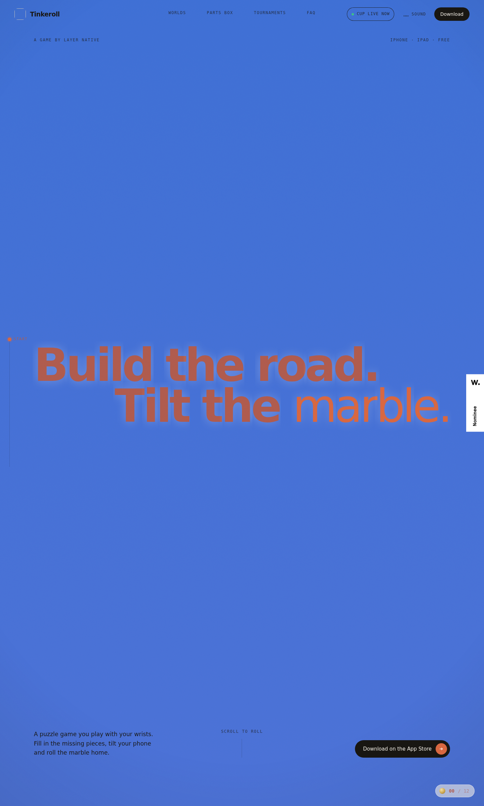
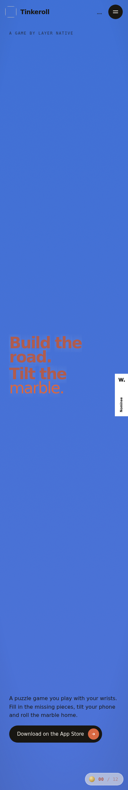

# UI Design System & Master Generation Blueprint: layernative-com_tinkeroll

> **Tinkeroll — Build the road. Tilt the marble.** (https://layernative.com/tinkeroll/) — Tinkeroll is a tilt-to-roll puzzle game for iPhone and iPad. Place the missing pieces, tilt your phone, and roll the marble home. 52 leve...



---

## 1. Executive Visual Persona & Design Archetype

- **Brand Essence & Persona**: **Tinkeroll — Build the road. Tilt the marble.** (`https://layernative.com/tinkeroll/`). Tinkeroll is a tilt-to-roll puzzle game for iPhone and iPad. Place the missing pieces, tilt your phone, and roll the marble home. 52 leve...
- **Visual Archetype**: **Light-Gallery WebGL / Canvas Interactive Experience (`#f3efe7` / `#4a453d`)**.
- **Anti-AI-Slop Differentiators**:
  - **Source-Grounded Chromatic Polarity**: Anchors the viewport in `#f3efe7` (`var(--bg)` in `:root`) paired with `#15130f` primary typography and `#4a453d` accents.
  - **Extracted Typographic Hierarchy**: Pairs `Geist` for display copy (`B u i l d t h e r o a d . T i l t t `) with `Geist Mono` and `Geist Mono`.
  - **Calibrated Spatial Grid & Motion**: Combines `760px` container bounds (`gap: 10px`, padding `10px`) with `cubic-bezier(.76,0,.24,1)` easing and Lenis Smooth Scroll (`data-lenis`), Three.js / WebGL Canvas Pipeline.

---

## 2. Spatial Architecture & Modular Grid Mathematics



### Viewport Allocation & Container Geometry
- **Captured Viewport Dimensions**: Desktop `1440×2400px` (`assets/desktop.png`, capped at 2400px multi-section capture), Mobile `390×2400px` (`assets/mobile.png`, capped at 2400px multi-section capture).
- **Master Container Bounds**: `760px` extracted from `layernative-com_tinkeroll` stylesheet.
- **Canvas Lateral Padding & Spacing**: `10px` lateral canvas padding with `10px` grid gap.
- **Border Radius Scale**: `50%`, `999px`, `32px`, `24px`.

### Responsive Breakpoint Architecture
- **Desktop Layout**: Multi-column CSS Grid / Flexbox layout at `1440px` (`max-width: 760px`, `gap: 10px`).
- **Mobile Layout**: Single-column vertical stack at `390px` viewport width with `10px` horizontal padding.
- **Extracted CSS Media Queries**: `@media (max-width: 760px)`, `@media (prefers-reduced-motion: reduce)`, `@media (max-width: 1180px), (hover: none)`, `@media (max-width: 900px)`.

---

## 3. Color System, Materiality & Atmospheric Lighting

### Semantic Palette & Source Grounding
| Semantic Role | Ground-Truth Value | Extracted CSS Source / Selector |
|---|---|---|
| **Primary Canvas Substrate** | `#f3efe7` | `var(--bg)` in `:root` |
| **Primary Typography Ink** | `#e9e3d8` | `var(--paper-2)` in `:root` |
| **Elevated Surface / Card Substrate** | `#15130f` | `var(--ink)` in `:root` |
| **Interactive Accent / Highlight** | `#4a453d` | `var(--ink-2)` in `:root` |
| **Secondary / Muted Copy** | `#8a8378` | `var(--ink-3)` in `:root` |
| **Structural Hairline Border** | `#d9663f` | `var(--accent)` in `:root` |
| **Variable Token (`--gold`)** | `#c9a24a` | `var(--gold)` in `:root` |
| **Variable Token (`--sage`)** | `#8fb39a` | `var(--sage)` in `:root` |
| **Variable Token (`--night`)** | `#0e1024` | `var(--night)` in `:root` |

### Sanitized Root CSS Variables (`ui-ux.md` Ground Truth)
| Variable Name | Extracted Value | Semantic Role |
|---|---|---|
| `--bg` | `#f3efe7` | Canvas / Surface Token |
| `--fg` | `var(--ink)` | Typography Ink Token |
| `--paper` | `#f3efe7` | Canvas / Surface Token |
| `--paper-2` | `#e9e3d8` | Canvas / Surface Token |
| `--ink` | `#15130f` | Typography Ink Token |
| `--ink-2` | `#4a453d` | Typography Ink Token |
| `--ink-3` | `#8a8378` | Typography Ink Token |
| `--line` | `rgba(21, 19, 15, .14)` | Color / Atmospheric Token |
| `--accent` | `#d9663f` | Brand / Palette Token |
| `--gold` | `#c9a24a` | Color / Atmospheric Token |
| `--sage` | `#8fb39a` | Color / Atmospheric Token |
| `--night` | `#0e1024` | Color / Atmospheric Token |
| `--radius` | `22px` | Elevation / Border Token |
| `--wrap` | `1240px` | Layout / Spatial Grid Token |
| `--serif` | `"Geist", ui-sans-serif, system-ui, -apple-system, sans-serif` | Typography / Scale Token |
| `--sans` | `"Geist", ui-sans-serif, system-ui, -apple-system, sans-serif` | Typography / Scale Token |

---

## 4. Typographic Scale & Editorial Hierarchy

### Font Family Stacks
- **Display Typography**: `Geist`.
- **Primary Body Stack**: `Geist Mono`.
- **Technical / Metadata Stack**: `Geist Mono`.

### Typographic Scale & Rules (Extracted from Stylesheet & Variables)
- **Hero Display (`H1`)**: rule `h1` (`font-size: clamp(48px, 7vw, 92px)`).
- **Section Heading (`H2`)**: rule `h2` (`font-size: 28px`).
- **Body Copy**: rule `p` (`font-size: 15px`, `line-height: 1.55`).
- **Metadata & Navigation Labels**: CSS variables `--mono: "Geist Mono", ui-monospace, SFMono-Regular, Menlo, monospace`; rule `.label` (`font-size: 9px`, `letter-spacing: .08em`).

---

## 5. Choreographed Motion & Interaction Physics

### Primary Easing Curves
- **Extracted Timing Functions**: `cubic-bezier(.76,0,.24,1)`, `cubic-bezier(.2,.8,.2,1)`.

### Per-Element Transition & Choreography Rules
- **Selector `.cursor`**: `transition: opacity .3s` extracted from `layernative-com_tinkeroll` stylesheet.
- **Selector `.cursor i`**: `transition: width .35s var(--ease), height .35s var(--ease), margin .35s v...` extracted from `layernative-com_tinkeroll` stylesheet.
- **Selector `.rail`**: `transition: opacity .4s` extracted from `layernative-com_tinkeroll` stylesheet.
- **Extracted Easing Curve (`cubic-bezier(.76,0,.24,1)`)**: Governs interactive state transitions across `<header.nav>` and `<section.s-missing>`.
- **Runtime Interaction Engine**: Integrates Lenis Smooth Scroll (`data-lenis`), Three.js / WebGL Canvas Pipeline with `prefers-reduced-motion: reduce` fallback guards.

---

## 6. Component Wireframe & Structural DOM Map

### Visual Layout Schematic (Grounded in `dom.html` — `1440px` Desktop & `390px` Mobile Reflow)
```
┌────────────────────────────────────────────────────────────────────────┐
│ DESKTOP VIEWPORT (1440px) — Tinkeroll — Build the road. Tilt the marbl │
│ ====================================================================== │
│ [ <header.nav>             | Worlds · Parts box · Tournaments · FAQ ]  │
│ ---------------------------------------------------------------------- │
│ | HERO STAGE: <section.s-hero>                                     |   │
│ | H1: B u i l d t h e r o a d . T i l t t h e m a r b l...         |   │
│ | Substrate: #f3efe7    | Ink: #15130f    | Accent: #4a453d        |   │
│ ---------------------------------------------------------------------- │
│ | SHOWCASE GRID (<section.s-missing>       ) max-w: 760px          |   │
│ | +------------------------------+  +------------------------------+ | │
│ | | E v e r y l e v e l i s m i  |  | Place the pieces             | | │
│ | +------------------------------+  +------------------------------+ | │
│ ---------------------------------------------------------------------- │
│ | MOBILE VIEWPORT REFLOW (390px) — Single-Column Stack (gap: 10px  ) | │
│ | [<header.nav>] -> [<section.s-hero>] -> [<section.s-missing] |       │
│ ---------------------------------------------------------------------- │
│ [ FOOTER (<footer.foot>         ) | https://layernative.com/tinkeroll/ │
└────────────────────────────────────────────────────────────────────────┘
```

### Granular DOM Region Breakdown
1. **Brand Header & Navigation Bar (<header.nav> — `layernative-com_tinkeroll`)**:
   - Landmark `<header class="nav">` hosting `Tinkeroll — Build the road. Tilt the` navigation (`Worlds · Parts box · Tournaments · FAQ`), DOM attributes (`data-load`, `data-load-dots`, `data-engine="three.js r160"`, `data-text="Tinkeroll"`), and stylesheet rule `.home { overflow-x: clip; }`.
2. **Hero Stage & Focal Lead (<section.s-hero> — `B u i l d t h e r o a d . T i l t `)**:
   - Landmark `<section class="s-hero">` presenting display lead `B u i l d t h e r o a d . T i l t t h e m a r b l...` and copy excerpt *"Laying the road ..."* over `#f3efe7` canvas and `#15130f` ink.
3. **Primary Showcase & Content Grid (<section.s-missing> — `E v e r y l e v e l i s m i s s i `)**:
   - Landmark `<section class="s-missing">` rendering section `E v e r y l e v e l i s m i s s i n g a f e w p i...` with copy *"Compete Tournaments"*, asset references (`icon-64.png`, `icon-180.png`, `fonts.googleapis.com`, `fonts.gstatic.com`), and grid rule `world { position: fixed; inset: 0; width: 100vw; height: 100vh; height: 100lvh;... }`.
4. **Interactive Detail & Feature Matrix (<section.s-world> — `Place the pieces`)**:
   - Landmark `<section class="s-world w-left">` framing `Place the pieces` and `Tilt your phone` (*"Support Privacy hello@layernative.com"*) with `#15130f` surface cards, `#4a453d` accents, and `.no-gl body { background: linear-gradient(cfdde6, f3efe7 40%, e6cfd6 70%, 0e1024); }`.
5. **Colophon & Global Directory Footer (<footer.foot> — `https://layernative.com/tinkeroll/`)**:
   - Landmark `<footer class="foot">` anchoring `Tinkeroll — Build the road. Tilt` footer links (`Worlds · Parts box · Tournaments · FAQ`), copy *"hello@layernative.com"*, and `#d9663f` structural dividers.

---

## 7. Master Zero-Shot AI Generation Prompt

```markdown
# Master Zero-Shot Frontend Generation Prompt: layernative-com_tinkeroll (Tinkeroll — Build the road. Tilt the marble.)

You are a principal frontend architect and design systems engineer. Build a complete, production-ready web application replicating the exact design system, DOM landmarks, typographic hierarchy, color tokens, and motion physics of `layernative-com_tinkeroll` (**Tinkeroll — Build the road. Tilt the marble.** — `https://layernative.com/tinkeroll/`).

### 1. Visual Archetype & Anti-AI-Slop Mandates
- **Archetype**: Light-Gallery WebGL / Canvas Interactive Experience (`#f3efe7` / `#4a453d`).
- **Identity & Domain Context**: Tinkeroll is a tilt-to-roll puzzle game for iPhone and iPad. Place the missing pieces, tilt your phone, and roll the marble home. 52 leve...
- **Primary Substrate**: `#f3efe7` (`var(--bg)` in `:root`), **Primary Ink**: `#15130f`, **Accent / Highlight**: `#4a453d`.
- **Site-Specific Differentiators**:
  - **Source-Grounded Chromatic Polarity**: Anchors the viewport in `#f3efe7` (`var(--bg)` in `:root`) paired with `#15130f` primary typography and `#4a453d` accents.
  - **Extracted Typographic Hierarchy**: Pairs `Geist` for display copy (`B u i l d t h e r o a d . T i l t t `) with `Geist Mono` and `Geist Mono`.
  - **Calibrated Spatial Grid & Motion**: Combines `760px` container bounds (`gap: 10px`, padding `10px`) with `cubic-bezier(.76,0,.24,1)` easing and Lenis Smooth Scroll (`data-lenis`), Three.js / WebGL Canvas Pipeline.

### 2. Ground-Truth CSS Variables (`:root` Token Contract)
Declare and consume these exact custom properties extracted from `layernative-com_tinkeroll` in your global stylesheet:

:root {
  /* Tinkeroll — Build the road. Tilt the marble. (layernative-com_tinkeroll) — Ground-Truth Extracted CSS Variables */
  --bg: #f3efe7; /* Canvas / Surface Token (layernative-com_tinkeroll) */
  --fg: var(--ink); /* Typography Ink Token (layernative-com_tinkeroll) */
  --paper: #f3efe7; /* Canvas / Surface Token (layernative-com_tinkeroll) */
  --paper-2: #e9e3d8; /* Canvas / Surface Token (layernative-com_tinkeroll) */
  --ink: #15130f; /* Typography Ink Token (layernative-com_tinkeroll) */
  --ink-2: #4a453d; /* Typography Ink Token (layernative-com_tinkeroll) */
  --ink-3: #8a8378; /* Typography Ink Token (layernative-com_tinkeroll) */
  --line: rgba(21, 19, 15, .14); /* Color / Atmospheric Token (layernative-com_tinkeroll) */
  --accent: #d9663f; /* Brand / Palette Token (layernative-com_tinkeroll) */
  --gold: #c9a24a; /* Color / Atmospheric Token (layernative-com_tinkeroll) */
  --sage: #8fb39a; /* Color / Atmospheric Token (layernative-com_tinkeroll) */
  --night: #0e1024; /* Color / Atmospheric Token (layernative-com_tinkeroll) */
  --radius: 22px; /* Elevation / Border Token (layernative-com_tinkeroll) */
  --wrap: 1240px; /* Layout / Spatial Grid Token (layernative-com_tinkeroll) */
  --serif: "Geist", ui-sans-serif, system-ui, -apple-system, sans-serif; /* Typography / Scale Token (layernative-com_tinkeroll) */
  --sans: "Geist", ui-sans-serif, system-ui, -apple-system, sans-serif; /* Typography / Scale Token (layernative-com_tinkeroll) */
}

### 3. Semantic Color & Materiality Contract
Map every surface, ink, and border strictly to these source-grounded tokens:
- **Primary Canvas Substrate**: `#f3efe7` — grounded in `var(--bg)` in `:root`
- **Primary Typography Ink**: `#e9e3d8` — grounded in `var(--paper-2)` in `:root`
- **Elevated Surface / Card Substrate**: `#15130f` — grounded in `var(--ink)` in `:root`
- **Interactive Accent / Highlight**: `#4a453d` — grounded in `var(--ink-2)` in `:root`
- **Secondary / Muted Copy**: `#8a8378` — grounded in `var(--ink-3)` in `:root`
- **Structural Hairline Border**: `#d9663f` — grounded in `var(--accent)` in `:root`
- **Variable Token (`--gold`)**: `#c9a24a` — grounded in `var(--gold)` in `:root`
- **Variable Token (`--sage`)**: `#8fb39a` — grounded in `var(--sage)` in `:root`
- **Variable Token (`--night`)**: `#0e1024` — grounded in `var(--night)` in `:root`

### 4. Spatial Grid, Container Bounds & Responsive Breakpoints
- **Desktop Viewport Reference**: `1440×2400px` (capped at 2400px multi-section capture, `1440px` standard desktop width).
- **Mobile Viewport Reference**: `390×2400px` (capped at 2400px multi-section capture, `390px` standard mobile width).
- **Container Max-Width**: `760px` extracted from `layernative-com_tinkeroll` stylesheet
- **Padding & Gutters**: `10px` lateral canvas padding with `10px` grid gap
- **Desktop Grid**: Multi-column CSS Grid / Flexbox layout at `1440px` (`max-width: 760px`, `gap: 10px`)
- **Mobile Adaptation**: Single-column vertical stack at `390px` viewport width with `10px` horizontal padding
- **Media Queries**: `@media (max-width: 760px)`, `@media (prefers-reduced-motion: reduce)`, `@media (max-width: 1180px), (hover: none)`, `@media (max-width: 900px)`
- **Corner Radii**: `50%`, `999px`, `32px`, `24px`

### 5. Typography & Editorial Scale Contract
- **Display Font Stack**: `Geist`
- **Body Font Stack**: `Geist Mono`
- **Monospace / Technical Font Stack**: `Geist Mono`
- **H1 Display Rule**: rule `h1` (`font-size: clamp(48px, 7vw, 92px)`)
- **H2 Section Rule**: rule `h2` (`font-size: 28px`)
- **Body Copy Rule**: rule `p` (`font-size: 15px`, `line-height: 1.55`)
- **Metadata & Index Rule**: CSS variables `--mono: "Geist Mono", ui-monospace, SFMono-Regular, Menlo, monospace`; rule `.label` (`font-size: 9px`, `letter-spacing: .08em`)

### 6. Component Hierarchy, Verbatim Copy & Real DOM Landmarks
Scaffold `layernative-com_tinkeroll` (`Tinkeroll — Build the road. Tilt the marble.`) with these exact structural regions, extracted copy, and CSS rules from `dom.html`:
1. **Brand Header & Navigation Bar (<header.nav> — `layernative-com_tinkeroll`)**:
   - DOM & Selectors: Landmark `<header class="nav">` hosting `Tinkeroll — Build the road. Tilt the` navigation (`Worlds · Parts box · Tournaments · FAQ`), DOM attributes (`data-load`, `data-load-dots`, `data-engine="three.js r160"`, `data-text="Tinkeroll"`), and stylesheet rule `.home { overflow-x: clip; }`.
   - Responsive Contract: Header `Brand Header & Navigation Bar (<header.nav> — `layernative-com_tinkeroll`)` (`layernative-com_tinkeroll`) adapts across `@media (max-width: 760px)`, `@media (prefers-reduced-motion: reduce)`, `@media (max-width: 1180px), (hover: none)`, `@media (max-width: 900px)` with `cubic-bezier(.76,0,.24,1)`, `cubic-bezier(.2,.8,.2,1)` transitions and links `Worlds · Parts box · Tournaments · FAQ`.
2. **Hero Stage & Focal Lead (<section.s-hero> — `B u i l d t h e r o a d . T i l t `)**:
   - DOM & Selectors: Landmark `<section class="s-hero">` presenting display lead `B u i l d t h e r o a d . T i l t t h e m a r b l...` and copy excerpt *"Laying the road ..."* over `#f3efe7` canvas and `#15130f` ink.
   - Responsive Contract: Hero stage (`1440×2400px` desktop / `390×2400px` mobile) sets `#f3efe7` background with `#15130f` headline `B u i l d t h e r o a d . T i l t t h e m a r b l...`.
3. **Primary Showcase & Content Grid (<section.s-missing> — `E v e r y l e v e l i s m i s s i `)**:
   - DOM & Selectors: Landmark `<section class="s-missing">` rendering section `E v e r y l e v e l i s m i s s i n g a f e w p i...` with copy *"Compete Tournaments"*, asset references (`icon-64.png`, `icon-180.png`, `fonts.googleapis.com`, `fonts.gstatic.com`), and grid rule `world { position: fixed; inset: 0; width: 100vw; height: 100vh; height: 100lvh;... }`.
   - Responsive Contract: Showcase grid `Primary Showcase & Content Grid (<section.s-missing> — `E v e r y l e v e l i s m i s s i `)` applies Multi-column CSS Grid / Flexbox layout at `1440px` (`max-width: 760px`, `gap: 10px`) on desktop and Single-column vertical stack at `390px` viewport width with `10px` horizontal padding on mobile.
4. **Interactive Detail & Feature Matrix (<section.s-world> — `Place the pieces`)**:
   - DOM & Selectors: Landmark `<section class="s-world w-left">` framing `Place the pieces` and `Tilt your phone` (*"Support Privacy hello@layernative.com"*) with `#15130f` surface cards, `#4a453d` accents, and `.no-gl body { background: linear-gradient(cfdde6, f3efe7 40%, e6cfd6 70%, 0e1024); }`.
   - Responsive Contract: Detail module `Interactive Detail & Feature Matrix (<section.s-world> — `Place the pieces`)` uses `50%`, `999px`, `32px`, `24px` radii, `#4a453d` highlights, and assets (icon-64.png, icon-180.png, fonts.googleapis.com).
5. **Colophon & Global Directory Footer (<footer.foot> — `https://layernative.com/tinkeroll/`)**:
   - DOM & Selectors: Landmark `<footer class="foot">` anchoring `Tinkeroll — Build the road. Tilt` footer links (`Worlds · Parts box · Tournaments · FAQ`), copy *"hello@layernative.com"*, and `#d9663f` structural dividers.
   - Responsive Contract: Footer `Colophon & Global Directory Footer (<footer.foot> — `https://layernative.com/tinkeroll/`)` aligns to `760px` extracted from `layernative-com_tinkeroll` stylesheet with `10px` lateral canvas padding with `10px` grid gap and attributes (data-load, data-load-dots, data-engine="three.js r160").

#### Verbatim DOM Copy Excerpts (`dom.html`)
- Copy Excerpt 1: *"Laying the road ..."*
- Copy Excerpt 2: *"Compete Tournaments"*
- Copy Excerpt 3: *"Support Privacy hello@layernative.com"*
- Copy Excerpt 4: *"hello@layernative.com"*

### 7. Motion, Extracted Stylesheet Rules & Interaction Choreography
- **Primary Easing Functions**: `cubic-bezier(.76,0,.24,1)`, `cubic-bezier(.2,.8,.2,1)`
- **Extracted Stylesheet Rules (`layernative-com_tinkeroll`)**:
- `.home { overflow-x: clip; }`
- `world { position: fixed; inset: 0; width: 100vw; height: 100vh; height: 100lvh;... }`
- `.no-gl body { background: linear-gradient(cfdde6, f3efe7 40%, e6cfd6 70%, 0e1024); }`
- `.foot { position: relative; z-index: 2; }`
- `.cursor { position: fixed; left: 0; top: 0; z-index: 90; pointer-events: none; opa... }`
- **Per-Selector Transition Rules**:
- **Selector `.cursor`**: `transition: opacity .3s` extracted from `layernative-com_tinkeroll` stylesheet.
- **Selector `.cursor i`**: `transition: width .35s var(--ease), height .35s var(--ease), margin .35s v...` extracted from `layernative-com_tinkeroll` stylesheet.
- **Selector `.rail`**: `transition: opacity .4s` extracted from `layernative-com_tinkeroll` stylesheet.
- **Extracted Easing Curve (`cubic-bezier(.76,0,.24,1)`)**: Governs interactive state transitions across `<header.nav>` and `<section.s-missing>`.
- **Runtime Interaction Engine**: Integrates Lenis Smooth Scroll (`data-lenis`), Three.js / WebGL Canvas Pipeline with `prefers-reduced-motion: reduce` fallback guards.

### 8. Technical Deliverables
- Implement in Next.js (App Router) with TypeScript and Tailwind CSS consuming the `:root` custom properties defined above for `layernative-com_tinkeroll`.
- Reproduce both the `1440px` desktop architecture and `390px` mobile breakpoint transitions, preserving semantic HTML5 landmarks (`<header>`, `<nav>`, `<main>`, `<section>`, `<footer>`) and `prefers-reduced-motion` accessibility guards.
```
