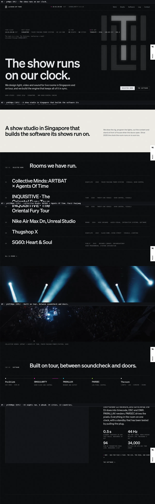
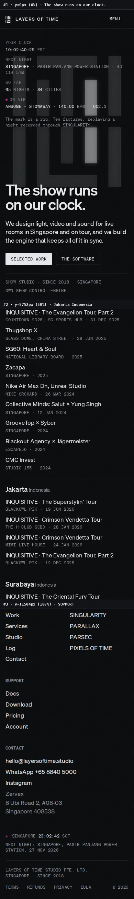

# UI Design System & Master Generation Blueprint: layersoftime-studio

> **LAYERS OF TIME — The show runs on our clock.** (https://layersoftime.studio/) — LAYERS OF TIME is a show studio in Singapore. We design light, video and sound for live rooms, and we build the engine that keeps all of...





---

## 1. Executive Visual Persona & Design Archetype

- **Brand Essence & Persona**: **LAYERS OF TIME — The show runs on our clock.** (`https://layersoftime.studio/`). LAYERS OF TIME is a show studio in Singapore. We design light, video and sound for live rooms, and we build the engine that keeps all of...
- **Capture Provenance**: Live browser capture (`tier1_fast`, HTTP `200`, captured `2026-11-24`).
- **Visual Archetype**: **Dark-Substrate WebGL / Canvas Interactive Experience (`#08090b` / `#8a9099`)**.
- **Anti-AI-Slop Differentiators**:
  - **Live-Computed Chromatic Polarity**: Anchors the viewport in `#08090b` (live computed `body` `background-color` (`computed_styles.json`)) paired with `#e9ecef` primary typography and `#8a9099` accents.
  - **Grounded Typographic Hierarchy**: Uses `Söhne` across display (`The show runs on our clock.`) and body copy, paired with `Söhne Mono` for monospace/code.
  - **Calibrated Spatial Grid & Motion**: Combines `1440px` container bounds (`gap: 16px`, padding `var(--gutter)`) with `cubic-bezier(.22,.61,.36,1)` easing and Lenis Smooth Scroll (`data-lenis`), Three.js / WebGL Canvas Pipeline.

---

## 2. Spatial Architecture & Modular Grid Mathematics

### Viewport Allocation & Container Geometry
- **Captured Journey Filmstrips**: Desktop `1280×4140px` (`assets/desktop-journey.webp`, `5` keyframes up to `y=3400px` / doc `6125px`), Mobile `390×2616px` (`assets/mobile-journey.webp`, `3` keyframes).
- **Master Container Bounds**: `1440px` (full-bleed `100%` desktop stage measured on `1440px` viewport).
- **Canvas Lateral Padding & Spacing**: `var(--gutter)` lateral canvas padding with `16px` grid gap.
- **Border Radius Scale**: `2px`, `50%`, `var(--phone-r)`, `1px`.

### Responsive Breakpoint Architecture
- **Desktop Layout**: Multi-column CSS Grid / Flexbox layout at `1440px` (`max-width: 1440px`, `gap: 16px`).
- **Mobile Layout**: Single-column vertical stack at `390px` viewport width with `var(--gutter)` horizontal padding.
- **Extracted CSS Media Queries**: `@media (width>=768px)`, `@media (width>=1280px)`, `@media (prefers-reduced-motion:reduce)`, `@media (prefers-reduced-motion)`.

---

## 3. Color System, Materiality & Atmospheric Lighting

### Semantic Palette & Source Grounding
| Semantic Role | Ground-Truth Value | Extracted Live / CSS Source |
|---|---|---|
| **Primary Canvas Substrate** | `#08090b` | live computed `body` `background-color` (`computed_styles.json`) |
| **Primary Typography Ink** | `#e9ecef` | live computed `h1` `color` (`computed_styles.json`) |
| **Elevated Surface / Card Substrate** | `#0e1013` | `var(--panel)` in `:root` |
| **Interactive Accent / Highlight** | `#8a9099` | live computed `button` `color` (`computed_styles.json`) |
| **Secondary / Muted Copy** | `#8a9099` | live computed `p` `color` (`computed_styles.json`) |
| **Structural Hairline Border** | `#232527` | `var(--line)` in `:root` (`e9ecef1f`) |
| **Variable Token (`--panel-2`)** | `#14171b` | `var(--panel-2)` in `:root` |
| **Variable Token (`--faint`)** | `#767c85` | `var(--faint)` in `:root` |
| **Variable Token (`--signal`)** | `#d4178f` | `var(--signal)` in `:root` |
| **Variable Token (`--signal-live`)** | `#ff29c4` | `var(--signal-live)` in `:root` |
| **Variable Token (`--signal-fill`)** | `#8f0e66` | `var(--signal-fill)` in `:root` |
| **Variable Token (`--parallax`)** | `#22d3ee` | `var(--parallax)` in `:root` |
| **Variable Token (`--parsec`)** | `#a3e635` | `var(--parsec)` in `:root` |

### Sanitized Root CSS Variables (`ui-ux.md` Ground Truth)
| Variable Name | Extracted Value | Semantic Role |
|---|---|---|
| `--bg` | `#08090b` | Canvas / Surface Token |
| `--panel` | `#0e1013` | Color / Atmospheric Token |
| `--panel-2` | `#14171b` | Color / Atmospheric Token |
| `--fg` | `#e9ecef` | Typography Ink Token |
| `--muted` | `#8a9099` | Color / Atmospheric Token |
| `--faint` | `#767c85` | Color / Atmospheric Token |
| `--line` | `#e9ecef1f` | Color / Atmospheric Token |
| `--line-strong` | `#e9ecef47` | Color / Atmospheric Token |
| `--signal` | `#d4178f` | Color / Atmospheric Token |
| `--signal-live` | `#ff29c4` | Color / Atmospheric Token |
| `--signal-fill` | `#8f0e66` | Color / Atmospheric Token |
| `--parallax` | `#22d3ee` | Color / Atmospheric Token |
| `--parsec` | `#a3e635` | Color / Atmospheric Token |
| `--ease` | `cubic-bezier(.22, .61, .36, 1)` | Motion / Easing Token |
| `--d-fast` | `.16s` | Motion / Timing Token |
| `--d-base` | `.32s` | Motion / Timing Token |

---

## 4. Typographic Scale & Editorial Hierarchy

### Font Family Stacks
- **Display Typography**: `Söhne`.
- **Primary Body Stack**: `Söhne`.
- **Technical / Metadata Stack**: `Söhne Mono`.

### Typographic Scale & Rules (Live Computed & Stylesheet Grounded)
- **Hero Display (`H1`)**: live computed `h1` (`font-size: 115.2px`, `line-height: 109.44px`, `font-weight: 500`, `letter-spacing: -4.032px`); CSS variables `--fs-h1: clamp(2.25rem, 5.5vw, 5.5rem)`.
- **Section Heading (`H2`)**: live computed `h2` (`font-size: 51.84px`, `line-height: 52.8768px`, `font-weight: 500`, `letter-spacing: -1.296px`); CSS variables `--fs-h2: clamp(1.75rem, 3.6vw, 3.5rem)`; rule `h2` (`font-size: var(--fs-h3)`, `letter-spacing: -.015em`, `font-weight: 500`).
- **Body Copy**: live computed `body` (`font-size: 17px`, `line-height: 25.5px`, `font-weight: 400`); CSS variables `--fs-body: 1.0625rem`.
- **Metadata & Navigation Labels**: live computed `nav/a` (`font-size: 17px`, `line-height: 25.5px`, `font-weight: 400`); CSS variables `--fs-small: .9375rem`, `--fs-label: .75rem`.

---

## 5. Choreographed Motion & Interaction Physics

### Primary Easing Curves
- **Extracted Timing Functions**: `cubic-bezier(.22,.61,.36,1)`, `cubic-bezier(.77,0,.175,1)`, `cubic-bezier(.16,1,.3,1)`.

### Per-Element Transition & Choreography Rules
- **Selector `body`**: `transition: background-color var(--d-slow) var(--ease), color var(--d-slow...` extracted from `layersoftime-studio` stylesheet.
- **Selector `.link`**: `transition: color var(--d-fast) var(--ease), background-size var(--d-base)...` extracted from `layersoftime-studio` stylesheet.
- **Selector `.arrow-link svg`**: `transition: transform var(--d-base) var(--ease)` extracted from `layersoftime-studio` stylesheet.
- **Extracted Easing Curve (`cubic-bezier(.22,.61,.36,1)`)**: Governs interactive state transitions across `<header.header>` and `<section.chapter>`.
- **Runtime Interaction Engine**: Integrates Lenis Smooth Scroll (`data-lenis`), Three.js / WebGL Canvas Pipeline with `prefers-reduced-motion: reduce` fallback guards.
### Measured Runtime Scroll & Interaction Telemetry (`behavioral_journey_v2`)
- **Scroll Driver Mode**: `native` (max document height `6125px`, deepest scrollY reached `3400px` across `5` desktop keyframes).
- **Detected Scroll / Motion Libraries**: `Lenis`, `WebGL/Canvas`.
- **Route Transition Architecture**: First internal navigation (`/work`) measured as `SPA` in `5177ms`.

---

## 6. Component Wireframe & Structural DOM Map

### Visual Layout Schematic — Desktop (`1440px`, Grounded in `dom.html` & Landmark Bounding Boxes)
```
┌────────────────────────────────────────────────────────────────────────┐
│ DESKTOP VIEWPORT (1440px) — LAYERS OF TIME — The show runs on our cloc │
│ ====================================================================== │
│ [ <header.header> (1440x64px)         | Work · Studio · Software · L ] │
│ ---------------------------------------------------------------------- │
│ | HERO STAGE: <section.hero> (w=1440px)                              | │
│ | H1: The show runs on our clock.                                    | │
│ | Substrate: #08090b | Ink: #e9ecef | Accent: #8a9099                | │
│ ---------------------------------------------------------------------- │
│ | SHOWCASE GRID (<section.chapter>) max-w: 1440px                    | │
│ | +------------------------------+  +------------------------------+ | │
│ | | A show studio in Singapore t |  | Rooms we have run.           | | │
│ | +------------------------------+  +------------------------------+ | │
│ ---------------------------------------------------------------------- │
│ | DETAIL MODULE (<section.section-tight>) — Built on tour, betwee    | │
│ ---------------------------------------------------------------------- │
│ [ FOOTER (<footer.footer>     ) | https://layersoftime.studio/         │
└────────────────────────────────────────────────────────────────────────┘
```

### Visual Layout Schematic — Mobile Reflow (`390px`)
```
┌────────────────────────────────────────────────────────────────────────┐
│ MOBILE VIEWPORT REFLOW (390px) — Single-Column Stack (gap: 16px)       │
│ ====================================================================== │
│ [ HEADER BAR (<header.header>         ) | Compact Menu (390px)         │
│ ---------------------------------------------------------------------- │
│ | HERO STAGE (<section.hero>) — 390px Vertical Lead                  | │
│ | H1: The show runs on our clock.                                    | │
│ ---------------------------------------------------------------------- │
│ | SHOWCASE STACK (<section.chapter>) — 1-Col Stack                   | │
│ | [ Item 1: A show studio in Singapore that builds the softwa...   ] | │
│ | [ Item 2: Rooms we have run.                                     ] | │
│ ---------------------------------------------------------------------- │
│ | DETAIL STACK (<section.section-tight>) — 1-Col (Built on tour, bet)  │
│ ---------------------------------------------------------------------- │
│ [ FOOTER (<footer.footer>     ) | Stacked 390px Colophon               │
└────────────────────────────────────────────────────────────────────────┘
```

### Granular DOM Region Breakdown
1. **Brand Header & Navigation Bar (<header.header> — `layersoftime-studio`)**:
   - Landmark `<header class="header">` (`1440x64px`) hosting `LAYERS OF TIME — The show runs on ou` navigation (`Work · Studio · Software · Log · Contact`), DOM attributes (`data-theme="dark"`, `data-astro-exec`, `data-header`, `data-astro-cid-nen7h5rs`), and stylesheet rule `root { --gutter:32px;--col-gap:24px;--header-h:64px }`.
2. **Hero Stage & Focal Lead (<section.hero> — `The show runs on our clock.`)**:
   - Landmark `<section class="hero">` presenting display lead `The show runs on our clock.` and copy excerpt *"The mark is a rig. Ten fixtures, replaying a night recorded throu"* over `#08090b` canvas and `#e9ecef` ink.
3. **Primary Showcase & Content Grid (<section.chapter> — `A show studio in Singapore that bu`)**:
   - Landmark `<section class="chapter chapter--light">` rendering section `A show studio in Singapore that builds the softwa...` with copy *"Your clock 10:01:28:14 EST"*, asset references (`favicon.svg`, `apple-touch-icon.png`, `soehne-kraftig.woff2`, `soehne-buch.woff2`), and grid rule `font-face { font-family:Söhne;src:url(/fonts/soehne-buch.woff2)format("woff2");font-... }`.
4. **Interactive Detail & Feature Matrix (<section.section-tight> — `Rooms we have run.`)**:
   - Landmark `<section class="section-tight">` framing `Rooms we have run.` and `Built on tour, between soundcheck and doors.` (*"Next night Singapore · Pasir Panjang Power Station · 4d 11h 58m"*) with `#0e1013` surface cards, `#8a9099` accents, and `after { box-sizing:border-box }`.
5. **Colophon & Global Directory Footer (<footer.footer> — `https://layersoftime.studio/`)**:
   - Landmark `<footer class="footer">` anchoring `LAYERS OF TIME — The show runs o` footer links (`Work · Studio · Software · Log · Contact`), copy *"Singapore · Pasir Panjang Power Station · 4d 11h 58m"*, and `#232527` structural dividers.
### Full Vertical Scroll Sequence (Desktop `1440×900` Keyframes)
- **Step 01** (`y=0px`, `0%`): Active landmark `The show runs on our clock.` · sticky/fixed elements: `3`
- **Step 02** (`y=850px`, `16%`): Active landmark `A show studio in Singapore that builds the softwa...` · sticky/fixed elements: `2`
- **Step 03** (`y=1700px`, `33%`): Active landmark `Collective Minds: ARTBAT × Agents Of Time, Pasir...` · sticky/fixed elements: `2`
- **Step 04** (`y=2550px`, `49%`): Active landmark `Built on tour, between soundcheck and doors.` · sticky/fixed elements: `2`
- **Step 05** (`y=3400px`, `65%`): Active landmark `65 nights run, 6 ahead. 34 cities, 13 countries.` · sticky/fixed elements: `2`

### Multi-Page Internal Route Map
- **Listing Route (`/work`)**: `https://layersoftime.studio/work` — H1: `Every room, in order.`, scrollHeight `2614px`, transition `SPA` (`5177ms`)
- **Detail Route (`/software/parallax`)**: `https://layersoftime.studio/software/parallax` — H1: `The same scene from every output, every node and...`, scrollHeight `2355px`, transition `direct` (`1403ms`)
- **About Route (`/studio`)**: `https://layersoftime.studio/studio` — H1: `LAYERS OF TIME is a show studio. We draw the rig,...`, scrollHeight `4132px`, transition `direct` (`423ms`)

---

## 7. Master Zero-Shot AI Generation Prompt

```markdown
# Master Zero-Shot Frontend Generation Prompt: layersoftime-studio (LAYERS OF TIME — The show runs on our clock.)

You are a principal frontend architect and design systems engineer. Build a complete, production-ready web application replicating the exact design system, DOM landmarks, typographic hierarchy, color tokens, and motion physics of `layersoftime-studio` (**LAYERS OF TIME — The show runs on our clock.** — `https://layersoftime.studio/`).

### 1. Visual Archetype & Anti-AI-Slop Mandates
- **Archetype**: Dark-Substrate WebGL / Canvas Interactive Experience (`#08090b` / `#8a9099`).
- **Identity & Domain Context**: LAYERS OF TIME is a show studio in Singapore. We design light, video and sound for live rooms, and we build the engine that keeps all of...
- **Primary Substrate**: `#08090b` (live computed `body` `background-color` (`computed_styles.json`)), **Primary Ink**: `#e9ecef`, **Accent / Highlight**: `#8a9099`.
- **Site-Specific Differentiators**:
  - **Live-Computed Chromatic Polarity**: Anchors the viewport in `#08090b` (live computed `body` `background-color` (`computed_styles.json`)) paired with `#e9ecef` primary typography and `#8a9099` accents.
  - **Grounded Typographic Hierarchy**: Uses `Söhne` across display (`The show runs on our clock.`) and body copy, paired with `Söhne Mono` for monospace/code.
  - **Calibrated Spatial Grid & Motion**: Combines `1440px` container bounds (`gap: 16px`, padding `var(--gutter)`) with `cubic-bezier(.22,.61,.36,1)` easing and Lenis Smooth Scroll (`data-lenis`), Three.js / WebGL Canvas Pipeline.

### 2. Ground-Truth CSS Variables (`:root` Token Contract)
Declare and consume these exact custom properties extracted from `layersoftime-studio` in your global stylesheet:

:root {
  /* LAYERS OF TIME — The show runs on our clock. (layersoftime-studio) — Live-Grounded CSS Variables */
  --bg: #08090b; /* Canvas / Surface Token (layersoftime-studio) */
  --panel: #0e1013; /* Color / Atmospheric Token (layersoftime-studio) */
  --panel-2: #14171b; /* Color / Atmospheric Token (layersoftime-studio) */
  --fg: #e9ecef; /* Typography Ink Token (layersoftime-studio) */
  --muted: #8a9099; /* Color / Atmospheric Token (layersoftime-studio) */
  --faint: #767c85; /* Color / Atmospheric Token (layersoftime-studio) */
  --line: #e9ecef1f; /* Color / Atmospheric Token (layersoftime-studio) */
  --line-strong: #e9ecef47; /* Color / Atmospheric Token (layersoftime-studio) */
  --signal: #d4178f; /* Color / Atmospheric Token (layersoftime-studio) */
  --signal-live: #ff29c4; /* Color / Atmospheric Token (layersoftime-studio) */
  --signal-fill: #8f0e66; /* Color / Atmospheric Token (layersoftime-studio) */
  --parallax: #22d3ee; /* Color / Atmospheric Token (layersoftime-studio) */
  --parsec: #a3e635; /* Color / Atmospheric Token (layersoftime-studio) */
  --ease: cubic-bezier(.22, .61, .36, 1); /* Motion / Easing Token (layersoftime-studio) */
  --d-fast: .16s; /* Motion / Timing Token (layersoftime-studio) */
  --d-base: .32s; /* Motion / Timing Token (layersoftime-studio) */
}

### 3. Semantic Color & Materiality Contract
Map every surface, ink, and border strictly to these source-grounded tokens:
- **Primary Canvas Substrate**: `#08090b` — grounded in live computed `body` `background-color` (`computed_styles.json`)
- **Primary Typography Ink**: `#e9ecef` — grounded in live computed `h1` `color` (`computed_styles.json`)
- **Elevated Surface / Card Substrate**: `#0e1013` — grounded in `var(--panel)` in `:root`
- **Interactive Accent / Highlight**: `#8a9099` — grounded in live computed `button` `color` (`computed_styles.json`)
- **Secondary / Muted Copy**: `#8a9099` — grounded in live computed `p` `color` (`computed_styles.json`)
- **Structural Hairline Border**: `#232527` — grounded in `var(--line)` in `:root` (`e9ecef1f`)
- **Variable Token (`--panel-2`)**: `#14171b` — grounded in `var(--panel-2)` in `:root`
- **Variable Token (`--faint`)**: `#767c85` — grounded in `var(--faint)` in `:root`
- **Variable Token (`--signal`)**: `#d4178f` — grounded in `var(--signal)` in `:root`
- **Variable Token (`--signal-live`)**: `#ff29c4` — grounded in `var(--signal-live)` in `:root`
- **Variable Token (`--signal-fill`)**: `#8f0e66` — grounded in `var(--signal-fill)` in `:root`
- **Variable Token (`--parallax`)**: `#22d3ee` — grounded in `var(--parallax)` in `:root`
- **Variable Token (`--parsec`)**: `#a3e635` — grounded in `var(--parsec)` in `:root`

### 4. Spatial Grid, Container Bounds & Responsive Breakpoints
- **Desktop Viewport Reference**: `1280×4140px` (multi-frame vertical journey filmstrip (4140px), `1440px` standard desktop width).
- **Mobile Viewport Reference**: `390×2616px` (multi-frame vertical journey filmstrip (2616px), `390px` standard mobile width).
- **Container Max-Width**: `1440px` (full-bleed `100%` desktop stage measured on `1440px` viewport)
- **Padding & Gutters**: `var(--gutter)` lateral canvas padding with `16px` grid gap
- **Desktop Grid**: Multi-column CSS Grid / Flexbox layout at `1440px` (`max-width: 1440px`, `gap: 16px`)
- **Mobile Adaptation**: Single-column vertical stack at `390px` viewport width with `var(--gutter)` horizontal padding
- **Media Queries**: `@media (width>=768px)`, `@media (width>=1280px)`, `@media (prefers-reduced-motion:reduce)`, `@media (prefers-reduced-motion)`
- **Corner Radii**: `2px`, `50%`, `var(--phone-r)`, `1px`

### 5. Typography & Editorial Scale Contract
- **Display Font Stack**: `Söhne`
- **Body Font Stack**: `Söhne`
- **Monospace / Technical Font Stack**: `Söhne Mono`
- **H1 Display Rule**: live computed `h1` (`font-size: 115.2px`, `line-height: 109.44px`, `font-weight: 500`, `letter-spacing: -4.032px`); CSS variables `--fs-h1: clamp(2.25rem, 5.5vw, 5.5rem)`
- **H2 Section Rule**: live computed `h2` (`font-size: 51.84px`, `line-height: 52.8768px`, `font-weight: 500`, `letter-spacing: -1.296px`); CSS variables `--fs-h2: clamp(1.75rem, 3.6vw, 3.5rem)`; rule `h2` (`font-size: var(--fs-h3)`, `letter-spacing: -.015em`, `font-weight: 500`)
- **Body Copy Rule**: live computed `body` (`font-size: 17px`, `line-height: 25.5px`, `font-weight: 400`); CSS variables `--fs-body: 1.0625rem`
- **Metadata & Index Rule**: live computed `nav/a` (`font-size: 17px`, `line-height: 25.5px`, `font-weight: 400`); CSS variables `--fs-small: .9375rem`, `--fs-label: .75rem`

### 6. Component Hierarchy, Verbatim Copy & Real DOM Landmarks
Scaffold `layersoftime-studio` (`LAYERS OF TIME — The show runs on our clock.`) with these exact structural regions, extracted copy, and CSS rules from `dom.html`:
1. **Brand Header & Navigation Bar (<header.header> — `layersoftime-studio`)**:
   - DOM & Selectors: Landmark `<header class="header">` (`1440x64px`) hosting `LAYERS OF TIME — The show runs on ou` navigation (`Work · Studio · Software · Log · Contact`), DOM attributes (`data-theme="dark"`, `data-astro-exec`, `data-header`, `data-astro-cid-nen7h5rs`), and stylesheet rule `root { --gutter:32px;--col-gap:24px;--header-h:64px }`.
   - Responsive Contract: Header `Brand Header & Navigation Bar (<header.header> — `layersoftime-studio`)` (`layersoftime-studio`) adapts across `@media (width>=768px)`, `@media (width>=1280px)`, `@media (prefers-reduced-motion:reduce)`, `@media (prefers-reduced-motion)` with `cubic-bezier(.22,.61,.36,1)`, `cubic-bezier(.77,0,.175,1)`, `cubic-bezier(.16,1,.3,1)` transitions and links `Work · Studio · Software · Log · Contact`.
2. **Hero Stage & Focal Lead (<section.hero> — `The show runs on our clock.`)**:
   - DOM & Selectors: Landmark `<section class="hero">` presenting display lead `The show runs on our clock.` and copy excerpt *"The mark is a rig. Ten fixtures, replaying a night recorded throu"* over `#08090b` canvas and `#e9ecef` ink.
   - Responsive Contract: Hero stage (`1280×4140px` desktop / `390×2616px` mobile) sets `#08090b` background with `#e9ecef` headline `The show runs on our clock.`.
3. **Primary Showcase & Content Grid (<section.chapter> — `A show studio in Singapore that bu`)**:
   - DOM & Selectors: Landmark `<section class="chapter chapter--light">` rendering section `A show studio in Singapore that builds the softwa...` with copy *"Your clock 10:01:28:14 EST"*, asset references (`favicon.svg`, `apple-touch-icon.png`, `soehne-kraftig.woff2`, `soehne-buch.woff2`), and grid rule `font-face { font-family:Söhne;src:url(/fonts/soehne-buch.woff2)format("woff2");font-... }`.
   - Responsive Contract: Showcase grid `Primary Showcase & Content Grid (<section.chapter> — `A show studio in Singapore that bu`)` applies Multi-column CSS Grid / Flexbox layout at `1440px` (`max-width: 1440px`, `gap: 16px`) on desktop and Single-column vertical stack at `390px` viewport width with `var(--gutter)` horizontal padding on mobile.
4. **Interactive Detail & Feature Matrix (<section.section-tight> — `Rooms we have run.`)**:
   - DOM & Selectors: Landmark `<section class="section-tight">` framing `Rooms we have run.` and `Built on tour, between soundcheck and doors.` (*"Next night Singapore · Pasir Panjang Power Station · 4d 11h 58m"*) with `#0e1013` surface cards, `#8a9099` accents, and `after { box-sizing:border-box }`.
   - Responsive Contract: Detail module `Interactive Detail & Feature Matrix (<section.section-tight> — `Rooms we have run.`)` uses `2px`, `50%`, `var(--phone-r)`, `1px` radii, `#8a9099` highlights, and assets (favicon.svg, apple-touch-icon.png, soehne-kraftig.woff2).
5. **Colophon & Global Directory Footer (<footer.footer> — `https://layersoftime.studio/`)**:
   - DOM & Selectors: Landmark `<footer class="footer">` anchoring `LAYERS OF TIME — The show runs o` footer links (`Work · Studio · Software · Log · Contact`), copy *"Singapore · Pasir Panjang Power Station · 4d 11h 58m"*, and `#232527` structural dividers.
   - Responsive Contract: Footer `Colophon & Global Directory Footer (<footer.footer> — `https://layersoftime.studio/`)` aligns to `1440px` (full-bleed `100%` desktop stage measured on `1440px` viewport) with `var(--gutter)` lateral canvas padding with `16px` grid gap and attributes (data-theme="dark", data-astro-exec, data-header).

#### Verbatim DOM Copy Excerpts (`dom.html`)
- Copy Excerpt 1: *"The mark is a rig. Ten fixtures, replaying a night recorded through SINGULARITY."*
- Copy Excerpt 2: *"Your clock 10:01:28:14 EST"*
- Copy Excerpt 3: *"Next night Singapore · Pasir Panjang Power Station · 4d 11h 58m"*
- Copy Excerpt 4: *"Singapore · Pasir Panjang Power Station · 4d 11h 58m"*

### 7. Motion, Extracted Stylesheet Rules & Interaction Choreography
- **Primary Easing Functions**: `cubic-bezier(.22,.61,.36,1)`, `cubic-bezier(.77,0,.175,1)`, `cubic-bezier(.16,1,.3,1)`
- **Extracted Stylesheet Rules (`layersoftime-studio`)**:
- `root { --gutter:32px;--col-gap:24px;--header-h:64px }`
- `font-face { font-family:Söhne;src:url(/fonts/soehne-buch.woff2)format("woff2");font-... }`
- `after { box-sizing:border-box }`
- `html.lenis body { height:auto }`
- `.lenis.lenis-smooth { scroll-behavior:auto!important }`
- **Per-Selector Transition Rules**:
- **Selector `body`**: `transition: background-color var(--d-slow) var(--ease), color var(--d-slow...` extracted from `layersoftime-studio` stylesheet.
- **Selector `.link`**: `transition: color var(--d-fast) var(--ease), background-size var(--d-base)...` extracted from `layersoftime-studio` stylesheet.
- **Selector `.arrow-link svg`**: `transition: transform var(--d-base) var(--ease)` extracted from `layersoftime-studio` stylesheet.
- **Extracted Easing Curve (`cubic-bezier(.22,.61,.36,1)`)**: Governs interactive state transitions across `<header.header>` and `<section.chapter>`.
- **Runtime Interaction Engine**: Integrates Lenis Smooth Scroll (`data-lenis`), Three.js / WebGL Canvas Pipeline with `prefers-reduced-motion: reduce` fallback guards.
### 7b. Full-Page Scroll Choreography, Interactive States & Multi-Page Routes
- **Scroll Mechanics**: Implement `native` vertical progression up to `6125px` across 5 distinct viewport chapters using Lenis, WebGL/Canvas.
- **Vertical Chapter Sequence**: The show runs on our clock. (0%) -> A show studio in Singapore... (16%) -> Collective Minds: ARTBAT ×... (33%) -> Built on tour, between soun... (49%) -> 65 nights run, 6 ahead. 34... (65%).
- **Multi-Page Routes**: Scaffold internal routes `/work` (listing, SPA), `/software/parallax` (detail, direct), `/studio` (about, direct) sharing the global header/footer shell and design tokens.

### 8. Technical Deliverables
- Implement in Next.js (App Router) with TypeScript and Tailwind CSS consuming the `:root` custom properties defined above for `layersoftime-studio`.
- Reproduce both the `1440px` desktop architecture and `390px` mobile breakpoint transitions, preserving semantic HTML5 landmarks (`<header>`, `<nav>`, `<main>`, `<section>`, `<footer>`) and `prefers-reduced-motion` accessibility guards.
```
---

## 8. Full-Page Scroll Journey, Interactive States & Subpage Inventory

### Desktop Scroll Keyframes (`1440×900` WebP)
| Step | Scroll Y | Progress | Active Landmark / Section | Sticky/Fixed | Visual Asset |
| :---: | :---: | :---: | :--- | :---: | :--- |
| `#01` | `0px` | `0%` | The show runs on our clock. | `3` | [desktop-step-01.webp](assets/desktop-step-01.webp) |
| `#02` | `850px` | `16%` | A show studio in Singapore that builds the so... | `2` | [desktop-step-02.webp](assets/desktop-step-02.webp) |
| `#03` | `1700px` | `33%` | Collective Minds: ARTBAT × Agents Of Time, Pa... | `2` | [desktop-step-03.webp](assets/desktop-step-03.webp) |
| `#04` | `2550px` | `49%` | Built on tour, between soundcheck and doors. | `2` | [desktop-step-04.webp](assets/desktop-step-04.webp) |
| `#05` | `3400px` | `65%` | 65 nights run, 6 ahead. 34 cities, 13 countries. | `2` | [desktop-step-05.webp](assets/desktop-step-05.webp) |

### Mobile Condensed Keyframes (`390×844` WebP)
| Step | Scroll Y | Progress | Active Landmark | Visual Asset |
| :---: | :---: | :---: | :--- | :--- |
| `#01` | `0px` | `0%` | The show runs on our clock. | [mobile-step-01.webp](assets/mobile-step-01.webp) |
| `#02` | `5752px` | `50%` | Jakarta Indonesia | [mobile-step-02.webp](assets/mobile-step-02.webp) |
| `#03` | `11504px` | `100%` | SUPPORT | [mobile-step-03.webp](assets/mobile-step-03.webp) |

### Internal Subpage Filmstrips (`1080px` Wide WebP)
| # | Template | Route URL | H1 / Title | Scroll Height | Transition | Filmstrip Asset |
| :-: | :---: | :--- | :--- | :---: | :---: | :--- |
| `1` | `listing` | `https://layersoftime.studio/work` | Every room, in order. | `2614px` | `SPA` (`5177ms`) | [subpage-01-work.webp](assets/subpage-01-work.webp) |
| `2` | `detail` | `https://layersoftime.studio/software/parallax` | The same scene from every output, eve... | `2355px` | `direct` (`1403ms`) | [subpage-02-software-parallax.webp](assets/subpage-02-software-parallax.webp) |
| `3` | `about` | `https://layersoftime.studio/studio` | LAYERS OF TIME is a show studio. We d... | `4132px` | `direct` (`423ms`) | [subpage-03-studio.webp](assets/subpage-03-studio.webp) |

