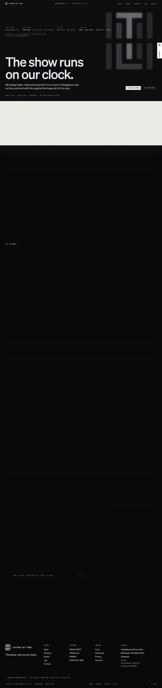
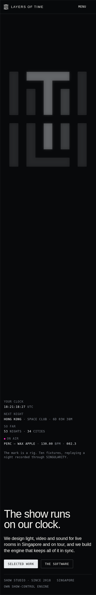

# UI Design System & Master Generation Blueprint: layersoftime-studio

> **LAYERS OF TIME — The show runs on our clock.** (https://layersoftime.studio/) — LAYERS OF TIME is a show studio in Singapore. We design light, video and sound for live rooms, and we build the engine that keeps all of...



---

## 1. Executive Visual Persona & Design Archetype

- **Brand Essence & Persona**: **LAYERS OF TIME — The show runs on our clock.** (`https://layersoftime.studio/`). LAYERS OF TIME is a show studio in Singapore. We design light, video and sound for live rooms, and we build the engine that keeps all of...
- **Visual Archetype**: **Dark-Substrate WebGL / Canvas Interactive Experience (`#08090b` / `#e9ecef`)**.
- **Anti-AI-Slop Differentiators**:
  - **Source-Grounded Chromatic Polarity**: Anchors the viewport in `#08090b` (`var(--bg)` in `:root`) paired with `#e9ecef` primary typography and `#e9ecef` accents.
  - **Extracted Typographic Hierarchy**: Pairs `Söhne` for display copy (`The show runs on our clock.`) with `Söhne Mono` and `Söhne Mono`.
  - **Calibrated Spatial Grid & Motion**: Combines `var(--max)` container bounds (`gap: 1.5rem`, padding `.5rem`) with `cubic-bezier(.16,1,.3,1)` easing and Lenis Smooth Scroll (`data-lenis`), Three.js / WebGL Canvas Pipeline.

---

## 2. Spatial Architecture & Modular Grid Mathematics



### Viewport Allocation & Container Geometry
- **Captured Viewport Dimensions**: Desktop `1440×6125px` (`assets/desktop.png`, full-page scroll capture), Mobile `390×2400px` (`assets/mobile.png`, capped at 2400px multi-section capture).
- **Master Container Bounds**: `var(--max)` extracted from `layersoftime-studio` stylesheet.
- **Canvas Lateral Padding & Spacing**: `.5rem` lateral canvas padding with `1.5rem` grid gap.
- **Border Radius Scale**: `50%`, `2px`, `var(--phone-r)`, `1px`.

### Responsive Breakpoint Architecture
- **Desktop Layout**: Multi-column CSS Grid / Flexbox layout at `1440px` (`max-width: var(--max)`, `gap: 1.5rem`).
- **Mobile Layout**: Single-column vertical stack at `390px` viewport width with `.5rem` horizontal padding.
- **Extracted CSS Media Queries**: `@media (prefers-reduced-motion)`, `@media (width>=900px)`, `@media (width<=30rem)`, `@media (width<=1279px)`.

---

## 3. Color System, Materiality & Atmospheric Lighting

### Semantic Palette & Source Grounding
| Semantic Role | Ground-Truth Value | Extracted CSS Source / Selector |
|---|---|---|
| **Primary Canvas Substrate** | `#08090b` | `var(--bg)` in `:root` |
| **Primary Typography Ink** | `#0e1013` | `var(--panel)` in `:root` |
| **Elevated Surface / Card Substrate** | `#14171b` | `var(--panel-2)` in `:root` |
| **Interactive Accent / Highlight** | `#e9ecef` | `var(--fg)` in `:root` |
| **Secondary / Muted Copy** | `#8a9099` | `var(--muted)` in `:root` |
| **Structural Hairline Border** | `#767c85` | `var(--faint)` in `:root` |
| **Variable Token (`--line`)** | `#e9ecef1f` | `var(--line)` in `:root` |
| **Variable Token (`--line-strong`)** | `#e9ecef47` | `var(--line-strong)` in `:root` |
| **Variable Token (`--signal`)** | `#d4178f` | `var(--signal)` in `:root` |
| **Variable Token (`--signal-live`)** | `#ff29c4` | `var(--signal-live)` in `:root` |
| **Variable Token (`--signal-fill`)** | `#8f0e66` | `var(--signal-fill)` in `:root` |
| **Variable Token (`--parallax`)** | `#22d3ee` | `var(--parallax)` in `:root` |
| **Variable Token (`--parsec`)** | `#a3e635` | `var(--parsec)` in `:root` |

### Sanitized Root CSS Variables (`ui-ux.md` Ground Truth)
| Variable Name | Extracted Value | Semantic Role |
|---|---|---|
| `--bg` | `#08090b` | Canvas / Surface Token |
| `--panel` | `#0e1013` | Color / Atmospheric Token |
| `--panel-2` | `#14171b` | Color / Atmospheric Token |
| `--fg` | `#e9ecef` | Typography Ink Token |
| `--muted` | `#8a9099` | Color / Atmospheric Token |
| `--faint` | `#767c85` | Color / Atmospheric Token |
| `--line` | `#e9ecef1f` | Color / Atmospheric Token |
| `--line-strong` | `#e9ecef47` | Color / Atmospheric Token |
| `--signal` | `#d4178f` | Color / Atmospheric Token |
| `--signal-live` | `#ff29c4` | Color / Atmospheric Token |
| `--signal-fill` | `#8f0e66` | Color / Atmospheric Token |
| `--parallax` | `#22d3ee` | Color / Atmospheric Token |
| `--parsec` | `#a3e635` | Color / Atmospheric Token |
| `--ease` | `cubic-bezier(.22, .61, .36, 1)` | Motion / Easing Token |
| `--d-fast` | `.16s` | Motion / Timing Token |
| `--d-base` | `.32s` | Motion / Timing Token |

---

## 4. Typographic Scale & Editorial Hierarchy

### Font Family Stacks
- **Display Typography**: `Söhne`.
- **Primary Body Stack**: `Söhne Mono`.
- **Technical / Metadata Stack**: `Söhne Mono`.

### Typographic Scale & Rules (Extracted from Stylesheet & Variables)
- **Hero Display (`H1`)**: CSS variables `--fs-h1: clamp(2.25rem, 5.5vw, 5.5rem)`.
- **Section Heading (`H2`)**: CSS variables `--fs-h2: clamp(1.75rem, 3.6vw, 3.5rem)`; rule `h2` (`font-size: var(--fs-h3)`, `letter-spacing: -.015em`, `font-weight: 500`).
- **Body Copy**: CSS variables `--fs-body: 1.0625rem`.
- **Metadata & Navigation Labels**: CSS variables `--fs-small: .9375rem`, `--fs-label: .75rem`.

---

## 5. Choreographed Motion & Interaction Physics

### Primary Easing Curves
- **Extracted Timing Functions**: `cubic-bezier(.16,1,.3,1)`, `cubic-bezier(.22,.61,.36,1)`, `cubic-bezier(.77,0,.175,1)`.

### Per-Element Transition & Choreography Rules
- **Selector `.header[data-astro-cid-nen7h5rs]`**: `transition: transform var(--d-base) var(--ease), background-color var(--d-...` extracted from `layersoftime-studio` stylesheet.
- **Selector `.status[data-astro-cid-nen7h5rs]`**: `transition: color var(--d-fast) var(--ease)` extracted from `layersoftime-studio` stylesheet.
- **Selector `.cursor__dot`**: `transition: opacity .2s var(--ease), width .2s var(--ease)` extracted from `layersoftime-studio` stylesheet.
- **Extracted Easing Curve (`cubic-bezier(.16,1,.3,1)`)**: Governs interactive state transitions across `<header.header>` and `<section.chapter>`.
- **Runtime Interaction Engine**: Integrates Lenis Smooth Scroll (`data-lenis`), Three.js / WebGL Canvas Pipeline with `prefers-reduced-motion: reduce` fallback guards.

---

## 6. Component Wireframe & Structural DOM Map

### Visual Layout Schematic (Grounded in `dom.html` — `1440px` Desktop & `390px` Mobile Reflow)
```
┌────────────────────────────────────────────────────────────────────────┐
│ DESKTOP VIEWPORT (1440px) — LAYERS OF TIME — The show runs on our cloc │
│ ====================================================================== │
│ [ <header.header>          | Work · Studio · Software · Log · Conta ]  │
│ ---------------------------------------------------------------------- │
│ | HERO STAGE: <section.hero>                                       |   │
│ | H1: The show runs on our clock.                                  |   │
│ | Substrate: #08090b    | Ink: #e9ecef    | Accent: #e9ecef        |   │
│ ---------------------------------------------------------------------- │
│ | SHOWCASE GRID (<section.chapter>         ) max-w: var(--max)     |   │
│ | +------------------------------+  +------------------------------+ | │
│ | | A show studio in Singapore t |  | Rooms we have run.           | | │
│ | +------------------------------+  +------------------------------+ | │
│ ---------------------------------------------------------------------- │
│ | MOBILE VIEWPORT REFLOW (390px) — Single-Column Stack (gap: 1.5rem) | │
│ | [<header.header>] -> [<section.hero>] -> [<section.chapter>] |       │
│ ---------------------------------------------------------------------- │
│ [ FOOTER (<footer.footer>       ) | https://layersoftime.studio/       │
└────────────────────────────────────────────────────────────────────────┘
```

### Granular DOM Region Breakdown
1. **Brand Header & Navigation Bar (<header.header> — `layersoftime-studio`)**:
   - Landmark `<header class="header">` hosting `LAYERS OF TIME — The show runs on ou` navigation (`Work · Studio · Software · Log · Contact`), DOM attributes (`data-theme="dark"`, `data-astro-exec`, `data-header`, `data-astro-cid-nen7h5rs`), and stylesheet rule `.brand__mark { flex:none;width:17px;height:20px }`.
2. **Hero Stage & Focal Lead (<section.hero> — `The show runs on our clock.`)**:
   - Landmark `<section class="hero">` presenting display lead `The show runs on our clock.` and copy excerpt *"18:21:18:27 UTC · SINGULARITY 0.9.13"* over `#08090b` canvas and `#e9ecef` ink.
3. **Primary Showcase & Content Grid (<section.chapter> — `A show studio in Singapore that bu`)**:
   - Landmark `<section class="chapter chapter--light">` rendering section `A show studio in Singapore that builds the softwa...` with copy *"SINGULARITY 0.9.13"*, asset references (`favicon.svg`, `apple-touch-icon.png`, `soehne-kraftig.woff2`, `soehne-buch.woff2`), and grid rule `hover { color:var(--fg) }`.
4. **Interactive Detail & Feature Matrix (<section.section-tight> — `Rooms we have run.`)**:
   - Landmark `<section class="section-tight">` framing `Rooms we have run.` and `Built on tour, between soundcheck and doors.` (*"hello@layersoftime.studio"*) with `#14171b` surface cards, `#e9ecef` accents, and `.footer__mark { flex:none;width:44px;height:52px }`.
5. **Colophon & Global Directory Footer (<footer.footer> — `https://layersoftime.studio/`)**:
   - Landmark `<footer class="footer">` anchoring `LAYERS OF TIME — The show runs o` footer links (`Work · Studio · Software · Log · Contact`), copy *"Zervex · 8 Ubi Road 2, #08-03 · Singapore 408538"*, and `#767c85` structural dividers.

---

## 7. Master Zero-Shot AI Generation Prompt

```markdown
# Master Zero-Shot Frontend Generation Prompt: layersoftime-studio (LAYERS OF TIME — The show runs on our clock.)

You are a principal frontend architect and design systems engineer. Build a complete, production-ready web application replicating the exact design system, DOM landmarks, typographic hierarchy, color tokens, and motion physics of `layersoftime-studio` (**LAYERS OF TIME — The show runs on our clock.** — `https://layersoftime.studio/`).

### 1. Visual Archetype & Anti-AI-Slop Mandates
- **Archetype**: Dark-Substrate WebGL / Canvas Interactive Experience (`#08090b` / `#e9ecef`).
- **Identity & Domain Context**: LAYERS OF TIME is a show studio in Singapore. We design light, video and sound for live rooms, and we build the engine that keeps all of...
- **Primary Substrate**: `#08090b` (`var(--bg)` in `:root`), **Primary Ink**: `#e9ecef`, **Accent / Highlight**: `#e9ecef`.
- **Site-Specific Differentiators**:
  - **Source-Grounded Chromatic Polarity**: Anchors the viewport in `#08090b` (`var(--bg)` in `:root`) paired with `#e9ecef` primary typography and `#e9ecef` accents.
  - **Extracted Typographic Hierarchy**: Pairs `Söhne` for display copy (`The show runs on our clock.`) with `Söhne Mono` and `Söhne Mono`.
  - **Calibrated Spatial Grid & Motion**: Combines `var(--max)` container bounds (`gap: 1.5rem`, padding `.5rem`) with `cubic-bezier(.16,1,.3,1)` easing and Lenis Smooth Scroll (`data-lenis`), Three.js / WebGL Canvas Pipeline.

### 2. Ground-Truth CSS Variables (`:root` Token Contract)
Declare and consume these exact custom properties extracted from `layersoftime-studio` in your global stylesheet:

:root {
  /* LAYERS OF TIME — The show runs on our clock. (layersoftime-studio) — Ground-Truth Extracted CSS Variables */
  --bg: #08090b; /* Canvas / Surface Token (layersoftime-studio) */
  --panel: #0e1013; /* Color / Atmospheric Token (layersoftime-studio) */
  --panel-2: #14171b; /* Color / Atmospheric Token (layersoftime-studio) */
  --fg: #e9ecef; /* Typography Ink Token (layersoftime-studio) */
  --muted: #8a9099; /* Color / Atmospheric Token (layersoftime-studio) */
  --faint: #767c85; /* Color / Atmospheric Token (layersoftime-studio) */
  --line: #e9ecef1f; /* Color / Atmospheric Token (layersoftime-studio) */
  --line-strong: #e9ecef47; /* Color / Atmospheric Token (layersoftime-studio) */
  --signal: #d4178f; /* Color / Atmospheric Token (layersoftime-studio) */
  --signal-live: #ff29c4; /* Color / Atmospheric Token (layersoftime-studio) */
  --signal-fill: #8f0e66; /* Color / Atmospheric Token (layersoftime-studio) */
  --parallax: #22d3ee; /* Color / Atmospheric Token (layersoftime-studio) */
  --parsec: #a3e635; /* Color / Atmospheric Token (layersoftime-studio) */
  --ease: cubic-bezier(.22, .61, .36, 1); /* Motion / Easing Token (layersoftime-studio) */
  --d-fast: .16s; /* Motion / Timing Token (layersoftime-studio) */
  --d-base: .32s; /* Motion / Timing Token (layersoftime-studio) */
}

### 3. Semantic Color & Materiality Contract
Map every surface, ink, and border strictly to these source-grounded tokens:
- **Primary Canvas Substrate**: `#08090b` — grounded in `var(--bg)` in `:root`
- **Primary Typography Ink**: `#0e1013` — grounded in `var(--panel)` in `:root`
- **Elevated Surface / Card Substrate**: `#14171b` — grounded in `var(--panel-2)` in `:root`
- **Interactive Accent / Highlight**: `#e9ecef` — grounded in `var(--fg)` in `:root`
- **Secondary / Muted Copy**: `#8a9099` — grounded in `var(--muted)` in `:root`
- **Structural Hairline Border**: `#767c85` — grounded in `var(--faint)` in `:root`
- **Variable Token (`--line`)**: `#e9ecef1f` — grounded in `var(--line)` in `:root`
- **Variable Token (`--line-strong`)**: `#e9ecef47` — grounded in `var(--line-strong)` in `:root`
- **Variable Token (`--signal`)**: `#d4178f` — grounded in `var(--signal)` in `:root`
- **Variable Token (`--signal-live`)**: `#ff29c4` — grounded in `var(--signal-live)` in `:root`
- **Variable Token (`--signal-fill`)**: `#8f0e66` — grounded in `var(--signal-fill)` in `:root`
- **Variable Token (`--parallax`)**: `#22d3ee` — grounded in `var(--parallax)` in `:root`
- **Variable Token (`--parsec`)**: `#a3e635` — grounded in `var(--parsec)` in `:root`

### 4. Spatial Grid, Container Bounds & Responsive Breakpoints
- **Desktop Viewport Reference**: `1440×6125px` (full-page scroll capture, `1440px` standard desktop width).
- **Mobile Viewport Reference**: `390×2400px` (capped at 2400px multi-section capture, `390px` standard mobile width).
- **Container Max-Width**: `var(--max)` extracted from `layersoftime-studio` stylesheet
- **Padding & Gutters**: `.5rem` lateral canvas padding with `1.5rem` grid gap
- **Desktop Grid**: Multi-column CSS Grid / Flexbox layout at `1440px` (`max-width: var(--max)`, `gap: 1.5rem`)
- **Mobile Adaptation**: Single-column vertical stack at `390px` viewport width with `.5rem` horizontal padding
- **Media Queries**: `@media (prefers-reduced-motion)`, `@media (width>=900px)`, `@media (width<=30rem)`, `@media (width<=1279px)`
- **Corner Radii**: `50%`, `2px`, `var(--phone-r)`, `1px`

### 5. Typography & Editorial Scale Contract
- **Display Font Stack**: `Söhne`
- **Body Font Stack**: `Söhne Mono`
- **Monospace / Technical Font Stack**: `Söhne Mono`
- **H1 Display Rule**: CSS variables `--fs-h1: clamp(2.25rem, 5.5vw, 5.5rem)`
- **H2 Section Rule**: CSS variables `--fs-h2: clamp(1.75rem, 3.6vw, 3.5rem)`; rule `h2` (`font-size: var(--fs-h3)`, `letter-spacing: -.015em`, `font-weight: 500`)
- **Body Copy Rule**: CSS variables `--fs-body: 1.0625rem`
- **Metadata & Index Rule**: CSS variables `--fs-small: .9375rem`, `--fs-label: .75rem`

### 6. Component Hierarchy, Verbatim Copy & Real DOM Landmarks
Scaffold `layersoftime-studio` (`LAYERS OF TIME — The show runs on our clock.`) with these exact structural regions, extracted copy, and CSS rules from `dom.html`:
1. **Brand Header & Navigation Bar (<header.header> — `layersoftime-studio`)**:
   - DOM & Selectors: Landmark `<header class="header">` hosting `LAYERS OF TIME — The show runs on ou` navigation (`Work · Studio · Software · Log · Contact`), DOM attributes (`data-theme="dark"`, `data-astro-exec`, `data-header`, `data-astro-cid-nen7h5rs`), and stylesheet rule `.brand__mark { flex:none;width:17px;height:20px }`.
   - Responsive Contract: Header `Brand Header & Navigation Bar (<header.header> — `layersoftime-studio`)` (`layersoftime-studio`) adapts across `@media (prefers-reduced-motion)`, `@media (width>=900px)`, `@media (width<=30rem)`, `@media (width<=1279px)` with `cubic-bezier(.16,1,.3,1)`, `cubic-bezier(.22,.61,.36,1)`, `cubic-bezier(.77,0,.175,1)` transitions and links `Work · Studio · Software · Log · Contact`.
2. **Hero Stage & Focal Lead (<section.hero> — `The show runs on our clock.`)**:
   - DOM & Selectors: Landmark `<section class="hero">` presenting display lead `The show runs on our clock.` and copy excerpt *"18:21:18:27 UTC · SINGULARITY 0.9.13"* over `#08090b` canvas and `#e9ecef` ink.
   - Responsive Contract: Hero stage (`1440×6125px` desktop / `390×2400px` mobile) sets `#08090b` background with `#e9ecef` headline `The show runs on our clock.`.
3. **Primary Showcase & Content Grid (<section.chapter> — `A show studio in Singapore that bu`)**:
   - DOM & Selectors: Landmark `<section class="chapter chapter--light">` rendering section `A show studio in Singapore that builds the softwa...` with copy *"SINGULARITY 0.9.13"*, asset references (`favicon.svg`, `apple-touch-icon.png`, `soehne-kraftig.woff2`, `soehne-buch.woff2`), and grid rule `hover { color:var(--fg) }`.
   - Responsive Contract: Showcase grid `Primary Showcase & Content Grid (<section.chapter> — `A show studio in Singapore that bu`)` applies Multi-column CSS Grid / Flexbox layout at `1440px` (`max-width: var(--max)`, `gap: 1.5rem`) on desktop and Single-column vertical stack at `390px` viewport width with `.5rem` horizontal padding on mobile.
4. **Interactive Detail & Feature Matrix (<section.section-tight> — `Rooms we have run.`)**:
   - DOM & Selectors: Landmark `<section class="section-tight">` framing `Rooms we have run.` and `Built on tour, between soundcheck and doors.` (*"hello@layersoftime.studio"*) with `#14171b` surface cards, `#e9ecef` accents, and `.footer__mark { flex:none;width:44px;height:52px }`.
   - Responsive Contract: Detail module `Interactive Detail & Feature Matrix (<section.section-tight> — `Rooms we have run.`)` uses `50%`, `2px`, `var(--phone-r)`, `1px` radii, `#e9ecef` highlights, and assets (favicon.svg, apple-touch-icon.png, soehne-kraftig.woff2).
5. **Colophon & Global Directory Footer (<footer.footer> — `https://layersoftime.studio/`)**:
   - DOM & Selectors: Landmark `<footer class="footer">` anchoring `LAYERS OF TIME — The show runs o` footer links (`Work · Studio · Software · Log · Contact`), copy *"Zervex · 8 Ubi Road 2, #08-03 · Singapore 408538"*, and `#767c85` structural dividers.
   - Responsive Contract: Footer `Colophon & Global Directory Footer (<footer.footer> — `https://layersoftime.studio/`)` aligns to `var(--max)` extracted from `layersoftime-studio` stylesheet with `.5rem` lateral canvas padding with `1.5rem` grid gap and attributes (data-theme="dark", data-astro-exec, data-header).

#### Verbatim DOM Copy Excerpts (`dom.html`)
- Copy Excerpt 1: *"18:21:18:27 UTC · SINGULARITY 0.9.13"*
- Copy Excerpt 2: *"SINGULARITY 0.9.13"*
- Copy Excerpt 3: *"hello@layersoftime.studio"*
- Copy Excerpt 4: *"Zervex · 8 Ubi Road 2, #08-03 · Singapore 408538"*

### 7. Motion, Extracted Stylesheet Rules & Interaction Choreography
- **Primary Easing Functions**: `cubic-bezier(.16,1,.3,1)`, `cubic-bezier(.22,.61,.36,1)`, `cubic-bezier(.77,0,.175,1)`
- **Extracted Stylesheet Rules (`layersoftime-studio`)**:
- `.brand__mark { flex:none;width:17px;height:20px }`
- `hover { color:var(--fg) }`
- `.footer__mark { flex:none;width:44px;height:52px }`
- `last-child { grid-column:1/-1 }`
- `before { content:"· " }`
- **Per-Selector Transition Rules**:
- **Selector `.header[data-astro-cid-nen7h5rs]`**: `transition: transform var(--d-base) var(--ease), background-color var(--d-...` extracted from `layersoftime-studio` stylesheet.
- **Selector `.status[data-astro-cid-nen7h5rs]`**: `transition: color var(--d-fast) var(--ease)` extracted from `layersoftime-studio` stylesheet.
- **Selector `.cursor__dot`**: `transition: opacity .2s var(--ease), width .2s var(--ease)` extracted from `layersoftime-studio` stylesheet.
- **Extracted Easing Curve (`cubic-bezier(.16,1,.3,1)`)**: Governs interactive state transitions across `<header.header>` and `<section.chapter>`.
- **Runtime Interaction Engine**: Integrates Lenis Smooth Scroll (`data-lenis`), Three.js / WebGL Canvas Pipeline with `prefers-reduced-motion: reduce` fallback guards.

### 8. Technical Deliverables
- Implement in Next.js (App Router) with TypeScript and Tailwind CSS consuming the `:root` custom properties defined above for `layersoftime-studio`.
- Reproduce both the `1440px` desktop architecture and `390px` mobile breakpoint transitions, preserving semantic HTML5 landmarks (`<header>`, `<nav>`, `<main>`, `<section>`, `<footer>`) and `prefers-reduced-motion` accessibility guards.
```
