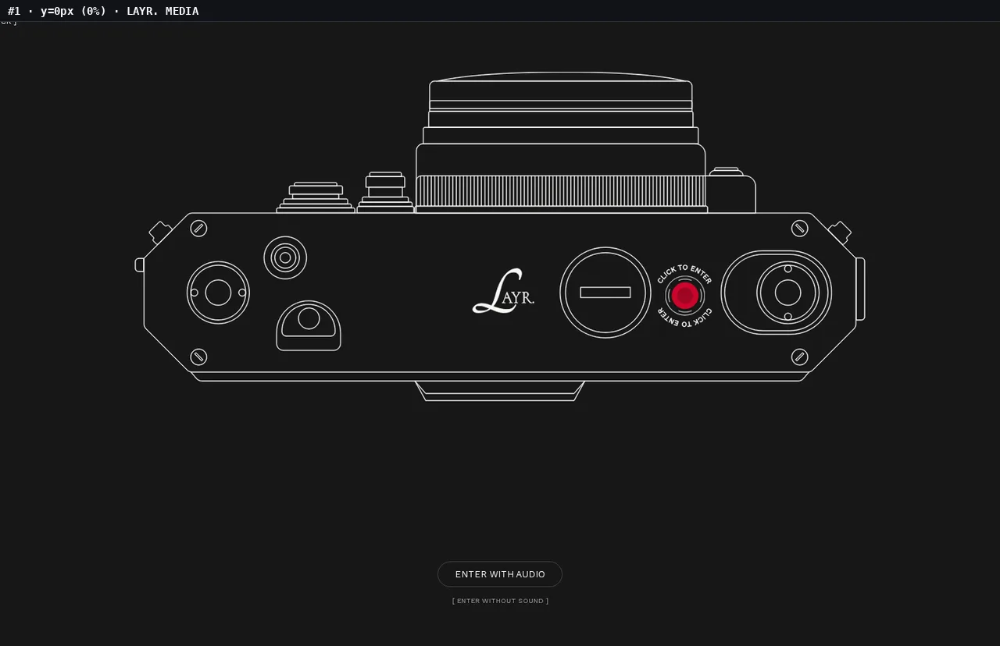
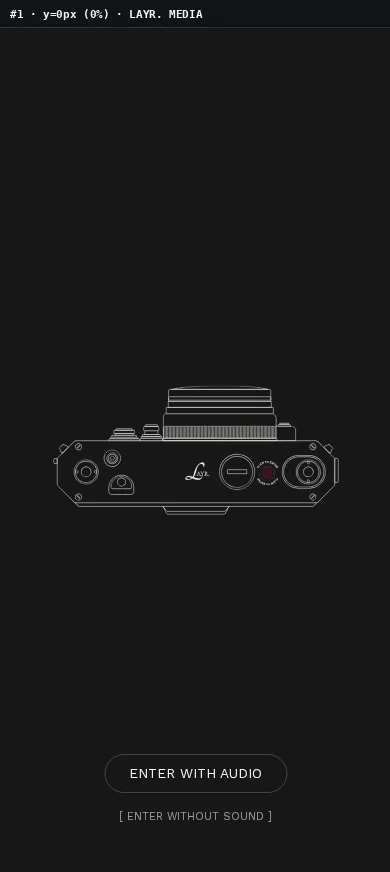

# UI Design System & Master Generation Blueprint: layrmedia-com

> **LAYR Media · Creative Photography & Videography Studio** (https://layrmedia.com/) — A Toronto-based photography and video production studio creating high-quality commercial, brand, corporate and social content from concep...





---

## 1. Executive Visual Persona & Design Archetype

- **Brand Essence & Persona**: **LAYR Media · Creative Photography & Videography Studio** (`https://layrmedia.com/`). A Toronto-based photography and video production studio creating high-quality commercial, brand, corporate and social content from concep...
- **Capture Provenance**: Live browser capture (`tier1_fast`, HTTP `200`, captured `2026-11-24`).
- **Visual Archetype**: **Light-Gallery WebGL / Canvas Interactive Experience (`#f8f7f6` / `#ff0033`)**.
- **Anti-AI-Slop Differentiators**:
  - **Live-Computed Chromatic Polarity**: Anchors the viewport in `#f8f7f6` (live computed `body` `background-color` (`computed_styles.json`)) paired with `#171717` primary typography and `#ff0033` accents.
  - **Grounded Typographic Hierarchy**: Uses `Koulen` across display (`LAYR. MEDIA`) and body copy, paired with `SFMono-Regular` for monospace/code.
  - **Calibrated Spatial Grid & Motion**: Combines `96rem` container bounds (`gap: .5vw`, padding `.2vw`) with `cubic-bezier(0,0,.2,1)` easing and Lenis Smooth Scroll (`data-lenis`), Three.js / WebGL Canvas Pipeline.

---

## 2. Spatial Architecture & Modular Grid Mathematics

### Viewport Allocation & Container Geometry
- **Captured Journey Filmstrips**: Desktop `1280×828px` (`assets/desktop-journey.webp`, `1` keyframes up to `y=0px` / doc `11113px`), Mobile `390×872px` (`assets/mobile-journey.webp`, `1` keyframes).
- **Master Container Bounds**: `96rem` (non-`@media` desktop container stylesheet rule).
- **Canvas Lateral Padding & Spacing**: `.2vw` lateral canvas padding with `.5vw` grid gap.
- **Border Radius Scale**: `.25rem`, `var(--radius-2xl)`, `var(--radius-md)`, `var(--radius-sm)`.

### Responsive Breakpoint Architecture
- **Desktop Layout**: Multi-column CSS Grid / Flexbox layout at `1440px` (`max-width: 96rem`, `gap: .5vw`).
- **Mobile Layout**: Single-column vertical stack at `390px` viewport width with `.2vw` horizontal padding.
- **Extracted CSS Media Queries**: `@media (min-width:40rem)`, `@media (min-width:48rem)`, `@media (min-width:64rem)`, `@media (min-width:80rem)`.

---

## 3. Color System, Materiality & Atmospheric Lighting

### Semantic Palette & Source Grounding
| Semantic Role | Ground-Truth Value | Extracted Live / CSS Source |
|---|---|---|
| **Primary Canvas Substrate** | `#f8f7f6` | live computed `body` `background-color` (`computed_styles.json`) |
| **Primary Typography Ink** | `#171717` | live computed `body` `color` (`computed_styles.json`) |
| **Elevated Surface / Card Substrate** | `#ffffff` | `.bg-background { background-color: white }` (`#ffffff`) |
| **Interactive Accent / Highlight** | `#ff0033` | `var(--color-red)` in `:root` |
| **Secondary / Muted Copy** | `#008000` | `.text-green-500 { color: green }` (`#008000`) |
| **Structural Hairline Border** | `#ffffff` | `20 { border-color: #ffffff }` |
| **Variable Token (`--color-red-500`)** | `#fb2c36` | `var(--color-red-500)` in `:root` |
| **Variable Token (`--color-red-600`)** | `#e40014` | `var(--color-red-600)` in `:root` |
| **Variable Token (`--color-amber-950`)** | `#461901` | `var(--color-amber-950)` in `:root` |
| **Variable Token (`--color-green-500`)** | `#00c758` | `var(--color-green-500)` in `:root` |

### Sanitized Root CSS Variables (`ui-ux.md` Ground Truth)
| Variable Name | Extracted Value | Semantic Role |
|---|---|---|
| `--color-black` | `#171717` | Canvas / Surface Token |
| `--color-white` | `#f8f7f6` | Canvas / Surface Token |
| `--color-red` | `#f03` | Brand / Palette Token |
| `--font-koulen` | `"Koulen", "Koulen Fallback"` | Typography / Scale Token |
| `--font-work-sans` | `"Work Sans", "Work Sans Fallback"` | Typography / Scale Token |
| `--color-red-500` | `#fb2c36` | Brand / Palette Token |
| `--color-red-600` | `#e40014` | Brand / Palette Token |
| `--color-amber-950` | `#461901` | Brand / Palette Token |
| `--color-green-500` | `#00c758` | Brand / Palette Token |
| `--color-neutral-900` | `#171717` | Brand / Palette Token |
| `--spacing` | `.25rem` | Layout / Spatial Grid Token |
| `--font-weight-light` | `300` | Canvas / Surface Token |
| `--font-weight-normal` | `400` | Typography / Scale Token |
| `--font-weight-medium` | `500` | Typography / Scale Token |
| `--font-weight-semibold` | `600` | Typography / Scale Token |
| `--font-weight-bold` | `700` | Typography / Scale Token |

---

## 4. Typographic Scale & Editorial Hierarchy

### Font Family Stacks
- **Display Typography**: `Koulen`.
- **Primary Body Stack**: `Koulen`.
- **Technical / Metadata Stack**: `SFMono-Regular`.

### Typographic Scale & Rules (Live Computed & Stylesheet Grounded)
- **Hero Display (`H1`)**: live computed `h1` (`font-size: 172.8px`, `line-height: 138.24px`, `font-weight: 400`).
- **Section Heading (`H2`)**: live computed `h2` (`font-size: 331.2px`, `line-height: 331.2px`, `font-weight: 500`, `letter-spacing: -8.28px`).
- **Body Copy**: live computed `body` (`font-size: 16px`, `line-height: 24px`, `font-weight: 400`).
- **Metadata & Navigation Labels**: live computed `nav/a` (`font-size: 16px`, `line-height: 24px`, `font-weight: 400`); CSS variables `--default-mono-font-family: var(--font-mono)`.

---

## 5. Choreographed Motion & Interaction Physics

### Primary Easing Curves
- **Extracted Timing Functions**: `cubic-bezier(0,0,.2,1)`, `cubic-bezier(.4,0,.6,1)`, `cubic-bezier(.4,0,.2,1)`.

### Per-Element Transition & Choreography Rules
- **Selector `layer theme`**: `transition: .15s` extracted from `layrmedia-com` stylesheet.
- **Selector `.transition`**: `transition: var(--tw-ease,var(--default-transition-timing-function))` extracted from `layrmedia-com` stylesheet.
- **Selector `.transition-\[border-color\]`**: `transition: var(--tw-ease,var(--default-transition-timing-function))` extracted from `layrmedia-com` stylesheet.
- **Extracted Easing Curve (`cubic-bezier(0,0,.2,1)`)**: Governs interactive state transitions across `<header.relative>` and `<section.h-fit>`.
- **Runtime Interaction Engine**: Integrates Lenis Smooth Scroll (`data-lenis`), Three.js / WebGL Canvas Pipeline with `prefers-reduced-motion: reduce` fallback guards.
### Measured Runtime Scroll & Interaction Telemetry (`behavioral_journey_v2`)
- **Scroll Driver Mode**: `native` (max document height `11113px`, deepest scrollY reached `0px` across `1` desktop keyframes).
- **Detected Scroll / Motion Libraries**: Native browser scroll / standard CSS transitions.

---

## 6. Component Wireframe & Structural DOM Map

### Visual Layout Schematic — Desktop (`1440px`, Grounded in `dom.html` & Landmark Bounding Boxes)
```
┌────────────────────────────────────────────────────────────────────────┐
│ DESKTOP VIEWPORT (1440px) — LAYR Media · Creative Photography & Videog │
│ ====================================================================== │
│ [ <header.relative> (1440x1800px)     | Overview · Index · Archive · ] │
│ ---------------------------------------------------------------------- │
│ | HERO STAGE: <section.relative> (w=1440px)                          | │
│ | H1: LAYR. MEDIA                                                    | │
│ | Substrate: #f8f7f6 | Ink: #171717 | Accent: #ff0033                | │
│ ---------------------------------------------------------------------- │
│ | SHOWCASE GRID (<section.h-fit>) max-w: 96rem                       | │
│ | +------------------------------+  +------------------------------+ | │
│ | | [ ENTER WITHOUT SOUND ]      |  | START A PROJECT START A PROJ | | │
│ | +------------------------------+  +------------------------------+ | │
│ ---------------------------------------------------------------------- │
│ | DETAIL MODULE (<section.group>) — © 2026 LAYR — Toronto            | │
│ ---------------------------------------------------------------------- │
│ [ FOOTER (<footer.overflow-x-c) | https://layrmedia.com/               │
└────────────────────────────────────────────────────────────────────────┘
```

### Visual Layout Schematic — Mobile Reflow (`390px`)
```
┌────────────────────────────────────────────────────────────────────────┐
│ MOBILE VIEWPORT REFLOW (390px) — Single-Column Stack (gap: .5vw)       │
│ ====================================================================== │
│ [ HEADER BAR (<header.relative>       ) | Compact Menu (390px)         │
│ ---------------------------------------------------------------------- │
│ | HERO STAGE (<section.relative>) — 390px Vertical Lead              | │
│ | H1: LAYR. MEDIA                                                    | │
│ ---------------------------------------------------------------------- │
│ | SHOWCASE STACK (<section.h-fit>) — 1-Col Stack                     | │
│ | [ Item 1: [ ENTER WITHOUT SOUND ]                                ] | │
│ | [ Item 2: START A PROJECT START A PROJECT                        ] | │
│ ---------------------------------------------------------------------- │
│ | DETAIL STACK (<section.group>) — 1-Col (© 2026 LAYR — Toro)        | │
│ ---------------------------------------------------------------------- │
│ [ FOOTER (<footer.overflow-x-c) | Stacked 390px Colophon               │
└────────────────────────────────────────────────────────────────────────┘
```

### Granular DOM Region Breakdown
1. **Brand Header & Navigation Bar (<header.relative> — `layrmedia-com`)**:
   - Landmark `<header class="relative w-full">` (`1440x1800px`) hosting `LAYR Media · Creative Photography & ` navigation (`Overview · Index · Archive · About · Contact`), DOM attributes (`data-precedence="next"`, `data-engine="three.js r184"`, `data-original-fill="F8F7F6"`, `data-original-fill="F8F7F6"`), and stylesheet rule `ulen_aaaf4d07-module__jwNIZW__cla... { font-family:Koulen,Koulen Fallback;font-style:normal;font-weight:400 }`.
2. **Hero Stage & Focal Lead (<section.relative> — `LAYR. MEDIA`)**:
   - Landmark `<section class="relative">` presenting display lead `LAYR. MEDIA` and copy excerpt *"[ ENTER WITHOUT SOUND ]"* over `#f8f7f6` canvas and `#171717` ink.
3. **Primary Showcase & Content Grid (<section.h-fit> — `[ ENTER WITHOUT SOUND ]`)**:
   - Landmark `<section class="h-fit relative">` rendering section `[ ENTER WITHOUT SOUND ]` with copy *"START A PROJECT START A PROJECT"*, asset references (`6c6a3def8289aaff-s.p.42fhi38wiwr8...`, `7ddd198311ba7843-s.p.3kq6k02b2ysv...`, `1.jpg`, `2.jpg`), and grid rule `oulen_aaaf4d07-module__jwNIZW__va... { --font-koulen:"Koulen", "Koulen Fallback" }`.
4. **Interactive Detail & Feature Matrix (<section.group> — `START A PROJECT START A PROJECT`)**:
   - Landmark `<section class="group bg-red">` framing `START A PROJECT START A PROJECT` and `© 2026 LAYR — Toronto, CA` (*"© 2026 LAYR — Toronto, CA"*) with `#ffffff` surface cards, `#ff0033` accents, and `sans_6c6a0eaa-module__Tqlsvq__cla... { font-family:Work Sans,Work Sans Fallback;font-style:normal }`.
5. **Colophon & Global Directory Footer (<footer.overflow-x-clip> — `https://layrmedia.com/`)**:
   - Landmark `<footer class="overflow-x-clip w-full">` anchoring `LAYR Media · Creative Photograph` footer links (`Overview · Index · Archive · About · Contact`), copy *"Creative Production Studio"*, and `#ffffff` structural dividers.
### Full Vertical Scroll Sequence (Desktop `1440×900` Keyframes)
- **Step 01** (`y=0px`, `0%`): Active landmark `LAYR. MEDIA` · sticky/fixed elements: `4`

---

## 7. Master Zero-Shot AI Generation Prompt

```markdown
# Master Zero-Shot Frontend Generation Prompt: layrmedia-com (LAYR Media · Creative Photography & Videography Studio)

You are a principal frontend architect and design systems engineer. Build a complete, production-ready web application replicating the exact design system, DOM landmarks, typographic hierarchy, color tokens, and motion physics of `layrmedia-com` (**LAYR Media · Creative Photography & Videography Studio** — `https://layrmedia.com/`).

### 1. Visual Archetype & Anti-AI-Slop Mandates
- **Archetype**: Light-Gallery WebGL / Canvas Interactive Experience (`#f8f7f6` / `#ff0033`).
- **Identity & Domain Context**: A Toronto-based photography and video production studio creating high-quality commercial, brand, corporate and social content from concep...
- **Primary Substrate**: `#f8f7f6` (live computed `body` `background-color` (`computed_styles.json`)), **Primary Ink**: `#171717`, **Accent / Highlight**: `#ff0033`.
- **Site-Specific Differentiators**:
  - **Live-Computed Chromatic Polarity**: Anchors the viewport in `#f8f7f6` (live computed `body` `background-color` (`computed_styles.json`)) paired with `#171717` primary typography and `#ff0033` accents.
  - **Grounded Typographic Hierarchy**: Uses `Koulen` across display (`LAYR. MEDIA`) and body copy, paired with `SFMono-Regular` for monospace/code.
  - **Calibrated Spatial Grid & Motion**: Combines `96rem` container bounds (`gap: .5vw`, padding `.2vw`) with `cubic-bezier(0,0,.2,1)` easing and Lenis Smooth Scroll (`data-lenis`), Three.js / WebGL Canvas Pipeline.

### 2. Ground-Truth CSS Variables (`:root` Token Contract)
Declare and consume these exact custom properties extracted from `layrmedia-com` in your global stylesheet:

:root {
  /* LAYR Media · Creative Photography & Videography Studio (layrmedia-com) — Live-Grounded CSS Variables */
  --color-black: #171717; /* Canvas / Surface Token (layrmedia-com) */
  --color-white: #f8f7f6; /* Canvas / Surface Token (layrmedia-com) */
  --color-red: #f03; /* Brand / Palette Token (layrmedia-com) */
  --font-koulen: "Koulen", "Koulen Fallback"; /* Typography / Scale Token (layrmedia-com) */
  --font-work-sans: "Work Sans", "Work Sans Fallback"; /* Typography / Scale Token (layrmedia-com) */
  --color-red-500: #fb2c36; /* Brand / Palette Token (layrmedia-com) */
  --color-red-600: #e40014; /* Brand / Palette Token (layrmedia-com) */
  --color-amber-950: #461901; /* Brand / Palette Token (layrmedia-com) */
  --color-green-500: #00c758; /* Brand / Palette Token (layrmedia-com) */
  --color-neutral-900: #171717; /* Brand / Palette Token (layrmedia-com) */
  --spacing: .25rem; /* Layout / Spatial Grid Token (layrmedia-com) */
  --font-weight-light: 300; /* Canvas / Surface Token (layrmedia-com) */
  --font-weight-normal: 400; /* Typography / Scale Token (layrmedia-com) */
  --font-weight-medium: 500; /* Typography / Scale Token (layrmedia-com) */
  --font-weight-semibold: 600; /* Typography / Scale Token (layrmedia-com) */
  --font-weight-bold: 700; /* Typography / Scale Token (layrmedia-com) */
}

### 3. Semantic Color & Materiality Contract
Map every surface, ink, and border strictly to these source-grounded tokens:
- **Primary Canvas Substrate**: `#f8f7f6` — grounded in live computed `body` `background-color` (`computed_styles.json`)
- **Primary Typography Ink**: `#171717` — grounded in live computed `body` `color` (`computed_styles.json`)
- **Elevated Surface / Card Substrate**: `#ffffff` — grounded in `.bg-background { background-color: white }` (`#ffffff`)
- **Interactive Accent / Highlight**: `#ff0033` — grounded in `var(--color-red)` in `:root`
- **Secondary / Muted Copy**: `#008000` — grounded in `.text-green-500 { color: green }` (`#008000`)
- **Structural Hairline Border**: `#ffffff` — grounded in `20 { border-color: #ffffff }`
- **Variable Token (`--color-red-500`)**: `#fb2c36` — grounded in `var(--color-red-500)` in `:root`
- **Variable Token (`--color-red-600`)**: `#e40014` — grounded in `var(--color-red-600)` in `:root`
- **Variable Token (`--color-amber-950`)**: `#461901` — grounded in `var(--color-amber-950)` in `:root`
- **Variable Token (`--color-green-500`)**: `#00c758` — grounded in `var(--color-green-500)` in `:root`

### 4. Spatial Grid, Container Bounds & Responsive Breakpoints
- **Desktop Viewport Reference**: `1280×828px` (single-viewport 100vh live capture (900px), `1440px` standard desktop width).
- **Mobile Viewport Reference**: `390×872px` (full-page live capture (872px), `390px` standard mobile width).
- **Container Max-Width**: `96rem` (non-`@media` desktop container stylesheet rule)
- **Padding & Gutters**: `.2vw` lateral canvas padding with `.5vw` grid gap
- **Desktop Grid**: Multi-column CSS Grid / Flexbox layout at `1440px` (`max-width: 96rem`, `gap: .5vw`)
- **Mobile Adaptation**: Single-column vertical stack at `390px` viewport width with `.2vw` horizontal padding
- **Media Queries**: `@media (min-width:40rem)`, `@media (min-width:48rem)`, `@media (min-width:64rem)`, `@media (min-width:80rem)`
- **Corner Radii**: `.25rem`, `var(--radius-2xl)`, `var(--radius-md)`, `var(--radius-sm)`

### 5. Typography & Editorial Scale Contract
- **Display Font Stack**: `Koulen`
- **Body Font Stack**: `Koulen`
- **Monospace / Technical Font Stack**: `SFMono-Regular`
- **H1 Display Rule**: live computed `h1` (`font-size: 172.8px`, `line-height: 138.24px`, `font-weight: 400`)
- **H2 Section Rule**: live computed `h2` (`font-size: 331.2px`, `line-height: 331.2px`, `font-weight: 500`, `letter-spacing: -8.28px`)
- **Body Copy Rule**: live computed `body` (`font-size: 16px`, `line-height: 24px`, `font-weight: 400`)
- **Metadata & Index Rule**: live computed `nav/a` (`font-size: 16px`, `line-height: 24px`, `font-weight: 400`); CSS variables `--default-mono-font-family: var(--font-mono)`

### 6. Component Hierarchy, Verbatim Copy & Real DOM Landmarks
Scaffold `layrmedia-com` (`LAYR Media · Creative Photography & Videography Studio`) with these exact structural regions, extracted copy, and CSS rules from `dom.html`:
1. **Brand Header & Navigation Bar (<header.relative> — `layrmedia-com`)**:
   - DOM & Selectors: Landmark `<header class="relative w-full">` (`1440x1800px`) hosting `LAYR Media · Creative Photography & ` navigation (`Overview · Index · Archive · About · Contact`), DOM attributes (`data-precedence="next"`, `data-engine="three.js r184"`, `data-original-fill="F8F7F6"`, `data-original-fill="F8F7F6"`), and stylesheet rule `ulen_aaaf4d07-module__jwNIZW__cla... { font-family:Koulen,Koulen Fallback;font-style:normal;font-weight:400 }`.
   - Responsive Contract: Header `Brand Header & Navigation Bar (<header.relative> — `layrmedia-com`)` (`layrmedia-com`) adapts across `@media (min-width:40rem)`, `@media (min-width:48rem)`, `@media (min-width:64rem)`, `@media (min-width:80rem)` with `cubic-bezier(0,0,.2,1)`, `cubic-bezier(.4,0,.6,1)`, `cubic-bezier(.4,0,.2,1)` transitions and links `Overview · Index · Archive · About · Contact`.
2. **Hero Stage & Focal Lead (<section.relative> — `LAYR. MEDIA`)**:
   - DOM & Selectors: Landmark `<section class="relative">` presenting display lead `LAYR. MEDIA` and copy excerpt *"[ ENTER WITHOUT SOUND ]"* over `#f8f7f6` canvas and `#171717` ink.
   - Responsive Contract: Hero stage (`1280×828px` desktop / `390×872px` mobile) sets `#f8f7f6` background with `#171717` headline `LAYR. MEDIA`.
3. **Primary Showcase & Content Grid (<section.h-fit> — `[ ENTER WITHOUT SOUND ]`)**:
   - DOM & Selectors: Landmark `<section class="h-fit relative">` rendering section `[ ENTER WITHOUT SOUND ]` with copy *"START A PROJECT START A PROJECT"*, asset references (`6c6a3def8289aaff-s.p.42fhi38wiwr8...`, `7ddd198311ba7843-s.p.3kq6k02b2ysv...`, `1.jpg`, `2.jpg`), and grid rule `oulen_aaaf4d07-module__jwNIZW__va... { --font-koulen:"Koulen", "Koulen Fallback" }`.
   - Responsive Contract: Showcase grid `Primary Showcase & Content Grid (<section.h-fit> — `[ ENTER WITHOUT SOUND ]`)` applies Multi-column CSS Grid / Flexbox layout at `1440px` (`max-width: 96rem`, `gap: .5vw`) on desktop and Single-column vertical stack at `390px` viewport width with `.2vw` horizontal padding on mobile.
4. **Interactive Detail & Feature Matrix (<section.group> — `START A PROJECT START A PROJECT`)**:
   - DOM & Selectors: Landmark `<section class="group bg-red">` framing `START A PROJECT START A PROJECT` and `© 2026 LAYR — Toronto, CA` (*"© 2026 LAYR — Toronto, CA"*) with `#ffffff` surface cards, `#ff0033` accents, and `sans_6c6a0eaa-module__Tqlsvq__cla... { font-family:Work Sans,Work Sans Fallback;font-style:normal }`.
   - Responsive Contract: Detail module `Interactive Detail & Feature Matrix (<section.group> — `START A PROJECT START A PROJECT`)` uses `.25rem`, `var(--radius-2xl)`, `var(--radius-md)`, `var(--radius-sm)` radii, `#ff0033` highlights, and assets (6c6a3def8289aaff-s.p.42fhi38wiwr8..., 7ddd198311ba7843-s.p.3kq6k02b2ysv..., 1.jpg).
5. **Colophon & Global Directory Footer (<footer.overflow-x-clip> — `https://layrmedia.com/`)**:
   - DOM & Selectors: Landmark `<footer class="overflow-x-clip w-full">` anchoring `LAYR Media · Creative Photograph` footer links (`Overview · Index · Archive · About · Contact`), copy *"Creative Production Studio"*, and `#ffffff` structural dividers.
   - Responsive Contract: Footer `Colophon & Global Directory Footer (<footer.overflow-x-clip> — `https://layrmedia.com/`)` aligns to `96rem` (non-`@media` desktop container stylesheet rule) with `.2vw` lateral canvas padding with `.5vw` grid gap and attributes (data-precedence="next", data-engine="three.js r184", data-original-fill="F8F7F6").

#### Verbatim DOM Copy Excerpts (`dom.html`)
- Copy Excerpt 1: *"[ ENTER WITHOUT SOUND ]"*
- Copy Excerpt 2: *"START A PROJECT START A PROJECT"*
- Copy Excerpt 3: *"© 2026 LAYR — Toronto, CA"*
- Copy Excerpt 4: *"Creative Production Studio"*

### 7. Motion, Extracted Stylesheet Rules & Interaction Choreography
- **Primary Easing Functions**: `cubic-bezier(0,0,.2,1)`, `cubic-bezier(.4,0,.6,1)`, `cubic-bezier(.4,0,.2,1)`
- **Extracted Stylesheet Rules (`layrmedia-com`)**:
- `ulen_aaaf4d07-module__jwNIZW__cla... { font-family:Koulen,Koulen Fallback;font-style:normal;font-weight:400 }`
- `oulen_aaaf4d07-module__jwNIZW__va... { --font-koulen:"Koulen", "Koulen Fallback" }`
- `sans_6c6a0eaa-module__Tqlsvq__cla... { font-family:Work Sans,Work Sans Fallback;font-style:normal }`
- `sans_6c6a0eaa-module__Tqlsvq__var... { --font-work-sans:"Work Sans", "Work Sans Fallback" }`
- `backdrop { box-sizing:border-box;border:0 solid;margin:0;padding:0 }`
- **Per-Selector Transition Rules**:
- **Selector `layer theme`**: `transition: .15s` extracted from `layrmedia-com` stylesheet.
- **Selector `.transition`**: `transition: var(--tw-ease,var(--default-transition-timing-function))` extracted from `layrmedia-com` stylesheet.
- **Selector `.transition-\[border-color\]`**: `transition: var(--tw-ease,var(--default-transition-timing-function))` extracted from `layrmedia-com` stylesheet.
- **Extracted Easing Curve (`cubic-bezier(0,0,.2,1)`)**: Governs interactive state transitions across `<header.relative>` and `<section.h-fit>`.
- **Runtime Interaction Engine**: Integrates Lenis Smooth Scroll (`data-lenis`), Three.js / WebGL Canvas Pipeline with `prefers-reduced-motion: reduce` fallback guards.
### 7b. Full-Page Scroll Choreography, Interactive States & Multi-Page Routes
- **Scroll Mechanics**: Implement `native` vertical progression up to `11113px` across 1 distinct viewport chapters.
- **Vertical Chapter Sequence**: LAYR. MEDIA (0%).

### 8. Technical Deliverables
- Implement in Next.js (App Router) with TypeScript and Tailwind CSS consuming the `:root` custom properties defined above for `layrmedia-com`.
- Reproduce both the `1440px` desktop architecture and `390px` mobile breakpoint transitions, preserving semantic HTML5 landmarks (`<header>`, `<nav>`, `<main>`, `<section>`, `<footer>`) and `prefers-reduced-motion` accessibility guards.
```
---

## 8. Full-Page Scroll Journey, Interactive States & Subpage Inventory

### Desktop Scroll Keyframes (`1440×900` WebP)
| Step | Scroll Y | Progress | Active Landmark / Section | Sticky/Fixed | Visual Asset |
| :---: | :---: | :---: | :--- | :---: | :--- |
| `#01` | `0px` | `0%` | LAYR. MEDIA | `4` | [desktop-step-01.webp](assets/desktop-step-01.webp) |

### Mobile Condensed Keyframes (`390×844` WebP)
| Step | Scroll Y | Progress | Active Landmark | Visual Asset |
| :---: | :---: | :---: | :--- | :--- |
| `#01` | `0px` | `0%` | LAYR. MEDIA | [mobile-step-01.webp](assets/mobile-step-01.webp) |

