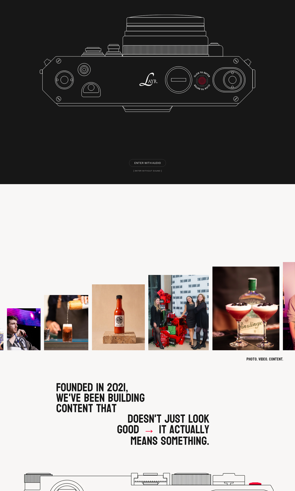
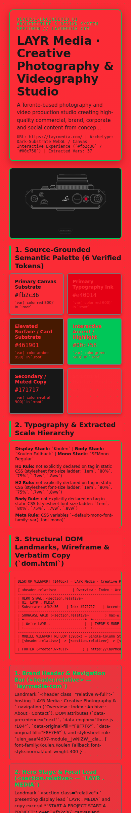

# UI Design System & Master Generation Blueprint: layrmedia-com

> **LAYR Media · Creative Photography & Videography Studio** (https://layrmedia.com/) — A Toronto-based photography and video production studio creating high-quality commercial, brand, corporate and social content from concep...



---

## 1. Executive Visual Persona & Design Archetype

- **Brand Essence & Persona**: **LAYR Media · Creative Photography & Videography Studio** (`https://layrmedia.com/`). A Toronto-based photography and video production studio creating high-quality commercial, brand, corporate and social content from concep...
- **Visual Archetype**: **Dark-Substrate WebGL / Canvas Interactive Experience (`#fb2c36` / `#00c758`)**.
- **Anti-AI-Slop Differentiators**:
  - **Source-Grounded Chromatic Polarity**: Anchors the viewport in `#fb2c36` (`var(--color-red-500)` in `:root`) paired with `#171717` primary typography and `#00c758` accents.
  - **Extracted Typographic Hierarchy**: Pairs `Koulen` for display copy (`LAYR . MEDIA`) with `Koulen Fallback` and `SFMono-Regular`.
  - **Calibrated Spatial Grid & Motion**: Combines `40rem` container bounds (`gap: .5vw`, padding `.2vw`) with `cubic-bezier(0,0,.2,1)` easing and Lenis Smooth Scroll (`data-lenis`), Three.js / WebGL Canvas Pipeline.

---

## 2. Spatial Architecture & Modular Grid Mathematics



### Viewport Allocation & Container Geometry
- **Captured Viewport Dimensions**: Desktop `1440×2400px` (`assets/desktop.png`, capped at 2400px multi-section capture), Mobile `390×2400px` (`assets/mobile.png`, capped at 2400px multi-section capture).
- **Master Container Bounds**: `40rem` extracted from `layrmedia-com` stylesheet.
- **Canvas Lateral Padding & Spacing**: `.2vw` lateral canvas padding with `.5vw` grid gap.
- **Border Radius Scale**: `.25rem`, `var(--radius-2xl)`, `var(--radius-md)`, `var(--radius-sm)`.

### Responsive Breakpoint Architecture
- **Desktop Layout**: Multi-column CSS Grid / Flexbox layout at `1440px` (`max-width: 40rem`, `gap: .5vw`).
- **Mobile Layout**: Single-column vertical stack at `390px` viewport width with `.2vw` horizontal padding.
- **Extracted CSS Media Queries**: `@media (min-width:40rem)`, `@media (min-width:48rem)`, `@media (min-width:64rem)`, `@media (min-width:80rem)`.

---

## 3. Color System, Materiality & Atmospheric Lighting

### Semantic Palette & Source Grounding
| Semantic Role | Ground-Truth Value | Extracted CSS Source / Selector |
|---|---|---|
| **Primary Canvas Substrate** | `#fb2c36` | `var(--color-red-500)` in `:root` |
| **Primary Typography Ink** | `#e40014` | `var(--color-red-600)` in `:root` |
| **Elevated Surface / Card Substrate** | `#461901` | `var(--color-amber-950)` in `:root` |
| **Interactive Accent / Highlight** | `#00c758` | `var(--color-green-500)` in `:root` |
| **Secondary / Muted Copy** | `#171717` | `var(--color-neutral-900)` in `:root` |
| **Structural Hairline Border** | `#0000` | `textarea { background-color: #0000 }` |

### Sanitized Root CSS Variables (`ui-ux.md` Ground Truth)
| Variable Name | Extracted Value | Semantic Role |
|---|---|---|
| `--font-koulen` | `"Koulen", "Koulen Fallback"` | Typography / Scale Token |
| `--font-work-sans` | `"Work Sans", "Work Sans Fallback"` | Typography / Scale Token |
| `--color-red-500` | `#fb2c36` | Brand / Palette Token |
| `--color-red-600` | `#e40014` | Brand / Palette Token |
| `--color-amber-950` | `#461901` | Brand / Palette Token |
| `--color-green-500` | `#00c758` | Brand / Palette Token |
| `--color-neutral-900` | `#171717` | Brand / Palette Token |
| `--color-black` | `var(--color-black)` | Canvas / Surface Token |
| `--color-white` | `var(--color-white)` | Canvas / Surface Token |
| `--spacing` | `.25rem` | Layout / Spatial Grid Token |
| `--font-weight-light` | `300` | Canvas / Surface Token |
| `--font-weight-normal` | `400` | Typography / Scale Token |
| `--font-weight-medium` | `500` | Typography / Scale Token |
| `--font-weight-semibold` | `600` | Typography / Scale Token |
| `--font-weight-bold` | `700` | Typography / Scale Token |
| `--tracking-tighter` | `-.05em` | Typography / Scale Token |

---

## 4. Typographic Scale & Editorial Hierarchy

### Font Family Stacks
- **Display Typography**: `Koulen`.
- **Primary Body Stack**: `Koulen Fallback`.
- **Technical / Metadata Stack**: `SFMono-Regular`.

### Typographic Scale & Rules (Extracted from Stylesheet & Variables)
- **Hero Display (`H1`)**: not explicitly declared on tag in static CSS (stylesheet font-size ladder: `1em`, `80%`, `75%`, `.7vw`, `.8vw`).
- **Section Heading (`H2`)**: not explicitly declared on tag in static CSS (stylesheet font-size ladder: `1em`, `80%`, `75%`, `.7vw`, `.8vw`).
- **Body Copy**: not explicitly declared on tag in static CSS (stylesheet font-size ladder: `1em`, `80%`, `75%`, `.7vw`, `.8vw`).
- **Metadata & Navigation Labels**: CSS variables `--default-mono-font-family: var(--font-mono)`.

---

## 5. Choreographed Motion & Interaction Physics

### Primary Easing Curves
- **Extracted Timing Functions**: `cubic-bezier(0,0,.2,1)`, `cubic-bezier(.4,0,.6,1)`, `cubic-bezier(.4,0,.2,1)`.

### Per-Element Transition & Choreography Rules
- **Selector `layer theme`**: `transition: .15s` extracted from `layrmedia-com` stylesheet.
- **Selector `.transition`**: `transition: var(--tw-ease,var(--default-transition-timing-function))` extracted from `layrmedia-com` stylesheet.
- **Selector `.transition-\[border-color\]`**: `transition: var(--tw-ease,var(--default-transition-timing-function))` extracted from `layrmedia-com` stylesheet.
- **Extracted Easing Curve (`cubic-bezier(0,0,.2,1)`)**: Governs interactive state transitions across `<header.relative>` and `<section.relative>`.
- **Runtime Interaction Engine**: Integrates Lenis Smooth Scroll (`data-lenis`), Three.js / WebGL Canvas Pipeline with `prefers-reduced-motion: reduce` fallback guards.

---

## 6. Component Wireframe & Structural DOM Map

### Visual Layout Schematic (Grounded in `dom.html` — `1440px` Desktop & `390px` Mobile Reflow)
```
┌────────────────────────────────────────────────────────────────────────┐
│ DESKTOP VIEWPORT (1440px) — LAYR Media · Creative Photography & Videog │
│ ====================================================================== │
│ [ <header.relative>        | Overview · Index · Archive · About · C ]  │
│ ---------------------------------------------------------------------- │
│ | HERO STAGE: <section.relative>                                   |   │
│ | H1: LAYR . MEDIA                                                 |   │
│ | Substrate: #fb2c36    | Ink: #171717    | Accent: #00c758        |   │
│ ---------------------------------------------------------------------- │
│ | SHOWCASE GRID (<section.relative>        ) max-w: 40rem          |   │
│ | +------------------------------+  +------------------------------+ | │
│ | | We're LAYR .                 |  | THERE'S MORE WHERE THAT CAME | | │
│ | +------------------------------+  +------------------------------+ | │
│ ---------------------------------------------------------------------- │
│ | MOBILE VIEWPORT REFLOW (390px) — Single-Column Stack (gap: .5vw  ) | │
│ | [<header.relative>] -> [<section.relative>] -> [<section.relative>]  │
│ ---------------------------------------------------------------------- │
│ [ FOOTER (<footer.w-full>       ) | https://layrmedia.com/             │
└────────────────────────────────────────────────────────────────────────┘
```

### Granular DOM Region Breakdown
1. **Brand Header & Navigation Bar (<header.relative> — `layrmedia-com`)**:
   - Landmark `<header class="relative w-full">` hosting `LAYR Media · Creative Photography & ` navigation (`Overview · Index · Archive · About · Contact`), DOM attributes (`data-precedence="next"`, `data-engine="three.js r184"`, `data-original-fill="F8F7F6"`, `data-original-fill="F8F7F6"`), and stylesheet rule `ulen_aaaf4d07-module__jwNIZW__cla... { font-family:Koulen,Koulen Fallback;font-style:normal;font-weight:400 }`.
2. **Hero Stage & Focal Lead (<section.relative> — `LAYR . MEDIA`)**:
   - Landmark `<section class="relative">` presenting display lead `LAYR . MEDIA` and copy excerpt *"START A PROJECT START A PROJECT"* over `#fb2c36` canvas and `#171717` ink.
3. **Primary Showcase & Content Grid (<section.relative> — `We're LAYR .`)**:
   - Landmark `<section class="relative bg-black">` rendering section `We're LAYR .` with copy *"© 2026 LAYR — Toronto, CA"*, asset references (`6c6a3def8289aaff-s.p.42fhi38wiwr8...`, `7ddd198311ba7843-s.p.3kq6k02b2ysv...`, `1.jpg`, `2.jpg`), and grid rule `oulen_aaaf4d07-module__jwNIZW__va... { --font-koulen:"Koulen", "Koulen Fallback" }`.
4. **Interactive Detail & Feature Matrix (<section.group> — `THERE'S MORE WHERE THAT CAME FROM.`)**:
   - Landmark `<section class="group flex">` framing `THERE'S MORE WHERE THAT CAME FROM.` and `testimonial` (*"Creative Production Studio"*) with `#461901` surface cards, `#00c758` accents, and `sans_6c6a0eaa-module__Tqlsvq__cla... { font-family:Work Sans,Work Sans Fallback;font-style:normal }`.
5. **Colophon & Global Directory Footer (<footer.w-full> — `https://layrmedia.com/`)**:
   - Landmark `<footer class="w-full overflow-x-clip">` anchoring `LAYR Media · Creative Photograph` footer links (`Overview · Index · Archive · About · Contact`), copy *"[ Enter without sound ]"*, and `#0000` structural dividers.

---

## 7. Master Zero-Shot AI Generation Prompt

```markdown
# Master Zero-Shot Frontend Generation Prompt: layrmedia-com (LAYR Media · Creative Photography & Videography Studio)

You are a principal frontend architect and design systems engineer. Build a complete, production-ready web application replicating the exact design system, DOM landmarks, typographic hierarchy, color tokens, and motion physics of `layrmedia-com` (**LAYR Media · Creative Photography & Videography Studio** — `https://layrmedia.com/`).

### 1. Visual Archetype & Anti-AI-Slop Mandates
- **Archetype**: Dark-Substrate WebGL / Canvas Interactive Experience (`#fb2c36` / `#00c758`).
- **Identity & Domain Context**: A Toronto-based photography and video production studio creating high-quality commercial, brand, corporate and social content from concep...
- **Primary Substrate**: `#fb2c36` (`var(--color-red-500)` in `:root`), **Primary Ink**: `#171717`, **Accent / Highlight**: `#00c758`.
- **Site-Specific Differentiators**:
  - **Source-Grounded Chromatic Polarity**: Anchors the viewport in `#fb2c36` (`var(--color-red-500)` in `:root`) paired with `#171717` primary typography and `#00c758` accents.
  - **Extracted Typographic Hierarchy**: Pairs `Koulen` for display copy (`LAYR . MEDIA`) with `Koulen Fallback` and `SFMono-Regular`.
  - **Calibrated Spatial Grid & Motion**: Combines `40rem` container bounds (`gap: .5vw`, padding `.2vw`) with `cubic-bezier(0,0,.2,1)` easing and Lenis Smooth Scroll (`data-lenis`), Three.js / WebGL Canvas Pipeline.

### 2. Ground-Truth CSS Variables (`:root` Token Contract)
Declare and consume these exact custom properties extracted from `layrmedia-com` in your global stylesheet:

:root {
  /* LAYR Media · Creative Photography & Videography Studio (layrmedia-com) — Ground-Truth Extracted CSS Variables */
  --font-koulen: "Koulen", "Koulen Fallback"; /* Typography / Scale Token (layrmedia-com) */
  --font-work-sans: "Work Sans", "Work Sans Fallback"; /* Typography / Scale Token (layrmedia-com) */
  --color-red-500: #fb2c36; /* Brand / Palette Token (layrmedia-com) */
  --color-red-600: #e40014; /* Brand / Palette Token (layrmedia-com) */
  --color-amber-950: #461901; /* Brand / Palette Token (layrmedia-com) */
  --color-green-500: #00c758; /* Brand / Palette Token (layrmedia-com) */
  --color-neutral-900: #171717; /* Brand / Palette Token (layrmedia-com) */
  --color-black: var(--color-black); /* Canvas / Surface Token (layrmedia-com) */
  --color-white: var(--color-white); /* Canvas / Surface Token (layrmedia-com) */
  --spacing: .25rem; /* Layout / Spatial Grid Token (layrmedia-com) */
  --font-weight-light: 300; /* Canvas / Surface Token (layrmedia-com) */
  --font-weight-normal: 400; /* Typography / Scale Token (layrmedia-com) */
  --font-weight-medium: 500; /* Typography / Scale Token (layrmedia-com) */
  --font-weight-semibold: 600; /* Typography / Scale Token (layrmedia-com) */
  --font-weight-bold: 700; /* Typography / Scale Token (layrmedia-com) */
  --tracking-tighter: -.05em; /* Typography / Scale Token (layrmedia-com) */
}

### 3. Semantic Color & Materiality Contract
Map every surface, ink, and border strictly to these source-grounded tokens:
- **Primary Canvas Substrate**: `#fb2c36` — grounded in `var(--color-red-500)` in `:root`
- **Primary Typography Ink**: `#e40014` — grounded in `var(--color-red-600)` in `:root`
- **Elevated Surface / Card Substrate**: `#461901` — grounded in `var(--color-amber-950)` in `:root`
- **Interactive Accent / Highlight**: `#00c758` — grounded in `var(--color-green-500)` in `:root`
- **Secondary / Muted Copy**: `#171717` — grounded in `var(--color-neutral-900)` in `:root`
- **Structural Hairline Border**: `#0000` — grounded in `textarea { background-color: #0000 }`

### 4. Spatial Grid, Container Bounds & Responsive Breakpoints
- **Desktop Viewport Reference**: `1440×2400px` (capped at 2400px multi-section capture, `1440px` standard desktop width).
- **Mobile Viewport Reference**: `390×2400px` (capped at 2400px multi-section capture, `390px` standard mobile width).
- **Container Max-Width**: `40rem` extracted from `layrmedia-com` stylesheet
- **Padding & Gutters**: `.2vw` lateral canvas padding with `.5vw` grid gap
- **Desktop Grid**: Multi-column CSS Grid / Flexbox layout at `1440px` (`max-width: 40rem`, `gap: .5vw`)
- **Mobile Adaptation**: Single-column vertical stack at `390px` viewport width with `.2vw` horizontal padding
- **Media Queries**: `@media (min-width:40rem)`, `@media (min-width:48rem)`, `@media (min-width:64rem)`, `@media (min-width:80rem)`
- **Corner Radii**: `.25rem`, `var(--radius-2xl)`, `var(--radius-md)`, `var(--radius-sm)`

### 5. Typography & Editorial Scale Contract
- **Display Font Stack**: `Koulen`
- **Body Font Stack**: `Koulen Fallback`
- **Monospace / Technical Font Stack**: `SFMono-Regular`
- **H1 Display Rule**: not explicitly declared on tag in static CSS (stylesheet font-size ladder: `1em`, `80%`, `75%`, `.7vw`, `.8vw`)
- **H2 Section Rule**: not explicitly declared on tag in static CSS (stylesheet font-size ladder: `1em`, `80%`, `75%`, `.7vw`, `.8vw`)
- **Body Copy Rule**: not explicitly declared on tag in static CSS (stylesheet font-size ladder: `1em`, `80%`, `75%`, `.7vw`, `.8vw`)
- **Metadata & Index Rule**: CSS variables `--default-mono-font-family: var(--font-mono)`

### 6. Component Hierarchy, Verbatim Copy & Real DOM Landmarks
Scaffold `layrmedia-com` (`LAYR Media · Creative Photography & Videography Studio`) with these exact structural regions, extracted copy, and CSS rules from `dom.html`:
1. **Brand Header & Navigation Bar (<header.relative> — `layrmedia-com`)**:
   - DOM & Selectors: Landmark `<header class="relative w-full">` hosting `LAYR Media · Creative Photography & ` navigation (`Overview · Index · Archive · About · Contact`), DOM attributes (`data-precedence="next"`, `data-engine="three.js r184"`, `data-original-fill="F8F7F6"`, `data-original-fill="F8F7F6"`), and stylesheet rule `ulen_aaaf4d07-module__jwNIZW__cla... { font-family:Koulen,Koulen Fallback;font-style:normal;font-weight:400 }`.
   - Responsive Contract: Header `Brand Header & Navigation Bar (<header.relative> — `layrmedia-com`)` (`layrmedia-com`) adapts across `@media (min-width:40rem)`, `@media (min-width:48rem)`, `@media (min-width:64rem)`, `@media (min-width:80rem)` with `cubic-bezier(0,0,.2,1)`, `cubic-bezier(.4,0,.6,1)`, `cubic-bezier(.4,0,.2,1)` transitions and links `Overview · Index · Archive · About · Contact`.
2. **Hero Stage & Focal Lead (<section.relative> — `LAYR . MEDIA`)**:
   - DOM & Selectors: Landmark `<section class="relative">` presenting display lead `LAYR . MEDIA` and copy excerpt *"START A PROJECT START A PROJECT"* over `#fb2c36` canvas and `#171717` ink.
   - Responsive Contract: Hero stage (`1440×2400px` desktop / `390×2400px` mobile) sets `#fb2c36` background with `#171717` headline `LAYR . MEDIA`.
3. **Primary Showcase & Content Grid (<section.relative> — `We're LAYR .`)**:
   - DOM & Selectors: Landmark `<section class="relative bg-black">` rendering section `We're LAYR .` with copy *"© 2026 LAYR — Toronto, CA"*, asset references (`6c6a3def8289aaff-s.p.42fhi38wiwr8...`, `7ddd198311ba7843-s.p.3kq6k02b2ysv...`, `1.jpg`, `2.jpg`), and grid rule `oulen_aaaf4d07-module__jwNIZW__va... { --font-koulen:"Koulen", "Koulen Fallback" }`.
   - Responsive Contract: Showcase grid `Primary Showcase & Content Grid (<section.relative> — `We're LAYR .`)` applies Multi-column CSS Grid / Flexbox layout at `1440px` (`max-width: 40rem`, `gap: .5vw`) on desktop and Single-column vertical stack at `390px` viewport width with `.2vw` horizontal padding on mobile.
4. **Interactive Detail & Feature Matrix (<section.group> — `THERE'S MORE WHERE THAT CAME FROM.`)**:
   - DOM & Selectors: Landmark `<section class="group flex">` framing `THERE'S MORE WHERE THAT CAME FROM.` and `testimonial` (*"Creative Production Studio"*) with `#461901` surface cards, `#00c758` accents, and `sans_6c6a0eaa-module__Tqlsvq__cla... { font-family:Work Sans,Work Sans Fallback;font-style:normal }`.
   - Responsive Contract: Detail module `Interactive Detail & Feature Matrix (<section.group> — `THERE'S MORE WHERE THAT CAME FROM.`)` uses `.25rem`, `var(--radius-2xl)`, `var(--radius-md)`, `var(--radius-sm)` radii, `#00c758` highlights, and assets (6c6a3def8289aaff-s.p.42fhi38wiwr8..., 7ddd198311ba7843-s.p.3kq6k02b2ysv..., 1.jpg).
5. **Colophon & Global Directory Footer (<footer.w-full> — `https://layrmedia.com/`)**:
   - DOM & Selectors: Landmark `<footer class="w-full overflow-x-clip">` anchoring `LAYR Media · Creative Photograph` footer links (`Overview · Index · Archive · About · Contact`), copy *"[ Enter without sound ]"*, and `#0000` structural dividers.
   - Responsive Contract: Footer `Colophon & Global Directory Footer (<footer.w-full> — `https://layrmedia.com/`)` aligns to `40rem` extracted from `layrmedia-com` stylesheet with `.2vw` lateral canvas padding with `.5vw` grid gap and attributes (data-precedence="next", data-engine="three.js r184", data-original-fill="F8F7F6").

#### Verbatim DOM Copy Excerpts (`dom.html`)
- Copy Excerpt 1: *"START A PROJECT START A PROJECT"*
- Copy Excerpt 2: *"© 2026 LAYR — Toronto, CA"*
- Copy Excerpt 3: *"Creative Production Studio"*
- Copy Excerpt 4: *"[ Enter without sound ]"*

### 7. Motion, Extracted Stylesheet Rules & Interaction Choreography
- **Primary Easing Functions**: `cubic-bezier(0,0,.2,1)`, `cubic-bezier(.4,0,.6,1)`, `cubic-bezier(.4,0,.2,1)`
- **Extracted Stylesheet Rules (`layrmedia-com`)**:
- `ulen_aaaf4d07-module__jwNIZW__cla... { font-family:Koulen,Koulen Fallback;font-style:normal;font-weight:400 }`
- `oulen_aaaf4d07-module__jwNIZW__va... { --font-koulen:"Koulen", "Koulen Fallback" }`
- `sans_6c6a0eaa-module__Tqlsvq__cla... { font-family:Work Sans,Work Sans Fallback;font-style:normal }`
- `sans_6c6a0eaa-module__Tqlsvq__var... { --font-work-sans:"Work Sans", "Work Sans Fallback" }`
- `backdrop { box-sizing:border-box;border:0 solid;margin:0;padding:0 }`
- **Per-Selector Transition Rules**:
- **Selector `layer theme`**: `transition: .15s` extracted from `layrmedia-com` stylesheet.
- **Selector `.transition`**: `transition: var(--tw-ease,var(--default-transition-timing-function))` extracted from `layrmedia-com` stylesheet.
- **Selector `.transition-\[border-color\]`**: `transition: var(--tw-ease,var(--default-transition-timing-function))` extracted from `layrmedia-com` stylesheet.
- **Extracted Easing Curve (`cubic-bezier(0,0,.2,1)`)**: Governs interactive state transitions across `<header.relative>` and `<section.relative>`.
- **Runtime Interaction Engine**: Integrates Lenis Smooth Scroll (`data-lenis`), Three.js / WebGL Canvas Pipeline with `prefers-reduced-motion: reduce` fallback guards.

### 8. Technical Deliverables
- Implement in Next.js (App Router) with TypeScript and Tailwind CSS consuming the `:root` custom properties defined above for `layrmedia-com`.
- Reproduce both the `1440px` desktop architecture and `390px` mobile breakpoint transitions, preserving semantic HTML5 landmarks (`<header>`, `<nav>`, `<main>`, `<section>`, `<footer>`) and `prefers-reduced-motion` accessibility guards.
```
