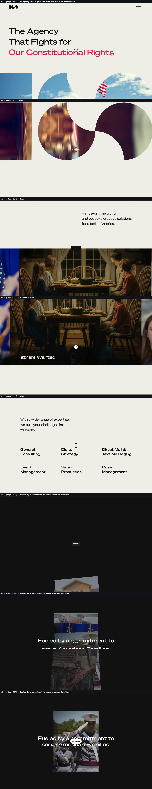
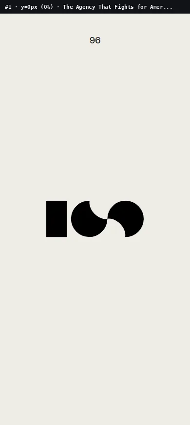

# UI Design System & Master Generation Blueprint: lcg-media

> **LCG · The Agency That Fights for American Families** (https://lcg.media) — LCG provides hands-on consulting and creative solutions to support conservative campaigns and drive results for American Families.





---

## 1. Executive Visual Persona & Design Archetype

- **Brand Essence & Persona**: **LCG · The Agency That Fights for American Families** (`https://lcg.media`). LCG provides hands-on consulting and creative solutions to support conservative campaigns and drive results for American Families.
- **Capture Provenance**: Live browser capture (`tier1_fast`, HTTP `200`, captured `2026-11-24`).
- **Visual Archetype**: **Dark-Substrate WebGL / Canvas Interactive Experience (`#121212` / `#de204e`)**.
- **Anti-AI-Slop Differentiators**:
  - **Live-Computed Chromatic Polarity**: Anchors the viewport in `#121212` (live computed `body` `background-color` (`computed_styles.json`)) paired with `#ffffff` primary typography and `#de204e` accents.
  - **Grounded Typographic Hierarchy**: Pairs `Soehne Breit Kraftig` for display copy (`The Agency That Fights for American `) with `PP Mori`.
  - **Calibrated Spatial Grid & Motion**: Combines `1249px` container bounds (`gap: 2.4rem`, padding `1.5rem`) with `cubic-bezier(0.47,0,0.745,0.715)` easing and Lenis Smooth Scroll (`data-lenis`), Three.js / WebGL Canvas Pipeline.

---

## 2. Spatial Architecture & Modular Grid Mathematics

### Viewport Allocation & Container Geometry
- **Captured Journey Filmstrips**: Desktop `1280×6624px` (`assets/desktop-journey.webp`, `8` keyframes up to `y=0px` / doc `900px`), Mobile `390×872px` (`assets/mobile-journey.webp`, `1` keyframes).
- **Master Container Bounds**: `1249px` (measured widest bounded `<section>` landmark width on `1440px` desktop).
- **Canvas Lateral Padding & Spacing**: `1.5rem` lateral canvas padding with `2.4rem` grid gap.
- **Border Radius Scale**: `4rem`, `4.8rem`, `50rem`, `50%`.

### Responsive Breakpoint Architecture
- **Desktop Layout**: Multi-column CSS Grid / Flexbox layout at `1440px` (`max-width: 1249px`, `gap: 2.4rem`).
- **Mobile Layout**: Single-column vertical stack at `390px` viewport width with `1.5rem` horizontal padding.
- **Extracted CSS Media Queries**: `@media (min-width: 1024px)`, `@media (max-width: 1023px)`, `@media (max-width: 767px)`, `@media (min-width: 1025px)`.

---

## 3. Color System, Materiality & Atmospheric Lighting

### Semantic Palette & Source Grounding
| Semantic Role | Ground-Truth Value | Extracted Live / CSS Source |
|---|---|---|
| **Primary Canvas Substrate** | `#121212` | live computed `body` `background-color` (`computed_styles.json`) |
| **Primary Typography Ink** | `#ffffff` | live computed `h2` `color` (`computed_styles.json`) |
| **Elevated Surface / Card Substrate** | `#000000` | `.rendered body { background: black }` (`#000000`) |
| **Interactive Accent / Highlight** | `#de204e` | `var(--color-highlight)` in `:root` |
| **Secondary / Muted Copy** | `#777777` | `recaptchaJavascriptChallengeQrF... { color: #777777 }` |
| **Structural Hairline Border** | `#000000` | `.cursor__bullet { border: #000000 }` |

### Sanitized Root CSS Variables (`ui-ux.md` Ground Truth)
| Variable Name | Extracted Value | Semantic Role |
|---|---|---|
| `--ease-in-sine` | `cubic-bezier(0.47, 0, 0.745, 0.715)` | Motion / Easing Token |
| `--ease-out-sine` | `cubic-bezier(0.39, 0.575, 0.565, 1)` | Motion / Easing Token |
| `--ease-in-out-sine` | `cubic-bezier(0.445, 0.05, 0.55, 0.95)` | Motion / Easing Token |
| `--ease-in-quad` | `cubic-bezier(0.55, 0.085, 0.68, 0.53)` | Motion / Easing Token |
| `--ease-out-quad` | `cubic-bezier(0.25, 0.46, 0.45, 0.94)` | Motion / Easing Token |
| `--ease-in-out-quad` | `cubic-bezier(0.455, 0.03, 0.515, 0.955)` | Motion / Easing Token |
| `--ease-in-cubic` | `cubic-bezier(0.55, 0.055, 0.675, 0.19)` | Motion / Easing Token |
| `--ease-out-cubic` | `cubic-bezier(0.215, 0.61, 0.355, 1)` | Motion / Easing Token |
| `--ease-in-out-cubic` | `cubic-bezier(0.645, 0.045, 0.355, 1)` | Motion / Easing Token |
| `--ease-in-quart` | `cubic-bezier(0.895, 0.03, 0.685, 0.22)` | Motion / Easing Token |
| `--ease-out-quart` | `cubic-bezier(0.165, 0.84, 0.44, 1)` | Motion / Easing Token |
| `--ease-in-out-quart` | `cubic-bezier(0.77, 0, 0.175, 1)` | Motion / Easing Token |
| `--ease-in-quint` | `cubic-bezier(0.755, 0.05, 0.855, 0.06)` | Motion / Easing Token |
| `--ease-out-quint` | `cubic-bezier(0.23, 1, 0.32, 1)` | Motion / Easing Token |
| `--ease-in-out-quint` | `cubic-bezier(0.86, 0, 0.07, 1)` | Motion / Easing Token |
| `--ease-in-expo` | `cubic-bezier(0.95, 0.05, 0.795, 0.035)` | Motion / Easing Token |

---

## 4. Typographic Scale & Editorial Hierarchy

### Font Family Stacks
- **Display Typography**: `Soehne Breit Kraftig`.
- **Primary Body Stack**: `PP Mori`.
- **Technical / Metadata Stack**: not declared in live computed styles (uses primary stack / `ui-monospace`).

### Typographic Scale & Rules (Live Computed & Stylesheet Grounded)
- **Hero Display (`H1`)**: live computed `h1` (`font-size: 74.0571px`, `line-height: 99.9771px`, `font-weight: 400`).
- **Section Heading (`H2`)**: live computed `h2` (`font-size: 41.1429px`, `line-height: 57.6px`, `font-weight: 400`).
- **Body Copy**: live computed `body` (`font-size: 10.2857px`, `line-height: 10.2857px`, `font-weight: 400`).
- **Metadata & Navigation Labels**: live computed `nav/a` (`font-size: 10.2857px`, `line-height: 10.2857px`, `font-weight: 400`).

---

## 5. Choreographed Motion & Interaction Physics

### Primary Easing Curves
- **Extracted Timing Functions**: `cubic-bezier(0.47,0,0.745,0.715)`, `cubic-bezier(0.39,0.575,0.565,1)`, `cubic-bezier(0.445,0.05,0.55,0.95)`.

### Per-Element Transition & Choreography Rules
- **Selector `.button`**: `transition: opacity .4s ease` extracted from `lcg-media` stylesheet.
- **Selector `.button div`**: `transition: transform .8s var(--delay) var(--ease-in-out-quart)` extracted from `lcg-media` stylesheet.
- **Selector `.cookies`**: `transition: transform .8s var(--ease-out-cubic)` extracted from `lcg-media` stylesheet.
- **Extracted Easing Curve (`cubic-bezier(0.47,0,0.745,0.715)`)**: Governs interactive state transitions across `<nav.navigation>` and `<section.logo-video>`.
- **Runtime Interaction Engine**: Integrates Lenis Smooth Scroll (`data-lenis`), Three.js / WebGL Canvas Pipeline with `prefers-reduced-motion: reduce` fallback guards.
### Measured Runtime Scroll & Interaction Telemetry (`behavioral_journey_v2`)
- **Scroll Driver Mode**: `wheel` (max document height `900px`, deepest scrollY reached `0px` across `8` desktop keyframes).
- **Detected Scroll / Motion Libraries**: `WebGL/Canvas`.
- **Hover Physics (`first_card` · `image-cards__medias`)**: Computed transition `0.6s` / `cubic-bezier(0.215, 0.61, 0.355, 1)` (no static color/transform shift captured at rest).
- **Route Transition Architecture**: First internal navigation (`/cases/`) measured as `direct` in `1122ms`.

---

## 6. Component Wireframe & Structural DOM Map

### Visual Layout Schematic — Desktop (`1440px`, Grounded in `dom.html` & Landmark Bounding Boxes)
```
┌────────────────────────────────────────────────────────────────────────┐
│ DESKTOP VIEWPORT (1440px) — LCG · The Agency That Fights for American  │
│ ====================================================================== │
│ [ <nav.navigation> (1440px)           | Home · Cases · Capabilities  ] │
│ ---------------------------------------------------------------------- │
│ | HERO STAGE: <section.header> (w=1440px)                            | │
│ | H1: The Agency That Fights for American Families Cons...           | │
│ | Substrate: #121212 | Ink: #ffffff | Accent: #de204e                | │
│ ---------------------------------------------------------------------- │
│ | SHOWCASE GRID (<section.logo-video>) max-w: 1249px                 | │
│ | +------------------------------+  +------------------------------+ | │
│ | | The Agency That Fights for A |  | C a s e s C a s e s          | | │
│ | +------------------------------+  +------------------------------+ | │
│ ---------------------------------------------------------------------- │
│ | DETAIL MODULE (<section.subheader>) — C a p a b i l i t i e        | │
│ ---------------------------------------------------------------------- │
│ [ FOOTER (<footer.footer>     ) | https://lcg.media                    │
└────────────────────────────────────────────────────────────────────────┘
```

### Visual Layout Schematic — Mobile Reflow (`390px`)
```
┌────────────────────────────────────────────────────────────────────────┐
│ MOBILE VIEWPORT REFLOW (390px) — Single-Column Stack (gap: 2.4rem)     │
│ ====================================================================== │
│ [ HEADER BAR (<nav.navigation>        ) | Compact Menu (390px)         │
│ ---------------------------------------------------------------------- │
│ | HERO STAGE (<section.header>) — 390px Vertical Lead                | │
│ | H1: The Agency That Fights for American Families Cons...           | │
│ ---------------------------------------------------------------------- │
│ | SHOWCASE STACK (<section.logo-video>) — 1-Col Stack                | │
│ | [ Item 1: The Agency That Fights for A m e r i c a n F a m...    ] | │
│ | [ Item 2: C a s e s C a s e s                                    ] | │
│ ---------------------------------------------------------------------- │
│ | DETAIL STACK (<section.subheader>) — 1-Col (C a p a b i l i t )    | │
│ ---------------------------------------------------------------------- │
│ [ FOOTER (<footer.footer>     ) | Stacked 390px Colophon               │
└────────────────────────────────────────────────────────────────────────┘
```

### Granular DOM Region Breakdown
1. **Brand Header & Navigation Bar (<nav.navigation> — `lcg-media`)**:
   - Landmark `<nav class="navigation">` (`1440px`) hosting `LCG · The Agency That Fights for Ame` navigation (`Home · Cases · Capabilities · Creed · Contact`), DOM attributes (`data-template="page"`, `data-svg-origin="121 36"`, `data-svg-origin="121 36"`, `data-svg-origin="0 0"`), and stylesheet rule `.app { height:100%;overflow:clip;position:relative;width:100% }`.
2. **Hero Stage & Focal Lead (<section.header> — `The Agency That Fights for America`)**:
   - Landmark `<section class="header header--left">` presenting display lead `The Agency That Fights for American Families Cons...` and copy excerpt *"The Agency That Fights for"* over `#121212` canvas and `#ffffff` ink.
3. **Primary Showcase & Content Grid (<section.logo-video> — `The Agency That Fights for A m e r`)**:
   - Landmark `<section class="logo-video">` rendering section `The Agency That Fights for A m e r i c a n F a m...` with copy *"C a s e s C a s e s"*, asset references (`mask.svg`, `bundle.ea4ceea.css`, `apple-touch-icon.png`, `site.webmanifest`), and grid rule `before { box-sizing:border-box }`.
4. **Interactive Detail & Feature Matrix (<section.subheader> — `C a s e s C a s e s`)**:
   - Landmark `<section class="subheader subheader--right">` framing `C a s e s C a s e s` and `C a p a b i l i t i e s C a p a b i l i t i e s` (*"C a p a b i l i t i e s C a p a b i l i t i e s"*) with `#000000` surface cards, `#de204e` accents, and `video { margin:0;padding:0;border:0;font-size:100%;font:inherit;vertical-align:b... }`.
5. **Colophon & Global Directory Footer (<footer.footer> — `https://lcg.media`)**:
   - Landmark `<footer class="footer">` anchoring `LCG · The Agency That Fights for` footer links (`Home · Cases · Capabilities · Creed · Contact`), copy *"C r e e d C r e e d"*, and `#000000` structural dividers.
### Full Vertical Scroll Sequence (Desktop `1440×900` Keyframes)
- **Step 01** (`y=0px`, `0%`): Active landmark `The Agency That Fights for American Families Cons...` · sticky/fixed elements: `2`
- **Step 02** (`y=0px`, `8%`): Active landmark `Hero` · sticky/fixed elements: `2`
- **Step 03** (`y=0px`, `17%`): Active landmark `Hero` · sticky/fixed elements: `2`
- **Step 04** (`y=0px`, `25%`): Active landmark `Fathers Wanted` · sticky/fixed elements: `2`
- **Step 05** (`y=0px`, `33%`): Active landmark `Hero` · sticky/fixed elements: `2`
- **Step 06** (`y=0px`, `42%`): Active landmark `Fueled by a commitment to serve American Families.` · sticky/fixed elements: `2`
- **Step 07** (`y=0px`, `50%`): Active landmark `Fueled by a commitment to serve American Families.` · sticky/fixed elements: `2`
- **Step 08** (`y=0px`, `58%`): Active landmark `Fueled by a commitment to serve American Families.` · sticky/fixed elements: `2`

### Multi-Page Internal Route Map
- **Listing Route (`/cases/`)**: `https://lcg.media/cases/` — H1: `cases`, scrollHeight `900px`, transition `direct` (`1122ms`)
- **Detail Route (`/cases/fathers-wanted/`)**: `https://lcg.media/cases/fathers-wanted/` — H1: `Fathers Wanted`, scrollHeight `900px`, transition `direct` (`1212ms`)
- **About Route (`/contact/`)**: `https://lcg.media/contact/` — H1: `Tailored service, wherever you’re located.`, scrollHeight `900px`, transition `direct` (`737ms`)

---

## 7. Master Zero-Shot AI Generation Prompt

```markdown
# Master Zero-Shot Frontend Generation Prompt: lcg-media (LCG · The Agency That Fights for American Families)

You are a principal frontend architect and design systems engineer. Build a complete, production-ready web application replicating the exact design system, DOM landmarks, typographic hierarchy, color tokens, and motion physics of `lcg-media` (**LCG · The Agency That Fights for American Families** — `https://lcg.media`).

### 1. Visual Archetype & Anti-AI-Slop Mandates
- **Archetype**: Dark-Substrate WebGL / Canvas Interactive Experience (`#121212` / `#de204e`).
- **Identity & Domain Context**: LCG provides hands-on consulting and creative solutions to support conservative campaigns and drive results for American Families.
- **Primary Substrate**: `#121212` (live computed `body` `background-color` (`computed_styles.json`)), **Primary Ink**: `#ffffff`, **Accent / Highlight**: `#de204e`.
- **Site-Specific Differentiators**:
  - **Live-Computed Chromatic Polarity**: Anchors the viewport in `#121212` (live computed `body` `background-color` (`computed_styles.json`)) paired with `#ffffff` primary typography and `#de204e` accents.
  - **Grounded Typographic Hierarchy**: Pairs `Soehne Breit Kraftig` for display copy (`The Agency That Fights for American `) with `PP Mori`.
  - **Calibrated Spatial Grid & Motion**: Combines `1249px` container bounds (`gap: 2.4rem`, padding `1.5rem`) with `cubic-bezier(0.47,0,0.745,0.715)` easing and Lenis Smooth Scroll (`data-lenis`), Three.js / WebGL Canvas Pipeline.

### 2. Ground-Truth CSS Variables (`:root` Token Contract)
Declare and consume these exact custom properties extracted from `lcg-media` in your global stylesheet:

:root {
  /* LCG · The Agency That Fights for American Families (lcg-media) — Live-Grounded CSS Variables */
  --ease-in-sine: cubic-bezier(0.47, 0, 0.745, 0.715); /* Motion / Easing Token (lcg-media) */
  --ease-out-sine: cubic-bezier(0.39, 0.575, 0.565, 1); /* Motion / Easing Token (lcg-media) */
  --ease-in-out-sine: cubic-bezier(0.445, 0.05, 0.55, 0.95); /* Motion / Easing Token (lcg-media) */
  --ease-in-quad: cubic-bezier(0.55, 0.085, 0.68, 0.53); /* Motion / Easing Token (lcg-media) */
  --ease-out-quad: cubic-bezier(0.25, 0.46, 0.45, 0.94); /* Motion / Easing Token (lcg-media) */
  --ease-in-out-quad: cubic-bezier(0.455, 0.03, 0.515, 0.955); /* Motion / Easing Token (lcg-media) */
  --ease-in-cubic: cubic-bezier(0.55, 0.055, 0.675, 0.19); /* Motion / Easing Token (lcg-media) */
  --ease-out-cubic: cubic-bezier(0.215, 0.61, 0.355, 1); /* Motion / Easing Token (lcg-media) */
  --ease-in-out-cubic: cubic-bezier(0.645, 0.045, 0.355, 1); /* Motion / Easing Token (lcg-media) */
  --ease-in-quart: cubic-bezier(0.895, 0.03, 0.685, 0.22); /* Motion / Easing Token (lcg-media) */
  --ease-out-quart: cubic-bezier(0.165, 0.84, 0.44, 1); /* Motion / Easing Token (lcg-media) */
  --ease-in-out-quart: cubic-bezier(0.77, 0, 0.175, 1); /* Motion / Easing Token (lcg-media) */
  --ease-in-quint: cubic-bezier(0.755, 0.05, 0.855, 0.06); /* Motion / Easing Token (lcg-media) */
  --ease-out-quint: cubic-bezier(0.23, 1, 0.32, 1); /* Motion / Easing Token (lcg-media) */
  --ease-in-out-quint: cubic-bezier(0.86, 0, 0.07, 1); /* Motion / Easing Token (lcg-media) */
  --ease-in-expo: cubic-bezier(0.95, 0.05, 0.795, 0.035); /* Motion / Easing Token (lcg-media) */
}

### 3. Semantic Color & Materiality Contract
Map every surface, ink, and border strictly to these source-grounded tokens:
- **Primary Canvas Substrate**: `#121212` — grounded in live computed `body` `background-color` (`computed_styles.json`)
- **Primary Typography Ink**: `#ffffff` — grounded in live computed `h2` `color` (`computed_styles.json`)
- **Elevated Surface / Card Substrate**: `#000000` — grounded in `.rendered body { background: black }` (`#000000`)
- **Interactive Accent / Highlight**: `#de204e` — grounded in `var(--color-highlight)` in `:root`
- **Secondary / Muted Copy**: `#777777` — grounded in `recaptchaJavascriptChallengeQrF... { color: #777777 }`
- **Structural Hairline Border**: `#000000` — grounded in `.cursor__bullet { border: #000000 }`

### 4. Spatial Grid, Container Bounds & Responsive Breakpoints
- **Desktop Viewport Reference**: `1280×6624px` (multi-frame vertical journey filmstrip (6624px), `1440px` standard desktop width).
- **Mobile Viewport Reference**: `390×872px` (full-page live capture (872px), `390px` standard mobile width).
- **Container Max-Width**: `1249px` (measured widest bounded `<section>` landmark width on `1440px` desktop)
- **Padding & Gutters**: `1.5rem` lateral canvas padding with `2.4rem` grid gap
- **Desktop Grid**: Multi-column CSS Grid / Flexbox layout at `1440px` (`max-width: 1249px`, `gap: 2.4rem`)
- **Mobile Adaptation**: Single-column vertical stack at `390px` viewport width with `1.5rem` horizontal padding
- **Media Queries**: `@media (min-width: 1024px)`, `@media (max-width: 1023px)`, `@media (max-width: 767px)`, `@media (min-width: 1025px)`
- **Corner Radii**: `4rem`, `4.8rem`, `50rem`, `50%`

### 5. Typography & Editorial Scale Contract
- **Display Font Stack**: `Soehne Breit Kraftig`
- **Body Font Stack**: `PP Mori`
- **Monospace / Technical Font Stack**: not declared in live computed styles (uses primary stack / `ui-monospace`)
- **H1 Display Rule**: live computed `h1` (`font-size: 74.0571px`, `line-height: 99.9771px`, `font-weight: 400`)
- **H2 Section Rule**: live computed `h2` (`font-size: 41.1429px`, `line-height: 57.6px`, `font-weight: 400`)
- **Body Copy Rule**: live computed `body` (`font-size: 10.2857px`, `line-height: 10.2857px`, `font-weight: 400`)
- **Metadata & Index Rule**: live computed `nav/a` (`font-size: 10.2857px`, `line-height: 10.2857px`, `font-weight: 400`)

### 6. Component Hierarchy, Verbatim Copy & Real DOM Landmarks
Scaffold `lcg-media` (`LCG · The Agency That Fights for American Families`) with these exact structural regions, extracted copy, and CSS rules from `dom.html`:
1. **Brand Header & Navigation Bar (<nav.navigation> — `lcg-media`)**:
   - DOM & Selectors: Landmark `<nav class="navigation">` (`1440px`) hosting `LCG · The Agency That Fights for Ame` navigation (`Home · Cases · Capabilities · Creed · Contact`), DOM attributes (`data-template="page"`, `data-svg-origin="121 36"`, `data-svg-origin="121 36"`, `data-svg-origin="0 0"`), and stylesheet rule `.app { height:100%;overflow:clip;position:relative;width:100% }`.
   - Responsive Contract: Header `Brand Header & Navigation Bar (<nav.navigation> — `lcg-media`)` (`lcg-media`) adapts across `@media (min-width: 1024px)`, `@media (max-width: 1023px)`, `@media (max-width: 767px)`, `@media (min-width: 1025px)` with `cubic-bezier(0.47,0,0.745,0.715)`, `cubic-bezier(0.39,0.575,0.565,1)`, `cubic-bezier(0.445,0.05,0.55,0.95)` transitions and links `Home · Cases · Capabilities · Creed · Contact`.
2. **Hero Stage & Focal Lead (<section.header> — `The Agency That Fights for America`)**:
   - DOM & Selectors: Landmark `<section class="header header--left">` presenting display lead `The Agency That Fights for American Families Cons...` and copy excerpt *"The Agency That Fights for"* over `#121212` canvas and `#ffffff` ink.
   - Responsive Contract: Hero stage (`1280×6624px` desktop / `390×872px` mobile) sets `#121212` background with `#ffffff` headline `The Agency That Fights for American Families Cons...`.
3. **Primary Showcase & Content Grid (<section.logo-video> — `The Agency That Fights for A m e r`)**:
   - DOM & Selectors: Landmark `<section class="logo-video">` rendering section `The Agency That Fights for A m e r i c a n F a m...` with copy *"C a s e s C a s e s"*, asset references (`mask.svg`, `bundle.ea4ceea.css`, `apple-touch-icon.png`, `site.webmanifest`), and grid rule `before { box-sizing:border-box }`.
   - Responsive Contract: Showcase grid `Primary Showcase & Content Grid (<section.logo-video> — `The Agency That Fights for A m e r`)` applies Multi-column CSS Grid / Flexbox layout at `1440px` (`max-width: 1249px`, `gap: 2.4rem`) on desktop and Single-column vertical stack at `390px` viewport width with `1.5rem` horizontal padding on mobile.
4. **Interactive Detail & Feature Matrix (<section.subheader> — `C a s e s C a s e s`)**:
   - DOM & Selectors: Landmark `<section class="subheader subheader--right">` framing `C a s e s C a s e s` and `C a p a b i l i t i e s C a p a b i l i t i e s` (*"C a p a b i l i t i e s C a p a b i l i t i e s"*) with `#000000` surface cards, `#de204e` accents, and `video { margin:0;padding:0;border:0;font-size:100%;font:inherit;vertical-align:b... }`.
   - Responsive Contract: Detail module `Interactive Detail & Feature Matrix (<section.subheader> — `C a s e s C a s e s`)` uses `4rem`, `4.8rem`, `50rem`, `50%` radii, `#de204e` highlights, and assets (mask.svg, bundle.ea4ceea.css, apple-touch-icon.png).
5. **Colophon & Global Directory Footer (<footer.footer> — `https://lcg.media`)**:
   - DOM & Selectors: Landmark `<footer class="footer">` anchoring `LCG · The Agency That Fights for` footer links (`Home · Cases · Capabilities · Creed · Contact`), copy *"C r e e d C r e e d"*, and `#000000` structural dividers.
   - Responsive Contract: Footer `Colophon & Global Directory Footer (<footer.footer> — `https://lcg.media`)` aligns to `1249px` (measured widest bounded `<section>` landmark width on `1440px` desktop) with `1.5rem` lateral canvas padding with `2.4rem` grid gap and attributes (data-template="page", data-svg-origin="121 36", data-svg-origin="121 36").

#### Verbatim DOM Copy Excerpts (`dom.html`)
- Copy Excerpt 1: *"The Agency That Fights for"*
- Copy Excerpt 2: *"C a s e s C a s e s"*
- Copy Excerpt 3: *"C a p a b i l i t i e s C a p a b i l i t i e s"*
- Copy Excerpt 4: *"C r e e d C r e e d"*

### 7. Motion, Extracted Stylesheet Rules & Interaction Choreography
- **Primary Easing Functions**: `cubic-bezier(0.47,0,0.745,0.715)`, `cubic-bezier(0.39,0.575,0.565,1)`, `cubic-bezier(0.445,0.05,0.55,0.95)`
- **Extracted Stylesheet Rules (`lcg-media`)**:
- `.app { height:100%;overflow:clip;position:relative;width:100% }`
- `before { box-sizing:border-box }`
- `video { margin:0;padding:0;border:0;font-size:100%;font:inherit;vertical-align:b... }`
- `section { display:block }`
- `body { line-height:1;height:100%;left:0;position:fixed;top:0;width:100% }`
- **Per-Selector Transition Rules**:
- **Selector `.button`**: `transition: opacity .4s ease` extracted from `lcg-media` stylesheet.
- **Selector `.button div`**: `transition: transform .8s var(--delay) var(--ease-in-out-quart)` extracted from `lcg-media` stylesheet.
- **Selector `.cookies`**: `transition: transform .8s var(--ease-out-cubic)` extracted from `lcg-media` stylesheet.
- **Extracted Easing Curve (`cubic-bezier(0.47,0,0.745,0.715)`)**: Governs interactive state transitions across `<nav.navigation>` and `<section.logo-video>`.
- **Runtime Interaction Engine**: Integrates Lenis Smooth Scroll (`data-lenis`), Three.js / WebGL Canvas Pipeline with `prefers-reduced-motion: reduce` fallback guards.
### 7b. Full-Page Scroll Choreography, Interactive States & Multi-Page Routes
- **Scroll Mechanics**: Implement `wheel` vertical progression up to `900px` across 8 distinct viewport chapters using WebGL/Canvas.
- **Vertical Chapter Sequence**: The Agency That Fights for... (0%) -> Hero (8%) -> Hero (17%) -> Fathers Wanted (25%) -> Hero (33%) -> Fueled by a commitment to s... (42%) -> Fueled by a commitment to s... (50%) -> Fueled by a commitment to s... (58%).
- **Multi-Page Routes**: Scaffold internal routes `/cases/` (listing, direct), `/cases/fathers-wanted/` (detail, direct), `/contact/` (about, direct) sharing the global header/footer shell and design tokens.

### 8. Technical Deliverables
- Implement in Next.js (App Router) with TypeScript and Tailwind CSS consuming the `:root` custom properties defined above for `lcg-media`.
- Reproduce both the `1440px` desktop architecture and `390px` mobile breakpoint transitions, preserving semantic HTML5 landmarks (`<header>`, `<nav>`, `<main>`, `<section>`, `<footer>`) and `prefers-reduced-motion` accessibility guards.
```
---

## 8. Full-Page Scroll Journey, Interactive States & Subpage Inventory

### Desktop Scroll Keyframes (`1440×900` WebP)
| Step | Scroll Y | Progress | Active Landmark / Section | Sticky/Fixed | Visual Asset |
| :---: | :---: | :---: | :--- | :---: | :--- |
| `#01` | `0px` | `0%` | The Agency That Fights for American Families... | `2` | [desktop-step-01.webp](assets/desktop-step-01.webp) |
| `#02` | `0px` | `8%` | Hero | `2` | [desktop-step-02.webp](assets/desktop-step-02.webp) |
| `#03` | `0px` | `17%` | Hero | `2` | [desktop-step-03.webp](assets/desktop-step-03.webp) |
| `#04` | `0px` | `25%` | Fathers Wanted | `2` | [desktop-step-04.webp](assets/desktop-step-04.webp) |
| `#05` | `0px` | `33%` | Hero | `2` | [desktop-step-05.webp](assets/desktop-step-05.webp) |
| `#06` | `0px` | `42%` | Fueled by a commitment to serve American Fami... | `2` | [desktop-step-06.webp](assets/desktop-step-06.webp) |
| `#07` | `0px` | `50%` | Fueled by a commitment to serve American Fami... | `2` | [desktop-step-07.webp](assets/desktop-step-07.webp) |
| `#08` | `0px` | `58%` | Fueled by a commitment to serve American Fami... | `2` | [desktop-step-08.webp](assets/desktop-step-08.webp) |

### Mobile Condensed Keyframes (`390×844` WebP)
| Step | Scroll Y | Progress | Active Landmark | Visual Asset |
| :---: | :---: | :---: | :--- | :--- |
| `#01` | `0px` | `0%` | The Agency That Fights for American Famil... | [mobile-step-01.webp](assets/mobile-step-01.webp) |

### Internal Subpage Filmstrips (`1080px` Wide WebP)
| # | Template | Route URL | H1 / Title | Scroll Height | Transition | Filmstrip Asset |
| :-: | :---: | :--- | :--- | :---: | :---: | :--- |
| `1` | `listing` | `https://lcg.media/cases/` | cases | `900px` | `direct` (`1122ms`) | [subpage-01-cases.webp](assets/subpage-01-cases.webp) |
| `2` | `detail` | `https://lcg.media/cases/fathers-wanted/` | Fathers Wanted | `900px` | `direct` (`1212ms`) | [subpage-02-cases-fathers-wanted.webp](assets/subpage-02-cases-fathers-wanted.webp) |
| `3` | `about` | `https://lcg.media/contact/` | Tailored service, wherever you’re loc... | `900px` | `direct` (`737ms`) | [subpage-03-contact.webp](assets/subpage-03-contact.webp) |

