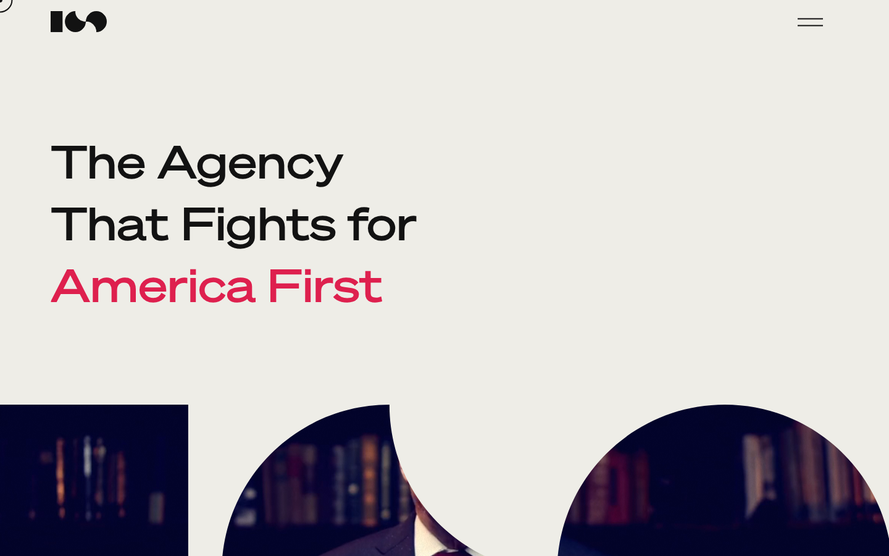
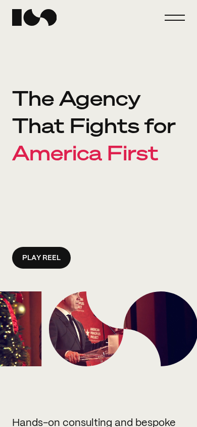

# UI Design System & Master Generation Blueprint: lcg-media

> **LCG · The Agency That Fights for American Families** (https://lcg.media) — LCG provides hands-on consulting and creative solutions to support conservative campaigns and drive results for American Families.



---

## 1. Executive Visual Persona & Design Archetype

- **Brand Essence & Persona**: **LCG · The Agency That Fights for American Families** (`https://lcg.media`). LCG provides hands-on consulting and creative solutions to support conservative campaigns and drive results for American Families.
- **Visual Archetype**: **Light-Gallery WebGL / Canvas Interactive Experience (`#eeede7` / `#121212`)**.
- **Anti-AI-Slop Differentiators**:
  - **Source-Grounded Chromatic Polarity**: Anchors the viewport in `#eeede7` (`var(--color-background)` in `:root`) paired with `#121212` primary typography and `#121212` accents.
  - **Extracted Typographic Hierarchy**: Pairs `PP Mori` for display copy (`O n e m e s s a g e a w a y f r o m `) with `Soehne Breit Kraftig` and not declared in static CSS (uses primary stack / `ui-monospace`).
  - **Calibrated Spatial Grid & Motion**: Combines `1023px` container bounds (`gap: 2.4rem`, padding `1.5rem`) with `cubic-bezier(0.47,0,0.745,0.715)` easing and Lenis Smooth Scroll (`data-lenis`), HTML5 `<canvas>` Interactive Viewport Surface.

---

## 2. Spatial Architecture & Modular Grid Mathematics



### Viewport Allocation & Container Geometry
- **Captured Viewport Dimensions**: Desktop `1440×2400px` (`assets/desktop.png`, capped at 2400px multi-section capture), Mobile `390×2400px` (`assets/mobile.png`, capped at 2400px multi-section capture).
- **Master Container Bounds**: `1023px` extracted from `lcg-media` stylesheet.
- **Canvas Lateral Padding & Spacing**: `1.5rem` lateral canvas padding with `2.4rem` grid gap.
- **Border Radius Scale**: `4rem`, `4.8rem`, `50rem`, `50%`.

### Responsive Breakpoint Architecture
- **Desktop Layout**: Multi-column CSS Grid / Flexbox layout at `1440px` (`max-width: 1023px`, `gap: 2.4rem`).
- **Mobile Layout**: Single-column vertical stack at `390px` viewport width with `1.5rem` horizontal padding.
- **Extracted CSS Media Queries**: `@media (min-width: 1024px)`, `@media (max-width: 1023px)`, `@media (max-width: 767px)`, `@media (min-width: 1025px)`.

---

## 3. Color System, Materiality & Atmospheric Lighting

### Semantic Palette & Source Grounding
| Semantic Role | Ground-Truth Value | Extracted CSS Source / Selector |
|---|---|---|
| **Primary Canvas Substrate** | `#eeede7` | `var(--color-background)` in `:root` |
| **Primary Typography Ink** | `#e5e4dc` | `var(--color-background-2)` in `:root` |
| **Elevated Surface / Card Substrate** | `#dcdbd1` | `var(--color-background-3)` in `:root` |
| **Interactive Accent / Highlight** | `#121212` | `var(--color-black)` in `:root` |
| **Secondary / Muted Copy** | `#fff` | `var(--color-white)` in `:root` |
| **Structural Hairline Border** | `#de204e` | `var(--color-highlight)` in `:root` |

### Sanitized Root CSS Variables (`ui-ux.md` Ground Truth)
| Variable Name | Extracted Value | Semantic Role |
|---|---|---|
| `--ease-in-sine` | `cubic-bezier(0.47, 0, 0.745, 0.715)` | Motion / Easing Token |
| `--ease-out-sine` | `cubic-bezier(0.39, 0.575, 0.565, 1)` | Motion / Easing Token |
| `--ease-in-out-sine` | `cubic-bezier(0.445, 0.05, 0.55, 0.95)` | Motion / Easing Token |
| `--ease-in-quad` | `cubic-bezier(0.55, 0.085, 0.68, 0.53)` | Motion / Easing Token |
| `--ease-out-quad` | `cubic-bezier(0.25, 0.46, 0.45, 0.94)` | Motion / Easing Token |
| `--ease-in-out-quad` | `cubic-bezier(0.455, 0.03, 0.515, 0.955)` | Motion / Easing Token |
| `--ease-in-cubic` | `cubic-bezier(0.55, 0.055, 0.675, 0.19)` | Motion / Easing Token |
| `--ease-out-cubic` | `cubic-bezier(0.215, 0.61, 0.355, 1)` | Motion / Easing Token |
| `--ease-in-out-cubic` | `cubic-bezier(0.645, 0.045, 0.355, 1)` | Motion / Easing Token |
| `--ease-in-quart` | `cubic-bezier(0.895, 0.03, 0.685, 0.22)` | Motion / Easing Token |
| `--ease-out-quart` | `cubic-bezier(0.165, 0.84, 0.44, 1)` | Motion / Easing Token |
| `--ease-in-out-quart` | `cubic-bezier(0.77, 0, 0.175, 1)` | Motion / Easing Token |
| `--ease-in-quint` | `cubic-bezier(0.755, 0.05, 0.855, 0.06)` | Motion / Easing Token |
| `--ease-out-quint` | `cubic-bezier(0.23, 1, 0.32, 1)` | Motion / Easing Token |
| `--ease-in-out-quint` | `cubic-bezier(0.86, 0, 0.07, 1)` | Motion / Easing Token |
| `--ease-in-expo` | `cubic-bezier(0.95, 0.05, 0.795, 0.035)` | Motion / Easing Token |

---

## 4. Typographic Scale & Editorial Hierarchy

### Font Family Stacks
- **Display Typography**: `PP Mori`.
- **Primary Body Stack**: `Soehne Breit Kraftig`.
- **Technical / Metadata Stack**: not declared in static CSS (uses primary stack / `ui-monospace`).

### Typographic Scale & Rules (Extracted from Stylesheet & Variables)
- **Hero Display (`H1`)**: not explicitly declared on tag in static CSS (stylesheet font-size ladder: `100%`, `.7142857143vw`, `1.2345679012vw`, `2.5641025641vw`, `7.2rem`).
- **Section Heading (`H2`)**: not explicitly declared on tag in static CSS (stylesheet font-size ladder: `100%`, `.7142857143vw`, `1.2345679012vw`, `2.5641025641vw`, `7.2rem`).
- **Body Copy**: not explicitly declared on tag in static CSS (stylesheet font-size ladder: `100%`, `.7142857143vw`, `1.2345679012vw`, `2.5641025641vw`, `7.2rem`).
- **Metadata & Navigation Labels**: not explicitly declared on tag in static CSS (stylesheet font-size ladder: `100%`, `.7142857143vw`, `1.2345679012vw`, `2.5641025641vw`, `7.2rem`).

---

## 5. Choreographed Motion & Interaction Physics

### Primary Easing Curves
- **Extracted Timing Functions**: `cubic-bezier(0.47,0,0.745,0.715)`, `cubic-bezier(0.39,0.575,0.565,1)`, `cubic-bezier(0.445,0.05,0.55,0.95)`.

### Per-Element Transition & Choreography Rules
- **Selector `.button`**: `transition: opacity .4s ease` extracted from `lcg-media` stylesheet.
- **Selector `.button div`**: `transition: transform .8s var(--delay) var(--ease-in-out-quart)` extracted from `lcg-media` stylesheet.
- **Selector `.cookies`**: `transition: transform .8s var(--ease-out-cubic)` extracted from `lcg-media` stylesheet.
- **Extracted Easing Curve (`cubic-bezier(0.47,0,0.745,0.715)`)**: Governs interactive state transitions across `<nav.navigation>` and `<section.logo-video>`.
- **Runtime Interaction Engine**: Integrates Lenis Smooth Scroll (`data-lenis`), HTML5 `<canvas>` Interactive Viewport Surface with `prefers-reduced-motion: reduce` fallback guards.

---

## 6. Component Wireframe & Structural DOM Map

### Visual Layout Schematic (Grounded in `dom.html` — `1440px` Desktop & `390px` Mobile Reflow)
```
┌────────────────────────────────────────────────────────────────────────┐
│ DESKTOP VIEWPORT (1440px) — LCG · The Agency That Fights for American  │
│ ====================================================================== │
│ [ <nav.navigation>         | Home · Cases · Capabilities · Creed ·  ]  │
│ ---------------------------------------------------------------------- │
│ | HERO STAGE: <section.header>                                     |   │
│ | H1: O n e m e s s a g e a w a y f r o m d e l i v e r...         |   │
│ | Substrate: #eeede7    | Ink: #121212    | Accent: #121212        |   │
│ ---------------------------------------------------------------------- │
│ | SHOWCASE GRID (<section.logo-video>      ) max-w: 1023px         |   │
│ | +------------------------------+  +------------------------------+ | │
│ | | The Agency That Fights for A |  | Fathers Wanted               | | │
│ | +------------------------------+  +------------------------------+ | │
│ ---------------------------------------------------------------------- │
│ | MOBILE VIEWPORT REFLOW (390px) — Single-Column Stack (gap: 2.4rem) | │
│ | [<nav.navigation>] -> [<section.header>] -> [<section.logo-vide] |   │
│ ---------------------------------------------------------------------- │
│ [ FOOTER (<footer.footer>       ) | https://lcg.media                  │
└────────────────────────────────────────────────────────────────────────┘
```

### Granular DOM Region Breakdown
1. **Brand Header & Navigation Bar (<nav.navigation> — `lcg-media`)**:
   - Landmark `<nav class="navigation">` hosting `LCG · The Agency That Fights for Ame` navigation (`Home · Cases · Capabilities · Creed · Contact`), DOM attributes (`data-template="page"`, `data-svg-origin="121 36"`, `data-svg-origin="121 36"`, `data-svg-origin="0 0"`), and stylesheet rule `.app { height:100%;overflow:clip;position:relative;width:100% }`.
2. **Hero Stage & Focal Lead (<section.header> — `O n e m e s s a g e a w a y f r o `)**:
   - Landmark `<section class="header header--left">` presenting display lead `O n e m e s s a g e a w a y f r o m d e l i v e r...` and copy excerpt *"This site uses sound and cookies to enhance your experience"* over `#eeede7` canvas and `#121212` ink.
3. **Primary Showcase & Content Grid (<section.logo-video> — `The Agency That Fights for A m e r`)**:
   - Landmark `<section class="logo-video">` rendering section `The Agency That Fights for A m e r i c a n F a m...` with copy *"This site uses sound and cookies"*, asset references (`mask.svg`, `bundle.ea4ceea.css`, `apple-touch-icon.png`, `site.webmanifest`), and grid rule `before { box-sizing:border-box }`.
4. **Interactive Detail & Feature Matrix (<section.subheader> — `Fathers Wanted`)**:
   - Landmark `<section class="subheader subheader--right">` framing `Fathers Wanted` and `Julia Letlow for Louisiana` (*"Do Not Track Tracking Off"*) with `#dcdbd1` surface cards, `#121212` accents, and `video { margin:0;padding:0;border:0;font-size:100%;font:inherit;vertical-align:b... }`.
5. **Colophon & Global Directory Footer (<footer.footer> — `https://lcg.media`)**:
   - Landmark `<footer class="footer">` anchoring `LCG · The Agency That Fights for` footer links (`Home · Cases · Capabilities · Creed · Contact`), copy *"C a s e s C a s e s"*, and `#de204e` structural dividers.

---

## 7. Master Zero-Shot AI Generation Prompt

```markdown
# Master Zero-Shot Frontend Generation Prompt: lcg-media (LCG · The Agency That Fights for American Families)

You are a principal frontend architect and design systems engineer. Build a complete, production-ready web application replicating the exact design system, DOM landmarks, typographic hierarchy, color tokens, and motion physics of `lcg-media` (**LCG · The Agency That Fights for American Families** — `https://lcg.media`).

### 1. Visual Archetype & Anti-AI-Slop Mandates
- **Archetype**: Light-Gallery WebGL / Canvas Interactive Experience (`#eeede7` / `#121212`).
- **Identity & Domain Context**: LCG provides hands-on consulting and creative solutions to support conservative campaigns and drive results for American Families.
- **Primary Substrate**: `#eeede7` (`var(--color-background)` in `:root`), **Primary Ink**: `#121212`, **Accent / Highlight**: `#121212`.
- **Site-Specific Differentiators**:
  - **Source-Grounded Chromatic Polarity**: Anchors the viewport in `#eeede7` (`var(--color-background)` in `:root`) paired with `#121212` primary typography and `#121212` accents.
  - **Extracted Typographic Hierarchy**: Pairs `PP Mori` for display copy (`O n e m e s s a g e a w a y f r o m `) with `Soehne Breit Kraftig` and not declared in static CSS (uses primary stack / `ui-monospace`).
  - **Calibrated Spatial Grid & Motion**: Combines `1023px` container bounds (`gap: 2.4rem`, padding `1.5rem`) with `cubic-bezier(0.47,0,0.745,0.715)` easing and Lenis Smooth Scroll (`data-lenis`), HTML5 `<canvas>` Interactive Viewport Surface.

### 2. Ground-Truth CSS Variables (`:root` Token Contract)
Declare and consume these exact custom properties extracted from `lcg-media` in your global stylesheet:

:root {
  /* LCG · The Agency That Fights for American Families (lcg-media) — Ground-Truth Extracted CSS Variables */
  --ease-in-sine: cubic-bezier(0.47, 0, 0.745, 0.715); /* Motion / Easing Token (lcg-media) */
  --ease-out-sine: cubic-bezier(0.39, 0.575, 0.565, 1); /* Motion / Easing Token (lcg-media) */
  --ease-in-out-sine: cubic-bezier(0.445, 0.05, 0.55, 0.95); /* Motion / Easing Token (lcg-media) */
  --ease-in-quad: cubic-bezier(0.55, 0.085, 0.68, 0.53); /* Motion / Easing Token (lcg-media) */
  --ease-out-quad: cubic-bezier(0.25, 0.46, 0.45, 0.94); /* Motion / Easing Token (lcg-media) */
  --ease-in-out-quad: cubic-bezier(0.455, 0.03, 0.515, 0.955); /* Motion / Easing Token (lcg-media) */
  --ease-in-cubic: cubic-bezier(0.55, 0.055, 0.675, 0.19); /* Motion / Easing Token (lcg-media) */
  --ease-out-cubic: cubic-bezier(0.215, 0.61, 0.355, 1); /* Motion / Easing Token (lcg-media) */
  --ease-in-out-cubic: cubic-bezier(0.645, 0.045, 0.355, 1); /* Motion / Easing Token (lcg-media) */
  --ease-in-quart: cubic-bezier(0.895, 0.03, 0.685, 0.22); /* Motion / Easing Token (lcg-media) */
  --ease-out-quart: cubic-bezier(0.165, 0.84, 0.44, 1); /* Motion / Easing Token (lcg-media) */
  --ease-in-out-quart: cubic-bezier(0.77, 0, 0.175, 1); /* Motion / Easing Token (lcg-media) */
  --ease-in-quint: cubic-bezier(0.755, 0.05, 0.855, 0.06); /* Motion / Easing Token (lcg-media) */
  --ease-out-quint: cubic-bezier(0.23, 1, 0.32, 1); /* Motion / Easing Token (lcg-media) */
  --ease-in-out-quint: cubic-bezier(0.86, 0, 0.07, 1); /* Motion / Easing Token (lcg-media) */
  --ease-in-expo: cubic-bezier(0.95, 0.05, 0.795, 0.035); /* Motion / Easing Token (lcg-media) */
}

### 3. Semantic Color & Materiality Contract
Map every surface, ink, and border strictly to these source-grounded tokens:
- **Primary Canvas Substrate**: `#eeede7` — grounded in `var(--color-background)` in `:root`
- **Primary Typography Ink**: `#e5e4dc` — grounded in `var(--color-background-2)` in `:root`
- **Elevated Surface / Card Substrate**: `#dcdbd1` — grounded in `var(--color-background-3)` in `:root`
- **Interactive Accent / Highlight**: `#121212` — grounded in `var(--color-black)` in `:root`
- **Secondary / Muted Copy**: `#fff` — grounded in `var(--color-white)` in `:root`
- **Structural Hairline Border**: `#de204e` — grounded in `var(--color-highlight)` in `:root`

### 4. Spatial Grid, Container Bounds & Responsive Breakpoints
- **Desktop Viewport Reference**: `1440×2400px` (capped at 2400px multi-section capture, `1440px` standard desktop width).
- **Mobile Viewport Reference**: `390×2400px` (capped at 2400px multi-section capture, `390px` standard mobile width).
- **Container Max-Width**: `1023px` extracted from `lcg-media` stylesheet
- **Padding & Gutters**: `1.5rem` lateral canvas padding with `2.4rem` grid gap
- **Desktop Grid**: Multi-column CSS Grid / Flexbox layout at `1440px` (`max-width: 1023px`, `gap: 2.4rem`)
- **Mobile Adaptation**: Single-column vertical stack at `390px` viewport width with `1.5rem` horizontal padding
- **Media Queries**: `@media (min-width: 1024px)`, `@media (max-width: 1023px)`, `@media (max-width: 767px)`, `@media (min-width: 1025px)`
- **Corner Radii**: `4rem`, `4.8rem`, `50rem`, `50%`

### 5. Typography & Editorial Scale Contract
- **Display Font Stack**: `PP Mori`
- **Body Font Stack**: `Soehne Breit Kraftig`
- **Monospace / Technical Font Stack**: not declared in static CSS (uses primary stack / `ui-monospace`)
- **H1 Display Rule**: not explicitly declared on tag in static CSS (stylesheet font-size ladder: `100%`, `.7142857143vw`, `1.2345679012vw`, `2.5641025641vw`, `7.2rem`)
- **H2 Section Rule**: not explicitly declared on tag in static CSS (stylesheet font-size ladder: `100%`, `.7142857143vw`, `1.2345679012vw`, `2.5641025641vw`, `7.2rem`)
- **Body Copy Rule**: not explicitly declared on tag in static CSS (stylesheet font-size ladder: `100%`, `.7142857143vw`, `1.2345679012vw`, `2.5641025641vw`, `7.2rem`)
- **Metadata & Index Rule**: not explicitly declared on tag in static CSS (stylesheet font-size ladder: `100%`, `.7142857143vw`, `1.2345679012vw`, `2.5641025641vw`, `7.2rem`)

### 6. Component Hierarchy, Verbatim Copy & Real DOM Landmarks
Scaffold `lcg-media` (`LCG · The Agency That Fights for American Families`) with these exact structural regions, extracted copy, and CSS rules from `dom.html`:
1. **Brand Header & Navigation Bar (<nav.navigation> — `lcg-media`)**:
   - DOM & Selectors: Landmark `<nav class="navigation">` hosting `LCG · The Agency That Fights for Ame` navigation (`Home · Cases · Capabilities · Creed · Contact`), DOM attributes (`data-template="page"`, `data-svg-origin="121 36"`, `data-svg-origin="121 36"`, `data-svg-origin="0 0"`), and stylesheet rule `.app { height:100%;overflow:clip;position:relative;width:100% }`.
   - Responsive Contract: Header `Brand Header & Navigation Bar (<nav.navigation> — `lcg-media`)` (`lcg-media`) adapts across `@media (min-width: 1024px)`, `@media (max-width: 1023px)`, `@media (max-width: 767px)`, `@media (min-width: 1025px)` with `cubic-bezier(0.47,0,0.745,0.715)`, `cubic-bezier(0.39,0.575,0.565,1)`, `cubic-bezier(0.445,0.05,0.55,0.95)` transitions and links `Home · Cases · Capabilities · Creed · Contact`.
2. **Hero Stage & Focal Lead (<section.header> — `O n e m e s s a g e a w a y f r o `)**:
   - DOM & Selectors: Landmark `<section class="header header--left">` presenting display lead `O n e m e s s a g e a w a y f r o m d e l i v e r...` and copy excerpt *"This site uses sound and cookies to enhance your experience"* over `#eeede7` canvas and `#121212` ink.
   - Responsive Contract: Hero stage (`1440×2400px` desktop / `390×2400px` mobile) sets `#eeede7` background with `#121212` headline `O n e m e s s a g e a w a y f r o m d e l i v e r...`.
3. **Primary Showcase & Content Grid (<section.logo-video> — `The Agency That Fights for A m e r`)**:
   - DOM & Selectors: Landmark `<section class="logo-video">` rendering section `The Agency That Fights for A m e r i c a n F a m...` with copy *"This site uses sound and cookies"*, asset references (`mask.svg`, `bundle.ea4ceea.css`, `apple-touch-icon.png`, `site.webmanifest`), and grid rule `before { box-sizing:border-box }`.
   - Responsive Contract: Showcase grid `Primary Showcase & Content Grid (<section.logo-video> — `The Agency That Fights for A m e r`)` applies Multi-column CSS Grid / Flexbox layout at `1440px` (`max-width: 1023px`, `gap: 2.4rem`) on desktop and Single-column vertical stack at `390px` viewport width with `1.5rem` horizontal padding on mobile.
4. **Interactive Detail & Feature Matrix (<section.subheader> — `Fathers Wanted`)**:
   - DOM & Selectors: Landmark `<section class="subheader subheader--right">` framing `Fathers Wanted` and `Julia Letlow for Louisiana` (*"Do Not Track Tracking Off"*) with `#dcdbd1` surface cards, `#121212` accents, and `video { margin:0;padding:0;border:0;font-size:100%;font:inherit;vertical-align:b... }`.
   - Responsive Contract: Detail module `Interactive Detail & Feature Matrix (<section.subheader> — `Fathers Wanted`)` uses `4rem`, `4.8rem`, `50rem`, `50%` radii, `#121212` highlights, and assets (mask.svg, bundle.ea4ceea.css, apple-touch-icon.png).
5. **Colophon & Global Directory Footer (<footer.footer> — `https://lcg.media`)**:
   - DOM & Selectors: Landmark `<footer class="footer">` anchoring `LCG · The Agency That Fights for` footer links (`Home · Cases · Capabilities · Creed · Contact`), copy *"C a s e s C a s e s"*, and `#de204e` structural dividers.
   - Responsive Contract: Footer `Colophon & Global Directory Footer (<footer.footer> — `https://lcg.media`)` aligns to `1023px` extracted from `lcg-media` stylesheet with `1.5rem` lateral canvas padding with `2.4rem` grid gap and attributes (data-template="page", data-svg-origin="121 36", data-svg-origin="121 36").

#### Verbatim DOM Copy Excerpts (`dom.html`)
- Copy Excerpt 1: *"This site uses sound and cookies to enhance your experience"*
- Copy Excerpt 2: *"This site uses sound and cookies"*
- Copy Excerpt 3: *"Do Not Track Tracking Off"*
- Copy Excerpt 4: *"C a s e s C a s e s"*

### 7. Motion, Extracted Stylesheet Rules & Interaction Choreography
- **Primary Easing Functions**: `cubic-bezier(0.47,0,0.745,0.715)`, `cubic-bezier(0.39,0.575,0.565,1)`, `cubic-bezier(0.445,0.05,0.55,0.95)`
- **Extracted Stylesheet Rules (`lcg-media`)**:
- `.app { height:100%;overflow:clip;position:relative;width:100% }`
- `before { box-sizing:border-box }`
- `video { margin:0;padding:0;border:0;font-size:100%;font:inherit;vertical-align:b... }`
- `section { display:block }`
- `body { line-height:1;height:100%;left:0;position:fixed;top:0;width:100% }`
- **Per-Selector Transition Rules**:
- **Selector `.button`**: `transition: opacity .4s ease` extracted from `lcg-media` stylesheet.
- **Selector `.button div`**: `transition: transform .8s var(--delay) var(--ease-in-out-quart)` extracted from `lcg-media` stylesheet.
- **Selector `.cookies`**: `transition: transform .8s var(--ease-out-cubic)` extracted from `lcg-media` stylesheet.
- **Extracted Easing Curve (`cubic-bezier(0.47,0,0.745,0.715)`)**: Governs interactive state transitions across `<nav.navigation>` and `<section.logo-video>`.
- **Runtime Interaction Engine**: Integrates Lenis Smooth Scroll (`data-lenis`), HTML5 `<canvas>` Interactive Viewport Surface with `prefers-reduced-motion: reduce` fallback guards.

### 8. Technical Deliverables
- Implement in Next.js (App Router) with TypeScript and Tailwind CSS consuming the `:root` custom properties defined above for `lcg-media`.
- Reproduce both the `1440px` desktop architecture and `390px` mobile breakpoint transitions, preserving semantic HTML5 landmarks (`<header>`, `<nav>`, `<main>`, `<section>`, `<footer>`) and `prefers-reduced-motion` accessibility guards.
```
