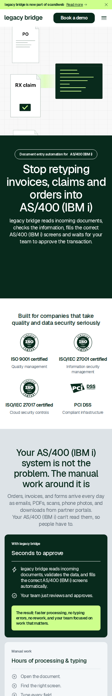

# UI Design System & Master Generation Blueprint: legacybridge-software

> **AI Document Entry for AS/400 & Legacy Systems · LegacyBridge** (https://legacybridge.software/) — An AI agent that reads invoices, orders and claims and keys them into AS/400 (IBM i), mainframe and other legacy systems. Human approval,...


---

## 1. Executive Visual Persona & Design Archetype

- **Brand Essence & Persona**: **AI Document Entry for AS/400 & Legacy Systems · LegacyBridge** (`https://legacybridge.software/`). An AI agent that reads invoices, orders and claims and keys them into AS/400 (IBM i), mainframe and other legacy systems. Human approval,...
- **Capture Provenance**: Live browser capture (`tier1_fast`, HTTP `200`, captured `2026-11-23`).
- **Visual Archetype**: **Light-Substrate Editorial & Modular Grid System (`#ffffff` canvas, `#082a1c` ink, `#cdff8c` accent)**.
- **Anti-AI-Slop Differentiators**:
  - **Live-Computed Chromatic Polarity**: Anchors the viewport in `#ffffff` (live computed `body` `background-color` (`computed_styles.json`)) paired with `#082a1c` primary typography and `#cdff8c` accents.
  - **Grounded Typographic Hierarchy**: Pairs `Geist` for display copy (`Stop retyping invoices, claims and o`) with `Geist` and `Geist Mono`.
  - **Calibrated Spatial Grid & Motion**: Combines `1360px` container bounds (`gap: 8px`, padding `12px`) with `cubic-bezier(.23,1,.32,1)` easing and Three.js / WebGL Canvas Pipeline.

---

## 2. Spatial Architecture & Modular Grid Mathematics



### Viewport Allocation & Container Geometry
- **Captured Viewport Dimensions**: Desktop `1440×2400px` (`assets/desktop.png`, clamped at 2400px live multi-section capture), Mobile `390×2400px` (`assets/mobile.png`, clamped at 2400px live multi-section capture).
- **Master Container Bounds**: `1360px` (measured widest bounded `<section>` landmark width on `1440px` desktop).
- **Canvas Lateral Padding & Spacing**: `12px` lateral canvas padding with `8px` grid gap.
- **Border Radius Scale**: `999px`, `var(--radius-12)`, `var(--radius-16)`, `var(--radius-8)`.

### Responsive Breakpoint Architecture
- **Desktop Layout**: Multi-column CSS Grid / Flexbox layout at `1440px` (`max-width: 1360px`, `gap: 8px`).
- **Mobile Layout**: Single-column vertical stack at `390px` viewport width with `12px` horizontal padding.
- **Extracted CSS Media Queries**: `@media (prefers-reduced-motion: reduce)`, `@media (max-width: 767px)`, `@media (max-width: 1599px)`, `@media (max-width: 1100px)`.

---

## 3. Color System, Materiality & Atmospheric Lighting

### Semantic Palette & Source Grounding
| Semantic Role | Ground-Truth Value | Extracted Live / CSS Source |
|---|---|---|
| **Primary Canvas Substrate** | `#ffffff` | live computed `body` `background-color` (`computed_styles.json`) |
| **Primary Typography Ink** | `#082a1c` | live computed `main` `color` (`computed_styles.json`) |
| **Elevated Surface / Card Substrate** | `#f4f7f9` | `var(--surface-card)` in `:root` |
| **Interactive Accent / Highlight** | `#cdff8c` | `var(--brand-accent)` in `:root` |
| **Secondary / Muted Copy** | `#94a3b8` | `var(--text-inverse-muted)` in `:root` |
| **Structural Hairline Border** | `#dde3e7` | `var(--border-divider)` in `:root` |
| **Variable Token (`--text-muted`)** | `#64707a` | `var(--text-muted)` in `:root` |

### Sanitized Root CSS Variables (`ui-ux.md` Ground Truth)
| Variable Name | Extracted Value | Semantic Role |
|---|---|---|
| `--text-ink` | `#082a1c` | Typography Ink Token |
| `--text-muted` | `#64707a` | Typography Ink Token |
| `--text-inverse` | `#ffffff` | Typography Ink Token |
| `--text-inverse-muted` | `#94a3b8` | Typography Ink Token |
| `--brand-primary` | `#082a1c` | Brand / Palette Token |
| `--brand-secondary` | `#94a3b8` | Brand / Palette Token |
| `--brand-accent` | `#cdff8c` | Brand / Palette Token |
| `--surface-white` | `#ffffff` | Canvas / Surface Token |
| `--surface-page` | `#ffffff` | Canvas / Surface Token |
| `--surface-card` | `#f4f7f9` | Canvas / Surface Token |
| `--surface-section` | `#f4f7f9` | Canvas / Surface Token |
| `--surface-accent` | `#dde3e7` | Canvas / Surface Token |
| `--surface-subtle` | `#dde3e7` | Canvas / Surface Token |
| `--border-divider` | `#dde3e7` | Elevation / Border Token |
| `--radius-8` | `8px` | Elevation / Border Token |
| `--radius-12` | `12px` | Elevation / Border Token |

---

## 4. Typographic Scale & Editorial Hierarchy

### Font Family Stacks
- **Display Typography**: `Geist`.
- **Primary Body Stack**: `Geist`.
- **Technical / Metadata Stack**: `Geist Mono`.

### Typographic Scale & Rules (Live Computed & Stylesheet Grounded)
- **Hero Display (`H1`)**: live computed `h1` (`font-size: 68px`, `line-height: 72px`, `font-weight: 500`, `letter-spacing: -3.4px`); rule `.h1` (`letter-spacing: -0.05em`).
- **Section Heading (`H2`)**: live computed `h2` (`font-size: 54px`, `line-height: 58px`, `font-weight: 500`, `letter-spacing: -2.16px`); rule `.h2` (`letter-spacing: -0.04em`).
- **Body Copy**: live computed `body` (`font-size: 16px`, `line-height: 20px`, `font-weight: 400`, `letter-spacing: -0.64px`); rule `.body` (`letter-spacing: -0.04em`).
- **Metadata & Navigation Labels**: live computed `nav/a` (`font-size: 16px`, `line-height: 20px`, `font-weight: 400`, `letter-spacing: -0.64px`); CSS variables `--mono: "Geist Mono", ui-monospace, "SF Mono", Menlo, Consolas, monospace`; rule `.caption` (`letter-spacing: -0.04em`).

---

## 5. Choreographed Motion & Interaction Physics

### Primary Easing Curves
- **Extracted Timing Functions**: `cubic-bezier(.23,1,.32,1)`, `cubic-bezier(0,1,0.4,1)`, `cubic-bezier(.16,1,.3,1)`.

### Per-Element Transition & Choreography Rules
- **Selector `.btn`**: `transition: background-color .15s ease, color .15s ease, border-color .15s...` extracted from `legacybridge-software` stylesheet.
- **Selector `.btn-wipe .btn__label::before`**: `transition: transform .3s cubic-bezier(.23,1,.32,1), clip-path .3s cubi...` extracted from `legacybridge-software` stylesheet.
- **Selector `.btn-wipe .btn__text`**: `transition: transform .3s cubic-bezier(.23,1,.32,1) .1s, clip-path .3s...` extracted from `legacybridge-software` stylesheet.
- **Extracted Easing Curve (`cubic-bezier(.23,1,.32,1)`)**: Governs interactive state transitions across `<header.site-header>` and `<section.compare-cards>`.
- **Runtime Interaction Engine**: Integrates Three.js / WebGL Canvas Pipeline with `prefers-reduced-motion: reduce` fallback guards.

---

## 6. Component Wireframe & Structural DOM Map

### Visual Layout Schematic — Desktop (`1440px`, Grounded in `dom.html` & Landmark Bounding Boxes)
```
┌────────────────────────────────────────────────────────────────────────┐
│ DESKTOP VIEWPORT (1440px) — AI Document Entry for AS/400 & Legacy Syst │
│ ====================================================================== │
│ [ <header.site-header> (1440x80px)    | How it works · Solutions · U ] │
│ ---------------------------------------------------------------------- │
│ | HERO STAGE: <section.hero> (w=1440px)                              | │
│ | H1: Stop retyping invoices, claims and orders into AS...           | │
│ | Substrate: #ffffff | Ink: #082a1c | Accent: #cdff8c                | │
│ ---------------------------------------------------------------------- │
│ | SHOWCASE GRID (<section.compare-cards>) max-w: 1360px              | │
│ | +------------------------------+  +------------------------------+ | │
│ | | Your AS/400 (IBM i) system i |  | Hours of processing & typing | | │
│ | +------------------------------+  +------------------------------+ | │
│ ---------------------------------------------------------------------- │
│ | DETAIL MODULE (<article.compare-cards__ca) — Seconds to approve    | │
│ ---------------------------------------------------------------------- │
│ [ FOOTER (<footer.site-footer>) | https://legacybridge.software/       │
└────────────────────────────────────────────────────────────────────────┘
```

### Visual Layout Schematic — Mobile Reflow (`390px`)
```
┌────────────────────────────────────────────────────────────────────────┐
│ MOBILE VIEWPORT REFLOW (390px) — Single-Column Stack (gap: 8px)        │
│ ====================================================================== │
│ [ HEADER BAR (<header.site-header>    ) | Compact Menu (390px)         │
│ ---------------------------------------------------------------------- │
│ | HERO STAGE (<section.hero>) — 390px Vertical Lead                  | │
│ | H1: Stop retyping invoices, claims and orders into AS...           | │
│ ---------------------------------------------------------------------- │
│ | SHOWCASE STACK (<section.compare-cards) — 1-Col Stack              | │
│ | [ Item 1: Your AS/400 (IBM i) system is not the problem. Th...   ] | │
│ | [ Item 2: Hours of processing & typing                           ] | │
│ ---------------------------------------------------------------------- │
│ | DETAIL STACK (<article.compare-cards__) — 1-Col (Seconds to approve) │
│ ---------------------------------------------------------------------- │
│ [ FOOTER (<footer.site-footer>) | Stacked 390px Colophon               │
└────────────────────────────────────────────────────────────────────────┘
```

### Granular DOM Region Breakdown
1. **Brand Header & Navigation Bar (<header.site-header> — `legacybridge-software`)**:
   - Landmark `<header class="site-header">` (`1440x80px`) hosting `AI Document Entry for AS/400 & Legac` navigation (`How it works · Solutions · Use cases · Blog · Why us`), DOM attributes (`data-lb-cta="header"`, `data-label="Book a demo"`, `data-label="Book"`, `data-contact-open="header"`), and stylesheet rule `.h1 { font: 500 68px/72px var(--font); letter-spacing: -0.05em; }`.
2. **Hero Stage & Focal Lead (<section.hero> — `Stop retyping invoices, claims and`)**:
   - Landmark `<section class="hero">` presenting display lead `Stop retyping invoices, claims and orders into AS...` and copy excerpt *"legacy bridge is now part of scandiweb"* over `#ffffff` canvas and `#082a1c` ink.
3. **Primary Showcase & Content Grid (<section.compare-cards> — `Your AS/400 (IBM i) system is not `)**:
   - Landmark `<section class="compare-cards">` rendering section `Your AS/400 (IBM i) system is not the problem. Th...` with copy *"Read the announcement"*, asset references (`favicon.svg`, `favicon-32.png`, `icon-192.png`, `apple-touch-icon.png`), and grid rule `.h2 { font: 500 54px/58px var(--font); letter-spacing: -0.04em; }`.
4. **Interactive Detail & Feature Matrix (<article.compare-cards__card> — `Hours of processing & typing`)**:
   - Landmark `<article class="compare-cards__card compare-cards__card--without">` framing `Hours of processing & typing` and `Seconds to approve` (*"Document entry automation for AS/400 (IBM i)"*) with `#f4f7f9` surface cards, `#cdff8c` accents, and `.h3 { font: 500 38px/42px var(--font); letter-spacing: -0.03em; }`.
5. **Colophon & Global Directory Footer (<footer.site-footer> — `https://legacybridge.software/`)**:
   - Landmark `<footer class="site-footer is-offscreen">` anchoring `AI Document Entry for AS/400 & L` footer links (`How it works · Solutions · Use cases · Blog · Why us`), copy *"legacy bridge reads incoming documents, checks the informati"*, and `#dde3e7` structural dividers.

---

## 7. Master Zero-Shot AI Generation Prompt

```markdown
# Master Zero-Shot Frontend Generation Prompt: legacybridge-software (AI Document Entry for AS/400 & Legacy Systems · LegacyBridge)

You are a principal frontend architect and design systems engineer. Build a complete, production-ready web application replicating the exact design system, DOM landmarks, typographic hierarchy, color tokens, and motion physics of `legacybridge-software` (**AI Document Entry for AS/400 & Legacy Systems · LegacyBridge** — `https://legacybridge.software/`).

### 1. Visual Archetype & Anti-AI-Slop Mandates
- **Archetype**: Light-Substrate Editorial & Modular Grid System (`#ffffff` canvas, `#082a1c` ink, `#cdff8c` accent).
- **Identity & Domain Context**: An AI agent that reads invoices, orders and claims and keys them into AS/400 (IBM i), mainframe and other legacy systems. Human approval,...
- **Primary Substrate**: `#ffffff` (live computed `body` `background-color` (`computed_styles.json`)), **Primary Ink**: `#082a1c`, **Accent / Highlight**: `#cdff8c`.
- **Site-Specific Differentiators**:
  - **Live-Computed Chromatic Polarity**: Anchors the viewport in `#ffffff` (live computed `body` `background-color` (`computed_styles.json`)) paired with `#082a1c` primary typography and `#cdff8c` accents.
  - **Grounded Typographic Hierarchy**: Pairs `Geist` for display copy (`Stop retyping invoices, claims and o`) with `Geist` and `Geist Mono`.
  - **Calibrated Spatial Grid & Motion**: Combines `1360px` container bounds (`gap: 8px`, padding `12px`) with `cubic-bezier(.23,1,.32,1)` easing and Three.js / WebGL Canvas Pipeline.

### 2. Ground-Truth CSS Variables (`:root` Token Contract)
Declare and consume these exact custom properties extracted from `legacybridge-software` in your global stylesheet:

:root {
  /* AI Document Entry for AS/400 & Legacy Systems · LegacyBridge (legacybridge-software) — Live-Grounded CSS Variables */
  --text-ink: #082a1c; /* Typography Ink Token (legacybridge-software) */
  --text-muted: #64707a; /* Typography Ink Token (legacybridge-software) */
  --text-inverse: #ffffff; /* Typography Ink Token (legacybridge-software) */
  --text-inverse-muted: #94a3b8; /* Typography Ink Token (legacybridge-software) */
  --brand-primary: #082a1c; /* Brand / Palette Token (legacybridge-software) */
  --brand-secondary: #94a3b8; /* Brand / Palette Token (legacybridge-software) */
  --brand-accent: #cdff8c; /* Brand / Palette Token (legacybridge-software) */
  --surface-white: #ffffff; /* Canvas / Surface Token (legacybridge-software) */
  --surface-page: #ffffff; /* Canvas / Surface Token (legacybridge-software) */
  --surface-card: #f4f7f9; /* Canvas / Surface Token (legacybridge-software) */
  --surface-section: #f4f7f9; /* Canvas / Surface Token (legacybridge-software) */
  --surface-accent: #dde3e7; /* Canvas / Surface Token (legacybridge-software) */
  --surface-subtle: #dde3e7; /* Canvas / Surface Token (legacybridge-software) */
  --border-divider: #dde3e7; /* Elevation / Border Token (legacybridge-software) */
  --radius-8: 8px; /* Elevation / Border Token (legacybridge-software) */
  --radius-12: 12px; /* Elevation / Border Token (legacybridge-software) */
}

### 3. Semantic Color & Materiality Contract
Map every surface, ink, and border strictly to these source-grounded tokens:
- **Primary Canvas Substrate**: `#ffffff` — grounded in live computed `body` `background-color` (`computed_styles.json`)
- **Primary Typography Ink**: `#082a1c` — grounded in live computed `main` `color` (`computed_styles.json`)
- **Elevated Surface / Card Substrate**: `#f4f7f9` — grounded in `var(--surface-card)` in `:root`
- **Interactive Accent / Highlight**: `#cdff8c` — grounded in `var(--brand-accent)` in `:root`
- **Secondary / Muted Copy**: `#94a3b8` — grounded in `var(--text-inverse-muted)` in `:root`
- **Structural Hairline Border**: `#dde3e7` — grounded in `var(--border-divider)` in `:root`
- **Variable Token (`--text-muted`)**: `#64707a` — grounded in `var(--text-muted)` in `:root`

### 4. Spatial Grid, Container Bounds & Responsive Breakpoints
- **Desktop Viewport Reference**: `1440×2400px` (clamped at 2400px live multi-section capture, `1440px` standard desktop width).
- **Mobile Viewport Reference**: `390×2400px` (clamped at 2400px live multi-section capture, `390px` standard mobile width).
- **Container Max-Width**: `1360px` (measured widest bounded `<section>` landmark width on `1440px` desktop)
- **Padding & Gutters**: `12px` lateral canvas padding with `8px` grid gap
- **Desktop Grid**: Multi-column CSS Grid / Flexbox layout at `1440px` (`max-width: 1360px`, `gap: 8px`)
- **Mobile Adaptation**: Single-column vertical stack at `390px` viewport width with `12px` horizontal padding
- **Media Queries**: `@media (prefers-reduced-motion: reduce)`, `@media (max-width: 767px)`, `@media (max-width: 1599px)`, `@media (max-width: 1100px)`
- **Corner Radii**: `999px`, `var(--radius-12)`, `var(--radius-16)`, `var(--radius-8)`

### 5. Typography & Editorial Scale Contract
- **Display Font Stack**: `Geist`
- **Body Font Stack**: `Geist`
- **Monospace / Technical Font Stack**: `Geist Mono`
- **H1 Display Rule**: live computed `h1` (`font-size: 68px`, `line-height: 72px`, `font-weight: 500`, `letter-spacing: -3.4px`); rule `.h1` (`letter-spacing: -0.05em`)
- **H2 Section Rule**: live computed `h2` (`font-size: 54px`, `line-height: 58px`, `font-weight: 500`, `letter-spacing: -2.16px`); rule `.h2` (`letter-spacing: -0.04em`)
- **Body Copy Rule**: live computed `body` (`font-size: 16px`, `line-height: 20px`, `font-weight: 400`, `letter-spacing: -0.64px`); rule `.body` (`letter-spacing: -0.04em`)
- **Metadata & Index Rule**: live computed `nav/a` (`font-size: 16px`, `line-height: 20px`, `font-weight: 400`, `letter-spacing: -0.64px`); CSS variables `--mono: "Geist Mono", ui-monospace, "SF Mono", Menlo, Consolas, monospace`; rule `.caption` (`letter-spacing: -0.04em`)

### 6. Component Hierarchy, Verbatim Copy & Real DOM Landmarks
Scaffold `legacybridge-software` (`AI Document Entry for AS/400 & Legacy Systems · LegacyBridge`) with these exact structural regions, extracted copy, and CSS rules from `dom.html`:
1. **Brand Header & Navigation Bar (<header.site-header> — `legacybridge-software`)**:
   - DOM & Selectors: Landmark `<header class="site-header">` (`1440x80px`) hosting `AI Document Entry for AS/400 & Legac` navigation (`How it works · Solutions · Use cases · Blog · Why us`), DOM attributes (`data-lb-cta="header"`, `data-label="Book a demo"`, `data-label="Book"`, `data-contact-open="header"`), and stylesheet rule `.h1 { font: 500 68px/72px var(--font); letter-spacing: -0.05em; }`.
   - Responsive Contract: Header `Brand Header & Navigation Bar (<header.site-header> — `legacybridge-software`)` (`legacybridge-software`) adapts across `@media (prefers-reduced-motion: reduce)`, `@media (max-width: 767px)`, `@media (max-width: 1599px)`, `@media (max-width: 1100px)` with `cubic-bezier(.23,1,.32,1)`, `cubic-bezier(0,1,0.4,1)`, `cubic-bezier(.16,1,.3,1)` transitions and links `How it works · Solutions · Use cases · Blog · Why us`.
2. **Hero Stage & Focal Lead (<section.hero> — `Stop retyping invoices, claims and`)**:
   - DOM & Selectors: Landmark `<section class="hero">` presenting display lead `Stop retyping invoices, claims and orders into AS...` and copy excerpt *"legacy bridge is now part of scandiweb"* over `#ffffff` canvas and `#082a1c` ink.
   - Responsive Contract: Hero stage (`1440×2400px` desktop / `390×2400px` mobile) sets `#ffffff` background with `#082a1c` headline `Stop retyping invoices, claims and orders into AS...`.
3. **Primary Showcase & Content Grid (<section.compare-cards> — `Your AS/400 (IBM i) system is not `)**:
   - DOM & Selectors: Landmark `<section class="compare-cards">` rendering section `Your AS/400 (IBM i) system is not the problem. Th...` with copy *"Read the announcement"*, asset references (`favicon.svg`, `favicon-32.png`, `icon-192.png`, `apple-touch-icon.png`), and grid rule `.h2 { font: 500 54px/58px var(--font); letter-spacing: -0.04em; }`.
   - Responsive Contract: Showcase grid `Primary Showcase & Content Grid (<section.compare-cards> — `Your AS/400 (IBM i) system is not `)` applies Multi-column CSS Grid / Flexbox layout at `1440px` (`max-width: 1360px`, `gap: 8px`) on desktop and Single-column vertical stack at `390px` viewport width with `12px` horizontal padding on mobile.
4. **Interactive Detail & Feature Matrix (<article.compare-cards__card> — `Hours of processing & typing`)**:
   - DOM & Selectors: Landmark `<article class="compare-cards__card compare-cards__card--without">` framing `Hours of processing & typing` and `Seconds to approve` (*"Document entry automation for AS/400 (IBM i)"*) with `#f4f7f9` surface cards, `#cdff8c` accents, and `.h3 { font: 500 38px/42px var(--font); letter-spacing: -0.03em; }`.
   - Responsive Contract: Detail module `Interactive Detail & Feature Matrix (<article.compare-cards__card> — `Hours of processing & typing`)` uses `999px`, `var(--radius-12)`, `var(--radius-16)`, `var(--radius-8)` radii, `#cdff8c` highlights, and assets (favicon.svg, favicon-32.png, icon-192.png).
5. **Colophon & Global Directory Footer (<footer.site-footer> — `https://legacybridge.software/`)**:
   - DOM & Selectors: Landmark `<footer class="site-footer is-offscreen">` anchoring `AI Document Entry for AS/400 & L` footer links (`How it works · Solutions · Use cases · Blog · Why us`), copy *"legacy bridge reads incoming documents, checks the informati"*, and `#dde3e7` structural dividers.
   - Responsive Contract: Footer `Colophon & Global Directory Footer (<footer.site-footer> — `https://legacybridge.software/`)` aligns to `1360px` (measured widest bounded `<section>` landmark width on `1440px` desktop) with `12px` lateral canvas padding with `8px` grid gap and attributes (data-lb-cta="header", data-label="Book a demo", data-label="Book").

#### Verbatim DOM Copy Excerpts (`dom.html`)
- Copy Excerpt 1: *"legacy bridge is now part of scandiweb"*
- Copy Excerpt 2: *"Read the announcement"*
- Copy Excerpt 3: *"Document entry automation for AS/400 (IBM i)"*
- Copy Excerpt 4: *"legacy bridge reads incoming documents, checks the information, fills the correct..."*

### 7. Motion, Extracted Stylesheet Rules & Interaction Choreography
- **Primary Easing Functions**: `cubic-bezier(.23,1,.32,1)`, `cubic-bezier(0,1,0.4,1)`, `cubic-bezier(.16,1,.3,1)`
- **Extracted Stylesheet Rules (`legacybridge-software`)**:
- `.h1 { font: 500 68px/72px var(--font); letter-spacing: -0.05em; }`
- `.h2 { font: 500 54px/58px var(--font); letter-spacing: -0.04em; }`
- `.h3 { font: 500 38px/42px var(--font); letter-spacing: -0.03em; }`
- `.h4 { font: 500 32px/36px var(--font); letter-spacing: -0.03em; }`
- `.h5 { font: 500 24px/28px var(--font); letter-spacing: -0.03em; }`
- **Per-Selector Transition Rules**:
- **Selector `.btn`**: `transition: background-color .15s ease, color .15s ease, border-color .15s...` extracted from `legacybridge-software` stylesheet.
- **Selector `.btn-wipe .btn__label::before`**: `transition: transform .3s cubic-bezier(.23,1,.32,1), clip-path .3s cubi...` extracted from `legacybridge-software` stylesheet.
- **Selector `.btn-wipe .btn__text`**: `transition: transform .3s cubic-bezier(.23,1,.32,1) .1s, clip-path .3s...` extracted from `legacybridge-software` stylesheet.
- **Extracted Easing Curve (`cubic-bezier(.23,1,.32,1)`)**: Governs interactive state transitions across `<header.site-header>` and `<section.compare-cards>`.
- **Runtime Interaction Engine**: Integrates Three.js / WebGL Canvas Pipeline with `prefers-reduced-motion: reduce` fallback guards.

### 8. Technical Deliverables
- Implement in Next.js (App Router) with TypeScript and Tailwind CSS consuming the `:root` custom properties defined above for `legacybridge-software`.
- Reproduce both the `1440px` desktop architecture and `390px` mobile breakpoint transitions, preserving semantic HTML5 landmarks (`<header>`, `<nav>`, `<main>`, `<section>`, `<footer>`) and `prefers-reduced-motion` accessibility guards.
```
