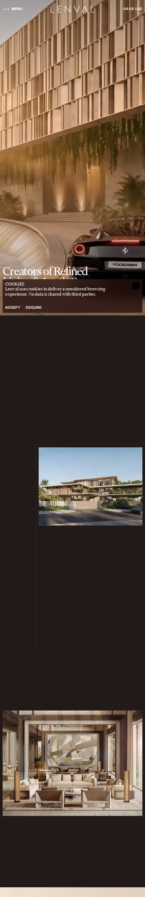

# UI Design System & Master Generation Blueprint: lenvalproperties-com

> **Lenval Properties — Creators of Refined Living & Iconic Spaces** (https://lenvalproperties.com) — Boutique residential developments in Abu Dhabi, built with intention and designed to endure.


---

## 1. Executive Visual Persona & Design Archetype

- **Brand Essence & Persona**: **Lenval Properties — Creators of Refined Living & Iconic Spaces** (`https://lenvalproperties.com`). Boutique residential developments in Abu Dhabi, built with intention and designed to endure.
- **Capture Provenance**: Live browser capture (`tier1_fast`, HTTP `200`, captured `2026-11-23`).
- **Visual Archetype**: **Dark-Substrate WebGL / Canvas Interactive Experience (`#211a19` / `#0082f3`)**.
- **Anti-AI-Slop Differentiators**:
  - **Live-Computed Chromatic Polarity**: Anchors the viewport in `#211a19` (live computed `body` `background-color` (`computed_styles.json`)) paired with `#ffffff` primary typography and `#0082f3` accents.
  - **Grounded Typographic Hierarchy**: Pairs `Financier Display` for display copy (`Creators of Refined Living & Iconic `) with `Helvetica Now Display` and not declared in live computed styles (uses primary stack / `ui-monospace`).
  - **Calibrated Spatial Grid & Motion**: Combines `1440px` container bounds (`gap: 43.2px`, padding `9px`) with `cubic-bezier(0.76,0,0.24,1)` easing and Lenis Smooth Scroll (`data-lenis`), GSAP Timeline & ScrollTrigger.

---

## 2. Spatial Architecture & Modular Grid Mathematics



### Viewport Allocation & Container Geometry
- **Captured Viewport Dimensions**: Desktop `1440×2400px` (`assets/desktop.png`, clamped at 2400px live multi-section capture), Mobile `390×2400px` (`assets/mobile.png`, clamped at 2400px live multi-section capture).
- **Master Container Bounds**: `1440px` (full-bleed `100%` viewport stage).
- **Canvas Lateral Padding & Spacing**: `9px` lateral canvas padding with `43.2px` grid gap.
- **Border Radius Scale**: `3px`, `100%`, `50%`, `2px`.

### Responsive Breakpoint Architecture
- **Desktop Layout**: Multi-column CSS Grid / Flexbox layout at `1440px` (`max-width: 1440px`, `gap: 43.2px`).
- **Mobile Layout**: Single-column vertical stack at `390px` viewport width with `9px` horizontal padding.
- **Extracted CSS Media Queries**: `@media screen and (max-width:991px)`, `@media screen and (max-width:767px)`, `@media screen and (max-width:479px)`, `@media (min-width:768px)`.

---

## 3. Color System, Materiality & Atmospheric Lighting

### Semantic Palette & Source Grounding
| Semantic Role | Ground-Truth Value | Extracted Live / CSS Source |
|---|---|---|
| **Primary Canvas Substrate** | `#211a19` | live computed `body` `background-color` (`computed_styles.json`) |
| **Primary Typography Ink** | `#ffffff` | live computed `h1` `color` (`computed_styles.json`) |
| **Elevated Surface / Card Substrate** | `#222222` | `.w-slider-nav-invert>div.w-active { background-color: #222222 }` |
| **Interactive Accent / Highlight** | `#0082f3` | `.w-dropdown-link.w--current { color: #0082f3 }` |
| **Secondary / Muted Copy** | `#f9f4ee` | live computed `p` `color` (`computed_styles.json`) |
| **Structural Hairline Border** | `#3898ec` | `.w-select:focus { border-color: #3898ec }` |

### Sanitized Root CSS Variables (`ui-ux.md` Ground Truth)
| Variable Name | Extracted Value | Semantic Role |
|---|---|---|
| `--_fonts---font-body` | `"Helvetica Now Display",Arial,sans-serif` | Typography / Scale Token |
| `--_colors---base-1000--primary` | `var(--_global-colors---base-1000--100)` | Brand / Palette Token |
| `--_fonts---font-display` | `"Financier Display","Times New Roman",sans-serif` | Typography / Scale Token |
| `--_fonts---h1--size` | `calc(64rem/var(--_special-units---scale-ratio))` | Typography / Scale Token |
| `--_fonts---h1--line-height` | `75%` | Typography / Scale Token |
| `--_fonts---h1--letter-spacing` | `-.032em` | Typography / Scale Token |
| `--_fonts---h2--size` | `calc(40rem/var(--_special-units---scale-ratio))` | Typography / Scale Token |
| `--_fonts---h2--line-height` | `100%` | Typography / Scale Token |
| `--_fonts---h2--letter-spacing` | `-.024em` | Typography / Scale Token |
| `--_fonts---h3--size` | `calc(16rem/var(--_special-units---scale-ratio))` | Typography / Scale Token |
| `--_fonts---h3--line-height` | `100%` | Typography / Scale Token |
| `--_fonts---h3--letter-spacing` | `0em` | Typography / Scale Token |
| `--_fonts---h4--size` | `0rem` | Typography / Scale Token |
| `--_fonts---h4--line-height` | `100%` | Typography / Scale Token |
| `--_fonts---h4--letter-spacing` | `-.048em` | Typography / Scale Token |
| `--_fonts---h5--size` | `0rem` | Typography / Scale Token |

---

## 4. Typographic Scale & Editorial Hierarchy

### Font Family Stacks
- **Display Typography**: `Financier Display`.
- **Primary Body Stack**: `Helvetica Now Display`.
- **Technical / Metadata Stack**: not declared in live computed styles (uses primary stack / `ui-monospace`).

### Typographic Scale & Rules (Live Computed & Stylesheet Grounded)
- **Hero Display (`H1`)**: live computed `h1` (`font-size: 57.6px`, `line-height: 43.2px`, `font-weight: 400`, `letter-spacing: -1.8432px`); CSS variables `--_fonts---font-display: "Financier Display","Times New Roman",sans-serif`, `--_fonts---h1--size: calc(64rem/var(--_special-units---scale-ratio))`, `--_fonts---h1--line-height: 75%`.
- **Section Heading (`H2`)**: live computed `h2` (`font-size: 36px`, `line-height: 36px`, `font-weight: 400`, `letter-spacing: -0.864px`); CSS variables `--_fonts---h2--size: calc(40rem/var(--_special-units---scale-ratio))`, `--_fonts---h2--line-height: 100%`, `--_fonts---h2--letter-spacing: -.024em`.
- **Body Copy**: live computed `body` (`font-size: 14.4px`, `line-height: 14.4px`, `font-weight: 400`); CSS variables `--_fonts---font-body: "Helvetica Now Display",Arial,sans-serif`.
- **Metadata & Navigation Labels**: live computed `nav/a` (`font-size: 14.4px`, `line-height: 14.4px`, `font-weight: 400`); CSS variables `--_fonts---h1--letter-spacing: -.032em`, `--_fonts---h2--letter-spacing: -.024em`, `--_fonts---h3--letter-spacing: 0em`.

---

## 5. Choreographed Motion & Interaction Physics

### Primary Easing Curves
- **Extracted Timing Functions**: `cubic-bezier(0.76,0,0.24,1)`, `cubic-bezier(0.25,1,0.5,1)`, `cubic-bezier(0.5,0,0.75,0)`.

### Per-Element Transition & Choreography Rules
- **Selector `.w-webflow-badge>img`**: `transition: unset` extracted from `lenvalproperties-com` stylesheet.
- **Selector `.w-slider-dot`**: `transition: background-color .1s,color .1s` extracted from `lenvalproperties-com` stylesheet.
- **Selector `.w-lightbox-control`**: `transition: all .3s` extracted from `lenvalproperties-com` stylesheet.
- **Extracted Easing Curve (`cubic-bezier(0.76,0,0.24,1)`)**: Governs interactive state transitions across `<header.header>` and `<section.theme_on-dark>`.
- **Runtime Interaction Engine**: Integrates Lenis Smooth Scroll (`data-lenis`), GSAP Timeline & ScrollTrigger, Three.js / WebGL Canvas Pipeline, Swiper Touch Carousel Engine, Lottie Vector Animation Player, Barba.js Page Transition Router with `prefers-reduced-motion: reduce` fallback guards.

---

## 6. Component Wireframe & Structural DOM Map

### Visual Layout Schematic — Desktop (`1440px`, Grounded in `dom.html` & Landmark Bounding Boxes)
```
┌────────────────────────────────────────────────────────────────────────┐
│ DESKTOP VIEWPORT (1440px) — Lenval Properties — Creators of Refined Li │
│ ====================================================================== │
│ [ <header.header> (826x25px)          | About us About us · Projects ] │
│ ---------------------------------------------------------------------- │
│ | HERO STAGE: <section.section> (w=826px)                            | │
│ | H1: Creators of Refined Living & Iconic Spaces                     | │
│ | Substrate: #211a19 | Ink: #ffffff | Accent: #0082f3                | │
│ ---------------------------------------------------------------------- │
│ | SHOWCASE GRID (<section.theme_on-dark>) max-w: 1440px              | │
│ | +------------------------------+  +------------------------------+ | │
│ | | Lenval develops timeless lan |  | Exceptional Exceptional Spac | | │
│ | +------------------------------+  +------------------------------+ | │
│ ---------------------------------------------------------------------- │
│ | DETAIL MODULE (<section.section:nth(2)>) — Architecture for a Be   | │
│ ---------------------------------------------------------------------- │
│ [ FOOTER (<footer.section>    ) | https://lenvalproperties.com         │
└────────────────────────────────────────────────────────────────────────┘
```

### Visual Layout Schematic — Mobile Reflow (`390px`)
```
┌────────────────────────────────────────────────────────────────────────┐
│ MOBILE VIEWPORT REFLOW (390px) — Single-Column Stack (gap: 43.2px)     │
│ ====================================================================== │
│ [ HEADER BAR (<header.header>         ) | Compact Menu (390px)         │
│ ---------------------------------------------------------------------- │
│ | HERO STAGE (<section.section>) — 390px Vertical Lead               | │
│ | H1: Creators of Refined Living & Iconic Spaces                     | │
│ ---------------------------------------------------------------------- │
│ | SHOWCASE STACK (<section.theme_on-dark) — 1-Col Stack              | │
│ | [ Item 1: Lenval develops timeless landmarks shaped by arch...   ] | │
│ | [ Item 2: Exceptional Exceptional Spaces for Refined Living      ] | │
│ ---------------------------------------------------------------------- │
│ | DETAIL STACK (<section.section:nth(2)>) — 1-Col (Architecture for a) │
│ ---------------------------------------------------------------------- │
│ [ FOOTER (<footer.section>    ) | Stacked 390px Colophon               │
└────────────────────────────────────────────────────────────────────────┘
```

### Granular DOM Region Breakdown
1. **Brand Header & Navigation Bar (<header.header> — `lenvalproperties-com`)**:
   - Landmark `<header class="header">` (`826x25px`) hosting `Lenval Properties — Creators of Refi` navigation (`About us About us · Projects Projects · Contact Contact`), DOM attributes (`data-wf-domain="lenvalproperties.com"`, `data-wf-page="69e0bb41d2ab22009f0e60bb"`, `data-wf-site="69e0bb41d2ab22009f0e60c1"`, `data-barba="wrapper"`), and stylesheet rule `html { -webkit-text-size-adjust:100%;-ms-text-size-adjust:100%;font-family:sans... }`.
2. **Hero Stage & Focal Lead (<section.section> — `Creators of Refined Living & Iconi`)**:
   - Landmark `<section class="section theme_on-color">` presenting display lead `Creators of Refined Living & Iconic Spaces` and copy excerpt *"TO CRAFT EXCEPTIONAL PROPERTIES AND REFINED EXPERIENCES."* over `#211a19` canvas and `#ffffff` ink.
3. **Primary Showcase & Content Grid (<section.theme_on-dark> — `Lenval develops timeless landmarks`)**:
   - Landmark `<section class="section theme_on-dark">` rendering section `Lenval develops timeless landmarks shaped by arch...` with copy *"To craft exceptional properties and refined experiences."*, asset references (`cdn.prod.website-files.com`, `lenvalproperties.webflow.shared.2...`, `6a8c839c1d892f3111d574bd_landscap... (This experience is designed for portr...)`, `6a8c839c1d892f3111d574bc_landscap...`), and grid rule `summary { display:block }`.
4. **Interactive Detail & Feature Matrix (<section.section:nth(2)> — `Exceptional Exceptional Spaces for`)**:
   - Landmark `<section class="section theme_on-dark">` framing `Exceptional Exceptional Spaces for Refined Living` and `Architecture for a Bespoke Life` (*"Lenval combines deep financial and investment expertise with a re"*) with `#222222` surface cards, `#0082f3` accents, and `video { vertical-align:baseline;display:inline-block }`.
5. **Colophon & Global Directory Footer (<footer.section> — `https://lenvalproperties.com`)**:
   - Landmark `<footer class="section clip">` anchoring `Lenval Properties — Creators of ` footer links (`About us About us · Projects Projects · Contact Contact`), copy *"Exceptional Spaces for Refined Living"*, and `#3898ec` structural dividers.

---

## 7. Master Zero-Shot AI Generation Prompt

```markdown
# Master Zero-Shot Frontend Generation Prompt: lenvalproperties-com (Lenval Properties — Creators of Refined Living & Iconic Spaces)

You are a principal frontend architect and design systems engineer. Build a complete, production-ready web application replicating the exact design system, DOM landmarks, typographic hierarchy, color tokens, and motion physics of `lenvalproperties-com` (**Lenval Properties — Creators of Refined Living & Iconic Spaces** — `https://lenvalproperties.com`).

### 1. Visual Archetype & Anti-AI-Slop Mandates
- **Archetype**: Dark-Substrate WebGL / Canvas Interactive Experience (`#211a19` / `#0082f3`).
- **Identity & Domain Context**: Boutique residential developments in Abu Dhabi, built with intention and designed to endure.
- **Primary Substrate**: `#211a19` (live computed `body` `background-color` (`computed_styles.json`)), **Primary Ink**: `#ffffff`, **Accent / Highlight**: `#0082f3`.
- **Site-Specific Differentiators**:
  - **Live-Computed Chromatic Polarity**: Anchors the viewport in `#211a19` (live computed `body` `background-color` (`computed_styles.json`)) paired with `#ffffff` primary typography and `#0082f3` accents.
  - **Grounded Typographic Hierarchy**: Pairs `Financier Display` for display copy (`Creators of Refined Living & Iconic `) with `Helvetica Now Display` and not declared in live computed styles (uses primary stack / `ui-monospace`).
  - **Calibrated Spatial Grid & Motion**: Combines `1440px` container bounds (`gap: 43.2px`, padding `9px`) with `cubic-bezier(0.76,0,0.24,1)` easing and Lenis Smooth Scroll (`data-lenis`), GSAP Timeline & ScrollTrigger.

### 2. Ground-Truth CSS Variables (`:root` Token Contract)
Declare and consume these exact custom properties extracted from `lenvalproperties-com` in your global stylesheet:

:root {
  /* Lenval Properties — Creators of Refined Living & Iconic Spaces (lenvalproperties-com) — Live-Grounded CSS Variables */
  --_fonts---font-body: "Helvetica Now Display",Arial,sans-serif; /* Typography / Scale Token (lenvalproperties-com) */
  --_colors---base-1000--primary: var(--_global-colors---base-1000--100); /* Brand / Palette Token (lenvalproperties-com) */
  --_fonts---font-display: "Financier Display","Times New Roman",sans-serif; /* Typography / Scale Token (lenvalproperties-com) */
  --_fonts---h1--size: calc(64rem/var(--_special-units---scale-ratio)); /* Typography / Scale Token (lenvalproperties-com) */
  --_fonts---h1--line-height: 75%; /* Typography / Scale Token (lenvalproperties-com) */
  --_fonts---h1--letter-spacing: -.032em; /* Typography / Scale Token (lenvalproperties-com) */
  --_fonts---h2--size: calc(40rem/var(--_special-units---scale-ratio)); /* Typography / Scale Token (lenvalproperties-com) */
  --_fonts---h2--line-height: 100%; /* Typography / Scale Token (lenvalproperties-com) */
  --_fonts---h2--letter-spacing: -.024em; /* Typography / Scale Token (lenvalproperties-com) */
  --_fonts---h3--size: calc(16rem/var(--_special-units---scale-ratio)); /* Typography / Scale Token (lenvalproperties-com) */
  --_fonts---h3--line-height: 100%; /* Typography / Scale Token (lenvalproperties-com) */
  --_fonts---h3--letter-spacing: 0em; /* Typography / Scale Token (lenvalproperties-com) */
  --_fonts---h4--size: 0rem; /* Typography / Scale Token (lenvalproperties-com) */
  --_fonts---h4--line-height: 100%; /* Typography / Scale Token (lenvalproperties-com) */
  --_fonts---h4--letter-spacing: -.048em; /* Typography / Scale Token (lenvalproperties-com) */
  --_fonts---h5--size: 0rem; /* Typography / Scale Token (lenvalproperties-com) */
}

### 3. Semantic Color & Materiality Contract
Map every surface, ink, and border strictly to these source-grounded tokens:
- **Primary Canvas Substrate**: `#211a19` — grounded in live computed `body` `background-color` (`computed_styles.json`)
- **Primary Typography Ink**: `#ffffff` — grounded in live computed `h1` `color` (`computed_styles.json`)
- **Elevated Surface / Card Substrate**: `#222222` — grounded in `.w-slider-nav-invert>div.w-active { background-color: #222222 }`
- **Interactive Accent / Highlight**: `#0082f3` — grounded in `.w-dropdown-link.w--current { color: #0082f3 }`
- **Secondary / Muted Copy**: `#f9f4ee` — grounded in live computed `p` `color` (`computed_styles.json`)
- **Structural Hairline Border**: `#3898ec` — grounded in `.w-select:focus { border-color: #3898ec }`

### 4. Spatial Grid, Container Bounds & Responsive Breakpoints
- **Desktop Viewport Reference**: `1440×2400px` (clamped at 2400px live multi-section capture, `1440px` standard desktop width).
- **Mobile Viewport Reference**: `390×2400px` (clamped at 2400px live multi-section capture, `390px` standard mobile width).
- **Container Max-Width**: `1440px` (full-bleed `100%` viewport stage)
- **Padding & Gutters**: `9px` lateral canvas padding with `43.2px` grid gap
- **Desktop Grid**: Multi-column CSS Grid / Flexbox layout at `1440px` (`max-width: 1440px`, `gap: 43.2px`)
- **Mobile Adaptation**: Single-column vertical stack at `390px` viewport width with `9px` horizontal padding
- **Media Queries**: `@media screen and (max-width:991px)`, `@media screen and (max-width:767px)`, `@media screen and (max-width:479px)`, `@media (min-width:768px)`
- **Corner Radii**: `3px`, `100%`, `50%`, `2px`

### 5. Typography & Editorial Scale Contract
- **Display Font Stack**: `Financier Display`
- **Body Font Stack**: `Helvetica Now Display`
- **Monospace / Technical Font Stack**: not declared in live computed styles (uses primary stack / `ui-monospace`)
- **H1 Display Rule**: live computed `h1` (`font-size: 57.6px`, `line-height: 43.2px`, `font-weight: 400`, `letter-spacing: -1.8432px`); CSS variables `--_fonts---font-display: "Financier Display","Times New Roman",sans-serif`, `--_fonts---h1--size: calc(64rem/var(--_special-units---scale-ratio))`, `--_fonts---h1--line-height: 75%`
- **H2 Section Rule**: live computed `h2` (`font-size: 36px`, `line-height: 36px`, `font-weight: 400`, `letter-spacing: -0.864px`); CSS variables `--_fonts---h2--size: calc(40rem/var(--_special-units---scale-ratio))`, `--_fonts---h2--line-height: 100%`, `--_fonts---h2--letter-spacing: -.024em`
- **Body Copy Rule**: live computed `body` (`font-size: 14.4px`, `line-height: 14.4px`, `font-weight: 400`); CSS variables `--_fonts---font-body: "Helvetica Now Display",Arial,sans-serif`
- **Metadata & Index Rule**: live computed `nav/a` (`font-size: 14.4px`, `line-height: 14.4px`, `font-weight: 400`); CSS variables `--_fonts---h1--letter-spacing: -.032em`, `--_fonts---h2--letter-spacing: -.024em`, `--_fonts---h3--letter-spacing: 0em`

### 6. Component Hierarchy, Verbatim Copy & Real DOM Landmarks
Scaffold `lenvalproperties-com` (`Lenval Properties — Creators of Refined Living & Iconic Spaces`) with these exact structural regions, extracted copy, and CSS rules from `dom.html`:
1. **Brand Header & Navigation Bar (<header.header> — `lenvalproperties-com`)**:
   - DOM & Selectors: Landmark `<header class="header">` (`826x25px`) hosting `Lenval Properties — Creators of Refi` navigation (`About us About us · Projects Projects · Contact Contact`), DOM attributes (`data-wf-domain="lenvalproperties.com"`, `data-wf-page="69e0bb41d2ab22009f0e60bb"`, `data-wf-site="69e0bb41d2ab22009f0e60c1"`, `data-barba="wrapper"`), and stylesheet rule `html { -webkit-text-size-adjust:100%;-ms-text-size-adjust:100%;font-family:sans... }`.
   - Responsive Contract: Header `Brand Header & Navigation Bar (<header.header> — `lenvalproperties-com`)` (`lenvalproperties-com`) adapts across `@media screen and (max-width:991px)`, `@media screen and (max-width:767px)`, `@media screen and (max-width:479px)`, `@media (min-width:768px)` with `cubic-bezier(0.76,0,0.24,1)`, `cubic-bezier(0.25,1,0.5,1)`, `cubic-bezier(0.5,0,0.75,0)` transitions and links `About us About us · Projects Projects · Contact Contact`.
2. **Hero Stage & Focal Lead (<section.section> — `Creators of Refined Living & Iconi`)**:
   - DOM & Selectors: Landmark `<section class="section theme_on-color">` presenting display lead `Creators of Refined Living & Iconic Spaces` and copy excerpt *"TO CRAFT EXCEPTIONAL PROPERTIES AND REFINED EXPERIENCES."* over `#211a19` canvas and `#ffffff` ink.
   - Responsive Contract: Hero stage (`1440×2400px` desktop / `390×2400px` mobile) sets `#211a19` background with `#ffffff` headline `Creators of Refined Living & Iconic Spaces`.
3. **Primary Showcase & Content Grid (<section.theme_on-dark> — `Lenval develops timeless landmarks`)**:
   - DOM & Selectors: Landmark `<section class="section theme_on-dark">` rendering section `Lenval develops timeless landmarks shaped by arch...` with copy *"To craft exceptional properties and refined experiences."*, asset references (`cdn.prod.website-files.com`, `lenvalproperties.webflow.shared.2...`, `6a8c839c1d892f3111d574bd_landscap... (This experience is designed for portr...)`, `6a8c839c1d892f3111d574bc_landscap...`), and grid rule `summary { display:block }`.
   - Responsive Contract: Showcase grid `Primary Showcase & Content Grid (<section.theme_on-dark> — `Lenval develops timeless landmarks`)` applies Multi-column CSS Grid / Flexbox layout at `1440px` (`max-width: 1440px`, `gap: 43.2px`) on desktop and Single-column vertical stack at `390px` viewport width with `9px` horizontal padding on mobile.
4. **Interactive Detail & Feature Matrix (<section.section:nth(2)> — `Exceptional Exceptional Spaces for`)**:
   - DOM & Selectors: Landmark `<section class="section theme_on-dark">` framing `Exceptional Exceptional Spaces for Refined Living` and `Architecture for a Bespoke Life` (*"Lenval combines deep financial and investment expertise with a re"*) with `#222222` surface cards, `#0082f3` accents, and `video { vertical-align:baseline;display:inline-block }`.
   - Responsive Contract: Detail module `Interactive Detail & Feature Matrix (<section.section:nth(2)> — `Exceptional Exceptional Spaces for`)` uses `3px`, `100%`, `50%`, `2px` radii, `#0082f3` highlights, and assets (cdn.prod.website-files.com, lenvalproperties.webflow.shared.2..., 6a8c839c1d892f3111d574bd_landscap... (This experience is designed for portr...)).
5. **Colophon & Global Directory Footer (<footer.section> — `https://lenvalproperties.com`)**:
   - DOM & Selectors: Landmark `<footer class="section clip">` anchoring `Lenval Properties — Creators of ` footer links (`About us About us · Projects Projects · Contact Contact`), copy *"Exceptional Spaces for Refined Living"*, and `#3898ec` structural dividers.
   - Responsive Contract: Footer `Colophon & Global Directory Footer (<footer.section> — `https://lenvalproperties.com`)` aligns to `1440px` (full-bleed `100%` viewport stage) with `9px` lateral canvas padding with `43.2px` grid gap and attributes (data-wf-domain="lenvalproperties.com", data-wf-page="69e0bb41d2ab22009f0e60bb", data-wf-site="69e0bb41d2ab22009f0e60c1").

#### Verbatim DOM Copy Excerpts (`dom.html`)
- Copy Excerpt 1: *"TO CRAFT EXCEPTIONAL PROPERTIES AND REFINED EXPERIENCES."*
- Copy Excerpt 2: *"To craft exceptional properties and refined experiences."*
- Copy Excerpt 3: *"Lenval combines deep financial and investment expertise with a refined development..."*
- Copy Excerpt 4: *"Exceptional Spaces for Refined Living"*

### 7. Motion, Extracted Stylesheet Rules & Interaction Choreography
- **Primary Easing Functions**: `cubic-bezier(0.76,0,0.24,1)`, `cubic-bezier(0.25,1,0.5,1)`, `cubic-bezier(0.5,0,0.75,0)`
- **Extracted Stylesheet Rules (`lenvalproperties-com`)**:
- `html { -webkit-text-size-adjust:100%;-ms-text-size-adjust:100%;font-family:sans... }`
- `summary { display:block }`
- `video { vertical-align:baseline;display:inline-block }`
- `template { display:none }`
- `strong { font-weight:700 }`
- **Per-Selector Transition Rules**:
- **Selector `.w-webflow-badge>img`**: `transition: unset` extracted from `lenvalproperties-com` stylesheet.
- **Selector `.w-slider-dot`**: `transition: background-color .1s,color .1s` extracted from `lenvalproperties-com` stylesheet.
- **Selector `.w-lightbox-control`**: `transition: all .3s` extracted from `lenvalproperties-com` stylesheet.
- **Extracted Easing Curve (`cubic-bezier(0.76,0,0.24,1)`)**: Governs interactive state transitions across `<header.header>` and `<section.theme_on-dark>`.
- **Runtime Interaction Engine**: Integrates Lenis Smooth Scroll (`data-lenis`), GSAP Timeline & ScrollTrigger, Three.js / WebGL Canvas Pipeline, Swiper Touch Carousel Engine, Lottie Vector Animation Player, Barba.js Page Transition Router with `prefers-reduced-motion: reduce` fallback guards.

### 8. Technical Deliverables
- Implement in Next.js (App Router) with TypeScript and Tailwind CSS consuming the `:root` custom properties defined above for `lenvalproperties-com`.
- Reproduce both the `1440px` desktop architecture and `390px` mobile breakpoint transitions, preserving semantic HTML5 landmarks (`<header>`, `<nav>`, `<main>`, `<section>`, `<footer>`) and `prefers-reduced-motion` accessibility guards.
```
