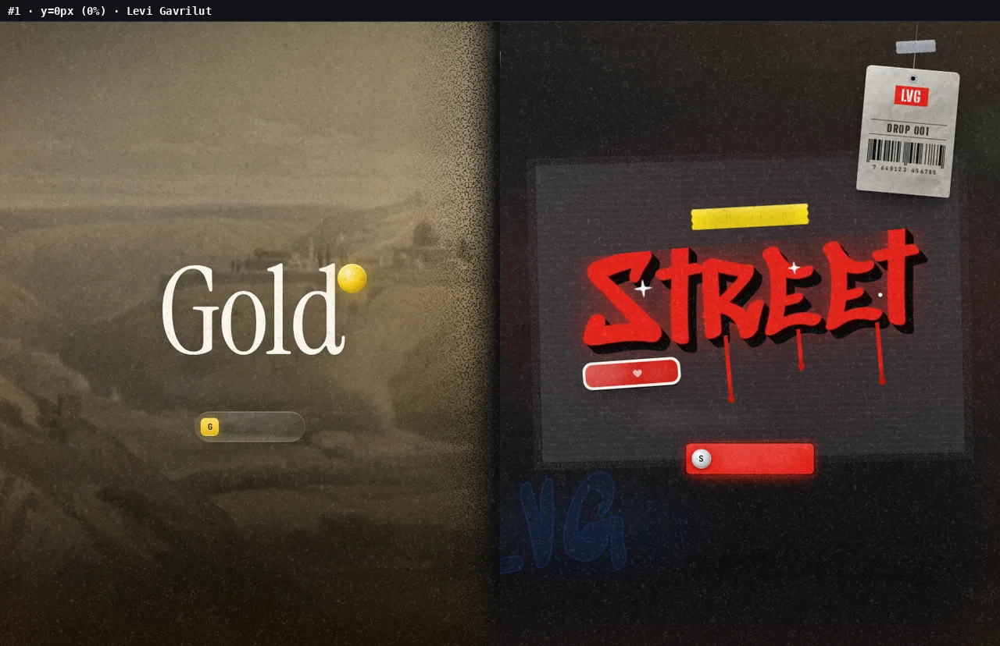
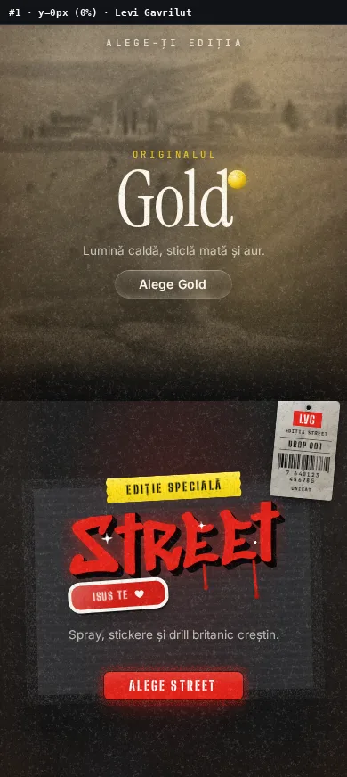

# UI Design System & Master Generation Blueprint: levigav-com

> **Levi Gavrilut · I build what I want to exist** (https://levigav.com) — Levi Gavrilut, 16. Designer and developer from Switzerland. Websites, web apps and small tools built with care. I ♥ Jesus.





---

## 1. Executive Visual Persona & Design Archetype

- **Brand Essence & Persona**: **Levi Gavrilut · I build what I want to exist** (`https://levigav.com`). Levi Gavrilut, 16. Designer and developer from Switzerland. Websites, web apps and small tools built with care. I ♥ Jesus.
- **Final Redirected URL**: [https://www.levigav.com/](https://www.levigav.com/)
- **Capture Provenance**: Live browser capture (`tier1_fast`, HTTP `200`, captured `2026-11-24`).
- **Visual Archetype**: **Dark-Substrate WebGL / Canvas Interactive Experience (`#000000` / `#ffff00`)**.
- **Anti-AI-Slop Differentiators**:
  - **Live-Computed Chromatic Polarity**: Anchors the viewport in `#000000` (live computed `html` `background-color` (`computed_styles.json`)) paired with `#ffffff` primary typography and `#ffff00` accents.
  - **Grounded Typographic Hierarchy**: Pairs `Instrument Serif` for display copy (`Levi Gavrilut`) with `Inter Variable` and `JetBrains Mono Variable`.
  - **Calibrated Spatial Grid & Motion**: Combines `1440px` container bounds (`gap: 37.44px`, padding `43.2px`) with `cubic-bezier(.22,1,.36,1)` easing and Lenis Smooth Scroll (`data-lenis`), GSAP Timeline & ScrollTrigger.

---

## 2. Spatial Architecture & Modular Grid Mathematics

### Viewport Allocation & Container Geometry
- **Captured Journey Filmstrips**: Desktop `1280×828px` (`assets/desktop-journey.webp`, `1` keyframes up to `y=0px` / doc `2156px`), Mobile `390×872px` (`assets/mobile-journey.webp`, `1` keyframes).
- **Master Container Bounds**: `1440px` (full-bleed `100%` desktop stage measured on `1440px` viewport).
- **Canvas Lateral Padding & Spacing**: `43.2px` lateral canvas padding with `37.44px` grid gap.
- **Border Radius Scale**: `6px`, `8px`, `var(--r-mega)`, `50%`.

### Responsive Breakpoint Architecture
- **Desktop Layout**: Multi-column CSS Grid / Flexbox layout at `1440px` (`max-width: 1440px`, `gap: 37.44px`).
- **Mobile Layout**: Single-column vertical stack at `390px` viewport width with `43.2px` horizontal padding.
- **Extracted CSS Media Queries**: `@media (max-width:760px)`, `@media (max-width:1100px)`, `@media (min-width:901px) and (max-width:1100px)`, `@media (max-width:900px)`.

---

## 3. Color System, Materiality & Atmospheric Lighting

### Semantic Palette & Source Grounding
| Semantic Role | Ground-Truth Value | Extracted Live / CSS Source |
|---|---|---|
| **Primary Canvas Substrate** | `#000000` | live computed `html` `background-color` (`computed_styles.json`) |
| **Primary Typography Ink** | `#ffffff` | live computed `h1` `color` (`computed_styles.json`) |
| **Elevated Surface / Card Substrate** | `#121110` | `var(--panel)` in `:root` |
| **Interactive Accent / Highlight** | `#ffff00` | `.btn--give:hover { background: yellow }` (`#ffff00`) |
| **Secondary / Muted Copy** | `#8f8a82` | `var(--fg-3)` in `:root` |
| **Structural Hairline Border** | `#141414` | `var(--line)` in `:root` (`ffffff14`) |
| **Variable Token (`--panel-2`)** | `#191816` | `var(--panel-2)` in `:root` |
| **Variable Token (`--panel-3`)** | `#22201e` | `var(--panel-3)` in `:root` |
| **Variable Token (`--glass`)** | `#1e1c1a` | `var(--glass)` in `:root` |
| **Variable Token (`--fg`)** | `#f4f2ec` | `var(--fg)` in `:root` |
| **Variable Token (`--fg-2`)** | `#b6b2aa` | `var(--fg-2)` in `:root` |
| **Variable Token (`--fg-4`)** | `#403e3a` | `var(--fg-4)` in `:root` |
| **Variable Token (`--yellow`)** | `#f6cd1b` | `var(--yellow)` in `:root` |
| **Variable Token (`--give`)** | `#e6b814` | `var(--give)` in `:root` |

### Sanitized Root CSS Variables (`ui-ux.md` Ground Truth)
| Variable Name | Extracted Value | Semantic Role |
|---|---|---|
| `--bg` | `#000` | Canvas / Surface Token |
| `--panel` | `#121110` | Color / Atmospheric Token |
| `--panel-2` | `#191816` | Color / Atmospheric Token |
| `--panel-3` | `#22201e` | Color / Atmospheric Token |
| `--glass` | `#1e1c1ab8` | Color / Atmospheric Token |
| `--fg` | `#f4f2ec` | Typography Ink Token |
| `--fg-2` | `#b6b2aa` | Typography Ink Token |
| `--fg-3` | `#8f8a82` | Typography Ink Token |
| `--fg-4` | `#403e3a` | Typography Ink Token |
| `--line` | `#ffffff14` | Color / Atmospheric Token |
| `--line-2` | `#ffffff26` | Color / Atmospheric Token |
| `--line-3` | `#ffffff47` | Color / Atmospheric Token |
| `--yellow` | `#f6cd1b` | Color / Atmospheric Token |
| `--give` | `#e6b814` | Color / Atmospheric Token |
| `--yellow-ink` | `#000` | Typography Ink Token |
| `--yellow-glow` | `#f6cd1b66` | Color / Atmospheric Token |

---

## 4. Typographic Scale & Editorial Hierarchy

### Font Family Stacks
- **Display Typography**: `Instrument Serif`.
- **Primary Body Stack**: `Inter Variable`.
- **Technical / Metadata Stack**: `JetBrains Mono Variable`.

### Typographic Scale & Rules (Live Computed & Stylesheet Grounded)
- **Hero Display (`H1`)**: live computed `h1` (`font-size: 216px`, `line-height: 172.8px`, `font-weight: 400`, `letter-spacing: -5.4px`).
- **Section Heading (`H2`)**: live computed `h2` (`font-size: 244.8px`, `line-height: 190.944px`, `font-weight: 400`, `letter-spacing: -9.792px`).
- **Body Copy**: live computed `body` (`font-size: 16px`, `line-height: 24px`, `font-weight: 400`); rule `p` (`font-size: clamp(16px,1.25vw,21px)`, `line-height: 1.2`, `letter-spacing: -.03em`).
- **Metadata & Navigation Labels**: live computed `nav/a` (`font-size: 16px`, `line-height: 24px`, `font-weight: 400`); rule `small` (`font-size: 9px`, `letter-spacing: .1em`).

---

## 5. Choreographed Motion & Interaction Physics

### Primary Easing Curves
- **Extracted Timing Functions**: `cubic-bezier(.22,1,.36,1)`, `cubic-bezier(.65,0,.35,1)`, `cubic-bezier(.45,0,.55,1)`.

### Per-Element Transition & Choreography Rules
- **Selector `.btn`**: `transition: transform .5s var(--ease), background .35s, box-shadow .35s` extracted from `levigav-com` stylesheet.
- **Selector `.btn svg`**: `transition: transform .45s var(--ease)` extracted from `levigav-com` stylesheet.
- **Selector `.btn--give:before`**: `transition: transform .9s var(--ease)` extracted from `levigav-com` stylesheet.
- **Extracted Easing Curve (`cubic-bezier(.22,1,.36,1)`)**: Governs interactive state transitions across `<header.nav>` and `<article.pro-verse>`.
- **Runtime Interaction Engine**: Integrates Lenis Smooth Scroll (`data-lenis`), GSAP Timeline & ScrollTrigger, Three.js / WebGL Canvas Pipeline, Framer Motion Layout Physics with `prefers-reduced-motion: reduce` fallback guards.
### Measured Runtime Scroll & Interaction Telemetry (`behavioral_journey_v2`)
- **Scroll Driver Mode**: `wheel` (max document height `2156px`, deepest scrollY reached `0px` across `1` desktop keyframes).
- **Detected Scroll / Motion Libraries**: Native browser scroll / standard CSS transitions.
- **Interactive Control Probe (`accordion`)**: Tested `Everything stored, by name 20` (diff `0.0`).

---

## 6. Component Wireframe & Structural DOM Map

### Visual Layout Schematic — Desktop (`1440px`, Grounded in `dom.html` & Landmark Bounding Boxes)
```
┌────────────────────────────────────────────────────────────────────────┐
│ DESKTOP VIEWPORT (1440px) — Levi Gavrilut · I build what I want to exi │
│ ====================================================================== │
│ [ <header.nav> (1440x346px)           | Overview · Index · Archive · ] │
│ ---------------------------------------------------------------------- │
│ | HERO STAGE: <section.prologue> (w=1440px)                          | │
│ | H1: Levi Gavrilut                                                  | │
│ | Substrate: #000000 | Ink: #ffffff | Accent: #ffff00                | │
│ ---------------------------------------------------------------------- │
│ | SHOWCASE GRID (<article.pro-verse>) max-w: 1440px                  | │
│ | +------------------------------+  +------------------------------+ | │
│ | | 07 Gethsemane                |  | 08 The Cross                 | | │
│ | +------------------------------+  +------------------------------+ | │
│ ---------------------------------------------------------------------- │
│ | DETAIL MODULE (<section.hero>) — 10 The Burial                     | │
│ ---------------------------------------------------------------------- │
│ [ FOOTER (<footer.in-prologue>) | https://levigav.com                  │
└────────────────────────────────────────────────────────────────────────┘
```

### Visual Layout Schematic — Mobile Reflow (`390px`)
```
┌────────────────────────────────────────────────────────────────────────┐
│ MOBILE VIEWPORT REFLOW (390px) — Single-Column Stack (gap: 37.44px)    │
│ ====================================================================== │
│ [ HEADER BAR (<header.nav>            ) | Compact Menu (390px)         │
│ ---------------------------------------------------------------------- │
│ | HERO STAGE (<section.prologue>) — 390px Vertical Lead              | │
│ | H1: Levi Gavrilut                                                  | │
│ ---------------------------------------------------------------------- │
│ | SHOWCASE STACK (<article.pro-verse>) — 1-Col Stack                 | │
│ | [ Item 1: 07 Gethsemane                                          ] | │
│ | [ Item 2: 08 The Cross                                           ] | │
│ ---------------------------------------------------------------------- │
│ | DETAIL STACK (<section.hero>) — 1-Col (10 The Burial)              | │
│ ---------------------------------------------------------------------- │
│ [ FOOTER (<footer.in-prologue>) | Stacked 390px Colophon               │
└────────────────────────────────────────────────────────────────────────┘
```

### Granular DOM Region Breakdown
1. **Brand Header & Navigation Bar (<header.nav> — `levigav-com`)**:
   - Landmark `<header class="nav">` (`1440x346px`) hosting `Levi Gavrilut · I build what I want ` navigation (`Overview · Index · Archive · About · Contact`), DOM attributes (`data-edition="gold"`, `data-welcome="out"`, `data-precedence="next"`, `data-precedence="next"`), and stylesheet rule `after { box-sizing:border-box }`.
2. **Hero Stage & Focal Lead (<section.prologue> — `Levi Gavrilut`)**:
   - Landmark `<section class="prologue is-quiet">` presenting display lead `Levi Gavrilut` and copy excerpt *"G picks Gold, S picks Street. You can switch any time. · G alege "* over `#000000` canvas and `#ffffff` ink.
3. **Primary Showcase & Content Grid (<article.pro-verse> — `07 Gethsemane`)**:
   - Landmark `<article class="pro-verse">` rendering section `07 Gethsemane` with copy *"Prologue · best with sound"*, asset references (`1sm_p255ynpf-.css`, `2fu8m418vo0kb.css`, `2fo6lh-lqntob.css`, `2w31v64880cal.css`), and grid rule `html { overflow-x:hidden }`.
4. **Interactive Detail & Feature Matrix (<section.hero> — `08 The Cross`)**:
   - Landmark `<section class="hero shell">` framing `08 The Cross` and `10 The Burial` (*"Faith. Code. A story."*) with `#121110` surface cards, `#ffff00` accents, and `html.lenis body { height:auto }`.
5. **Colophon & Global Directory Footer (<footer.in-prologue> — `https://levigav.com`)**:
   - Landmark `<footer class="in-prologue">` anchoring `Levi Gavrilut · I build what I w` footer links (`Overview · Index · Archive · About · Contact`), copy *"or scroll at your own pace"*, and `#141414` structural dividers.
### Full Vertical Scroll Sequence (Desktop `1440×900` Keyframes)
- **Step 01** (`y=0px`, `0%`): Active landmark `Levi Gavrilut` · sticky/fixed elements: `5`

---

## 7. Master Zero-Shot AI Generation Prompt

```markdown
# Master Zero-Shot Frontend Generation Prompt: levigav-com (Levi Gavrilut · I build what I want to exist)

You are a principal frontend architect and design systems engineer. Build a complete, production-ready web application replicating the exact design system, DOM landmarks, typographic hierarchy, color tokens, and motion physics of `levigav-com` (**Levi Gavrilut · I build what I want to exist** — `https://levigav.com`).

### 1. Visual Archetype & Anti-AI-Slop Mandates
- **Archetype**: Dark-Substrate WebGL / Canvas Interactive Experience (`#000000` / `#ffff00`).
- **Identity & Domain Context**: Levi Gavrilut, 16. Designer and developer from Switzerland. Websites, web apps and small tools built with care. I ♥ Jesus.
- **Primary Substrate**: `#000000` (live computed `html` `background-color` (`computed_styles.json`)), **Primary Ink**: `#ffffff`, **Accent / Highlight**: `#ffff00`.
- **Site-Specific Differentiators**:
  - **Live-Computed Chromatic Polarity**: Anchors the viewport in `#000000` (live computed `html` `background-color` (`computed_styles.json`)) paired with `#ffffff` primary typography and `#ffff00` accents.
  - **Grounded Typographic Hierarchy**: Pairs `Instrument Serif` for display copy (`Levi Gavrilut`) with `Inter Variable` and `JetBrains Mono Variable`.
  - **Calibrated Spatial Grid & Motion**: Combines `1440px` container bounds (`gap: 37.44px`, padding `43.2px`) with `cubic-bezier(.22,1,.36,1)` easing and Lenis Smooth Scroll (`data-lenis`), GSAP Timeline & ScrollTrigger.

### 2. Ground-Truth CSS Variables (`:root` Token Contract)
Declare and consume these exact custom properties extracted from `levigav-com` in your global stylesheet:

:root {
  /* Levi Gavrilut · I build what I want to exist (levigav-com) — Live-Grounded CSS Variables */
  --bg: #000; /* Canvas / Surface Token (levigav-com) */
  --panel: #121110; /* Color / Atmospheric Token (levigav-com) */
  --panel-2: #191816; /* Color / Atmospheric Token (levigav-com) */
  --panel-3: #22201e; /* Color / Atmospheric Token (levigav-com) */
  --glass: #1e1c1ab8; /* Color / Atmospheric Token (levigav-com) */
  --fg: #f4f2ec; /* Typography Ink Token (levigav-com) */
  --fg-2: #b6b2aa; /* Typography Ink Token (levigav-com) */
  --fg-3: #8f8a82; /* Typography Ink Token (levigav-com) */
  --fg-4: #403e3a; /* Typography Ink Token (levigav-com) */
  --line: #ffffff14; /* Color / Atmospheric Token (levigav-com) */
  --line-2: #ffffff26; /* Color / Atmospheric Token (levigav-com) */
  --line-3: #ffffff47; /* Color / Atmospheric Token (levigav-com) */
  --yellow: #f6cd1b; /* Color / Atmospheric Token (levigav-com) */
  --give: #e6b814; /* Color / Atmospheric Token (levigav-com) */
  --yellow-ink: #000; /* Typography Ink Token (levigav-com) */
  --yellow-glow: #f6cd1b66; /* Color / Atmospheric Token (levigav-com) */
}

### 3. Semantic Color & Materiality Contract
Map every surface, ink, and border strictly to these source-grounded tokens:
- **Primary Canvas Substrate**: `#000000` — grounded in live computed `html` `background-color` (`computed_styles.json`)
- **Primary Typography Ink**: `#ffffff` — grounded in live computed `h1` `color` (`computed_styles.json`)
- **Elevated Surface / Card Substrate**: `#121110` — grounded in `var(--panel)` in `:root`
- **Interactive Accent / Highlight**: `#ffff00` — grounded in `.btn--give:hover { background: yellow }` (`#ffff00`)
- **Secondary / Muted Copy**: `#8f8a82` — grounded in `var(--fg-3)` in `:root`
- **Structural Hairline Border**: `#141414` — grounded in `var(--line)` in `:root` (`ffffff14`)
- **Variable Token (`--panel-2`)**: `#191816` — grounded in `var(--panel-2)` in `:root`
- **Variable Token (`--panel-3`)**: `#22201e` — grounded in `var(--panel-3)` in `:root`
- **Variable Token (`--glass`)**: `#1e1c1a` — grounded in `var(--glass)` in `:root`
- **Variable Token (`--fg`)**: `#f4f2ec` — grounded in `var(--fg)` in `:root`
- **Variable Token (`--fg-2`)**: `#b6b2aa` — grounded in `var(--fg-2)` in `:root`
- **Variable Token (`--fg-4`)**: `#403e3a` — grounded in `var(--fg-4)` in `:root`
- **Variable Token (`--yellow`)**: `#f6cd1b` — grounded in `var(--yellow)` in `:root`
- **Variable Token (`--give`)**: `#e6b814` — grounded in `var(--give)` in `:root`

### 4. Spatial Grid, Container Bounds & Responsive Breakpoints
- **Desktop Viewport Reference**: `1280×828px` (single-viewport 100vh live capture (900px), `1440px` standard desktop width).
- **Mobile Viewport Reference**: `390×872px` (full-page live capture (872px), `390px` standard mobile width).
- **Container Max-Width**: `1440px` (full-bleed `100%` desktop stage measured on `1440px` viewport)
- **Padding & Gutters**: `43.2px` lateral canvas padding with `37.44px` grid gap
- **Desktop Grid**: Multi-column CSS Grid / Flexbox layout at `1440px` (`max-width: 1440px`, `gap: 37.44px`)
- **Mobile Adaptation**: Single-column vertical stack at `390px` viewport width with `43.2px` horizontal padding
- **Media Queries**: `@media (max-width:760px)`, `@media (max-width:1100px)`, `@media (min-width:901px) and (max-width:1100px)`, `@media (max-width:900px)`
- **Corner Radii**: `6px`, `8px`, `var(--r-mega)`, `50%`

### 5. Typography & Editorial Scale Contract
- **Display Font Stack**: `Instrument Serif`
- **Body Font Stack**: `Inter Variable`
- **Monospace / Technical Font Stack**: `JetBrains Mono Variable`
- **H1 Display Rule**: live computed `h1` (`font-size: 216px`, `line-height: 172.8px`, `font-weight: 400`, `letter-spacing: -5.4px`)
- **H2 Section Rule**: live computed `h2` (`font-size: 244.8px`, `line-height: 190.944px`, `font-weight: 400`, `letter-spacing: -9.792px`)
- **Body Copy Rule**: live computed `body` (`font-size: 16px`, `line-height: 24px`, `font-weight: 400`); rule `p` (`font-size: clamp(16px,1.25vw,21px)`, `line-height: 1.2`, `letter-spacing: -.03em`)
- **Metadata & Index Rule**: live computed `nav/a` (`font-size: 16px`, `line-height: 24px`, `font-weight: 400`); rule `small` (`font-size: 9px`, `letter-spacing: .1em`)

### 6. Component Hierarchy, Verbatim Copy & Real DOM Landmarks
Scaffold `levigav-com` (`Levi Gavrilut · I build what I want to exist`) with these exact structural regions, extracted copy, and CSS rules from `dom.html`:
1. **Brand Header & Navigation Bar (<header.nav> — `levigav-com`)**:
   - DOM & Selectors: Landmark `<header class="nav">` (`1440x346px`) hosting `Levi Gavrilut · I build what I want ` navigation (`Overview · Index · Archive · About · Contact`), DOM attributes (`data-edition="gold"`, `data-welcome="out"`, `data-precedence="next"`, `data-precedence="next"`), and stylesheet rule `after { box-sizing:border-box }`.
   - Responsive Contract: Header `Brand Header & Navigation Bar (<header.nav> — `levigav-com`)` (`levigav-com`) adapts across `@media (max-width:760px)`, `@media (max-width:1100px)`, `@media (min-width:901px) and (max-width:1100px)`, `@media (max-width:900px)` with `cubic-bezier(.22,1,.36,1)`, `cubic-bezier(.65,0,.35,1)`, `cubic-bezier(.45,0,.55,1)` transitions and links `Overview · Index · Archive · About · Contact`.
2. **Hero Stage & Focal Lead (<section.prologue> — `Levi Gavrilut`)**:
   - DOM & Selectors: Landmark `<section class="prologue is-quiet">` presenting display lead `Levi Gavrilut` and copy excerpt *"G picks Gold, S picks Street. You can switch any time. · G alege "* over `#000000` canvas and `#ffffff` ink.
   - Responsive Contract: Hero stage (`1280×828px` desktop / `390×872px` mobile) sets `#000000` background with `#ffffff` headline `Levi Gavrilut`.
3. **Primary Showcase & Content Grid (<article.pro-verse> — `07 Gethsemane`)**:
   - DOM & Selectors: Landmark `<article class="pro-verse">` rendering section `07 Gethsemane` with copy *"Prologue · best with sound"*, asset references (`1sm_p255ynpf-.css`, `2fu8m418vo0kb.css`, `2fo6lh-lqntob.css`, `2w31v64880cal.css`), and grid rule `html { overflow-x:hidden }`.
   - Responsive Contract: Showcase grid `Primary Showcase & Content Grid (<article.pro-verse> — `07 Gethsemane`)` applies Multi-column CSS Grid / Flexbox layout at `1440px` (`max-width: 1440px`, `gap: 37.44px`) on desktop and Single-column vertical stack at `390px` viewport width with `43.2px` horizontal padding on mobile.
4. **Interactive Detail & Feature Matrix (<section.hero> — `08 The Cross`)**:
   - DOM & Selectors: Landmark `<section class="hero shell">` framing `08 The Cross` and `10 The Burial` (*"Faith. Code. A story."*) with `#121110` surface cards, `#ffff00` accents, and `html.lenis body { height:auto }`.
   - Responsive Contract: Detail module `Interactive Detail & Feature Matrix (<section.hero> — `08 The Cross`)` uses `6px`, `8px`, `var(--r-mega)`, `50%` radii, `#ffff00` highlights, and assets (1sm_p255ynpf-.css, 2fu8m418vo0kb.css, 2fo6lh-lqntob.css).
5. **Colophon & Global Directory Footer (<footer.in-prologue> — `https://levigav.com`)**:
   - DOM & Selectors: Landmark `<footer class="in-prologue">` anchoring `Levi Gavrilut · I build what I w` footer links (`Overview · Index · Archive · About · Contact`), copy *"or scroll at your own pace"*, and `#141414` structural dividers.
   - Responsive Contract: Footer `Colophon & Global Directory Footer (<footer.in-prologue> — `https://levigav.com`)` aligns to `1440px` (full-bleed `100%` desktop stage measured on `1440px` viewport) with `43.2px` lateral canvas padding with `37.44px` grid gap and attributes (data-edition="gold", data-welcome="out", data-precedence="next").

#### Verbatim DOM Copy Excerpts (`dom.html`)
- Copy Excerpt 1: *"G picks Gold, S picks Street. You can switch any time. · G alege Gold, S alege Str..."*
- Copy Excerpt 2: *"Prologue · best with sound"*
- Copy Excerpt 3: *"Faith. Code. A story."*
- Copy Excerpt 4: *"or scroll at your own pace"*

### 7. Motion, Extracted Stylesheet Rules & Interaction Choreography
- **Primary Easing Functions**: `cubic-bezier(.22,1,.36,1)`, `cubic-bezier(.65,0,.35,1)`, `cubic-bezier(.45,0,.55,1)`
- **Extracted Stylesheet Rules (`levigav-com`)**:
- `after { box-sizing:border-box }`
- `html { overflow-x:hidden }`
- `html.lenis body { height:auto }`
- `.lenis.lenis-smooth { scroll-behavior:auto!important }`
- `.lenis.lenis-stopped { overflow:clip }`
- **Per-Selector Transition Rules**:
- **Selector `.btn`**: `transition: transform .5s var(--ease), background .35s, box-shadow .35s` extracted from `levigav-com` stylesheet.
- **Selector `.btn svg`**: `transition: transform .45s var(--ease)` extracted from `levigav-com` stylesheet.
- **Selector `.btn--give:before`**: `transition: transform .9s var(--ease)` extracted from `levigav-com` stylesheet.
- **Extracted Easing Curve (`cubic-bezier(.22,1,.36,1)`)**: Governs interactive state transitions across `<header.nav>` and `<article.pro-verse>`.
- **Runtime Interaction Engine**: Integrates Lenis Smooth Scroll (`data-lenis`), GSAP Timeline & ScrollTrigger, Three.js / WebGL Canvas Pipeline, Framer Motion Layout Physics with `prefers-reduced-motion: reduce` fallback guards.
### 7b. Full-Page Scroll Choreography, Interactive States & Multi-Page Routes
- **Scroll Mechanics**: Implement `wheel` vertical progression up to `2156px` across 1 distinct viewport chapters.
- **Vertical Chapter Sequence**: Levi Gavrilut (0%).

### 8. Technical Deliverables
- Implement in Next.js (App Router) with TypeScript and Tailwind CSS consuming the `:root` custom properties defined above for `levigav-com`.
- Reproduce both the `1440px` desktop architecture and `390px` mobile breakpoint transitions, preserving semantic HTML5 landmarks (`<header>`, `<nav>`, `<main>`, `<section>`, `<footer>`) and `prefers-reduced-motion` accessibility guards.
```
---

## 8. Full-Page Scroll Journey, Interactive States & Subpage Inventory

### Desktop Scroll Keyframes (`1440×900` WebP)
| Step | Scroll Y | Progress | Active Landmark / Section | Sticky/Fixed | Visual Asset |
| :---: | :---: | :---: | :--- | :---: | :--- |
| `#01` | `0px` | `0%` | Levi Gavrilut | `5` | [desktop-step-01.webp](assets/desktop-step-01.webp) |

### Mobile Condensed Keyframes (`390×844` WebP)
| Step | Scroll Y | Progress | Active Landmark | Visual Asset |
| :---: | :---: | :---: | :--- | :--- |
| `#01` | `0px` | `0%` | Levi Gavrilut | [mobile-step-01.webp](assets/mobile-step-01.webp) |

