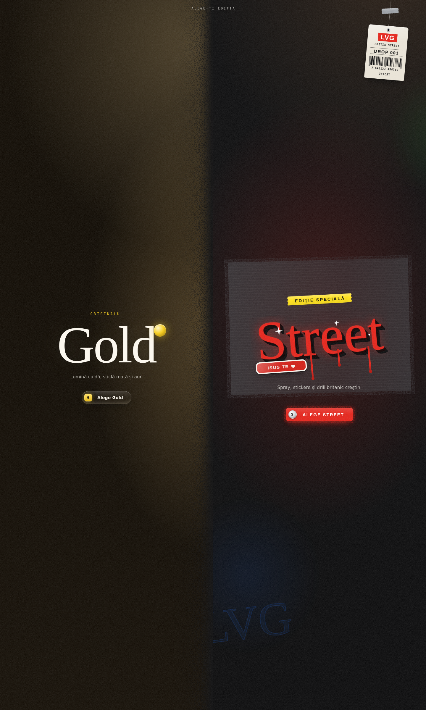
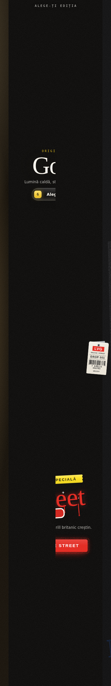

# UI Design System & Master Generation Blueprint: levigav-com

> **Levi Gavrilut · I build what I want to exist** (https://levigav.com) — Levi Gavrilut, 16. Designer and developer from Switzerland. Websites, web apps and small tools built with care. I ♥ Jesus.



---

## 1. Executive Visual Persona & Design Archetype

- **Brand Essence & Persona**: **Levi Gavrilut · I build what I want to exist** (`https://levigav.com`). Levi Gavrilut, 16. Designer and developer from Switzerland. Websites, web apps and small tools built with care. I ♥ Jesus.
- **Visual Archetype**: **Dark-Substrate WebGL / Canvas Interactive Experience (`#000` / `#22201e`)**.
- **Anti-AI-Slop Differentiators**:
  - **Source-Grounded Chromatic Polarity**: Anchors the viewport in `#000` (`var(--bg)` in `:root`) paired with `#f4f2ec` primary typography and `#22201e` accents.
  - **Extracted Typographic Hierarchy**: Pairs `Instrument Serif` for display copy (`Choose your language · Alege-ți limb`) with `Inter Variable` and `JetBrains Mono Variable`.
  - **Calibrated Spatial Grid & Motion**: Combines `760px` container bounds (`gap: 10px`, padding `8px`) with `cubic-bezier(.22,1,.36,1)` easing and Lenis Smooth Scroll (`data-lenis`), GSAP Timeline & ScrollTrigger.

---

## 2. Spatial Architecture & Modular Grid Mathematics



### Viewport Allocation & Container Geometry
- **Captured Viewport Dimensions**: Desktop `1440×2400px` (`assets/desktop.png`, capped at 2400px multi-section capture), Mobile `390×2400px` (`assets/mobile.png`, capped at 2400px multi-section capture).
- **Master Container Bounds**: `760px` extracted from `levigav-com` stylesheet.
- **Canvas Lateral Padding & Spacing**: `8px` lateral canvas padding with `10px` grid gap.
- **Border Radius Scale**: `999px`, `2px`, `50%`, `30px`.

### Responsive Breakpoint Architecture
- **Desktop Layout**: Multi-column CSS Grid / Flexbox layout at `1440px` (`max-width: 760px`, `gap: 10px`).
- **Mobile Layout**: Single-column vertical stack at `390px` viewport width with `8px` horizontal padding.
- **Extracted CSS Media Queries**: `@media (prefers-reduced-motion:reduce)`, `@media (max-width:760px)`, `@media (hover:hover) and (prefers-reduced-motion:no-preference)`, `@media (prefers-reduced-motion:no-preference)`.

---

## 3. Color System, Materiality & Atmospheric Lighting

### Semantic Palette & Source Grounding
| Semantic Role | Ground-Truth Value | Extracted CSS Source / Selector |
|---|---|---|
| **Primary Canvas Substrate** | `#000` | `var(--bg)` in `:root` |
| **Primary Typography Ink** | `#121110` | `var(--panel)` in `:root` |
| **Elevated Surface / Card Substrate** | `#191816` | `var(--panel-2)` in `:root` |
| **Interactive Accent / Highlight** | `#22201e` | `var(--panel-3)` in `:root` |
| **Secondary / Muted Copy** | `#f4f2ec` | `var(--fg)` in `:root` |
| **Structural Hairline Border** | `#b6b2aa` | `var(--fg-2)` in `:root` |
| **Variable Token (`--glass`)** | `#1e1c1ab8` | `var(--glass)` in `:root` |
| **Variable Token (`--fg-3`)** | `#8f8a82` | `var(--fg-3)` in `:root` |

### Sanitized Root CSS Variables (`ui-ux.md` Ground Truth)
| Variable Name | Extracted Value | Semantic Role |
|---|---|---|
| `--charge` | `0` | Design System Custom Token |
| `--orb` | `clamp(104px, 9vw, 136px)` | Dimension / Scale Token |
| `--sfx-ease` | `cubic-bezier(.16, 1, .3, 1)` | Motion / Easing Token |
| `--sfx-c` | `246, 205, 27` | Design System Custom Token |
| `--sfx-nudge` | `sfx-hop` | Design System Custom Token |
| `--pad` | `clamp(22px, 2.2vw, 34px)` | Layout / Spatial Grid Token |
| `--band-top` | `30px` | Dimension / Scale Token |
| `--fs` | `88px` | Dimension / Scale Token |
| `--bg` | `#000` | Canvas / Surface Token |
| `--panel` | `#121110` | Color / Atmospheric Token |
| `--panel-2` | `#191816` | Color / Atmospheric Token |
| `--panel-3` | `#22201e` | Color / Atmospheric Token |
| `--glass` | `#1e1c1ab8` | Color / Atmospheric Token |
| `--fg` | `#f4f2ec` | Typography Ink Token |
| `--fg-2` | `#b6b2aa` | Typography Ink Token |
| `--fg-3` | `#8f8a82` | Typography Ink Token |

---

## 4. Typographic Scale & Editorial Hierarchy

### Font Family Stacks
- **Display Typography**: `Instrument Serif`.
- **Primary Body Stack**: `Inter Variable`.
- **Technical / Metadata Stack**: `JetBrains Mono Variable`.

### Typographic Scale & Rules (Extracted from Stylesheet & Variables)
- **Hero Display (`H1`)**: not explicitly declared on tag in static CSS (stylesheet font-size ladder: `11px`, `clamp(44px,9vw,112px)`, `clamp(24px,3.6vw,40px)`, `clamp(18px,2.2vw,22px)`, `10.5px`).
- **Section Heading (`H2`)**: not explicitly declared on tag in static CSS (stylesheet font-size ladder: `11px`, `clamp(44px,9vw,112px)`, `clamp(24px,3.6vw,40px)`, `clamp(18px,2.2vw,22px)`, `10.5px`).
- **Body Copy**: rule `p` (`font-size: clamp(18px,2.2vw,22px)`, `line-height: 1.4`).
- **Metadata & Navigation Labels**: rule `small` (`font-size: 9.5px`, `letter-spacing: .08em`).

---

## 5. Choreographed Motion & Interaction Physics

### Primary Easing Curves
- **Extracted Timing Functions**: `cubic-bezier(.22,1,.36,1)`, `cubic-bezier(.3,1.7,.5,1)`, `cubic-bezier(.2,.7,.2,1)`.

### Per-Element Transition & Choreography Rules
- **Selector `.nf__btn`**: `transition: background-color .3s, border-color .3s, translate .3s var(--ea...` extracted from `levigav-com` stylesheet.
- **Selector `.love`**: `transition: --charge .7s var(--ease)` extracted from `levigav-com` stylesheet.
- **Selector `.love.is-holding`**: `transition: none` extracted from `levigav-com` stylesheet.
- **Extracted Easing Curve (`cubic-bezier(.22,1,.36,1)`)**: Governs interactive state transitions across `<header.nav>` and `<article.pro-verse>`.
- **Runtime Interaction Engine**: Integrates Lenis Smooth Scroll (`data-lenis`), GSAP Timeline & ScrollTrigger, Three.js / WebGL Canvas Pipeline, Framer Motion Layout Physics with `prefers-reduced-motion: reduce` fallback guards.

---

## 6. Component Wireframe & Structural DOM Map

### Visual Layout Schematic (Grounded in `dom.html` — `1440px` Desktop & `390px` Mobile Reflow)
```
┌────────────────────────────────────────────────────────────────────────┐
│ DESKTOP VIEWPORT (1440px) — Levi Gavrilut · I build what I want to exi │
│ ====================================================================== │
│ [ <header.nav>             | Overview · Index · Archive · About · C ]  │
│ ---------------------------------------------------------------------- │
│ | HERO STAGE: <section.prologue>                                   |   │
│ | H1: Choose your language · Alege-ți limba · Wähle dei...         |   │
│ | Substrate: #000       | Ink: #f4f2ec    | Accent: #22201e        |   │
│ ---------------------------------------------------------------------- │
│ | SHOWCASE GRID (<article.pro-verse>       ) max-w: 760px          |   │
│ | +------------------------------+  +------------------------------+ | │
│ | | Choose your edition · Alege- |  | Levi Gavrilut                | | │
│ | +------------------------------+  +------------------------------+ | │
│ ---------------------------------------------------------------------- │
│ | MOBILE VIEWPORT REFLOW (390px) — Single-Column Stack (gap: 10px  ) | │
│ | [<header.nav>] -> [<section.prologue>] -> [<article.pro-verse] |     │
│ ---------------------------------------------------------------------- │
│ [ FOOTER (<footer.in-prologue>  ) | https://levigav.com                │
└────────────────────────────────────────────────────────────────────────┘
```

### Granular DOM Region Breakdown
1. **Brand Header & Navigation Bar (<header.nav> — `levigav-com`)**:
   - Landmark `<header class="nav">` hosting `Levi Gavrilut · I build what I want ` navigation (`Overview · Index · Archive · About · Contact`), DOM attributes (`data-edition="gold"`, `data-welcome="out"`, `data-precedence="next"`, `data-precedence="next"`), and stylesheet rule `.nf__lead { font-family:var(--serif,serif);color:var(--yellow,f6cd1b);margin:0;font-... }`.
2. **Hero Stage & Focal Lead (<section.prologue> — `Choose your language · Alege-ți li`)**:
   - Landmark `<section class="prologue is-quiet">` presenting display lead `Choose your language · Alege-ți limba · Wähle dei...` and copy excerpt *"Jesus Christ Isus Hristos Jesus Christus"* over `#000` canvas and `#f4f2ec` ink.
3. **Primary Showcase & Content Grid (<article.pro-verse> — `Choose your edition · Alege-ți edi`)**:
   - Landmark `<article class="pro-verse">` rendering section `Choose your edition · Alege-ți ediția · Wähle dei...` with copy *"Welcome back Bine ai revenit Willkommen zurück"*, asset references (`1sm_p255ynpf-.css`, `2fu8m418vo0kb.css`, `2fo6lh-lqntob.css`, `2w31v64880cal.css`), and grid rule `.nf__verse { gap:10px;max-width:34em;margin:clamp(8px,2vw,18px) 0 0;display:grid }`.
4. **Interactive Detail & Feature Matrix (<section.hero> — `Levi Gavrilut`)**:
   - Landmark `<section class="hero shell">` framing `Levi Gavrilut` and `02 Home` (*"Jesus loves you Isus te iubește Jesus liebt dich"*) with `#191816` surface cards, `#22201e` accents, and `.nf__verse p { font-family:var(--serif,serif);color:var(--fg-2,b6b2aa);margin:0;font-si... }`.
5. **Colophon & Global Directory Footer (<footer.in-prologue> — `https://levigav.com`)**:
   - Landmark `<footer class="in-prologue">` anchoring `Levi Gavrilut · I build what I w` footer links (`Overview · Index · Archive · About · Contact`), copy *"LVG Street edition Ediția Street Street-Ausgabe Drop 001"*, and `#b6b2aa` structural dividers.

---

## 7. Master Zero-Shot AI Generation Prompt

```markdown
# Master Zero-Shot Frontend Generation Prompt: levigav-com (Levi Gavrilut · I build what I want to exist)

You are a principal frontend architect and design systems engineer. Build a complete, production-ready web application replicating the exact design system, DOM landmarks, typographic hierarchy, color tokens, and motion physics of `levigav-com` (**Levi Gavrilut · I build what I want to exist** — `https://levigav.com`).

### 1. Visual Archetype & Anti-AI-Slop Mandates
- **Archetype**: Dark-Substrate WebGL / Canvas Interactive Experience (`#000` / `#22201e`).
- **Identity & Domain Context**: Levi Gavrilut, 16. Designer and developer from Switzerland. Websites, web apps and small tools built with care. I ♥ Jesus.
- **Primary Substrate**: `#000` (`var(--bg)` in `:root`), **Primary Ink**: `#f4f2ec`, **Accent / Highlight**: `#22201e`.
- **Site-Specific Differentiators**:
  - **Source-Grounded Chromatic Polarity**: Anchors the viewport in `#000` (`var(--bg)` in `:root`) paired with `#f4f2ec` primary typography and `#22201e` accents.
  - **Extracted Typographic Hierarchy**: Pairs `Instrument Serif` for display copy (`Choose your language · Alege-ți limb`) with `Inter Variable` and `JetBrains Mono Variable`.
  - **Calibrated Spatial Grid & Motion**: Combines `760px` container bounds (`gap: 10px`, padding `8px`) with `cubic-bezier(.22,1,.36,1)` easing and Lenis Smooth Scroll (`data-lenis`), GSAP Timeline & ScrollTrigger.

### 2. Ground-Truth CSS Variables (`:root` Token Contract)
Declare and consume these exact custom properties extracted from `levigav-com` in your global stylesheet:

:root {
  /* Levi Gavrilut · I build what I want to exist (levigav-com) — Ground-Truth Extracted CSS Variables */
  --charge: 0; /* Design System Custom Token (levigav-com) */
  --orb: clamp(104px, 9vw, 136px); /* Dimension / Scale Token (levigav-com) */
  --sfx-ease: cubic-bezier(.16, 1, .3, 1); /* Motion / Easing Token (levigav-com) */
  --sfx-c: 246, 205, 27; /* Design System Custom Token (levigav-com) */
  --sfx-nudge: sfx-hop; /* Design System Custom Token (levigav-com) */
  --pad: clamp(22px, 2.2vw, 34px); /* Layout / Spatial Grid Token (levigav-com) */
  --band-top: 30px; /* Dimension / Scale Token (levigav-com) */
  --fs: 88px; /* Dimension / Scale Token (levigav-com) */
  --bg: #000; /* Canvas / Surface Token (levigav-com) */
  --panel: #121110; /* Color / Atmospheric Token (levigav-com) */
  --panel-2: #191816; /* Color / Atmospheric Token (levigav-com) */
  --panel-3: #22201e; /* Color / Atmospheric Token (levigav-com) */
  --glass: #1e1c1ab8; /* Color / Atmospheric Token (levigav-com) */
  --fg: #f4f2ec; /* Typography Ink Token (levigav-com) */
  --fg-2: #b6b2aa; /* Typography Ink Token (levigav-com) */
  --fg-3: #8f8a82; /* Typography Ink Token (levigav-com) */
}

### 3. Semantic Color & Materiality Contract
Map every surface, ink, and border strictly to these source-grounded tokens:
- **Primary Canvas Substrate**: `#000` — grounded in `var(--bg)` in `:root`
- **Primary Typography Ink**: `#121110` — grounded in `var(--panel)` in `:root`
- **Elevated Surface / Card Substrate**: `#191816` — grounded in `var(--panel-2)` in `:root`
- **Interactive Accent / Highlight**: `#22201e` — grounded in `var(--panel-3)` in `:root`
- **Secondary / Muted Copy**: `#f4f2ec` — grounded in `var(--fg)` in `:root`
- **Structural Hairline Border**: `#b6b2aa` — grounded in `var(--fg-2)` in `:root`
- **Variable Token (`--glass`)**: `#1e1c1ab8` — grounded in `var(--glass)` in `:root`
- **Variable Token (`--fg-3`)**: `#8f8a82` — grounded in `var(--fg-3)` in `:root`

### 4. Spatial Grid, Container Bounds & Responsive Breakpoints
- **Desktop Viewport Reference**: `1440×2400px` (capped at 2400px multi-section capture, `1440px` standard desktop width).
- **Mobile Viewport Reference**: `390×2400px` (capped at 2400px multi-section capture, `390px` standard mobile width).
- **Container Max-Width**: `760px` extracted from `levigav-com` stylesheet
- **Padding & Gutters**: `8px` lateral canvas padding with `10px` grid gap
- **Desktop Grid**: Multi-column CSS Grid / Flexbox layout at `1440px` (`max-width: 760px`, `gap: 10px`)
- **Mobile Adaptation**: Single-column vertical stack at `390px` viewport width with `8px` horizontal padding
- **Media Queries**: `@media (prefers-reduced-motion:reduce)`, `@media (max-width:760px)`, `@media (hover:hover) and (prefers-reduced-motion:no-preference)`, `@media (prefers-reduced-motion:no-preference)`
- **Corner Radii**: `999px`, `2px`, `50%`, `30px`

### 5. Typography & Editorial Scale Contract
- **Display Font Stack**: `Instrument Serif`
- **Body Font Stack**: `Inter Variable`
- **Monospace / Technical Font Stack**: `JetBrains Mono Variable`
- **H1 Display Rule**: not explicitly declared on tag in static CSS (stylesheet font-size ladder: `11px`, `clamp(44px,9vw,112px)`, `clamp(24px,3.6vw,40px)`, `clamp(18px,2.2vw,22px)`, `10.5px`)
- **H2 Section Rule**: not explicitly declared on tag in static CSS (stylesheet font-size ladder: `11px`, `clamp(44px,9vw,112px)`, `clamp(24px,3.6vw,40px)`, `clamp(18px,2.2vw,22px)`, `10.5px`)
- **Body Copy Rule**: rule `p` (`font-size: clamp(18px,2.2vw,22px)`, `line-height: 1.4`)
- **Metadata & Index Rule**: rule `small` (`font-size: 9.5px`, `letter-spacing: .08em`)

### 6. Component Hierarchy, Verbatim Copy & Real DOM Landmarks
Scaffold `levigav-com` (`Levi Gavrilut · I build what I want to exist`) with these exact structural regions, extracted copy, and CSS rules from `dom.html`:
1. **Brand Header & Navigation Bar (<header.nav> — `levigav-com`)**:
   - DOM & Selectors: Landmark `<header class="nav">` hosting `Levi Gavrilut · I build what I want ` navigation (`Overview · Index · Archive · About · Contact`), DOM attributes (`data-edition="gold"`, `data-welcome="out"`, `data-precedence="next"`, `data-precedence="next"`), and stylesheet rule `.nf__lead { font-family:var(--serif,serif);color:var(--yellow,f6cd1b);margin:0;font-... }`.
   - Responsive Contract: Header `Brand Header & Navigation Bar (<header.nav> — `levigav-com`)` (`levigav-com`) adapts across `@media (prefers-reduced-motion:reduce)`, `@media (max-width:760px)`, `@media (hover:hover) and (prefers-reduced-motion:no-preference)`, `@media (prefers-reduced-motion:no-preference)` with `cubic-bezier(.22,1,.36,1)`, `cubic-bezier(.3,1.7,.5,1)`, `cubic-bezier(.2,.7,.2,1)` transitions and links `Overview · Index · Archive · About · Contact`.
2. **Hero Stage & Focal Lead (<section.prologue> — `Choose your language · Alege-ți li`)**:
   - DOM & Selectors: Landmark `<section class="prologue is-quiet">` presenting display lead `Choose your language · Alege-ți limba · Wähle dei...` and copy excerpt *"Jesus Christ Isus Hristos Jesus Christus"* over `#000` canvas and `#f4f2ec` ink.
   - Responsive Contract: Hero stage (`1440×2400px` desktop / `390×2400px` mobile) sets `#000` background with `#f4f2ec` headline `Choose your language · Alege-ți limba · Wähle dei...`.
3. **Primary Showcase & Content Grid (<article.pro-verse> — `Choose your edition · Alege-ți edi`)**:
   - DOM & Selectors: Landmark `<article class="pro-verse">` rendering section `Choose your edition · Alege-ți ediția · Wähle dei...` with copy *"Welcome back Bine ai revenit Willkommen zurück"*, asset references (`1sm_p255ynpf-.css`, `2fu8m418vo0kb.css`, `2fo6lh-lqntob.css`, `2w31v64880cal.css`), and grid rule `.nf__verse { gap:10px;max-width:34em;margin:clamp(8px,2vw,18px) 0 0;display:grid }`.
   - Responsive Contract: Showcase grid `Primary Showcase & Content Grid (<article.pro-verse> — `Choose your edition · Alege-ți edi`)` applies Multi-column CSS Grid / Flexbox layout at `1440px` (`max-width: 760px`, `gap: 10px`) on desktop and Single-column vertical stack at `390px` viewport width with `8px` horizontal padding on mobile.
4. **Interactive Detail & Feature Matrix (<section.hero> — `Levi Gavrilut`)**:
   - DOM & Selectors: Landmark `<section class="hero shell">` framing `Levi Gavrilut` and `02 Home` (*"Jesus loves you Isus te iubește Jesus liebt dich"*) with `#191816` surface cards, `#22201e` accents, and `.nf__verse p { font-family:var(--serif,serif);color:var(--fg-2,b6b2aa);margin:0;font-si... }`.
   - Responsive Contract: Detail module `Interactive Detail & Feature Matrix (<section.hero> — `Levi Gavrilut`)` uses `999px`, `2px`, `50%`, `30px` radii, `#22201e` highlights, and assets (1sm_p255ynpf-.css, 2fu8m418vo0kb.css, 2fo6lh-lqntob.css).
5. **Colophon & Global Directory Footer (<footer.in-prologue> — `https://levigav.com`)**:
   - DOM & Selectors: Landmark `<footer class="in-prologue">` anchoring `Levi Gavrilut · I build what I w` footer links (`Overview · Index · Archive · About · Contact`), copy *"LVG Street edition Ediția Street Street-Ausgabe Drop 001"*, and `#b6b2aa` structural dividers.
   - Responsive Contract: Footer `Colophon & Global Directory Footer (<footer.in-prologue> — `https://levigav.com`)` aligns to `760px` extracted from `levigav-com` stylesheet with `8px` lateral canvas padding with `10px` grid gap and attributes (data-edition="gold", data-welcome="out", data-precedence="next").

#### Verbatim DOM Copy Excerpts (`dom.html`)
- Copy Excerpt 1: *"Jesus Christ Isus Hristos Jesus Christus"*
- Copy Excerpt 2: *"Welcome back Bine ai revenit Willkommen zurück"*
- Copy Excerpt 3: *"Jesus loves you Isus te iubește Jesus liebt dich"*
- Copy Excerpt 4: *"LVG Street edition Ediția Street Street-Ausgabe Drop 001"*

### 7. Motion, Extracted Stylesheet Rules & Interaction Choreography
- **Primary Easing Functions**: `cubic-bezier(.22,1,.36,1)`, `cubic-bezier(.3,1.7,.5,1)`, `cubic-bezier(.2,.7,.2,1)`
- **Extracted Stylesheet Rules (`levigav-com`)**:
- `.nf__lead { font-family:var(--serif,serif);color:var(--yellow,f6cd1b);margin:0;font-... }`
- `.nf__verse { gap:10px;max-width:34em;margin:clamp(8px,2vw,18px) 0 0;display:grid }`
- `.nf__verse p { font-family:var(--serif,serif);color:var(--fg-2,b6b2aa);margin:0;font-si... }`
- `.nf__links { flex-wrap:wrap;justify-content:center;gap:10px;margin-top:clamp(10px,2.4... }`
- `.nf__btn--main { background:var(--yellow,f6cd1b);color:0b0a08;border-color:0000 }`
- **Per-Selector Transition Rules**:
- **Selector `.nf__btn`**: `transition: background-color .3s, border-color .3s, translate .3s var(--ea...` extracted from `levigav-com` stylesheet.
- **Selector `.love`**: `transition: --charge .7s var(--ease)` extracted from `levigav-com` stylesheet.
- **Selector `.love.is-holding`**: `transition: none` extracted from `levigav-com` stylesheet.
- **Extracted Easing Curve (`cubic-bezier(.22,1,.36,1)`)**: Governs interactive state transitions across `<header.nav>` and `<article.pro-verse>`.
- **Runtime Interaction Engine**: Integrates Lenis Smooth Scroll (`data-lenis`), GSAP Timeline & ScrollTrigger, Three.js / WebGL Canvas Pipeline, Framer Motion Layout Physics with `prefers-reduced-motion: reduce` fallback guards.

### 8. Technical Deliverables
- Implement in Next.js (App Router) with TypeScript and Tailwind CSS consuming the `:root` custom properties defined above for `levigav-com`.
- Reproduce both the `1440px` desktop architecture and `390px` mobile breakpoint transitions, preserving semantic HTML5 landmarks (`<header>`, `<nav>`, `<main>`, `<section>`, `<footer>`) and `prefers-reduced-motion` accessibility guards.
```
