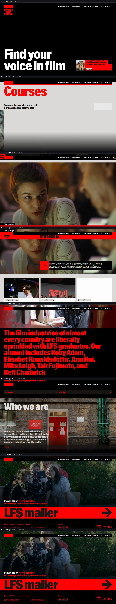
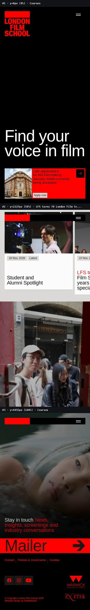

# UI Design System & Master Generation Blueprint: lfs-org-uk

> **London Film School** (https://lfs.org.uk/) — The oldest film school in the UK, dedicated to the education of filmmakers.





---

## 1. Executive Visual Persona & Design Archetype

- **Brand Essence & Persona**: **London Film School** (`https://lfs.org.uk/`). The oldest film school in the UK, dedicated to the education of filmmakers.
- **Capture Provenance**: Live browser capture (`tier1_fast`, HTTP `200`, captured `2026-11-24`).
- **Visual Archetype**: **High-Contrast Obsidian / Atmospheric Design System (`#000000` canvas, `#ffffff` ink, `#0000ff` accent)**.
- **Anti-AI-Slop Differentiators**:
  - **Live-Computed Chromatic Polarity**: Anchors the viewport in `#000000` (live computed `body` `background-color` (`computed_styles.json`)) paired with `#ffffff` primary typography and `#0000ff` accents.
  - **Grounded Typographic Hierarchy**: Pairs `Waldenburg Condensed Black` for display copy (`Find your voice in film`) with `Segoe UI`.
  - **Calibrated Spatial Grid & Motion**: Combines `74em` container bounds (`gap: 20px 5px`, padding `50px`) with `cubic-bezier(0,.658,.203,1.005)` easing and Three.js / WebGL Canvas Pipeline.

---

## 2. Spatial Architecture & Modular Grid Mathematics

### Viewport Allocation & Container Geometry
- **Captured Journey Filmstrips**: Desktop `1280×6624px` (`assets/desktop-journey.webp`, `8` keyframes up to `y=5995px` / doc `6895px`), Mobile `390×2616px` (`assets/mobile-journey.webp`, `3` keyframes).
- **Master Container Bounds**: `74em` (non-`@media` desktop container stylesheet rule).
- **Canvas Lateral Padding & Spacing**: `50px` lateral canvas padding with `20px 5px` grid gap.
- **Border Radius Scale**: `100%`, `.5rem`, `.4rem`, `1rem`.

### Responsive Breakpoint Architecture
- **Desktop Layout**: Multi-column CSS Grid / Flexbox layout at `1440px` (`max-width: 74em`, `gap: 20px 5px`).
- **Mobile Layout**: Single-column vertical stack at `390px` viewport width with `50px` horizontal padding.
- **Extracted CSS Media Queries**: `@media (prefers-reduced-motion: reduce)`, `@media screen and (width>=640px)`, `@media (prefers-reduced-motion)`, `@media screen and (width<=640px)`.

---

## 3. Color System, Materiality & Atmospheric Lighting

### Semantic Palette & Source Grounding
| Semantic Role | Ground-Truth Value | Extracted Live / CSS Source |
|---|---|---|
| **Primary Canvas Substrate** | `#000000` | live computed `body` `background-color` (`computed_styles.json`) |
| **Primary Typography Ink** | `#ffffff` | live computed `h1` `color` (`computed_styles.json`) |
| **Elevated Surface / Card Substrate** | `#23282d` | `.wpcf7-spinner { background-color: #23282d }` |
| **Interactive Accent / Highlight** | `#0000ff` | `.page--short-courses .pill-btn { background-color: blue }` (`#0000ff`) |
| **Secondary / Muted Copy** | `#5e6266` | `var(--cc-secondary-color)` in `:root` |
| **Structural Hairline Border** | `#d4dae0` | `var(--cc-btn-secondary-hover-border-color)` in `:root` |
| **Variable Token (`--cc-primary-color`)** | `#2c2f31` | `var(--cc-primary-color)` in `:root` |
| **Variable Token (`--cc-btn-primary-bg`)** | `#30363c` | `var(--cc-btn-primary-bg)` in `:root` |
| **Variable Token (`--cc-btn-secondary-bg`)** | `#eaeff2` | `var(--cc-btn-secondary-bg)` in `:root` |

### Sanitized Root CSS Variables (`ui-ux.md` Ground Truth)
| Variable Name | Extracted Value | Semantic Role |
|---|---|---|
| `--cc-modal-border-radius` | `.5rem` | Elevation / Border Token |
| `--cc-btn-border-radius` | `.4rem` | Elevation / Border Token |
| `--cc-modal-transition-duration` | `.25s` | Motion / Easing Token |
| `--cc-link-color` | `var(--cc-btn-primary-bg)` | Typography Ink Token |
| `--cc-modal-margin` | `1rem` | Layout / Spatial Grid Token |
| `--cc-z-index` | `2147480000` | Elevation / Border Token |
| `--cc-bg` | `#fff` | Canvas / Surface Token |
| `--cc-primary-color` | `#2c2f31` | Brand / Palette Token |
| `--cc-secondary-color` | `#5e6266` | Brand / Palette Token |
| `--cc-btn-primary-bg` | `#30363c` | Canvas / Surface Token |
| `--cc-btn-primary-color` | `#fff` | Brand / Palette Token |
| `--cc-btn-primary-border-color` | `var(--cc-btn-primary-bg)` | Brand / Palette Token |
| `--cc-btn-primary-hover-bg` | `#000` | Canvas / Surface Token |
| `--cc-btn-primary-hover-color` | `#fff` | Brand / Palette Token |
| `--cc-btn-primary-hover-border-color` | `var(--cc-btn-primary-hover-bg)` | Brand / Palette Token |
| `--cc-btn-secondary-bg` | `#eaeff2` | Canvas / Surface Token |

---

## 4. Typographic Scale & Editorial Hierarchy

### Font Family Stacks
- **Display Typography**: `Waldenburg Condensed Black`.
- **Primary Body Stack**: `Segoe UI`.
- **Technical / Metadata Stack**: not declared in live computed styles (uses primary stack / `ui-monospace`).

### Typographic Scale & Rules (Live Computed & Stylesheet Grounded)
- **Hero Display (`H1`)**: live computed `h1` (`font-size: 160px`, `line-height: 144px`, `font-weight: 400`, `letter-spacing: -3.2px`); rule `h1` (`font-size: 2rem`, `line-height: 1`, `letter-spacing: -.02em`, `font-weight: 400`).
- **Section Heading (`H2`)**: live computed `h2` (`font-size: 160px`, `line-height: 144px`, `font-weight: 400`, `letter-spacing: -3.2px`); rule `h2` (`font-size: 1.375rem`, `line-height: 1`, `letter-spacing: -.01em`, `font-weight: 400`).
- **Body Copy**: live computed `body` (`font-size: 20px`, `line-height: 22px`, `font-weight: 400`); rule `p` (`line-height: 1.2`).
- **Metadata & Navigation Labels**: live computed `nav/a` (`font-size: 20px`, `line-height: 22px`, `font-weight: 400`); CSS variables `--spacing-xsmall: 1rem`, `--spacing-small: 2rem`.

---

## 5. Choreographed Motion & Interaction Physics

### Primary Easing Curves
- **Extracted Timing Functions**: `cubic-bezier(0,.658,.203,1.005)`, `cubic-bezier(.49,.78,.46,1.34)`.

### Per-Element Transition & Choreography Rules
- **Selector `:root`**: `transition: .25s` extracted from `lfs-org-uk` stylesheet.
- **Selector `#cc-main a`**: `transition: background-size .25s,color .25s` extracted from `lfs-org-uk` stylesheet.
- **Selector `media (prefers-reduced-motion)`**: `transition: 0s` extracted from `lfs-org-uk` stylesheet.
- **Extracted Easing Curve (`cubic-bezier(0,.658,.203,1.005)`)**: Governs interactive state transitions across `<header.header>` and `<section.homepage-courses>`.
- **Runtime Interaction Engine**: Integrates Three.js / WebGL Canvas Pipeline with `prefers-reduced-motion: reduce` fallback guards.
### Measured Runtime Scroll & Interaction Telemetry (`behavioral_journey_v2`)
- **Scroll Driver Mode**: `native` (max document height `6895px`, deepest scrollY reached `5995px` across `8` desktop keyframes).
- **Detected Scroll / Motion Libraries**: Native browser scroll / standard CSS transitions.
- **Hover Physics (`primary_cta` · `London Film School`)**: Computed transition `0s` / `ease` (no static color/transform shift captured at rest).
- **Hover Physics (`first_card` · `Late applications for MA Filmmaki...`)**: Computed transition `0s` / `ease` (no static color/transform shift captured at rest).
- **Route Transition Architecture**: First internal navigation (`/news/`) measured as `direct` in `3752ms`.

---

## 6. Component Wireframe & Structural DOM Map

### Visual Layout Schematic — Desktop (`1440px`, Grounded in `dom.html` & Landmark Bounding Boxes)
```
┌────────────────────────────────────────────────────────────────────────┐
│ DESKTOP VIEWPORT (1440px) — London Film School                         │
│ ====================================================================== │
│ [ <header.header> (1440x40px)         | Full time courses · MA Filmm ] │
│ ---------------------------------------------------------------------- │
│ | HERO STAGE: <section.homepage-hero> (w=1440px)                     | │
│ | H1: Find your voice in film                                        | │
│ | Substrate: #000000 | Ink: #ffffff | Accent: #0000ff                | │
│ ---------------------------------------------------------------------- │
│ | SHOWCASE GRID (<section.homepage-courses>) max-w: 74em             | │
│ | +------------------------------+  +------------------------------+ | │
│ | | Training the world’s next gr |  | MA Filmmaking                | | │
│ | +------------------------------+  +------------------------------+ | │
│ ---------------------------------------------------------------------- │
│ | DETAIL MODULE (<section.featured-film>) — MA Screenwriting         | │
│ ---------------------------------------------------------------------- │
│ [ FOOTER (<footer.footer>     ) | https://lfs.org.uk/                  │
└────────────────────────────────────────────────────────────────────────┘
```

### Visual Layout Schematic — Mobile Reflow (`390px`)
```
┌────────────────────────────────────────────────────────────────────────┐
│ MOBILE VIEWPORT REFLOW (390px) — Single-Column Stack (gap: 20px 5px)   │
│ ====================================================================== │
│ [ HEADER BAR (<header.header>         ) | Compact Menu (390px)         │
│ ---------------------------------------------------------------------- │
│ | HERO STAGE (<section.homepage-hero>) — 390px Vertical Lead         | │
│ | H1: Find your voice in film                                        | │
│ ---------------------------------------------------------------------- │
│ | SHOWCASE STACK (<section.homepage-cour) — 1-Col Stack              | │
│ | [ Item 1: Training the world’s next great filmmakers and st...   ] | │
│ | [ Item 2: MA Filmmaking                                          ] | │
│ ---------------------------------------------------------------------- │
│ | DETAIL STACK (<section.featured-film>) — 1-Col (MA Screenwriting)  | │
│ ---------------------------------------------------------------------- │
│ [ FOOTER (<footer.footer>     ) | Stacked 390px Colophon               │
└────────────────────────────────────────────────────────────────────────┘
```

### Granular DOM Region Breakdown
1. **Brand Header & Navigation Bar (<header.header> — `lfs-org-uk`)**:
   - Landmark `<header class="header js-header">` (`1440x40px`) hosting `London Film School` navigation (`Full time courses · MA Filmmaking · MA Screenwriting · MA Film Marketing · MA Film Producing`), DOM attributes (`data-category="analytics"`, `data-service="Google Analytics"`, `data-category="analytics"`, `data-service="Google Analytics"`), and stylesheet rule `.wpcf7 .hidden-fields-container { display: none; }`.
2. **Hero Stage & Focal Lead (<section.homepage-hero> — `Find your voice in film`)**:
   - Landmark `<section class="homepage-hero homepage-hero--announcement">` presenting display lead `Find your voice in film` and copy excerpt *"A 17-year-old Ada spends the school vacation helping her father s"* over `#000000` canvas and `#ffffff` ink.
3. **Primary Showcase & Content Grid (<section.homepage-courses> — `Training the world’s next great fi`)**:
   - Landmark `<section class="homepage-courses background-grey">` rendering section `Training the world’s next great filmmakers and st...` with copy *"Explore London Film School from anywhere"*, asset references (`recaptcha__en.js`, `favicon-96x96.png`, `favicon.svg`, `favicon.ico`), and grid rule `.wpcf7 form .wpcf7-response-output { margin: 2em 0.5em 1em; padding: 0.2em 1em; border: 2px solid 00a0d2; }`.
4. **Interactive Detail & Feature Matrix (<section.featured-film> — `MA Filmmaking`)**:
   - Landmark `<section class="featured-film js-featured-film">` framing `MA Filmmaking` and `MA Screenwriting` (*"Elísabet Ronaldsdóttir"*) with `#23282d` surface cards, `#0000ff` accents, and `form.submitting .wpcf7-response-o... { display: none; }`.
5. **Colophon & Global Directory Footer (<footer.footer> — `https://lfs.org.uk/`)**:
   - Landmark `<footer class="footer grid-container">` anchoring `London Film School` footer links (`Full time courses · MA Filmmaking · MA Screenwriting · MA Film Marketing · MA Film Producing`), copy *"LFS is the UK's oldest dedicated film school. Based in the c"*, and `#d4dae0` structural dividers.
### Full Vertical Scroll Sequence (Desktop `1440×900` Keyframes)
- **Step 01** (`y=0px`, `0%`): Active landmark `Courses` · sticky/fixed elements: `5`
- **Step 02** (`y=850px`, `14%`): Active landmark `Courses` · sticky/fixed elements: `4`
- **Step 03** (`y=1700px`, `28%`): Active landmark `Courses` · sticky/fixed elements: `4`
- **Step 04** (`y=2550px`, `43%`): Active landmark `Courses` · sticky/fixed elements: `4`
- **Step 05** (`y=4250px`, `71%`): Active landmark `Courses` · sticky/fixed elements: `4`
- **Step 06** (`y=5100px`, `85%`): Active landmark `Who we are` · sticky/fixed elements: `4`
- **Step 07** (`y=5950px`, `99%`): Active landmark `Courses` · sticky/fixed elements: `4`
- **Step 08** (`y=5995px`, `100%`): Active landmark `Courses` · sticky/fixed elements: `4`

### Multi-Page Internal Route Map
- **Listing Route (`/news/`)**: `https://lfs.org.uk/news/` — H1: `News & Events`, scrollHeight `4095px`, transition `direct` (`3752ms`)
- **Detail Route (`/course/ma-filmmaking/`)**: `https://lfs.org.uk/course/ma-filmmaking/` — H1: `MA Filmmaking`, scrollHeight `6894px`, transition `direct` (`10370ms`)
- **About Route (`/about/`)**: `https://lfs.org.uk/about/` — H1: `About · London Film School`, scrollHeight `7342px`, transition `direct` (`6356ms`)

---

## 7. Master Zero-Shot AI Generation Prompt

```markdown
# Master Zero-Shot Frontend Generation Prompt: lfs-org-uk (London Film School)

You are a principal frontend architect and design systems engineer. Build a complete, production-ready web application replicating the exact design system, DOM landmarks, typographic hierarchy, color tokens, and motion physics of `lfs-org-uk` (**London Film School** — `https://lfs.org.uk/`).

### 1. Visual Archetype & Anti-AI-Slop Mandates
- **Archetype**: High-Contrast Obsidian / Atmospheric Design System (`#000000` canvas, `#ffffff` ink, `#0000ff` accent).
- **Identity & Domain Context**: The oldest film school in the UK, dedicated to the education of filmmakers.
- **Primary Substrate**: `#000000` (live computed `body` `background-color` (`computed_styles.json`)), **Primary Ink**: `#ffffff`, **Accent / Highlight**: `#0000ff`.
- **Site-Specific Differentiators**:
  - **Live-Computed Chromatic Polarity**: Anchors the viewport in `#000000` (live computed `body` `background-color` (`computed_styles.json`)) paired with `#ffffff` primary typography and `#0000ff` accents.
  - **Grounded Typographic Hierarchy**: Pairs `Waldenburg Condensed Black` for display copy (`Find your voice in film`) with `Segoe UI`.
  - **Calibrated Spatial Grid & Motion**: Combines `74em` container bounds (`gap: 20px 5px`, padding `50px`) with `cubic-bezier(0,.658,.203,1.005)` easing and Three.js / WebGL Canvas Pipeline.

### 2. Ground-Truth CSS Variables (`:root` Token Contract)
Declare and consume these exact custom properties extracted from `lfs-org-uk` in your global stylesheet:

:root {
  /* London Film School (lfs-org-uk) — Live-Grounded CSS Variables */
  --cc-modal-border-radius: .5rem; /* Elevation / Border Token (lfs-org-uk) */
  --cc-btn-border-radius: .4rem; /* Elevation / Border Token (lfs-org-uk) */
  --cc-modal-transition-duration: .25s; /* Motion / Easing Token (lfs-org-uk) */
  --cc-link-color: var(--cc-btn-primary-bg); /* Typography Ink Token (lfs-org-uk) */
  --cc-modal-margin: 1rem; /* Layout / Spatial Grid Token (lfs-org-uk) */
  --cc-z-index: 2147480000; /* Elevation / Border Token (lfs-org-uk) */
  --cc-bg: #fff; /* Canvas / Surface Token (lfs-org-uk) */
  --cc-primary-color: #2c2f31; /* Brand / Palette Token (lfs-org-uk) */
  --cc-secondary-color: #5e6266; /* Brand / Palette Token (lfs-org-uk) */
  --cc-btn-primary-bg: #30363c; /* Canvas / Surface Token (lfs-org-uk) */
  --cc-btn-primary-color: #fff; /* Brand / Palette Token (lfs-org-uk) */
  --cc-btn-primary-border-color: var(--cc-btn-primary-bg); /* Brand / Palette Token (lfs-org-uk) */
  --cc-btn-primary-hover-bg: #000; /* Canvas / Surface Token (lfs-org-uk) */
  --cc-btn-primary-hover-color: #fff; /* Brand / Palette Token (lfs-org-uk) */
  --cc-btn-primary-hover-border-color: var(--cc-btn-primary-hover-bg); /* Brand / Palette Token (lfs-org-uk) */
  --cc-btn-secondary-bg: #eaeff2; /* Canvas / Surface Token (lfs-org-uk) */
}

### 3. Semantic Color & Materiality Contract
Map every surface, ink, and border strictly to these source-grounded tokens:
- **Primary Canvas Substrate**: `#000000` — grounded in live computed `body` `background-color` (`computed_styles.json`)
- **Primary Typography Ink**: `#ffffff` — grounded in live computed `h1` `color` (`computed_styles.json`)
- **Elevated Surface / Card Substrate**: `#23282d` — grounded in `.wpcf7-spinner { background-color: #23282d }`
- **Interactive Accent / Highlight**: `#0000ff` — grounded in `.page--short-courses .pill-btn { background-color: blue }` (`#0000ff`)
- **Secondary / Muted Copy**: `#5e6266` — grounded in `var(--cc-secondary-color)` in `:root`
- **Structural Hairline Border**: `#d4dae0` — grounded in `var(--cc-btn-secondary-hover-border-color)` in `:root`
- **Variable Token (`--cc-primary-color`)**: `#2c2f31` — grounded in `var(--cc-primary-color)` in `:root`
- **Variable Token (`--cc-btn-primary-bg`)**: `#30363c` — grounded in `var(--cc-btn-primary-bg)` in `:root`
- **Variable Token (`--cc-btn-secondary-bg`)**: `#eaeff2` — grounded in `var(--cc-btn-secondary-bg)` in `:root`

### 4. Spatial Grid, Container Bounds & Responsive Breakpoints
- **Desktop Viewport Reference**: `1280×6624px` (multi-frame vertical journey filmstrip (6624px), `1440px` standard desktop width).
- **Mobile Viewport Reference**: `390×2616px` (multi-frame vertical journey filmstrip (2616px), `390px` standard mobile width).
- **Container Max-Width**: `74em` (non-`@media` desktop container stylesheet rule)
- **Padding & Gutters**: `50px` lateral canvas padding with `20px 5px` grid gap
- **Desktop Grid**: Multi-column CSS Grid / Flexbox layout at `1440px` (`max-width: 74em`, `gap: 20px 5px`)
- **Mobile Adaptation**: Single-column vertical stack at `390px` viewport width with `50px` horizontal padding
- **Media Queries**: `@media (prefers-reduced-motion: reduce)`, `@media screen and (width>=640px)`, `@media (prefers-reduced-motion)`, `@media screen and (width<=640px)`
- **Corner Radii**: `100%`, `.5rem`, `.4rem`, `1rem`

### 5. Typography & Editorial Scale Contract
- **Display Font Stack**: `Waldenburg Condensed Black`
- **Body Font Stack**: `Segoe UI`
- **Monospace / Technical Font Stack**: not declared in live computed styles (uses primary stack / `ui-monospace`)
- **H1 Display Rule**: live computed `h1` (`font-size: 160px`, `line-height: 144px`, `font-weight: 400`, `letter-spacing: -3.2px`); rule `h1` (`font-size: 2rem`, `line-height: 1`, `letter-spacing: -.02em`, `font-weight: 400`)
- **H2 Section Rule**: live computed `h2` (`font-size: 160px`, `line-height: 144px`, `font-weight: 400`, `letter-spacing: -3.2px`); rule `h2` (`font-size: 1.375rem`, `line-height: 1`, `letter-spacing: -.01em`, `font-weight: 400`)
- **Body Copy Rule**: live computed `body` (`font-size: 20px`, `line-height: 22px`, `font-weight: 400`); rule `p` (`line-height: 1.2`)
- **Metadata & Index Rule**: live computed `nav/a` (`font-size: 20px`, `line-height: 22px`, `font-weight: 400`); CSS variables `--spacing-xsmall: 1rem`, `--spacing-small: 2rem`

### 6. Component Hierarchy, Verbatim Copy & Real DOM Landmarks
Scaffold `lfs-org-uk` (`London Film School`) with these exact structural regions, extracted copy, and CSS rules from `dom.html`:
1. **Brand Header & Navigation Bar (<header.header> — `lfs-org-uk`)**:
   - DOM & Selectors: Landmark `<header class="header js-header">` (`1440x40px`) hosting `London Film School` navigation (`Full time courses · MA Filmmaking · MA Screenwriting · MA Film Marketing · MA Film Producing`), DOM attributes (`data-category="analytics"`, `data-service="Google Analytics"`, `data-category="analytics"`, `data-service="Google Analytics"`), and stylesheet rule `.wpcf7 .hidden-fields-container { display: none; }`.
   - Responsive Contract: Header `Brand Header & Navigation Bar (<header.header> — `lfs-org-uk`)` (`lfs-org-uk`) adapts across `@media (prefers-reduced-motion: reduce)`, `@media screen and (width>=640px)`, `@media (prefers-reduced-motion)`, `@media screen and (width<=640px)` with `cubic-bezier(0,.658,.203,1.005)`, `cubic-bezier(.49,.78,.46,1.34)` transitions and links `Full time courses · MA Filmmaking · MA Screenwriting · MA Film Marketing · MA Film Producing`.
2. **Hero Stage & Focal Lead (<section.homepage-hero> — `Find your voice in film`)**:
   - DOM & Selectors: Landmark `<section class="homepage-hero homepage-hero--announcement">` presenting display lead `Find your voice in film` and copy excerpt *"A 17-year-old Ada spends the school vacation helping her father s"* over `#000000` canvas and `#ffffff` ink.
   - Responsive Contract: Hero stage (`1280×6624px` desktop / `390×2616px` mobile) sets `#000000` background with `#ffffff` headline `Find your voice in film`.
3. **Primary Showcase & Content Grid (<section.homepage-courses> — `Training the world’s next great fi`)**:
   - DOM & Selectors: Landmark `<section class="homepage-courses background-grey">` rendering section `Training the world’s next great filmmakers and st...` with copy *"Explore London Film School from anywhere"*, asset references (`recaptcha__en.js`, `favicon-96x96.png`, `favicon.svg`, `favicon.ico`), and grid rule `.wpcf7 form .wpcf7-response-output { margin: 2em 0.5em 1em; padding: 0.2em 1em; border: 2px solid 00a0d2; }`.
   - Responsive Contract: Showcase grid `Primary Showcase & Content Grid (<section.homepage-courses> — `Training the world’s next great fi`)` applies Multi-column CSS Grid / Flexbox layout at `1440px` (`max-width: 74em`, `gap: 20px 5px`) on desktop and Single-column vertical stack at `390px` viewport width with `50px` horizontal padding on mobile.
4. **Interactive Detail & Feature Matrix (<section.featured-film> — `MA Filmmaking`)**:
   - DOM & Selectors: Landmark `<section class="featured-film js-featured-film">` framing `MA Filmmaking` and `MA Screenwriting` (*"Elísabet Ronaldsdóttir"*) with `#23282d` surface cards, `#0000ff` accents, and `form.submitting .wpcf7-response-o... { display: none; }`.
   - Responsive Contract: Detail module `Interactive Detail & Feature Matrix (<section.featured-film> — `MA Filmmaking`)` uses `100%`, `.5rem`, `.4rem`, `1rem` radii, `#0000ff` highlights, and assets (recaptcha__en.js, favicon-96x96.png, favicon.svg).
5. **Colophon & Global Directory Footer (<footer.footer> — `https://lfs.org.uk/`)**:
   - DOM & Selectors: Landmark `<footer class="footer grid-container">` anchoring `London Film School` footer links (`Full time courses · MA Filmmaking · MA Screenwriting · MA Film Marketing · MA Film Producing`), copy *"LFS is the UK's oldest dedicated film school. Based in the c"*, and `#d4dae0` structural dividers.
   - Responsive Contract: Footer `Colophon & Global Directory Footer (<footer.footer> — `https://lfs.org.uk/`)` aligns to `74em` (non-`@media` desktop container stylesheet rule) with `50px` lateral canvas padding with `20px 5px` grid gap and attributes (data-category="analytics", data-service="Google Analytics", data-category="analytics").

#### Verbatim DOM Copy Excerpts (`dom.html`)
- Copy Excerpt 1: *"A 17-year-old Ada spends the school vacation helping her father sell contraband ci..."*
- Copy Excerpt 2: *"Explore London Film School from anywhere"*
- Copy Excerpt 3: *"Elísabet Ronaldsdóttir"*
- Copy Excerpt 4: *"LFS is the UK's oldest dedicated film school. Based in the centre of London. Two n..."*

### 7. Motion, Extracted Stylesheet Rules & Interaction Choreography
- **Primary Easing Functions**: `cubic-bezier(0,.658,.203,1.005)`, `cubic-bezier(.49,.78,.46,1.34)`
- **Extracted Stylesheet Rules (`lfs-org-uk`)**:
- `.wpcf7 .hidden-fields-container { display: none; }`
- `.wpcf7 form .wpcf7-response-output { margin: 2em 0.5em 1em; padding: 0.2em 1em; border: 2px solid 00a0d2; }`
- `form.submitting .wpcf7-response-o... { display: none; }`
- `.wpcf7 form.sent .wpcf7-response-... { border-color: 46b450; }`
- `cf7 form.aborted .wpcf7-response-... { border-color: dc3232; }`
- **Per-Selector Transition Rules**:
- **Selector `:root`**: `transition: .25s` extracted from `lfs-org-uk` stylesheet.
- **Selector `#cc-main a`**: `transition: background-size .25s,color .25s` extracted from `lfs-org-uk` stylesheet.
- **Selector `media (prefers-reduced-motion)`**: `transition: 0s` extracted from `lfs-org-uk` stylesheet.
- **Extracted Easing Curve (`cubic-bezier(0,.658,.203,1.005)`)**: Governs interactive state transitions across `<header.header>` and `<section.homepage-courses>`.
- **Runtime Interaction Engine**: Integrates Three.js / WebGL Canvas Pipeline with `prefers-reduced-motion: reduce` fallback guards.
### 7b. Full-Page Scroll Choreography, Interactive States & Multi-Page Routes
- **Scroll Mechanics**: Implement `native` vertical progression up to `6895px` across 8 distinct viewport chapters.
- **Vertical Chapter Sequence**: Courses (0%) -> Courses (14%) -> Courses (28%) -> Courses (43%) -> Courses (71%) -> Who we are (85%) -> Courses (99%) -> Courses (100%).
- **Multi-Page Routes**: Scaffold internal routes `/news/` (listing, direct), `/course/ma-filmmaking/` (detail, direct), `/about/` (about, direct) sharing the global header/footer shell and design tokens.

### 8. Technical Deliverables
- Implement in Next.js (App Router) with TypeScript and Tailwind CSS consuming the `:root` custom properties defined above for `lfs-org-uk`.
- Reproduce both the `1440px` desktop architecture and `390px` mobile breakpoint transitions, preserving semantic HTML5 landmarks (`<header>`, `<nav>`, `<main>`, `<section>`, `<footer>`) and `prefers-reduced-motion` accessibility guards.
```
---

## 8. Full-Page Scroll Journey, Interactive States & Subpage Inventory

### Desktop Scroll Keyframes (`1440×900` WebP)
| Step | Scroll Y | Progress | Active Landmark / Section | Sticky/Fixed | Visual Asset |
| :---: | :---: | :---: | :--- | :---: | :--- |
| `#01` | `0px` | `0%` | Courses | `5` | [desktop-step-01.webp](assets/desktop-step-01.webp) |
| `#02` | `850px` | `14%` | Courses | `4` | [desktop-step-02.webp](assets/desktop-step-02.webp) |
| `#03` | `1700px` | `28%` | Courses | `4` | [desktop-step-03.webp](assets/desktop-step-03.webp) |
| `#04` | `2550px` | `43%` | Courses | `4` | [desktop-step-04.webp](assets/desktop-step-04.webp) |
| `#05` | `4250px` | `71%` | Courses | `4` | [desktop-step-05.webp](assets/desktop-step-05.webp) |
| `#06` | `5100px` | `85%` | Who we are | `4` | [desktop-step-06.webp](assets/desktop-step-06.webp) |
| `#07` | `5950px` | `99%` | Courses | `4` | [desktop-step-07.webp](assets/desktop-step-07.webp) |
| `#08` | `5995px` | `100%` | Courses | `4` | [desktop-step-08.webp](assets/desktop-step-08.webp) |

### Mobile Condensed Keyframes (`390×844` WebP)
| Step | Scroll Y | Progress | Active Landmark | Visual Asset |
| :---: | :---: | :---: | :--- | :--- |
| `#01` | `0px` | `0%` | Courses | [mobile-step-01.webp](assets/mobile-step-01.webp) |
| `#02` | `2227px` | `50%` | LFS turns 70 London Film School celebrate... | [mobile-step-02.webp](assets/mobile-step-02.webp) |
| `#03` | `4455px` | `100%` | Courses | [mobile-step-03.webp](assets/mobile-step-03.webp) |

### Internal Subpage Filmstrips (`1080px` Wide WebP)
| # | Template | Route URL | H1 / Title | Scroll Height | Transition | Filmstrip Asset |
| :-: | :---: | :--- | :--- | :---: | :---: | :--- |
| `1` | `listing` | `https://lfs.org.uk/news/` | News & Events | `4095px` | `direct` (`3752ms`) | [subpage-01-news.webp](assets/subpage-01-news.webp) |
| `2` | `detail` | `https://lfs.org.uk/course/ma-filmmaking/` | MA Filmmaking | `6894px` | `direct` (`10370ms`) | [subpage-02-course-ma-filmmaking.webp](assets/subpage-02-course-ma-filmmaking.webp) |
| `3` | `about` | `https://lfs.org.uk/about/` | About · London Film School | `7342px` | `direct` (`6356ms`) | [subpage-03-about.webp](assets/subpage-03-about.webp) |

