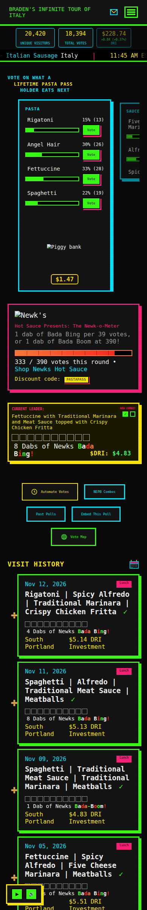

# UI Design System & Master Generation Blueprint: lifetimepastapass-com

> **LIFETIME PASTA PASS · BRADEN'S INFINITE TOUR OF ITALY** (https://lifetimepastapass.com) — Braden is an Olive Garden Lifetime Pasta Pass holder. Now the internet votes on what he eats next. Live results, vote history, and the fu...


---

## 1. Executive Visual Persona & Design Archetype

- **Brand Essence & Persona**: **LIFETIME PASTA PASS · BRADEN'S INFINITE TOUR OF ITALY** (`https://lifetimepastapass.com`). Braden is an Olive Garden Lifetime Pasta Pass holder. Now the internet votes on what he eats next. Live results, vote history, and the fu...
- **Visual Archetype**: **Dark-Substrate WebGL / Canvas Interactive Experience (`#0a0a0a` / `#ff2079`)**.
- **Anti-AI-Slop Differentiators**:
  - **Source-Grounded Chromatic Polarity**: Anchors the viewport in `#0a0a0a` (`var(--bg)` in `:root`) paired with `#ffe900` primary typography and `#ff2079` accents.
  - **Extracted Typographic Hierarchy**: Pairs `VT323` for display copy (`Vote on what a LIFETIME PASTA PASS h`) with `monospace)` and `monospace)`.
  - **Calibrated Spatial Grid & Motion**: Combines `1200px` container bounds (`gap: 0.4rem`, padding `1rem`) with `cubic-bezier(0.25,0.1,0.25,1)` easing and Three.js / WebGL Canvas Pipeline.

---

## 2. Spatial Architecture & Modular Grid Mathematics



### Viewport Allocation & Container Geometry
- **Captured Viewport Dimensions**: Desktop `1440×5316px` (`assets/desktop.png`, full-page scroll capture), Mobile `390×2400px` (`assets/mobile.png`, capped at 2400px multi-section capture).
- **Master Container Bounds**: `1200px` extracted from `lifetimepastapass-com` stylesheet.
- **Canvas Lateral Padding & Spacing**: `1rem` lateral canvas padding with `0.4rem` grid gap.
- **Border Radius Scale**: `50%`, `2px`, `6px`, `4px`.

### Responsive Breakpoint Architecture
- **Desktop Layout**: Multi-column CSS Grid / Flexbox layout at `1440px` (`max-width: 1200px`, `gap: 0.4rem`).
- **Mobile Layout**: Single-column vertical stack at `390px` viewport width with `1rem` horizontal padding.
- **Extracted CSS Media Queries**: `@media (min-width: 641px)`, `@media (max-width: 640px)`, `@media (max-width: 480px)`, `@media (min-width: 900px)`.

---

## 3. Color System, Materiality & Atmospheric Lighting

### Semantic Palette & Source Grounding
| Semantic Role | Ground-Truth Value | Extracted CSS Source / Selector |
|---|---|---|
| **Primary Canvas Substrate** | `#0a0a0a` | `var(--bg)` in `:root` |
| **Primary Typography Ink** | `#141414` | `var(--bg-panel)` in `:root` |
| **Elevated Surface / Card Substrate** | `#39ff14` | `var(--neon-green)` in `:root` |
| **Interactive Accent / Highlight** | `#ff2079` | `var(--neon-pink)` in `:root` |
| **Secondary / Muted Copy** | `#ffe900` | `var(--neon-yellow)` in `:root` |
| **Structural Hairline Border** | `#00e5ff` | `var(--neon-cyan)` in `:root` |
| **Variable Token (`--white`)** | `#f5f5f5` | `var(--white)` in `:root` |
| **Variable Token (`--trophy-bronze`)** | `#d98a3d` | `var(--trophy-bronze)` in `:root` |
| **Variable Token (`--trophy-silver`)** | `#d8d8e2` | `var(--trophy-silver)` in `:root` |
| **Variable Token (`--trophy-gold`)** | `#ffd700` | `var(--trophy-gold)` in `:root` |
| **Variable Token (`--bada-bing`)** | `#ff7a3d` | `var(--bada-bing)` in `:root` |
| **Variable Token (`--bada-boom`)** | `#ff2b1f` | `var(--bada-boom)` in `:root` |

### Sanitized Root CSS Variables (`ui-ux.md` Ground Truth)
| Variable Name | Extracted Value | Semantic Role |
|---|---|---|
| `--bg` | `#0a0a0a` | Canvas / Surface Token |
| `--bg-panel` | `#141414` | Canvas / Surface Token |
| `--neon-green` | `#39ff14` | Color / Atmospheric Token |
| `--neon-pink` | `#ff2079` | Typography Ink Token |
| `--neon-yellow` | `#ffe900` | Color / Atmospheric Token |
| `--neon-cyan` | `#00e5ff` | Color / Atmospheric Token |
| `--white` | `#f5f5f5` | Canvas / Surface Token |
| `--pixel-font` | `'Press Start 2P', monospace` | Typography / Scale Token |
| `--body-font` | `'VT323', monospace` | Typography / Scale Token |
| `--trophy-bronze` | `#d98a3d` | Color / Atmospheric Token |
| `--trophy-silver` | `#d8d8e2` | Color / Atmospheric Token |
| `--trophy-gold` | `#ffd700` | Color / Atmospheric Token |
| `--bada-bing` | `#ff7a3d` | Color / Atmospheric Token |
| `--bada-boom` | `#ff2b1f` | Color / Atmospheric Token |
| `--lifetimepastapas-bg` | `#0a0a0a` | Canvas Substrate (from `var(--bg)` in `:root`) |
| `--lifetimepastapas-ink` | `#ffe900` | Primary Typography Ink (stylesheet-derived) |

---

## 4. Typographic Scale & Editorial Hierarchy

### Font Family Stacks
- **Display Typography**: `VT323`.
- **Primary Body Stack**: `monospace)`.
- **Technical / Metadata Stack**: `monospace)`.

### Typographic Scale & Rules (Extracted from Stylesheet & Variables)
- **Hero Display (`H1`)**: not explicitly declared on tag in static CSS (stylesheet font-size ladder: `19px`, `0.9rem`, `0.65rem`, `12px`, `0.5rem`).
- **Section Heading (`H2`)**: rule `h2` (`font-size: 1.1rem`).
- **Body Copy**: CSS variables `--body-font: 'VT323', monospace`; rule `body` (`font-size: 19px`).
- **Metadata & Navigation Labels**: not explicitly declared on tag in static CSS (stylesheet font-size ladder: `19px`, `0.9rem`, `0.65rem`, `12px`, `0.5rem`).

---

## 5. Choreographed Motion & Interaction Physics

### Primary Easing Curves
- **Extracted Timing Functions**: `cubic-bezier(0.25,0.1,0.25,1)`.

### Per-Element Transition & Choreography Rules
- **Selector `.hamburger span`**: `transition: transform 0.15s steps(3)` extracted from `lifetimepastapass-com` stylesheet.
- **Selector `.site-nav`**: `transition: right 0.2s steps(6)` extracted from `lifetimepastapass-com` stylesheet.
- **Selector `.status-icon`**: `transition: filter 0.15s ease, opacity 0.15s ease` extracted from `lifetimepastapass-com` stylesheet.
- **Standard CSS Easing (`cubic-bezier(0.25,0.1,0.25,1)`)**: Default timing curve (no custom `cubic-bezier()` declared in static CSS).
- **Runtime Interaction Engine**: Integrates Three.js / WebGL Canvas Pipeline with `prefers-reduced-motion: reduce` fallback guards.

---

## 6. Component Wireframe & Structural DOM Map

### Visual Layout Schematic (Grounded in `dom.html` — `1440px` Desktop & `390px` Mobile Reflow)
```
┌────────────────────────────────────────────────────────────────────────┐
│ DESKTOP VIEWPORT (1440px) — LIFETIME PASTA PASS · BRADEN'S INFINITE TO │
│ ====================================================================== │
│ [ <header.site-header>     | Home · Trophy Case · OG Merch Gallery  ]  │
│ ---------------------------------------------------------------------- │
│ | HERO STAGE: <section.poll-section>                               |   │
│ | H1: Vote on what a LIFETIME PASTA PASS holder eats next          |   │
│ | Substrate: #0a0a0a    | Ink: #ffe900    | Accent: #ff2079        |   │
│ ---------------------------------------------------------------------- │
│ | SHOWCASE GRID (<section.visits-section>  ) max-w: 1200px         |   │
│ | +------------------------------+  +------------------------------+ | │
│ | | Pasta                        |  | Sauce                        | | │
│ | +------------------------------+  +------------------------------+ | │
│ ---------------------------------------------------------------------- │
│ | MOBILE VIEWPORT REFLOW (390px) — Single-Column Stack (gap: 0.4rem) | │
│ | [<header.site-heade] -> [<section.poll-sect] -> [<section.visits-se] │
│ ---------------------------------------------------------------------- │
│ [ FOOTER (<footer.site-footer>  ) | https://lifetimepastapass.com      │
└────────────────────────────────────────────────────────────────────────┘
```

### Granular DOM Region Breakdown
1. **Brand Header & Navigation Bar (<header.site-header> — `lifetimepastapass-com`)**:
   - Landmark `<header class="site-header">` hosting `LIFETIME PASTA PASS · BRADEN'S INFIN` navigation (`Home · Trophy Case · OG Merch Gallery · Backstory · Get in Touch`), DOM attributes (`data-address="braden@lifetimepastap..."`, `data-track="mailapp"`, `data-category="Pasta"`, `data-category="Pasta"`), and stylesheet rule `h3 { font-family: var(--pixel-font); text-transform: uppercase; letter-spacin... }`.
2. **Hero Stage & Focal Lead (<section.poll-section> — `Vote on what a LIFETIME PASTA PASS`)**:
   - Landmark `<section class="poll-section">` presenting display lead `Vote on what a LIFETIME PASTA PASS holder eats next` and copy excerpt *"BRADEN'S INFINITE TOUR OF ITALY"* over `#0a0a0a` canvas and `#ffe900` ink.
3. **Primary Showcase & Content Grid (<section.visits-section> — `Pasta`)**:
   - Landmark `<section class="visits-section">` rendering section `Pasta` with copy *"12:06 PM EST Spaghetti + Spicy Alfredo + Meat Sauce + Italian Sau"*, asset references (`fonts.googleapis.com`, `css2`, `style.css`, `card.png (Lifetime Pasta Pass card)`), and grid rule `.site-header { position: sticky; top: 0; }`.
4. **Interactive Detail & Feature Matrix (<section.visits-section> — `Sauce`)**:
   - Landmark `<section class="visits-section">` framing `Sauce` and `Second Sauce` (*"11:45 AM EST Spaghetti + Creamy Mushroom + Five Cheese Marinara +"*) with `#39ff14` surface cards, `#ff2079` accents, and `.site-nav.open { right: 0; }`.
5. **Colophon & Global Directory Footer (<footer.site-footer> — `https://lifetimepastapass.com`)**:
   - Landmark `<footer class="site-footer">` anchoring `LIFETIME PASTA PASS · BRADEN'S I` footer links (`Home · Trophy Case · OG Merch Gallery · Backstory · Get in Touch`), copy *"Connecticut, United States"*, and `#00e5ff` structural dividers.

---

## 7. Master Zero-Shot AI Generation Prompt

```markdown
# Master Zero-Shot Frontend Generation Prompt: lifetimepastapass-com (LIFETIME PASTA PASS · BRADEN'S INFINITE TOUR OF ITALY)

You are a principal frontend architect and design systems engineer. Build a complete, production-ready web application replicating the exact design system, DOM landmarks, typographic hierarchy, color tokens, and motion physics of `lifetimepastapass-com` (**LIFETIME PASTA PASS · BRADEN'S INFINITE TOUR OF ITALY** — `https://lifetimepastapass.com`).

### 1. Visual Archetype & Anti-AI-Slop Mandates
- **Archetype**: Dark-Substrate WebGL / Canvas Interactive Experience (`#0a0a0a` / `#ff2079`).
- **Identity & Domain Context**: Braden is an Olive Garden Lifetime Pasta Pass holder. Now the internet votes on what he eats next. Live results, vote history, and the fu...
- **Primary Substrate**: `#0a0a0a` (`var(--bg)` in `:root`), **Primary Ink**: `#ffe900`, **Accent / Highlight**: `#ff2079`.
- **Site-Specific Differentiators**:
  - **Source-Grounded Chromatic Polarity**: Anchors the viewport in `#0a0a0a` (`var(--bg)` in `:root`) paired with `#ffe900` primary typography and `#ff2079` accents.
  - **Extracted Typographic Hierarchy**: Pairs `VT323` for display copy (`Vote on what a LIFETIME PASTA PASS h`) with `monospace)` and `monospace)`.
  - **Calibrated Spatial Grid & Motion**: Combines `1200px` container bounds (`gap: 0.4rem`, padding `1rem`) with `cubic-bezier(0.25,0.1,0.25,1)` easing and Three.js / WebGL Canvas Pipeline.

### 2. Ground-Truth CSS Variables (`:root` Token Contract)
Declare and consume these exact custom properties extracted from `lifetimepastapass-com` in your global stylesheet:

:root {
  /* LIFETIME PASTA PASS · BRADEN'S INFINITE TOUR OF ITALY (lifetimepastapass-com) — Ground-Truth Extracted CSS Variables */
  --bg: #0a0a0a; /* Canvas / Surface Token (lifetimepastapass-com) */
  --bg-panel: #141414; /* Canvas / Surface Token (lifetimepastapass-com) */
  --neon-green: #39ff14; /* Color / Atmospheric Token (lifetimepastapass-com) */
  --neon-pink: #ff2079; /* Typography Ink Token (lifetimepastapass-com) */
  --neon-yellow: #ffe900; /* Color / Atmospheric Token (lifetimepastapass-com) */
  --neon-cyan: #00e5ff; /* Color / Atmospheric Token (lifetimepastapass-com) */
  --white: #f5f5f5; /* Canvas / Surface Token (lifetimepastapass-com) */
  --pixel-font: 'Press Start 2P', monospace; /* Typography / Scale Token (lifetimepastapass-com) */
  --body-font: 'VT323', monospace; /* Typography / Scale Token (lifetimepastapass-com) */
  --trophy-bronze: #d98a3d; /* Color / Atmospheric Token (lifetimepastapass-com) */
  --trophy-silver: #d8d8e2; /* Color / Atmospheric Token (lifetimepastapass-com) */
  --trophy-gold: #ffd700; /* Color / Atmospheric Token (lifetimepastapass-com) */
  --bada-bing: #ff7a3d; /* Color / Atmospheric Token (lifetimepastapass-com) */
  --bada-boom: #ff2b1f; /* Color / Atmospheric Token (lifetimepastapass-com) */
  --lifetimepastapas-bg: #0a0a0a; /* Canvas Substrate (from `var(--bg)` in `:root`) (lifetimepastapass-com) */
  --lifetimepastapas-ink: #ffe900; /* Primary Typography Ink (stylesheet-derived) (lifetimepastapass-com) */
}

### 3. Semantic Color & Materiality Contract
Map every surface, ink, and border strictly to these source-grounded tokens:
- **Primary Canvas Substrate**: `#0a0a0a` — grounded in `var(--bg)` in `:root`
- **Primary Typography Ink**: `#141414` — grounded in `var(--bg-panel)` in `:root`
- **Elevated Surface / Card Substrate**: `#39ff14` — grounded in `var(--neon-green)` in `:root`
- **Interactive Accent / Highlight**: `#ff2079` — grounded in `var(--neon-pink)` in `:root`
- **Secondary / Muted Copy**: `#ffe900` — grounded in `var(--neon-yellow)` in `:root`
- **Structural Hairline Border**: `#00e5ff` — grounded in `var(--neon-cyan)` in `:root`
- **Variable Token (`--white`)**: `#f5f5f5` — grounded in `var(--white)` in `:root`
- **Variable Token (`--trophy-bronze`)**: `#d98a3d` — grounded in `var(--trophy-bronze)` in `:root`
- **Variable Token (`--trophy-silver`)**: `#d8d8e2` — grounded in `var(--trophy-silver)` in `:root`
- **Variable Token (`--trophy-gold`)**: `#ffd700` — grounded in `var(--trophy-gold)` in `:root`
- **Variable Token (`--bada-bing`)**: `#ff7a3d` — grounded in `var(--bada-bing)` in `:root`
- **Variable Token (`--bada-boom`)**: `#ff2b1f` — grounded in `var(--bada-boom)` in `:root`

### 4. Spatial Grid, Container Bounds & Responsive Breakpoints
- **Desktop Viewport Reference**: `1440×5316px` (full-page scroll capture, `1440px` standard desktop width).
- **Mobile Viewport Reference**: `390×2400px` (capped at 2400px multi-section capture, `390px` standard mobile width).
- **Container Max-Width**: `1200px` extracted from `lifetimepastapass-com` stylesheet
- **Padding & Gutters**: `1rem` lateral canvas padding with `0.4rem` grid gap
- **Desktop Grid**: Multi-column CSS Grid / Flexbox layout at `1440px` (`max-width: 1200px`, `gap: 0.4rem`)
- **Mobile Adaptation**: Single-column vertical stack at `390px` viewport width with `1rem` horizontal padding
- **Media Queries**: `@media (min-width: 641px)`, `@media (max-width: 640px)`, `@media (max-width: 480px)`, `@media (min-width: 900px)`
- **Corner Radii**: `50%`, `2px`, `6px`, `4px`

### 5. Typography & Editorial Scale Contract
- **Display Font Stack**: `VT323`
- **Body Font Stack**: `monospace)`
- **Monospace / Technical Font Stack**: `monospace)`
- **H1 Display Rule**: not explicitly declared on tag in static CSS (stylesheet font-size ladder: `19px`, `0.9rem`, `0.65rem`, `12px`, `0.5rem`)
- **H2 Section Rule**: rule `h2` (`font-size: 1.1rem`)
- **Body Copy Rule**: CSS variables `--body-font: 'VT323', monospace`; rule `body` (`font-size: 19px`)
- **Metadata & Index Rule**: not explicitly declared on tag in static CSS (stylesheet font-size ladder: `19px`, `0.9rem`, `0.65rem`, `12px`, `0.5rem`)

### 6. Component Hierarchy, Verbatim Copy & Real DOM Landmarks
Scaffold `lifetimepastapass-com` (`LIFETIME PASTA PASS · BRADEN'S INFINITE TOUR OF ITALY`) with these exact structural regions, extracted copy, and CSS rules from `dom.html`:
1. **Brand Header & Navigation Bar (<header.site-header> — `lifetimepastapass-com`)**:
   - DOM & Selectors: Landmark `<header class="site-header">` hosting `LIFETIME PASTA PASS · BRADEN'S INFIN` navigation (`Home · Trophy Case · OG Merch Gallery · Backstory · Get in Touch`), DOM attributes (`data-address="braden@lifetimepastap..."`, `data-track="mailapp"`, `data-category="Pasta"`, `data-category="Pasta"`), and stylesheet rule `h3 { font-family: var(--pixel-font); text-transform: uppercase; letter-spacin... }`.
   - Responsive Contract: Header `Brand Header & Navigation Bar (<header.site-header> — `lifetimepastapass-com`)` (`lifetimepastapass-com`) adapts across `@media (min-width: 641px)`, `@media (max-width: 640px)`, `@media (max-width: 480px)`, `@media (min-width: 900px)` with `cubic-bezier(0.25,0.1,0.25,1)` transitions and links `Home · Trophy Case · OG Merch Gallery · Backstory · Get in Touch`.
2. **Hero Stage & Focal Lead (<section.poll-section> — `Vote on what a LIFETIME PASTA PASS`)**:
   - DOM & Selectors: Landmark `<section class="poll-section">` presenting display lead `Vote on what a LIFETIME PASTA PASS holder eats next` and copy excerpt *"BRADEN'S INFINITE TOUR OF ITALY"* over `#0a0a0a` canvas and `#ffe900` ink.
   - Responsive Contract: Hero stage (`1440×5316px` desktop / `390×2400px` mobile) sets `#0a0a0a` background with `#ffe900` headline `Vote on what a LIFETIME PASTA PASS holder eats next`.
3. **Primary Showcase & Content Grid (<section.visits-section> — `Pasta`)**:
   - DOM & Selectors: Landmark `<section class="visits-section">` rendering section `Pasta` with copy *"12:06 PM EST Spaghetti + Spicy Alfredo + Meat Sauce + Italian Sau"*, asset references (`fonts.googleapis.com`, `css2`, `style.css`, `card.png (Lifetime Pasta Pass card)`), and grid rule `.site-header { position: sticky; top: 0; }`.
   - Responsive Contract: Showcase grid `Primary Showcase & Content Grid (<section.visits-section> — `Pasta`)` applies Multi-column CSS Grid / Flexbox layout at `1440px` (`max-width: 1200px`, `gap: 0.4rem`) on desktop and Single-column vertical stack at `390px` viewport width with `1rem` horizontal padding on mobile.
4. **Interactive Detail & Feature Matrix (<section.visits-section> — `Sauce`)**:
   - DOM & Selectors: Landmark `<section class="visits-section">` framing `Sauce` and `Second Sauce` (*"11:45 AM EST Spaghetti + Creamy Mushroom + Five Cheese Marinara +"*) with `#39ff14` surface cards, `#ff2079` accents, and `.site-nav.open { right: 0; }`.
   - Responsive Contract: Detail module `Interactive Detail & Feature Matrix (<section.visits-section> — `Sauce`)` uses `50%`, `2px`, `6px`, `4px` radii, `#ff2079` highlights, and assets (fonts.googleapis.com, css2, style.css).
5. **Colophon & Global Directory Footer (<footer.site-footer> — `https://lifetimepastapass.com`)**:
   - DOM & Selectors: Landmark `<footer class="site-footer">` anchoring `LIFETIME PASTA PASS · BRADEN'S I` footer links (`Home · Trophy Case · OG Merch Gallery · Backstory · Get in Touch`), copy *"Connecticut, United States"*, and `#00e5ff` structural dividers.
   - Responsive Contract: Footer `Colophon & Global Directory Footer (<footer.site-footer> — `https://lifetimepastapass.com`)` aligns to `1200px` extracted from `lifetimepastapass-com` stylesheet with `1rem` lateral canvas padding with `0.4rem` grid gap and attributes (data-address="braden@lifetimepastap...", data-track="mailapp", data-category="Pasta").

#### Verbatim DOM Copy Excerpts (`dom.html`)
- Copy Excerpt 1: *"BRADEN'S INFINITE TOUR OF ITALY"*
- Copy Excerpt 2: *"12:06 PM EST Spaghetti + Spicy Alfredo + Meat Sauce + Italian Sausage Italy"*
- Copy Excerpt 3: *"11:45 AM EST Spaghetti + Creamy Mushroom + Five Cheese Marinara + Crispy Chicken F..."*
- Copy Excerpt 4: *"Connecticut, United States"*

### 7. Motion, Extracted Stylesheet Rules & Interaction Choreography
- **Primary Easing Functions**: `cubic-bezier(0.25,0.1,0.25,1)`
- **Extracted Stylesheet Rules (`lifetimepastapass-com`)**:
- `h3 { font-family: var(--pixel-font); text-transform: uppercase; letter-spacin... }`
- `.site-header { position: sticky; top: 0; }`
- `.site-nav.open { right: 0; }`
- `.site-nav a.active { border-color: var(--neon-green); background: rgba(57, 255, 20, 0.1); col... }`
- `.nav-overlay { display: none; position: fixed; inset: 0; background: rgba(0, 0, 0, 0.7)... }`
- **Per-Selector Transition Rules**:
- **Selector `.hamburger span`**: `transition: transform 0.15s steps(3)` extracted from `lifetimepastapass-com` stylesheet.
- **Selector `.site-nav`**: `transition: right 0.2s steps(6)` extracted from `lifetimepastapass-com` stylesheet.
- **Selector `.status-icon`**: `transition: filter 0.15s ease, opacity 0.15s ease` extracted from `lifetimepastapass-com` stylesheet.
- **Standard CSS Easing (`cubic-bezier(0.25,0.1,0.25,1)`)**: Default timing curve (no custom `cubic-bezier()` declared in static CSS).
- **Runtime Interaction Engine**: Integrates Three.js / WebGL Canvas Pipeline with `prefers-reduced-motion: reduce` fallback guards.

### 8. Technical Deliverables
- Implement in Next.js (App Router) with TypeScript and Tailwind CSS consuming the `:root` custom properties defined above for `lifetimepastapass-com`.
- Reproduce both the `1440px` desktop architecture and `390px` mobile breakpoint transitions, preserving semantic HTML5 landmarks (`<header>`, `<nav>`, `<main>`, `<section>`, `<footer>`) and `prefers-reduced-motion` accessibility guards.
```
