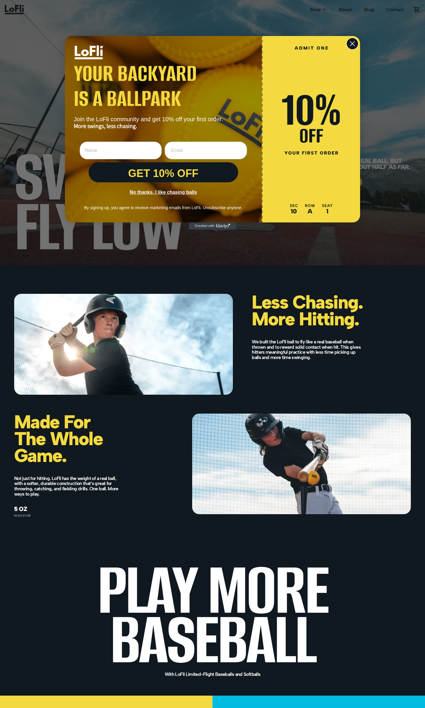
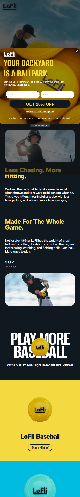

# UI Design System & Master Generation Blueprint: lofliballs-com

> **LoFli Balls—Innovative Training Tools for Youth Athletes – Lofli** (http://lofliballs.com) — LoFli Balls are weighted training tools with emulated stitching to mimic the feel of a real ball. Flying about half the distance of a sta...



---

## 1. Executive Visual Persona & Design Archetype

- **Brand Essence & Persona**: **LoFli Balls—Innovative Training Tools for Youth Athletes – Lofli** (`http://lofliballs.com`). LoFli Balls are weighted training tools with emulated stitching to mimic the feel of a real ball. Flying about half the distance of a sta...
- **Capture Provenance**: Live browser capture (`tier1_fast`, HTTP `200`, captured `2026-11-23`).
- **Visual Archetype**: **Light-Gallery WebGL / Canvas Interactive Experience (`#fafeff` / `#f4da40`)**.
- **Anti-AI-Slop Differentiators**:
  - **Live-Computed Chromatic Polarity**: Anchors the viewport in `#fafeff` (live computed `body` `background-color` (`computed_styles.json`)) paired with `#101820` primary typography and `#f4da40` accents.
  - **Grounded Typographic Hierarchy**: Pairs `Alumni Sans` for display copy (`SWING HARD FLY LOW`) with `Assistant` and not declared in live computed styles (uses primary stack / `ui-monospace`).
  - **Calibrated Spatial Grid & Motion**: Combines `1440px` container bounds (`gap: 64px`, padding `48px`) with `cubic-bezier(.34,1.56,.64,1)` easing and Lenis Smooth Scroll (`data-lenis`), Three.js / WebGL Canvas Pipeline.

---

## 2. Spatial Architecture & Modular Grid Mathematics



### Viewport Allocation & Container Geometry
- **Captured Viewport Dimensions**: Desktop `1440×2400px` (`assets/desktop.png`, clamped at 2400px live multi-section capture), Mobile `390×2400px` (`assets/mobile.png`, clamped at 2400px live multi-section capture).
- **Master Container Bounds**: `1440px` (full-bleed `100%` desktop stage measured on `1440px` viewport).
- **Canvas Lateral Padding & Spacing**: `48px` lateral canvas padding with `64px` grid gap.
- **Border Radius Scale**: `var(--radius)`, `var(--radius-full)`, `var(--radius-xs)`, `var(--radius-xl)`.

### Responsive Breakpoint Architecture
- **Desktop Layout**: Multi-column CSS Grid / Flexbox layout at `1440px` (`max-width: 1440px`, `gap: 64px`).
- **Mobile Layout**: Single-column vertical stack at `390px` viewport width with `48px` horizontal padding.
- **Extracted CSS Media Queries**: `@media (prefers-reduced-motion:reduce)`, `@media (max-width:749px)`, `@media (max-width: 749px)`, `@media (min-width: 750px)`.

---

## 3. Color System, Materiality & Atmospheric Lighting

### Semantic Palette & Source Grounding
| Semantic Role | Ground-Truth Value | Extracted Live / CSS Source |
|---|---|---|
| **Primary Canvas Substrate** | `#fafeff` | live computed `body` `background-color` (`computed_styles.json`) |
| **Primary Typography Ink** | `#101820` | live computed `main` `color` (`computed_styles.json`) |
| **Elevated Surface / Card Substrate** | `#ffffff` | `var(--jdgm-snippet-card-color)` in `:root` |
| **Interactive Accent / Highlight** | `#f4da40` | live computed `button` `color` (`computed_styles.json`) |
| **Secondary / Muted Copy** | `#7b7b7b` | `var(--jdgm-snippet-lighter-text-color)` in `:root` |
| **Structural Hairline Border** | `#ffffff` | `.gw-path__reveal { stroke: #ffffff }` |
| **Variable Token (`--color-yellow-5`)** | `#fdfbee` | `var(--color-yellow-5)` in `:root` |
| **Variable Token (`--color-yellow-50`)** | `#f8f4d9` | `var(--color-yellow-50)` in `:root` |
| **Variable Token (`--color-yellow-100`)** | `#f6eec2` | `var(--color-yellow-100)` in `:root` |
| **Variable Token (`--color-yellow-200`)** | `#f5e9a9` | `var(--color-yellow-200)` in `:root` |
| **Variable Token (`--color-yellow-300`)** | `#f4e48d` | `var(--color-yellow-300)` in `:root` |
| **Variable Token (`--color-yellow-400`)** | `#f4df6c` | `var(--color-yellow-400)` in `:root` |
| **Variable Token (`--color-yellow-600`)** | `#c9940d` | `var(--color-yellow-600)` in `:root` |
| **Variable Token (`--color-yellow-700`)** | `#8e5a0b` | `var(--color-yellow-700)` in `:root` |
| **Variable Token (`--color-yellow-800`)** | `#5d3309` | `var(--color-yellow-800)` in `:root` |
| **Variable Token (`--color-yellow-900`)** | `#361c08` | `var(--color-yellow-900)` in `:root` |
| **Variable Token (`--color-cyan-5`)** | `#f1fdff` | `var(--color-cyan-5)` in `:root` |
| **Variable Token (`--color-cyan-50`)** | `#d4edf5` | `var(--color-cyan-50)` in `:root` |
| **Variable Token (`--color-cyan-100`)** | `#b8e2ef` | `var(--color-cyan-100)` in `:root` |
| **Variable Token (`--color-cyan-200`)** | `#9bd8ea` | `var(--color-cyan-200)` in `:root` |
| **Variable Token (`--color-cyan-300`)** | `#7bcee7` | `var(--color-cyan-300)` in `:root` |

### Sanitized Root CSS Variables (`ui-ux.md` Ground Truth)
| Variable Name | Extracted Value | Semantic Role |
|---|---|---|
| `--color-yellow-5` | `#FDFBEE` | Brand / Palette Token |
| `--color-yellow-50` | `#F8F4D9` | Brand / Palette Token |
| `--color-yellow-100` | `#F6EEC2` | Brand / Palette Token |
| `--color-yellow-200` | `#F5E9A9` | Brand / Palette Token |
| `--color-yellow-300` | `#F4E48D` | Brand / Palette Token |
| `--color-yellow-400` | `#F4DF6C` | Brand / Palette Token |
| `--color-yellow-500` | `#F4DA40` | Brand / Palette Token |
| `--color-yellow-600` | `#C9940D` | Brand / Palette Token |
| `--color-yellow-700` | `#8E5A0B` | Brand / Palette Token |
| `--color-yellow-800` | `#5D3309` | Brand / Palette Token |
| `--color-yellow-900` | `#361C08` | Brand / Palette Token |
| `--color-cyan-5` | `#F1FDFF` | Brand / Palette Token |
| `--color-cyan-50` | `#D4EDF5` | Brand / Palette Token |
| `--color-cyan-100` | `#B8E2EF` | Brand / Palette Token |
| `--color-cyan-200` | `#9BD8EA` | Brand / Palette Token |
| `--color-cyan-300` | `#7BCEE7` | Brand / Palette Token |

---

## 4. Typographic Scale & Editorial Hierarchy

### Font Family Stacks
- **Display Typography**: `Alumni Sans`.
- **Primary Body Stack**: `Assistant`.
- **Technical / Metadata Stack**: not declared in live computed styles (uses primary stack / `ui-monospace`).

### Typographic Scale & Rules (Live Computed & Stylesheet Grounded)
- **Hero Display (`H1`)**: live computed `h1` (`font-size: 259.2px`, `line-height: 168.48px`, `font-weight: 700`, `letter-spacing: -7.776px`).
- **Section Heading (`H2`)**: live computed `h2` (`font-size: 63.36px`, `line-height: 57.024px`, `font-weight: 900`, `letter-spacing: -2.5344px`); rule `h2` (`font-size: calc(var(--kl-reviews-reviews...`, `line-height: 122%`, `font-weight: calc(var(--kl...`).
- **Body Copy**: live computed `body` (`font-size: 16px`, `line-height: normal`, `font-weight: 400`); CSS variables `--gw-ball-body: var(--bg-brand)`, `--font-body: Assistant, sans-serif`; rule `p` (`font-size: medium`, `line-height: normal`, `letter-spacing: normal`, `font-weight: normal`).
- **Metadata & Navigation Labels**: live computed `nav/a` (`font-size: 16px`, `line-height: normal`, `font-weight: 400`); rule `small` (`font-size: calc(var(--kl-reviews-reviews...`, `font-weight: var(--kl-revi...`).

---

## 5. Choreographed Motion & Interaction Physics

### Primary Easing Curves
- **Extracted Timing Functions**: `cubic-bezier(.34,1.56,.64,1)`, `cubic-bezier(.22,1,.36,1)`, `cubic-bezier(.55,0,.68,.3)`.

### Per-Element Transition & Choreography Rules
- **Selector `.gw-model__poster`**: `transition: opacity .3s` extracted from `lofliballs-com` stylesheet.
- **Selector `media(prefers-reduced-motion:reduce)`**: `transition: none` extracted from `lofliballs-com` stylesheet.
- **Selector `.gw-btn`**: `transition: background-color .18s ease, color .18s ease, border-color .18s...` extracted from `lofliballs-com` stylesheet.
- **Extracted Easing Curve (`cubic-bezier(.34,1.56,.64,1)`)**: Governs interactive state transitions across `<header.gw-header>` and `<section.gw-hero>`.
- **Runtime Interaction Engine**: Integrates Lenis Smooth Scroll (`data-lenis`), Three.js / WebGL Canvas Pipeline, Swiper Touch Carousel Engine with `prefers-reduced-motion: reduce` fallback guards.

---

## 6. Component Wireframe & Structural DOM Map

### Visual Layout Schematic — Desktop (`1440px`, Grounded in `dom.html` & Landmark Bounding Boxes)
```
┌────────────────────────────────────────────────────────────────────────┐
│ DESKTOP VIEWPORT (1440px) — LoFli Balls—Innovative Training Tools for  │
│ ====================================================================== │
│ [ <header.gw-header> (1440x65px)      | Shop · Shop All · LoFli Base ] │
│ ---------------------------------------------------------------------- │
│ | HERO STAGE: <section.shopify-section> (w=1440px)                   | │
│ | H1: SWING HARD FLY LOW                                             | │
│ | Substrate: #fafeff | Ink: #101820 | Accent: #f4da40                | │
│ ---------------------------------------------------------------------- │
│ | SHOWCASE GRID (<section.gw-hero>) max-w: 1440px                    | │
│ | +------------------------------+  +------------------------------+ | │
│ | | Swing hard Fly low           |  | Less Chasing. More Hitting.  | | │
│ | +------------------------------+  +------------------------------+ | │
│ ---------------------------------------------------------------------- │
│ | DETAIL MODULE (<section.shopify-section:n) — Made For The Whole Ga | │
│ ---------------------------------------------------------------------- │
│ [ FOOTER (<footer.gw-footer>  ) | http://lofliballs.com                │
└────────────────────────────────────────────────────────────────────────┘
```

### Visual Layout Schematic — Mobile Reflow (`390px`)
```
┌────────────────────────────────────────────────────────────────────────┐
│ MOBILE VIEWPORT REFLOW (390px) — Single-Column Stack (gap: 64px)       │
│ ====================================================================== │
│ [ HEADER BAR (<header.gw-header>      ) | Compact Menu (390px)         │
│ ---------------------------------------------------------------------- │
│ | HERO STAGE (<section.shopify-section) — 390px Vertical Lead        | │
│ | H1: SWING HARD FLY LOW                                             | │
│ ---------------------------------------------------------------------- │
│ | SHOWCASE STACK (<section.gw-hero>) — 1-Col Stack                   | │
│ | [ Item 1: Swing hard Fly low                                     ] | │
│ | [ Item 2: Less Chasing. More Hitting.                            ] | │
│ ---------------------------------------------------------------------- │
│ | DETAIL STACK (<section.shopify-section) — 1-Col (Made For The Whole) │
│ ---------------------------------------------------------------------- │
│ [ FOOTER (<footer.gw-footer>  ) | Stacked 390px Colophon               │
└────────────────────────────────────────────────────────────────────────┘
```

### Granular DOM Region Breakdown
1. **Brand Header & Navigation Bar (<header.gw-header> — `lofliballs-com`)**:
   - Landmark `<header class="gw-header gw-header--dark">` (`1440x65px`) hosting `LoFli Balls—Innovative Training Tool` navigation (`Shop · Shop All · LoFli Baseball · LoFli Softball · About`), DOM attributes (`data-source-attribution="shopify.exit_intersti..."`, `data-shop-id="77292208214"`, `data-venmo-supported="false"`, `data-environment="production"`), and stylesheet rule `after { box-sizing:border-box }`.
2. **Hero Stage & Focal Lead (<section.shopify-section> — `SWING HARD FLY LOW`)**:
   - Landmark `<section class="shopify-section">` presenting display lead `SWING HARD FLY LOW` and copy excerpt *"HITS LIKE A REAL BALL, BUT TRAVELS ABOUT HALF AS FAR."* over `#fafeff` canvas and `#101820` ink.
3. **Primary Showcase & Content Grid (<section.gw-hero> — `Swing hard Fly low`)**:
   - Landmark `<section class="gw-hero color-scheme-1">` rendering section `Swing hard Fly low` with copy *"Hits like a real ball, but travels about half as far."*, asset references (`destination`, `1129077949490951`, `fbevents.js`, `lofli-favicon.png`), and grid rule `.gw-type-h1 { font-size:calc(1rem * var(--type-scale) * var(--type-scale) * var(--type... }`.
4. **Interactive Detail & Feature Matrix (<section.shopify-section:nth(2)> — `Less Chasing. More Hitting.`)**:
   - Landmark `<section class="shopify-section">` framing `Less Chasing. More Hitting.` and `Made For The Whole Game.` (*"We built the LoFli ball to fly like a real baseball when thrown a"*) with `#ffffff` surface cards, `#f4da40` accents, and `.gw-type-h2 { font-size:calc(1rem * var(--type-scale) * var(--type-scale)) }`.
5. **Colophon & Global Directory Footer (<footer.gw-footer> — `http://lofliballs.com`)**:
   - Landmark `<footer class="gw-footer gw-footer--black">` anchoring `LoFli Balls—Innovative Training ` footer links (`Shop · Shop All · LoFli Baseball · LoFli Softball · About`), copy *"Not just for hitting. LoFli has the weight of a real ball, w"*, and `#ffffff` structural dividers.

---

## 7. Master Zero-Shot AI Generation Prompt

```markdown
# Master Zero-Shot Frontend Generation Prompt: lofliballs-com (LoFli Balls—Innovative Training Tools for Youth Athletes – Lofli)

You are a principal frontend architect and design systems engineer. Build a complete, production-ready web application replicating the exact design system, DOM landmarks, typographic hierarchy, color tokens, and motion physics of `lofliballs-com` (**LoFli Balls—Innovative Training Tools for Youth Athletes – Lofli** — `http://lofliballs.com`).

### 1. Visual Archetype & Anti-AI-Slop Mandates
- **Archetype**: Light-Gallery WebGL / Canvas Interactive Experience (`#fafeff` / `#f4da40`).
- **Identity & Domain Context**: LoFli Balls are weighted training tools with emulated stitching to mimic the feel of a real ball. Flying about half the distance of a sta...
- **Primary Substrate**: `#fafeff` (live computed `body` `background-color` (`computed_styles.json`)), **Primary Ink**: `#101820`, **Accent / Highlight**: `#f4da40`.
- **Site-Specific Differentiators**:
  - **Live-Computed Chromatic Polarity**: Anchors the viewport in `#fafeff` (live computed `body` `background-color` (`computed_styles.json`)) paired with `#101820` primary typography and `#f4da40` accents.
  - **Grounded Typographic Hierarchy**: Pairs `Alumni Sans` for display copy (`SWING HARD FLY LOW`) with `Assistant` and not declared in live computed styles (uses primary stack / `ui-monospace`).
  - **Calibrated Spatial Grid & Motion**: Combines `1440px` container bounds (`gap: 64px`, padding `48px`) with `cubic-bezier(.34,1.56,.64,1)` easing and Lenis Smooth Scroll (`data-lenis`), Three.js / WebGL Canvas Pipeline.

### 2. Ground-Truth CSS Variables (`:root` Token Contract)
Declare and consume these exact custom properties extracted from `lofliballs-com` in your global stylesheet:

:root {
  /* LoFli Balls—Innovative Training Tools for Youth Athletes – Lofli (lofliballs-com) — Live-Grounded CSS Variables */
  --color-yellow-5: #FDFBEE; /* Brand / Palette Token (lofliballs-com) */
  --color-yellow-50: #F8F4D9; /* Brand / Palette Token (lofliballs-com) */
  --color-yellow-100: #F6EEC2; /* Brand / Palette Token (lofliballs-com) */
  --color-yellow-200: #F5E9A9; /* Brand / Palette Token (lofliballs-com) */
  --color-yellow-300: #F4E48D; /* Brand / Palette Token (lofliballs-com) */
  --color-yellow-400: #F4DF6C; /* Brand / Palette Token (lofliballs-com) */
  --color-yellow-500: #F4DA40; /* Brand / Palette Token (lofliballs-com) */
  --color-yellow-600: #C9940D; /* Brand / Palette Token (lofliballs-com) */
  --color-yellow-700: #8E5A0B; /* Brand / Palette Token (lofliballs-com) */
  --color-yellow-800: #5D3309; /* Brand / Palette Token (lofliballs-com) */
  --color-yellow-900: #361C08; /* Brand / Palette Token (lofliballs-com) */
  --color-cyan-5: #F1FDFF; /* Brand / Palette Token (lofliballs-com) */
  --color-cyan-50: #D4EDF5; /* Brand / Palette Token (lofliballs-com) */
  --color-cyan-100: #B8E2EF; /* Brand / Palette Token (lofliballs-com) */
  --color-cyan-200: #9BD8EA; /* Brand / Palette Token (lofliballs-com) */
  --color-cyan-300: #7BCEE7; /* Brand / Palette Token (lofliballs-com) */
}

### 3. Semantic Color & Materiality Contract
Map every surface, ink, and border strictly to these source-grounded tokens:
- **Primary Canvas Substrate**: `#fafeff` — grounded in live computed `body` `background-color` (`computed_styles.json`)
- **Primary Typography Ink**: `#101820` — grounded in live computed `main` `color` (`computed_styles.json`)
- **Elevated Surface / Card Substrate**: `#ffffff` — grounded in `var(--jdgm-snippet-card-color)` in `:root`
- **Interactive Accent / Highlight**: `#f4da40` — grounded in live computed `button` `color` (`computed_styles.json`)
- **Secondary / Muted Copy**: `#7b7b7b` — grounded in `var(--jdgm-snippet-lighter-text-color)` in `:root`
- **Structural Hairline Border**: `#ffffff` — grounded in `.gw-path__reveal { stroke: #ffffff }`
- **Variable Token (`--color-yellow-5`)**: `#fdfbee` — grounded in `var(--color-yellow-5)` in `:root`
- **Variable Token (`--color-yellow-50`)**: `#f8f4d9` — grounded in `var(--color-yellow-50)` in `:root`
- **Variable Token (`--color-yellow-100`)**: `#f6eec2` — grounded in `var(--color-yellow-100)` in `:root`
- **Variable Token (`--color-yellow-200`)**: `#f5e9a9` — grounded in `var(--color-yellow-200)` in `:root`
- **Variable Token (`--color-yellow-300`)**: `#f4e48d` — grounded in `var(--color-yellow-300)` in `:root`
- **Variable Token (`--color-yellow-400`)**: `#f4df6c` — grounded in `var(--color-yellow-400)` in `:root`
- **Variable Token (`--color-yellow-600`)**: `#c9940d` — grounded in `var(--color-yellow-600)` in `:root`
- **Variable Token (`--color-yellow-700`)**: `#8e5a0b` — grounded in `var(--color-yellow-700)` in `:root`
- **Variable Token (`--color-yellow-800`)**: `#5d3309` — grounded in `var(--color-yellow-800)` in `:root`
- **Variable Token (`--color-yellow-900`)**: `#361c08` — grounded in `var(--color-yellow-900)` in `:root`
- **Variable Token (`--color-cyan-5`)**: `#f1fdff` — grounded in `var(--color-cyan-5)` in `:root`
- **Variable Token (`--color-cyan-50`)**: `#d4edf5` — grounded in `var(--color-cyan-50)` in `:root`
- **Variable Token (`--color-cyan-100`)**: `#b8e2ef` — grounded in `var(--color-cyan-100)` in `:root`
- **Variable Token (`--color-cyan-200`)**: `#9bd8ea` — grounded in `var(--color-cyan-200)` in `:root`
- **Variable Token (`--color-cyan-300`)**: `#7bcee7` — grounded in `var(--color-cyan-300)` in `:root`

### 4. Spatial Grid, Container Bounds & Responsive Breakpoints
- **Desktop Viewport Reference**: `1440×2400px` (clamped at 2400px live multi-section capture, `1440px` standard desktop width).
- **Mobile Viewport Reference**: `390×2400px` (clamped at 2400px live multi-section capture, `390px` standard mobile width).
- **Container Max-Width**: `1440px` (full-bleed `100%` desktop stage measured on `1440px` viewport)
- **Padding & Gutters**: `48px` lateral canvas padding with `64px` grid gap
- **Desktop Grid**: Multi-column CSS Grid / Flexbox layout at `1440px` (`max-width: 1440px`, `gap: 64px`)
- **Mobile Adaptation**: Single-column vertical stack at `390px` viewport width with `48px` horizontal padding
- **Media Queries**: `@media (prefers-reduced-motion:reduce)`, `@media (max-width:749px)`, `@media (max-width: 749px)`, `@media (min-width: 750px)`
- **Corner Radii**: `var(--radius)`, `var(--radius-full)`, `var(--radius-xs)`, `var(--radius-xl)`

### 5. Typography & Editorial Scale Contract
- **Display Font Stack**: `Alumni Sans`
- **Body Font Stack**: `Assistant`
- **Monospace / Technical Font Stack**: not declared in live computed styles (uses primary stack / `ui-monospace`)
- **H1 Display Rule**: live computed `h1` (`font-size: 259.2px`, `line-height: 168.48px`, `font-weight: 700`, `letter-spacing: -7.776px`)
- **H2 Section Rule**: live computed `h2` (`font-size: 63.36px`, `line-height: 57.024px`, `font-weight: 900`, `letter-spacing: -2.5344px`); rule `h2` (`font-size: calc(var(--kl-reviews-reviews...`, `line-height: 122%`, `font-weight: calc(var(--kl...`)
- **Body Copy Rule**: live computed `body` (`font-size: 16px`, `line-height: normal`, `font-weight: 400`); CSS variables `--gw-ball-body: var(--bg-brand)`, `--font-body: Assistant, sans-serif`; rule `p` (`font-size: medium`, `line-height: normal`, `letter-spacing: normal`, `font-weight: normal`)
- **Metadata & Index Rule**: live computed `nav/a` (`font-size: 16px`, `line-height: normal`, `font-weight: 400`); rule `small` (`font-size: calc(var(--kl-reviews-reviews...`, `font-weight: var(--kl-revi...`)

### 6. Component Hierarchy, Verbatim Copy & Real DOM Landmarks
Scaffold `lofliballs-com` (`LoFli Balls—Innovative Training Tools for Youth Athletes – Lofli`) with these exact structural regions, extracted copy, and CSS rules from `dom.html`:
1. **Brand Header & Navigation Bar (<header.gw-header> — `lofliballs-com`)**:
   - DOM & Selectors: Landmark `<header class="gw-header gw-header--dark">` (`1440x65px`) hosting `LoFli Balls—Innovative Training Tool` navigation (`Shop · Shop All · LoFli Baseball · LoFli Softball · About`), DOM attributes (`data-source-attribution="shopify.exit_intersti..."`, `data-shop-id="77292208214"`, `data-venmo-supported="false"`, `data-environment="production"`), and stylesheet rule `after { box-sizing:border-box }`.
   - Responsive Contract: Header `Brand Header & Navigation Bar (<header.gw-header> — `lofliballs-com`)` (`lofliballs-com`) adapts across `@media (prefers-reduced-motion:reduce)`, `@media (max-width:749px)`, `@media (max-width: 749px)`, `@media (min-width: 750px)` with `cubic-bezier(.34,1.56,.64,1)`, `cubic-bezier(.22,1,.36,1)`, `cubic-bezier(.55,0,.68,.3)` transitions and links `Shop · Shop All · LoFli Baseball · LoFli Softball · About`.
2. **Hero Stage & Focal Lead (<section.shopify-section> — `SWING HARD FLY LOW`)**:
   - DOM & Selectors: Landmark `<section class="shopify-section">` presenting display lead `SWING HARD FLY LOW` and copy excerpt *"HITS LIKE A REAL BALL, BUT TRAVELS ABOUT HALF AS FAR."* over `#fafeff` canvas and `#101820` ink.
   - Responsive Contract: Hero stage (`1440×2400px` desktop / `390×2400px` mobile) sets `#fafeff` background with `#101820` headline `SWING HARD FLY LOW`.
3. **Primary Showcase & Content Grid (<section.gw-hero> — `Swing hard Fly low`)**:
   - DOM & Selectors: Landmark `<section class="gw-hero color-scheme-1">` rendering section `Swing hard Fly low` with copy *"Hits like a real ball, but travels about half as far."*, asset references (`destination`, `1129077949490951`, `fbevents.js`, `lofli-favicon.png`), and grid rule `.gw-type-h1 { font-size:calc(1rem * var(--type-scale) * var(--type-scale) * var(--type... }`.
   - Responsive Contract: Showcase grid `Primary Showcase & Content Grid (<section.gw-hero> — `Swing hard Fly low`)` applies Multi-column CSS Grid / Flexbox layout at `1440px` (`max-width: 1440px`, `gap: 64px`) on desktop and Single-column vertical stack at `390px` viewport width with `48px` horizontal padding on mobile.
4. **Interactive Detail & Feature Matrix (<section.shopify-section:nth(2)> — `Less Chasing. More Hitting.`)**:
   - DOM & Selectors: Landmark `<section class="shopify-section">` framing `Less Chasing. More Hitting.` and `Made For The Whole Game.` (*"We built the LoFli ball to fly like a real baseball when thrown a"*) with `#ffffff` surface cards, `#f4da40` accents, and `.gw-type-h2 { font-size:calc(1rem * var(--type-scale) * var(--type-scale)) }`.
   - Responsive Contract: Detail module `Interactive Detail & Feature Matrix (<section.shopify-section:nth(2)> — `Less Chasing. More Hitting.`)` uses `var(--radius)`, `var(--radius-full)`, `var(--radius-xs)`, `var(--radius-xl)` radii, `#f4da40` highlights, and assets (destination, 1129077949490951, fbevents.js).
5. **Colophon & Global Directory Footer (<footer.gw-footer> — `http://lofliballs.com`)**:
   - DOM & Selectors: Landmark `<footer class="gw-footer gw-footer--black">` anchoring `LoFli Balls—Innovative Training ` footer links (`Shop · Shop All · LoFli Baseball · LoFli Softball · About`), copy *"Not just for hitting. LoFli has the weight of a real ball, w"*, and `#ffffff` structural dividers.
   - Responsive Contract: Footer `Colophon & Global Directory Footer (<footer.gw-footer> — `http://lofliballs.com`)` aligns to `1440px` (full-bleed `100%` desktop stage measured on `1440px` viewport) with `48px` lateral canvas padding with `64px` grid gap and attributes (data-source-attribution="shopify.exit_intersti...", data-shop-id="77292208214", data-venmo-supported="false").

#### Verbatim DOM Copy Excerpts (`dom.html`)
- Copy Excerpt 1: *"HITS LIKE A REAL BALL, BUT TRAVELS ABOUT HALF AS FAR."*
- Copy Excerpt 2: *"Hits like a real ball, but travels about half as far."*
- Copy Excerpt 3: *"We built the LoFli ball to fly like a real baseball when thrown and to reward soli..."*
- Copy Excerpt 4: *"Not just for hitting. LoFli has the weight of a real ball, with a softer, durable..."*

### 7. Motion, Extracted Stylesheet Rules & Interaction Choreography
- **Primary Easing Functions**: `cubic-bezier(.34,1.56,.64,1)`, `cubic-bezier(.22,1,.36,1)`, `cubic-bezier(.55,0,.68,.3)`
- **Extracted Stylesheet Rules (`lofliballs-com`)**:
- `after { box-sizing:border-box }`
- `.gw-type-h1 { font-size:calc(1rem * var(--type-scale) * var(--type-scale) * var(--type... }`
- `.gw-type-h2 { font-size:calc(1rem * var(--type-scale) * var(--type-scale)) }`
- `.gw-type-h3 { font-size:calc(1rem * var(--type-scale)) }`
- `img { max-width:100%;height:auto;display:block }`
- **Per-Selector Transition Rules**:
- **Selector `.gw-model__poster`**: `transition: opacity .3s` extracted from `lofliballs-com` stylesheet.
- **Selector `media(prefers-reduced-motion:reduce)`**: `transition: none` extracted from `lofliballs-com` stylesheet.
- **Selector `.gw-btn`**: `transition: background-color .18s ease, color .18s ease, border-color .18s...` extracted from `lofliballs-com` stylesheet.
- **Extracted Easing Curve (`cubic-bezier(.34,1.56,.64,1)`)**: Governs interactive state transitions across `<header.gw-header>` and `<section.gw-hero>`.
- **Runtime Interaction Engine**: Integrates Lenis Smooth Scroll (`data-lenis`), Three.js / WebGL Canvas Pipeline, Swiper Touch Carousel Engine with `prefers-reduced-motion: reduce` fallback guards.

### 8. Technical Deliverables
- Implement in Next.js (App Router) with TypeScript and Tailwind CSS consuming the `:root` custom properties defined above for `lofliballs-com`.
- Reproduce both the `1440px` desktop architecture and `390px` mobile breakpoint transitions, preserving semantic HTML5 landmarks (`<header>`, `<nav>`, `<main>`, `<section>`, `<footer>`) and `prefers-reduced-motion` accessibility guards.
```
