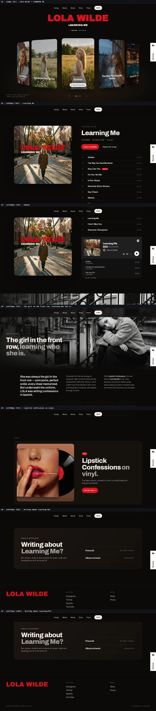
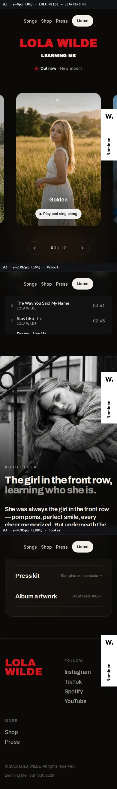

# UI Design System & Master Generation Blueprint: lolawilde-com

> **LOLA WILDE — Learning Me** (https://lolawilde.com/) — Learning Me, the new album by LOLA WILDE. Listen on Spotify and read the lyrics.





---

## 1. Executive Visual Persona & Design Archetype

- **Brand Essence & Persona**: **LOLA WILDE — Learning Me** (`https://lolawilde.com/`). Learning Me, the new album by LOLA WILDE. Listen on Spotify and read the lyrics.
- **Capture Provenance**: Live browser capture (`tier1_fast`, HTTP `200`, captured `2026-11-24`).
- **Visual Archetype**: **High-Contrast Obsidian / Atmospheric Design System (`#0b0a09` canvas, `#f3eee7` ink, `#ff0000` accent)**.
- **Anti-AI-Slop Differentiators**:
  - **Live-Computed Chromatic Polarity**: Anchors the viewport in `#0b0a09` (live computed `body` `background-color` (`computed_styles.json`)) paired with `#f3eee7` primary typography and `#ff0000` accents.
  - **Grounded Typographic Hierarchy**: Uses `Inter` across display (`LOLA WILDE — LEARNING ME`) and body copy, paired with `SpotifyMixMono` for monospace/code.
  - **Calibrated Spatial Grid & Motion**: Combines `1440px` container bounds (`gap: 4px`, padding `56px`) with `cubic-bezier(0.3,0,0,1)` easing.

---

## 2. Spatial Architecture & Modular Grid Mathematics

### Viewport Allocation & Container Geometry
- **Captured Journey Filmstrips**: Desktop `1280×5796px` (`assets/desktop-journey.webp`, `7` keyframes up to `y=4352px` / doc `5252px`), Mobile `390×2616px` (`assets/mobile-journey.webp`, `3` keyframes).
- **Master Container Bounds**: `1440px` (full-bleed `100%` desktop stage measured on `1440px` viewport).
- **Canvas Lateral Padding & Spacing**: `56px` lateral canvas padding with `4px` grid gap.
- **Border Radius Scale**: `22px`, `48px`, `.25rem`, `4px`.

### Responsive Breakpoint Architecture
- **Desktop Layout**: Multi-column CSS Grid / Flexbox layout at `1440px` (`max-width: 1440px`, `gap: 4px`).
- **Mobile Layout**: Single-column vertical stack at `390px` viewport width with `56px` horizontal padding.
- **Extracted CSS Media Queries**: `@media (max-height:550px)`, `@media (max-height:200px)`, `@media (max-height:130px)`, `@media (max-width:359px)`.

---

## 3. Color System, Materiality & Atmospheric Lighting

### Semantic Palette & Source Grounding
| Semantic Role | Ground-Truth Value | Extracted Live / CSS Source |
|---|---|---|
| **Primary Canvas Substrate** | `#0b0a09` | live computed `body` `background-color` (`computed_styles.json`) |
| **Primary Typography Ink** | `#f3eee7` | live computed `h1` `color` (`computed_styles.json`) |
| **Elevated Surface / Card Substrate** | `#1d1915` | live computed `button` `background-color` (`computed_styles.json`) |
| **Interactive Accent / Highlight** | `#ff0000` | `.btn-red { background: red }` (`#ff0000`) |
| **Secondary / Muted Copy** | `#f3727f` | `var(--text-negative)` in `:root` |
| **Structural Hairline Border** | `#272524` | `var(--line)` in `:root` (`rgba(243,238,231,.12)`) |
| **Variable Token (`--bg-2`)** | `#14110e` | `var(--bg-2)` in `:root` |
| **Variable Token (`--red`)** | `#d9141f` | `var(--red)` in `:root` |
| **Variable Token (`--amber`)** | `#c8823a` | `var(--amber)` in `:root` |

### Sanitized Root CSS Variables (`ui-ux.md` Ground Truth)
| Variable Name | Extracted Value | Semantic Role |
|---|---|---|
| `--bg` | `#0b0a09` | Canvas / Surface Token |
| `--bg-2` | `#14110e` | Canvas / Surface Token |
| `--bg-3` | `#1d1915` | Canvas / Surface Token |
| `--ink` | `#f3eee7` | Typography Ink Token |
| `--ink-2` | `rgba(243,238,231,.66)` | Typography Ink Token |
| `--ink-3` | `rgba(243,238,231,.38)` | Typography Ink Token |
| `--line` | `rgba(243,238,231,.12)` | Color / Atmospheric Token |
| `--red` | `#d9141f` | Color / Atmospheric Token |
| `--amber` | `#c8823a` | Color / Atmospheric Token |
| `--serif` | `'Archivo', 'Helvetica Neue', Arial, sans-serif` | Typography / Scale Token |
| `--sans` | `'Inter', system-ui, -apple-system, 'Segoe UI', sans-serif` | Typography / Scale Token |
| `--display` | `'Archivo Black', 'Arial Black', sans-serif` | Dimension / Scale Token |
| `--radius` | `22px` | Elevation / Border Token |
| `--card-h` | `min(52vh, 500px)` | Dimension / Scale Token |
| `--card-w` | `calc(var(--card-h) * .64)` | Design System Custom Token |
| `--trans-x` | `0px` | Dimension / Scale Token |

---

## 4. Typographic Scale & Editorial Hierarchy

### Font Family Stacks
- **Display Typography**: `Inter`.
- **Primary Body Stack**: `Inter`.
- **Technical / Metadata Stack**: `SpotifyMixMono`.

### Typographic Scale & Rules (Live Computed & Stylesheet Grounded)
- **Hero Display (`H1`)**: live computed `h1` (`font-size: 32px`, `line-height: 48px`, `font-weight: 700`); CSS variables `--display: 'Archivo Black', 'Arial Black', sans-serif`, `--text-link-standalone-display: block`, `--encore-overlay-trigger-display: block`.
- **Section Heading (`H2`)**: live computed `h2` (`font-size: 60.8px`, `line-height: 60.8px`, `font-weight: 800`, `letter-spacing: -2.128px`); rule `.h2` (`font-size: clamp(2.1rem,4.6vw,3.8rem)`, `line-height: 1`, `letter-spacing: -.035em`, `font-weight: 800`).
- **Body Copy**: live computed `body` (`font-size: 16px`, `line-height: 24px`, `font-weight: 400`); rule `body` (`font-size: 16px`, `line-height: 1.5`).
- **Metadata & Navigation Labels**: live computed `nav/a` (`font-size: 16px`, `line-height: 24px`, `font-weight: 400`); CSS variables `--encore-text-size-smaller-3: 0.625rem`, `--encore-text-size-smaller-2: 0.75rem`, `--encore-text-size-smaller: 0.875rem`; rule `.meta` (`font-size: 14px`).

---

## 5. Choreographed Motion & Interaction Physics

### Primary Easing Curves
- **Extracted Timing Functions**: `cubic-bezier(0.3,0,0,1)`, `cubic-bezier(0,0,0.2,1)`, `cubic-bezier(0.8,0,1,1)`.

### Per-Element Transition & Choreography Rules
- **Selector `.PreSaveButton_preSaveButton__6lI...`**: `transition: transform .3s ease-in-out` extracted from `lolawilde-com` stylesheet.
- **Selector `media(prefers-reduced-motion:reduce)`**: `transition: .01ms!important` extracted from `lolawilde-com` stylesheet.
- **Selector `tifyButton_saveOnSpotifyButton__Q...`**: `transition: transform .3s ease-in-out` extracted from `lolawilde-com` stylesheet.
- **Extracted Easing Curve (`cubic-bezier(0.3,0,0,1)`)**: Governs interactive state transitions across `<header.nav>` and `<section.blk>`.
- **State & Hover Choreography**: Opacity and transform transitions on `<section.hero>` and `<section.blk>` interactive targets.
### Measured Runtime Scroll & Interaction Telemetry (`behavioral_journey_v2`)
- **Scroll Driver Mode**: `native` (max document height `5252px`, deepest scrollY reached `4352px` across `7` desktop keyframes).
- **Detected Scroll / Motion Libraries**: Native browser scroll / standard CSS transitions.
- **Hover Physics (`primary_cta` · `01 Golden ▶ Play and sing along`)**: Computed transition `0s` / `ease` (no static color/transform shift captured at rest).
- **Hover Physics (`first_card` · `02 The Way You Said My Name ▶ Pla...`)**: Computed transition `0s` / `ease` (no static color/transform shift captured at rest).
- **Interactive Control Probe (`carousel_next` · `Next song`)**: Triggered visual diff `13.099` (attr ` -> `, captured in `assets/state-interactive.webp`).
- **Route Transition Architecture**: First internal navigation (`/press.html`) measured as `MPA` in `1745ms`.

---

## 6. Component Wireframe & Structural DOM Map

### Visual Layout Schematic — Desktop (`1440px`, Grounded in `dom.html` & Landmark Bounding Boxes)
```
┌────────────────────────────────────────────────────────────────────────┐
│ DESKTOP VIEWPORT (1440px) — LOLA WILDE — Learning Me                   │
│ ====================================================================== │
│ [ <header.nav> (1440x82px)            | Songs · Album · About · Shop ] │
│ ---------------------------------------------------------------------- │
│ | HERO STAGE: <section.hero> (w=1440px)                              | │
│ | H1: LOLA WILDE — LEARNING ME                                       | │
│ | Substrate: #0b0a09 | Ink: #f3eee7 | Accent: #ff0000                | │
│ ---------------------------------------------------------------------- │
│ | SHOWCASE GRID (<section.blk>) max-w: 1440px                        | │
│ | +------------------------------+  +------------------------------+ | │
│ | | LOLA WILDE — Learning Me     |  | The girl in the front row, l | | │
│ | +------------------------------+  +------------------------------+ | │
│ ---------------------------------------------------------------------- │
│ | DETAIL MODULE (<section.about-sec>) — Lipstick Confessions         | │
│ ---------------------------------------------------------------------- │
│ [ FOOTER (<footer.pill>       ) | https://lolawilde.com/               │
└────────────────────────────────────────────────────────────────────────┘
```

### Visual Layout Schematic — Mobile Reflow (`390px`)
```
┌────────────────────────────────────────────────────────────────────────┐
│ MOBILE VIEWPORT REFLOW (390px) — Single-Column Stack (gap: 4px)        │
│ ====================================================================== │
│ [ HEADER BAR (<header.nav>            ) | Compact Menu (390px)         │
│ ---------------------------------------------------------------------- │
│ | HERO STAGE (<section.hero>) — 390px Vertical Lead                  | │
│ | H1: LOLA WILDE — LEARNING ME                                       | │
│ ---------------------------------------------------------------------- │
│ | SHOWCASE STACK (<section.blk>) — 1-Col Stack                       | │
│ | [ Item 1: LOLA WILDE — Learning Me                               ] | │
│ | [ Item 2: The girl in the front row, learning who she is.        ] | │
│ ---------------------------------------------------------------------- │
│ | DETAIL STACK (<section.about-sec>) — 1-Col (Lipstick Confessio)    | │
│ ---------------------------------------------------------------------- │
│ [ FOOTER (<footer.pill>       ) | Stacked 390px Colophon               │
└────────────────────────────────────────────────────────────────────────┘
```

### Granular DOM Region Breakdown
1. **Brand Header & Navigation Bar (<header.nav> — `lolawilde-com`)**:
   - Landmark `<header class="nav">` (`1440x82px`) hosting `LOLA WILDE — Learning Me` navigation (`Songs · Album · About · Shop · Press`), DOM attributes (`data-album-title`, `data-i="0"`, `data-i="1"`, `data-i="2"`), and stylesheet rule `.Error_wrapper__7m1Fk { display:flex;align-items:center;flex-direction:column }`.
2. **Hero Stage & Focal Lead (<section.hero> — `LOLA WILDE — LEARNING ME`)**:
   - Landmark `<section class="hero">` presenting display lead `LOLA WILDE — LEARNING ME` and copy excerpt *"Out now · New album"* over `#0b0a09` canvas and `#f3eee7` ink.
3. **Primary Showcase & Content Grid (<section.blk> — `LOLA WILDE — Learning Me`)**:
   - Landmark `<section class="blk">` rendering section `LOLA WILDE — Learning Me` with copy *"▶ Play and sing along"*, asset references (`favicon.svg`, `favicon-32.png`, `apple-touch-icon.png`, `fonts.googleapis.com`), and grid rule `.Error_title__KvfPv { font-size:48px;line-height:1;letter-spacing:-.04em;margin:40px 0 16px;fo... }`.
4. **Interactive Detail & Feature Matrix (<section.about-sec> — `The girl in the front row, learnin`)**:
   - Landmark `<section class="about-sec">` framing `The girl in the front row, learning who she is.` and `Lipstick Confessions on vinyl.` (*"The Way You Said My Name"*) with `#1d1915` surface cards, `#ff0000` accents, and `.Error_description__h_wjs { line-height:24px;max-width:507px;margin:0 0 40px;font-weight:200;display... }`.
5. **Colophon & Global Directory Footer (<footer.pill> — `https://lolawilde.com/`)**:
   - Landmark `<footer class="pill">` anchoring `LOLA WILDE — Learning Me` footer links (`Songs · Album · About · Shop · Press`), copy *"Someone Else’s Version"*, and `#272524` structural dividers.
### Full Vertical Scroll Sequence (Desktop `1440×900` Keyframes)
- **Step 01** (`y=0px`, `0%`): Active landmark `LOLA WILDE — LEARNING ME` · sticky/fixed elements: `2`
- **Step 02** (`y=850px`, `20%`): Active landmark `Learning Me` · sticky/fixed elements: `3`
- **Step 03** (`y=1700px`, `39%`): Active landmark `#about` · sticky/fixed elements: `3`
- **Step 04** (`y=2550px`, `59%`): Active landmark `The girl in the front row, learning who she is.` · sticky/fixed elements: `2`
- **Step 05** (`y=3400px`, `78%`): Active landmark `Lipstick Confessions on vinyl.` · sticky/fixed elements: `2`
- **Step 06** (`y=4250px`, `98%`): Active landmark `Writing about Learning Me?` · sticky/fixed elements: `2`
- **Step 07** (`y=4352px`, `100%`): Active landmark `Writing about Learning Me?` · sticky/fixed elements: `2`

### Multi-Page Internal Route Map
- **Other Route (`/press.html`)**: `https://lolawilde.com/press.html` — H1: `LOLA WILDE LEARNING ME — OUT OCTOBER 16, 2026`, scrollHeight `6553px`, transition `MPA` (`1745ms`)

---

## 7. Master Zero-Shot AI Generation Prompt

```markdown
# Master Zero-Shot Frontend Generation Prompt: lolawilde-com (LOLA WILDE — Learning Me)

You are a principal frontend architect and design systems engineer. Build a complete, production-ready web application replicating the exact design system, DOM landmarks, typographic hierarchy, color tokens, and motion physics of `lolawilde-com` (**LOLA WILDE — Learning Me** — `https://lolawilde.com/`).

### 1. Visual Archetype & Anti-AI-Slop Mandates
- **Archetype**: High-Contrast Obsidian / Atmospheric Design System (`#0b0a09` canvas, `#f3eee7` ink, `#ff0000` accent).
- **Identity & Domain Context**: Learning Me, the new album by LOLA WILDE. Listen on Spotify and read the lyrics.
- **Primary Substrate**: `#0b0a09` (live computed `body` `background-color` (`computed_styles.json`)), **Primary Ink**: `#f3eee7`, **Accent / Highlight**: `#ff0000`.
- **Site-Specific Differentiators**:
  - **Live-Computed Chromatic Polarity**: Anchors the viewport in `#0b0a09` (live computed `body` `background-color` (`computed_styles.json`)) paired with `#f3eee7` primary typography and `#ff0000` accents.
  - **Grounded Typographic Hierarchy**: Uses `Inter` across display (`LOLA WILDE — LEARNING ME`) and body copy, paired with `SpotifyMixMono` for monospace/code.
  - **Calibrated Spatial Grid & Motion**: Combines `1440px` container bounds (`gap: 4px`, padding `56px`) with `cubic-bezier(0.3,0,0,1)` easing.

### 2. Ground-Truth CSS Variables (`:root` Token Contract)
Declare and consume these exact custom properties extracted from `lolawilde-com` in your global stylesheet:

:root {
  /* LOLA WILDE — Learning Me (lolawilde-com) — Live-Grounded CSS Variables */
  --bg: #0b0a09; /* Canvas / Surface Token (lolawilde-com) */
  --bg-2: #14110e; /* Canvas / Surface Token (lolawilde-com) */
  --bg-3: #1d1915; /* Canvas / Surface Token (lolawilde-com) */
  --ink: #f3eee7; /* Typography Ink Token (lolawilde-com) */
  --ink-2: rgba(243,238,231,.66); /* Typography Ink Token (lolawilde-com) */
  --ink-3: rgba(243,238,231,.38); /* Typography Ink Token (lolawilde-com) */
  --line: rgba(243,238,231,.12); /* Color / Atmospheric Token (lolawilde-com) */
  --red: #d9141f; /* Color / Atmospheric Token (lolawilde-com) */
  --amber: #c8823a; /* Color / Atmospheric Token (lolawilde-com) */
  --serif: 'Archivo', 'Helvetica Neue', Arial, sans-serif; /* Typography / Scale Token (lolawilde-com) */
  --sans: 'Inter', system-ui, -apple-system, 'Segoe UI', sans-serif; /* Typography / Scale Token (lolawilde-com) */
  --display: 'Archivo Black', 'Arial Black', sans-serif; /* Dimension / Scale Token (lolawilde-com) */
  --radius: 22px; /* Elevation / Border Token (lolawilde-com) */
  --card-h: min(52vh, 500px); /* Dimension / Scale Token (lolawilde-com) */
  --card-w: calc(var(--card-h) * .64); /* Design System Custom Token (lolawilde-com) */
  --trans-x: 0px; /* Dimension / Scale Token (lolawilde-com) */
}

### 3. Semantic Color & Materiality Contract
Map every surface, ink, and border strictly to these source-grounded tokens:
- **Primary Canvas Substrate**: `#0b0a09` — grounded in live computed `body` `background-color` (`computed_styles.json`)
- **Primary Typography Ink**: `#f3eee7` — grounded in live computed `h1` `color` (`computed_styles.json`)
- **Elevated Surface / Card Substrate**: `#1d1915` — grounded in live computed `button` `background-color` (`computed_styles.json`)
- **Interactive Accent / Highlight**: `#ff0000` — grounded in `.btn-red { background: red }` (`#ff0000`)
- **Secondary / Muted Copy**: `#f3727f` — grounded in `var(--text-negative)` in `:root`
- **Structural Hairline Border**: `#272524` — grounded in `var(--line)` in `:root` (`rgba(243,238,231,.12)`)
- **Variable Token (`--bg-2`)**: `#14110e` — grounded in `var(--bg-2)` in `:root`
- **Variable Token (`--red`)**: `#d9141f` — grounded in `var(--red)` in `:root`
- **Variable Token (`--amber`)**: `#c8823a` — grounded in `var(--amber)` in `:root`

### 4. Spatial Grid, Container Bounds & Responsive Breakpoints
- **Desktop Viewport Reference**: `1280×5796px` (multi-frame vertical journey filmstrip (5796px), `1440px` standard desktop width).
- **Mobile Viewport Reference**: `390×2616px` (multi-frame vertical journey filmstrip (2616px), `390px` standard mobile width).
- **Container Max-Width**: `1440px` (full-bleed `100%` desktop stage measured on `1440px` viewport)
- **Padding & Gutters**: `56px` lateral canvas padding with `4px` grid gap
- **Desktop Grid**: Multi-column CSS Grid / Flexbox layout at `1440px` (`max-width: 1440px`, `gap: 4px`)
- **Mobile Adaptation**: Single-column vertical stack at `390px` viewport width with `56px` horizontal padding
- **Media Queries**: `@media (max-height:550px)`, `@media (max-height:200px)`, `@media (max-height:130px)`, `@media (max-width:359px)`
- **Corner Radii**: `22px`, `48px`, `.25rem`, `4px`

### 5. Typography & Editorial Scale Contract
- **Display Font Stack**: `Inter`
- **Body Font Stack**: `Inter`
- **Monospace / Technical Font Stack**: `SpotifyMixMono`
- **H1 Display Rule**: live computed `h1` (`font-size: 32px`, `line-height: 48px`, `font-weight: 700`); CSS variables `--display: 'Archivo Black', 'Arial Black', sans-serif`, `--text-link-standalone-display: block`, `--encore-overlay-trigger-display: block`
- **H2 Section Rule**: live computed `h2` (`font-size: 60.8px`, `line-height: 60.8px`, `font-weight: 800`, `letter-spacing: -2.128px`); rule `.h2` (`font-size: clamp(2.1rem,4.6vw,3.8rem)`, `line-height: 1`, `letter-spacing: -.035em`, `font-weight: 800`)
- **Body Copy Rule**: live computed `body` (`font-size: 16px`, `line-height: 24px`, `font-weight: 400`); rule `body` (`font-size: 16px`, `line-height: 1.5`)
- **Metadata & Index Rule**: live computed `nav/a` (`font-size: 16px`, `line-height: 24px`, `font-weight: 400`); CSS variables `--encore-text-size-smaller-3: 0.625rem`, `--encore-text-size-smaller-2: 0.75rem`, `--encore-text-size-smaller: 0.875rem`; rule `.meta` (`font-size: 14px`)

### 6. Component Hierarchy, Verbatim Copy & Real DOM Landmarks
Scaffold `lolawilde-com` (`LOLA WILDE — Learning Me`) with these exact structural regions, extracted copy, and CSS rules from `dom.html`:
1. **Brand Header & Navigation Bar (<header.nav> — `lolawilde-com`)**:
   - DOM & Selectors: Landmark `<header class="nav">` (`1440x82px`) hosting `LOLA WILDE — Learning Me` navigation (`Songs · Album · About · Shop · Press`), DOM attributes (`data-album-title`, `data-i="0"`, `data-i="1"`, `data-i="2"`), and stylesheet rule `.Error_wrapper__7m1Fk { display:flex;align-items:center;flex-direction:column }`.
   - Responsive Contract: Header `Brand Header & Navigation Bar (<header.nav> — `lolawilde-com`)` (`lolawilde-com`) adapts across `@media (max-height:550px)`, `@media (max-height:200px)`, `@media (max-height:130px)`, `@media (max-width:359px)` with `cubic-bezier(0.3,0,0,1)`, `cubic-bezier(0,0,0.2,1)`, `cubic-bezier(0.8,0,1,1)` transitions and links `Songs · Album · About · Shop · Press`.
2. **Hero Stage & Focal Lead (<section.hero> — `LOLA WILDE — LEARNING ME`)**:
   - DOM & Selectors: Landmark `<section class="hero">` presenting display lead `LOLA WILDE — LEARNING ME` and copy excerpt *"Out now · New album"* over `#0b0a09` canvas and `#f3eee7` ink.
   - Responsive Contract: Hero stage (`1280×5796px` desktop / `390×2616px` mobile) sets `#0b0a09` background with `#f3eee7` headline `LOLA WILDE — LEARNING ME`.
3. **Primary Showcase & Content Grid (<section.blk> — `LOLA WILDE — Learning Me`)**:
   - DOM & Selectors: Landmark `<section class="blk">` rendering section `LOLA WILDE — Learning Me` with copy *"▶ Play and sing along"*, asset references (`favicon.svg`, `favicon-32.png`, `apple-touch-icon.png`, `fonts.googleapis.com`), and grid rule `.Error_title__KvfPv { font-size:48px;line-height:1;letter-spacing:-.04em;margin:40px 0 16px;fo... }`.
   - Responsive Contract: Showcase grid `Primary Showcase & Content Grid (<section.blk> — `LOLA WILDE — Learning Me`)` applies Multi-column CSS Grid / Flexbox layout at `1440px` (`max-width: 1440px`, `gap: 4px`) on desktop and Single-column vertical stack at `390px` viewport width with `56px` horizontal padding on mobile.
4. **Interactive Detail & Feature Matrix (<section.about-sec> — `The girl in the front row, learnin`)**:
   - DOM & Selectors: Landmark `<section class="about-sec">` framing `The girl in the front row, learning who she is.` and `Lipstick Confessions on vinyl.` (*"The Way You Said My Name"*) with `#1d1915` surface cards, `#ff0000` accents, and `.Error_description__h_wjs { line-height:24px;max-width:507px;margin:0 0 40px;font-weight:200;display... }`.
   - Responsive Contract: Detail module `Interactive Detail & Feature Matrix (<section.about-sec> — `The girl in the front row, learnin`)` uses `22px`, `48px`, `.25rem`, `4px` radii, `#ff0000` highlights, and assets (favicon.svg, favicon-32.png, apple-touch-icon.png).
5. **Colophon & Global Directory Footer (<footer.pill> — `https://lolawilde.com/`)**:
   - DOM & Selectors: Landmark `<footer class="pill">` anchoring `LOLA WILDE — Learning Me` footer links (`Songs · Album · About · Shop · Press`), copy *"Someone Else’s Version"*, and `#272524` structural dividers.
   - Responsive Contract: Footer `Colophon & Global Directory Footer (<footer.pill> — `https://lolawilde.com/`)` aligns to `1440px` (full-bleed `100%` desktop stage measured on `1440px` viewport) with `56px` lateral canvas padding with `4px` grid gap and attributes (data-album-title, data-i="0", data-i="1").

#### Verbatim DOM Copy Excerpts (`dom.html`)
- Copy Excerpt 1: *"Out now · New album"*
- Copy Excerpt 2: *"▶ Play and sing along"*
- Copy Excerpt 3: *"The Way You Said My Name"*
- Copy Excerpt 4: *"Someone Else’s Version"*

### 7. Motion, Extracted Stylesheet Rules & Interaction Choreography
- **Primary Easing Functions**: `cubic-bezier(0.3,0,0,1)`, `cubic-bezier(0,0,0.2,1)`, `cubic-bezier(0.8,0,1,1)`
- **Extracted Stylesheet Rules (`lolawilde-com`)**:
- `.Error_wrapper__7m1Fk { display:flex;align-items:center;flex-direction:column }`
- `.Error_title__KvfPv { font-size:48px;line-height:1;letter-spacing:-.04em;margin:40px 0 16px;fo... }`
- `.Error_description__h_wjs { line-height:24px;max-width:507px;margin:0 0 40px;font-weight:200;display... }`
- `.Error_links__WY7mc { display:flex;flex-direction:column;align-items:center }`
- `.Error_links__WY7mc a { font-size:1em;font-weight:700;text-decoration:none }`
- **Per-Selector Transition Rules**:
- **Selector `.PreSaveButton_preSaveButton__6lI...`**: `transition: transform .3s ease-in-out` extracted from `lolawilde-com` stylesheet.
- **Selector `media(prefers-reduced-motion:reduce)`**: `transition: .01ms!important` extracted from `lolawilde-com` stylesheet.
- **Selector `tifyButton_saveOnSpotifyButton__Q...`**: `transition: transform .3s ease-in-out` extracted from `lolawilde-com` stylesheet.
- **Extracted Easing Curve (`cubic-bezier(0.3,0,0,1)`)**: Governs interactive state transitions across `<header.nav>` and `<section.blk>`.
- **State & Hover Choreography**: Opacity and transform transitions on `<section.hero>` and `<section.blk>` interactive targets.
### 7b. Full-Page Scroll Choreography, Interactive States & Multi-Page Routes
- **Scroll Mechanics**: Implement `native` vertical progression up to `5252px` across 7 distinct viewport chapters.
- **Vertical Chapter Sequence**: LOLA WILDE — LEARNING ME (0%) -> Learning Me (20%) -> #about (39%) -> The girl in the front row,... (59%) -> Lipstick Confessions on vinyl. (78%) -> Writing about Learning Me? (98%) -> Writing about Learning Me? (100%).
- **Multi-Page Routes**: Scaffold internal routes `/press.html` (other, MPA) sharing the global header/footer shell and design tokens.

### 8. Technical Deliverables
- Implement in Next.js (App Router) with TypeScript and Tailwind CSS consuming the `:root` custom properties defined above for `lolawilde-com`.
- Reproduce both the `1440px` desktop architecture and `390px` mobile breakpoint transitions, preserving semantic HTML5 landmarks (`<header>`, `<nav>`, `<main>`, `<section>`, `<footer>`) and `prefers-reduced-motion` accessibility guards.
```
---

## 8. Full-Page Scroll Journey, Interactive States & Subpage Inventory

### Desktop Scroll Keyframes (`1440×900` WebP)
| Step | Scroll Y | Progress | Active Landmark / Section | Sticky/Fixed | Visual Asset |
| :---: | :---: | :---: | :--- | :---: | :--- |
| `#01` | `0px` | `0%` | LOLA WILDE — LEARNING ME | `2` | [desktop-step-01.webp](assets/desktop-step-01.webp) |
| `#02` | `850px` | `20%` | Learning Me | `3` | [desktop-step-02.webp](assets/desktop-step-02.webp) |
| `#03` | `1700px` | `39%` | #about | `3` | [desktop-step-03.webp](assets/desktop-step-03.webp) |
| `#04` | `2550px` | `59%` | The girl in the front row, learning who she is. | `2` | [desktop-step-04.webp](assets/desktop-step-04.webp) |
| `#05` | `3400px` | `78%` | Lipstick Confessions on vinyl. | `2` | [desktop-step-05.webp](assets/desktop-step-05.webp) |
| `#06` | `4250px` | `98%` | Writing about Learning Me? | `2` | [desktop-step-06.webp](assets/desktop-step-06.webp) |
| `#07` | `4352px` | `100%` | Writing about Learning Me? | `2` | [desktop-step-07.webp](assets/desktop-step-07.webp) |

### Mobile Condensed Keyframes (`390×844` WebP)
| Step | Scroll Y | Progress | Active Landmark | Visual Asset |
| :---: | :---: | :---: | :--- | :--- |
| `#01` | `0px` | `0%` | LOLA WILDE — LEARNING ME | [mobile-step-01.webp](assets/mobile-step-01.webp) |
| `#02` | `2392px` | `50%` | #about | [mobile-step-02.webp](assets/mobile-step-02.webp) |
| `#03` | `4785px` | `100%` | Footer | [mobile-step-03.webp](assets/mobile-step-03.webp) |

### Interactive UI State Captures (`1440×900` WebP)
| State Type | Trigger / Observation | Visual Asset |
| :--- | :--- | :--- |
| `interactive_control` | Control `carousel_next` (`Next song`, diff `13.099`) | [state-interactive.webp](assets/state-interactive.webp) |

### Internal Subpage Filmstrips (`1080px` Wide WebP)
| # | Template | Route URL | H1 / Title | Scroll Height | Transition | Filmstrip Asset |
| :-: | :---: | :--- | :--- | :---: | :---: | :--- |
| `1` | `other` | `https://lolawilde.com/press.html` | LOLA WILDE LEARNING ME — OUT OCTOBER... | `6553px` | `MPA` (`1745ms`) | [subpage-01-press-html.webp](assets/subpage-01-press-html.webp) |

