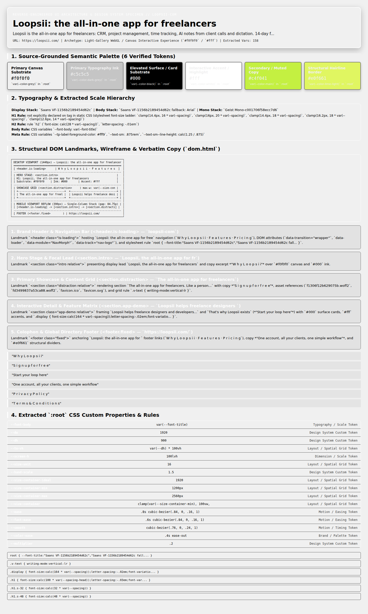
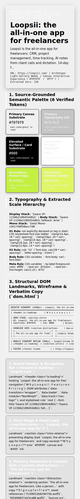

# UI Design System & Master Generation Blueprint: loopsii-com

> **Loopsii: the all-in-one app for freelancers** (https://loopsii.com/) — Loopsii is the all-in-one app for freelancers: CRM, project management, time tracking, AI notes from client calls and dictation. 14-day f...



---

## 1. Executive Visual Persona & Design Archetype

- **Brand Essence & Persona**: **Loopsii: the all-in-one app for freelancers** (`https://loopsii.com/`). Loopsii is the all-in-one app for freelancers: CRM, project management, time tracking, AI notes from client calls and dictation. 14-day f...
- **Visual Archetype**: **Light-Gallery WebGL / Canvas Interactive Experience (`#f0f0f0` / `#fff`)**.
- **Anti-AI-Slop Differentiators**:
  - **Source-Grounded Chromatic Polarity**: Anchors the viewport in `#f0f0f0` (`var(--color-grey)` in `:root`) paired with `#000` primary typography and `#fff` accents.
  - **Extracted Typographic Hierarchy**: Pairs `Saans VF-1156b2189454d62c` for display copy (`Loopsii, the all-in-one app for free`) with `Saans VF-1156b2189454d62c fallback: Arial` and `Geist Mono-c001706f58ecc7d6`.
  - **Calibrated Spatial Grid & Motion**: Combines `var(--size-container-max)` container bounds (`gap: 84.75px`, padding `8px`) with `cubic-bezier(.84,0,.16,1)` easing and Lenis Smooth Scroll (`data-lenis`), GSAP Timeline & ScrollTrigger.

---

## 2. Spatial Architecture & Modular Grid Mathematics



### Viewport Allocation & Container Geometry
- **Captured Viewport Dimensions**: Desktop `1440×2400px` (`assets/desktop.png`, capped at 2400px multi-section capture), Mobile `390×2400px` (`assets/mobile.png`, capped at 2400px multi-section capture).
- **Master Container Bounds**: `var(--size-container-max)` extracted from `loopsii-com` stylesheet.
- **Canvas Lateral Padding & Spacing**: `8px` lateral canvas padding with `84.75px` grid gap.
- **Border Radius Scale**: `12px`, `50%`, `100%`, `18px`.

### Responsive Breakpoint Architecture
- **Desktop Layout**: Multi-column CSS Grid / Flexbox layout at `1440px` (`max-width: var(--size-container-max)`, `gap: 84.75px`).
- **Mobile Layout**: Single-column vertical stack at `390px` viewport width with `8px` horizontal padding.
- **Extracted CSS Media Queries**: `@media screen and (width<=1023px)`, `@media screen and (width<=767px)`, `@media screen and (width<=479px)`, `@media screen and (width<=1024px)`.

---

## 3. Color System, Materiality & Atmospheric Lighting

### Semantic Palette & Source Grounding
| Semantic Role | Ground-Truth Value | Extracted CSS Source / Selector |
|---|---|---|
| **Primary Canvas Substrate** | `#f0f0f0` | `var(--color-grey)` in `:root` |
| **Primary Typography Ink** | `#c5c5c5` | `var(--color-dark-grey)` in `:root` |
| **Elevated Surface / Card Substrate** | `#000` | `var(--color-black)` in `:root` |
| **Interactive Accent / Highlight** | `#fff` | `var(--color-white)` in `:root` |
| **Secondary / Muted Copy** | `#c4f041` | `var(--color-main)` in `:root` |
| **Structural Hairline Border** | `#e0f661` | `var(--color-lime-light)` in `:root` |

### Sanitized Root CSS Variables (`ui-ux.md` Ground Truth)
| Variable Name | Extracted Value | Semantic Role |
|---|---|---|
| `--font-body` | `var(--font-title)` | Typography / Scale Token |
| `--dw` | `1920` | Design System Custom Token |
| `--dh` | `900` | Design System Custom Token |
| `--to-vh` | `var(--dh) * 100vh` | Layout / Spatial Grid Token |
| `--screen-h` | `100lvh` | Dimension / Scale Token |
| `--size-unit` | `16` | Layout / Spatial Grid Token |
| `--hand-scale` | `1.5` | Design System Custom Token |
| `--size-container-ideal` | `1920` | Layout / Spatial Grid Token |
| `--size-container-min` | `1200px` | Layout / Spatial Grid Token |
| `--size-container-max` | `2560px` | Layout / Spatial Grid Token |
| `--size-container` | `clamp(var(--size-container-min), 100vw, var(--size-container-max))` | Layout / Spatial Grid Token |
| `--ease` | `.8s cubic-bezier(.84, 0, .16, 1)` | Motion / Easing Token |
| `--fast-ease` | `.6s cubic-bezier(.84, 0, .16, 1)` | Motion / Easing Token |
| `--smooth` | `cubic-bezier(.76, 0, .24, 1)` | Motion / Timing Token |
| `--color-ease` | `.4s ease-out` | Brand / Palette Token |
| `--multiplier` | `.2` | Design System Custom Token |

---

## 4. Typographic Scale & Editorial Hierarchy

### Font Family Stacks
- **Display Typography**: `Saans VF-1156b2189454d62c`.
- **Primary Body Stack**: `Saans VF-1156b2189454d62c fallback: Arial`.
- **Technical / Metadata Stack**: `Geist Mono-c001706f58ecc7d6`.

### Typographic Scale & Rules (Extracted from Stylesheet & Variables)
- **Hero Display (`H1`)**: not explicitly declared on tag in static CSS (stylesheet font-size ladder: `clamp(14.4px, 16 * var(--spacing)`, `clamp(16px, 20 * var(--spacing)`, `clamp(14.4px, 18 * var(--spacing)`, `clamp(16.2px, 18 * var(--spacing)`, `clamp(12.6px, 14 * var(--spacing)`).
- **Section Heading (`H2`)**: rule `h2` (`font-size: calc(28 * var(--spacing))`, `letter-spacing: -.01em`).
- **Body Copy**: CSS variables `--font-body: var(--font-title)`.
- **Metadata & Navigation Labels**: CSS variables `--tp-label-foreground-color: #fff9`, `--text-sm: .875rem`, `--text-sm--line-height: calc(1.25 / .875)`.

---

## 5. Choreographed Motion & Interaction Physics

### Primary Easing Curves
- **Extracted Timing Functions**: `cubic-bezier(.84,0,.16,1)`, `cubic-bezier(.76,0,.24,1)`, `cubic-bezier(.65,0,.35,1)`.

### Per-Element Transition & Choreography Rules
- **Selector `.nav_body`**: `transition: background-color .5s ease, border-radius .5s ease, width .9s v...` extracted from `loopsii-com` stylesheet.
- **Selector `.nav_body.is-active`**: `transition: background-color .5s,border-color .5s,border-radius .5s` extracted from `loopsii-com` stylesheet.
- **Selector `.cookies_ok`**: `transition: background-color .3s,color .3s` extracted from `loopsii-com` stylesheet.
- **Extracted Easing Curve (`cubic-bezier(.84,0,.16,1)`)**: Governs interactive state transitions across `<header.is-loading>` and `<section.distraction>`.
- **Runtime Interaction Engine**: Integrates Lenis Smooth Scroll (`data-lenis`), GSAP Timeline & ScrollTrigger, Three.js / WebGL Canvas Pipeline, Lottie Vector Animation Player with `prefers-reduced-motion: reduce` fallback guards.

---

## 6. Component Wireframe & Structural DOM Map

### Visual Layout Schematic (Grounded in `dom.html` — `1440px` Desktop & `390px` Mobile Reflow)
```
┌────────────────────────────────────────────────────────────────────────┐
│ DESKTOP VIEWPORT (1440px) — Loopsii: the all-in-one app for freelancer │
│ ====================================================================== │
│ [ <header.is-loading>      | W h y L o o p s i i · F e a t u r e s  ]  │
│ ---------------------------------------------------------------------- │
│ | HERO STAGE: <section.intro>                                      |   │
│ | H1: Loopsii, the all-in-one app for freelancers                  |   │
│ | Substrate: #f0f0f0    | Ink: #000       | Accent: #fff           |   │
│ ---------------------------------------------------------------------- │
│ | SHOWCASE GRID (<section.distraction>     ) max-w: var(--size-con |   │
│ | +------------------------------+  +------------------------------+ | │
│ | | The all-in-one app for freel |  | Loopsii helps freelance desi | | │
│ | +------------------------------+  +------------------------------+ | │
│ ---------------------------------------------------------------------- │
│ | MOBILE VIEWPORT REFLOW (390px) — Single-Column Stack (gap: 84.75p) | │
│ | [<header.is-loading] -> [<section.intro>] -> [<section.distracti] |  │
│ ---------------------------------------------------------------------- │
│ [ FOOTER (<footer.fixed>        ) | https://loopsii.com/               │
└────────────────────────────────────────────────────────────────────────┘
```

### Granular DOM Region Breakdown
1. **Brand Header & Navigation Bar (<header.is-loading> — `loopsii-com`)**:
   - Landmark `<header class="is-loading">` hosting `Loopsii: the all-in-one app for free` navigation (`W h y L o o p s i i · F e a t u r e s · P r i c i n g`), DOM attributes (`data-transition="wrapper"`, `data-loader`, `data-module="NavMorph"`, `data-track="nav-logo"`), and stylesheet rule `root { --font-title:"Saans VF-1156b2189454d62c","Saans VF-1156b2189454d62c fall... }`.
2. **Hero Stage & Focal Lead (<section.intro> — `Loopsii, the all-in-one app for fr`)**:
   - Landmark `<section class="intro relative">` presenting display lead `Loopsii, the all-in-one app for freelancers` and copy excerpt *"W h y L o o p s i i"* over `#f0f0f0` canvas and `#000` ink.
3. **Primary Showcase & Content Grid (<section.distraction> — `The all-in-one app for freelancers`)**:
   - Landmark `<section class="distraction relative">` rendering section `The all-in-one app for freelancers. Like a person...` with copy *"S i g n u p f o r f r e e"*, asset references (`f1306f12b629075b.woff2`, `fd3499837a53ca88.woff2`, `favicon.ico`, `favicon.svg`), and grid rule `.v-text { writing-mode:vertical-lr }`.
4. **Interactive Detail & Feature Matrix (<section.app-demo> — `Loopsii helps freelance designers `)**:
   - Landmark `<section class="app-demo relative">` framing `Loopsii helps freelance designers and developers...` and `That's why Loopsii exists` (*"Start your loop here"*) with `#000` surface cards, `#fff` accents, and `.display { font-size:calc(164 * var(--spacing));letter-spacing:-.02em;font-variatio... }`.
5. **Colophon & Global Directory Footer (<footer.fixed> — `https://loopsii.com/`)**:
   - Landmark `<footer class="fixed">` anchoring `Loopsii: the all-in-one app for ` footer links (`W h y L o o p s i i · F e a t u r e s · P r i c i n g`), copy *"One account, all your clients, one simple workflow"*, and `#e0f661` structural dividers.

---

## 7. Master Zero-Shot AI Generation Prompt

```markdown
# Master Zero-Shot Frontend Generation Prompt: loopsii-com (Loopsii: the all-in-one app for freelancers)

You are a principal frontend architect and design systems engineer. Build a complete, production-ready web application replicating the exact design system, DOM landmarks, typographic hierarchy, color tokens, and motion physics of `loopsii-com` (**Loopsii: the all-in-one app for freelancers** — `https://loopsii.com/`).

### 1. Visual Archetype & Anti-AI-Slop Mandates
- **Archetype**: Light-Gallery WebGL / Canvas Interactive Experience (`#f0f0f0` / `#fff`).
- **Identity & Domain Context**: Loopsii is the all-in-one app for freelancers: CRM, project management, time tracking, AI notes from client calls and dictation. 14-day f...
- **Primary Substrate**: `#f0f0f0` (`var(--color-grey)` in `:root`), **Primary Ink**: `#000`, **Accent / Highlight**: `#fff`.
- **Site-Specific Differentiators**:
  - **Source-Grounded Chromatic Polarity**: Anchors the viewport in `#f0f0f0` (`var(--color-grey)` in `:root`) paired with `#000` primary typography and `#fff` accents.
  - **Extracted Typographic Hierarchy**: Pairs `Saans VF-1156b2189454d62c` for display copy (`Loopsii, the all-in-one app for free`) with `Saans VF-1156b2189454d62c fallback: Arial` and `Geist Mono-c001706f58ecc7d6`.
  - **Calibrated Spatial Grid & Motion**: Combines `var(--size-container-max)` container bounds (`gap: 84.75px`, padding `8px`) with `cubic-bezier(.84,0,.16,1)` easing and Lenis Smooth Scroll (`data-lenis`), GSAP Timeline & ScrollTrigger.

### 2. Ground-Truth CSS Variables (`:root` Token Contract)
Declare and consume these exact custom properties extracted from `loopsii-com` in your global stylesheet:

:root {
  /* Loopsii: the all-in-one app for freelancers (loopsii-com) — Ground-Truth Extracted CSS Variables */
  --font-body: var(--font-title); /* Typography / Scale Token (loopsii-com) */
  --dw: 1920; /* Design System Custom Token (loopsii-com) */
  --dh: 900; /* Design System Custom Token (loopsii-com) */
  --to-vh: var(--dh) * 100vh; /* Layout / Spatial Grid Token (loopsii-com) */
  --screen-h: 100lvh; /* Dimension / Scale Token (loopsii-com) */
  --size-unit: 16; /* Layout / Spatial Grid Token (loopsii-com) */
  --hand-scale: 1.5; /* Design System Custom Token (loopsii-com) */
  --size-container-ideal: 1920; /* Layout / Spatial Grid Token (loopsii-com) */
  --size-container-min: 1200px; /* Layout / Spatial Grid Token (loopsii-com) */
  --size-container-max: 2560px; /* Layout / Spatial Grid Token (loopsii-com) */
  --size-container: clamp(var(--size-container-min), 100vw, var(--size-container-max)); /* Layout / Spatial Grid Token (loopsii-com) */
  --ease: .8s cubic-bezier(.84, 0, .16, 1); /* Motion / Easing Token (loopsii-com) */
  --fast-ease: .6s cubic-bezier(.84, 0, .16, 1); /* Motion / Easing Token (loopsii-com) */
  --smooth: cubic-bezier(.76, 0, .24, 1); /* Motion / Timing Token (loopsii-com) */
  --color-ease: .4s ease-out; /* Brand / Palette Token (loopsii-com) */
  --multiplier: .2; /* Design System Custom Token (loopsii-com) */
}

### 3. Semantic Color & Materiality Contract
Map every surface, ink, and border strictly to these source-grounded tokens:
- **Primary Canvas Substrate**: `#f0f0f0` — grounded in `var(--color-grey)` in `:root`
- **Primary Typography Ink**: `#c5c5c5` — grounded in `var(--color-dark-grey)` in `:root`
- **Elevated Surface / Card Substrate**: `#000` — grounded in `var(--color-black)` in `:root`
- **Interactive Accent / Highlight**: `#fff` — grounded in `var(--color-white)` in `:root`
- **Secondary / Muted Copy**: `#c4f041` — grounded in `var(--color-main)` in `:root`
- **Structural Hairline Border**: `#e0f661` — grounded in `var(--color-lime-light)` in `:root`

### 4. Spatial Grid, Container Bounds & Responsive Breakpoints
- **Desktop Viewport Reference**: `1440×2400px` (capped at 2400px multi-section capture, `1440px` standard desktop width).
- **Mobile Viewport Reference**: `390×2400px` (capped at 2400px multi-section capture, `390px` standard mobile width).
- **Container Max-Width**: `var(--size-container-max)` extracted from `loopsii-com` stylesheet
- **Padding & Gutters**: `8px` lateral canvas padding with `84.75px` grid gap
- **Desktop Grid**: Multi-column CSS Grid / Flexbox layout at `1440px` (`max-width: var(--size-container-max)`, `gap: 84.75px`)
- **Mobile Adaptation**: Single-column vertical stack at `390px` viewport width with `8px` horizontal padding
- **Media Queries**: `@media screen and (width<=1023px)`, `@media screen and (width<=767px)`, `@media screen and (width<=479px)`, `@media screen and (width<=1024px)`
- **Corner Radii**: `12px`, `50%`, `100%`, `18px`

### 5. Typography & Editorial Scale Contract
- **Display Font Stack**: `Saans VF-1156b2189454d62c`
- **Body Font Stack**: `Saans VF-1156b2189454d62c fallback: Arial`
- **Monospace / Technical Font Stack**: `Geist Mono-c001706f58ecc7d6`
- **H1 Display Rule**: not explicitly declared on tag in static CSS (stylesheet font-size ladder: `clamp(14.4px, 16 * var(--spacing)`, `clamp(16px, 20 * var(--spacing)`, `clamp(14.4px, 18 * var(--spacing)`, `clamp(16.2px, 18 * var(--spacing)`, `clamp(12.6px, 14 * var(--spacing)`)
- **H2 Section Rule**: rule `h2` (`font-size: calc(28 * var(--spacing))`, `letter-spacing: -.01em`)
- **Body Copy Rule**: CSS variables `--font-body: var(--font-title)`
- **Metadata & Index Rule**: CSS variables `--tp-label-foreground-color: #f0f0f0`, `--text-sm: .875rem`, `--text-sm--line-height: calc(1.25 / .875)`

### 6. Component Hierarchy, Verbatim Copy & Real DOM Landmarks
Scaffold `loopsii-com` (`Loopsii: the all-in-one app for freelancers`) with these exact structural regions, extracted copy, and CSS rules from `dom.html`:
1. **Brand Header & Navigation Bar (<header.is-loading> — `loopsii-com`)**:
   - DOM & Selectors: Landmark `<header class="is-loading">` hosting `Loopsii: the all-in-one app for free` navigation (`W h y L o o p s i i · F e a t u r e s · P r i c i n g`), DOM attributes (`data-transition="wrapper"`, `data-loader`, `data-module="NavMorph"`, `data-track="nav-logo"`), and stylesheet rule `root { --font-title:"Saans VF-1156b2189454d62c","Saans VF-1156b2189454d62c fall... }`.
   - Responsive Contract: Header `Brand Header & Navigation Bar (<header.is-loading> — `loopsii-com`)` (`loopsii-com`) adapts across `@media screen and (width<=1023px)`, `@media screen and (width<=767px)`, `@media screen and (width<=479px)`, `@media screen and (width<=1024px)` with `cubic-bezier(.84,0,.16,1)`, `cubic-bezier(.76,0,.24,1)`, `cubic-bezier(.65,0,.35,1)` transitions and links `W h y L o o p s i i · F e a t u r e s · P r i c i n g`.
2. **Hero Stage & Focal Lead (<section.intro> — `Loopsii, the all-in-one app for fr`)**:
   - DOM & Selectors: Landmark `<section class="intro relative">` presenting display lead `Loopsii, the all-in-one app for freelancers` and copy excerpt *"W h y L o o p s i i"* over `#f0f0f0` canvas and `#000` ink.
   - Responsive Contract: Hero stage (`1440×2400px` desktop / `390×2400px` mobile) sets `#f0f0f0` background with `#000` headline `Loopsii, the all-in-one app for freelancers`.
3. **Primary Showcase & Content Grid (<section.distraction> — `The all-in-one app for freelancers`)**:
   - DOM & Selectors: Landmark `<section class="distraction relative">` rendering section `The all-in-one app for freelancers. Like a person...` with copy *"S i g n u p f o r f r e e"*, asset references (`f1306f12b629075b.woff2`, `fd3499837a53ca88.woff2`, `favicon.ico`, `favicon.svg`), and grid rule `.v-text { writing-mode:vertical-lr }`.
   - Responsive Contract: Showcase grid `Primary Showcase & Content Grid (<section.distraction> — `The all-in-one app for freelancers`)` applies Multi-column CSS Grid / Flexbox layout at `1440px` (`max-width: var(--size-container-max)`, `gap: 84.75px`) on desktop and Single-column vertical stack at `390px` viewport width with `8px` horizontal padding on mobile.
4. **Interactive Detail & Feature Matrix (<section.app-demo> — `Loopsii helps freelance designers `)**:
   - DOM & Selectors: Landmark `<section class="app-demo relative">` framing `Loopsii helps freelance designers and developers...` and `That's why Loopsii exists` (*"Start your loop here"*) with `#000` surface cards, `#fff` accents, and `.display { font-size:calc(164 * var(--spacing));letter-spacing:-.02em;font-variatio... }`.
   - Responsive Contract: Detail module `Interactive Detail & Feature Matrix (<section.app-demo> — `Loopsii helps freelance designers `)` uses `12px`, `50%`, `100%`, `18px` radii, `#fff` highlights, and assets (f1306f12b629075b.woff2, fd3499837a53ca88.woff2, favicon.ico).
5. **Colophon & Global Directory Footer (<footer.fixed> — `https://loopsii.com/`)**:
   - DOM & Selectors: Landmark `<footer class="fixed">` anchoring `Loopsii: the all-in-one app for ` footer links (`W h y L o o p s i i · F e a t u r e s · P r i c i n g`), copy *"One account, all your clients, one simple workflow"*, and `#e0f661` structural dividers.
   - Responsive Contract: Footer `Colophon & Global Directory Footer (<footer.fixed> — `https://loopsii.com/`)` aligns to `var(--size-container-max)` extracted from `loopsii-com` stylesheet with `8px` lateral canvas padding with `84.75px` grid gap and attributes (data-transition="wrapper", data-loader, data-module="NavMorph").

#### Verbatim DOM Copy Excerpts (`dom.html`)
- Copy Excerpt 1: *"W h y L o o p s i i"*
- Copy Excerpt 2: *"S i g n u p f o r f r e e"*
- Copy Excerpt 3: *"Start your loop here"*
- Copy Excerpt 4: *"One account, all your clients, one simple workflow"*

### 7. Motion, Extracted Stylesheet Rules & Interaction Choreography
- **Primary Easing Functions**: `cubic-bezier(.84,0,.16,1)`, `cubic-bezier(.76,0,.24,1)`, `cubic-bezier(.65,0,.35,1)`
- **Extracted Stylesheet Rules (`loopsii-com`)**:
- `root { --font-title:"Saans VF-1156b2189454d62c","Saans VF-1156b2189454d62c fall... }`
- `.v-text { writing-mode:vertical-lr }`
- `.display { font-size:calc(164 * var(--spacing));letter-spacing:-.02em;font-variatio... }`
- `.h1 { font-size:calc(100 * var(--spacing-head));letter-spacing:-.03em;font-var... }`
- `.h1.s-32 { font-size:calc(32 * var(--spacing)) }`
- **Per-Selector Transition Rules**:
- **Selector `.nav_body`**: `transition: background-color .5s ease, border-radius .5s ease, width .9s v...` extracted from `loopsii-com` stylesheet.
- **Selector `.nav_body.is-active`**: `transition: background-color .5s,border-color .5s,border-radius .5s` extracted from `loopsii-com` stylesheet.
- **Selector `.cookies_ok`**: `transition: background-color .3s,color .3s` extracted from `loopsii-com` stylesheet.
- **Extracted Easing Curve (`cubic-bezier(.84,0,.16,1)`)**: Governs interactive state transitions across `<header.is-loading>` and `<section.distraction>`.
- **Runtime Interaction Engine**: Integrates Lenis Smooth Scroll (`data-lenis`), GSAP Timeline & ScrollTrigger, Three.js / WebGL Canvas Pipeline, Lottie Vector Animation Player with `prefers-reduced-motion: reduce` fallback guards.

### 8. Technical Deliverables
- Implement in Next.js (App Router) with TypeScript and Tailwind CSS consuming the `:root` custom properties defined above for `loopsii-com`.
- Reproduce both the `1440px` desktop architecture and `390px` mobile breakpoint transitions, preserving semantic HTML5 landmarks (`<header>`, `<nav>`, `<main>`, `<section>`, `<footer>`) and `prefers-reduced-motion` accessibility guards.
```
