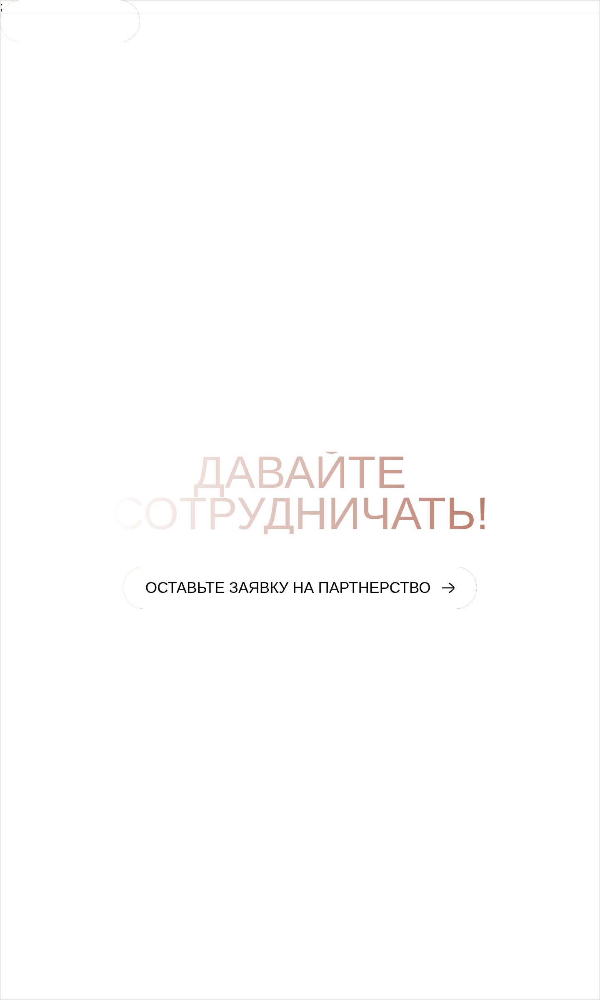
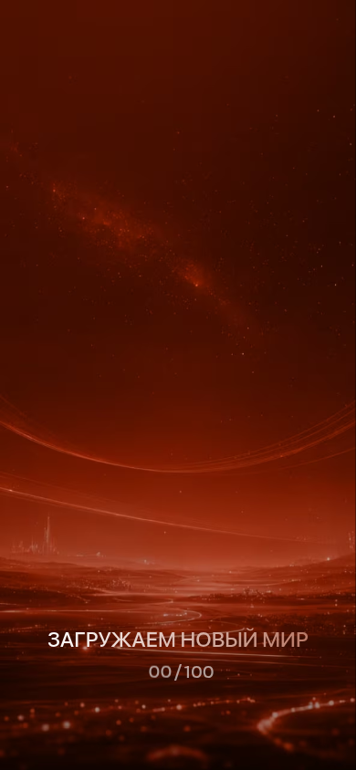

# UI Design System & Master Generation Blueprint: loot-games-ru

> **LOOT – награды в играх за активность в реальной жизни** (https://loot-games.ru) — Получайте лутсы за обучение, тренировки, музыку, фильмы и книги. Обменивайте их на предметы и награды в 4500+ играх.



---

## 1. Executive Visual Persona & Design Archetype

- **Brand Essence & Persona**: **LOOT – награды в играх за активность в реальной жизни** (`https://loot-games.ru`). Получайте лутсы за обучение, тренировки, музыку, фильмы и книги. Обменивайте их на предметы и награды в 4500+ играх.
- **Visual Archetype**: **Light-Gallery WebGL / Canvas Interactive Experience (`#fff` / `#fffc`)**.
- **Anti-AI-Slop Differentiators**:
  - **Source-Grounded Chromatic Polarity**: Anchors the viewport in `#fff` (`var(--flicker-fg)` in `:root`) paired with `#000` primary typography and `#fffc` accents.
  - **Extracted Typographic Hierarchy**: Pairs `Atkinson` for display copy (`ТВОЯ ЖИЗНЬ – ТВОЙ LOOT`) with `SF Pro` and not declared in static CSS (uses primary stack / `ui-monospace`).
  - **Calibrated Spatial Grid & Motion**: Combines `3840px` container bounds (`gap: 1rem`, padding `1px`) with `cubic-bezier(.32,.72,0,1)` easing and Lenis Smooth Scroll (`data-lenis`), Three.js / WebGL Canvas Pipeline.

---

## 2. Spatial Architecture & Modular Grid Mathematics



### Viewport Allocation & Container Geometry
- **Captured Viewport Dimensions**: Desktop `1440×2400px` (`assets/desktop.png`, capped at 2400px multi-section capture), Mobile `390×2400px` (`assets/mobile.png`, capped at 2400px multi-section capture).
- **Master Container Bounds**: `3840px` extracted from `loot-games-ru` stylesheet.
- **Canvas Lateral Padding & Spacing**: `1px` lateral canvas padding with `1rem` grid gap.
- **Border Radius Scale**: `5rem`, `3.5rem`, `4rem`, `2rem`.

### Responsive Breakpoint Architecture
- **Desktop Layout**: Multi-column CSS Grid / Flexbox layout at `1440px` (`max-width: 3840px`, `gap: 1rem`).
- **Mobile Layout**: Single-column vertical stack at `390px` viewport width with `1px` horizontal padding.
- **Extracted CSS Media Queries**: `@media screen and (width<=1000px) and (orientation:landscape)`, `@media screen and (width<=481px) and (orientation:portrait)`, `@media screen and (width>=482px) and (orientation:portrait)`, `@media (orientation:landscape) and (width<=1000px)`.

---

## 3. Color System, Materiality & Atmospheric Lighting

### Semantic Palette & Source Grounding
| Semantic Role | Ground-Truth Value | Extracted CSS Source / Selector |
|---|---|---|
| **Primary Canvas Substrate** | `#fff` | `var(--flicker-fg)` in `:root` |
| **Primary Typography Ink** | `#000` | `var(--flicker-bg)` in `:root` |
| **Elevated Surface / Card Substrate** | `#ffa500` | `.loading-layer svg circle { stroke: orange }` (`#ffa500`) |
| **Interactive Accent / Highlight** | `#fffc` | `.tagline { color: #fffc }` |
| **Secondary / Muted Copy** | `#ec5a00` | `.is--orange:before { background: #ec5a00 }` |
| **Structural Hairline Border** | `#fff9` | `.calc .calc-meta__desc { color: #fff9 }` |

### Sanitized Root CSS Variables (`ui-ux.md` Ground Truth)
| Variable Name | Extracted Value | Semantic Role |
|---|---|---|
| `--energy-ease` | `cubic-bezier(.32, .72, 0, 1)` | Motion / Easing Token |
| `--smooth-ease` | `cubic-bezier(.625, .05, 0, 1)` | Motion / Easing Token |
| `--fade-ease` | `cubic-bezier(.25, .1, .25, 1)` | Motion / Easing Token |
| `--flicker-fg` | `#fff` | Typography Ink Token |
| `--flicker-bg` | `#000` | Canvas / Surface Token |
| `--flicker-duration` | `.3s` | Motion / Easing Token |
| `--img` | `url("/assets/images/icon-09.avif")` | Design System Custom Token |
| `--hue` | `0` | Design System Custom Token |
| `--loot-games-ru-bg` | `#fff` | Canvas Substrate (from `var(--flicker-fg)` in `:root`) |
| `--loot-games-ru-ink` | `#000` | Primary Typography Ink (stylesheet-derived) |
| `--loot-games-ru-surface` | `#ffa500` | Surface Substrate (stylesheet-derived) |
| `--loot-games-ru-accent` | `#fffc` | Interactive Accent (stylesheet-derived) |
| `--loot-games-ru-muted` | `#ec5a00` | Secondary Ink (stylesheet-derived) |
| `--loot-games-ru-border` | `#fff9` | Structural Border (stylesheet-derived) |
| `--loot-games-ru-container` | `3840px` | Container Bound (stylesheet-derived) |
| `--loot-games-ru-gap` | `1rem` | Grid Gutter (stylesheet-derived) |

---

## 4. Typographic Scale & Editorial Hierarchy

### Font Family Stacks
- **Display Typography**: `Atkinson`.
- **Primary Body Stack**: `SF Pro`.
- **Technical / Metadata Stack**: not declared in static CSS (uses primary stack / `ui-monospace`).

### Typographic Scale & Rules (Extracted from Stylesheet & Variables)
- **Hero Display (`H1`)**: not explicitly declared on tag in static CSS (stylesheet font-size ladder: `.47619vw`, `clamp(3px,.520833vw + .0109375rem...`, `2.48756vw`, `1.81818vw`, `1.6rem`).
- **Section Heading (`H2`)**: rule `h2` (`font-size: 11.5rem`, `font-weight: 500`).
- **Body Copy**: rule `p` (`font-size: 1.6rem`, `line-height: 1.2`, `font-weight: 500`).
- **Metadata & Navigation Labels**: not explicitly declared on tag in static CSS (stylesheet font-size ladder: `.47619vw`, `clamp(3px,.520833vw + .0109375rem...`, `2.48756vw`, `1.81818vw`, `1.6rem`).

---

## 5. Choreographed Motion & Interaction Physics

### Primary Easing Curves
- **Extracted Timing Functions**: `cubic-bezier(.32,.72,0,1)`, `cubic-bezier(.625,.05,0,1)`, `cubic-bezier(.25,.1,.25,1)`.

### Per-Element Transition & Choreography Rules
- **Selector `input:-webkit-autofill`**: `transition: background-color 5000s ease-in-out` extracted from `loot-games-ru` stylesheet.
- **Selector `.lenis.lenis-autoToggle`**: `transition: 1ms` extracted from `loot-games-ru` stylesheet.
- **Selector `.loading-layer`**: `transition: opacity .6s var(--ease), visibility 0s var(--ease)` extracted from `loot-games-ru` stylesheet.
- **Extracted Easing Curve (`cubic-bezier(.32,.72,0,1)`)**: Governs interactive state transitions across `<header.navbar>` and `<section.main-wrap__sticky>`.
- **Runtime Interaction Engine**: Integrates Lenis Smooth Scroll (`data-lenis`), Three.js / WebGL Canvas Pipeline, Swiper Touch Carousel Engine with `prefers-reduced-motion: reduce` fallback guards.

---

## 6. Component Wireframe & Structural DOM Map

### Visual Layout Schematic (Grounded in `dom.html` — `1440px` Desktop & `390px` Mobile Reflow)
```
┌────────────────────────────────────────────────────────────────────────┐
│ DESKTOP VIEWPORT (1440px) — LOOT – награды в играх за активность в реа │
│ ====================================================================== │
│ [ <header.navbar>          | НАЧНИТЕ · ГЛАВНАЯ · ПАРТНЕРАМ · ПЛАНЫ  ]  │
│ ---------------------------------------------------------------------- │
│ | HERO STAGE: <section.main-wrap>                                  |   │
│ | H1: ТВОЯ ЖИЗНЬ – ТВОЙ LOOT                                       |   │
│ | Substrate: #fff       | Ink: #000       | Accent: #fffc          |   │
│ ---------------------------------------------------------------------- │
│ | SHOWCASE GRID (<section.main-wrap__sticky) max-w: 3840px         |   │
│ | +------------------------------+  +------------------------------+ | │
│ | | Что такое LOOT?              |  | Лутсы – внутренняя валюта LO | | │
│ | +------------------------------+  +------------------------------+ | │
│ ---------------------------------------------------------------------- │
│ | MOBILE VIEWPORT REFLOW (390px) — Single-Column Stack (gap: 1rem  ) | │
│ | [<header.navbar>] -> [<section.main-wrap] -> [<section.main-wrap] |  │
│ ---------------------------------------------------------------------- │
│ [ FOOTER (<footer.footer>       ) | https://loot-games.ru              │
└────────────────────────────────────────────────────────────────────────┘
```

### Granular DOM Region Breakdown
1. **Brand Header & Navigation Bar (<header.navbar> — `loot-games-ru`)**:
   - Landmark `<header class="navbar">` hosting `LOOT – награды в играх за активность` navigation (`НАЧНИТЕ · ГЛАВНАЯ · ПАРТНЕРАМ · ПЛАНЫ · КАК ЭТО РАБОТАЕТ`), DOM attributes (`data-astro-cid-l7arcky5`, `data-menu-toggle`, `data-page-progress`, `data-scrollto="0"`), and stylesheet rule `html { width:100%;height:100svh;position:fixed;top:0;left:0;overflow:hidden }`.
2. **Hero Stage & Focal Lead (<section.main-wrap> — `ТВОЯ ЖИЗНЬ – ТВОЙ LOOT`)**:
   - Landmark `<section class="main-wrap">` presenting display lead `ТВОЯ ЖИЗНЬ – ТВОЙ LOOT` and copy excerpt *"ОГРН 1197746200123 · ИНН 7707428570"* over `#fff` canvas and `#000` ink.
3. **Primary Showcase & Content Grid (<section.main-wrap__sticky> — `Что такое LOOT?`)**:
   - Landmark `<section class="main-wrap__sticky">` rendering section `Что такое LOOT?` with copy *"141590, Московская обл., г. о. Химки, г. Химки, Транспортный пр-д"*, asset references (`apple-touch-icon.png`, `favicon-32x32.png`, `favicon-16x16.png`, `favicon.ico`), and grid rule `.scroller-wrapper.is--seq-lock { touch-action:none }`.
4. **Interactive Detail & Feature Matrix (<section.hero> — `Лутсы – внутренняя валюта LOOT`)**:
   - Landmark `<section class="hero is--section">` framing `Лутсы – внутренняя валюта LOOT` and `5 км` (*"partners@loot-games.ru"*) with `#ffa500` surface cards, `#fffc` accents, and `.scroller-content { min-height:100% }`.
5. **Colophon & Global Directory Footer (<footer.footer> — `https://loot-games.ru`)**:
   - Landmark `<footer class="footer is--home">` anchoring `LOOT – награды в играх за активн` footer links (`НАЧНИТЕ · ГЛАВНАЯ · ПАРТНЕРАМ · ПЛАНЫ · КАК ЭТО РАБОТАЕТ`), copy *"Свяжитесь с командой"*, and `#fff9` structural dividers.

---

## 7. Master Zero-Shot AI Generation Prompt

```markdown
# Master Zero-Shot Frontend Generation Prompt: loot-games-ru (LOOT – награды в играх за активность в реальной жизни)

You are a principal frontend architect and design systems engineer. Build a complete, production-ready web application replicating the exact design system, DOM landmarks, typographic hierarchy, color tokens, and motion physics of `loot-games-ru` (**LOOT – награды в играх за активность в реальной жизни** — `https://loot-games.ru`).

### 1. Visual Archetype & Anti-AI-Slop Mandates
- **Archetype**: Light-Gallery WebGL / Canvas Interactive Experience (`#fff` / `#fffc`).
- **Identity & Domain Context**: Получайте лутсы за обучение, тренировки, музыку, фильмы и книги. Обменивайте их на предметы и награды в 4500+ играх.
- **Primary Substrate**: `#fff` (`var(--flicker-fg)` in `:root`), **Primary Ink**: `#000`, **Accent / Highlight**: `#fffc`.
- **Site-Specific Differentiators**:
  - **Source-Grounded Chromatic Polarity**: Anchors the viewport in `#fff` (`var(--flicker-fg)` in `:root`) paired with `#000` primary typography and `#fffc` accents.
  - **Extracted Typographic Hierarchy**: Pairs `Atkinson` for display copy (`ТВОЯ ЖИЗНЬ – ТВОЙ LOOT`) with `SF Pro` and not declared in static CSS (uses primary stack / `ui-monospace`).
  - **Calibrated Spatial Grid & Motion**: Combines `3840px` container bounds (`gap: 1rem`, padding `1px`) with `cubic-bezier(.32,.72,0,1)` easing and Lenis Smooth Scroll (`data-lenis`), Three.js / WebGL Canvas Pipeline.

### 2. Ground-Truth CSS Variables (`:root` Token Contract)
Declare and consume these exact custom properties extracted from `loot-games-ru` in your global stylesheet:

:root {
  /* LOOT – награды в играх за активность в реальной жизни (loot-games-ru) — Ground-Truth Extracted CSS Variables */
  --energy-ease: cubic-bezier(.32, .72, 0, 1); /* Motion / Easing Token (loot-games-ru) */
  --smooth-ease: cubic-bezier(.625, .05, 0, 1); /* Motion / Easing Token (loot-games-ru) */
  --fade-ease: cubic-bezier(.25, .1, .25, 1); /* Motion / Easing Token (loot-games-ru) */
  --flicker-fg: #fff; /* Typography Ink Token (loot-games-ru) */
  --flicker-bg: #000; /* Canvas / Surface Token (loot-games-ru) */
  --flicker-duration: .3s; /* Motion / Easing Token (loot-games-ru) */
  --img: url("/assets/images/icon-09.avif"); /* Design System Custom Token (loot-games-ru) */
  --hue: 0; /* Design System Custom Token (loot-games-ru) */
  --loot-games-ru-bg: #fff; /* Canvas Substrate (from `var(--flicker-fg)` in `:root`) (loot-games-ru) */
  --loot-games-ru-ink: #000; /* Primary Typography Ink (stylesheet-derived) (loot-games-ru) */
  --loot-games-ru-surface: #ffa500; /* Surface Substrate (stylesheet-derived) (loot-games-ru) */
  --loot-games-ru-accent: #fffc; /* Interactive Accent (stylesheet-derived) (loot-games-ru) */
  --loot-games-ru-muted: #ec5a00; /* Secondary Ink (stylesheet-derived) (loot-games-ru) */
  --loot-games-ru-border: #fff9; /* Structural Border (stylesheet-derived) (loot-games-ru) */
  --loot-games-ru-container: 3840px; /* Container Bound (stylesheet-derived) (loot-games-ru) */
  --loot-games-ru-gap: 1rem; /* Grid Gutter (stylesheet-derived) (loot-games-ru) */
}

### 3. Semantic Color & Materiality Contract
Map every surface, ink, and border strictly to these source-grounded tokens:
- **Primary Canvas Substrate**: `#fff` — grounded in `var(--flicker-fg)` in `:root`
- **Primary Typography Ink**: `#000` — grounded in `var(--flicker-bg)` in `:root`
- **Elevated Surface / Card Substrate**: `#ffa500` — grounded in `.loading-layer svg circle { stroke: orange }` (`#ffa500`)
- **Interactive Accent / Highlight**: `#fffc` — grounded in `.tagline { color: #fffc }`
- **Secondary / Muted Copy**: `#ec5a00` — grounded in `.is--orange:before { background: #ec5a00 }`
- **Structural Hairline Border**: `#fff9` — grounded in `.calc .calc-meta__desc { color: #fff9 }`

### 4. Spatial Grid, Container Bounds & Responsive Breakpoints
- **Desktop Viewport Reference**: `1440×2400px` (capped at 2400px multi-section capture, `1440px` standard desktop width).
- **Mobile Viewport Reference**: `390×2400px` (capped at 2400px multi-section capture, `390px` standard mobile width).
- **Container Max-Width**: `3840px` extracted from `loot-games-ru` stylesheet
- **Padding & Gutters**: `1px` lateral canvas padding with `1rem` grid gap
- **Desktop Grid**: Multi-column CSS Grid / Flexbox layout at `1440px` (`max-width: 3840px`, `gap: 1rem`)
- **Mobile Adaptation**: Single-column vertical stack at `390px` viewport width with `1px` horizontal padding
- **Media Queries**: `@media screen and (width<=1000px) and (orientation:landscape)`, `@media screen and (width<=481px) and (orientation:portrait)`, `@media screen and (width>=482px) and (orientation:portrait)`, `@media (orientation:landscape) and (width<=1000px)`
- **Corner Radii**: `5rem`, `3.5rem`, `4rem`, `2rem`

### 5. Typography & Editorial Scale Contract
- **Display Font Stack**: `Atkinson`
- **Body Font Stack**: `SF Pro`
- **Monospace / Technical Font Stack**: not declared in static CSS (uses primary stack / `ui-monospace`)
- **H1 Display Rule**: not explicitly declared on tag in static CSS (stylesheet font-size ladder: `.47619vw`, `clamp(3px,.520833vw + .0109375rem...`, `2.48756vw`, `1.81818vw`, `1.6rem`)
- **H2 Section Rule**: rule `h2` (`font-size: 11.5rem`, `font-weight: 500`)
- **Body Copy Rule**: rule `p` (`font-size: 1.6rem`, `line-height: 1.2`, `font-weight: 500`)
- **Metadata & Index Rule**: not explicitly declared on tag in static CSS (stylesheet font-size ladder: `.47619vw`, `clamp(3px,.520833vw + .0109375rem...`, `2.48756vw`, `1.81818vw`, `1.6rem`)

### 6. Component Hierarchy, Verbatim Copy & Real DOM Landmarks
Scaffold `loot-games-ru` (`LOOT – награды в играх за активность в реальной жизни`) with these exact structural regions, extracted copy, and CSS rules from `dom.html`:
1. **Brand Header & Navigation Bar (<header.navbar> — `loot-games-ru`)**:
   - DOM & Selectors: Landmark `<header class="navbar">` hosting `LOOT – награды в играх за активность` navigation (`НАЧНИТЕ · ГЛАВНАЯ · ПАРТНЕРАМ · ПЛАНЫ · КАК ЭТО РАБОТАЕТ`), DOM attributes (`data-astro-cid-l7arcky5`, `data-menu-toggle`, `data-page-progress`, `data-scrollto="0"`), and stylesheet rule `html { width:100%;height:100svh;position:fixed;top:0;left:0;overflow:hidden }`.
   - Responsive Contract: Header `Brand Header & Navigation Bar (<header.navbar> — `loot-games-ru`)` (`loot-games-ru`) adapts across `@media screen and (width<=1000px) and (orientation:landscape)`, `@media screen and (width<=481px) and (orientation:portrait)`, `@media screen and (width>=482px) and (orientation:portrait)`, `@media (orientation:landscape) and (width<=1000px)` with `cubic-bezier(.32,.72,0,1)`, `cubic-bezier(.625,.05,0,1)`, `cubic-bezier(.25,.1,.25,1)` transitions and links `НАЧНИТЕ · ГЛАВНАЯ · ПАРТНЕРАМ · ПЛАНЫ · КАК ЭТО РАБОТАЕТ`.
2. **Hero Stage & Focal Lead (<section.main-wrap> — `ТВОЯ ЖИЗНЬ – ТВОЙ LOOT`)**:
   - DOM & Selectors: Landmark `<section class="main-wrap">` presenting display lead `ТВОЯ ЖИЗНЬ – ТВОЙ LOOT` and copy excerpt *"ОГРН 1197746200123 · ИНН 7707428570"* over `#fff` canvas and `#000` ink.
   - Responsive Contract: Hero stage (`1440×2400px` desktop / `390×2400px` mobile) sets `#fff` background with `#000` headline `ТВОЯ ЖИЗНЬ – ТВОЙ LOOT`.
3. **Primary Showcase & Content Grid (<section.main-wrap__sticky> — `Что такое LOOT?`)**:
   - DOM & Selectors: Landmark `<section class="main-wrap__sticky">` rendering section `Что такое LOOT?` with copy *"141590, Московская обл., г. о. Химки, г. Химки, Транспортный пр-д"*, asset references (`apple-touch-icon.png`, `favicon-32x32.png`, `favicon-16x16.png`, `favicon.ico`), and grid rule `.scroller-wrapper.is--seq-lock { touch-action:none }`.
   - Responsive Contract: Showcase grid `Primary Showcase & Content Grid (<section.main-wrap__sticky> — `Что такое LOOT?`)` applies Multi-column CSS Grid / Flexbox layout at `1440px` (`max-width: 3840px`, `gap: 1rem`) on desktop and Single-column vertical stack at `390px` viewport width with `1px` horizontal padding on mobile.
4. **Interactive Detail & Feature Matrix (<section.hero> — `Лутсы – внутренняя валюта LOOT`)**:
   - DOM & Selectors: Landmark `<section class="hero is--section">` framing `Лутсы – внутренняя валюта LOOT` and `5 км` (*"partners@loot-games.ru"*) with `#ffa500` surface cards, `#fffc` accents, and `.scroller-content { min-height:100% }`.
   - Responsive Contract: Detail module `Interactive Detail & Feature Matrix (<section.hero> — `Лутсы – внутренняя валюта LOOT`)` uses `5rem`, `3.5rem`, `4rem`, `2rem` radii, `#fffc` highlights, and assets (apple-touch-icon.png, favicon-32x32.png, favicon-16x16.png).
5. **Colophon & Global Directory Footer (<footer.footer> — `https://loot-games.ru`)**:
   - DOM & Selectors: Landmark `<footer class="footer is--home">` anchoring `LOOT – награды в играх за активн` footer links (`НАЧНИТЕ · ГЛАВНАЯ · ПАРТНЕРАМ · ПЛАНЫ · КАК ЭТО РАБОТАЕТ`), copy *"Свяжитесь с командой"*, and `#fff9` structural dividers.
   - Responsive Contract: Footer `Colophon & Global Directory Footer (<footer.footer> — `https://loot-games.ru`)` aligns to `3840px` extracted from `loot-games-ru` stylesheet with `1px` lateral canvas padding with `1rem` grid gap and attributes (data-astro-cid-l7arcky5, data-menu-toggle, data-page-progress).

#### Verbatim DOM Copy Excerpts (`dom.html`)
- Copy Excerpt 1: *"ОГРН 1197746200123 · ИНН 7707428570"*
- Copy Excerpt 2: *"141590, Московская обл., г. о. Химки, г. Химки, Транспортный пр-д, стр. 19, БЦ Ast..."*
- Copy Excerpt 3: *"partners@loot-games.ru"*
- Copy Excerpt 4: *"Свяжитесь с командой"*

### 7. Motion, Extracted Stylesheet Rules & Interaction Choreography
- **Primary Easing Functions**: `cubic-bezier(.32,.72,0,1)`, `cubic-bezier(.625,.05,0,1)`, `cubic-bezier(.25,.1,.25,1)`
- **Extracted Stylesheet Rules (`loot-games-ru`)**:
- `html { width:100%;height:100svh;position:fixed;top:0;left:0;overflow:hidden }`
- `.scroller-wrapper.is--seq-lock { touch-action:none }`
- `.scroller-content { min-height:100% }`
- `html.is-snapping .scroller-wrapper { pointer-events:none;touch-action:none }`
- `video { object-fit:cover;width:100%;height:100% }`
- **Per-Selector Transition Rules**:
- **Selector `input:-webkit-autofill`**: `transition: background-color 5000s ease-in-out` extracted from `loot-games-ru` stylesheet.
- **Selector `.lenis.lenis-autoToggle`**: `transition: 1ms` extracted from `loot-games-ru` stylesheet.
- **Selector `.loading-layer`**: `transition: opacity .6s var(--ease), visibility 0s var(--ease)` extracted from `loot-games-ru` stylesheet.
- **Extracted Easing Curve (`cubic-bezier(.32,.72,0,1)`)**: Governs interactive state transitions across `<header.navbar>` and `<section.main-wrap__sticky>`.
- **Runtime Interaction Engine**: Integrates Lenis Smooth Scroll (`data-lenis`), Three.js / WebGL Canvas Pipeline, Swiper Touch Carousel Engine with `prefers-reduced-motion: reduce` fallback guards.

### 8. Technical Deliverables
- Implement in Next.js (App Router) with TypeScript and Tailwind CSS consuming the `:root` custom properties defined above for `loot-games-ru`.
- Reproduce both the `1440px` desktop architecture and `390px` mobile breakpoint transitions, preserving semantic HTML5 landmarks (`<header>`, `<nav>`, `<main>`, `<section>`, `<footer>`) and `prefers-reduced-motion` accessibility guards.
```
