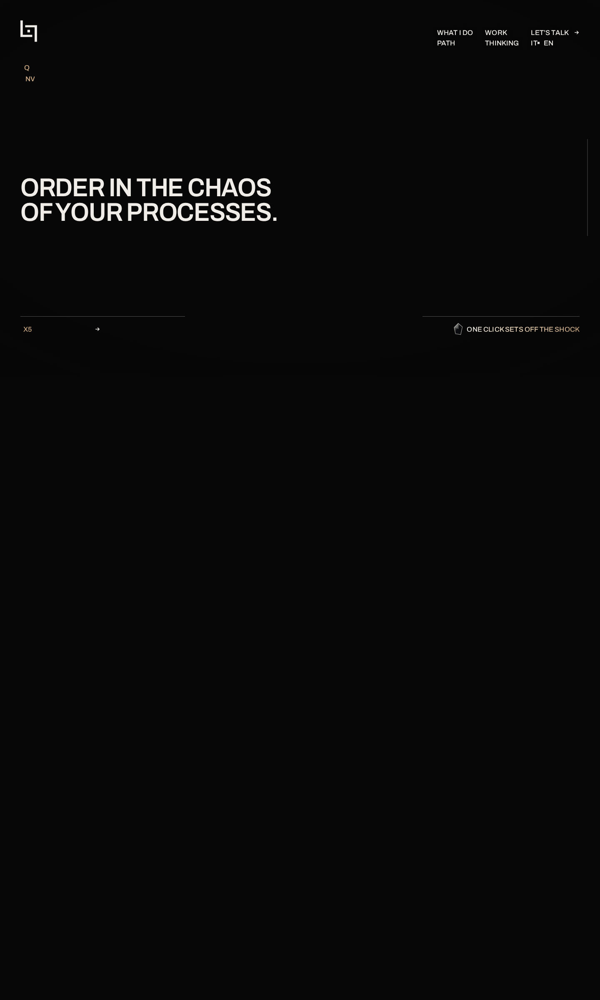
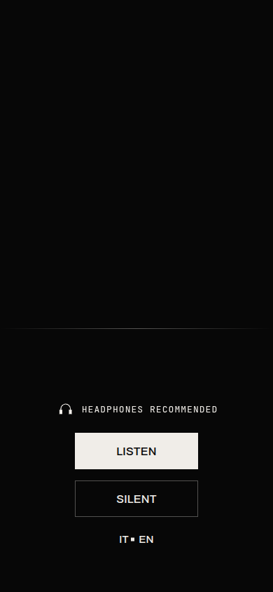

# UI Design System & Master Generation Blueprint: lorenzolottici-it_en

> **Lorenzo Lottici · Order in chaos** (https://lorenzolottici.it/en) — I bring order to the chaos in your business. Outside, a site people recognize at first glance. Inside, automations and AI agents that wor...



---

## 1. Executive Visual Persona & Design Archetype

- **Brand Essence & Persona**: **Lorenzo Lottici · Order in chaos** (`https://lorenzolottici.it/en`). I bring order to the chaos in your business. Outside, a site people recognize at first glance. Inside, automations and AI agents that wor...
- **Capture Provenance**: Live browser capture (`tier1_fast`, HTTP `200`, captured `2026-11-23`).
- **Visual Archetype**: **Dark-Substrate WebGL / Canvas Interactive Experience (`#070707` / `#0000ff`)**.
- **Anti-AI-Slop Differentiators**:
  - **Live-Computed Chromatic Polarity**: Anchors the viewport in `#070707` (live computed `body` `background-color` (`computed_styles.json`)) paired with `#f0ede8` primary typography and `#0000ff` accents.
  - **Grounded Typographic Hierarchy**: Pairs `archivo` for display copy (`ORDER IN THE CHAOS OF YOUR PROCESSES`) with `jetbrainsMono` and `jetbrainsMono`.
  - **Calibrated Spatial Grid & Motion**: Combines `96rem` container bounds (`gap: 12px`, padding `48.96px`) with `cubic-bezier(.4,0,1,1)` easing and Lenis Smooth Scroll (`data-lenis`), GSAP Timeline & ScrollTrigger.

---

## 2. Spatial Architecture & Modular Grid Mathematics



### Viewport Allocation & Container Geometry
- **Captured Viewport Dimensions**: Desktop `1440×2400px` (`assets/desktop.png`, clamped at 2400px live multi-section capture), Mobile `390×844px` (`assets/mobile.png`, single-viewport 100vh live capture (844px)).
- **Master Container Bounds**: `96rem` (non-`@media` desktop container stylesheet rule).
- **Canvas Lateral Padding & Spacing**: `48.96px` lateral canvas padding with `12px` grid gap.
- **Border Radius Scale**: `50%`, `4px`, `.25rem`, `var(--radius-2xl)`.

### Responsive Breakpoint Architecture
- **Desktop Layout**: Multi-column CSS Grid / Flexbox layout at `1440px` (`max-width: 96rem`, `gap: 12px`).
- **Mobile Layout**: Single-column vertical stack at `390px` viewport width with `48.96px` horizontal padding.
- **Extracted CSS Media Queries**: `@media (max-width:640px)`, `@media (max-width:760px)`, `@media (max-width:300px)`, `@media (prefers-reduced-motion:reduce)`.

---

## 3. Color System, Materiality & Atmospheric Lighting

### Semantic Palette & Source Grounding
| Semantic Role | Ground-Truth Value | Extracted Live / CSS Source |
|---|---|---|
| **Primary Canvas Substrate** | `#070707` | live computed `body` `background-color` (`computed_styles.json`) |
| **Primary Typography Ink** | `#f0ede8` | live computed `h1` `color` (`computed_styles.json`) |
| **Elevated Surface / Card Substrate** | `#f0ede8` | live computed `button` `background-color` (`computed_styles.json`) |
| **Interactive Accent / Highlight** | `#0000ff` | `.text-blue-500 { color: blue }` (`#0000ff`) |
| **Secondary / Muted Copy** | `#0000ff` | `.text-blue-500 { color: blue }` (`#0000ff`) |
| **Structural Hairline Border** | `#4b2a18` | `30 { border-color: #4b2a18 }` |

### Sanitized Root CSS Variables (`ui-ux.md` Ground Truth)
| Variable Name | Extracted Value | Semantic Role |
|---|---|---|
| `--z-banda` | `8000` | Elevation / Border Token |
| `--z-parliamone` | `9000` | Elevation / Border Token |
| `--z-voce-cabina` | `9100` | Elevation / Border Token |
| `--z-passaggio` | `10000` | Elevation / Border Token |
| `--z-velo-scritta` | `10001` | Elevation / Border Token |
| `--z-indice` | `2147480000` | Elevation / Border Token |
| `--z-salta` | `2147480000` | Elevation / Border Token |
| `--gutter` | `clamp(1.25rem,3.4vw,4rem)` | Layout / Spatial Grid Token |
| `--corsia-bordo` | `4rem` | Dimension / Scale Token |
| `--tipo-marchio` | `clamp(6rem,calc(1.3958rem + 20.463vw),19.8125rem)` | Dimension / Scale Token |
| `--tipo-display` | `clamp(2.75rem,calc(1.2708rem + 6.5741vw),7.1875rem)` | Dimension / Scale Token |
| `--tipo-titolo` | `clamp(2.125rem,calc(1.3125rem + 3.6111vw),4.5625rem)` | Dimension / Scale Token |
| `--tipo-sottotitolo` | `clamp(1.625rem,calc(.8542rem + 3.4259vw),3.9375rem)` | Dimension / Scale Token |
| `--tipo-servizio` | `clamp(1.25rem,calc(1.1042rem + .6481vw),1.6875rem)` | Dimension / Scale Token |
| `--tipo-lead` | `var(--tipo-corpo)` | Design System Custom Token |
| `--tipo-corpo` | `clamp(1rem,calc(.9792rem + .0926vw),1.0625rem)` | Dimension / Scale Token |

---

## 4. Typographic Scale & Editorial Hierarchy

### Font Family Stacks
- **Display Typography**: `archivo`.
- **Primary Body Stack**: `jetbrainsMono`.
- **Technical / Metadata Stack**: `jetbrainsMono`.

### Typographic Scale & Rules (Live Computed & Stylesheet Grounded)
- **Hero Display (`H1`)**: live computed `h1` (`font-size: 61.92px`, `line-height: 59.4432px`, `font-weight: 600`, `letter-spacing: -1.2384px`); CSS variables `--tipo-display: clamp(2.75rem,calc(1.2708rem + 6.5741vw),7.1875rem)`, `--lh-display: .98`, `--ls-display: -.03em`; rule `h1` (`font-size: var(--tipo-titolo)`, `line-height: var(--lh-titolo)`, `letter-spacing: var(--ls-titolo)`, `font-weight: var(--peso-di...`).
- **Section Heading (`H2`)**: live computed `h3 (primary section heading)` (`font-size: 23.92px`, `line-height: 38.272px`, `font-weight: 600`, `letter-spacing: 0.2392px`); rule `h2` (`font-size: var(--tipo-label)`, `line-height: var(--lh-label)`, `letter-spacing: var(--ls-label)`, `font-weight: var(--peso-la...`).
- **Body Copy**: live computed `body` (`font-size: 16.5005px`, `line-height: 26.4008px`, `font-weight: 400`, `letter-spacing: 1.15503px`); rule `p` (`line-height: var(--lh-corpo)`).
- **Metadata & Navigation Labels**: live computed `nav/a` (`font-size: 14.016px`, `line-height: 18.9216px`, `font-weight: 400`, `letter-spacing: 1.12128px`); CSS variables `--tipo-label: clamp(.75rem,calc(.7083rem + .1852vw),.875rem)`, `--lh-label: 1.4`, `--ls-label: .18em`.

---

## 5. Choreographed Motion & Interaction Physics

### Primary Easing Curves
- **Extracted Timing Functions**: `cubic-bezier(.4,0,1,1)`, `cubic-bezier(0,0,.2,1)`, `cubic-bezier(.4,0,.2,1)`.

### Per-Element Transition & Choreography Rules
- **Selector `._2ZgDjW_eroe[data-via=scivola]`**: `transition: transform var(--dur-scopri) var(--curva-uscita)` extracted from `lorenzolottici-it_en` stylesheet.
- **Selector `._2ZgDjW_piede`**: `transition: transform var(--dur-scopri) var(--curva)` extracted from `lorenzolottici-it_en` stylesheet.
- **Selector `html[data-lavori-esce] ._2ZgDjW_p...`**: `transition: transform var(--dur-stato) var(--curva)` extracted from `lorenzolottici-it_en` stylesheet.
- **Extracted Easing Curve (`cubic-bezier(.4,0,1,1)`)**: Governs interactive state transitions across `<header.indice-home>` and `<section.js>`.
- **Runtime Interaction Engine**: Integrates Lenis Smooth Scroll (`data-lenis`), GSAP Timeline & ScrollTrigger, Three.js / WebGL Canvas Pipeline, Framer Motion Layout Physics with `prefers-reduced-motion: reduce` fallback guards.

---

## 6. Component Wireframe & Structural DOM Map

### Visual Layout Schematic — Desktop (`1440px`, Grounded in `dom.html` & Landmark Bounding Boxes)
```
┌────────────────────────────────────────────────────────────────────────┐
│ DESKTOP VIEWPORT (1440px) — Lorenzo Lottici · Order in chaos           │
│ ====================================================================== │
│ [ <header.indice-home> (1440x77px)    | What I do · Path · Work · Th ] │
│ ---------------------------------------------------------------------- │
│ | HERO STAGE: <section.dark> (w=1440px)                              | │
│ | H1: ORDER IN THE CHAOS OF YOUR PROCESSES. ORDER IN TH...           | │
│ | Substrate: #070707 | Ink: #f0ede8 | Accent: #0000ff                | │
│ ---------------------------------------------------------------------- │
│ | SHOWCASE GRID (<section.js>) max-w: 96rem                          | │
│ | +------------------------------+  +------------------------------+ | │
│ | | Order in the chaos of your p |  | What I do                    | | │
│ | +------------------------------+  +------------------------------+ | │
│ ---------------------------------------------------------------------- │
│ | DETAIL MODULE (<section.scroll-fermo>) — Work                      | │
│ ---------------------------------------------------------------------- │
│ [ FOOTER (<footer.su-piede>   ) | https://lorenzolottici.it/en         │
└────────────────────────────────────────────────────────────────────────┘
```

### Visual Layout Schematic — Mobile Reflow (`390px`)
```
┌────────────────────────────────────────────────────────────────────────┐
│ MOBILE VIEWPORT REFLOW (390px) — Single-Column Stack (gap: 12px)       │
│ ====================================================================== │
│ [ HEADER BAR (<header.indice-home>    ) | Compact Menu (390px)         │
│ ---------------------------------------------------------------------- │
│ | HERO STAGE (<section.dark>) — 390px Vertical Lead                  | │
│ | H1: ORDER IN THE CHAOS OF YOUR PROCESSES. ORDER IN TH...           | │
│ ---------------------------------------------------------------------- │
│ | SHOWCASE STACK (<section.js>) — 1-Col Stack                        | │
│ | [ Item 1: Order in the chaos of your processes. Order in th...   ] | │
│ | [ Item 2: What I do                                              ] | │
│ ---------------------------------------------------------------------- │
│ | DETAIL STACK (<section.scroll-fermo>) — 1-Col (Work)               | │
│ ---------------------------------------------------------------------- │
│ [ FOOTER (<footer.su-piede>   ) | Stacked 390px Colophon               │
└────────────────────────────────────────────────────────────────────────┘
```

### Granular DOM Region Breakdown
1. **Brand Header & Navigation Bar (<header.indice-home> — `lorenzolottici-it_en`)**:
   - Landmark `<header class="indice-home indice-testata">` (`1440x77px`) hosting `Lorenzo Lottici · Order in chaos` navigation (`What I do · Path · Work · Thinking · Let’s talk`), DOM attributes (`data-testata="1"`, `data-caricamento="1"`, `data-tre="1"`, `data-precedence="next"`), and stylesheet rule `.iLAgaa_colonna { max-width:80rem;margin:0 auto;position:relative }`.
2. **Hero Stage & Focal Lead (<section.dark> — `ORDER IN THE CHAOS OF YOUR PROCESS`)**:
   - Landmark `<section class="dark">` presenting display lead `ORDER IN THE CHAOS OF YOUR PROCESSES. ORDER IN TH...` and copy excerpt *"Creative Developer & Automation Architect"* over `#070707` canvas and `#f0ede8` ink.
3. **Primary Showcase & Content Grid (<section.js> — `Order in the chaos of your process`)**:
   - Landmark `<section class="js">` rendering section `Order in the chaos of your processes. Order in th...` with copy *"Order in the chaos of your processes."*, asset references (`archivo_latin_var-s.p.3b1_7etm2gp...`, `jetbrains_mono_latin_var.p.0gbvn7...`, `polvere-carta.webp`, `420u9fgvjqgpl.js`), and grid rule `.iLAgaa_stelle { border-radius:50%;width:1px;height:1px;position:absolute;top:0;left:0 }`.
4. **Interactive Detail & Feature Matrix (<section.scroll-fermo> — `What I do`)**:
   - Landmark `<section class="scroll-fermo">` framing `What I do` and `Work` (*"Order in the chaos"*) with `#f0ede8` surface cards, `#0000ff` accents, and `.iLAgaa_pianeta { width:120vw;top:-74vw;right:-62vw }`.
5. **Colophon & Global Directory Footer (<footer.su-piede> — `https://lorenzolottici.it/en`)**:
   - Landmark `<footer class="su-piede indice-home">` anchoring `Lorenzo Lottici · Order in chaos` footer links (`What I do · Path · Work · Thinking · Let’s talk`), copy *"of your processes."*, and `#4b2a18` structural dividers.

---

## 7. Master Zero-Shot AI Generation Prompt

```markdown
# Master Zero-Shot Frontend Generation Prompt: lorenzolottici-it_en (Lorenzo Lottici · Order in chaos)

You are a principal frontend architect and design systems engineer. Build a complete, production-ready web application replicating the exact design system, DOM landmarks, typographic hierarchy, color tokens, and motion physics of `lorenzolottici-it_en` (**Lorenzo Lottici · Order in chaos** — `https://lorenzolottici.it/en`).

### 1. Visual Archetype & Anti-AI-Slop Mandates
- **Archetype**: Dark-Substrate WebGL / Canvas Interactive Experience (`#070707` / `#0000ff`).
- **Identity & Domain Context**: I bring order to the chaos in your business. Outside, a site people recognize at first glance. Inside, automations and AI agents that wor...
- **Primary Substrate**: `#070707` (live computed `body` `background-color` (`computed_styles.json`)), **Primary Ink**: `#f0ede8`, **Accent / Highlight**: `#0000ff`.
- **Site-Specific Differentiators**:
  - **Live-Computed Chromatic Polarity**: Anchors the viewport in `#070707` (live computed `body` `background-color` (`computed_styles.json`)) paired with `#f0ede8` primary typography and `#0000ff` accents.
  - **Grounded Typographic Hierarchy**: Pairs `archivo` for display copy (`ORDER IN THE CHAOS OF YOUR PROCESSES`) with `jetbrainsMono` and `jetbrainsMono`.
  - **Calibrated Spatial Grid & Motion**: Combines `96rem` container bounds (`gap: 12px`, padding `48.96px`) with `cubic-bezier(.4,0,1,1)` easing and Lenis Smooth Scroll (`data-lenis`), GSAP Timeline & ScrollTrigger.

### 2. Ground-Truth CSS Variables (`:root` Token Contract)
Declare and consume these exact custom properties extracted from `lorenzolottici-it_en` in your global stylesheet:

:root {
  /* Lorenzo Lottici · Order in chaos (lorenzolottici-it_en) — Live-Grounded CSS Variables */
  --z-banda: 8000; /* Elevation / Border Token (lorenzolottici-it_en) */
  --z-parliamone: 9000; /* Elevation / Border Token (lorenzolottici-it_en) */
  --z-voce-cabina: 9100; /* Elevation / Border Token (lorenzolottici-it_en) */
  --z-passaggio: 10000; /* Elevation / Border Token (lorenzolottici-it_en) */
  --z-velo-scritta: 10001; /* Elevation / Border Token (lorenzolottici-it_en) */
  --z-indice: 2147480000; /* Elevation / Border Token (lorenzolottici-it_en) */
  --z-salta: 2147480000; /* Elevation / Border Token (lorenzolottici-it_en) */
  --gutter: clamp(1.25rem,3.4vw,4rem); /* Layout / Spatial Grid Token (lorenzolottici-it_en) */
  --corsia-bordo: 4rem; /* Dimension / Scale Token (lorenzolottici-it_en) */
  --tipo-marchio: clamp(6rem,calc(1.3958rem + 20.463vw),19.8125rem); /* Dimension / Scale Token (lorenzolottici-it_en) */
  --tipo-display: clamp(2.75rem,calc(1.2708rem + 6.5741vw),7.1875rem); /* Dimension / Scale Token (lorenzolottici-it_en) */
  --tipo-titolo: clamp(2.125rem,calc(1.3125rem + 3.6111vw),4.5625rem); /* Dimension / Scale Token (lorenzolottici-it_en) */
  --tipo-sottotitolo: clamp(1.625rem,calc(.8542rem + 3.4259vw),3.9375rem); /* Dimension / Scale Token (lorenzolottici-it_en) */
  --tipo-servizio: clamp(1.25rem,calc(1.1042rem + .6481vw),1.6875rem); /* Dimension / Scale Token (lorenzolottici-it_en) */
  --tipo-lead: var(--tipo-corpo); /* Design System Custom Token (lorenzolottici-it_en) */
  --tipo-corpo: clamp(1rem,calc(.9792rem + .0926vw),1.0625rem); /* Dimension / Scale Token (lorenzolottici-it_en) */
}

### 3. Semantic Color & Materiality Contract
Map every surface, ink, and border strictly to these source-grounded tokens:
- **Primary Canvas Substrate**: `#070707` — grounded in live computed `body` `background-color` (`computed_styles.json`)
- **Primary Typography Ink**: `#f0ede8` — grounded in live computed `h1` `color` (`computed_styles.json`)
- **Elevated Surface / Card Substrate**: `#f0ede8` — grounded in live computed `button` `background-color` (`computed_styles.json`)
- **Interactive Accent / Highlight**: `#0000ff` — grounded in `.text-blue-500 { color: blue }` (`#0000ff`)
- **Secondary / Muted Copy**: `#0000ff` — grounded in `.text-blue-500 { color: blue }` (`#0000ff`)
- **Structural Hairline Border**: `#4b2a18` — grounded in `30 { border-color: #4b2a18 }`

### 4. Spatial Grid, Container Bounds & Responsive Breakpoints
- **Desktop Viewport Reference**: `1440×2400px` (clamped at 2400px live multi-section capture, `1440px` standard desktop width).
- **Mobile Viewport Reference**: `390×844px` (single-viewport 100vh live capture (844px), `390px` standard mobile width).
- **Container Max-Width**: `96rem` (non-`@media` desktop container stylesheet rule)
- **Padding & Gutters**: `48.96px` lateral canvas padding with `12px` grid gap
- **Desktop Grid**: Multi-column CSS Grid / Flexbox layout at `1440px` (`max-width: 96rem`, `gap: 12px`)
- **Mobile Adaptation**: Single-column vertical stack at `390px` viewport width with `48.96px` horizontal padding
- **Media Queries**: `@media (max-width:640px)`, `@media (max-width:760px)`, `@media (max-width:300px)`, `@media (prefers-reduced-motion:reduce)`
- **Corner Radii**: `50%`, `4px`, `.25rem`, `var(--radius-2xl)`

### 5. Typography & Editorial Scale Contract
- **Display Font Stack**: `archivo`
- **Body Font Stack**: `jetbrainsMono`
- **Monospace / Technical Font Stack**: `jetbrainsMono`
- **H1 Display Rule**: live computed `h1` (`font-size: 61.92px`, `line-height: 59.4432px`, `font-weight: 600`, `letter-spacing: -1.2384px`); CSS variables `--tipo-display: clamp(2.75rem,calc(1.2708rem + 6.5741vw),7.1875rem)`, `--lh-display: .98`, `--ls-display: -.03em`; rule `h1` (`font-size: var(--tipo-titolo)`, `line-height: var(--lh-titolo)`, `letter-spacing: var(--ls-titolo)`, `font-weight: var(--peso-di...`)
- **H2 Section Rule**: live computed `h3 (primary section heading)` (`font-size: 23.92px`, `line-height: 38.272px`, `font-weight: 600`, `letter-spacing: 0.2392px`); rule `h2` (`font-size: var(--tipo-label)`, `line-height: var(--lh-label)`, `letter-spacing: var(--ls-label)`, `font-weight: var(--peso-la...`)
- **Body Copy Rule**: live computed `body` (`font-size: 16.5005px`, `line-height: 26.4008px`, `font-weight: 400`, `letter-spacing: 1.15503px`); rule `p` (`line-height: var(--lh-corpo)`)
- **Metadata & Index Rule**: live computed `nav/a` (`font-size: 14.016px`, `line-height: 18.9216px`, `font-weight: 400`, `letter-spacing: 1.12128px`); CSS variables `--tipo-label: clamp(.75rem,calc(.7083rem + .1852vw),.875rem)`, `--lh-label: 1.4`, `--ls-label: .18em`

### 6. Component Hierarchy, Verbatim Copy & Real DOM Landmarks
Scaffold `lorenzolottici-it_en` (`Lorenzo Lottici · Order in chaos`) with these exact structural regions, extracted copy, and CSS rules from `dom.html`:
1. **Brand Header & Navigation Bar (<header.indice-home> — `lorenzolottici-it_en`)**:
   - DOM & Selectors: Landmark `<header class="indice-home indice-testata">` (`1440x77px`) hosting `Lorenzo Lottici · Order in chaos` navigation (`What I do · Path · Work · Thinking · Let’s talk`), DOM attributes (`data-testata="1"`, `data-caricamento="1"`, `data-tre="1"`, `data-precedence="next"`), and stylesheet rule `.iLAgaa_colonna { max-width:80rem;margin:0 auto;position:relative }`.
   - Responsive Contract: Header `Brand Header & Navigation Bar (<header.indice-home> — `lorenzolottici-it_en`)` (`lorenzolottici-it_en`) adapts across `@media (max-width:640px)`, `@media (max-width:760px)`, `@media (max-width:300px)`, `@media (prefers-reduced-motion:reduce)` with `cubic-bezier(.4,0,1,1)`, `cubic-bezier(0,0,.2,1)`, `cubic-bezier(.4,0,.2,1)` transitions and links `What I do · Path · Work · Thinking · Let’s talk`.
2. **Hero Stage & Focal Lead (<section.dark> — `ORDER IN THE CHAOS OF YOUR PROCESS`)**:
   - DOM & Selectors: Landmark `<section class="dark">` presenting display lead `ORDER IN THE CHAOS OF YOUR PROCESSES. ORDER IN TH...` and copy excerpt *"Creative Developer & Automation Architect"* over `#070707` canvas and `#f0ede8` ink.
   - Responsive Contract: Hero stage (`1440×2400px` desktop / `390×844px` mobile) sets `#070707` background with `#f0ede8` headline `ORDER IN THE CHAOS OF YOUR PROCESSES. ORDER IN TH...`.
3. **Primary Showcase & Content Grid (<section.js> — `Order in the chaos of your process`)**:
   - DOM & Selectors: Landmark `<section class="js">` rendering section `Order in the chaos of your processes. Order in th...` with copy *"Order in the chaos of your processes."*, asset references (`archivo_latin_var-s.p.3b1_7etm2gp...`, `jetbrains_mono_latin_var.p.0gbvn7...`, `polvere-carta.webp`, `420u9fgvjqgpl.js`), and grid rule `.iLAgaa_stelle { border-radius:50%;width:1px;height:1px;position:absolute;top:0;left:0 }`.
   - Responsive Contract: Showcase grid `Primary Showcase & Content Grid (<section.js> — `Order in the chaos of your process`)` applies Multi-column CSS Grid / Flexbox layout at `1440px` (`max-width: 96rem`, `gap: 12px`) on desktop and Single-column vertical stack at `390px` viewport width with `48.96px` horizontal padding on mobile.
4. **Interactive Detail & Feature Matrix (<section.scroll-fermo> — `What I do`)**:
   - DOM & Selectors: Landmark `<section class="scroll-fermo">` framing `What I do` and `Work` (*"Order in the chaos"*) with `#f0ede8` surface cards, `#0000ff` accents, and `.iLAgaa_pianeta { width:120vw;top:-74vw;right:-62vw }`.
   - Responsive Contract: Detail module `Interactive Detail & Feature Matrix (<section.scroll-fermo> — `What I do`)` uses `50%`, `4px`, `.25rem`, `var(--radius-2xl)` radii, `#0000ff` highlights, and assets (archivo_latin_var-s.p.3b1_7etm2gp..., jetbrains_mono_latin_var.p.0gbvn7..., polvere-carta.webp).
5. **Colophon & Global Directory Footer (<footer.su-piede> — `https://lorenzolottici.it/en`)**:
   - DOM & Selectors: Landmark `<footer class="su-piede indice-home">` anchoring `Lorenzo Lottici · Order in chaos` footer links (`What I do · Path · Work · Thinking · Let’s talk`), copy *"of your processes."*, and `#4b2a18` structural dividers.
   - Responsive Contract: Footer `Colophon & Global Directory Footer (<footer.su-piede> — `https://lorenzolottici.it/en`)` aligns to `96rem` (non-`@media` desktop container stylesheet rule) with `48.96px` lateral canvas padding with `12px` grid gap and attributes (data-testata="1", data-caricamento="1", data-tre="1").

#### Verbatim DOM Copy Excerpts (`dom.html`)
- Copy Excerpt 1: *"Creative Developer & Automation Architect"*
- Copy Excerpt 2: *"Order in the chaos of your processes."*
- Copy Excerpt 3: *"Order in the chaos"*
- Copy Excerpt 4: *"of your processes."*

### 7. Motion, Extracted Stylesheet Rules & Interaction Choreography
- **Primary Easing Functions**: `cubic-bezier(.4,0,1,1)`, `cubic-bezier(0,0,.2,1)`, `cubic-bezier(.4,0,.2,1)`
- **Extracted Stylesheet Rules (`lorenzolottici-it_en`)**:
- `.iLAgaa_colonna { max-width:80rem;margin:0 auto;position:relative }`
- `.iLAgaa_stelle { border-radius:50%;width:1px;height:1px;position:absolute;top:0;left:0 }`
- `.iLAgaa_pianeta { width:120vw;top:-74vw;right:-62vw }`
- `.iLAgaa_vai { color:var(--tenue) }`
- `.iLAgaa_meta a { color:inherit;align-items:center;min-height:44px;margin:-12px 0;text-dec... }`
- **Per-Selector Transition Rules**:
- **Selector `._2ZgDjW_eroe[data-via=scivola]`**: `transition: transform var(--dur-scopri) var(--curva-uscita)` extracted from `lorenzolottici-it_en` stylesheet.
- **Selector `._2ZgDjW_piede`**: `transition: transform var(--dur-scopri) var(--curva)` extracted from `lorenzolottici-it_en` stylesheet.
- **Selector `html[data-lavori-esce] ._2ZgDjW_p...`**: `transition: transform var(--dur-stato) var(--curva)` extracted from `lorenzolottici-it_en` stylesheet.
- **Extracted Easing Curve (`cubic-bezier(.4,0,1,1)`)**: Governs interactive state transitions across `<header.indice-home>` and `<section.js>`.
- **Runtime Interaction Engine**: Integrates Lenis Smooth Scroll (`data-lenis`), GSAP Timeline & ScrollTrigger, Three.js / WebGL Canvas Pipeline, Framer Motion Layout Physics with `prefers-reduced-motion: reduce` fallback guards.

### 8. Technical Deliverables
- Implement in Next.js (App Router) with TypeScript and Tailwind CSS consuming the `:root` custom properties defined above for `lorenzolottici-it_en`.
- Reproduce both the `1440px` desktop architecture and `390px` mobile breakpoint transitions, preserving semantic HTML5 landmarks (`<header>`, `<nav>`, `<main>`, `<section>`, `<footer>`) and `prefers-reduced-motion` accessibility guards.
```
