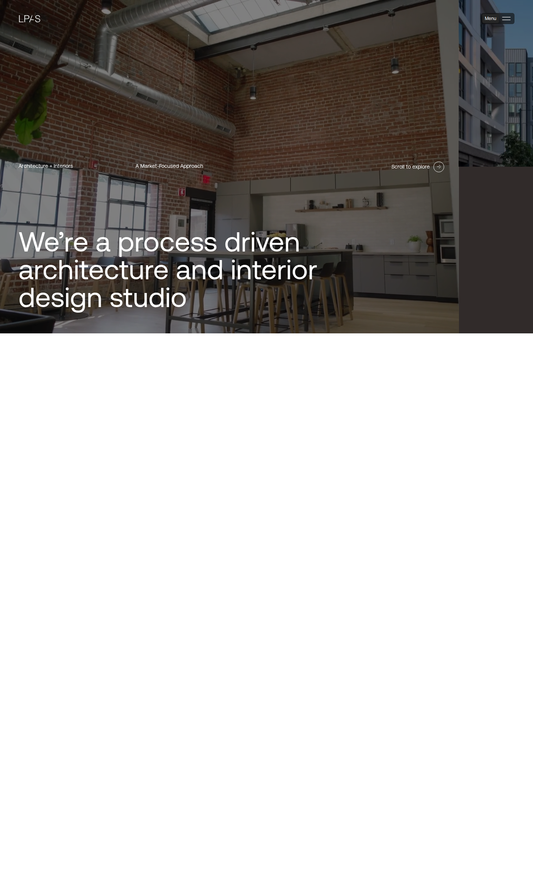
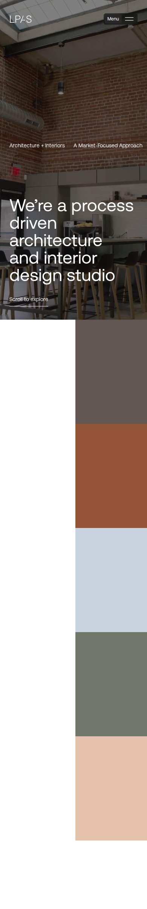

# UI Design System & Master Generation Blueprint: lpas-com

> **LPAS - Architecture and Interiors** (https://lpas.com/) — Clear Process. Creative Results. Human-centered. Always Curious. At LPAS, we design with people at the center and purpose at every turn.



---

## 1. Executive Visual Persona & Design Archetype

- **Brand Essence & Persona**: **LPAS - Architecture and Interiors** (`https://lpas.com/`). Clear Process. Creative Results. Human-centered. Always Curious. At LPAS, we design with people at the center and purpose at every turn.
- **Capture Provenance**: Live browser capture (`tier1_fast`, HTTP `200`, captured `2026-11-23`).
- **Visual Archetype**: **Light-Substrate Editorial & Modular Grid System (`#ffffff` canvas, `#000000` ink, `#0e0e0e` accent)**.
- **Anti-AI-Slop Differentiators**:
  - **Live-Computed Chromatic Polarity**: Anchors the viewport in `#ffffff` (live computed `body` `background-color` (`computed_styles.json`)) paired with `#000000` primary typography and `#0e0e0e` accents.
  - **Grounded Typographic Hierarchy**: Pairs `Aeonik` for display copy (`We’re a process driven architecture `) with `Aeonik` and not declared in live computed styles (uses primary stack / `ui-monospace`).
  - **Calibrated Spatial Grid & Motion**: Combines `1440px` container bounds (`gap: 0px 10px`, padding `1px`) with `cubic-bezier(.14,.83,.4,1)` easing and Lenis Smooth Scroll (`data-lenis`), Three.js / WebGL Canvas Pipeline.

---

## 2. Spatial Architecture & Modular Grid Mathematics



### Viewport Allocation & Container Geometry
- **Captured Viewport Dimensions**: Desktop `1440×2400px` (`assets/desktop.png`, clamped at 2400px live multi-section capture), Mobile `390×2400px` (`assets/mobile.png`, clamped at 2400px live multi-section capture).
- **Master Container Bounds**: `1440px` (live computed `main` `max-width`).
- **Canvas Lateral Padding & Spacing**: `1px` lateral canvas padding with `0px 10px` grid gap.
- **Border Radius Scale**: `6px`, `50%`, `.2rem`, `1.3rem`.

### Responsive Breakpoint Architecture
- **Desktop Layout**: Multi-column CSS Grid / Flexbox layout at `1440px` (`max-width: 1440px`, `gap: 0px 10px`).
- **Mobile Layout**: Single-column vertical stack at `390px` viewport width with `1px` horizontal padding.
- **Extracted CSS Media Queries**: `@media (min-width: 480px)`, `@media (min-width: 768px)`, `@media (min-width: 1280px)`, `@media (min-width: 2150px)`.

---

## 3. Color System, Materiality & Atmospheric Lighting

### Semantic Palette & Source Grounding
| Semantic Role | Ground-Truth Value | Extracted Live / CSS Source |
|---|---|---|
| **Primary Canvas Substrate** | `#ffffff` | live computed `body` `background-color` (`computed_styles.json`) |
| **Primary Typography Ink** | `#000000` | live computed `body` `color` (`computed_styles.json`) |
| **Elevated Surface / Card Substrate** | `#eeeeee` | `.template code { background-color: #eeeeee }` |
| **Interactive Accent / Highlight** | `#0e0e0e` | live computed `button` `background-color` (`computed_styles.json`) |
| **Secondary / Muted Copy** | `#747474` | live computed `p` `color` (`computed_styles.json`) |
| **Structural Hairline Border** | `#e5e5e5` | `.template__title { border-bottom: #e5e5e5 }` |

### Sanitized Root CSS Variables (`ui-ux.md` Ground Truth)
| Variable Name | Extracted Value | Semantic Role |
|---|---|---|
| `--row-gap` | `0` | Layout / Spatial Grid Token |
| `--column-gap` | `1rem` | Layout / Spatial Grid Token |
| `--xxlSpace` | `8.5rem` | Layout / Spatial Grid Token |
| `--marketMainColor` | `rgb(98, 86, 83)` | Brand / Palette Token |
| `--marketSecondaryColor` | `rgb(123, 105, 100)` | Brand / Palette Token |
| `--marketContentColor` | `rgb(255, 255, 255)` | Brand / Palette Token |
| `--marketContentContrast` | `rgb(38, 38, 38)` | Color / Atmospheric Token |
| `--scrollbarWidth` | `0px` | Layout / Spatial Grid Token |
| `--ctaBarHeight` | `0px` | Brand / Palette Token |
| `--viewportWidth` | `calc(100vw - var(--scrollbarWidth))` | Layout / Spatial Grid Token |
| `--cut` | `2rem` | Dimension / Scale Token |
| `--sticky-offset` | `505px` | Dimension / Scale Token |
| `--wp--preset--aspect-ratio--square` | `1` | Design System Custom Token |
| `--wp--preset--aspect-ratio--4-3` | `4/3` | Design System Custom Token |
| `--lpas-com-bg` | `#ffffff` | Canvas Substrate (from live computed `body` `background-color` (`computed_styles.json`)) |
| `--lpas-com-ink` | `#000000` | Primary Typography Ink (computed-derived) |

---

## 4. Typographic Scale & Editorial Hierarchy

### Font Family Stacks
- **Display Typography**: `Aeonik`.
- **Primary Body Stack**: `Aeonik`.
- **Technical / Metadata Stack**: not declared in live computed styles (uses primary stack / `ui-monospace`).

### Typographic Scale & Rules (Live Computed & Stylesheet Grounded)
- **Hero Display (`H1`)**: live computed `h1` (`font-size: 75px`, `line-height: 75px`, `font-weight: 400`).
- **Section Heading (`H2`)**: live computed `h2` (`font-size: 38px`, `line-height: 41.8px`, `font-weight: 400`); rule `h2` (`line-height: 110%`, `font-weight: 400`).
- **Body Copy**: live computed `body` (`font-size: 16px`, `line-height: 21.6px`, `font-weight: 400`); rule `,body` (`line-height: 135%`, `font-weight: 400`).
- **Metadata & Navigation Labels**: live computed `nav/a` (`font-size: 16px`, `line-height: 21.6px`, `font-weight: 400`).

---

## 5. Choreographed Motion & Interaction Physics

### Primary Easing Curves
- **Extracted Timing Functions**: `cubic-bezier(.14,.83,.4,1)`, `cubic-bezier(0,0,.13,.99)`, `cubic-bezier(.4,0,.2,1)`.

### Per-Element Transition & Choreography Rules
- **Selector `:focus-visible`**: `transition: none` extracted from `lpas-com` stylesheet.
- **Selector `.is-previous-container:after`**: `transition: opacity .5s ease` extracted from `lpas-com` stylesheet.
- **Selector `.is-previous-container.is-darkene...`**: `transition: opacity .5s ease,backdrop-filter .6s ease` extracted from `lpas-com` stylesheet.
- **Extracted Easing Curve (`cubic-bezier(.14,.83,.4,1)`)**: Governs interactive state transitions across `<header.mainHeader>` and `<section.blockIntroGeneral>`.
- **Runtime Interaction Engine**: Integrates Lenis Smooth Scroll (`data-lenis`), Three.js / WebGL Canvas Pipeline, Swiper Touch Carousel Engine with `prefers-reduced-motion: reduce` fallback guards.

---

## 6. Component Wireframe & Structural DOM Map

### Visual Layout Schematic — Desktop (`1440px`, Grounded in `dom.html` & Landmark Bounding Boxes)
```
┌────────────────────────────────────────────────────────────────────────┐
│ DESKTOP VIEWPORT (1440px) — LPAS - Architecture and Interiors          │
│ ====================================================================== │
│ [ <header.mainHeader> (900x225px)     | Housing · Interiors · Higher ] │
│ ---------------------------------------------------------------------- │
│ | HERO STAGE: <section.homeHero> (w=1440px)                          | │
│ | H1: We’re a process driven architecture and interior...            | │
│ | Substrate: #ffffff | Ink: #000000 | Accent: #0e0e0e                | │
│ ---------------------------------------------------------------------- │
│ | SHOWCASE GRID (<section.blockIntroGeneral) max-w: 1440px           | │
│ | +------------------------------+  +------------------------------+ | │
│ | | Higher Education             |  | Clear Process. Creative Resu | | │
│ | +------------------------------+  +------------------------------+ | │
│ ---------------------------------------------------------------------- │
│ | DETAIL MODULE (<section.blockProjectsHigh) — Listen. Plan. Analyze | │
│ ---------------------------------------------------------------------- │
│ [ FOOTER (<footer.navigationFo) | https://lpas.com/                    │
└────────────────────────────────────────────────────────────────────────┘
```

### Visual Layout Schematic — Mobile Reflow (`390px`)
```
┌────────────────────────────────────────────────────────────────────────┐
│ MOBILE VIEWPORT REFLOW (390px) — Single-Column Stack (gap: 0px 10px)   │
│ ====================================================================== │
│ [ HEADER BAR (<header.mainHeader>     ) | Compact Menu (390px)         │
│ ---------------------------------------------------------------------- │
│ | HERO STAGE (<section.homeHero>) — 390px Vertical Lead              | │
│ | H1: We’re a process driven architecture and interior...            | │
│ ---------------------------------------------------------------------- │
│ | SHOWCASE STACK (<section.blockIntroGen) — 1-Col Stack              | │
│ | [ Item 1: Higher Education                                       ] | │
│ | [ Item 2: Clear Process. Creative Results. Human Centered....    ] | │
│ ---------------------------------------------------------------------- │
│ | DETAIL STACK (<section.blockProjectsHi) — 1-Col (Listen. Plan. Anal) │
│ ---------------------------------------------------------------------- │
│ [ FOOTER (<footer.navigationFo) | Stacked 390px Colophon               │
└────────────────────────────────────────────────────────────────────────┘
```

### Granular DOM Region Breakdown
1. **Brand Header & Navigation Bar (<header.mainHeader> — `lpas-com`)**:
   - Landmark `<header class="mainHeader">` (`900x225px`) hosting `LPAS - Architecture and Interiors` navigation (`Housing · Interiors · Higher Education · Civic · Commercial`), DOM attributes (`data-browser="Chrome"`, `data-istoch="false"`, `data-logocolor="light"`, `data-first-visit="true"`), and stylesheet rule `video { margin:0;padding:0;border:0;font-size:100%;font:inherit;vertical-align:b... }`.
2. **Hero Stage & Focal Lead (<section.homeHero> — `We’re a process driven architectur`)**:
   - Landmark `<section class="homeHero">` presenting display lead `We’re a process driven architecture and interior...` and copy excerpt *"Happy Halloween from LPAS! Teamwork makes the scream work."* over `#ffffff` canvas and `#000000` ink.
3. **Primary Showcase & Content Grid (<section.blockIntroGeneral> — `Higher Education`)**:
   - Landmark `<section class="blockIntroGeneral">` rendering section `Higher Education` with copy *"Architecture + Interiors"*, asset references (`main-DN-9Dm9S.css`, `swup-config-DoT-9FzL.js`, `preloader-CQAQSTAa.js`, `lenisSmooth-BjXMsNId.js`), and grid rule `section { display:block }`.
4. **Interactive Detail & Feature Matrix (<section.blockProjectsHighlight> — `Clear Process. Creative Results. H`)**:
   - Landmark `<section class="blockProjectsHighlight">` framing `Clear Process. Creative Results. Human Centered....` and `Listen. Plan. Analyze. Shape.` (*"A Market-Focused Approach"*) with `#eeeeee` surface cards, `#0e0e0e` accents, and `body { line-height:1 }`.
5. **Colophon & Global Directory Footer (<footer.navigationFooter> — `https://lpas.com/`)**:
   - Landmark `<footer class="navigationFooter">` anchoring `LPAS - Architecture and Interior` footer links (`Housing · Interiors · Higher Education · Civic · Commercial`), copy *"Swipe up to explore"*, and `#e5e5e5` structural dividers.

---

## 7. Master Zero-Shot AI Generation Prompt

```markdown
# Master Zero-Shot Frontend Generation Prompt: lpas-com (LPAS - Architecture and Interiors)

You are a principal frontend architect and design systems engineer. Build a complete, production-ready web application replicating the exact design system, DOM landmarks, typographic hierarchy, color tokens, and motion physics of `lpas-com` (**LPAS - Architecture and Interiors** — `https://lpas.com/`).

### 1. Visual Archetype & Anti-AI-Slop Mandates
- **Archetype**: Light-Substrate Editorial & Modular Grid System (`#ffffff` canvas, `#000000` ink, `#0e0e0e` accent).
- **Identity & Domain Context**: Clear Process. Creative Results. Human-centered. Always Curious. At LPAS, we design with people at the center and purpose at every turn.
- **Primary Substrate**: `#ffffff` (live computed `body` `background-color` (`computed_styles.json`)), **Primary Ink**: `#000000`, **Accent / Highlight**: `#0e0e0e`.
- **Site-Specific Differentiators**:
  - **Live-Computed Chromatic Polarity**: Anchors the viewport in `#ffffff` (live computed `body` `background-color` (`computed_styles.json`)) paired with `#000000` primary typography and `#0e0e0e` accents.
  - **Grounded Typographic Hierarchy**: Pairs `Aeonik` for display copy (`We’re a process driven architecture `) with `Aeonik` and not declared in live computed styles (uses primary stack / `ui-monospace`).
  - **Calibrated Spatial Grid & Motion**: Combines `1440px` container bounds (`gap: 0px 10px`, padding `1px`) with `cubic-bezier(.14,.83,.4,1)` easing and Lenis Smooth Scroll (`data-lenis`), Three.js / WebGL Canvas Pipeline.

### 2. Ground-Truth CSS Variables (`:root` Token Contract)
Declare and consume these exact custom properties extracted from `lpas-com` in your global stylesheet:

:root {
  /* LPAS - Architecture and Interiors (lpas-com) — Live-Grounded CSS Variables */
  --row-gap: 0; /* Layout / Spatial Grid Token (lpas-com) */
  --column-gap: 1rem; /* Layout / Spatial Grid Token (lpas-com) */
  --xxlSpace: 8.5rem; /* Layout / Spatial Grid Token (lpas-com) */
  --marketMainColor: rgb(98, 86, 83); /* Brand / Palette Token (lpas-com) */
  --marketSecondaryColor: rgb(123, 105, 100); /* Brand / Palette Token (lpas-com) */
  --marketContentColor: rgb(255, 255, 255); /* Brand / Palette Token (lpas-com) */
  --marketContentContrast: rgb(38, 38, 38); /* Color / Atmospheric Token (lpas-com) */
  --scrollbarWidth: 0px; /* Layout / Spatial Grid Token (lpas-com) */
  --ctaBarHeight: 0px; /* Brand / Palette Token (lpas-com) */
  --viewportWidth: calc(100vw - var(--scrollbarWidth)); /* Layout / Spatial Grid Token (lpas-com) */
  --cut: 2rem; /* Dimension / Scale Token (lpas-com) */
  --sticky-offset: 505px; /* Dimension / Scale Token (lpas-com) */
  --wp--preset--aspect-ratio--square: 1; /* Design System Custom Token (lpas-com) */
  --wp--preset--aspect-ratio--4-3: 4/3; /* Design System Custom Token (lpas-com) */
  --lpas-com-bg: #ffffff; /* Canvas Substrate (from live computed `body` `background-color` (`computed_styles.json`)) (lpas-com) */
  --lpas-com-ink: #000000; /* Primary Typography Ink (computed-derived) (lpas-com) */
}

### 3. Semantic Color & Materiality Contract
Map every surface, ink, and border strictly to these source-grounded tokens:
- **Primary Canvas Substrate**: `#ffffff` — grounded in live computed `body` `background-color` (`computed_styles.json`)
- **Primary Typography Ink**: `#000000` — grounded in live computed `body` `color` (`computed_styles.json`)
- **Elevated Surface / Card Substrate**: `#eeeeee` — grounded in `.template code { background-color: #eeeeee }`
- **Interactive Accent / Highlight**: `#0e0e0e` — grounded in live computed `button` `background-color` (`computed_styles.json`)
- **Secondary / Muted Copy**: `#747474` — grounded in live computed `p` `color` (`computed_styles.json`)
- **Structural Hairline Border**: `#e5e5e5` — grounded in `.template__title { border-bottom: #e5e5e5 }`

### 4. Spatial Grid, Container Bounds & Responsive Breakpoints
- **Desktop Viewport Reference**: `1440×2400px` (clamped at 2400px live multi-section capture, `1440px` standard desktop width).
- **Mobile Viewport Reference**: `390×2400px` (clamped at 2400px live multi-section capture, `390px` standard mobile width).
- **Container Max-Width**: `1440px` (live computed `main` `max-width`)
- **Padding & Gutters**: `1px` lateral canvas padding with `0px 10px` grid gap
- **Desktop Grid**: Multi-column CSS Grid / Flexbox layout at `1440px` (`max-width: 1440px`, `gap: 0px 10px`)
- **Mobile Adaptation**: Single-column vertical stack at `390px` viewport width with `1px` horizontal padding
- **Media Queries**: `@media (min-width: 480px)`, `@media (min-width: 768px)`, `@media (min-width: 1280px)`, `@media (min-width: 2150px)`
- **Corner Radii**: `6px`, `50%`, `.2rem`, `1.3rem`

### 5. Typography & Editorial Scale Contract
- **Display Font Stack**: `Aeonik`
- **Body Font Stack**: `Aeonik`
- **Monospace / Technical Font Stack**: not declared in live computed styles (uses primary stack / `ui-monospace`)
- **H1 Display Rule**: live computed `h1` (`font-size: 75px`, `line-height: 75px`, `font-weight: 400`)
- **H2 Section Rule**: live computed `h2` (`font-size: 38px`, `line-height: 41.8px`, `font-weight: 400`); rule `h2` (`line-height: 110%`, `font-weight: 400`)
- **Body Copy Rule**: live computed `body` (`font-size: 16px`, `line-height: 21.6px`, `font-weight: 400`); rule `,body` (`line-height: 135%`, `font-weight: 400`)
- **Metadata & Index Rule**: live computed `nav/a` (`font-size: 16px`, `line-height: 21.6px`, `font-weight: 400`)

### 6. Component Hierarchy, Verbatim Copy & Real DOM Landmarks
Scaffold `lpas-com` (`LPAS - Architecture and Interiors`) with these exact structural regions, extracted copy, and CSS rules from `dom.html`:
1. **Brand Header & Navigation Bar (<header.mainHeader> — `lpas-com`)**:
   - DOM & Selectors: Landmark `<header class="mainHeader">` (`900x225px`) hosting `LPAS - Architecture and Interiors` navigation (`Housing · Interiors · Higher Education · Civic · Commercial`), DOM attributes (`data-browser="Chrome"`, `data-istoch="false"`, `data-logocolor="light"`, `data-first-visit="true"`), and stylesheet rule `video { margin:0;padding:0;border:0;font-size:100%;font:inherit;vertical-align:b... }`.
   - Responsive Contract: Header `Brand Header & Navigation Bar (<header.mainHeader> — `lpas-com`)` (`lpas-com`) adapts across `@media (min-width: 480px)`, `@media (min-width: 768px)`, `@media (min-width: 1280px)`, `@media (min-width: 2150px)` with `cubic-bezier(.14,.83,.4,1)`, `cubic-bezier(0,0,.13,.99)`, `cubic-bezier(.4,0,.2,1)` transitions and links `Housing · Interiors · Higher Education · Civic · Commercial`.
2. **Hero Stage & Focal Lead (<section.homeHero> — `We’re a process driven architectur`)**:
   - DOM & Selectors: Landmark `<section class="homeHero">` presenting display lead `We’re a process driven architecture and interior...` and copy excerpt *"Happy Halloween from LPAS! Teamwork makes the scream work."* over `#ffffff` canvas and `#000000` ink.
   - Responsive Contract: Hero stage (`1440×2400px` desktop / `390×2400px` mobile) sets `#ffffff` background with `#000000` headline `We’re a process driven architecture and interior...`.
3. **Primary Showcase & Content Grid (<section.blockIntroGeneral> — `Higher Education`)**:
   - DOM & Selectors: Landmark `<section class="blockIntroGeneral">` rendering section `Higher Education` with copy *"Architecture + Interiors"*, asset references (`main-DN-9Dm9S.css`, `swup-config-DoT-9FzL.js`, `preloader-CQAQSTAa.js`, `lenisSmooth-BjXMsNId.js`), and grid rule `section { display:block }`.
   - Responsive Contract: Showcase grid `Primary Showcase & Content Grid (<section.blockIntroGeneral> — `Higher Education`)` applies Multi-column CSS Grid / Flexbox layout at `1440px` (`max-width: 1440px`, `gap: 0px 10px`) on desktop and Single-column vertical stack at `390px` viewport width with `1px` horizontal padding on mobile.
4. **Interactive Detail & Feature Matrix (<section.blockProjectsHighlight> — `Clear Process. Creative Results. H`)**:
   - DOM & Selectors: Landmark `<section class="blockProjectsHighlight">` framing `Clear Process. Creative Results. Human Centered....` and `Listen. Plan. Analyze. Shape.` (*"A Market-Focused Approach"*) with `#eeeeee` surface cards, `#0e0e0e` accents, and `body { line-height:1 }`.
   - Responsive Contract: Detail module `Interactive Detail & Feature Matrix (<section.blockProjectsHighlight> — `Clear Process. Creative Results. H`)` uses `6px`, `50%`, `.2rem`, `1.3rem` radii, `#0e0e0e` highlights, and assets (main-DN-9Dm9S.css, swup-config-DoT-9FzL.js, preloader-CQAQSTAa.js).
5. **Colophon & Global Directory Footer (<footer.navigationFooter> — `https://lpas.com/`)**:
   - DOM & Selectors: Landmark `<footer class="navigationFooter">` anchoring `LPAS - Architecture and Interior` footer links (`Housing · Interiors · Higher Education · Civic · Commercial`), copy *"Swipe up to explore"*, and `#e5e5e5` structural dividers.
   - Responsive Contract: Footer `Colophon & Global Directory Footer (<footer.navigationFooter> — `https://lpas.com/`)` aligns to `1440px` (live computed `main` `max-width`) with `1px` lateral canvas padding with `0px 10px` grid gap and attributes (data-browser="Chrome", data-istoch="false", data-logocolor="light").

#### Verbatim DOM Copy Excerpts (`dom.html`)
- Copy Excerpt 1: *"Happy Halloween from LPAS! Teamwork makes the scream work."*
- Copy Excerpt 2: *"Architecture + Interiors"*
- Copy Excerpt 3: *"A Market-Focused Approach"*
- Copy Excerpt 4: *"Swipe up to explore"*

### 7. Motion, Extracted Stylesheet Rules & Interaction Choreography
- **Primary Easing Functions**: `cubic-bezier(.14,.83,.4,1)`, `cubic-bezier(0,0,.13,.99)`, `cubic-bezier(.4,0,.2,1)`
- **Extracted Stylesheet Rules (`lpas-com`)**:
- `video { margin:0;padding:0;border:0;font-size:100%;font:inherit;vertical-align:b... }`
- `section { display:block }`
- `body { line-height:1 }`
- `q:after { content:"";content:none }`
- `table { border-collapse:collapse;border-spacing:0 }`
- **Per-Selector Transition Rules**:
- **Selector `:focus-visible`**: `transition: none` extracted from `lpas-com` stylesheet.
- **Selector `.is-previous-container:after`**: `transition: opacity .5s ease` extracted from `lpas-com` stylesheet.
- **Selector `.is-previous-container.is-darkene...`**: `transition: opacity .5s ease,backdrop-filter .6s ease` extracted from `lpas-com` stylesheet.
- **Extracted Easing Curve (`cubic-bezier(.14,.83,.4,1)`)**: Governs interactive state transitions across `<header.mainHeader>` and `<section.blockIntroGeneral>`.
- **Runtime Interaction Engine**: Integrates Lenis Smooth Scroll (`data-lenis`), Three.js / WebGL Canvas Pipeline, Swiper Touch Carousel Engine with `prefers-reduced-motion: reduce` fallback guards.

### 8. Technical Deliverables
- Implement in Next.js (App Router) with TypeScript and Tailwind CSS consuming the `:root` custom properties defined above for `lpas-com`.
- Reproduce both the `1440px` desktop architecture and `390px` mobile breakpoint transitions, preserving semantic HTML5 landmarks (`<header>`, `<nav>`, `<main>`, `<section>`, `<footer>`) and `prefers-reduced-motion` accessibility guards.
```
