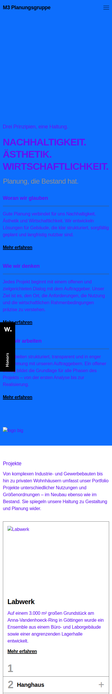

# UI Design System & Master Generation Blueprint: m3-pg-de

> **M3 Planungsgruppe** (https://m3-pg.de) — Nachhaltigkeit. Ästhetik. Wirtschaftlichkeit.


---

## 1. Executive Visual Persona & Design Archetype

- **Brand Essence & Persona**: **M3 Planungsgruppe** (`https://m3-pg.de`). Nachhaltigkeit. Ästhetik. Wirtschaftlichkeit.
- **Visual Archetype**: **High-Contrast Obsidian / Atmospheric Design System (`#0d6efd` canvas, `#6610f2` ink, `#d63384` accent)**.
- **Anti-AI-Slop Differentiators**:
  - **Source-Grounded Chromatic Polarity**: Anchors the viewport in `#0d6efd` (`var(--bs-blue)` in `:root`) paired with `#6610f2` primary typography and `#d63384` accents.
  - **Extracted Typographic Hierarchy**: Pairs `Inter` for display copy (`Nachhaltigkeit. Ästhetik. Wirtschaft`) with `212529` and not declared in static CSS (uses primary stack / `ui-monospace`).
  - **Calibrated Spatial Grid & Motion**: Combines `540px` container bounds (`gap: 1rem`, padding `2rem`) with `cubic-bezier(.4,0,.2,1)` easing and Three.js / WebGL Canvas Pipeline.

---

## 2. Spatial Architecture & Modular Grid Mathematics



### Viewport Allocation & Container Geometry
- **Captured Viewport Dimensions**: Desktop `1440×4711px` (`assets/desktop.png`, full-page scroll capture), Mobile `390×2400px` (`assets/mobile.png`, capped at 2400px multi-section capture).
- **Master Container Bounds**: `540px` extracted from `m3-pg-de` stylesheet.
- **Canvas Lateral Padding & Spacing**: `2rem` lateral canvas padding with `1rem` grid gap.
- **Border Radius Scale**: `0.375rem`, `.25rem`, `var(--bs-border-radius)`, `var(--bs-border-radius-sm)`.

### Responsive Breakpoint Architecture
- **Desktop Layout**: Multi-column CSS Grid / Flexbox layout at `1440px` (`max-width: 540px`, `gap: 1rem`).
- **Mobile Layout**: Single-column vertical stack at `390px` viewport width with `2rem` horizontal padding.
- **Extracted CSS Media Queries**: `@media (prefers-reduced-motion:no-preference)`, `@media (min-width:1200px)`, `@media (min-width:576px)`, `@media (min-width:768px)`.

---

## 3. Color System, Materiality & Atmospheric Lighting

### Semantic Palette & Source Grounding
| Semantic Role | Ground-Truth Value | Extracted CSS Source / Selector |
|---|---|---|
| **Primary Canvas Substrate** | `#0d6efd` | `var(--bs-blue)` in `:root` |
| **Primary Typography Ink** | `#6610f2` | `var(--bs-indigo)` in `:root` |
| **Elevated Surface / Card Substrate** | `#6f42c1` | `var(--bs-purple)` in `:root` |
| **Interactive Accent / Highlight** | `#d63384` | `var(--bs-pink)` in `:root` |
| **Secondary / Muted Copy** | `#dc3545` | `var(--bs-red)` in `:root` |
| **Structural Hairline Border** | `#fd7e14` | `var(--bs-orange)` in `:root` |
| **Variable Token (`--bs-yellow`)** | `#ffc107` | `var(--bs-yellow)` in `:root` |
| **Variable Token (`--bs-green`)** | `#198754` | `var(--bs-green)` in `:root` |
| **Variable Token (`--bs-teal`)** | `#20c997` | `var(--bs-teal)` in `:root` |
| **Variable Token (`--bs-cyan`)** | `#0dcaf0` | `var(--bs-cyan)` in `:root` |
| **Variable Token (`--bs-black`)** | `#000` | `var(--bs-black)` in `:root` |
| **Variable Token (`--bs-white`)** | `#fff` | `var(--bs-white)` in `:root` |
| **Variable Token (`--bs-gray`)** | `#6c757d` | `var(--bs-gray)` in `:root` |
| **Variable Token (`--bs-gray-dark`)** | `#343a40` | `var(--bs-gray-dark)` in `:root` |
| **Variable Token (`--bs-gray-100`)** | `#f8f9fa` | `var(--bs-gray-100)` in `:root` |
| **Variable Token (`--bs-gray-200`)** | `#e9ecef` | `var(--bs-gray-200)` in `:root` |

### Sanitized Root CSS Variables (`ui-ux.md` Ground Truth)
| Variable Name | Extracted Value | Semantic Role |
|---|---|---|
| `--bs-blue` | `#0d6efd` | Color / Atmospheric Token |
| `--bs-indigo` | `#6610f2` | Color / Atmospheric Token |
| `--bs-purple` | `#6f42c1` | Color / Atmospheric Token |
| `--bs-pink` | `#d63384` | Typography Ink Token |
| `--bs-red` | `#dc3545` | Color / Atmospheric Token |
| `--bs-orange` | `#fd7e14` | Color / Atmospheric Token |
| `--bs-yellow` | `#ffc107` | Color / Atmospheric Token |
| `--bs-green` | `#198754` | Color / Atmospheric Token |
| `--bs-teal` | `#20c997` | Color / Atmospheric Token |
| `--bs-cyan` | `#0dcaf0` | Color / Atmospheric Token |
| `--bs-black` | `#000` | Canvas / Surface Token |
| `--bs-white` | `#fff` | Canvas / Surface Token |
| `--bs-gray` | `#6c757d` | Color / Atmospheric Token |
| `--bs-gray-dark` | `#343a40` | Canvas / Surface Token |
| `--bs-gray-100` | `#f8f9fa` | Color / Atmospheric Token |
| `--bs-gray-200` | `#e9ecef` | Color / Atmospheric Token |

---

## 4. Typographic Scale & Editorial Hierarchy

### Font Family Stacks
- **Display Typography**: `Inter`.
- **Primary Body Stack**: `212529`.
- **Technical / Metadata Stack**: not declared in static CSS (uses primary stack / `ui-monospace`).

### Typographic Scale & Rules (Extracted from Stylesheet & Variables)
- **Hero Display (`H1`)**: rule `,h1` (`font-size: calc(1.375rem + 1.5vw)`).
- **Section Heading (`H2`)**: rule `,h2` (`font-size: calc(1.325rem + .9vw)`).
- **Body Copy**: CSS variables `--bs-body-font-family: var(--bs-font-sans-serif)`, `--bs-body-font-size: 1rem`, `--bs-body-font-weight: 400`; rule `body` (`font-size: 16px`, `line-height: 1.5em`, `letter-spacing: -0.01em`, `font-weight: 400`).
- **Metadata & Navigation Labels**: CSS variables `--bs-carousel-caption-color: #000`; rule `,small` (`font-size: .875em`).

---

## 5. Choreographed Motion & Interaction Physics

### Primary Easing Curves
- **Extracted Timing Functions**: `cubic-bezier(.4,0,.2,1)`.

### Per-Element Transition & Choreography Rules
- **Selector `.form-control`**: `transition: border-color .15s ease-in-out,box-shadow .15s ease-in-out` extracted from `m3-pg-de` stylesheet.
- **Selector `media (prefers-reduced-motion:red...`**: `transition: none` extracted from `m3-pg-de` stylesheet.
- **Selector `.form-control::-webkit-file-uploa...`**: `transition: color .15s ease-in-out,background-color .15s ease-in-out,borde...` extracted from `m3-pg-de` stylesheet.
- **Extracted Easing Curve (`cubic-bezier(.4,0,.2,1)`)**: Governs interactive state transitions across `<header.header-desk>` and `<section.page-template>`.
- **Runtime Interaction Engine**: Integrates Three.js / WebGL Canvas Pipeline with `prefers-reduced-motion: reduce` fallback guards.

---

## 6. Component Wireframe & Structural DOM Map

### Visual Layout Schematic (Grounded in `dom.html` — `1440px` Desktop & `390px` Mobile Reflow)
```
┌────────────────────────────────────────────────────────────────────────┐
│ DESKTOP VIEWPORT (1440px) — M3 Planungsgruppe                          │
│ ====================================================================== │
│ [ <header.header-desk>     | M3 Planungsgruppe · Leistungen · Proje ]  │
│ ---------------------------------------------------------------------- │
│ | HERO STAGE: <section.wp-singular>                                |   │
│ | H1: Nachhaltigkeit. Ästhetik. Wirtschaftlichkeit.                |   │
│ | Substrate: #0d6efd    | Ink: #6610f2    | Accent: #d63384        |   │
│ ---------------------------------------------------------------------- │
│ | SHOWCASE GRID (<section.page-template>   ) max-w: 540px          |   │
│ | +------------------------------+  +------------------------------+ | │
│ | | Planung, die Bestand hat.    |  | Labwerk                      | | │
│ | +------------------------------+  +------------------------------+ | │
│ ---------------------------------------------------------------------- │
│ | MOBILE VIEWPORT REFLOW (390px) — Single-Column Stack (gap: 1rem  ) | │
│ | [<header.header-des] -> [<section.wp-singul] -> [<section.page-temp] │
│ ---------------------------------------------------------------------- │
│ [ FOOTER (<footer.page-template-) | https://m3-pg.de                   │
└────────────────────────────────────────────────────────────────────────┘
```

### Granular DOM Region Breakdown
1. **Brand Header & Navigation Bar (<header.header-desk> — `m3-pg-de`)**:
   - Landmark `<header class="header-desk">` hosting `M3 Planungsgruppe` navigation (`M3 Planungsgruppe · Leistungen · Projekte · Über uns · Blog`), DOM attributes (`data-wp-strategy="defer"`, `data-more="Mehr erfahren"`, `data-less="Weniger"`, `data-more="Mehr erfahren"`), and stylesheet rule `.bi-123::before { content:"\f67f" }`.
2. **Hero Stage & Focal Lead (<section.wp-singular> — `Nachhaltigkeit. Ästhetik. Wirtscha`)**:
   - Landmark `<section class="wp-singular">` presenting display lead `Nachhaltigkeit. Ästhetik. Wirtschaftlichkeit.` and copy excerpt *"Projekte Alle Projekte Büro & Verwaltung Industrie Wohnen"* over `#0d6efd` canvas and `#6610f2` ink.
3. **Primary Showcase & Content Grid (<section.page-template> — `Planung, die Bestand hat.`)**:
   - Landmark `<section class="page-template">` rendering section `Planung, die Bestand hat.` with copy *"Gute Planung verbindet für uns Nachhaltigkeit, Ästhetik und Wirts"*, asset references (`bootstrap.min.css`, `slick.min.css`, `main.css`, `responsive.css`), and grid rule `.bi-alarm-fill::before { content:"\f101" }`.
4. **Interactive Detail & Feature Matrix (<section.page-template-templates> — `Labwerk`)**:
   - Landmark `<section class="page-template-templates">` framing `Labwerk` and `Hanghaus` (*"Unser Fokus liegt auf präziser Planung, bewusst eingesetzten Mate"*) with `#6f42c1` surface cards, `#d63384` accents, and `.bi-alarm::before { content:"\f102" }`.
5. **Colophon & Global Directory Footer (<footer.page-template-home> — `https://m3-pg.de`)**:
   - Landmark `<footer class="page-template-home">` anchoring `M3 Planungsgruppe` footer links (`M3 Planungsgruppe · Leistungen · Projekte · Über uns · Blog`), copy *"Jedes Projekt beginnt mit einem offenen und zielgerichteten "*, and `#fd7e14` structural dividers.

---

## 7. Master Zero-Shot AI Generation Prompt

```markdown
# Master Zero-Shot Frontend Generation Prompt: m3-pg-de (M3 Planungsgruppe)

You are a principal frontend architect and design systems engineer. Build a complete, production-ready web application replicating the exact design system, DOM landmarks, typographic hierarchy, color tokens, and motion physics of `m3-pg-de` (**M3 Planungsgruppe** — `https://m3-pg.de`).

### 1. Visual Archetype & Anti-AI-Slop Mandates
- **Archetype**: High-Contrast Obsidian / Atmospheric Design System (`#0d6efd` canvas, `#6610f2` ink, `#d63384` accent).
- **Identity & Domain Context**: Nachhaltigkeit. Ästhetik. Wirtschaftlichkeit.
- **Primary Substrate**: `#0d6efd` (`var(--bs-blue)` in `:root`), **Primary Ink**: `#6610f2`, **Accent / Highlight**: `#d63384`.
- **Site-Specific Differentiators**:
  - **Source-Grounded Chromatic Polarity**: Anchors the viewport in `#0d6efd` (`var(--bs-blue)` in `:root`) paired with `#6610f2` primary typography and `#d63384` accents.
  - **Extracted Typographic Hierarchy**: Pairs `Inter` for display copy (`Nachhaltigkeit. Ästhetik. Wirtschaft`) with `212529` and not declared in static CSS (uses primary stack / `ui-monospace`).
  - **Calibrated Spatial Grid & Motion**: Combines `540px` container bounds (`gap: 1rem`, padding `2rem`) with `cubic-bezier(.4,0,.2,1)` easing and Three.js / WebGL Canvas Pipeline.

### 2. Ground-Truth CSS Variables (`:root` Token Contract)
Declare and consume these exact custom properties extracted from `m3-pg-de` in your global stylesheet:

:root {
  /* M3 Planungsgruppe (m3-pg-de) — Ground-Truth Extracted CSS Variables */
  --bs-blue: #0d6efd; /* Color / Atmospheric Token (m3-pg-de) */
  --bs-indigo: #6610f2; /* Color / Atmospheric Token (m3-pg-de) */
  --bs-purple: #6f42c1; /* Color / Atmospheric Token (m3-pg-de) */
  --bs-pink: #d63384; /* Typography Ink Token (m3-pg-de) */
  --bs-red: #dc3545; /* Color / Atmospheric Token (m3-pg-de) */
  --bs-orange: #fd7e14; /* Color / Atmospheric Token (m3-pg-de) */
  --bs-yellow: #ffc107; /* Color / Atmospheric Token (m3-pg-de) */
  --bs-green: #198754; /* Color / Atmospheric Token (m3-pg-de) */
  --bs-teal: #20c997; /* Color / Atmospheric Token (m3-pg-de) */
  --bs-cyan: #0dcaf0; /* Color / Atmospheric Token (m3-pg-de) */
  --bs-black: #000; /* Canvas / Surface Token (m3-pg-de) */
  --bs-white: #fff; /* Canvas / Surface Token (m3-pg-de) */
  --bs-gray: #6c757d; /* Color / Atmospheric Token (m3-pg-de) */
  --bs-gray-dark: #343a40; /* Canvas / Surface Token (m3-pg-de) */
  --bs-gray-100: #f8f9fa; /* Color / Atmospheric Token (m3-pg-de) */
  --bs-gray-200: #e9ecef; /* Color / Atmospheric Token (m3-pg-de) */
}

### 3. Semantic Color & Materiality Contract
Map every surface, ink, and border strictly to these source-grounded tokens:
- **Primary Canvas Substrate**: `#0d6efd` — grounded in `var(--bs-blue)` in `:root`
- **Primary Typography Ink**: `#6610f2` — grounded in `var(--bs-indigo)` in `:root`
- **Elevated Surface / Card Substrate**: `#6f42c1` — grounded in `var(--bs-purple)` in `:root`
- **Interactive Accent / Highlight**: `#d63384` — grounded in `var(--bs-pink)` in `:root`
- **Secondary / Muted Copy**: `#dc3545` — grounded in `var(--bs-red)` in `:root`
- **Structural Hairline Border**: `#fd7e14` — grounded in `var(--bs-orange)` in `:root`
- **Variable Token (`--bs-yellow`)**: `#ffc107` — grounded in `var(--bs-yellow)` in `:root`
- **Variable Token (`--bs-green`)**: `#198754` — grounded in `var(--bs-green)` in `:root`
- **Variable Token (`--bs-teal`)**: `#20c997` — grounded in `var(--bs-teal)` in `:root`
- **Variable Token (`--bs-cyan`)**: `#0dcaf0` — grounded in `var(--bs-cyan)` in `:root`
- **Variable Token (`--bs-black`)**: `#000` — grounded in `var(--bs-black)` in `:root`
- **Variable Token (`--bs-white`)**: `#fff` — grounded in `var(--bs-white)` in `:root`
- **Variable Token (`--bs-gray`)**: `#6c757d` — grounded in `var(--bs-gray)` in `:root`
- **Variable Token (`--bs-gray-dark`)**: `#343a40` — grounded in `var(--bs-gray-dark)` in `:root`
- **Variable Token (`--bs-gray-100`)**: `#f8f9fa` — grounded in `var(--bs-gray-100)` in `:root`
- **Variable Token (`--bs-gray-200`)**: `#e9ecef` — grounded in `var(--bs-gray-200)` in `:root`

### 4. Spatial Grid, Container Bounds & Responsive Breakpoints
- **Desktop Viewport Reference**: `1440×4711px` (full-page scroll capture, `1440px` standard desktop width).
- **Mobile Viewport Reference**: `390×2400px` (capped at 2400px multi-section capture, `390px` standard mobile width).
- **Container Max-Width**: `540px` extracted from `m3-pg-de` stylesheet
- **Padding & Gutters**: `2rem` lateral canvas padding with `1rem` grid gap
- **Desktop Grid**: Multi-column CSS Grid / Flexbox layout at `1440px` (`max-width: 540px`, `gap: 1rem`)
- **Mobile Adaptation**: Single-column vertical stack at `390px` viewport width with `2rem` horizontal padding
- **Media Queries**: `@media (prefers-reduced-motion:no-preference)`, `@media (min-width:1200px)`, `@media (min-width:576px)`, `@media (min-width:768px)`
- **Corner Radii**: `0.375rem`, `.25rem`, `var(--bs-border-radius)`, `var(--bs-border-radius-sm)`

### 5. Typography & Editorial Scale Contract
- **Display Font Stack**: `Inter`
- **Body Font Stack**: `212529`
- **Monospace / Technical Font Stack**: not declared in static CSS (uses primary stack / `ui-monospace`)
- **H1 Display Rule**: rule `,h1` (`font-size: calc(1.375rem + 1.5vw)`)
- **H2 Section Rule**: rule `,h2` (`font-size: calc(1.325rem + .9vw)`)
- **Body Copy Rule**: CSS variables `--bs-body-font-family: var(--bs-font-sans-serif)`, `--bs-body-font-size: 1rem`, `--bs-body-font-weight: 400`; rule `body` (`font-size: 16px`, `line-height: 1.5em`, `letter-spacing: -0.01em`, `font-weight: 400`)
- **Metadata & Index Rule**: CSS variables `--bs-carousel-caption-color: #000`; rule `,small` (`font-size: .875em`)

### 6. Component Hierarchy, Verbatim Copy & Real DOM Landmarks
Scaffold `m3-pg-de` (`M3 Planungsgruppe`) with these exact structural regions, extracted copy, and CSS rules from `dom.html`:
1. **Brand Header & Navigation Bar (<header.header-desk> — `m3-pg-de`)**:
   - DOM & Selectors: Landmark `<header class="header-desk">` hosting `M3 Planungsgruppe` navigation (`M3 Planungsgruppe · Leistungen · Projekte · Über uns · Blog`), DOM attributes (`data-wp-strategy="defer"`, `data-more="Mehr erfahren"`, `data-less="Weniger"`, `data-more="Mehr erfahren"`), and stylesheet rule `.bi-123::before { content:"\f67f" }`.
   - Responsive Contract: Header `Brand Header & Navigation Bar (<header.header-desk> — `m3-pg-de`)` (`m3-pg-de`) adapts across `@media (prefers-reduced-motion:no-preference)`, `@media (min-width:1200px)`, `@media (min-width:576px)`, `@media (min-width:768px)` with `cubic-bezier(.4,0,.2,1)` transitions and links `M3 Planungsgruppe · Leistungen · Projekte · Über uns · Blog`.
2. **Hero Stage & Focal Lead (<section.wp-singular> — `Nachhaltigkeit. Ästhetik. Wirtscha`)**:
   - DOM & Selectors: Landmark `<section class="wp-singular">` presenting display lead `Nachhaltigkeit. Ästhetik. Wirtschaftlichkeit.` and copy excerpt *"Projekte Alle Projekte Büro & Verwaltung Industrie Wohnen"* over `#0d6efd` canvas and `#6610f2` ink.
   - Responsive Contract: Hero stage (`1440×4711px` desktop / `390×2400px` mobile) sets `#0d6efd` background with `#6610f2` headline `Nachhaltigkeit. Ästhetik. Wirtschaftlichkeit.`.
3. **Primary Showcase & Content Grid (<section.page-template> — `Planung, die Bestand hat.`)**:
   - DOM & Selectors: Landmark `<section class="page-template">` rendering section `Planung, die Bestand hat.` with copy *"Gute Planung verbindet für uns Nachhaltigkeit, Ästhetik und Wirts"*, asset references (`bootstrap.min.css`, `slick.min.css`, `main.css`, `responsive.css`), and grid rule `.bi-alarm-fill::before { content:"\f101" }`.
   - Responsive Contract: Showcase grid `Primary Showcase & Content Grid (<section.page-template> — `Planung, die Bestand hat.`)` applies Multi-column CSS Grid / Flexbox layout at `1440px` (`max-width: 540px`, `gap: 1rem`) on desktop and Single-column vertical stack at `390px` viewport width with `2rem` horizontal padding on mobile.
4. **Interactive Detail & Feature Matrix (<section.page-template-templates> — `Labwerk`)**:
   - DOM & Selectors: Landmark `<section class="page-template-templates">` framing `Labwerk` and `Hanghaus` (*"Unser Fokus liegt auf präziser Planung, bewusst eingesetzten Mate"*) with `#6f42c1` surface cards, `#d63384` accents, and `.bi-alarm::before { content:"\f102" }`.
   - Responsive Contract: Detail module `Interactive Detail & Feature Matrix (<section.page-template-templates> — `Labwerk`)` uses `0.375rem`, `.25rem`, `var(--bs-border-radius)`, `var(--bs-border-radius-sm)` radii, `#d63384` highlights, and assets (bootstrap.min.css, slick.min.css, main.css).
5. **Colophon & Global Directory Footer (<footer.page-template-home> — `https://m3-pg.de`)**:
   - DOM & Selectors: Landmark `<footer class="page-template-home">` anchoring `M3 Planungsgruppe` footer links (`M3 Planungsgruppe · Leistungen · Projekte · Über uns · Blog`), copy *"Jedes Projekt beginnt mit einem offenen und zielgerichteten "*, and `#fd7e14` structural dividers.
   - Responsive Contract: Footer `Colophon & Global Directory Footer (<footer.page-template-home> — `https://m3-pg.de`)` aligns to `540px` extracted from `m3-pg-de` stylesheet with `2rem` lateral canvas padding with `1rem` grid gap and attributes (data-wp-strategy="defer", data-more="Mehr erfahren", data-less="Weniger").

#### Verbatim DOM Copy Excerpts (`dom.html`)
- Copy Excerpt 1: *"Projekte Alle Projekte Büro & Verwaltung Industrie Wohnen"*
- Copy Excerpt 2: *"Gute Planung verbindet für uns Nachhaltigkeit, Ästhetik und Wirtschaftlichkeit. Wi..."*
- Copy Excerpt 3: *"Unser Fokus liegt auf präziser Planung, bewusst eingesetzten Materialien und einer..."*
- Copy Excerpt 4: *"Jedes Projekt beginnt mit einem offenen und zielgerichteten Dialog mit dem Auftrag..."*

### 7. Motion, Extracted Stylesheet Rules & Interaction Choreography
- **Primary Easing Functions**: `cubic-bezier(.4,0,.2,1)`
- **Extracted Stylesheet Rules (`m3-pg-de`)**:
- `.bi-123::before { content:"\f67f" }`
- `.bi-alarm-fill::before { content:"\f101" }`
- `.bi-alarm::before { content:"\f102" }`
- `.bi-align-bottom::before { content:"\f103" }`
- `.bi-align-center::before { content:"\f104" }`
- **Per-Selector Transition Rules**:
- **Selector `.form-control`**: `transition: border-color .15s ease-in-out,box-shadow .15s ease-in-out` extracted from `m3-pg-de` stylesheet.
- **Selector `media (prefers-reduced-motion:red...`**: `transition: none` extracted from `m3-pg-de` stylesheet.
- **Selector `.form-control::-webkit-file-uploa...`**: `transition: color .15s ease-in-out,background-color .15s ease-in-out,borde...` extracted from `m3-pg-de` stylesheet.
- **Extracted Easing Curve (`cubic-bezier(.4,0,.2,1)`)**: Governs interactive state transitions across `<header.header-desk>` and `<section.page-template>`.
- **Runtime Interaction Engine**: Integrates Three.js / WebGL Canvas Pipeline with `prefers-reduced-motion: reduce` fallback guards.

### 8. Technical Deliverables
- Implement in Next.js (App Router) with TypeScript and Tailwind CSS consuming the `:root` custom properties defined above for `m3-pg-de`.
- Reproduce both the `1440px` desktop architecture and `390px` mobile breakpoint transitions, preserving semantic HTML5 landmarks (`<header>`, `<nav>`, `<main>`, `<section>`, `<footer>`) and `prefers-reduced-motion` accessibility guards.
```
