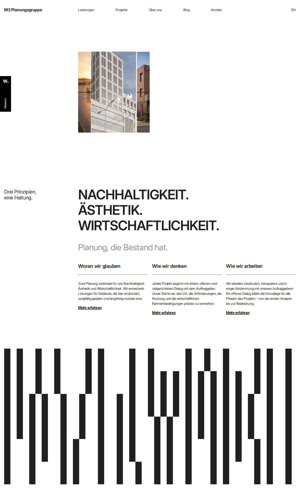

# UI Design System & Master Generation Blueprint: m3-pg-de

> **M3 Planungsgruppe** (https://m3-pg.de) — Nachhaltigkeit. Ästhetik. Wirtschaftlichkeit.



---

## 1. Executive Visual Persona & Design Archetype

- **Brand Essence & Persona**: **M3 Planungsgruppe** (`https://m3-pg.de`). Nachhaltigkeit. Ästhetik. Wirtschaftlichkeit.
- **Capture Provenance**: Live browser capture (`tier1_fast`, HTTP `200`, captured `2026-11-23`).
- **Visual Archetype**: **Light-Substrate Editorial & Modular Grid System (`#ffffff` canvas, `#000000` ink, `#0d6efd` accent)**.
- **Anti-AI-Slop Differentiators**:
  - **Live-Computed Chromatic Polarity**: Anchors the viewport in `#ffffff` (live computed `body` `background-color` (`computed_styles.json`)) paired with `#000000` primary typography and `#0d6efd` accents.
  - **Grounded Typographic Hierarchy**: Pairs `Inter` for display copy (`M3 Planungsgruppe`) with `Inter` and not declared in live computed styles (uses primary stack / `ui-monospace`).
  - **Calibrated Spatial Grid & Motion**: Combines `1420px` container bounds (`gap: 10px`, padding `16px`) with `cubic-bezier(.4,0,.2,1)` easing and Three.js / WebGL Canvas Pipeline.

---

## 2. Spatial Architecture & Modular Grid Mathematics


### Viewport Allocation & Container Geometry
- **Captured Viewport Dimensions**: Desktop `1440×2400px` (`assets/desktop.png`, clamped at 2400px live multi-section capture), Mobile `390×2400px` (`assets/mobile.png`, clamped at 2400px live multi-section capture).
- **Master Container Bounds**: `1420px` (non-`@media` desktop container stylesheet rule).
- **Canvas Lateral Padding & Spacing**: `16px` lateral canvas padding with `10px` grid gap.
- **Border Radius Scale**: `100%`, `0.375rem`, `.25rem`, `var(--bs-border-radius)`.

### Responsive Breakpoint Architecture
- **Desktop Layout**: Multi-column CSS Grid / Flexbox layout at `1440px` (`max-width: 1420px`, `gap: 10px`).
- **Mobile Layout**: Single-column vertical stack at `390px` viewport width with `16px` horizontal padding.
- **Extracted CSS Media Queries**: `@media (prefers-reduced-motion: reduce)`, `@media (min-width: 1300px)`, `@media (min-width: 1430px)`, `@media screen and (min-width: 1024px)`.

---

## 3. Color System, Materiality & Atmospheric Lighting

### Semantic Palette & Source Grounding
| Semantic Role | Ground-Truth Value | Extracted Live / CSS Source |
|---|---|---|
| **Primary Canvas Substrate** | `#ffffff` | live computed `body` `background-color` (`computed_styles.json`) |
| **Primary Typography Ink** | `#000000` | live computed `a` `color` (`computed_styles.json`) |
| **Elevated Surface / Card Substrate** | `#f8f9fa` | `var(--bs-tertiary-bg)` in `:root` |
| **Interactive Accent / Highlight** | `#0d6efd` | `var(--bs-primary)` in `:root` |
| **Secondary / Muted Copy** | `#6c757d` | `var(--bs-secondary)` in `:root` |
| **Structural Hairline Border** | `#9ec5fe` | `var(--bs-primary-border-subtle)` in `:root` |
| **Variable Token (`--bs-indigo`)** | `#6610f2` | `var(--bs-indigo)` in `:root` |
| **Variable Token (`--bs-purple`)** | `#6f42c1` | `var(--bs-purple)` in `:root` |
| **Variable Token (`--bs-pink`)** | `#d63384` | `var(--bs-pink)` in `:root` |
| **Variable Token (`--bs-red`)** | `#dc3545` | `var(--bs-red)` in `:root` |
| **Variable Token (`--bs-orange`)** | `#fd7e14` | `var(--bs-orange)` in `:root` |
| **Variable Token (`--bs-yellow`)** | `#ffc107` | `var(--bs-yellow)` in `:root` |
| **Variable Token (`--bs-green`)** | `#198754` | `var(--bs-green)` in `:root` |
| **Variable Token (`--bs-teal`)** | `#20c997` | `var(--bs-teal)` in `:root` |
| **Variable Token (`--bs-cyan`)** | `#0dcaf0` | `var(--bs-cyan)` in `:root` |
| **Variable Token (`--bs-gray-dark`)** | `#343a40` | `var(--bs-gray-dark)` in `:root` |
| **Variable Token (`--bs-gray-200`)** | `#e9ecef` | `var(--bs-gray-200)` in `:root` |

### Sanitized Root CSS Variables (`ui-ux.md` Ground Truth)
| Variable Name | Extracted Value | Semantic Role |
|---|---|---|
| `--bs-blue` | `#0d6efd` | Color / Atmospheric Token |
| `--bs-indigo` | `#6610f2` | Color / Atmospheric Token |
| `--bs-purple` | `#6f42c1` | Color / Atmospheric Token |
| `--bs-pink` | `#d63384` | Typography Ink Token |
| `--bs-red` | `#dc3545` | Color / Atmospheric Token |
| `--bs-orange` | `#fd7e14` | Color / Atmospheric Token |
| `--bs-yellow` | `#ffc107` | Color / Atmospheric Token |
| `--bs-green` | `#198754` | Color / Atmospheric Token |
| `--bs-teal` | `#20c997` | Color / Atmospheric Token |
| `--bs-cyan` | `#0dcaf0` | Color / Atmospheric Token |
| `--bs-black` | `#000` | Canvas / Surface Token |
| `--bs-white` | `#fff` | Canvas / Surface Token |
| `--bs-gray` | `#6c757d` | Color / Atmospheric Token |
| `--bs-gray-dark` | `#343a40` | Canvas / Surface Token |
| `--bs-gray-100` | `#f8f9fa` | Color / Atmospheric Token |
| `--bs-gray-200` | `#e9ecef` | Color / Atmospheric Token |

---

## 4. Typographic Scale & Editorial Hierarchy

### Font Family Stacks
- **Display Typography**: `Inter`.
- **Primary Body Stack**: `Inter`.
- **Technical / Metadata Stack**: not declared in live computed styles (uses primary stack / `ui-monospace`).

### Typographic Scale & Rules (Live Computed & Stylesheet Grounded)
- **Hero Display (`H1`)**: live computed `h1` (`font-size: 155.4px`, `line-height: 155.4px`, `font-weight: 700`, `letter-spacing: -4.662px`); rule `h1` (`font-size: clamp(40px, 11.1cqw, 198px)`, `line-height: 1em`, `letter-spacing: -0.03em`, `font-weight: 700`).
- **Section Heading (`H2`)**: live computed `h2` (`font-size: 64px`, `line-height: 74px`, `font-weight: 600`, `letter-spacing: -1.92px`); rule `.h2` (`font-size: 64px`, `line-height: 1.125em`, `letter-spacing: -0.03em`, `font-weight: 600`).
- **Body Copy**: live computed `body` (`font-size: 16px`, `line-height: 24px`, `font-weight: 400`, `letter-spacing: -0.16px`); CSS variables `--bs-body-font-family: var(--bs-font-sans-serif)`, `--bs-body-font-size: 1rem`, `--bs-body-font-weight: 400`; rule `body` (`font-size: 16px`, `line-height: 1.5em`, `letter-spacing: -0.01em`, `font-weight: 400`).
- **Metadata & Navigation Labels**: live computed `nav/a` (`font-size: 20px`, `line-height: 24px`, `font-weight: 600`, `letter-spacing: -0.4px`); rule `,small` (`font-size: .875em`).

---

## 5. Choreographed Motion & Interaction Physics

### Primary Easing Curves
- **Extracted Timing Functions**: `cubic-bezier(.4,0,.2,1)`.

### Per-Element Transition & Choreography Rules
- **Selector `header`**: `transition: background-color 0.3s ease` extracted from `m3-pg-de` stylesheet.
- **Selector `.readmore::after`**: `transition: width 0.6s ease` extracted from `m3-pg-de` stylesheet.
- **Selector `.bottom-row a`**: `transition: all .3s ease` extracted from `m3-pg-de` stylesheet.
- **Extracted Easing Curve (`cubic-bezier(.4,0,.2,1)`)**: Governs interactive state transitions across `<header.header-desk>` and `<section.page-template>`.
- **Runtime Interaction Engine**: Integrates Three.js / WebGL Canvas Pipeline with `prefers-reduced-motion: reduce` fallback guards.

---

## 6. Component Wireframe & Structural DOM Map

### Visual Layout Schematic — Desktop (`1440px`, Grounded in `dom.html` & Landmark Bounding Boxes)
```
┌────────────────────────────────────────────────────────────────────────┐
│ DESKTOP VIEWPORT (1440px) — M3 Planungsgruppe                          │
│ ====================================================================== │
│ [ <header.header-desk> (1440x60px)    | M3 Planungsgruppe · Leistung ] │
│ ---------------------------------------------------------------------- │
│ | HERO STAGE: <section.wp-singular> (w=1440px)                       | │
│ | H1: M3 Planungsgruppe                                              | │
│ | Substrate: #ffffff | Ink: #000000 | Accent: #0d6efd                | │
│ ---------------------------------------------------------------------- │
│ | SHOWCASE GRID (<section.page-template>) max-w: 1420px              | │
│ | +------------------------------+  +------------------------------+ | │
│ | | Nachhaltigkeit. Ästhetik. Wi |  | Planung, die Bestand hat.    | | │
│ | +------------------------------+  +------------------------------+ | │
│ ---------------------------------------------------------------------- │
│ | DETAIL MODULE (<section.page-template-tem) — B18 – Fachwerk trifft | │
│ ---------------------------------------------------------------------- │
│ [ FOOTER (<footer.page-templat) | https://m3-pg.de                     │
└────────────────────────────────────────────────────────────────────────┘
```

### Visual Layout Schematic — Mobile Reflow (`390px`)
```
┌────────────────────────────────────────────────────────────────────────┐
│ MOBILE VIEWPORT REFLOW (390px) — Single-Column Stack (gap: 10px)       │
│ ====================================================================== │
│ [ HEADER BAR (<header.header-desk>    ) | Compact Menu (390px)         │
│ ---------------------------------------------------------------------- │
│ | HERO STAGE (<section.wp-singular>) — 390px Vertical Lead           | │
│ | H1: M3 Planungsgruppe                                              | │
│ ---------------------------------------------------------------------- │
│ | SHOWCASE STACK (<section.page-template) — 1-Col Stack              | │
│ | [ Item 1: Nachhaltigkeit. Ästhetik. Wirtschaftlichkeit.          ] | │
│ | [ Item 2: Planung, die Bestand hat.                              ] | │
│ ---------------------------------------------------------------------- │
│ | DETAIL STACK (<section.page-template-t) — 1-Col (B18 – Fachwerk tri) │
│ ---------------------------------------------------------------------- │
│ [ FOOTER (<footer.page-templat) | Stacked 390px Colophon               │
└────────────────────────────────────────────────────────────────────────┘
```

### Granular DOM Region Breakdown
1. **Brand Header & Navigation Bar (<header.header-desk> — `m3-pg-de`)**:
   - Landmark `<header class="header-desk">` (`1440x60px`) hosting `M3 Planungsgruppe` navigation (`M3 Planungsgruppe · Leistungen · Projekte · Über uns · Blog`), DOM attributes (`data-wp-strategy="defer"`, `data-more="Mehr erfahren"`, `data-less="Weniger"`, `data-more="Mehr erfahren"`), and stylesheet rule `.wpcf7 .hidden-fields-container { display: none; }`.
2. **Hero Stage & Focal Lead (<section.wp-singular> — `M3 Planungsgruppe`)**:
   - Landmark `<section class="wp-singular">` presenting display lead `M3 Planungsgruppe` and copy excerpt *"Gute Planung verbindet für uns Nachhaltigkeit, Ästhetik und Wirts"* over `#ffffff` canvas and `#000000` ink.
3. **Primary Showcase & Content Grid (<section.page-template> — `Nachhaltigkeit. Ästhetik. Wirtscha`)**:
   - Landmark `<section class="page-template">` rendering section `Nachhaltigkeit. Ästhetik. Wirtschaftlichkeit.` with copy *"Unser Fokus liegt auf präziser Planung, bewusst eingesetzten Mate"*, asset references (`bootstrap.min.css`, `slick.min.css`, `main.css`, `responsive.css`), and grid rule `.wpcf7 form .wpcf7-response-output { margin: 2em 0.5em 1em; padding: 0.2em 1em; border: 2px solid 00a0d2; }`.
4. **Interactive Detail & Feature Matrix (<section.page-template-templates> — `Planung, die Bestand hat.`)**:
   - Landmark `<section class="page-template-templates">` framing `Planung, die Bestand hat.` and `B18 – Fachwerk trifft Glas` (*"Jedes Projekt beginnt mit einem offenen und zielgerichteten Dialo"*) with `#f8f9fa` surface cards, `#0d6efd` accents, and `form.submitting .wpcf7-response-o... { display: none; }`.
5. **Colophon & Global Directory Footer (<footer.page-template-home> — `https://m3-pg.de`)**:
   - Landmark `<footer class="page-template-home">` anchoring `M3 Planungsgruppe` footer links (`M3 Planungsgruppe · Leistungen · Projekte · Über uns · Blog`), copy *"Auf dieser Grundlage entwickeln wir eine klare Projektstrate"*, and `#9ec5fe` structural dividers.

---

## 7. Master Zero-Shot AI Generation Prompt

```markdown
# Master Zero-Shot Frontend Generation Prompt: m3-pg-de (M3 Planungsgruppe)

You are a principal frontend architect and design systems engineer. Build a complete, production-ready web application replicating the exact design system, DOM landmarks, typographic hierarchy, color tokens, and motion physics of `m3-pg-de` (**M3 Planungsgruppe** — `https://m3-pg.de`).

### 1. Visual Archetype & Anti-AI-Slop Mandates
- **Archetype**: Light-Substrate Editorial & Modular Grid System (`#ffffff` canvas, `#000000` ink, `#0d6efd` accent).
- **Identity & Domain Context**: Nachhaltigkeit. Ästhetik. Wirtschaftlichkeit.
- **Primary Substrate**: `#ffffff` (live computed `body` `background-color` (`computed_styles.json`)), **Primary Ink**: `#000000`, **Accent / Highlight**: `#0d6efd`.
- **Site-Specific Differentiators**:
  - **Live-Computed Chromatic Polarity**: Anchors the viewport in `#ffffff` (live computed `body` `background-color` (`computed_styles.json`)) paired with `#000000` primary typography and `#0d6efd` accents.
  - **Grounded Typographic Hierarchy**: Pairs `Inter` for display copy (`M3 Planungsgruppe`) with `Inter` and not declared in live computed styles (uses primary stack / `ui-monospace`).
  - **Calibrated Spatial Grid & Motion**: Combines `1420px` container bounds (`gap: 10px`, padding `16px`) with `cubic-bezier(.4,0,.2,1)` easing and Three.js / WebGL Canvas Pipeline.

### 2. Ground-Truth CSS Variables (`:root` Token Contract)
Declare and consume these exact custom properties extracted from `m3-pg-de` in your global stylesheet:

:root {
  /* M3 Planungsgruppe (m3-pg-de) — Live-Grounded CSS Variables */
  --bs-blue: #0d6efd; /* Color / Atmospheric Token (m3-pg-de) */
  --bs-indigo: #6610f2; /* Color / Atmospheric Token (m3-pg-de) */
  --bs-purple: #6f42c1; /* Color / Atmospheric Token (m3-pg-de) */
  --bs-pink: #d63384; /* Typography Ink Token (m3-pg-de) */
  --bs-red: #dc3545; /* Color / Atmospheric Token (m3-pg-de) */
  --bs-orange: #fd7e14; /* Color / Atmospheric Token (m3-pg-de) */
  --bs-yellow: #ffc107; /* Color / Atmospheric Token (m3-pg-de) */
  --bs-green: #198754; /* Color / Atmospheric Token (m3-pg-de) */
  --bs-teal: #20c997; /* Color / Atmospheric Token (m3-pg-de) */
  --bs-cyan: #0dcaf0; /* Color / Atmospheric Token (m3-pg-de) */
  --bs-black: #000; /* Canvas / Surface Token (m3-pg-de) */
  --bs-white: #fff; /* Canvas / Surface Token (m3-pg-de) */
  --bs-gray: #6c757d; /* Color / Atmospheric Token (m3-pg-de) */
  --bs-gray-dark: #343a40; /* Canvas / Surface Token (m3-pg-de) */
  --bs-gray-100: #f8f9fa; /* Color / Atmospheric Token (m3-pg-de) */
  --bs-gray-200: #e9ecef; /* Color / Atmospheric Token (m3-pg-de) */
}

### 3. Semantic Color & Materiality Contract
Map every surface, ink, and border strictly to these source-grounded tokens:
- **Primary Canvas Substrate**: `#ffffff` — grounded in live computed `body` `background-color` (`computed_styles.json`)
- **Primary Typography Ink**: `#000000` — grounded in live computed `a` `color` (`computed_styles.json`)
- **Elevated Surface / Card Substrate**: `#f8f9fa` — grounded in `var(--bs-tertiary-bg)` in `:root`
- **Interactive Accent / Highlight**: `#0d6efd` — grounded in `var(--bs-primary)` in `:root`
- **Secondary / Muted Copy**: `#6c757d` — grounded in `var(--bs-secondary)` in `:root`
- **Structural Hairline Border**: `#9ec5fe` — grounded in `var(--bs-primary-border-subtle)` in `:root`
- **Variable Token (`--bs-indigo`)**: `#6610f2` — grounded in `var(--bs-indigo)` in `:root`
- **Variable Token (`--bs-purple`)**: `#6f42c1` — grounded in `var(--bs-purple)` in `:root`
- **Variable Token (`--bs-pink`)**: `#d63384` — grounded in `var(--bs-pink)` in `:root`
- **Variable Token (`--bs-red`)**: `#dc3545` — grounded in `var(--bs-red)` in `:root`
- **Variable Token (`--bs-orange`)**: `#fd7e14` — grounded in `var(--bs-orange)` in `:root`
- **Variable Token (`--bs-yellow`)**: `#ffc107` — grounded in `var(--bs-yellow)` in `:root`
- **Variable Token (`--bs-green`)**: `#198754` — grounded in `var(--bs-green)` in `:root`
- **Variable Token (`--bs-teal`)**: `#20c997` — grounded in `var(--bs-teal)` in `:root`
- **Variable Token (`--bs-cyan`)**: `#0dcaf0` — grounded in `var(--bs-cyan)` in `:root`
- **Variable Token (`--bs-gray-dark`)**: `#343a40` — grounded in `var(--bs-gray-dark)` in `:root`
- **Variable Token (`--bs-gray-200`)**: `#e9ecef` — grounded in `var(--bs-gray-200)` in `:root`

### 4. Spatial Grid, Container Bounds & Responsive Breakpoints
- **Desktop Viewport Reference**: `1440×2400px` (clamped at 2400px live multi-section capture, `1440px` standard desktop width).
- **Mobile Viewport Reference**: `390×2400px` (clamped at 2400px live multi-section capture, `390px` standard mobile width).
- **Container Max-Width**: `1420px` (non-`@media` desktop container stylesheet rule)
- **Padding & Gutters**: `16px` lateral canvas padding with `10px` grid gap
- **Desktop Grid**: Multi-column CSS Grid / Flexbox layout at `1440px` (`max-width: 1420px`, `gap: 10px`)
- **Mobile Adaptation**: Single-column vertical stack at `390px` viewport width with `16px` horizontal padding
- **Media Queries**: `@media (prefers-reduced-motion: reduce)`, `@media (min-width: 1300px)`, `@media (min-width: 1430px)`, `@media screen and (min-width: 1024px)`
- **Corner Radii**: `100%`, `0.375rem`, `.25rem`, `var(--bs-border-radius)`

### 5. Typography & Editorial Scale Contract
- **Display Font Stack**: `Inter`
- **Body Font Stack**: `Inter`
- **Monospace / Technical Font Stack**: not declared in live computed styles (uses primary stack / `ui-monospace`)
- **H1 Display Rule**: live computed `h1` (`font-size: 155.4px`, `line-height: 155.4px`, `font-weight: 700`, `letter-spacing: -4.662px`); rule `h1` (`font-size: clamp(40px, 11.1cqw, 198px)`, `line-height: 1em`, `letter-spacing: -0.03em`, `font-weight: 700`)
- **H2 Section Rule**: live computed `h2` (`font-size: 64px`, `line-height: 74px`, `font-weight: 600`, `letter-spacing: -1.92px`); rule `.h2` (`font-size: 64px`, `line-height: 1.125em`, `letter-spacing: -0.03em`, `font-weight: 600`)
- **Body Copy Rule**: live computed `body` (`font-size: 16px`, `line-height: 24px`, `font-weight: 400`, `letter-spacing: -0.16px`); CSS variables `--bs-body-font-family: var(--bs-font-sans-serif)`, `--bs-body-font-size: 1rem`, `--bs-body-font-weight: 400`; rule `body` (`font-size: 16px`, `line-height: 1.5em`, `letter-spacing: -0.01em`, `font-weight: 400`)
- **Metadata & Index Rule**: live computed `nav/a` (`font-size: 20px`, `line-height: 24px`, `font-weight: 600`, `letter-spacing: -0.4px`); rule `,small` (`font-size: .875em`)

### 6. Component Hierarchy, Verbatim Copy & Real DOM Landmarks
Scaffold `m3-pg-de` (`M3 Planungsgruppe`) with these exact structural regions, extracted copy, and CSS rules from `dom.html`:
1. **Brand Header & Navigation Bar (<header.header-desk> — `m3-pg-de`)**:
   - DOM & Selectors: Landmark `<header class="header-desk">` (`1440x60px`) hosting `M3 Planungsgruppe` navigation (`M3 Planungsgruppe · Leistungen · Projekte · Über uns · Blog`), DOM attributes (`data-wp-strategy="defer"`, `data-more="Mehr erfahren"`, `data-less="Weniger"`, `data-more="Mehr erfahren"`), and stylesheet rule `.wpcf7 .hidden-fields-container { display: none; }`.
   - Responsive Contract: Header `Brand Header & Navigation Bar (<header.header-desk> — `m3-pg-de`)` (`m3-pg-de`) adapts across `@media (prefers-reduced-motion: reduce)`, `@media (min-width: 1300px)`, `@media (min-width: 1430px)`, `@media screen and (min-width: 1024px)` with `cubic-bezier(.4,0,.2,1)` transitions and links `M3 Planungsgruppe · Leistungen · Projekte · Über uns · Blog`.
2. **Hero Stage & Focal Lead (<section.wp-singular> — `M3 Planungsgruppe`)**:
   - DOM & Selectors: Landmark `<section class="wp-singular">` presenting display lead `M3 Planungsgruppe` and copy excerpt *"Gute Planung verbindet für uns Nachhaltigkeit, Ästhetik und Wirts"* over `#ffffff` canvas and `#000000` ink.
   - Responsive Contract: Hero stage (`1440×2400px` desktop / `390×2400px` mobile) sets `#ffffff` background with `#000000` headline `M3 Planungsgruppe`.
3. **Primary Showcase & Content Grid (<section.page-template> — `Nachhaltigkeit. Ästhetik. Wirtscha`)**:
   - DOM & Selectors: Landmark `<section class="page-template">` rendering section `Nachhaltigkeit. Ästhetik. Wirtschaftlichkeit.` with copy *"Unser Fokus liegt auf präziser Planung, bewusst eingesetzten Mate"*, asset references (`bootstrap.min.css`, `slick.min.css`, `main.css`, `responsive.css`), and grid rule `.wpcf7 form .wpcf7-response-output { margin: 2em 0.5em 1em; padding: 0.2em 1em; border: 2px solid 00a0d2; }`.
   - Responsive Contract: Showcase grid `Primary Showcase & Content Grid (<section.page-template> — `Nachhaltigkeit. Ästhetik. Wirtscha`)` applies Multi-column CSS Grid / Flexbox layout at `1440px` (`max-width: 1420px`, `gap: 10px`) on desktop and Single-column vertical stack at `390px` viewport width with `16px` horizontal padding on mobile.
4. **Interactive Detail & Feature Matrix (<section.page-template-templates> — `Planung, die Bestand hat.`)**:
   - DOM & Selectors: Landmark `<section class="page-template-templates">` framing `Planung, die Bestand hat.` and `B18 – Fachwerk trifft Glas` (*"Jedes Projekt beginnt mit einem offenen und zielgerichteten Dialo"*) with `#f8f9fa` surface cards, `#0d6efd` accents, and `form.submitting .wpcf7-response-o... { display: none; }`.
   - Responsive Contract: Detail module `Interactive Detail & Feature Matrix (<section.page-template-templates> — `Planung, die Bestand hat.`)` uses `100%`, `0.375rem`, `.25rem`, `var(--bs-border-radius)` radii, `#0d6efd` highlights, and assets (bootstrap.min.css, slick.min.css, main.css).
5. **Colophon & Global Directory Footer (<footer.page-template-home> — `https://m3-pg.de`)**:
   - DOM & Selectors: Landmark `<footer class="page-template-home">` anchoring `M3 Planungsgruppe` footer links (`M3 Planungsgruppe · Leistungen · Projekte · Über uns · Blog`), copy *"Auf dieser Grundlage entwickeln wir eine klare Projektstrate"*, and `#9ec5fe` structural dividers.
   - Responsive Contract: Footer `Colophon & Global Directory Footer (<footer.page-template-home> — `https://m3-pg.de`)` aligns to `1420px` (non-`@media` desktop container stylesheet rule) with `16px` lateral canvas padding with `10px` grid gap and attributes (data-wp-strategy="defer", data-more="Mehr erfahren", data-less="Weniger").

#### Verbatim DOM Copy Excerpts (`dom.html`)
- Copy Excerpt 1: *"Gute Planung verbindet für uns Nachhaltigkeit, Ästhetik und Wirtschaftlichkeit. Wi..."*
- Copy Excerpt 2: *"Unser Fokus liegt auf präziser Planung, bewusst eingesetzten Materialien und einer..."*
- Copy Excerpt 3: *"Jedes Projekt beginnt mit einem offenen und zielgerichteten Dialog mit dem Auftrag..."*
- Copy Excerpt 4: *"Auf dieser Grundlage entwickeln wir eine klare Projektstrategie, die als verbindli..."*

### 7. Motion, Extracted Stylesheet Rules & Interaction Choreography
- **Primary Easing Functions**: `cubic-bezier(.4,0,.2,1)`
- **Extracted Stylesheet Rules (`m3-pg-de`)**:
- `.wpcf7 .hidden-fields-container { display: none; }`
- `.wpcf7 form .wpcf7-response-output { margin: 2em 0.5em 1em; padding: 0.2em 1em; border: 2px solid 00a0d2; }`
- `form.submitting .wpcf7-response-o... { display: none; }`
- `.wpcf7 form.sent .wpcf7-response-... { border-color: 46b450; }`
- `cf7 form.aborted .wpcf7-response-... { border-color: dc3232; }`
- **Per-Selector Transition Rules**:
- **Selector `header`**: `transition: background-color 0.3s ease` extracted from `m3-pg-de` stylesheet.
- **Selector `.readmore::after`**: `transition: width 0.6s ease` extracted from `m3-pg-de` stylesheet.
- **Selector `.bottom-row a`**: `transition: all .3s ease` extracted from `m3-pg-de` stylesheet.
- **Extracted Easing Curve (`cubic-bezier(.4,0,.2,1)`)**: Governs interactive state transitions across `<header.header-desk>` and `<section.page-template>`.
- **Runtime Interaction Engine**: Integrates Three.js / WebGL Canvas Pipeline with `prefers-reduced-motion: reduce` fallback guards.

### 8. Technical Deliverables
- Implement in Next.js (App Router) with TypeScript and Tailwind CSS consuming the `:root` custom properties defined above for `m3-pg-de`.
- Reproduce both the `1440px` desktop architecture and `390px` mobile breakpoint transitions, preserving semantic HTML5 landmarks (`<header>`, `<nav>`, `<main>`, `<section>`, `<footer>`) and `prefers-reduced-motion` accessibility guards.
```
