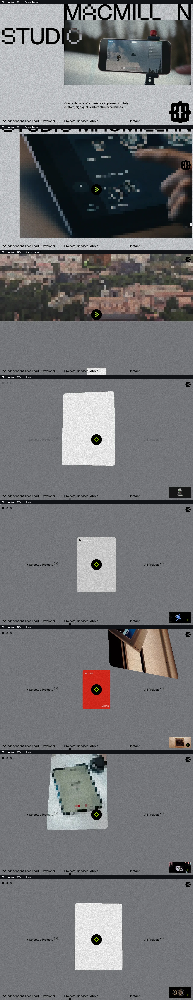
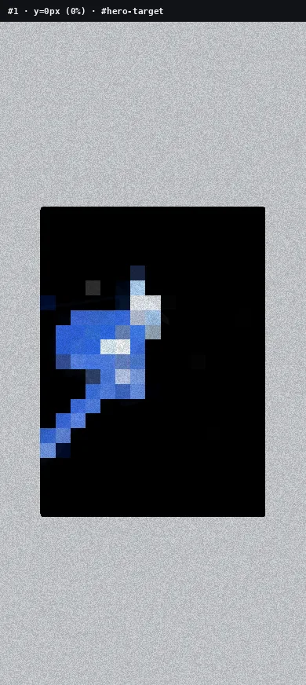

# UI Design System & Master Generation Blueprint: macmillan-studio

> **Christian MacMillan · Independent Tech Lead—Developer** (https://macmillan.studio) — Over a decade of experience implementing fully custom, high-quality interactive experiences for global agencies and brands.





---

## 1. Executive Visual Persona & Design Archetype

- **Brand Essence & Persona**: **Christian MacMillan · Independent Tech Lead—Developer** (`https://macmillan.studio`). Over a decade of experience implementing fully custom, high-quality interactive experiences for global agencies and brands.
- **Capture Provenance**: Live browser capture (`tier1_fast`, HTTP `200`, captured `2026-11-24`).
- **Visual Archetype**: **Light-Gallery WebGL / Canvas Interactive Experience (`#ffffff` / `#808080`)**.
- **Anti-AI-Slop Differentiators**:
  - **Live-Computed Chromatic Polarity**: Anchors the viewport in `#ffffff` (live computed `body` `background-color` (`computed_styles.json`)) paired with `#000000` primary typography and `#808080` accents.
  - **Grounded Typographic Hierarchy**: Pairs `HelveticaNowDisplayMedium` for display copy (`MacMillan Studio—Independent Develop`) with `HelveticaNowDisplayBold`.
  - **Calibrated Spatial Grid & Motion**: Combines `1440px` container bounds (`gap: .4rem`, padding `8rem`) with `cubic-bezier(0.25,0.1,0.25,1)` easing and Three.js / WebGL Canvas Pipeline.

---

## 2. Spatial Architecture & Modular Grid Mathematics

### Viewport Allocation & Container Geometry
- **Captured Journey Filmstrips**: Desktop `1280×6624px` (`assets/desktop-journey.webp`, `8` keyframes up to `y=0px` / doc `900px`), Mobile `390×872px` (`assets/mobile-journey.webp`, `1` keyframes).
- **Master Container Bounds**: `1440px` (full-bleed `100%` desktop stage measured on `1440px` viewport).
- **Canvas Lateral Padding & Spacing**: `8rem` lateral canvas padding with `.4rem` grid gap.
- **Border Radius Scale**: `100%`, `var(--border-radius--m)`, `.8rem`, `1.6rem`.

### Responsive Breakpoint Architecture
- **Desktop Layout**: Multi-column CSS Grid / Flexbox layout at `1440px` (`max-width: 1440px`, `gap: .4rem`).
- **Mobile Layout**: Single-column vertical stack at `390px` viewport width with `8rem` horizontal padding.
- **Extracted CSS Media Queries**: `@media screen and (min-width:769px)`, `@media screen and (min-width:1800px)`, `@media screen and (min-width:561px)`, `@media screen and (min-width:769px)and (min-width:769px)`.

---

## 3. Color System, Materiality & Atmospheric Lighting

### Semantic Palette & Source Grounding
| Semantic Role | Ground-Truth Value | Extracted Live / CSS Source |
|---|---|---|
| **Primary Canvas Substrate** | `#ffffff` | live computed `body` `background-color` (`computed_styles.json`) |
| **Primary Typography Ink** | `#000000` | live computed `h1` `color` (`computed_styles.json`) |
| **Elevated Surface / Card Substrate** | `#808080` | `.home__services__service__conte... { background-color: grey }` (`#808080`) |
| **Interactive Accent / Highlight** | `#808080` | `home__projects__buttons__button... { color: grey }` (`#808080`) |
| **Secondary / Muted Copy** | `#808080` | `ome__projects__project__collabo... { color: grey }` (`#808080`) |
| **Structural Hairline Border** | `#ffff00` | `.home__projects__videos video { border: #ffff00 }` |
| **Variable Token (`--lime`)** | `#bdff00` | `var(--lime)` in `:root` |
| **Variable Token (`--light-grey`)** | `#d3d6da` | `var(--light-grey)` in `:root` |
| **Variable Token (`--dark-grey`)** | `#818388` | `var(--dark-grey)` in `:root` |

### Sanitized Root CSS Variables (`ui-ux.md` Ground Truth)
| Variable Name | Extracted Value | Semantic Role |
|---|---|---|
| `--black` | `#000` | Canvas / Surface Token |
| `--white` | `#fff` | Canvas / Surface Token |
| `--lime` | `#bdff00` | Color / Atmospheric Token |
| `--light-grey` | `#d3d6da` | Canvas / Surface Token |
| `--dark-grey` | `#818388` | Canvas / Surface Token |
| `--layout-max-width` | `1800px` | Layout / Spatial Grid Token |
| `--layout-columns` | `8` | Layout / Spatial Grid Token |
| `--layout-margin` | `1.6rem` | Layout / Spatial Grid Token |
| `--layout-gutter` | `.8rem` | Layout / Spatial Grid Token |
| `--layout-column-width` | `calc(var(--layout-width)/var(--layout-columns))` | Layout / Spatial Grid Token |
| `--col` | `33.3333%` | Layout / Spatial Grid Token |
| `--columns` | `4` | Layout / Spatial Grid Token |
| `--columns-width` | `calc((var(--columns)/var(--layout-columns))*100%)` | Layout / Spatial Grid Token |
| `--columns-gap-width` | `calc(var(--layout-gutter)*(1 - 1/(var(--layout-columns)/var(--columns))))` | Layout / Spatial Grid Token |
| `--gap` | `2` | Layout / Spatial Grid Token |
| `--gap-width` | `calc((var(--gap)/var(--layout-columns))*100%)` | Layout / Spatial Grid Token |

---

## 4. Typographic Scale & Editorial Hierarchy

### Font Family Stacks
- **Display Typography**: `HelveticaNowDisplayMedium`.
- **Primary Body Stack**: `HelveticaNowDisplayBold`.
- **Technical / Metadata Stack**: not declared in live computed styles (uses primary stack / `ui-monospace`).

### Typographic Scale & Rules (Live Computed & Stylesheet Grounded)
- **Hero Display (`H1`)**: live computed `h1` (`font-size: 10px`, `line-height: 10px`, `font-weight: 400`).
- **Section Heading (`H2`)**: live computed `h3 (primary section heading)` (`font-size: 52px`, `line-height: 56px`, `font-weight: 700`, `letter-spacing: -0.875px`).
- **Body Copy**: live computed `body` (`font-size: 10px`, `line-height: 10px`, `font-weight: 400`); rule `p` (`font-size: max(4vw,1.5rem)`, `line-height: max(4.8vw,1.8rem)`).
- **Metadata & Navigation Labels**: live computed `nav/a` (`font-size: 10px`, `line-height: 10px`, `font-weight: 400`).

---

## 5. Choreographed Motion & Interaction Physics

### Primary Easing Curves
- **Extracted Timing Functions**: `cubic-bezier(0.25,0.1,0.25,1)`.

### Per-Element Transition & Choreography Rules
- **Standard CSS Easing (`cubic-bezier(0.25,0.1,0.25,1)`)**: Default timing curve (no custom `cubic-bezier()` declared in captured CSS).
- **Runtime Interaction Engine**: Integrates Three.js / WebGL Canvas Pipeline with `prefers-reduced-motion: reduce` fallback guards.
### Measured Runtime Scroll & Interaction Telemetry (`behavioral_journey_v2`)
- **Scroll Driver Mode**: `wheel` (max document height `900px`, deepest scrollY reached `0px` across `8` desktop keyframes).
- **Detected Scroll / Motion Libraries**: `WebGL/Canvas`.
- **Hover Physics (`primary_cta` · `Projects,`)**: Computed transition `0s` / `ease` (no static color/transform shift captured at rest).
- **Hover Physics (`first_card` · `custom-link home__projects__proje...`)**: Computed transition `0s` / `ease` (no static color/transform shift captured at rest).
- **Route Transition Architecture**: First internal navigation (`/google-cloud-team-usa`) measured as `direct` in `897ms`.

---

## 6. Component Wireframe & Structural DOM Map

### Visual Layout Schematic — Desktop (`1440px`, Grounded in `dom.html` & Landmark Bounding Boxes)
```
┌────────────────────────────────────────────────────────────────────────┐
│ DESKTOP VIEWPORT (1440px) — Christian MacMillan · Independent Tech Lea │
│ ====================================================================== │
│ [ <header.header> (1440x49px)         | Projects, · Services, · Abou ] │
│ ---------------------------------------------------------------------- │
│ | HERO STAGE: <section.home__hero> (w=1440px)                        | │
│ | H1: MacMillan Studio—Independent Development Studio l...           | │
│ | Substrate: #ffffff | Ink: #000000 | Accent: #808080                | │
│ ---------------------------------------------------------------------- │
│ | SHOWCASE GRID (<section.home__hero:nth(2)) max-w: 1440px           | │
│ | +------------------------------+  +------------------------------+ | │
│ | | Joining your team as a freel |  | Installations                | | │
│ | +------------------------------+  +------------------------------+ | │
│ ---------------------------------------------------------------------- │
│ | DETAIL MODULE (<section.home__hero:nth(3)) — Site Maintainance     | │
│ ---------------------------------------------------------------------- │
│ [ FOOTER (<footer.footer>     ) | https://macmillan.studio             │
└────────────────────────────────────────────────────────────────────────┘
```

### Visual Layout Schematic — Mobile Reflow (`390px`)
```
┌────────────────────────────────────────────────────────────────────────┐
│ MOBILE VIEWPORT REFLOW (390px) — Single-Column Stack (gap: .4rem)      │
│ ====================================================================== │
│ [ HEADER BAR (<header.header>         ) | Compact Menu (390px)         │
│ ---------------------------------------------------------------------- │
│ | HERO STAGE (<section.home__hero>) — 390px Vertical Lead            | │
│ | H1: MacMillan Studio—Independent Development Studio l...           | │
│ ---------------------------------------------------------------------- │
│ | SHOWCASE STACK (<section.home__hero:nt) — 1-Col Stack              | │
│ | [ Item 1: Joining your team as a freelancer or taking on th...   ] | │
│ | [ Item 2: Installations                                          ] | │
│ ---------------------------------------------------------------------- │
│ | DETAIL STACK (<section.home__hero:nth() — 1-Col (Site Maintainance)  │
│ ---------------------------------------------------------------------- │
│ [ FOOTER (<footer.footer>     ) | Stacked 390px Colophon               │
└────────────────────────────────────────────────────────────────────────┘
```

### Granular DOM Region Breakdown
1. **Brand Header & Navigation Bar (<header.header> — `macmillan-studio`)**:
   - Landmark `<header class="header">` (`1440x49px`) hosting `Christian MacMillan · Independent Te` navigation (`Projects, · Services, · About`), DOM attributes (`data-tab-fixed`, `data-v-7d7b041a`, `data-scroll-target-top`, `data-scroll-continuous`), and stylesheet rule `.accordion { border-bottom:.2rem solid 000;position:relative }`.
2. **Hero Stage & Focal Lead (<section.home__hero> — `MacMillan Studio—Independent Devel`)**:
   - Landmark `<section class="home__hero">` presenting display lead `MacMillan Studio—Independent Development Studio l...` and copy excerpt *"Independent Tech Lead—Developer"* over `#ffffff` canvas and `#000000` ink.
3. **Primary Showcase & Content Grid (<section.home__hero:nth(2)> — `Joining your team as a freelancer `)**:
   - Landmark `<section class="home__hero">` rendering section `Joining your team as a freelancer or taking on th...` with copy *"Over a decade of experience implementing fully custom, high-quali"*, asset references (`entry.CkIT_B6y.css`, `default.Kg7iOwm3.css`, `Pause.BHNIHZ0n.css`, `_slug_.DfTMbnN4.css`), and grid rule `.accordion--first { border-top:.2rem solid 000 }`.
4. **Interactive Detail & Feature Matrix (<section.home__hero:nth(3)> — `Installations`)**:
   - Landmark `<section class="home__hero">` framing `Installations` and `Site Maintainance` (*"Joining your team as a freelancer or taking on the project indepe"*) with `#808080` surface cards, `#808080` accents, and `.accordion__title { align-items:center;border:none;display:flex;height:min(10.6666666667vw,1... }`.
5. **Colophon & Global Directory Footer (<footer.footer> — `https://macmillan.studio`)**:
   - Landmark `<footer class="footer">` anchoring `Christian MacMillan · Independen` footer links (`Projects, · Services, · About`), copy *"From large-scale websites to creative campaign landing pages"*, and `#ffff00` structural dividers.
### Full Vertical Scroll Sequence (Desktop `1440×900` Keyframes)
- **Step 01** (`y=0px`, `0%`): Active landmark `#hero-target` · sticky/fixed elements: `0`
- **Step 02** (`y=0px`, `8%`): Active landmark `#hero-target` · sticky/fixed elements: `0`
- **Step 03** (`y=0px`, `17%`): Active landmark `#hero-target` · sticky/fixed elements: `0`
- **Step 04** (`y=0px`, `25%`): Active landmark `Hero` · sticky/fixed elements: `0`
- **Step 05** (`y=0px`, `33%`): Active landmark `Hero` · sticky/fixed elements: `0`
- **Step 06** (`y=0px`, `42%`): Active landmark `Hero` · sticky/fixed elements: `0`
- **Step 07** (`y=0px`, `50%`): Active landmark `Hero` · sticky/fixed elements: `0`
- **Step 08** (`y=0px`, `58%`): Active landmark `Hero` · sticky/fixed elements: `0`

### Multi-Page Internal Route Map
- **Other Route (`/google-cloud-team-usa`)**: `https://macmillan.studio/google-cloud-team-usa` — H1: `Google Cloud x Team USA 🇺🇸`, scrollHeight `900px`, transition `direct` (`897ms`)
- **Other Route (`/forever-frequencies`)**: `https://macmillan.studio/forever-frequencies` — H1: `Forever Frequencies`, scrollHeight `900px`, transition `direct` (`972ms`)
- **Other Route (`/memory-project`)**: `https://macmillan.studio/memory-project` — H1: `TED Memory Project`, scrollHeight `900px`, transition `direct` (`467ms`)

---

## 7. Master Zero-Shot AI Generation Prompt

```markdown
# Master Zero-Shot Frontend Generation Prompt: macmillan-studio (Christian MacMillan · Independent Tech Lead—Developer)

You are a principal frontend architect and design systems engineer. Build a complete, production-ready web application replicating the exact design system, DOM landmarks, typographic hierarchy, color tokens, and motion physics of `macmillan-studio` (**Christian MacMillan · Independent Tech Lead—Developer** — `https://macmillan.studio`).

### 1. Visual Archetype & Anti-AI-Slop Mandates
- **Archetype**: Light-Gallery WebGL / Canvas Interactive Experience (`#ffffff` / `#808080`).
- **Identity & Domain Context**: Over a decade of experience implementing fully custom, high-quality interactive experiences for global agencies and brands.
- **Primary Substrate**: `#ffffff` (live computed `body` `background-color` (`computed_styles.json`)), **Primary Ink**: `#000000`, **Accent / Highlight**: `#808080`.
- **Site-Specific Differentiators**:
  - **Live-Computed Chromatic Polarity**: Anchors the viewport in `#ffffff` (live computed `body` `background-color` (`computed_styles.json`)) paired with `#000000` primary typography and `#808080` accents.
  - **Grounded Typographic Hierarchy**: Pairs `HelveticaNowDisplayMedium` for display copy (`MacMillan Studio—Independent Develop`) with `HelveticaNowDisplayBold`.
  - **Calibrated Spatial Grid & Motion**: Combines `1440px` container bounds (`gap: .4rem`, padding `8rem`) with `cubic-bezier(0.25,0.1,0.25,1)` easing and Three.js / WebGL Canvas Pipeline.

### 2. Ground-Truth CSS Variables (`:root` Token Contract)
Declare and consume these exact custom properties extracted from `macmillan-studio` in your global stylesheet:

:root {
  /* Christian MacMillan · Independent Tech Lead—Developer (macmillan-studio) — Live-Grounded CSS Variables */
  --black: #000; /* Canvas / Surface Token (macmillan-studio) */
  --white: #fff; /* Canvas / Surface Token (macmillan-studio) */
  --lime: #bdff00; /* Color / Atmospheric Token (macmillan-studio) */
  --light-grey: #d3d6da; /* Canvas / Surface Token (macmillan-studio) */
  --dark-grey: #818388; /* Canvas / Surface Token (macmillan-studio) */
  --layout-max-width: 1800px; /* Layout / Spatial Grid Token (macmillan-studio) */
  --layout-columns: 8; /* Layout / Spatial Grid Token (macmillan-studio) */
  --layout-margin: 1.6rem; /* Layout / Spatial Grid Token (macmillan-studio) */
  --layout-gutter: .8rem; /* Layout / Spatial Grid Token (macmillan-studio) */
  --layout-column-width: calc(var(--layout-width)/var(--layout-columns)); /* Layout / Spatial Grid Token (macmillan-studio) */
  --col: 33.3333%; /* Layout / Spatial Grid Token (macmillan-studio) */
  --columns: 4; /* Layout / Spatial Grid Token (macmillan-studio) */
  --columns-width: calc((var(--columns)/var(--layout-columns))*100%); /* Layout / Spatial Grid Token (macmillan-studio) */
  --columns-gap-width: calc(var(--layout-gutter)*(1 - 1/(var(--layout-columns)/var(--columns)))); /* Layout / Spatial Grid Token (macmillan-studio) */
  --gap: 2; /* Layout / Spatial Grid Token (macmillan-studio) */
  --gap-width: calc((var(--gap)/var(--layout-columns))*100%); /* Layout / Spatial Grid Token (macmillan-studio) */
}

### 3. Semantic Color & Materiality Contract
Map every surface, ink, and border strictly to these source-grounded tokens:
- **Primary Canvas Substrate**: `#ffffff` — grounded in live computed `body` `background-color` (`computed_styles.json`)
- **Primary Typography Ink**: `#000000` — grounded in live computed `h1` `color` (`computed_styles.json`)
- **Elevated Surface / Card Substrate**: `#808080` — grounded in `.home__services__service__conte... { background-color: grey }` (`#808080`)
- **Interactive Accent / Highlight**: `#808080` — grounded in `home__projects__buttons__button... { color: grey }` (`#808080`)
- **Secondary / Muted Copy**: `#808080` — grounded in `ome__projects__project__collabo... { color: grey }` (`#808080`)
- **Structural Hairline Border**: `#ffff00` — grounded in `.home__projects__videos video { border: #ffff00 }`
- **Variable Token (`--lime`)**: `#bdff00` — grounded in `var(--lime)` in `:root`
- **Variable Token (`--light-grey`)**: `#d3d6da` — grounded in `var(--light-grey)` in `:root`
- **Variable Token (`--dark-grey`)**: `#818388` — grounded in `var(--dark-grey)` in `:root`

### 4. Spatial Grid, Container Bounds & Responsive Breakpoints
- **Desktop Viewport Reference**: `1280×6624px` (multi-frame vertical journey filmstrip (6624px), `1440px` standard desktop width).
- **Mobile Viewport Reference**: `390×872px` (full-page live capture (872px), `390px` standard mobile width).
- **Container Max-Width**: `1440px` (full-bleed `100%` desktop stage measured on `1440px` viewport)
- **Padding & Gutters**: `8rem` lateral canvas padding with `.4rem` grid gap
- **Desktop Grid**: Multi-column CSS Grid / Flexbox layout at `1440px` (`max-width: 1440px`, `gap: .4rem`)
- **Mobile Adaptation**: Single-column vertical stack at `390px` viewport width with `8rem` horizontal padding
- **Media Queries**: `@media screen and (min-width:769px)`, `@media screen and (min-width:1800px)`, `@media screen and (min-width:561px)`, `@media screen and (min-width:769px)and (min-width:769px)`
- **Corner Radii**: `100%`, `var(--border-radius--m)`, `.8rem`, `1.6rem`

### 5. Typography & Editorial Scale Contract
- **Display Font Stack**: `HelveticaNowDisplayMedium`
- **Body Font Stack**: `HelveticaNowDisplayBold`
- **Monospace / Technical Font Stack**: not declared in live computed styles (uses primary stack / `ui-monospace`)
- **H1 Display Rule**: live computed `h1` (`font-size: 10px`, `line-height: 10px`, `font-weight: 400`)
- **H2 Section Rule**: live computed `h3 (primary section heading)` (`font-size: 52px`, `line-height: 56px`, `font-weight: 700`, `letter-spacing: -0.875px`)
- **Body Copy Rule**: live computed `body` (`font-size: 10px`, `line-height: 10px`, `font-weight: 400`); rule `p` (`font-size: max(4vw,1.5rem)`, `line-height: max(4.8vw,1.8rem)`)
- **Metadata & Index Rule**: live computed `nav/a` (`font-size: 10px`, `line-height: 10px`, `font-weight: 400`)

### 6. Component Hierarchy, Verbatim Copy & Real DOM Landmarks
Scaffold `macmillan-studio` (`Christian MacMillan · Independent Tech Lead—Developer`) with these exact structural regions, extracted copy, and CSS rules from `dom.html`:
1. **Brand Header & Navigation Bar (<header.header> — `macmillan-studio`)**:
   - DOM & Selectors: Landmark `<header class="header">` (`1440x49px`) hosting `Christian MacMillan · Independent Te` navigation (`Projects, · Services, · About`), DOM attributes (`data-tab-fixed`, `data-v-7d7b041a`, `data-scroll-target-top`, `data-scroll-continuous`), and stylesheet rule `.accordion { border-bottom:.2rem solid 000;position:relative }`.
   - Responsive Contract: Header `Brand Header & Navigation Bar (<header.header> — `macmillan-studio`)` (`macmillan-studio`) adapts across `@media screen and (min-width:769px)`, `@media screen and (min-width:1800px)`, `@media screen and (min-width:561px)`, `@media screen and (min-width:769px)and (min-width:769px)` with `cubic-bezier(0.25,0.1,0.25,1)` transitions and links `Projects, · Services, · About`.
2. **Hero Stage & Focal Lead (<section.home__hero> — `MacMillan Studio—Independent Devel`)**:
   - DOM & Selectors: Landmark `<section class="home__hero">` presenting display lead `MacMillan Studio—Independent Development Studio l...` and copy excerpt *"Independent Tech Lead—Developer"* over `#ffffff` canvas and `#000000` ink.
   - Responsive Contract: Hero stage (`1280×6624px` desktop / `390×872px` mobile) sets `#ffffff` background with `#000000` headline `MacMillan Studio—Independent Development Studio l...`.
3. **Primary Showcase & Content Grid (<section.home__hero:nth(2)> — `Joining your team as a freelancer `)**:
   - DOM & Selectors: Landmark `<section class="home__hero">` rendering section `Joining your team as a freelancer or taking on th...` with copy *"Over a decade of experience implementing fully custom, high-quali"*, asset references (`entry.CkIT_B6y.css`, `default.Kg7iOwm3.css`, `Pause.BHNIHZ0n.css`, `_slug_.DfTMbnN4.css`), and grid rule `.accordion--first { border-top:.2rem solid 000 }`.
   - Responsive Contract: Showcase grid `Primary Showcase & Content Grid (<section.home__hero:nth(2)> — `Joining your team as a freelancer `)` applies Multi-column CSS Grid / Flexbox layout at `1440px` (`max-width: 1440px`, `gap: .4rem`) on desktop and Single-column vertical stack at `390px` viewport width with `8rem` horizontal padding on mobile.
4. **Interactive Detail & Feature Matrix (<section.home__hero:nth(3)> — `Installations`)**:
   - DOM & Selectors: Landmark `<section class="home__hero">` framing `Installations` and `Site Maintainance` (*"Joining your team as a freelancer or taking on the project indepe"*) with `#808080` surface cards, `#808080` accents, and `.accordion__title { align-items:center;border:none;display:flex;height:min(10.6666666667vw,1... }`.
   - Responsive Contract: Detail module `Interactive Detail & Feature Matrix (<section.home__hero:nth(3)> — `Installations`)` uses `100%`, `var(--border-radius--m)`, `.8rem`, `1.6rem` radii, `#808080` highlights, and assets (entry.CkIT_B6y.css, default.Kg7iOwm3.css, Pause.BHNIHZ0n.css).
5. **Colophon & Global Directory Footer (<footer.footer> — `https://macmillan.studio`)**:
   - DOM & Selectors: Landmark `<footer class="footer">` anchoring `Christian MacMillan · Independen` footer links (`Projects, · Services, · About`), copy *"From large-scale websites to creative campaign landing pages"*, and `#ffff00` structural dividers.
   - Responsive Contract: Footer `Colophon & Global Directory Footer (<footer.footer> — `https://macmillan.studio`)` aligns to `1440px` (full-bleed `100%` desktop stage measured on `1440px` viewport) with `8rem` lateral canvas padding with `.4rem` grid gap and attributes (data-tab-fixed, data-v-7d7b041a, data-scroll-target-top).

#### Verbatim DOM Copy Excerpts (`dom.html`)
- Copy Excerpt 1: *"Independent Tech Lead—Developer"*
- Copy Excerpt 2: *"Over a decade of experience implementing fully custom, high-quality interactive ex..."*
- Copy Excerpt 3: *"Joining your team as a freelancer or taking on the project independently."*
- Copy Excerpt 4: *"From large-scale websites to creative campaign landing pages, bringing designs to..."*

### 7. Motion, Extracted Stylesheet Rules & Interaction Choreography
- **Primary Easing Functions**: `cubic-bezier(0.25,0.1,0.25,1)`
- **Extracted Stylesheet Rules (`macmillan-studio`)**:
- `.accordion { border-bottom:.2rem solid 000;position:relative }`
- `.accordion--first { border-top:.2rem solid 000 }`
- `.accordion__title { align-items:center;border:none;display:flex;height:min(10.6666666667vw,1... }`
- `.accordion__title__content { align-items:center;display:flex }`
- `.accordion__title__content__number { font-size:min(1.5277777778vw,2.75rem);line-height:min(1.5277777778vw,2.7... }`
- **Per-Selector Transition Rules**:
- **Standard CSS Easing (`cubic-bezier(0.25,0.1,0.25,1)`)**: Default timing curve (no custom `cubic-bezier()` declared in captured CSS).
- **Runtime Interaction Engine**: Integrates Three.js / WebGL Canvas Pipeline with `prefers-reduced-motion: reduce` fallback guards.
### 7b. Full-Page Scroll Choreography, Interactive States & Multi-Page Routes
- **Scroll Mechanics**: Implement `wheel` vertical progression up to `900px` across 8 distinct viewport chapters using WebGL/Canvas.
- **Vertical Chapter Sequence**: #hero-target (0%) -> #hero-target (8%) -> #hero-target (17%) -> Hero (25%) -> Hero (33%) -> Hero (42%) -> Hero (50%) -> Hero (58%).
- **Multi-Page Routes**: Scaffold internal routes `/google-cloud-team-usa` (other, direct), `/forever-frequencies` (other, direct), `/memory-project` (other, direct) sharing the global header/footer shell and design tokens.

### 8. Technical Deliverables
- Implement in Next.js (App Router) with TypeScript and Tailwind CSS consuming the `:root` custom properties defined above for `macmillan-studio`.
- Reproduce both the `1440px` desktop architecture and `390px` mobile breakpoint transitions, preserving semantic HTML5 landmarks (`<header>`, `<nav>`, `<main>`, `<section>`, `<footer>`) and `prefers-reduced-motion` accessibility guards.
```
---

## 8. Full-Page Scroll Journey, Interactive States & Subpage Inventory

### Desktop Scroll Keyframes (`1440×900` WebP)
| Step | Scroll Y | Progress | Active Landmark / Section | Sticky/Fixed | Visual Asset |
| :---: | :---: | :---: | :--- | :---: | :--- |
| `#01` | `0px` | `0%` | #hero-target | `0` | [desktop-step-01.webp](assets/desktop-step-01.webp) |
| `#02` | `0px` | `8%` | #hero-target | `0` | [desktop-step-02.webp](assets/desktop-step-02.webp) |
| `#03` | `0px` | `17%` | #hero-target | `0` | [desktop-step-03.webp](assets/desktop-step-03.webp) |
| `#04` | `0px` | `25%` | Hero | `0` | [desktop-step-04.webp](assets/desktop-step-04.webp) |
| `#05` | `0px` | `33%` | Hero | `0` | [desktop-step-05.webp](assets/desktop-step-05.webp) |
| `#06` | `0px` | `42%` | Hero | `0` | [desktop-step-06.webp](assets/desktop-step-06.webp) |
| `#07` | `0px` | `50%` | Hero | `0` | [desktop-step-07.webp](assets/desktop-step-07.webp) |
| `#08` | `0px` | `58%` | Hero | `0` | [desktop-step-08.webp](assets/desktop-step-08.webp) |

### Mobile Condensed Keyframes (`390×844` WebP)
| Step | Scroll Y | Progress | Active Landmark | Visual Asset |
| :---: | :---: | :---: | :--- | :--- |
| `#01` | `0px` | `0%` | #hero-target | [mobile-step-01.webp](assets/mobile-step-01.webp) |

### Internal Subpage Filmstrips (`1080px` Wide WebP)
| # | Template | Route URL | H1 / Title | Scroll Height | Transition | Filmstrip Asset |
| :-: | :---: | :--- | :--- | :---: | :---: | :--- |
| `1` | `other` | `https://macmillan.studio/google-cloud-team-usa` | Google Cloud x Team USA 🇺🇸 | `900px` | `direct` (`897ms`) | [subpage-01-google-cloud-team-usa.webp](assets/subpage-01-google-cloud-team-usa.webp) |
| `2` | `other` | `https://macmillan.studio/forever-frequencies` | Forever Frequencies | `900px` | `direct` (`972ms`) | [subpage-02-forever-frequencies.webp](assets/subpage-02-forever-frequencies.webp) |
| `3` | `other` | `https://macmillan.studio/memory-project` | TED Memory Project | `900px` | `direct` (`467ms`) | [subpage-03-memory-project.webp](assets/subpage-03-memory-project.webp) |

