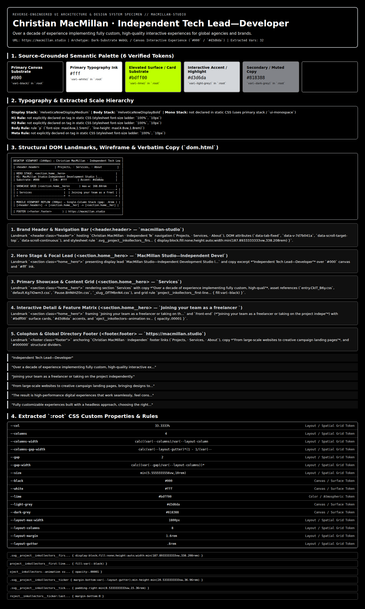
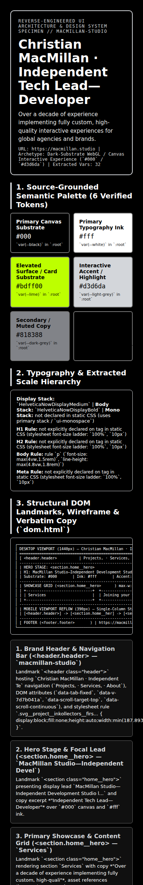

# UI Design System & Master Generation Blueprint: macmillan-studio

> **Christian MacMillan · Independent Tech Lead—Developer** (https://macmillan.studio) — Over a decade of experience implementing fully custom, high-quality interactive experiences for global agencies and brands.



---

## 1. Executive Visual Persona & Design Archetype

- **Brand Essence & Persona**: **Christian MacMillan · Independent Tech Lead—Developer** (`https://macmillan.studio`). Over a decade of experience implementing fully custom, high-quality interactive experiences for global agencies and brands.
- **Visual Archetype**: **Dark-Substrate WebGL / Canvas Interactive Experience (`#000` / `#d3d6da`)**.
- **Anti-AI-Slop Differentiators**:
  - **Source-Grounded Chromatic Polarity**: Anchors the viewport in `#000` (`var(--black)` in `:root`) paired with `#fff` primary typography and `#d3d6da` accents.
  - **Extracted Typographic Hierarchy**: Pairs `HelveticaNowDisplayMedium` for display copy (`MacMillan Studio—Independent Develop`) with `HelveticaNowDisplayBold` and not declared in static CSS (uses primary stack / `ui-monospace`).
  - **Calibrated Spatial Grid & Motion**: Combines `168.84rem` container bounds (`gap: .4rem`, padding `8rem`) with `cubic-bezier(0.25,0.1,0.25,1)` easing and Three.js / WebGL Canvas Pipeline.

---

## 2. Spatial Architecture & Modular Grid Mathematics



### Viewport Allocation & Container Geometry
- **Captured Viewport Dimensions**: Desktop `1440×2400px` (`assets/desktop.png`, capped at 2400px multi-section capture), Mobile `390×2400px` (`assets/mobile.png`, capped at 2400px multi-section capture).
- **Master Container Bounds**: `168.84rem` extracted from `macmillan-studio` stylesheet.
- **Canvas Lateral Padding & Spacing**: `8rem` lateral canvas padding with `.4rem` grid gap.
- **Border Radius Scale**: `100%`, `var(--border-radius--m)`, `.8rem`, `1.6rem`.

### Responsive Breakpoint Architecture
- **Desktop Layout**: Multi-column CSS Grid / Flexbox layout at `1440px` (`max-width: 168.84rem`, `gap: .4rem`).
- **Mobile Layout**: Single-column vertical stack at `390px` viewport width with `8rem` horizontal padding.
- **Extracted CSS Media Queries**: `@media screen and (min-width:769px)`, `@media screen and (min-width:1800px)`, `@media screen and (min-width:561px)`, `@media screen and (min-width:769px)and (min-width:769px)`.

---

## 3. Color System, Materiality & Atmospheric Lighting

### Semantic Palette & Source Grounding
| Semantic Role | Ground-Truth Value | Extracted CSS Source / Selector |
|---|---|---|
| **Primary Canvas Substrate** | `#000` | `var(--black)` in `:root` |
| **Primary Typography Ink** | `#fff` | `var(--white)` in `:root` |
| **Elevated Surface / Card Substrate** | `#bdff00` | `var(--lime)` in `:root` |
| **Interactive Accent / Highlight** | `#d3d6da` | `var(--light-grey)` in `:root` |
| **Secondary / Muted Copy** | `#818388` | `var(--dark-grey)` in `:root` |
| **Structural Hairline Border** | `#000000` | `vg__project__inkollectors__firs... { fill: black }` (`#000000`) |

### Sanitized Root CSS Variables (`ui-ux.md` Ground Truth)
| Variable Name | Extracted Value | Semantic Role |
|---|---|---|
| `--col` | `33.3333%` | Layout / Spatial Grid Token |
| `--columns` | `4` | Layout / Spatial Grid Token |
| `--columns-width` | `calc((var(--columns)/var(--layout-columns))*100%)` | Layout / Spatial Grid Token |
| `--columns-gap-width` | `calc(var(--layout-gutter)*(1 - 1/(var(--layout-columns)/var(--columns))))` | Layout / Spatial Grid Token |
| `--gap` | `2` | Layout / Spatial Grid Token |
| `--gap-width` | `calc((var(--gap)/var(--layout-columns))*100%)` | Layout / Spatial Grid Token |
| `--size` | `min(5.5555555556vw,10rem)` | Layout / Spatial Grid Token |
| `--black` | `#000` | Canvas / Surface Token |
| `--white` | `#fff` | Canvas / Surface Token |
| `--lime` | `#bdff00` | Color / Atmospheric Token |
| `--light-grey` | `#d3d6da` | Canvas / Surface Token |
| `--dark-grey` | `#818388` | Canvas / Surface Token |
| `--layout-max-width` | `1800px` | Layout / Spatial Grid Token |
| `--layout-columns` | `8` | Layout / Spatial Grid Token |
| `--layout-margin` | `1.6rem` | Layout / Spatial Grid Token |
| `--layout-gutter` | `.8rem` | Layout / Spatial Grid Token |

---

## 4. Typographic Scale & Editorial Hierarchy

### Font Family Stacks
- **Display Typography**: `HelveticaNowDisplayMedium`.
- **Primary Body Stack**: `HelveticaNowDisplayBold`.
- **Technical / Metadata Stack**: not declared in static CSS (uses primary stack / `ui-monospace`).

### Typographic Scale & Rules (Extracted from Stylesheet & Variables)
- **Hero Display (`H1`)**: not explicitly declared on tag in static CSS (stylesheet font-size ladder: `100%`, `10px`).
- **Section Heading (`H2`)**: not explicitly declared on tag in static CSS (stylesheet font-size ladder: `100%`, `10px`).
- **Body Copy**: rule `p` (`font-size: max(4vw,1.5rem)`, `line-height: max(4.8vw,1.8rem)`).
- **Metadata & Navigation Labels**: not explicitly declared on tag in static CSS (stylesheet font-size ladder: `100%`, `10px`).

---

## 5. Choreographed Motion & Interaction Physics

### Primary Easing Curves
- **Extracted Timing Functions**: `cubic-bezier(0.25,0.1,0.25,1)`.

### Per-Element Transition & Choreography Rules
- **Standard CSS Easing (`cubic-bezier(0.25,0.1,0.25,1)`)**: Default timing curve (no custom `cubic-bezier()` declared in static CSS).
- **Runtime Interaction Engine**: Integrates Three.js / WebGL Canvas Pipeline with `prefers-reduced-motion: reduce` fallback guards.

---

## 6. Component Wireframe & Structural DOM Map

### Visual Layout Schematic (Grounded in `dom.html` — `1440px` Desktop & `390px` Mobile Reflow)
```
┌────────────────────────────────────────────────────────────────────────┐
│ DESKTOP VIEWPORT (1440px) — Christian MacMillan · Independent Tech Lea │
│ ====================================================================== │
│ [ <header.header>          | Projects, · Services, · About          ]  │
│ ---------------------------------------------------------------------- │
│ | HERO STAGE: <section.home__hero>                                 |   │
│ | H1: MacMillan Studio—Independent Development Studio l...         |   │
│ | Substrate: #000       | Ink: #fff       | Accent: #d3d6da        |   │
│ ---------------------------------------------------------------------- │
│ | SHOWCASE GRID (<section.home__hero>      ) max-w: 168.84rem      |   │
│ | +------------------------------+  +------------------------------+ | │
│ | | Services                     |  | Joining your team as a freel | | │
│ | +------------------------------+  +------------------------------+ | │
│ ---------------------------------------------------------------------- │
│ | MOBILE VIEWPORT REFLOW (390px) — Single-Column Stack (gap: .4rem ) | │
│ | [<header.header>] -> [<section.home__her] -> [<section.home__her] |  │
│ ---------------------------------------------------------------------- │
│ [ FOOTER (<footer.footer>       ) | https://macmillan.studio           │
└────────────────────────────────────────────────────────────────────────┘
```

### Granular DOM Region Breakdown
1. **Brand Header & Navigation Bar (<header.header> — `macmillan-studio`)**:
   - Landmark `<header class="header">` hosting `Christian MacMillan · Independent Te` navigation (`Projects, · Services, · About`), DOM attributes (`data-tab-fixed`, `data-v-7d7b041a`, `data-scroll-target-top`, `data-scroll-continuous`), and stylesheet rule `.svg__project__inkollectors__firs... { display:block;fill:none;height:auto;width:min(187.8933333333vw,338.208rem) }`.
2. **Hero Stage & Focal Lead (<section.home__hero> — `MacMillan Studio—Independent Devel`)**:
   - Landmark `<section class="home__hero">` presenting display lead `MacMillan Studio—Independent Development Studio l...` and copy excerpt *"Independent Tech Lead—Developer"* over `#000` canvas and `#fff` ink.
3. **Primary Showcase & Content Grid (<section.home__hero> — `Services`)**:
   - Landmark `<section class="home__hero">` rendering section `Services` with copy *"Over a decade of experience implementing fully custom, high-quali"*, asset references (`entry.CkIT_B6y.css`, `default.Kg7iOwm3.css`, `Pause.BHNIHZ0n.css`, `_slug_.DfTMbnN4.css`), and grid rule `project__inkollectors__first-line... { fill:var(--black) }`.
4. **Interactive Detail & Feature Matrix (<section.home__hero> — `Joining your team as a freelancer `)**:
   - Landmark `<section class="home__hero">` framing `Joining your team as a freelancer or taking on th...` and `Front-end` (*"Joining your team as a freelancer or taking on the project indepe"*) with `#bdff00` surface cards, `#d3d6da` accents, and `oject__inkollectors--animation sv... { opacity:.00001 }`.
5. **Colophon & Global Directory Footer (<footer.footer> — `https://macmillan.studio`)**:
   - Landmark `<footer class="footer">` anchoring `Christian MacMillan · Independen` footer links (`Projects, · Services, · About`), copy *"From large-scale websites to creative campaign landing pages"*, and `#000000` structural dividers.

---

## 7. Master Zero-Shot AI Generation Prompt

```markdown
# Master Zero-Shot Frontend Generation Prompt: macmillan-studio (Christian MacMillan · Independent Tech Lead—Developer)

You are a principal frontend architect and design systems engineer. Build a complete, production-ready web application replicating the exact design system, DOM landmarks, typographic hierarchy, color tokens, and motion physics of `macmillan-studio` (**Christian MacMillan · Independent Tech Lead—Developer** — `https://macmillan.studio`).

### 1. Visual Archetype & Anti-AI-Slop Mandates
- **Archetype**: Dark-Substrate WebGL / Canvas Interactive Experience (`#000` / `#d3d6da`).
- **Identity & Domain Context**: Over a decade of experience implementing fully custom, high-quality interactive experiences for global agencies and brands.
- **Primary Substrate**: `#000` (`var(--black)` in `:root`), **Primary Ink**: `#fff`, **Accent / Highlight**: `#d3d6da`.
- **Site-Specific Differentiators**:
  - **Source-Grounded Chromatic Polarity**: Anchors the viewport in `#000` (`var(--black)` in `:root`) paired with `#fff` primary typography and `#d3d6da` accents.
  - **Extracted Typographic Hierarchy**: Pairs `HelveticaNowDisplayMedium` for display copy (`MacMillan Studio—Independent Develop`) with `HelveticaNowDisplayBold` and not declared in static CSS (uses primary stack / `ui-monospace`).
  - **Calibrated Spatial Grid & Motion**: Combines `168.84rem` container bounds (`gap: .4rem`, padding `8rem`) with `cubic-bezier(0.25,0.1,0.25,1)` easing and Three.js / WebGL Canvas Pipeline.

### 2. Ground-Truth CSS Variables (`:root` Token Contract)
Declare and consume these exact custom properties extracted from `macmillan-studio` in your global stylesheet:

:root {
  /* Christian MacMillan · Independent Tech Lead—Developer (macmillan-studio) — Ground-Truth Extracted CSS Variables */
  --col: 33.3333%; /* Layout / Spatial Grid Token (macmillan-studio) */
  --columns: 4; /* Layout / Spatial Grid Token (macmillan-studio) */
  --columns-width: calc((var(--columns)/var(--layout-columns))*100%); /* Layout / Spatial Grid Token (macmillan-studio) */
  --columns-gap-width: calc(var(--layout-gutter)*(1 - 1/(var(--layout-columns)/var(--columns)))); /* Layout / Spatial Grid Token (macmillan-studio) */
  --gap: 2; /* Layout / Spatial Grid Token (macmillan-studio) */
  --gap-width: calc((var(--gap)/var(--layout-columns))*100%); /* Layout / Spatial Grid Token (macmillan-studio) */
  --size: min(5.5555555556vw,10rem); /* Layout / Spatial Grid Token (macmillan-studio) */
  --black: #000; /* Canvas / Surface Token (macmillan-studio) */
  --white: #fff; /* Canvas / Surface Token (macmillan-studio) */
  --lime: #bdff00; /* Color / Atmospheric Token (macmillan-studio) */
  --light-grey: #d3d6da; /* Canvas / Surface Token (macmillan-studio) */
  --dark-grey: #818388; /* Canvas / Surface Token (macmillan-studio) */
  --layout-max-width: 1800px; /* Layout / Spatial Grid Token (macmillan-studio) */
  --layout-columns: 8; /* Layout / Spatial Grid Token (macmillan-studio) */
  --layout-margin: 1.6rem; /* Layout / Spatial Grid Token (macmillan-studio) */
  --layout-gutter: .8rem; /* Layout / Spatial Grid Token (macmillan-studio) */
}

### 3. Semantic Color & Materiality Contract
Map every surface, ink, and border strictly to these source-grounded tokens:
- **Primary Canvas Substrate**: `#000` — grounded in `var(--black)` in `:root`
- **Primary Typography Ink**: `#fff` — grounded in `var(--white)` in `:root`
- **Elevated Surface / Card Substrate**: `#bdff00` — grounded in `var(--lime)` in `:root`
- **Interactive Accent / Highlight**: `#d3d6da` — grounded in `var(--light-grey)` in `:root`
- **Secondary / Muted Copy**: `#818388` — grounded in `var(--dark-grey)` in `:root`
- **Structural Hairline Border**: `#000000` — grounded in `vg__project__inkollectors__firs... { fill: black }` (`#000000`)

### 4. Spatial Grid, Container Bounds & Responsive Breakpoints
- **Desktop Viewport Reference**: `1440×2400px` (capped at 2400px multi-section capture, `1440px` standard desktop width).
- **Mobile Viewport Reference**: `390×2400px` (capped at 2400px multi-section capture, `390px` standard mobile width).
- **Container Max-Width**: `168.84rem` extracted from `macmillan-studio` stylesheet
- **Padding & Gutters**: `8rem` lateral canvas padding with `.4rem` grid gap
- **Desktop Grid**: Multi-column CSS Grid / Flexbox layout at `1440px` (`max-width: 168.84rem`, `gap: .4rem`)
- **Mobile Adaptation**: Single-column vertical stack at `390px` viewport width with `8rem` horizontal padding
- **Media Queries**: `@media screen and (min-width:769px)`, `@media screen and (min-width:1800px)`, `@media screen and (min-width:561px)`, `@media screen and (min-width:769px)and (min-width:769px)`
- **Corner Radii**: `100%`, `var(--border-radius--m)`, `.8rem`, `1.6rem`

### 5. Typography & Editorial Scale Contract
- **Display Font Stack**: `HelveticaNowDisplayMedium`
- **Body Font Stack**: `HelveticaNowDisplayBold`
- **Monospace / Technical Font Stack**: not declared in static CSS (uses primary stack / `ui-monospace`)
- **H1 Display Rule**: not explicitly declared on tag in static CSS (stylesheet font-size ladder: `100%`, `10px`)
- **H2 Section Rule**: not explicitly declared on tag in static CSS (stylesheet font-size ladder: `100%`, `10px`)
- **Body Copy Rule**: rule `p` (`font-size: max(4vw,1.5rem)`, `line-height: max(4.8vw,1.8rem)`)
- **Metadata & Index Rule**: not explicitly declared on tag in static CSS (stylesheet font-size ladder: `100%`, `10px`)

### 6. Component Hierarchy, Verbatim Copy & Real DOM Landmarks
Scaffold `macmillan-studio` (`Christian MacMillan · Independent Tech Lead—Developer`) with these exact structural regions, extracted copy, and CSS rules from `dom.html`:
1. **Brand Header & Navigation Bar (<header.header> — `macmillan-studio`)**:
   - DOM & Selectors: Landmark `<header class="header">` hosting `Christian MacMillan · Independent Te` navigation (`Projects, · Services, · About`), DOM attributes (`data-tab-fixed`, `data-v-7d7b041a`, `data-scroll-target-top`, `data-scroll-continuous`), and stylesheet rule `.svg__project__inkollectors__firs... { display:block;fill:none;height:auto;width:min(187.8933333333vw,338.208rem) }`.
   - Responsive Contract: Header `Brand Header & Navigation Bar (<header.header> — `macmillan-studio`)` (`macmillan-studio`) adapts across `@media screen and (min-width:769px)`, `@media screen and (min-width:1800px)`, `@media screen and (min-width:561px)`, `@media screen and (min-width:769px)and (min-width:769px)` with `cubic-bezier(0.25,0.1,0.25,1)` transitions and links `Projects, · Services, · About`.
2. **Hero Stage & Focal Lead (<section.home__hero> — `MacMillan Studio—Independent Devel`)**:
   - DOM & Selectors: Landmark `<section class="home__hero">` presenting display lead `MacMillan Studio—Independent Development Studio l...` and copy excerpt *"Independent Tech Lead—Developer"* over `#000` canvas and `#fff` ink.
   - Responsive Contract: Hero stage (`1440×2400px` desktop / `390×2400px` mobile) sets `#000` background with `#fff` headline `MacMillan Studio—Independent Development Studio l...`.
3. **Primary Showcase & Content Grid (<section.home__hero> — `Services`)**:
   - DOM & Selectors: Landmark `<section class="home__hero">` rendering section `Services` with copy *"Over a decade of experience implementing fully custom, high-quali"*, asset references (`entry.CkIT_B6y.css`, `default.Kg7iOwm3.css`, `Pause.BHNIHZ0n.css`, `_slug_.DfTMbnN4.css`), and grid rule `project__inkollectors__first-line... { fill:var(--black) }`.
   - Responsive Contract: Showcase grid `Primary Showcase & Content Grid (<section.home__hero> — `Services`)` applies Multi-column CSS Grid / Flexbox layout at `1440px` (`max-width: 168.84rem`, `gap: .4rem`) on desktop and Single-column vertical stack at `390px` viewport width with `8rem` horizontal padding on mobile.
4. **Interactive Detail & Feature Matrix (<section.home__hero> — `Joining your team as a freelancer `)**:
   - DOM & Selectors: Landmark `<section class="home__hero">` framing `Joining your team as a freelancer or taking on th...` and `Front-end` (*"Joining your team as a freelancer or taking on the project indepe"*) with `#bdff00` surface cards, `#d3d6da` accents, and `oject__inkollectors--animation sv... { opacity:.00001 }`.
   - Responsive Contract: Detail module `Interactive Detail & Feature Matrix (<section.home__hero> — `Joining your team as a freelancer `)` uses `100%`, `var(--border-radius--m)`, `.8rem`, `1.6rem` radii, `#d3d6da` highlights, and assets (entry.CkIT_B6y.css, default.Kg7iOwm3.css, Pause.BHNIHZ0n.css).
5. **Colophon & Global Directory Footer (<footer.footer> — `https://macmillan.studio`)**:
   - DOM & Selectors: Landmark `<footer class="footer">` anchoring `Christian MacMillan · Independen` footer links (`Projects, · Services, · About`), copy *"From large-scale websites to creative campaign landing pages"*, and `#000000` structural dividers.
   - Responsive Contract: Footer `Colophon & Global Directory Footer (<footer.footer> — `https://macmillan.studio`)` aligns to `168.84rem` extracted from `macmillan-studio` stylesheet with `8rem` lateral canvas padding with `.4rem` grid gap and attributes (data-tab-fixed, data-v-7d7b041a, data-scroll-target-top).

#### Verbatim DOM Copy Excerpts (`dom.html`)
- Copy Excerpt 1: *"Independent Tech Lead—Developer"*
- Copy Excerpt 2: *"Over a decade of experience implementing fully custom, high-quality interactive ex..."*
- Copy Excerpt 3: *"Joining your team as a freelancer or taking on the project independently."*
- Copy Excerpt 4: *"From large-scale websites to creative campaign landing pages, bringing designs to..."*

### 7. Motion, Extracted Stylesheet Rules & Interaction Choreography
- **Primary Easing Functions**: `cubic-bezier(0.25,0.1,0.25,1)`
- **Extracted Stylesheet Rules (`macmillan-studio`)**:
- `.svg__project__inkollectors__firs... { display:block;fill:none;height:auto;width:min(187.8933333333vw,338.208rem) }`
- `project__inkollectors__first-line... { fill:var(--black) }`
- `oject__inkollectors--animation sv... { opacity:.00001 }`
- `.svg__project__inkollectors__ticker { margin-bottom:var(--layout-gutter);min-height:min(20.5333333333vw,36.96rem) }`
- `.svg__project__inkollectors__tick... { padding-right:min(8.5333333333vw,15.36rem) }`
- **Per-Selector Transition Rules**:
- **Standard CSS Easing (`cubic-bezier(0.25,0.1,0.25,1)`)**: Default timing curve (no custom `cubic-bezier()` declared in static CSS).
- **Runtime Interaction Engine**: Integrates Three.js / WebGL Canvas Pipeline with `prefers-reduced-motion: reduce` fallback guards.

### 8. Technical Deliverables
- Implement in Next.js (App Router) with TypeScript and Tailwind CSS consuming the `:root` custom properties defined above for `macmillan-studio`.
- Reproduce both the `1440px` desktop architecture and `390px` mobile breakpoint transitions, preserving semantic HTML5 landmarks (`<header>`, `<nav>`, `<main>`, `<section>`, `<footer>`) and `prefers-reduced-motion` accessibility guards.
```
