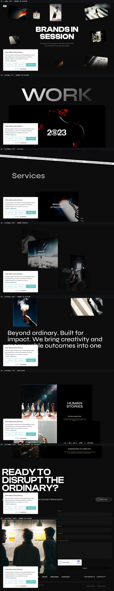
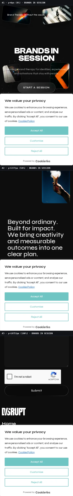

# UI Design System & Master Generation Blueprint: madetodisrupt-com

> **Disrupt · Creative Brand Experience Agency** (https://madetodisrupt.com) — Disrupt is a creative brand experience agency shaping strategy, identity, events and activations into ideas people can see, feel and expe...





---

## 1. Executive Visual Persona & Design Archetype

- **Brand Essence & Persona**: **Disrupt · Creative Brand Experience Agency** (`https://madetodisrupt.com`). Disrupt is a creative brand experience agency shaping strategy, identity, events and activations into ideas people can see, feel and expe...
- **Capture Provenance**: Live browser capture (`tier1_fast`, HTTP `200`, captured `2026-11-24`).
- **Visual Archetype**: **Dark-Substrate WebGL / Canvas Interactive Experience (`#0d0d0d` / `#1863dc`)**.
- **Anti-AI-Slop Differentiators**:
  - **Live-Computed Chromatic Polarity**: Anchors the viewport in `#0d0d0d` (live computed `body` `background-color` (`computed_styles.json`)) paired with `#ffffff` primary typography and `#1863dc` accents.
  - **Grounded Typographic Hierarchy**: Pairs `Clash Display` for display copy (`BRANDS IN SESSION`) with `Syne`.
  - **Calibrated Spatial Grid & Motion**: Combines `1152px` container bounds (`gap: var(--row-gap)`, padding `5px`) with `cubic-bezier(.58,.3,.005,1)` easing and Three.js / WebGL Canvas Pipeline, Swiper Touch Carousel Engine.

---

## 2. Spatial Architecture & Modular Grid Mathematics

### Viewport Allocation & Container Geometry
- **Captured Journey Filmstrips**: Desktop `1280×6624px` (`assets/desktop-journey.webp`, `8` keyframes up to `y=12729px` / doc `13647px`), Mobile `390×2616px` (`assets/mobile-journey.webp`, `3` keyframes).
- **Master Container Bounds**: `1152px` (measured widest bounded `<section>` landmark width on `1440px` desktop).
- **Canvas Lateral Padding & Spacing**: `5px` lateral canvas padding with `var(--row-gap)` grid gap.
- **Border Radius Scale**: `2px`, `var(--border-radius)`, `3px`, `4px`.

### Responsive Breakpoint Architecture
- **Desktop Layout**: Multi-column CSS Grid / Flexbox layout at `1440px` (`max-width: 1152px`, `gap: var(--row-gap)`).
- **Mobile Layout**: Single-column vertical stack at `390px` viewport width with `5px` horizontal padding.
- **Extracted CSS Media Queries**: `@media (max-width:1024px)`, `@media (max-width:767px)`, `@media (min-width:-1)`, `@media (max-width:-1)`.

---

## 3. Color System, Materiality & Atmospheric Lighting

### Semantic Palette & Source Grounding
| Semantic Role | Ground-Truth Value | Extracted Live / CSS Source |
|---|---|---|
| **Primary Canvas Substrate** | `#0d0d0d` | live computed `body` `background-color` (`computed_styles.json`) |
| **Primary Typography Ink** | `#ffffff` | live computed `h1` `color` (`computed_styles.json`) |
| **Elevated Surface / Card Substrate** | `#111111` | `var(--mxq-hover-bg)` in `:root` |
| **Interactive Accent / Highlight** | `#1863dc` | live computed `a` `color` (`computed_styles.json`) |
| **Secondary / Muted Copy** | `#7a7a7a` | `var(--e-global-color-text)` in `:root` |
| **Structural Hairline Border** | `#0b0b0b` | `var(--mxq-box-border)` in `:root` (`rgba(0,0,0,.12)`) |
| **Variable Token (`--ast-code-block-background`)** | `#eceff3` | `var(--ast-code-block-background)` in `:root` |
| **Variable Token (`--ast-comment-inputs-background`)** | `#f9fafb` | `var(--ast-comment-inputs-background)` in `:root` |

### Sanitized Root CSS Variables (`ui-ux.md` Ground Truth)
| Variable Name | Extracted Value | Semantic Role |
|---|---|---|
| `--ast-post-nav-space` | `0` | Layout / Spatial Grid Token |
| `--ast-container-default-xlg-padding` | `2.5em` | Layout / Spatial Grid Token |
| `--ast-container-default-lg-padding` | `2.5em` | Layout / Spatial Grid Token |
| `--ast-container-default-slg-padding` | `2em` | Layout / Spatial Grid Token |
| `--ast-container-default-md-padding` | `2.5em` | Layout / Spatial Grid Token |
| `--ast-container-default-sm-padding` | `2.5em` | Layout / Spatial Grid Token |
| `--ast-container-default-xs-padding` | `2.4em` | Layout / Spatial Grid Token |
| `--ast-container-default-xxs-padding` | `1.8em` | Layout / Spatial Grid Token |
| `--ast-code-block-background` | `#ECEFF3` | Canvas / Surface Token |
| `--ast-comment-inputs-background` | `#F9FAFB` | Canvas / Surface Token |
| `--ast-normal-container-width` | `1200px` | Layout / Spatial Grid Token |
| `--ast-narrow-container-width` | `750px` | Layout / Spatial Grid Token |
| `--ast-blog-title-font-weight` | `600` | Typography / Scale Token |
| `--ast-blog-meta-weight` | `600` | Design System Custom Token |
| `--ast-global-color-primary` | `var(--ast-global-color-4)` | Brand / Palette Token |
| `--ast-global-color-secondary` | `var(--ast-global-color-5)` | Brand / Palette Token |

---

## 4. Typographic Scale & Editorial Hierarchy

### Font Family Stacks
- **Display Typography**: `Clash Display`.
- **Primary Body Stack**: `Syne`.
- **Technical / Metadata Stack**: not declared in live computed styles (uses primary stack / `ui-monospace`).

### Typographic Scale & Rules (Live Computed & Stylesheet Grounded)
- **Hero Display (`H1`)**: live computed `h1` (`font-size: 98px`, `line-height: 90.16px`, `font-weight: 850`); CSS variables `--page-title-display: block`, `--display: flex`; rule `,h1` (`font-size: 2em`, `line-height: 1.2`).
- **Section Heading (`H2`)**: live computed `h2` (`font-size: 244.8px`, `line-height: 318.24px`, `font-weight: 700`, `letter-spacing: -7.344px`); rule `,h2` (`font-size: 1.7em`, `line-height: 1.3`).
- **Body Copy**: live computed `body` (`font-size: 16px`, `line-height: 26.4px`, `font-weight: 400`); rule `p` (`font-size: 20px`, `line-height: 1.65`, `font-weight: 300`).
- **Metadata & Navigation Labels**: live computed `nav/a` (`font-size: 16px`, `line-height: 26.4px`, `font-weight: 400`); CSS variables `--ast-blog-meta-weight: 600`, `--mv-label-x: calc(var(--mv-base-x) + var(--mv-shift-x))`.

---

## 5. Choreographed Motion & Interaction Physics

### Primary Easing Curves
- **Extracted Timing Functions**: `cubic-bezier(.58,.3,.005,1)`, `cubic-bezier(0,.33,.07,1.03)`, `cubic-bezier(0.22,1,0.36,1)`.

### Per-Element Transition & Choreography Rules
- **Selector `entor .elementor-background-video...`**: `transition: opacity 1s` extracted from `madetodisrupt-com` stylesheet.
- **Selector `.elementor-custom-embed-play svg`**: `transition: all .5s` extracted from `madetodisrupt-com` stylesheet.
- **Selector `.elementor-ken-burns`**: `transition: 10s` extracted from `madetodisrupt-com` stylesheet.
- **Extracted Easing Curve (`cubic-bezier(.58,.3,.005,1)`)**: Governs interactive state transitions across `<header.entry-header>` and `<section.poc-tilt-section>`.
- **Runtime Interaction Engine**: Integrates Three.js / WebGL Canvas Pipeline, Swiper Touch Carousel Engine, Lottie Vector Animation Player, Framer Motion Layout Physics with `prefers-reduced-motion: reduce` fallback guards.
### Measured Runtime Scroll & Interaction Telemetry (`behavioral_journey_v2`)
- **Scroll Driver Mode**: `native` (max document height `13647px`, deepest scrollY reached `12729px` across `8` desktop keyframes).
- **Detected Scroll / Motion Libraries**: `WebGL/Canvas`.
- **Hover Physics (`primary_cta` · `Brand Therapy, Without the couch.`)**: `color`: `rgb(4, 107, 210)` -> `rgb(4, 105, 205)`; `borderColor`: `rgb(4, 107, 210)` -> `rgb(4, 105, 205)` (`transition-duration: 0.2s`, `timing: linear`).
- **Route Transition Architecture**: First internal navigation (`/services-brand-strategy/`) measured as `direct` in `1680ms`.

---

## 6. Component Wireframe & Structural DOM Map

### Visual Layout Schematic — Desktop (`1440px`, Grounded in `dom.html` & Landmark Bounding Boxes)
```
┌────────────────────────────────────────────────────────────────────────┐
│ DESKTOP VIEWPORT (1440px) — Disrupt · Creative Brand Experience Agency │
│ ====================================================================== │
│ [ <header.entry-header> (1440x0px)    | Home · Work · Services · Con ] │
│ ---------------------------------------------------------------------- │
│ | HERO STAGE: <article.post-10> (w=1440px)                           | │
│ | H1: BRANDS IN SESSION                                              | │
│ | Substrate: #0d0d0d | Ink: #ffffff | Accent: #1863dc                | │
│ ---------------------------------------------------------------------- │
│ | SHOWCASE GRID (<section.poc-tilt-section>) max-w: 1152px           | │
│ | +------------------------------+  +------------------------------+ | │
│ | | Craft experiences that move  |  | A world where brands live as | | │
│ | +------------------------------+  +------------------------------+ | │
│ ---------------------------------------------------------------------- │
│ | DETAIL MODULE (<section.mxq-stage>) — BRAND STRATEGY               | │
│ ---------------------------------------------------------------------- │
│ [ FOOTER (<footer.elementor>  ) | https://madetodisrupt.com            │
└────────────────────────────────────────────────────────────────────────┘
```

### Visual Layout Schematic — Mobile Reflow (`390px`)
```
┌────────────────────────────────────────────────────────────────────────┐
│ MOBILE VIEWPORT REFLOW (390px) — Single-Column Stack (gap: var(--ro)   │
│ ====================================================================== │
│ [ HEADER BAR (<header.entry-header>   ) | Compact Menu (390px)         │
│ ---------------------------------------------------------------------- │
│ | HERO STAGE (<article.post-10>) — 390px Vertical Lead               | │
│ | H1: BRANDS IN SESSION                                              | │
│ ---------------------------------------------------------------------- │
│ | SHOWCASE STACK (<section.poc-tilt-sect) — 1-Col Stack              | │
│ | [ Item 1: Craft experiences that move people and shape how...    ] | │
│ | [ Item 2: A world where brands live as story-spaces; design...   ] | │
│ ---------------------------------------------------------------------- │
│ | DETAIL STACK (<section.mxq-stage>) — 1-Col (BRAND STRATEGY)        | │
│ ---------------------------------------------------------------------- │
│ [ FOOTER (<footer.elementor>  ) | Stacked 390px Colophon               │
└────────────────────────────────────────────────────────────────────────┘
```

### Granular DOM Region Breakdown
1. **Brand Header & Navigation Bar (<header.entry-header> — `madetodisrupt-com`)**:
   - Landmark `<header class="entry-header ast-no-thumbnail">` (`1440x0px`) hosting `Disrupt · Creative Brand Experience ` navigation (`Home · Work · Services · Contact`), DOM attributes (`data-minify="1"`, `data-rocket-defer`, `data-rocket-prefetch`, `data-rocket-preload`), and stylesheet rule `.elementor-widget-image { text-align:center }`.
2. **Hero Stage & Focal Lead (<article.post-10> — `BRANDS IN SESSION`)**:
   - Landmark `<article class="post-10 page">` presenting display lead `BRANDS IN SESSION` and copy excerpt *"Brand Therapy, Without the couch."* over `#0d0d0d` canvas and `#ffffff` ink.
3. **Primary Showcase & Content Grid (<section.poc-tilt-section> — `Craft experiences that move people`)**:
   - Landmark `<section class="poc-tilt-section">` rendering section `Craft experiences that move people and shape how...` with copy *"Strategic brand therapy for identities, experiences, and activati"*, asset references (`recaptcha__en.js`, `script.js`, `www.gstatic.com`, `fonts.googleapis.com`), and grid rule `.elementor-widget-image a { display:inline-block }`.
4. **Interactive Detail & Feature Matrix (<section.mxq-stage> — `A world where brands live as story`)**:
   - Landmark `<section class="mxq-stage">` framing `A world where brands live as story-spaces; design...` and `BRAND STRATEGY` (*"E v e r y b r a n d c a r r i e s a s p a r k . W e t u r n i t i"*) with `#111111` surface cards, `#1863dc` accents, and `.elementor-widget-image img { display:inline-block;vertical-align:middle }`.
5. **Colophon & Global Directory Footer (<footer.elementor> — `https://madetodisrupt.com`)**:
   - Landmark `<footer class="elementor elementor-425">` anchoring `Disrupt · Creative Brand Experie` footer links (`Home · Work · Services · Contact`), copy *"We shape brands from the inside out; strategy, identity, and"*, and `#0b0b0b` structural dividers.
### Full Vertical Scroll Sequence (Desktop `1440×900` Keyframes)
- **Step 01** (`y=0px`, `0%`): Active landmark `BRANDS IN SESSION` · sticky/fixed elements: `3`
- **Step 02** (`y=850px`, `7%`): Active landmark `BRANDS IN SESSION` · sticky/fixed elements: `3`
- **Step 03** (`y=3400px`, `27%`): Active landmark `Services` · sticky/fixed elements: `3`
- **Step 04** (`y=5100px`, `40%`): Active landmark `BRAND STRATEGY` · sticky/fixed elements: `3`
- **Step 05** (`y=7650px`, `60%`): Active landmark `BRANDS IN SESSION` · sticky/fixed elements: `3`
- **Step 06** (`y=9350px`, `73%`): Active landmark `BOLD IDEAS` · sticky/fixed elements: `4`
- **Step 07** (`y=11900px`, `93%`): Active landmark `READY TO DISRUPT THE ORDINARY?` · sticky/fixed elements: `4`
- **Step 08** (`y=12729px`, `100%`): Active landmark `BRANDS IN SESSION` · sticky/fixed elements: `2`

### Multi-Page Internal Route Map
- **Other Route (`/services-brand-strategy/`)**: `https://madetodisrupt.com/services-brand-strategy/` — H1: `BRAND STRATEGY`, scrollHeight `4062px`, transition `direct` (`1680ms`)
- **Other Route (`/services-brand-identity/`)**: `https://madetodisrupt.com/services-brand-identity/` — H1: `BRAND IDENTITY`, scrollHeight `3925px`, transition `direct` (`1274ms`)
- **Other Route (`/services-event-experiences/`)**: `https://madetodisrupt.com/services-event-experiences/` — H1: `EVENTS EXPERIENCES`, scrollHeight `4664px`, transition `direct` (`433ms`)

---

## 7. Master Zero-Shot AI Generation Prompt

```markdown
# Master Zero-Shot Frontend Generation Prompt: madetodisrupt-com (Disrupt · Creative Brand Experience Agency)

You are a principal frontend architect and design systems engineer. Build a complete, production-ready web application replicating the exact design system, DOM landmarks, typographic hierarchy, color tokens, and motion physics of `madetodisrupt-com` (**Disrupt · Creative Brand Experience Agency** — `https://madetodisrupt.com`).

### 1. Visual Archetype & Anti-AI-Slop Mandates
- **Archetype**: Dark-Substrate WebGL / Canvas Interactive Experience (`#0d0d0d` / `#1863dc`).
- **Identity & Domain Context**: Disrupt is a creative brand experience agency shaping strategy, identity, events and activations into ideas people can see, feel and expe...
- **Primary Substrate**: `#0d0d0d` (live computed `body` `background-color` (`computed_styles.json`)), **Primary Ink**: `#ffffff`, **Accent / Highlight**: `#1863dc`.
- **Site-Specific Differentiators**:
  - **Live-Computed Chromatic Polarity**: Anchors the viewport in `#0d0d0d` (live computed `body` `background-color` (`computed_styles.json`)) paired with `#ffffff` primary typography and `#1863dc` accents.
  - **Grounded Typographic Hierarchy**: Pairs `Clash Display` for display copy (`BRANDS IN SESSION`) with `Syne`.
  - **Calibrated Spatial Grid & Motion**: Combines `1152px` container bounds (`gap: var(--row-gap)`, padding `5px`) with `cubic-bezier(.58,.3,.005,1)` easing and Three.js / WebGL Canvas Pipeline, Swiper Touch Carousel Engine.

### 2. Ground-Truth CSS Variables (`:root` Token Contract)
Declare and consume these exact custom properties extracted from `madetodisrupt-com` in your global stylesheet:

:root {
  /* Disrupt · Creative Brand Experience Agency (madetodisrupt-com) — Live-Grounded CSS Variables */
  --ast-post-nav-space: 0; /* Layout / Spatial Grid Token (madetodisrupt-com) */
  --ast-container-default-xlg-padding: 2.5em; /* Layout / Spatial Grid Token (madetodisrupt-com) */
  --ast-container-default-lg-padding: 2.5em; /* Layout / Spatial Grid Token (madetodisrupt-com) */
  --ast-container-default-slg-padding: 2em; /* Layout / Spatial Grid Token (madetodisrupt-com) */
  --ast-container-default-md-padding: 2.5em; /* Layout / Spatial Grid Token (madetodisrupt-com) */
  --ast-container-default-sm-padding: 2.5em; /* Layout / Spatial Grid Token (madetodisrupt-com) */
  --ast-container-default-xs-padding: 2.4em; /* Layout / Spatial Grid Token (madetodisrupt-com) */
  --ast-container-default-xxs-padding: 1.8em; /* Layout / Spatial Grid Token (madetodisrupt-com) */
  --ast-code-block-background: #ECEFF3; /* Canvas / Surface Token (madetodisrupt-com) */
  --ast-comment-inputs-background: #F9FAFB; /* Canvas / Surface Token (madetodisrupt-com) */
  --ast-normal-container-width: 1200px; /* Layout / Spatial Grid Token (madetodisrupt-com) */
  --ast-narrow-container-width: 750px; /* Layout / Spatial Grid Token (madetodisrupt-com) */
  --ast-blog-title-font-weight: 600; /* Typography / Scale Token (madetodisrupt-com) */
  --ast-blog-meta-weight: 600; /* Design System Custom Token (madetodisrupt-com) */
  --ast-global-color-primary: var(--ast-global-color-4); /* Brand / Palette Token (madetodisrupt-com) */
  --ast-global-color-secondary: var(--ast-global-color-5); /* Brand / Palette Token (madetodisrupt-com) */
}

### 3. Semantic Color & Materiality Contract
Map every surface, ink, and border strictly to these source-grounded tokens:
- **Primary Canvas Substrate**: `#0d0d0d` — grounded in live computed `body` `background-color` (`computed_styles.json`)
- **Primary Typography Ink**: `#ffffff` — grounded in live computed `h1` `color` (`computed_styles.json`)
- **Elevated Surface / Card Substrate**: `#111111` — grounded in `var(--mxq-hover-bg)` in `:root`
- **Interactive Accent / Highlight**: `#1863dc` — grounded in live computed `a` `color` (`computed_styles.json`)
- **Secondary / Muted Copy**: `#7a7a7a` — grounded in `var(--e-global-color-text)` in `:root`
- **Structural Hairline Border**: `#0b0b0b` — grounded in `var(--mxq-box-border)` in `:root` (`rgba(0,0,0,.12)`)
- **Variable Token (`--ast-code-block-background`)**: `#eceff3` — grounded in `var(--ast-code-block-background)` in `:root`
- **Variable Token (`--ast-comment-inputs-background`)**: `#f9fafb` — grounded in `var(--ast-comment-inputs-background)` in `:root`

### 4. Spatial Grid, Container Bounds & Responsive Breakpoints
- **Desktop Viewport Reference**: `1280×6624px` (multi-frame vertical journey filmstrip (6624px), `1440px` standard desktop width).
- **Mobile Viewport Reference**: `390×2616px` (multi-frame vertical journey filmstrip (2616px), `390px` standard mobile width).
- **Container Max-Width**: `1152px` (measured widest bounded `<section>` landmark width on `1440px` desktop)
- **Padding & Gutters**: `5px` lateral canvas padding with `var(--row-gap)` grid gap
- **Desktop Grid**: Multi-column CSS Grid / Flexbox layout at `1440px` (`max-width: 1152px`, `gap: var(--row-gap)`)
- **Mobile Adaptation**: Single-column vertical stack at `390px` viewport width with `5px` horizontal padding
- **Media Queries**: `@media (max-width:1024px)`, `@media (max-width:767px)`, `@media (min-width:-1)`, `@media (max-width:-1)`
- **Corner Radii**: `2px`, `var(--border-radius)`, `3px`, `4px`

### 5. Typography & Editorial Scale Contract
- **Display Font Stack**: `Clash Display`
- **Body Font Stack**: `Syne`
- **Monospace / Technical Font Stack**: not declared in live computed styles (uses primary stack / `ui-monospace`)
- **H1 Display Rule**: live computed `h1` (`font-size: 98px`, `line-height: 90.16px`, `font-weight: 850`); CSS variables `--page-title-display: block`, `--display: flex`; rule `,h1` (`font-size: 2em`, `line-height: 1.2`)
- **H2 Section Rule**: live computed `h2` (`font-size: 244.8px`, `line-height: 318.24px`, `font-weight: 700`, `letter-spacing: -7.344px`); rule `,h2` (`font-size: 1.7em`, `line-height: 1.3`)
- **Body Copy Rule**: live computed `body` (`font-size: 16px`, `line-height: 26.4px`, `font-weight: 400`); rule `p` (`font-size: 20px`, `line-height: 1.65`, `font-weight: 300`)
- **Metadata & Index Rule**: live computed `nav/a` (`font-size: 16px`, `line-height: 26.4px`, `font-weight: 400`); CSS variables `--ast-blog-meta-weight: 600`, `--mv-label-x: calc(var(--mv-base-x) + var(--mv-shift-x))`

### 6. Component Hierarchy, Verbatim Copy & Real DOM Landmarks
Scaffold `madetodisrupt-com` (`Disrupt · Creative Brand Experience Agency`) with these exact structural regions, extracted copy, and CSS rules from `dom.html`:
1. **Brand Header & Navigation Bar (<header.entry-header> — `madetodisrupt-com`)**:
   - DOM & Selectors: Landmark `<header class="entry-header ast-no-thumbnail">` (`1440x0px`) hosting `Disrupt · Creative Brand Experience ` navigation (`Home · Work · Services · Contact`), DOM attributes (`data-minify="1"`, `data-rocket-defer`, `data-rocket-prefetch`, `data-rocket-preload`), and stylesheet rule `.elementor-widget-image { text-align:center }`.
   - Responsive Contract: Header `Brand Header & Navigation Bar (<header.entry-header> — `madetodisrupt-com`)` (`madetodisrupt-com`) adapts across `@media (max-width:1024px)`, `@media (max-width:767px)`, `@media (min-width:-1)`, `@media (max-width:-1)` with `cubic-bezier(.58,.3,.005,1)`, `cubic-bezier(0,.33,.07,1.03)`, `cubic-bezier(0.22,1,0.36,1)` transitions and links `Home · Work · Services · Contact`.
2. **Hero Stage & Focal Lead (<article.post-10> — `BRANDS IN SESSION`)**:
   - DOM & Selectors: Landmark `<article class="post-10 page">` presenting display lead `BRANDS IN SESSION` and copy excerpt *"Brand Therapy, Without the couch."* over `#0d0d0d` canvas and `#ffffff` ink.
   - Responsive Contract: Hero stage (`1280×6624px` desktop / `390×2616px` mobile) sets `#0d0d0d` background with `#ffffff` headline `BRANDS IN SESSION`.
3. **Primary Showcase & Content Grid (<section.poc-tilt-section> — `Craft experiences that move people`)**:
   - DOM & Selectors: Landmark `<section class="poc-tilt-section">` rendering section `Craft experiences that move people and shape how...` with copy *"Strategic brand therapy for identities, experiences, and activati"*, asset references (`recaptcha__en.js`, `script.js`, `www.gstatic.com`, `fonts.googleapis.com`), and grid rule `.elementor-widget-image a { display:inline-block }`.
   - Responsive Contract: Showcase grid `Primary Showcase & Content Grid (<section.poc-tilt-section> — `Craft experiences that move people`)` applies Multi-column CSS Grid / Flexbox layout at `1440px` (`max-width: 1152px`, `gap: var(--row-gap)`) on desktop and Single-column vertical stack at `390px` viewport width with `5px` horizontal padding on mobile.
4. **Interactive Detail & Feature Matrix (<section.mxq-stage> — `A world where brands live as story`)**:
   - DOM & Selectors: Landmark `<section class="mxq-stage">` framing `A world where brands live as story-spaces; design...` and `BRAND STRATEGY` (*"E v e r y b r a n d c a r r i e s a s p a r k . W e t u r n i t i"*) with `#111111` surface cards, `#1863dc` accents, and `.elementor-widget-image img { display:inline-block;vertical-align:middle }`.
   - Responsive Contract: Detail module `Interactive Detail & Feature Matrix (<section.mxq-stage> — `A world where brands live as story`)` uses `2px`, `var(--border-radius)`, `3px`, `4px` radii, `#1863dc` highlights, and assets (recaptcha__en.js, script.js, www.gstatic.com).
5. **Colophon & Global Directory Footer (<footer.elementor> — `https://madetodisrupt.com`)**:
   - DOM & Selectors: Landmark `<footer class="elementor elementor-425">` anchoring `Disrupt · Creative Brand Experie` footer links (`Home · Work · Services · Contact`), copy *"We shape brands from the inside out; strategy, identity, and"*, and `#0b0b0b` structural dividers.
   - Responsive Contract: Footer `Colophon & Global Directory Footer (<footer.elementor> — `https://madetodisrupt.com`)` aligns to `1152px` (measured widest bounded `<section>` landmark width on `1440px` desktop) with `5px` lateral canvas padding with `var(--row-gap)` grid gap and attributes (data-minify="1", data-rocket-defer, data-rocket-prefetch).

#### Verbatim DOM Copy Excerpts (`dom.html`)
- Copy Excerpt 1: *"Brand Therapy, Without the couch."*
- Copy Excerpt 2: *"Strategic brand therapy for identities, experiences, and activations that stay wit..."*
- Copy Excerpt 3: *"E v e r y b r a n d c a r r i e s a s p a r k . W e t u r n i t i n t o s o m e t..."*
- Copy Excerpt 4: *"We shape brands from the inside out; strategy, identity, and experiences that live..."*

### 7. Motion, Extracted Stylesheet Rules & Interaction Choreography
- **Primary Easing Functions**: `cubic-bezier(.58,.3,.005,1)`, `cubic-bezier(0,.33,.07,1.03)`, `cubic-bezier(0.22,1,0.36,1)`
- **Extracted Stylesheet Rules (`madetodisrupt-com`)**:
- `.elementor-widget-image { text-align:center }`
- `.elementor-widget-image a { display:inline-block }`
- `.elementor-widget-image img { display:inline-block;vertical-align:middle }`
- `ntor-heading-title.elementor-size... { font-size:15px }`
- `tor-heading-title.elementor-size-... { font-size:19px }`
- **Per-Selector Transition Rules**:
- **Selector `entor .elementor-background-video...`**: `transition: opacity 1s` extracted from `madetodisrupt-com` stylesheet.
- **Selector `.elementor-custom-embed-play svg`**: `transition: all .5s` extracted from `madetodisrupt-com` stylesheet.
- **Selector `.elementor-ken-burns`**: `transition: 10s` extracted from `madetodisrupt-com` stylesheet.
- **Extracted Easing Curve (`cubic-bezier(.58,.3,.005,1)`)**: Governs interactive state transitions across `<header.entry-header>` and `<section.poc-tilt-section>`.
- **Runtime Interaction Engine**: Integrates Three.js / WebGL Canvas Pipeline, Swiper Touch Carousel Engine, Lottie Vector Animation Player, Framer Motion Layout Physics with `prefers-reduced-motion: reduce` fallback guards.
### 7b. Full-Page Scroll Choreography, Interactive States & Multi-Page Routes
- **Scroll Mechanics**: Implement `native` vertical progression up to `13647px` across 8 distinct viewport chapters using WebGL/Canvas.
- **Vertical Chapter Sequence**: BRANDS IN SESSION (0%) -> BRANDS IN SESSION (7%) -> Services (27%) -> BRAND STRATEGY (40%) -> BRANDS IN SESSION (60%) -> BOLD IDEAS (73%) -> READY TO DISRUPT THE ORDINARY? (93%) -> BRANDS IN SESSION (100%).
- **Hover Micro-Interaction (`primary_cta`)**: Animate `color, borderColor` with `0.2s linear`.
- **Multi-Page Routes**: Scaffold internal routes `/services-brand-strategy/` (other, direct), `/services-brand-identity/` (other, direct), `/services-event-experiences/` (other, direct) sharing the global header/footer shell and design tokens.

### 8. Technical Deliverables
- Implement in Next.js (App Router) with TypeScript and Tailwind CSS consuming the `:root` custom properties defined above for `madetodisrupt-com`.
- Reproduce both the `1440px` desktop architecture and `390px` mobile breakpoint transitions, preserving semantic HTML5 landmarks (`<header>`, `<nav>`, `<main>`, `<section>`, `<footer>`) and `prefers-reduced-motion` accessibility guards.
```
---

## 8. Full-Page Scroll Journey, Interactive States & Subpage Inventory

### Desktop Scroll Keyframes (`1440×900` WebP)
| Step | Scroll Y | Progress | Active Landmark / Section | Sticky/Fixed | Visual Asset |
| :---: | :---: | :---: | :--- | :---: | :--- |
| `#01` | `0px` | `0%` | BRANDS IN SESSION | `3` | [desktop-step-01.webp](assets/desktop-step-01.webp) |
| `#02` | `850px` | `7%` | BRANDS IN SESSION | `3` | [desktop-step-02.webp](assets/desktop-step-02.webp) |
| `#03` | `3400px` | `27%` | Services | `3` | [desktop-step-03.webp](assets/desktop-step-03.webp) |
| `#04` | `5100px` | `40%` | BRAND STRATEGY | `3` | [desktop-step-04.webp](assets/desktop-step-04.webp) |
| `#05` | `7650px` | `60%` | BRANDS IN SESSION | `3` | [desktop-step-05.webp](assets/desktop-step-05.webp) |
| `#06` | `9350px` | `73%` | BOLD IDEAS | `4` | [desktop-step-06.webp](assets/desktop-step-06.webp) |
| `#07` | `11900px` | `93%` | READY TO DISRUPT THE ORDINARY? | `4` | [desktop-step-07.webp](assets/desktop-step-07.webp) |
| `#08` | `12729px` | `100%` | BRANDS IN SESSION | `2` | [desktop-step-08.webp](assets/desktop-step-08.webp) |

### Mobile Condensed Keyframes (`390×844` WebP)
| Step | Scroll Y | Progress | Active Landmark | Visual Asset |
| :---: | :---: | :---: | :--- | :--- |
| `#01` | `0px` | `0%` | BRANDS IN SESSION | [mobile-step-01.webp](assets/mobile-step-01.webp) |
| `#02` | `5377px` | `50%` | BRANDS IN SESSION | [mobile-step-02.webp](assets/mobile-step-02.webp) |
| `#03` | `10755px` | `100%` | BRANDS IN SESSION | [mobile-step-03.webp](assets/mobile-step-03.webp) |

### Internal Subpage Filmstrips (`1080px` Wide WebP)
| # | Template | Route URL | H1 / Title | Scroll Height | Transition | Filmstrip Asset |
| :-: | :---: | :--- | :--- | :---: | :---: | :--- |
| `1` | `other` | `https://madetodisrupt.com/services-brand-strategy/` | BRAND STRATEGY | `4062px` | `direct` (`1680ms`) | [subpage-01-services-brand-strategy.webp](assets/subpage-01-services-brand-strategy.webp) |
| `2` | `other` | `https://madetodisrupt.com/services-brand-identity/` | BRAND IDENTITY | `3925px` | `direct` (`1274ms`) | [subpage-02-services-brand-identity.webp](assets/subpage-02-services-brand-identity.webp) |
| `3` | `other` | `https://madetodisrupt.com/services-event-experiences/` | EVENTS EXPERIENCES | `4664px` | `direct` (`433ms`) | [subpage-03-services-event-experiences.webp](assets/subpage-03-services-event-experiences.webp) |

