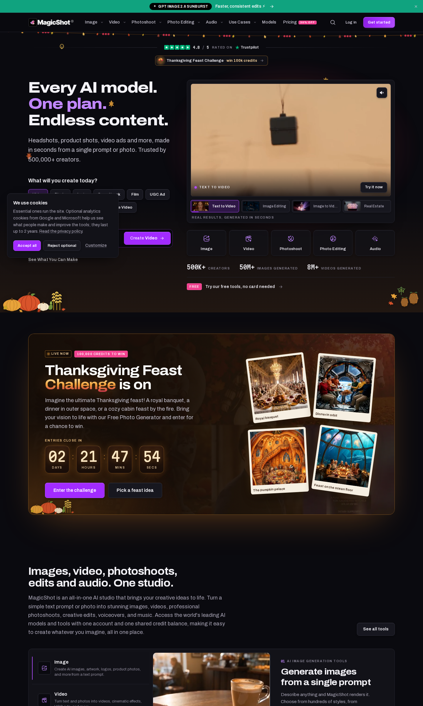
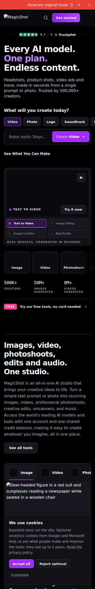

# UI Design System & Master Generation Blueprint: magicshot-ai

> **AI Image, Video & Audio Generator all in One Plan** (https://magicshot.ai) — Generate images, video, and audio with top AI models and countless tools under one subscription. No five tabs, no five invoices, one plan...



---

## 1. Executive Visual Persona & Design Archetype

- **Brand Essence & Persona**: **AI Image, Video & Audio Generator all in One Plan** (`https://magicshot.ai`). Generate images, video, and audio with top AI models and countless tools under one subscription. No five tabs, no five invoices, one plan...
- **Visual Archetype**: **High-Contrast Obsidian / Atmospheric Design System (`#000` canvas, `#fff` ink, `#d7b0ff` accent)**.
- **Anti-AI-Slop Differentiators**:
  - **Source-Grounded Chromatic Polarity**: Anchors the viewport in `#000` (`var(--color-black)` in `:root`) paired with `#fff` primary typography and `#d7b0ff` accents.
  - **Extracted Typographic Hierarchy**: Pairs `Archivo` for display copy (`Every AI model. One plan. Endless co`) with `Martian Mono` and `Martian Mono`.
  - **Calibrated Spatial Grid & Motion**: Combines `72ch` container bounds (`gap: .5rem`, padding `.125rem`) with `cubic-bezier(.4,0,1,1)` easing and GSAP Timeline & ScrollTrigger, Three.js / WebGL Canvas Pipeline.

---

## 2. Spatial Architecture & Modular Grid Mathematics



### Viewport Allocation & Container Geometry
- **Captured Viewport Dimensions**: Desktop `1440×13554px` (`assets/desktop.png`, full-page scroll capture), Mobile `390×2400px` (`assets/mobile.png`, capped at 2400px multi-section capture).
- **Master Container Bounds**: `72ch` extracted from `magicshot-ai` stylesheet.
- **Canvas Lateral Padding & Spacing**: `.125rem` lateral canvas padding with `.5rem` grid gap.
- **Border Radius Scale**: `8px`, `4px`, `var(--radius-card)`, `.375rem`.

### Responsive Breakpoint Architecture
- **Desktop Layout**: Multi-column CSS Grid / Flexbox layout at `1440px` (`max-width: 72ch`, `gap: .5rem`).
- **Mobile Layout**: Single-column vertical stack at `390px` viewport width with `.125rem` horizontal padding.
- **Extracted CSS Media Queries**: `@media (prefers-reduced-motion:reduce)`, `@media (prefers-reduced-motion:no-preference)`, `@media (width>=40rem)`, `@media (width>=48rem)`.

---

## 3. Color System, Materiality & Atmospheric Lighting

### Semantic Palette & Source Grounding
| Semantic Role | Ground-Truth Value | Extracted CSS Source / Selector |
|---|---|---|
| **Primary Canvas Substrate** | `#000` | `var(--color-black)` in `:root` |
| **Primary Typography Ink** | `#fff` | `var(--color-white)` in `:root` |
| **Elevated Surface / Card Substrate** | `#ecd9ff` | `var(--color-brand-100)` in `:root` |
| **Interactive Accent / Highlight** | `#d7b0ff` | `var(--color-brand-200)` in `:root` |
| **Secondary / Muted Copy** | `#c187ff` | `var(--color-brand-300)` in `:root` |
| **Structural Hairline Border** | `#b14dff` | `var(--color-brand-400)` in `:root` |

### Sanitized Root CSS Variables (`ui-ux.md` Ground Truth)
| Variable Name | Extracted Value | Semantic Role |
|---|---|---|
| `--font-serif` | `ui-serif, Georgia, Cambria, "Times New Roman", Times, serif` | Typography / Scale Token |
| `--font-mono` | `"Martian Mono", ui-monospace, SFMono-Regular, Menlo, Consolas, monospace` | Typography / Scale Token |
| `--color-red-300` | `oklch(80.8% .114 19.571)` | Brand / Palette Token |
| `--color-red-400` | `oklch(70.4% .191 22.216)` | Brand / Palette Token |
| `--color-red-500` | `oklch(63.7% .237 25.331)` | Brand / Palette Token |
| `--color-amber-300` | `oklch(87.9% .169 91.605)` | Brand / Palette Token |
| `--color-amber-400` | `oklch(82.8% .189 84.429)` | Brand / Palette Token |
| `--color-sky-400` | `oklch(74.6% .16 232.661)` | Brand / Palette Token |
| `--color-blue-300` | `oklch(80.9% .105 251.813)` | Brand / Palette Token |
| `--color-blue-700` | `oklch(48.8% .243 264.376)` | Brand / Palette Token |
| `--color-blue-800` | `oklch(42.4% .199 265.638)` | Brand / Palette Token |
| `--color-gray-50` | `oklch(98.5% .002 247.839)` | Brand / Palette Token |
| `--color-gray-100` | `oklch(96.7% .003 264.542)` | Brand / Palette Token |
| `--color-gray-200` | `oklch(92.8% .006 264.531)` | Brand / Palette Token |
| `--color-gray-300` | `oklch(87.2% .01 258.338)` | Brand / Palette Token |
| `--color-gray-400` | `oklch(70.7% .022 261.325)` | Brand / Palette Token |

---

## 4. Typographic Scale & Editorial Hierarchy

### Font Family Stacks
- **Display Typography**: `Archivo`.
- **Primary Body Stack**: `Martian Mono`.
- **Technical / Metadata Stack**: `Martian Mono`.

### Typographic Scale & Rules (Extracted from Stylesheet & Variables)
- **Hero Display (`H1`)**: CSS variables `--text-4xl: 2.25rem`, `--text-4xl--line-height: calc(2.5 / 2.25)`, `--text-5xl: 3rem`.
- **Section Heading (`H2`)**: CSS variables `--text-2xl: 1.5rem`, `--text-2xl--line-height: calc(2 / 1.5)`, `--text-3xl: 1.875rem`; rule `h2` (`font-size: 1.5rem`).
- **Body Copy**: CSS variables `--text-base: 1rem`, `--text-base--line-height: calc(1.5 / 1)`.
- **Metadata & Navigation Labels**: CSS variables `--font-mono: "Martian Mono", ui-monospace, SFMono-Regular, Menlo, Consolas, monospace`, `--text-xs: .75rem`, `--text-xs--line-height: calc(1 / .75)`.

---

## 5. Choreographed Motion & Interaction Physics

### Primary Easing Curves
- **Extracted Timing Functions**: `cubic-bezier(.4,0,1,1)`, `cubic-bezier(0,0,.2,1)`, `cubic-bezier(.4,0,.2,1)`.

### Per-Element Transition & Choreography Rules
- **Selector `layer theme`**: `transition: .15s` extracted from `magicshot-ai` stylesheet.
- **Selector `html[data-motion] img[loading=lazy]`**: `transition: opacity .6s` extracted from `magicshot-ai` stylesheet.
- **Selector `media (prefers-reduced-motion:red...`**: `transition: .001ms!important` extracted from `magicshot-ai` stylesheet.
- **Extracted Easing Curve (`cubic-bezier(.4,0,1,1)`)**: Governs interactive state transitions across `<header.site-header>` and `<section.section-y>`.
- **Runtime Interaction Engine**: Integrates GSAP Timeline & ScrollTrigger, Three.js / WebGL Canvas Pipeline with `prefers-reduced-motion: reduce` fallback guards.

---

## 6. Component Wireframe & Structural DOM Map

### Visual Layout Schematic (Grounded in `dom.html` — `1440px` Desktop & `390px` Mobile Reflow)
```
┌────────────────────────────────────────────────────────────────────────┐
│ DESKTOP VIEWPORT (1440px) — AI Image, Video & Audio Generator all in O │
│ ====================================================================== │
│ [ <header.site-header>     | Image · Video · Photoshoot · Photo Edi ]  │
│ ---------------------------------------------------------------------- │
│ | HERO STAGE: <section.relative>                                   |   │
│ | H1: Every AI model. One plan. Endless content.                   |   │
│ | Substrate: #000       | Ink: #fff       | Accent: #d7b0ff        |   │
│ ---------------------------------------------------------------------- │
│ | SHOWCASE GRID (<section.section-y>       ) max-w: 72ch           |   │
│ | +------------------------------+  +------------------------------+ | │
│ | | Images, video, photoshoots,  |  | Generate images from a singl | | │
│ | +------------------------------+  +------------------------------+ | │
│ ---------------------------------------------------------------------- │
│ | MOBILE VIEWPORT REFLOW (390px) — Single-Column Stack (gap: .5rem ) | │
│ | [<header.site-heade] -> [<section.relative>] -> [<section.section-y] │
│ ---------------------------------------------------------------------- │
│ [ FOOTER (<footer.border-t>     ) | https://magicshot.ai               │
└────────────────────────────────────────────────────────────────────────┘
```

### Granular DOM Region Breakdown
1. **Brand Header & Navigation Bar (<header.site-header> — `magicshot-ai`)**:
   - Landmark `<header class="site-header sticky">` hosting `AI Image, Video & Audio Generator al` navigation (`Image · Video · Photoshoot · Photo Editing · Audio`), DOM attributes (`data-motion`, `data-navigate-track="reload"`, `data-navigate-track="reload"`, `data-animate`), and stylesheet rule `backdrop { box-sizing:border-box;border:0 solid;margin:0;padding:0 }`.
2. **Hero Stage & Focal Lead (<section.relative> — `Every AI model. One plan. Endless `)**:
   - Landmark `<section class="relative isolate">` presenting display lead `Every AI model. One plan. Endless content.` and copy excerpt *"JUST DROPPED Generate lifelike visuals with Seedream 5.5 ⚡"* over `#000` canvas and `#fff` ink.
3. **Primary Showcase & Content Grid (<section.section-y> — `Images, video, photoshoots, edits `)**:
   - Landmark `<section class="section-y">` rendering section `Images, video, photoshoots, edits and audio. One...` with copy *"Generate lifelike visuals with Seedream 5.5 ⚡"*, asset references (`d2q9lphzn5ioni.cloudfront.net`, `favicon-96x96.png`, `favicon.svg`, `favicon.ico`), and grid rule `file-selector-button { box-sizing:border-box;border:0 solid;margin:0;padding:0 }`.
4. **Interactive Detail & Feature Matrix (<section.section-y> — `Generate images from a single prom`)**:
   - Landmark `<section class="section-y">` framing `Generate images from a single prompt` and `Bring images and ideas to life as video` (*"GPT Image 2.6 Sunburst Faster, consistent edits ⚡"*) with `#ecd9ff` surface cards, `#d7b0ff` accents, and `strong { font-weight:bolder }`.
5. **Colophon & Global Directory Footer (<footer.border-t> — `https://magicshot.ai`)**:
   - Landmark `<footer class="border-t border-surface-800">` anchoring `AI Image, Video & Audio Generato` footer links (`Image · Video · Photoshoot · Photo Editing · Audio`), copy *"GPT Image 2.6 Sunburst"*, and `#b14dff` structural dividers.

---

## 7. Master Zero-Shot AI Generation Prompt

```markdown
# Master Zero-Shot Frontend Generation Prompt: magicshot-ai (AI Image, Video & Audio Generator all in One Plan)

You are a principal frontend architect and design systems engineer. Build a complete, production-ready web application replicating the exact design system, DOM landmarks, typographic hierarchy, color tokens, and motion physics of `magicshot-ai` (**AI Image, Video & Audio Generator all in One Plan** — `https://magicshot.ai`).

### 1. Visual Archetype & Anti-AI-Slop Mandates
- **Archetype**: High-Contrast Obsidian / Atmospheric Design System (`#000` canvas, `#fff` ink, `#d7b0ff` accent).
- **Identity & Domain Context**: Generate images, video, and audio with top AI models and countless tools under one subscription. No five tabs, no five invoices, one plan...
- **Primary Substrate**: `#000` (`var(--color-black)` in `:root`), **Primary Ink**: `#fff`, **Accent / Highlight**: `#d7b0ff`.
- **Site-Specific Differentiators**:
  - **Source-Grounded Chromatic Polarity**: Anchors the viewport in `#000` (`var(--color-black)` in `:root`) paired with `#fff` primary typography and `#d7b0ff` accents.
  - **Extracted Typographic Hierarchy**: Pairs `Archivo` for display copy (`Every AI model. One plan. Endless co`) with `Martian Mono` and `Martian Mono`.
  - **Calibrated Spatial Grid & Motion**: Combines `72ch` container bounds (`gap: .5rem`, padding `.125rem`) with `cubic-bezier(.4,0,1,1)` easing and GSAP Timeline & ScrollTrigger, Three.js / WebGL Canvas Pipeline.

### 2. Ground-Truth CSS Variables (`:root` Token Contract)
Declare and consume these exact custom properties extracted from `magicshot-ai` in your global stylesheet:

:root {
  /* AI Image, Video & Audio Generator all in One Plan (magicshot-ai) — Ground-Truth Extracted CSS Variables */
  --font-serif: ui-serif, Georgia, Cambria, "Times New Roman", Times, serif; /* Typography / Scale Token (magicshot-ai) */
  --font-mono: "Martian Mono", ui-monospace, SFMono-Regular, Menlo, Consolas, monospace; /* Typography / Scale Token (magicshot-ai) */
  --color-red-300: oklch(80.8% .114 19.571); /* Brand / Palette Token (magicshot-ai) */
  --color-red-400: oklch(70.4% .191 22.216); /* Brand / Palette Token (magicshot-ai) */
  --color-red-500: oklch(63.7% .237 25.331); /* Brand / Palette Token (magicshot-ai) */
  --color-amber-300: oklch(87.9% .169 91.605); /* Brand / Palette Token (magicshot-ai) */
  --color-amber-400: oklch(82.8% .189 84.429); /* Brand / Palette Token (magicshot-ai) */
  --color-sky-400: oklch(74.6% .16 232.661); /* Brand / Palette Token (magicshot-ai) */
  --color-blue-300: oklch(80.9% .105 251.813); /* Brand / Palette Token (magicshot-ai) */
  --color-blue-700: oklch(48.8% .243 264.376); /* Brand / Palette Token (magicshot-ai) */
  --color-blue-800: oklch(42.4% .199 265.638); /* Brand / Palette Token (magicshot-ai) */
  --color-gray-50: oklch(98.5% .002 247.839); /* Brand / Palette Token (magicshot-ai) */
  --color-gray-100: oklch(96.7% .003 264.542); /* Brand / Palette Token (magicshot-ai) */
  --color-gray-200: oklch(92.8% .006 264.531); /* Brand / Palette Token (magicshot-ai) */
  --color-gray-300: oklch(87.2% .01 258.338); /* Brand / Palette Token (magicshot-ai) */
  --color-gray-400: oklch(70.7% .022 261.325); /* Brand / Palette Token (magicshot-ai) */
}

### 3. Semantic Color & Materiality Contract
Map every surface, ink, and border strictly to these source-grounded tokens:
- **Primary Canvas Substrate**: `#000` — grounded in `var(--color-black)` in `:root`
- **Primary Typography Ink**: `#fff` — grounded in `var(--color-white)` in `:root`
- **Elevated Surface / Card Substrate**: `#ecd9ff` — grounded in `var(--color-brand-100)` in `:root`
- **Interactive Accent / Highlight**: `#d7b0ff` — grounded in `var(--color-brand-200)` in `:root`
- **Secondary / Muted Copy**: `#c187ff` — grounded in `var(--color-brand-300)` in `:root`
- **Structural Hairline Border**: `#b14dff` — grounded in `var(--color-brand-400)` in `:root`

### 4. Spatial Grid, Container Bounds & Responsive Breakpoints
- **Desktop Viewport Reference**: `1440×13554px` (full-page scroll capture, `1440px` standard desktop width).
- **Mobile Viewport Reference**: `390×2400px` (capped at 2400px multi-section capture, `390px` standard mobile width).
- **Container Max-Width**: `72ch` extracted from `magicshot-ai` stylesheet
- **Padding & Gutters**: `.125rem` lateral canvas padding with `.5rem` grid gap
- **Desktop Grid**: Multi-column CSS Grid / Flexbox layout at `1440px` (`max-width: 72ch`, `gap: .5rem`)
- **Mobile Adaptation**: Single-column vertical stack at `390px` viewport width with `.125rem` horizontal padding
- **Media Queries**: `@media (prefers-reduced-motion:reduce)`, `@media (prefers-reduced-motion:no-preference)`, `@media (width>=40rem)`, `@media (width>=48rem)`
- **Corner Radii**: `8px`, `4px`, `var(--radius-card)`, `.375rem`

### 5. Typography & Editorial Scale Contract
- **Display Font Stack**: `Archivo`
- **Body Font Stack**: `Martian Mono`
- **Monospace / Technical Font Stack**: `Martian Mono`
- **H1 Display Rule**: CSS variables `--text-4xl: 2.25rem`, `--text-4xl--line-height: calc(2.5 / 2.25)`, `--text-5xl: 3rem`
- **H2 Section Rule**: CSS variables `--text-2xl: 1.5rem`, `--text-2xl--line-height: calc(2 / 1.5)`, `--text-3xl: 1.875rem`; rule `h2` (`font-size: 1.5rem`)
- **Body Copy Rule**: CSS variables `--text-base: 1rem`, `--text-base--line-height: calc(1.5 / 1)`
- **Metadata & Index Rule**: CSS variables `--font-mono: "Martian Mono", ui-monospace, SFMono-Regular, Menlo, Consolas, monospace`, `--text-xs: .75rem`, `--text-xs--line-height: calc(1 / .75)`

### 6. Component Hierarchy, Verbatim Copy & Real DOM Landmarks
Scaffold `magicshot-ai` (`AI Image, Video & Audio Generator all in One Plan`) with these exact structural regions, extracted copy, and CSS rules from `dom.html`:
1. **Brand Header & Navigation Bar (<header.site-header> — `magicshot-ai`)**:
   - DOM & Selectors: Landmark `<header class="site-header sticky">` hosting `AI Image, Video & Audio Generator al` navigation (`Image · Video · Photoshoot · Photo Editing · Audio`), DOM attributes (`data-motion`, `data-navigate-track="reload"`, `data-navigate-track="reload"`, `data-animate`), and stylesheet rule `backdrop { box-sizing:border-box;border:0 solid;margin:0;padding:0 }`.
   - Responsive Contract: Header `Brand Header & Navigation Bar (<header.site-header> — `magicshot-ai`)` (`magicshot-ai`) adapts across `@media (prefers-reduced-motion:reduce)`, `@media (prefers-reduced-motion:no-preference)`, `@media (width>=40rem)`, `@media (width>=48rem)` with `cubic-bezier(.4,0,1,1)`, `cubic-bezier(0,0,.2,1)`, `cubic-bezier(.4,0,.2,1)` transitions and links `Image · Video · Photoshoot · Photo Editing · Audio`.
2. **Hero Stage & Focal Lead (<section.relative> — `Every AI model. One plan. Endless `)**:
   - DOM & Selectors: Landmark `<section class="relative isolate">` presenting display lead `Every AI model. One plan. Endless content.` and copy excerpt *"JUST DROPPED Generate lifelike visuals with Seedream 5.5 ⚡"* over `#000` canvas and `#fff` ink.
   - Responsive Contract: Hero stage (`1440×13554px` desktop / `390×2400px` mobile) sets `#000` background with `#fff` headline `Every AI model. One plan. Endless content.`.
3. **Primary Showcase & Content Grid (<section.section-y> — `Images, video, photoshoots, edits `)**:
   - DOM & Selectors: Landmark `<section class="section-y">` rendering section `Images, video, photoshoots, edits and audio. One...` with copy *"Generate lifelike visuals with Seedream 5.5 ⚡"*, asset references (`d2q9lphzn5ioni.cloudfront.net`, `favicon-96x96.png`, `favicon.svg`, `favicon.ico`), and grid rule `file-selector-button { box-sizing:border-box;border:0 solid;margin:0;padding:0 }`.
   - Responsive Contract: Showcase grid `Primary Showcase & Content Grid (<section.section-y> — `Images, video, photoshoots, edits `)` applies Multi-column CSS Grid / Flexbox layout at `1440px` (`max-width: 72ch`, `gap: .5rem`) on desktop and Single-column vertical stack at `390px` viewport width with `.125rem` horizontal padding on mobile.
4. **Interactive Detail & Feature Matrix (<section.section-y> — `Generate images from a single prom`)**:
   - DOM & Selectors: Landmark `<section class="section-y">` framing `Generate images from a single prompt` and `Bring images and ideas to life as video` (*"GPT Image 2.6 Sunburst Faster, consistent edits ⚡"*) with `#ecd9ff` surface cards, `#d7b0ff` accents, and `strong { font-weight:bolder }`.
   - Responsive Contract: Detail module `Interactive Detail & Feature Matrix (<section.section-y> — `Generate images from a single prom`)` uses `8px`, `4px`, `var(--radius-card)`, `.375rem` radii, `#d7b0ff` highlights, and assets (d2q9lphzn5ioni.cloudfront.net, favicon-96x96.png, favicon.svg).
5. **Colophon & Global Directory Footer (<footer.border-t> — `https://magicshot.ai`)**:
   - DOM & Selectors: Landmark `<footer class="border-t border-surface-800">` anchoring `AI Image, Video & Audio Generato` footer links (`Image · Video · Photoshoot · Photo Editing · Audio`), copy *"GPT Image 2.6 Sunburst"*, and `#b14dff` structural dividers.
   - Responsive Contract: Footer `Colophon & Global Directory Footer (<footer.border-t> — `https://magicshot.ai`)` aligns to `72ch` extracted from `magicshot-ai` stylesheet with `.125rem` lateral canvas padding with `.5rem` grid gap and attributes (data-motion, data-navigate-track="reload", data-navigate-track="reload").

#### Verbatim DOM Copy Excerpts (`dom.html`)
- Copy Excerpt 1: *"JUST DROPPED Generate lifelike visuals with Seedream 5.5 ⚡"*
- Copy Excerpt 2: *"Generate lifelike visuals with Seedream 5.5 ⚡"*
- Copy Excerpt 3: *"GPT Image 2.6 Sunburst Faster, consistent edits ⚡"*
- Copy Excerpt 4: *"GPT Image 2.6 Sunburst"*

### 7. Motion, Extracted Stylesheet Rules & Interaction Choreography
- **Primary Easing Functions**: `cubic-bezier(.4,0,1,1)`, `cubic-bezier(0,0,.2,1)`, `cubic-bezier(.4,0,.2,1)`
- **Extracted Stylesheet Rules (`magicshot-ai`)**:
- `backdrop { box-sizing:border-box;border:0 solid;margin:0;padding:0 }`
- `file-selector-button { box-sizing:border-box;border:0 solid;margin:0;padding:0 }`
- `strong { font-weight:bolder }`
- `small { font-size:80% }`
- `sup { vertical-align:baseline;font-size:75%;line-height:0;position:relative }`
- **Per-Selector Transition Rules**:
- **Selector `layer theme`**: `transition: .15s` extracted from `magicshot-ai` stylesheet.
- **Selector `html[data-motion] img[loading=lazy]`**: `transition: opacity .6s` extracted from `magicshot-ai` stylesheet.
- **Selector `media (prefers-reduced-motion:red...`**: `transition: .001ms!important` extracted from `magicshot-ai` stylesheet.
- **Extracted Easing Curve (`cubic-bezier(.4,0,1,1)`)**: Governs interactive state transitions across `<header.site-header>` and `<section.section-y>`.
- **Runtime Interaction Engine**: Integrates GSAP Timeline & ScrollTrigger, Three.js / WebGL Canvas Pipeline with `prefers-reduced-motion: reduce` fallback guards.

### 8. Technical Deliverables
- Implement in Next.js (App Router) with TypeScript and Tailwind CSS consuming the `:root` custom properties defined above for `magicshot-ai`.
- Reproduce both the `1440px` desktop architecture and `390px` mobile breakpoint transitions, preserving semantic HTML5 landmarks (`<header>`, `<nav>`, `<main>`, `<section>`, `<footer>`) and `prefers-reduced-motion` accessibility guards.
```
