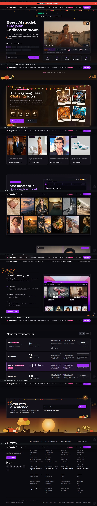
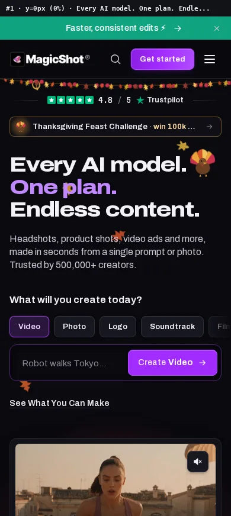

# UI Design System & Master Generation Blueprint: magicshot-ai

> **AI Image, Video & Audio Generator all in One Plan** (https://magicshot.ai) — Generate images, video, and audio with top AI models and countless tools under one subscription. No five tabs, no five invoices, one plan...





---

## 1. Executive Visual Persona & Design Archetype

- **Brand Essence & Persona**: **AI Image, Video & Audio Generator all in One Plan** (`https://magicshot.ai`). Generate images, video, and audio with top AI models and countless tools under one subscription. No five tabs, no five invoices, one plan...
- **Capture Provenance**: Live browser capture (`tier1_fast`, HTTP `200`, captured `2026-11-24`).
- **Visual Archetype**: **High-Contrast Obsidian / Atmospheric Design System (`#0a0a0f` canvas, `#ffffff` ink, `#a22bff` accent)**.
- **Anti-AI-Slop Differentiators**:
  - **Live-Computed Chromatic Polarity**: Anchors the viewport in `#0a0a0f` (live computed `body` `background-color` (`computed_styles.json`)) paired with `#ffffff` primary typography and `#a22bff` accents.
  - **Grounded Typographic Hierarchy**: Uses `Archivo` across display (`Every AI model. One plan. Endless co`) and body copy, paired with `Martian Mono` for monospace/code.
  - **Calibrated Spatial Grid & Motion**: Combines `96rem` container bounds (`gap: 24px`, padding `.125rem`) with `cubic-bezier(.4,0,1,1)` easing and GSAP Timeline & ScrollTrigger, Three.js / WebGL Canvas Pipeline.

---

## 2. Spatial Architecture & Modular Grid Mathematics

### Viewport Allocation & Container Geometry
- **Captured Journey Filmstrips**: Desktop `1280×6624px` (`assets/desktop-journey.webp`, `8` keyframes up to `y=13589px` / doc `14489px`), Mobile `390×872px` (`assets/mobile-journey.webp`, `1` keyframes).
- **Master Container Bounds**: `96rem` (non-`@media` desktop container stylesheet rule).
- **Canvas Lateral Padding & Spacing**: `.125rem` lateral canvas padding with `24px` grid gap.
- **Border Radius Scale**: `3.35544e+07px`, `8px`, `4px`, `var(--radius-card)`.

### Responsive Breakpoint Architecture
- **Desktop Layout**: Multi-column CSS Grid / Flexbox layout at `1440px` (`max-width: 96rem`, `gap: 24px`).
- **Mobile Layout**: Single-column vertical stack at `390px` viewport width with `.125rem` horizontal padding.
- **Extracted CSS Media Queries**: `@media (prefers-reduced-motion:reduce)`, `@media (prefers-reduced-motion:no-preference)`, `@media (width>=40rem)`, `@media (width>=48rem)`.

---

## 3. Color System, Materiality & Atmospheric Lighting

### Semantic Palette & Source Grounding
| Semantic Role | Ground-Truth Value | Extracted Live / CSS Source |
|---|---|---|
| **Primary Canvas Substrate** | `#0a0a0f` | live computed `body` `background-color` (`computed_styles.json`) |
| **Primary Typography Ink** | `#ffffff` | live computed `h2` `color` (`computed_styles.json`) |
| **Elevated Surface / Card Substrate** | `#121218` | `var(--color-surface-900)` in `:root` |
| **Interactive Accent / Highlight** | `#a22bff` | `var(--color-brand-500)` in `:root` |
| **Secondary / Muted Copy** | `#8d8999` | `var(--color-ink-400)` in `:root` |
| **Structural Hairline Border** | `#7740a7` | `.key:hover { border-color: #7740a7 }` |

### Sanitized Root CSS Variables (`ui-ux.md` Ground Truth)
| Variable Name | Extracted Value | Semantic Role |
|---|---|---|
| `--font-serif` | `ui-serif, Georgia, Cambria, "Times New Roman", Times, serif` | Typography / Scale Token |
| `--font-mono` | `"Martian Mono", ui-monospace, SFMono-Regular, Menlo, Consolas, monospace` | Typography / Scale Token |
| `--color-red-300` | `oklch(80.8% .114 19.571)` | Brand / Palette Token |
| `--color-red-400` | `oklch(70.4% .191 22.216)` | Brand / Palette Token |
| `--color-red-500` | `oklch(63.7% .237 25.331)` | Brand / Palette Token |
| `--color-amber-300` | `oklch(87.9% .169 91.605)` | Brand / Palette Token |
| `--color-amber-400` | `oklch(82.8% .189 84.429)` | Brand / Palette Token |
| `--color-sky-400` | `oklch(74.6% .16 232.661)` | Brand / Palette Token |
| `--color-blue-300` | `oklch(80.9% .105 251.813)` | Brand / Palette Token |
| `--color-blue-700` | `oklch(48.8% .243 264.376)` | Brand / Palette Token |
| `--color-blue-800` | `oklch(42.4% .199 265.638)` | Brand / Palette Token |
| `--color-gray-50` | `oklch(98.5% .002 247.839)` | Brand / Palette Token |
| `--color-gray-100` | `oklch(96.7% .003 264.542)` | Brand / Palette Token |
| `--color-gray-200` | `oklch(92.8% .006 264.531)` | Brand / Palette Token |
| `--color-gray-300` | `oklch(87.2% .01 258.338)` | Brand / Palette Token |
| `--color-gray-400` | `oklch(70.7% .022 261.325)` | Brand / Palette Token |

---

## 4. Typographic Scale & Editorial Hierarchy

### Font Family Stacks
- **Display Typography**: `Archivo`.
- **Primary Body Stack**: `Archivo`.
- **Technical / Metadata Stack**: `Martian Mono`.

### Typographic Scale & Rules (Live Computed & Stylesheet Grounded)
- **Hero Display (`H1`)**: live computed `h1` (`font-size: 51.2px`, `line-height: 55.296px`, `font-weight: 800`, `letter-spacing: -1.792px`); CSS variables `--text-4xl: 2.25rem`, `--text-4xl--line-height: calc(2.5 / 2.25)`, `--text-5xl: 3rem`.
- **Section Heading (`H2`)**: live computed `h2` (`font-size: 48px`, `line-height: 48px`, `font-weight: 700`, `letter-spacing: -1.44px`); CSS variables `--text-2xl: 1.5rem`, `--text-2xl--line-height: calc(2 / 1.5)`, `--text-3xl: 1.875rem`; rule `h2` (`font-size: 1.5rem`).
- **Body Copy**: live computed `body` (`font-size: 16px`, `line-height: 24.8px`, `font-weight: 400`); CSS variables `--text-base: 1rem`, `--text-base--line-height: calc(1.5 / 1)`.
- **Metadata & Navigation Labels**: live computed `nav/a` (`font-size: 16px`, `line-height: 24.8px`, `font-weight: 400`); CSS variables `--font-mono: "Martian Mono", ui-monospace, SFMono-Regular, Menlo, Consolas, monospace`, `--text-xs: .75rem`, `--text-xs--line-height: calc(1 / .75)`; rule `small` (`font-size: .625rem`, `letter-spacing: .16em`, `font-weight: 600`).

---

## 5. Choreographed Motion & Interaction Physics

### Primary Easing Curves
- **Extracted Timing Functions**: `cubic-bezier(.4,0,1,1)`, `cubic-bezier(0,0,.2,1)`, `cubic-bezier(.4,0,.2,1)`.

### Per-Element Transition & Choreography Rules
- **Selector `layer theme`**: `transition: .15s` extracted from `magicshot-ai` stylesheet.
- **Selector `html[data-motion] img[loading=lazy]`**: `transition: opacity .6s` extracted from `magicshot-ai` stylesheet.
- **Selector `media (prefers-reduced-motion:red...`**: `transition: .001ms!important` extracted from `magicshot-ai` stylesheet.
- **Extracted Easing Curve (`cubic-bezier(.4,0,1,1)`)**: Governs interactive state transitions across `<header.site-header>` and `<section.section-y:nth(2)>`.
- **Runtime Interaction Engine**: Integrates GSAP Timeline & ScrollTrigger, Three.js / WebGL Canvas Pipeline with `prefers-reduced-motion: reduce` fallback guards.
### Measured Runtime Scroll & Interaction Telemetry (`behavioral_journey_v2`)
- **Scroll Driver Mode**: `native` (max document height `14489px`, deepest scrollY reached `13589px` across `8` desktop keyframes).
- **Detected Scroll / Motion Libraries**: Native browser scroll / standard CSS transitions.
- **Nav / Drawer Probe (`Show AI Image Generation Tools`)**: Triggered visual change (pixel diff `27.115`, captured in `assets/state-nav.webp`); revealed links: See all tools, Photo Generator Gener..., AI GIF Generator Make..., AI Image Enhancer Sha..., AI Logo Generator Cre..., Product Photo Generat....
- **Hover Physics (`primary_cta` · `4.8 / 5 RATED ON Trustpilot`)**: Computed transition `0s` / `ease` (no static color/transform shift captured at rest).
- **Hover Physics (`first_card` · `absolute inset-0 rounded-[8px] fo...`)**: Computed transition `0s` / `ease` (no static color/transform shift captured at rest).
- **Interactive Control Probe (`tab` · `Video Turn text and photos into v...`)**: Triggered visual diff `11.053` (attr `false -> true`, captured in `assets/state-interactive.webp`).
- **Route Transition Architecture**: First internal navigation (`/solutions`) measured as `MPA` in `4380ms`.

---

## 6. Component Wireframe & Structural DOM Map

### Visual Layout Schematic — Desktop (`1440px`, Grounded in `dom.html` & Landmark Bounding Boxes)
```
┌────────────────────────────────────────────────────────────────────────┐
│ DESKTOP VIEWPORT (1440px) — AI Image, Video & Audio Generator all in O │
│ ====================================================================== │
│ [ <header.site-header> (1440x65px)    | Image · Video · Photoshoot · ] │
│ ---------------------------------------------------------------------- │
│ | HERO STAGE: <section.section-y> (w=1440px)                         | │
│ | H1: Every AI model. One plan. Endless content.                     | │
│ | Substrate: #0a0a0f | Ink: #ffffff | Accent: #a22bff                | │
│ ---------------------------------------------------------------------- │
│ | SHOWCASE GRID (<section.section-y:nth(2)>) max-w: 96rem            | │
│ | +------------------------------+  +------------------------------+ | │
│ | | Thanksgiving Feast Challenge |  | Images, video, photoshoots,  | | │
│ | +------------------------------+  +------------------------------+ | │
│ ---------------------------------------------------------------------- │
│ | DETAIL MODULE (<section.section-y:nth(3)>) — Generate images from  | │
│ ---------------------------------------------------------------------- │
│ [ FOOTER (<footer.border-surfa) | https://magicshot.ai                 │
└────────────────────────────────────────────────────────────────────────┘
```

### Visual Layout Schematic — Mobile Reflow (`390px`)
```
┌────────────────────────────────────────────────────────────────────────┐
│ MOBILE VIEWPORT REFLOW (390px) — Single-Column Stack (gap: 24px)       │
│ ====================================================================== │
│ [ HEADER BAR (<header.site-header>    ) | Compact Menu (390px)         │
│ ---------------------------------------------------------------------- │
│ | HERO STAGE (<section.section-y>) — 390px Vertical Lead             | │
│ | H1: Every AI model. One plan. Endless content.                     | │
│ ---------------------------------------------------------------------- │
│ | SHOWCASE STACK (<section.section-y:nth) — 1-Col Stack              | │
│ | [ Item 1: Thanksgiving Feast Challenge is on                     ] | │
│ | [ Item 2: Images, video, photoshoots, edits and audio. One...    ] | │
│ ---------------------------------------------------------------------- │
│ | DETAIL STACK (<section.section-y:nth(3) — 1-Col (Generate images fr) │
│ ---------------------------------------------------------------------- │
│ [ FOOTER (<footer.border-surfa) | Stacked 390px Colophon               │
└────────────────────────────────────────────────────────────────────────┘
```

### Granular DOM Region Breakdown
1. **Brand Header & Navigation Bar (<header.site-header> — `magicshot-ai`)**:
   - Landmark `<header class="site-header top-0">` (`1440x65px`) hosting `AI Image, Video & Audio Generator al` navigation (`Image · Video · Photoshoot · Photo Editing · Audio`), DOM attributes (`data-motion`, `data-id="DB8MR53C77UC0DK7DIE0"`, `data-navigate-track="reload"`, `data-navigate-track="reload"`), and stylesheet rule `backdrop { box-sizing:border-box;border:0 solid;margin:0;padding:0 }`.
2. **Hero Stage & Focal Lead (<section.section-y> — `Every AI model. One plan. Endless `)**:
   - Landmark `<section class="section-y pt-6">` presenting display lead `Every AI model. One plan. Endless content.` and copy excerpt *"Headshots, product shots, video ads and more, made in seconds fro"* over `#0a0a0f` canvas and `#ffffff` ink.
3. **Primary Showcase & Content Grid (<section.section-y:nth(2)> — `Thanksgiving Feast Challenge is on`)**:
   - Landmark `<section class="section-y">` rendering section `Thanksgiving Feast Challenge is on` with copy *"Thanksgiving Feast Challenge · win 100k credits"*, asset references (`d2q9lphzn5ioni.cloudfront.net`, `favicon-96x96.png`, `favicon.svg`, `favicon.ico`), and grid rule `file-selector-button { box-sizing:border-box;border:0 solid;margin:0;padding:0 }`.
4. **Interactive Detail & Feature Matrix (<section.section-y:nth(3)> — `Images, video, photoshoots, edits `)**:
   - Landmark `<section class="section-y">` framing `Images, video, photoshoots, edits and audio. One...` and `Generate images from a single prompt` (*"What will you create today?"*) with `#121218` surface cards, `#a22bff` accents, and `strong { font-weight:bolder }`.
5. **Colophon & Global Directory Footer (<footer.border-surface-800> — `https://magicshot.ai`)**:
   - Landmark `<footer class="border-surface-800 bg-surface-950">` anchoring `AI Image, Video & Audio Generato` footer links (`Image · Video · Photoshoot · Photo Editing · Audio`), copy *"See What You Can Make"*, and `#7740a7` structural dividers.
### Full Vertical Scroll Sequence (Desktop `1440×900` Keyframes)
- **Step 01** (`y=0px`, `0%`): Active landmark `Every AI model. One plan. Endless content.` · sticky/fixed elements: `1`
- **Step 02** (`y=850px`, `6%`): Active landmark `Thanksgiving Feast Challenge is on` · sticky/fixed elements: `1`
- **Step 03** (`y=3400px`, `25%`): Active landmark `AI Headshot Generator` · sticky/fixed elements: `1`
- **Step 04** (`y=5950px`, `44%`): Active landmark `Section @ 44%` · sticky/fixed elements: `1`
- **Step 05** (`y=7650px`, `56%`): Active landmark `One tab. Every tool.` · sticky/fixed elements: `1`
- **Step 06** (`y=10200px`, `75%`): Active landmark `Plans for every creator` · sticky/fixed elements: `1`
- **Step 07** (`y=12750px`, `94%`): Active landmark `Start with a sentence.` · sticky/fixed elements: `1`
- **Step 08** (`y=13589px`, `100%`): Active landmark `Footer` · sticky/fixed elements: `1`

### Multi-Page Internal Route Map
- **Listing Route (`/solutions`)**: `https://magicshot.ai/solutions` — H1: `The AI studio, tuned to your work.`, scrollHeight `3863px`, transition `MPA` (`4380ms`)
- **Detail Route (`/ai-image-generator/photo-generator`)**: `https://magicshot.ai/ai-image-generator/photo-generator` — H1: `Photo Generator`, scrollHeight `10135px`, transition `direct` (`970ms`)
- **Listing Route (`/pricing`)**: `https://magicshot.ai/pricing` — H1: `Simple pricing that scales with you`, scrollHeight `3698px`, transition `direct` (`1647ms`)

---

## 7. Master Zero-Shot AI Generation Prompt

```markdown
# Master Zero-Shot Frontend Generation Prompt: magicshot-ai (AI Image, Video & Audio Generator all in One Plan)

You are a principal frontend architect and design systems engineer. Build a complete, production-ready web application replicating the exact design system, DOM landmarks, typographic hierarchy, color tokens, and motion physics of `magicshot-ai` (**AI Image, Video & Audio Generator all in One Plan** — `https://magicshot.ai`).

### 1. Visual Archetype & Anti-AI-Slop Mandates
- **Archetype**: High-Contrast Obsidian / Atmospheric Design System (`#0a0a0f` canvas, `#ffffff` ink, `#a22bff` accent).
- **Identity & Domain Context**: Generate images, video, and audio with top AI models and countless tools under one subscription. No five tabs, no five invoices, one plan...
- **Primary Substrate**: `#0a0a0f` (live computed `body` `background-color` (`computed_styles.json`)), **Primary Ink**: `#ffffff`, **Accent / Highlight**: `#a22bff`.
- **Site-Specific Differentiators**:
  - **Live-Computed Chromatic Polarity**: Anchors the viewport in `#0a0a0f` (live computed `body` `background-color` (`computed_styles.json`)) paired with `#ffffff` primary typography and `#a22bff` accents.
  - **Grounded Typographic Hierarchy**: Uses `Archivo` across display (`Every AI model. One plan. Endless co`) and body copy, paired with `Martian Mono` for monospace/code.
  - **Calibrated Spatial Grid & Motion**: Combines `96rem` container bounds (`gap: 24px`, padding `.125rem`) with `cubic-bezier(.4,0,1,1)` easing and GSAP Timeline & ScrollTrigger, Three.js / WebGL Canvas Pipeline.

### 2. Ground-Truth CSS Variables (`:root` Token Contract)
Declare and consume these exact custom properties extracted from `magicshot-ai` in your global stylesheet:

:root {
  /* AI Image, Video & Audio Generator all in One Plan (magicshot-ai) — Live-Grounded CSS Variables */
  --font-serif: ui-serif, Georgia, Cambria, "Times New Roman", Times, serif; /* Typography / Scale Token (magicshot-ai) */
  --font-mono: "Martian Mono", ui-monospace, SFMono-Regular, Menlo, Consolas, monospace; /* Typography / Scale Token (magicshot-ai) */
  --color-red-300: oklch(80.8% .114 19.571); /* Brand / Palette Token (magicshot-ai) */
  --color-red-400: oklch(70.4% .191 22.216); /* Brand / Palette Token (magicshot-ai) */
  --color-red-500: oklch(63.7% .237 25.331); /* Brand / Palette Token (magicshot-ai) */
  --color-amber-300: oklch(87.9% .169 91.605); /* Brand / Palette Token (magicshot-ai) */
  --color-amber-400: oklch(82.8% .189 84.429); /* Brand / Palette Token (magicshot-ai) */
  --color-sky-400: oklch(74.6% .16 232.661); /* Brand / Palette Token (magicshot-ai) */
  --color-blue-300: oklch(80.9% .105 251.813); /* Brand / Palette Token (magicshot-ai) */
  --color-blue-700: oklch(48.8% .243 264.376); /* Brand / Palette Token (magicshot-ai) */
  --color-blue-800: oklch(42.4% .199 265.638); /* Brand / Palette Token (magicshot-ai) */
  --color-gray-50: oklch(98.5% .002 247.839); /* Brand / Palette Token (magicshot-ai) */
  --color-gray-100: oklch(96.7% .003 264.542); /* Brand / Palette Token (magicshot-ai) */
  --color-gray-200: oklch(92.8% .006 264.531); /* Brand / Palette Token (magicshot-ai) */
  --color-gray-300: oklch(87.2% .01 258.338); /* Brand / Palette Token (magicshot-ai) */
  --color-gray-400: oklch(70.7% .022 261.325); /* Brand / Palette Token (magicshot-ai) */
}

### 3. Semantic Color & Materiality Contract
Map every surface, ink, and border strictly to these source-grounded tokens:
- **Primary Canvas Substrate**: `#0a0a0f` — grounded in live computed `body` `background-color` (`computed_styles.json`)
- **Primary Typography Ink**: `#ffffff` — grounded in live computed `h2` `color` (`computed_styles.json`)
- **Elevated Surface / Card Substrate**: `#121218` — grounded in `var(--color-surface-900)` in `:root`
- **Interactive Accent / Highlight**: `#a22bff` — grounded in `var(--color-brand-500)` in `:root`
- **Secondary / Muted Copy**: `#8d8999` — grounded in `var(--color-ink-400)` in `:root`
- **Structural Hairline Border**: `#7740a7` — grounded in `.key:hover { border-color: #7740a7 }`

### 4. Spatial Grid, Container Bounds & Responsive Breakpoints
- **Desktop Viewport Reference**: `1280×6624px` (multi-frame vertical journey filmstrip (6624px), `1440px` standard desktop width).
- **Mobile Viewport Reference**: `390×872px` (full-page live capture (872px), `390px` standard mobile width).
- **Container Max-Width**: `96rem` (non-`@media` desktop container stylesheet rule)
- **Padding & Gutters**: `.125rem` lateral canvas padding with `24px` grid gap
- **Desktop Grid**: Multi-column CSS Grid / Flexbox layout at `1440px` (`max-width: 96rem`, `gap: 24px`)
- **Mobile Adaptation**: Single-column vertical stack at `390px` viewport width with `.125rem` horizontal padding
- **Media Queries**: `@media (prefers-reduced-motion:reduce)`, `@media (prefers-reduced-motion:no-preference)`, `@media (width>=40rem)`, `@media (width>=48rem)`
- **Corner Radii**: `3.35544e+07px`, `8px`, `4px`, `var(--radius-card)`

### 5. Typography & Editorial Scale Contract
- **Display Font Stack**: `Archivo`
- **Body Font Stack**: `Archivo`
- **Monospace / Technical Font Stack**: `Martian Mono`
- **H1 Display Rule**: live computed `h1` (`font-size: 51.2px`, `line-height: 55.296px`, `font-weight: 800`, `letter-spacing: -1.792px`); CSS variables `--text-4xl: 2.25rem`, `--text-4xl--line-height: calc(2.5 / 2.25)`, `--text-5xl: 3rem`
- **H2 Section Rule**: live computed `h2` (`font-size: 48px`, `line-height: 48px`, `font-weight: 700`, `letter-spacing: -1.44px`); CSS variables `--text-2xl: 1.5rem`, `--text-2xl--line-height: calc(2 / 1.5)`, `--text-3xl: 1.875rem`; rule `h2` (`font-size: 1.5rem`)
- **Body Copy Rule**: live computed `body` (`font-size: 16px`, `line-height: 24.8px`, `font-weight: 400`); CSS variables `--text-base: 1rem`, `--text-base--line-height: calc(1.5 / 1)`
- **Metadata & Index Rule**: live computed `nav/a` (`font-size: 16px`, `line-height: 24.8px`, `font-weight: 400`); CSS variables `--font-mono: "Martian Mono", ui-monospace, SFMono-Regular, Menlo, Consolas, monospace`, `--text-xs: .75rem`, `--text-xs--line-height: calc(1 / .75)`; rule `small` (`font-size: .625rem`, `letter-spacing: .16em`, `font-weight: 600`)

### 6. Component Hierarchy, Verbatim Copy & Real DOM Landmarks
Scaffold `magicshot-ai` (`AI Image, Video & Audio Generator all in One Plan`) with these exact structural regions, extracted copy, and CSS rules from `dom.html`:
1. **Brand Header & Navigation Bar (<header.site-header> — `magicshot-ai`)**:
   - DOM & Selectors: Landmark `<header class="site-header top-0">` (`1440x65px`) hosting `AI Image, Video & Audio Generator al` navigation (`Image · Video · Photoshoot · Photo Editing · Audio`), DOM attributes (`data-motion`, `data-id="DB8MR53C77UC0DK7DIE0"`, `data-navigate-track="reload"`, `data-navigate-track="reload"`), and stylesheet rule `backdrop { box-sizing:border-box;border:0 solid;margin:0;padding:0 }`.
   - Responsive Contract: Header `Brand Header & Navigation Bar (<header.site-header> — `magicshot-ai`)` (`magicshot-ai`) adapts across `@media (prefers-reduced-motion:reduce)`, `@media (prefers-reduced-motion:no-preference)`, `@media (width>=40rem)`, `@media (width>=48rem)` with `cubic-bezier(.4,0,1,1)`, `cubic-bezier(0,0,.2,1)`, `cubic-bezier(.4,0,.2,1)` transitions and links `Image · Video · Photoshoot · Photo Editing · Audio`.
2. **Hero Stage & Focal Lead (<section.section-y> — `Every AI model. One plan. Endless `)**:
   - DOM & Selectors: Landmark `<section class="section-y pt-6">` presenting display lead `Every AI model. One plan. Endless content.` and copy excerpt *"Headshots, product shots, video ads and more, made in seconds fro"* over `#0a0a0f` canvas and `#ffffff` ink.
   - Responsive Contract: Hero stage (`1280×6624px` desktop / `390×872px` mobile) sets `#0a0a0f` background with `#ffffff` headline `Every AI model. One plan. Endless content.`.
3. **Primary Showcase & Content Grid (<section.section-y:nth(2)> — `Thanksgiving Feast Challenge is on`)**:
   - DOM & Selectors: Landmark `<section class="section-y">` rendering section `Thanksgiving Feast Challenge is on` with copy *"Thanksgiving Feast Challenge · win 100k credits"*, asset references (`d2q9lphzn5ioni.cloudfront.net`, `favicon-96x96.png`, `favicon.svg`, `favicon.ico`), and grid rule `file-selector-button { box-sizing:border-box;border:0 solid;margin:0;padding:0 }`.
   - Responsive Contract: Showcase grid `Primary Showcase & Content Grid (<section.section-y:nth(2)> — `Thanksgiving Feast Challenge is on`)` applies Multi-column CSS Grid / Flexbox layout at `1440px` (`max-width: 96rem`, `gap: 24px`) on desktop and Single-column vertical stack at `390px` viewport width with `.125rem` horizontal padding on mobile.
4. **Interactive Detail & Feature Matrix (<section.section-y:nth(3)> — `Images, video, photoshoots, edits `)**:
   - DOM & Selectors: Landmark `<section class="section-y">` framing `Images, video, photoshoots, edits and audio. One...` and `Generate images from a single prompt` (*"What will you create today?"*) with `#121218` surface cards, `#a22bff` accents, and `strong { font-weight:bolder }`.
   - Responsive Contract: Detail module `Interactive Detail & Feature Matrix (<section.section-y:nth(3)> — `Images, video, photoshoots, edits `)` uses `3.35544e+07px`, `8px`, `4px`, `var(--radius-card)` radii, `#a22bff` highlights, and assets (d2q9lphzn5ioni.cloudfront.net, favicon-96x96.png, favicon.svg).
5. **Colophon & Global Directory Footer (<footer.border-surface-800> — `https://magicshot.ai`)**:
   - DOM & Selectors: Landmark `<footer class="border-surface-800 bg-surface-950">` anchoring `AI Image, Video & Audio Generato` footer links (`Image · Video · Photoshoot · Photo Editing · Audio`), copy *"See What You Can Make"*, and `#7740a7` structural dividers.
   - Responsive Contract: Footer `Colophon & Global Directory Footer (<footer.border-surface-800> — `https://magicshot.ai`)` aligns to `96rem` (non-`@media` desktop container stylesheet rule) with `.125rem` lateral canvas padding with `24px` grid gap and attributes (data-motion, data-id="DB8MR53C77UC0DK7DIE0", data-navigate-track="reload").

#### Verbatim DOM Copy Excerpts (`dom.html`)
- Copy Excerpt 1: *"Headshots, product shots, video ads and more, made in seconds from a single prompt..."*
- Copy Excerpt 2: *"Thanksgiving Feast Challenge · win 100k credits"*
- Copy Excerpt 3: *"What will you create today?"*
- Copy Excerpt 4: *"See What You Can Make"*

### 7. Motion, Extracted Stylesheet Rules & Interaction Choreography
- **Primary Easing Functions**: `cubic-bezier(.4,0,1,1)`, `cubic-bezier(0,0,.2,1)`, `cubic-bezier(.4,0,.2,1)`
- **Extracted Stylesheet Rules (`magicshot-ai`)**:
- `backdrop { box-sizing:border-box;border:0 solid;margin:0;padding:0 }`
- `file-selector-button { box-sizing:border-box;border:0 solid;margin:0;padding:0 }`
- `strong { font-weight:bolder }`
- `small { font-size:80% }`
- `sup { vertical-align:baseline;font-size:75%;line-height:0;position:relative }`
- **Per-Selector Transition Rules**:
- **Selector `layer theme`**: `transition: .15s` extracted from `magicshot-ai` stylesheet.
- **Selector `html[data-motion] img[loading=lazy]`**: `transition: opacity .6s` extracted from `magicshot-ai` stylesheet.
- **Selector `media (prefers-reduced-motion:red...`**: `transition: .001ms!important` extracted from `magicshot-ai` stylesheet.
- **Extracted Easing Curve (`cubic-bezier(.4,0,1,1)`)**: Governs interactive state transitions across `<header.site-header>` and `<section.section-y:nth(2)>`.
- **Runtime Interaction Engine**: Integrates GSAP Timeline & ScrollTrigger, Three.js / WebGL Canvas Pipeline with `prefers-reduced-motion: reduce` fallback guards.
### 7b. Full-Page Scroll Choreography, Interactive States & Multi-Page Routes
- **Scroll Mechanics**: Implement `native` vertical progression up to `14489px` across 8 distinct viewport chapters.
- **Vertical Chapter Sequence**: Every AI model. One plan. E... (0%) -> Thanksgiving Feast Challeng... (6%) -> AI Headshot Generator (25%) -> Section @ 44% (44%) -> One tab. Every tool. (56%) -> Plans for every creator (75%) -> Start with a sentence. (94%) -> Footer (100%).
- **Navigation Drawer / Menu State**: Replicate interactive menu toggle (`Show AI Image Generation Tools`) with Escape-to-close keyboard handling.
- **Multi-Page Routes**: Scaffold internal routes `/solutions` (listing, MPA), `/ai-image-generator/photo-generator` (detail, direct), `/pricing` (listing, direct) sharing the global header/footer shell and design tokens.

### 8. Technical Deliverables
- Implement in Next.js (App Router) with TypeScript and Tailwind CSS consuming the `:root` custom properties defined above for `magicshot-ai`.
- Reproduce both the `1440px` desktop architecture and `390px` mobile breakpoint transitions, preserving semantic HTML5 landmarks (`<header>`, `<nav>`, `<main>`, `<section>`, `<footer>`) and `prefers-reduced-motion` accessibility guards.
```
---

## 8. Full-Page Scroll Journey, Interactive States & Subpage Inventory

### Desktop Scroll Keyframes (`1440×900` WebP)
| Step | Scroll Y | Progress | Active Landmark / Section | Sticky/Fixed | Visual Asset |
| :---: | :---: | :---: | :--- | :---: | :--- |
| `#01` | `0px` | `0%` | Every AI model. One plan. Endless content. | `1` | [desktop-step-01.webp](assets/desktop-step-01.webp) |
| `#02` | `850px` | `6%` | Thanksgiving Feast Challenge is on | `1` | [desktop-step-02.webp](assets/desktop-step-02.webp) |
| `#03` | `3400px` | `25%` | AI Headshot Generator | `1` | [desktop-step-03.webp](assets/desktop-step-03.webp) |
| `#04` | `5950px` | `44%` | Section @ 44% | `1` | [desktop-step-04.webp](assets/desktop-step-04.webp) |
| `#05` | `7650px` | `56%` | One tab. Every tool. | `1` | [desktop-step-05.webp](assets/desktop-step-05.webp) |
| `#06` | `10200px` | `75%` | Plans for every creator | `1` | [desktop-step-06.webp](assets/desktop-step-06.webp) |
| `#07` | `12750px` | `94%` | Start with a sentence. | `1` | [desktop-step-07.webp](assets/desktop-step-07.webp) |
| `#08` | `13589px` | `100%` | Footer | `1` | [desktop-step-08.webp](assets/desktop-step-08.webp) |

### Mobile Condensed Keyframes (`390×844` WebP)
| Step | Scroll Y | Progress | Active Landmark | Visual Asset |
| :---: | :---: | :---: | :--- | :--- |
| `#01` | `0px` | `0%` | Every AI model. One plan. Endless content. | [mobile-step-01.webp](assets/mobile-step-01.webp) |

### Interactive UI State Captures (`1440×900` WebP)
| State Type | Trigger / Observation | Visual Asset |
| :--- | :--- | :--- |
| `nav_menu` | Nav/Menu opened (`Show AI Image Generation Tools`, diff `27.115`) | [state-nav.webp](assets/state-nav.webp) |
| `interactive_control` | Control `tab` (`Video Turn text and photos in...`, diff `11.053`) | [state-interactive.webp](assets/state-interactive.webp) |

### Internal Subpage Filmstrips (`1080px` Wide WebP)
| # | Template | Route URL | H1 / Title | Scroll Height | Transition | Filmstrip Asset |
| :-: | :---: | :--- | :--- | :---: | :---: | :--- |
| `1` | `listing` | `https://magicshot.ai/solutions` | The AI studio, tuned to your work. | `3863px` | `MPA` (`4380ms`) | [subpage-01-solutions.webp](assets/subpage-01-solutions.webp) |
| `2` | `detail` | `https://magicshot.ai/ai-image-generator/photo-generator` | Photo Generator | `10135px` | `direct` (`970ms`) | [subpage-02-ai-image-generator-photo-generator.webp](assets/subpage-02-ai-image-generator-photo-generator.webp) |
| `3` | `listing` | `https://magicshot.ai/pricing` | Simple pricing that scales with you | `3698px` | `direct` (`1647ms`) | [subpage-03-pricing.webp](assets/subpage-03-pricing.webp) |

