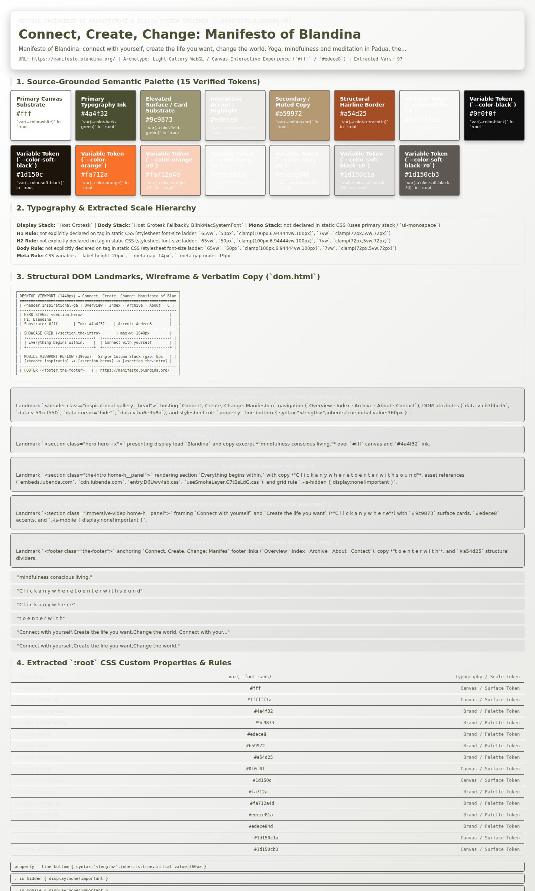
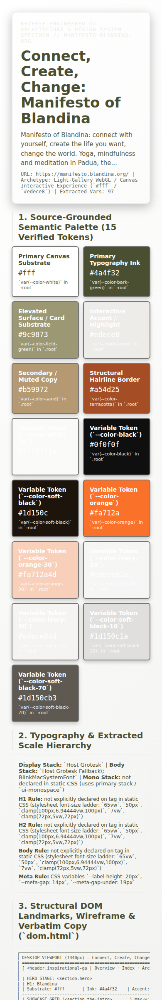

# UI Design System & Master Generation Blueprint: manifesto-blandina-org

> **Connect, Create, Change: Manifesto of Blandina** (https://manifesto.blandina.org/) — Manifesto of Blandina: connect with yourself, create the life you want, change the world. Yoga, mindfulness and meditation in Padua, the...



---

## 1. Executive Visual Persona & Design Archetype

- **Brand Essence & Persona**: **Connect, Create, Change: Manifesto of Blandina** (`https://manifesto.blandina.org/`). Manifesto of Blandina: connect with yourself, create the life you want, change the world. Yoga, mindfulness and meditation in Padua, the...
- **Visual Archetype**: **Light-Gallery WebGL / Canvas Interactive Experience (`#fff` / `#edece8`)**.
- **Anti-AI-Slop Differentiators**:
  - **Source-Grounded Chromatic Polarity**: Anchors the viewport in `#fff` (`var(--color-white)` in `:root`) paired with `#4a4f32` primary typography and `#edece8` accents.
  - **Extracted Typographic Hierarchy**: Pairs `Host Grotesk` for display copy (`Blandina`) with `Host Grotesk Fallback\: BlinkMacSystemFont` and not declared in static CSS (uses primary stack / `ui-monospace`).
  - **Calibrated Spatial Grid & Motion**: Combines `1640px` container bounds (`gap: 8px`, padding `7px`) with `cubic-bezier(.55,.06,.68,.19)` easing and Lenis Smooth Scroll (`data-lenis`), HTML5 `<canvas>` Interactive Viewport Surface.

---

## 2. Spatial Architecture & Modular Grid Mathematics



### Viewport Allocation & Container Geometry
- **Captured Viewport Dimensions**: Desktop `1440×2400px` (`assets/desktop.png`, capped at 2400px multi-section capture), Mobile `390×2400px` (`assets/mobile.png`, capped at 2400px multi-section capture).
- **Master Container Bounds**: `1640px` extracted from `manifesto-blandina-org` stylesheet.
- **Canvas Lateral Padding & Spacing**: `7px` lateral canvas padding with `8px` grid gap.
- **Border Radius Scale**: `50%`, `5px`, `2px`, `14px`.

### Responsive Breakpoint Architecture
- **Desktop Layout**: Multi-column CSS Grid / Flexbox layout at `1440px` (`max-width: 1640px`, `gap: 8px`).
- **Mobile Layout**: Single-column vertical stack at `390px` viewport width with `7px` horizontal padding.
- **Extracted CSS Media Queries**: `@media (width>=64em)`, `@media (width<=63.99em)`, `@media (prefers-reduced-motion:reduce)`, `@media (width<=1023px)`.

---

## 3. Color System, Materiality & Atmospheric Lighting

### Semantic Palette & Source Grounding
| Semantic Role | Ground-Truth Value | Extracted CSS Source / Selector |
|---|---|---|
| **Primary Canvas Substrate** | `#fff` | `var(--color-white)` in `:root` |
| **Primary Typography Ink** | `#4a4f32` | `var(--color-bark-green)` in `:root` |
| **Elevated Surface / Card Substrate** | `#9c9873` | `var(--color-field-green)` in `:root` |
| **Interactive Accent / Highlight** | `#edece8` | `var(--color-ivory)` in `:root` |
| **Secondary / Muted Copy** | `#b59972` | `var(--color-sand)` in `:root` |
| **Structural Hairline Border** | `#a54d25` | `var(--color-terracotta)` in `:root` |
| **Variable Token (`--color-white-10`)** | `#ffffff1a` | `var(--color-white-10)` in `:root` |
| **Variable Token (`--color-black`)** | `#0f0f0f` | `var(--color-black)` in `:root` |
| **Variable Token (`--color-soft-black`)** | `#1d150c` | `var(--color-soft-black)` in `:root` |
| **Variable Token (`--color-orange`)** | `#fa712a` | `var(--color-orange)` in `:root` |
| **Variable Token (`--color-orange-30`)** | `#fa712a4d` | `var(--color-orange-30)` in `:root` |
| **Variable Token (`--color-ivory-10`)** | `#edece81a` | `var(--color-ivory-10)` in `:root` |
| **Variable Token (`--color-ivory-30`)** | `#edece84d` | `var(--color-ivory-30)` in `:root` |
| **Variable Token (`--color-soft-black-10`)** | `#1d150c1a` | `var(--color-soft-black-10)` in `:root` |
| **Variable Token (`--color-soft-black-70`)** | `#1d150cb3` | `var(--color-soft-black-70)` in `:root` |

### Sanitized Root CSS Variables (`ui-ux.md` Ground Truth)
| Variable Name | Extracted Value | Semantic Role |
|---|---|---|
| `--font-base` | `var(--font-sans)` | Typography / Scale Token |
| `--color-white` | `#fff` | Canvas / Surface Token |
| `--color-white-10` | `#ffffff1a` | Canvas / Surface Token |
| `--color-bark-green` | `#4a4f32` | Brand / Palette Token |
| `--color-field-green` | `#9c9873` | Brand / Palette Token |
| `--color-ivory` | `#edece8` | Brand / Palette Token |
| `--color-sand` | `#b59972` | Brand / Palette Token |
| `--color-terracotta` | `#a54d25` | Brand / Palette Token |
| `--color-black` | `#0f0f0f` | Canvas / Surface Token |
| `--color-soft-black` | `#1d150c` | Canvas / Surface Token |
| `--color-orange` | `#fa712a` | Brand / Palette Token |
| `--color-orange-30` | `#fa712a4d` | Brand / Palette Token |
| `--color-ivory-10` | `#edece81a` | Brand / Palette Token |
| `--color-ivory-30` | `#edece84d` | Brand / Palette Token |
| `--color-soft-black-10` | `#1d150c1a` | Canvas / Surface Token |
| `--color-soft-black-70` | `#1d150cb3` | Canvas / Surface Token |

---

## 4. Typographic Scale & Editorial Hierarchy

### Font Family Stacks
- **Display Typography**: `Host Grotesk`.
- **Primary Body Stack**: `Host Grotesk Fallback\: BlinkMacSystemFont`.
- **Technical / Metadata Stack**: not declared in static CSS (uses primary stack / `ui-monospace`).

### Typographic Scale & Rules (Extracted from Stylesheet & Variables)
- **Hero Display (`H1`)**: not explicitly declared on tag in static CSS (stylesheet font-size ladder: `65vw`, `50px`, `clamp(100px,6.94444vw,100px)`, `7vw`, `clamp(72px,5vw,72px)`).
- **Section Heading (`H2`)**: not explicitly declared on tag in static CSS (stylesheet font-size ladder: `65vw`, `50px`, `clamp(100px,6.94444vw,100px)`, `7vw`, `clamp(72px,5vw,72px)`).
- **Body Copy**: not explicitly declared on tag in static CSS (stylesheet font-size ladder: `65vw`, `50px`, `clamp(100px,6.94444vw,100px)`, `7vw`, `clamp(72px,5vw,72px)`).
- **Metadata & Navigation Labels**: CSS variables `--label-height: 20px`, `--meta-gap: 14px`, `--meta-gap-under: 19px`.

---

## 5. Choreographed Motion & Interaction Physics

### Primary Easing Curves
- **Extracted Timing Functions**: `cubic-bezier(.55,.06,.68,.19)`, `cubic-bezier(.65,.05,.36,1)`, `cubic-bezier(.16,1,.3,1)`.

### Per-Element Transition & Choreography Rules
- **Selector `a:not([class])`**: `transition: color var(--timing-fast) var(--easing-out)` extracted from `manifesto-blandina-org` stylesheet.
- **Selector `media (prefers-reduced-motion:red...`**: `transition: .01ms!important` extracted from `manifesto-blandina-org` stylesheet.
- **Selector `.fade-in-leave-active`**: `transition: opacity var(--timing-default) var(--easing-in)` extracted from `manifesto-blandina-org` stylesheet.
- **Extracted Easing Curve (`cubic-bezier(.55,.06,.68,.19)`)**: Governs interactive state transitions across `<header.inspirational-gallery__head>` and `<section.the-intro>`.
- **Runtime Interaction Engine**: Integrates Lenis Smooth Scroll (`data-lenis`), HTML5 `<canvas>` Interactive Viewport Surface with `prefers-reduced-motion: reduce` fallback guards.

---

## 6. Component Wireframe & Structural DOM Map

### Visual Layout Schematic (Grounded in `dom.html` — `1440px` Desktop & `390px` Mobile Reflow)
```
┌────────────────────────────────────────────────────────────────────────┐
│ DESKTOP VIEWPORT (1440px) — Connect, Create, Change: Manifesto of Blan │
│ ====================================================================== │
│ [ <header.inspirational-ga | Overview · Index · Archive · About · C ]  │
│ ---------------------------------------------------------------------- │
│ | HERO STAGE: <section.hero>                                       |   │
│ | H1: Blandina                                                     |   │
│ | Substrate: #fff       | Ink: #4a4f32    | Accent: #edece8        |   │
│ ---------------------------------------------------------------------- │
│ | SHOWCASE GRID (<section.the-intro>       ) max-w: 1640px         |   │
│ | +------------------------------+  +------------------------------+ | │
│ | | Everything begins within.    |  | Connect with yourself        | | │
│ | +------------------------------+  +------------------------------+ | │
│ ---------------------------------------------------------------------- │
│ | MOBILE VIEWPORT REFLOW (390px) — Single-Column Stack (gap: 8px   ) | │
│ | [<header.inspiratio] -> [<section.hero>] -> [<section.the-intro] |   │
│ ---------------------------------------------------------------------- │
│ [ FOOTER (<footer.the-footer>   ) | https://manifesto.blandina.org/    │
└────────────────────────────────────────────────────────────────────────┘
```

### Granular DOM Region Breakdown
1. **Brand Header & Navigation Bar (<header.inspirational-gallery__head> — `manifesto-blandina-org`)**:
   - Landmark `<header class="inspirational-gallery__head">` hosting `Connect, Create, Change: Manifesto o` navigation (`Overview · Index · Archive · About · Contact`), DOM attributes (`data-v-cb3bbcd5`, `data-v-59ccf550`, `data-cursor="hide"`, `data-v-ba6e3b8d`), and stylesheet rule `property --line-bottom { syntax:"<length>";inherits:true;initial-value:360px }`.
2. **Hero Stage & Focal Lead (<section.hero> — `Blandina`)**:
   - Landmark `<section class="hero hero--fx">` presenting display lead `Blandina` and copy excerpt *"mindfulness conscious living."* over `#fff` canvas and `#4a4f32` ink.
3. **Primary Showcase & Content Grid (<section.the-intro> — `Everything begins within.`)**:
   - Landmark `<section class="the-intro home-h__panel">` rendering section `Everything begins within.` with copy *"C l i c k a n y w h e r e t o e n t e r w i t h s o u n d"*, asset references (`embeds.iubenda.com`, `cdn.iubenda.com`, `entry.D6Uwv4sb.css`, `useSmokeLayer.C7tBsLdG.css`), and grid rule `.-is-hidden { display:none!important }`.
4. **Interactive Detail & Feature Matrix (<section.immersive-video> — `Connect with yourself`)**:
   - Landmark `<section class="immersive-video home-h__panel">` framing `Connect with yourself` and `Create the life you want` (*"C l i c k a n y w h e r e"*) with `#9c9873` surface cards, `#edece8` accents, and `.-is-mobile { display:none!important }`.
5. **Colophon & Global Directory Footer (<footer.the-footer> — `https://manifesto.blandina.org/`)**:
   - Landmark `<footer class="the-footer">` anchoring `Connect, Create, Change: Manifes` footer links (`Overview · Index · Archive · About · Contact`), copy *"t o e n t e r w i t h"*, and `#a54d25` structural dividers.

---

## 7. Master Zero-Shot AI Generation Prompt

```markdown
# Master Zero-Shot Frontend Generation Prompt: manifesto-blandina-org (Connect, Create, Change: Manifesto of Blandina)

You are a principal frontend architect and design systems engineer. Build a complete, production-ready web application replicating the exact design system, DOM landmarks, typographic hierarchy, color tokens, and motion physics of `manifesto-blandina-org` (**Connect, Create, Change: Manifesto of Blandina** — `https://manifesto.blandina.org/`).

### 1. Visual Archetype & Anti-AI-Slop Mandates
- **Archetype**: Light-Gallery WebGL / Canvas Interactive Experience (`#fff` / `#edece8`).
- **Identity & Domain Context**: Manifesto of Blandina: connect with yourself, create the life you want, change the world. Yoga, mindfulness and meditation in Padua, the...
- **Primary Substrate**: `#fff` (`var(--color-white)` in `:root`), **Primary Ink**: `#4a4f32`, **Accent / Highlight**: `#edece8`.
- **Site-Specific Differentiators**:
  - **Source-Grounded Chromatic Polarity**: Anchors the viewport in `#fff` (`var(--color-white)` in `:root`) paired with `#4a4f32` primary typography and `#edece8` accents.
  - **Extracted Typographic Hierarchy**: Pairs `Host Grotesk` for display copy (`Blandina`) with `Host Grotesk Fallback\: BlinkMacSystemFont` and not declared in static CSS (uses primary stack / `ui-monospace`).
  - **Calibrated Spatial Grid & Motion**: Combines `1640px` container bounds (`gap: 8px`, padding `7px`) with `cubic-bezier(.55,.06,.68,.19)` easing and Lenis Smooth Scroll (`data-lenis`), HTML5 `<canvas>` Interactive Viewport Surface.

### 2. Ground-Truth CSS Variables (`:root` Token Contract)
Declare and consume these exact custom properties extracted from `manifesto-blandina-org` in your global stylesheet:

:root {
  /* Connect, Create, Change: Manifesto of Blandina (manifesto-blandina-org) — Ground-Truth Extracted CSS Variables */
  --font-base: var(--font-sans); /* Typography / Scale Token (manifesto-blandina-org) */
  --color-white: #fff; /* Canvas / Surface Token (manifesto-blandina-org) */
  --color-white-10: #ffffff1a; /* Canvas / Surface Token (manifesto-blandina-org) */
  --color-bark-green: #4a4f32; /* Brand / Palette Token (manifesto-blandina-org) */
  --color-field-green: #9c9873; /* Brand / Palette Token (manifesto-blandina-org) */
  --color-ivory: #edece8; /* Brand / Palette Token (manifesto-blandina-org) */
  --color-sand: #b59972; /* Brand / Palette Token (manifesto-blandina-org) */
  --color-terracotta: #a54d25; /* Brand / Palette Token (manifesto-blandina-org) */
  --color-black: #0f0f0f; /* Canvas / Surface Token (manifesto-blandina-org) */
  --color-soft-black: #1d150c; /* Canvas / Surface Token (manifesto-blandina-org) */
  --color-orange: #fa712a; /* Brand / Palette Token (manifesto-blandina-org) */
  --color-orange-30: #fa712a4d; /* Brand / Palette Token (manifesto-blandina-org) */
  --color-ivory-10: #edece81a; /* Brand / Palette Token (manifesto-blandina-org) */
  --color-ivory-30: #edece84d; /* Brand / Palette Token (manifesto-blandina-org) */
  --color-soft-black-10: #1d150c1a; /* Canvas / Surface Token (manifesto-blandina-org) */
  --color-soft-black-70: #1d150cb3; /* Canvas / Surface Token (manifesto-blandina-org) */
}

### 3. Semantic Color & Materiality Contract
Map every surface, ink, and border strictly to these source-grounded tokens:
- **Primary Canvas Substrate**: `#fff` — grounded in `var(--color-white)` in `:root`
- **Primary Typography Ink**: `#4a4f32` — grounded in `var(--color-bark-green)` in `:root`
- **Elevated Surface / Card Substrate**: `#9c9873` — grounded in `var(--color-field-green)` in `:root`
- **Interactive Accent / Highlight**: `#edece8` — grounded in `var(--color-ivory)` in `:root`
- **Secondary / Muted Copy**: `#b59972` — grounded in `var(--color-sand)` in `:root`
- **Structural Hairline Border**: `#a54d25` — grounded in `var(--color-terracotta)` in `:root`
- **Variable Token (`--color-white-10`)**: `#ffffff1a` — grounded in `var(--color-white-10)` in `:root`
- **Variable Token (`--color-black`)**: `#0f0f0f` — grounded in `var(--color-black)` in `:root`
- **Variable Token (`--color-soft-black`)**: `#1d150c` — grounded in `var(--color-soft-black)` in `:root`
- **Variable Token (`--color-orange`)**: `#fa712a` — grounded in `var(--color-orange)` in `:root`
- **Variable Token (`--color-orange-30`)**: `#fa712a4d` — grounded in `var(--color-orange-30)` in `:root`
- **Variable Token (`--color-ivory-10`)**: `#edece81a` — grounded in `var(--color-ivory-10)` in `:root`
- **Variable Token (`--color-ivory-30`)**: `#edece84d` — grounded in `var(--color-ivory-30)` in `:root`
- **Variable Token (`--color-soft-black-10`)**: `#1d150c1a` — grounded in `var(--color-soft-black-10)` in `:root`
- **Variable Token (`--color-soft-black-70`)**: `#1d150cb3` — grounded in `var(--color-soft-black-70)` in `:root`

### 4. Spatial Grid, Container Bounds & Responsive Breakpoints
- **Desktop Viewport Reference**: `1440×2400px` (capped at 2400px multi-section capture, `1440px` standard desktop width).
- **Mobile Viewport Reference**: `390×2400px` (capped at 2400px multi-section capture, `390px` standard mobile width).
- **Container Max-Width**: `1640px` extracted from `manifesto-blandina-org` stylesheet
- **Padding & Gutters**: `7px` lateral canvas padding with `8px` grid gap
- **Desktop Grid**: Multi-column CSS Grid / Flexbox layout at `1440px` (`max-width: 1640px`, `gap: 8px`)
- **Mobile Adaptation**: Single-column vertical stack at `390px` viewport width with `7px` horizontal padding
- **Media Queries**: `@media (width>=64em)`, `@media (width<=63.99em)`, `@media (prefers-reduced-motion:reduce)`, `@media (width<=1023px)`
- **Corner Radii**: `50%`, `5px`, `2px`, `14px`

### 5. Typography & Editorial Scale Contract
- **Display Font Stack**: `Host Grotesk`
- **Body Font Stack**: `Host Grotesk Fallback\: BlinkMacSystemFont`
- **Monospace / Technical Font Stack**: not declared in static CSS (uses primary stack / `ui-monospace`)
- **H1 Display Rule**: not explicitly declared on tag in static CSS (stylesheet font-size ladder: `65vw`, `50px`, `clamp(100px,6.94444vw,100px)`, `7vw`, `clamp(72px,5vw,72px)`)
- **H2 Section Rule**: not explicitly declared on tag in static CSS (stylesheet font-size ladder: `65vw`, `50px`, `clamp(100px,6.94444vw,100px)`, `7vw`, `clamp(72px,5vw,72px)`)
- **Body Copy Rule**: not explicitly declared on tag in static CSS (stylesheet font-size ladder: `65vw`, `50px`, `clamp(100px,6.94444vw,100px)`, `7vw`, `clamp(72px,5vw,72px)`)
- **Metadata & Index Rule**: CSS variables `--label-height: 20px`, `--meta-gap: 14px`, `--meta-gap-under: 19px`

### 6. Component Hierarchy, Verbatim Copy & Real DOM Landmarks
Scaffold `manifesto-blandina-org` (`Connect, Create, Change: Manifesto of Blandina`) with these exact structural regions, extracted copy, and CSS rules from `dom.html`:
1. **Brand Header & Navigation Bar (<header.inspirational-gallery__head> — `manifesto-blandina-org`)**:
   - DOM & Selectors: Landmark `<header class="inspirational-gallery__head">` hosting `Connect, Create, Change: Manifesto o` navigation (`Overview · Index · Archive · About · Contact`), DOM attributes (`data-v-cb3bbcd5`, `data-v-59ccf550`, `data-cursor="hide"`, `data-v-ba6e3b8d`), and stylesheet rule `property --line-bottom { syntax:"<length>";inherits:true;initial-value:360px }`.
   - Responsive Contract: Header `Brand Header & Navigation Bar (<header.inspirational-gallery__head> — `manifesto-blandina-org`)` (`manifesto-blandina-org`) adapts across `@media (width>=64em)`, `@media (width<=63.99em)`, `@media (prefers-reduced-motion:reduce)`, `@media (width<=1023px)` with `cubic-bezier(.55,.06,.68,.19)`, `cubic-bezier(.65,.05,.36,1)`, `cubic-bezier(.16,1,.3,1)` transitions and links `Overview · Index · Archive · About · Contact`.
2. **Hero Stage & Focal Lead (<section.hero> — `Blandina`)**:
   - DOM & Selectors: Landmark `<section class="hero hero--fx">` presenting display lead `Blandina` and copy excerpt *"mindfulness conscious living."* over `#fff` canvas and `#4a4f32` ink.
   - Responsive Contract: Hero stage (`1440×2400px` desktop / `390×2400px` mobile) sets `#fff` background with `#4a4f32` headline `Blandina`.
3. **Primary Showcase & Content Grid (<section.the-intro> — `Everything begins within.`)**:
   - DOM & Selectors: Landmark `<section class="the-intro home-h__panel">` rendering section `Everything begins within.` with copy *"C l i c k a n y w h e r e t o e n t e r w i t h s o u n d"*, asset references (`embeds.iubenda.com`, `cdn.iubenda.com`, `entry.D6Uwv4sb.css`, `useSmokeLayer.C7tBsLdG.css`), and grid rule `.-is-hidden { display:none!important }`.
   - Responsive Contract: Showcase grid `Primary Showcase & Content Grid (<section.the-intro> — `Everything begins within.`)` applies Multi-column CSS Grid / Flexbox layout at `1440px` (`max-width: 1640px`, `gap: 8px`) on desktop and Single-column vertical stack at `390px` viewport width with `7px` horizontal padding on mobile.
4. **Interactive Detail & Feature Matrix (<section.immersive-video> — `Connect with yourself`)**:
   - DOM & Selectors: Landmark `<section class="immersive-video home-h__panel">` framing `Connect with yourself` and `Create the life you want` (*"C l i c k a n y w h e r e"*) with `#9c9873` surface cards, `#edece8` accents, and `.-is-mobile { display:none!important }`.
   - Responsive Contract: Detail module `Interactive Detail & Feature Matrix (<section.immersive-video> — `Connect with yourself`)` uses `50%`, `5px`, `2px`, `14px` radii, `#edece8` highlights, and assets (embeds.iubenda.com, cdn.iubenda.com, entry.D6Uwv4sb.css).
5. **Colophon & Global Directory Footer (<footer.the-footer> — `https://manifesto.blandina.org/`)**:
   - DOM & Selectors: Landmark `<footer class="the-footer">` anchoring `Connect, Create, Change: Manifes` footer links (`Overview · Index · Archive · About · Contact`), copy *"t o e n t e r w i t h"*, and `#a54d25` structural dividers.
   - Responsive Contract: Footer `Colophon & Global Directory Footer (<footer.the-footer> — `https://manifesto.blandina.org/`)` aligns to `1640px` extracted from `manifesto-blandina-org` stylesheet with `7px` lateral canvas padding with `8px` grid gap and attributes (data-v-cb3bbcd5, data-v-59ccf550, data-cursor="hide").

#### Verbatim DOM Copy Excerpts (`dom.html`)
- Copy Excerpt 1: *"mindfulness conscious living."*
- Copy Excerpt 2: *"C l i c k a n y w h e r e t o e n t e r w i t h s o u n d"*
- Copy Excerpt 3: *"C l i c k a n y w h e r e"*
- Copy Excerpt 4: *"t o e n t e r w i t h"*

### 7. Motion, Extracted Stylesheet Rules & Interaction Choreography
- **Primary Easing Functions**: `cubic-bezier(.55,.06,.68,.19)`, `cubic-bezier(.65,.05,.36,1)`, `cubic-bezier(.16,1,.3,1)`
- **Extracted Stylesheet Rules (`manifesto-blandina-org`)**:
- `property --line-bottom { syntax:"<length>";inherits:true;initial-value:360px }`
- `.-is-hidden { display:none!important }`
- `.-is-mobile { display:none!important }`
- `.-is-desktop { display:none!important }`
- `.-bg-white { background-color:var(--color-ivory);color:var(--color-soft-black) }`
- **Per-Selector Transition Rules**:
- **Selector `a:not([class])`**: `transition: color var(--timing-fast) var(--easing-out)` extracted from `manifesto-blandina-org` stylesheet.
- **Selector `media (prefers-reduced-motion:red...`**: `transition: .01ms!important` extracted from `manifesto-blandina-org` stylesheet.
- **Selector `.fade-in-leave-active`**: `transition: opacity var(--timing-default) var(--easing-in)` extracted from `manifesto-blandina-org` stylesheet.
- **Extracted Easing Curve (`cubic-bezier(.55,.06,.68,.19)`)**: Governs interactive state transitions across `<header.inspirational-gallery__head>` and `<section.the-intro>`.
- **Runtime Interaction Engine**: Integrates Lenis Smooth Scroll (`data-lenis`), HTML5 `<canvas>` Interactive Viewport Surface with `prefers-reduced-motion: reduce` fallback guards.

### 8. Technical Deliverables
- Implement in Next.js (App Router) with TypeScript and Tailwind CSS consuming the `:root` custom properties defined above for `manifesto-blandina-org`.
- Reproduce both the `1440px` desktop architecture and `390px` mobile breakpoint transitions, preserving semantic HTML5 landmarks (`<header>`, `<nav>`, `<main>`, `<section>`, `<footer>`) and `prefers-reduced-motion` accessibility guards.
```
