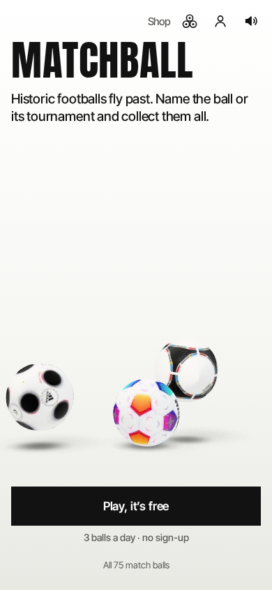

# UI Design System & Master Generation Blueprint: matchball-today

> **Matchball · Football quiz: name the match ball in flight** (https://matchball.today/) — A free football quiz: historic match balls fly past in 3D and you name them. Every World Cup ball since 1930, plus Euros, Champions Leagu...


---

## 1. Executive Visual Persona & Design Archetype

- **Brand Essence & Persona**: **Matchball · Football quiz: name the match ball in flight** (`https://matchball.today/`). A free football quiz: historic match balls fly past in 3D and you name them. Every World Cup ball since 1930, plus Euros, Champions Leagu...
- **Capture Provenance**: Live browser capture (`tier1_fast`, HTTP `200`, captured `2026-11-23`).
- **Visual Archetype**: **Light-Gallery WebGL / Canvas Interactive Experience (`#ffffff` / `#5c5c57`)**.
- **Anti-AI-Slop Differentiators**:
  - **Live-Computed Chromatic Polarity**: Anchors the viewport in `#ffffff` (live computed `body` `background-color` (`computed_styles.json`)) paired with `#121212` primary typography and `#5c5c57` accents.
  - **Grounded Typographic Hierarchy**: Pairs `Anton` for display copy (`MATCHBALL`) with `Inter Tight` and not declared in live computed styles (uses primary stack / `ui-monospace`).
  - **Calibrated Spatial Grid & Motion**: Combines `1440px` container bounds (`gap: 8px`, padding `72px`) with `cubic-bezier(.2,.8,.2,1)` easing and Three.js / WebGL Canvas Pipeline.

---

## 2. Spatial Architecture & Modular Grid Mathematics



### Viewport Allocation & Container Geometry
- **Captured Viewport Dimensions**: Desktop `1440×900px` (`assets/desktop.png`, single-viewport 100vh live capture (900px)), Mobile `390×844px` (`assets/mobile.png`, single-viewport 100vh live capture (844px)).
- **Master Container Bounds**: `1440px` (full-bleed `100%` desktop stage measured on `1440px` viewport).
- **Canvas Lateral Padding & Spacing**: `72px` lateral canvas padding with `8px` grid gap.
- **Border Radius Scale**: `50%`, `12px`, `16px`, `999px`.

### Responsive Breakpoint Architecture
- **Desktop Layout**: Multi-column CSS Grid / Flexbox layout at `1440px` (`max-width: 1440px`, `gap: 8px`).
- **Mobile Layout**: Single-column vertical stack at `390px` viewport width with `72px` horizontal padding.
- **Extracted CSS Media Queries**: `@media (max-width:374px)`, `@media not all and (min-width:900px) and (min-aspect-ratio:1)`, `@media (orientation:landscape) and (max-height:500px) and (max-w...`, `@media (min-width:900px) and (min-aspect-ratio:1)`.

---

## 3. Color System, Materiality & Atmospheric Lighting

### Semantic Palette & Source Grounding
| Semantic Role | Ground-Truth Value | Extracted Live / CSS Source |
|---|---|---|
| **Primary Canvas Substrate** | `#ffffff` | live computed `body` `background-color` (`computed_styles.json`) |
| **Primary Typography Ink** | `#121212` | live computed `h1` `color` (`computed_styles.json`) |
| **Elevated Surface / Card Substrate** | `#1f8a4c` | `.fin-dia-casillas i.bien { background: #1f8a4c }` |
| **Interactive Accent / Highlight** | `#5c5c57` | live computed `a` `color` (`computed_styles.json`) |
| **Secondary / Muted Copy** | `#5c5c57` | live computed `a` `color` (`computed_styles.json`) |
| **Structural Hairline Border** | `#f0f0f0` | `.vitrina-ficha { border: #f0f0f0 }` |
| **Variable Token (`--boton-gris`)** | `#efefea` | `var(--boton-gris)` in `:root` |
| **Variable Token (`--boton-gris-encima`)** | `#e4e4de` | `var(--boton-gris-encima)` in `:root` |
| **Variable Token (`--linea`)** | `#e2e2dc` | `var(--linea)` in `:root` |
| **Variable Token (`--apagado`)** | `#deded8` | `var(--apagado)` in `:root` |
| **Variable Token (`--noche`)** | `#07090d` | `var(--noche)` in `:root` |
| **Variable Token (`--fallo`)** | `#b3261e` | `var(--fallo)` in `:root` |
| **Variable Token (`--estudio`)** | `#f7f7f4` | `var(--estudio)` in `:root` |
| **Variable Token (`--estudio`)** | `#e9e9e4` | `var(--estudio)` in `:root` |

### Sanitized Root CSS Variables (`ui-ux.md` Ground Truth)
| Variable Name | Extracted Value | Semantic Role |
|---|---|---|
| `--tinta` | `#121212` | Canvas / Surface Token |
| `--papel` | `#fff` | Color / Atmospheric Token |
| `--superficie` | `#fff` | Color / Atmospheric Token |
| `--boton-gris` | `#efefea` | Color / Atmospheric Token |
| `--boton-gris-encima` | `#e4e4de` | Color / Atmospheric Token |
| `--gris` | `#5c5c57` | Color / Atmospheric Token |
| `--linea` | `#e2e2dc` | Color / Atmospheric Token |
| `--apagado` | `#deded8` | Color / Atmospheric Token |
| `--noche` | `#07090d` | Color / Atmospheric Token |
| `--fallo` | `#b3261e` | Color / Atmospheric Token |
| `--estudio` | `linear-gradient(180deg, #fff 0%, #f7f7f4 55%, #e9e9e4 100%)` | Color / Atmospheric Token |
| `--ancho` | `600px` | Dimension / Scale Token |
| `--margen` | `16px` | Dimension / Scale Token |
| `--cabecera` | `56px` | Dimension / Scale Token |
| `--alto-juego` | `288px` | Dimension / Scale Token |
| `--panel` | `clamp(360px, 29vw, 440px)` | Dimension / Scale Token |

---

## 4. Typographic Scale & Editorial Hierarchy

### Font Family Stacks
- **Display Typography**: `Anton`.
- **Primary Body Stack**: `Inter Tight`.
- **Technical / Metadata Stack**: not declared in live computed styles (uses primary stack / `ui-monospace`).

### Typographic Scale & Rules (Live Computed & Stylesheet Grounded)
- **Hero Display (`H1`)**: live computed `h1` (`font-size: 123.84px`, `line-height: 111.456px`, `font-weight: 400`, `letter-spacing: 1.2384px`).
- **Section Heading (`H2`)**: rule `h2` (`font-size: 17px`, `line-height: 1.2`, `letter-spacing: -.01em`, `font-weight: 700`).
- **Body Copy**: live computed `body` (`font-size: 16px`, `line-height: normal`, `font-weight: 400`); rule `p` (`font-size: 15px`, `line-height: 1.4`).
- **Metadata & Navigation Labels**: live computed `nav/a` (`font-size: 16px`, `line-height: normal`, `font-weight: 400`).

---

## 5. Choreographed Motion & Interaction Physics

### Primary Easing Curves
- **Extracted Timing Functions**: `cubic-bezier(.2,.8,.2,1)`.

### Per-Element Transition & Choreography Rules
- **Selector `.panel-cargando .panel-cifras`**: `transition: opacity .2s` extracted from `matchball-today` stylesheet.
- **Selector `.resultado [data-entra]`**: `transition: opacity .22s ease-out` extracted from `matchball-today` stylesheet.
- **Selector `media (prefers-reduced-motion:red...`**: `transition: none` extracted from `matchball-today` stylesheet.
- **Extracted Easing Curve (`cubic-bezier(.2,.8,.2,1)`)**: Governs interactive state transitions across `<nav.navegacion>` and `<main.portada:nth(2)>`.
- **Runtime Interaction Engine**: Integrates Three.js / WebGL Canvas Pipeline with `prefers-reduced-motion: reduce` fallback guards.

---

## 6. Component Wireframe & Structural DOM Map

### Visual Layout Schematic — Desktop (`1440px`, Grounded in `dom.html` & Landmark Bounding Boxes)
```
┌────────────────────────────────────────────────────────────────────────┐
│ DESKTOP VIEWPORT (1440px) — Matchball · Football quiz: name the match  │
│ ====================================================================== │
│ [ <nav.navegacion> (175x44px)         | Shop                         ] │
│ ---------------------------------------------------------------------- │
│ | HERO STAGE: <main.portada> (w=1440px)                              | │
│ | H1: MATCHBALL                                                      | │
│ | Substrate: #ffffff | Ink: #121212 | Accent: #5c5c57                | │
│ ---------------------------------------------------------------------- │
│ | SHOWCASE GRID (<main.portada:nth(2)>) max-w: 1440px                | │
│ | +------------------------------+  +------------------------------+ | │
│ | | Matchball                    |  | 3 balls a day · no sign-up   | | │
│ | +------------------------------+  +------------------------------+ | │
│ ---------------------------------------------------------------------- │
│ | DETAIL MODULE (<main.portada:nth(3)>) — matchball-today Archi      | │
│ ---------------------------------------------------------------------- │
│ [ FOOTER (<footer.nav>        ) | https://matchball.today/             │
└────────────────────────────────────────────────────────────────────────┘
```

### Visual Layout Schematic — Mobile Reflow (`390px`)
```
┌────────────────────────────────────────────────────────────────────────┐
│ MOBILE VIEWPORT REFLOW (390px) — Single-Column Stack (gap: 8px)        │
│ ====================================================================== │
│ [ HEADER BAR (<nav.navegacion>        ) | Compact Menu (390px)         │
│ ---------------------------------------------------------------------- │
│ | HERO STAGE (<main.portada>) — 390px Vertical Lead                  | │
│ | H1: MATCHBALL                                                      | │
│ ---------------------------------------------------------------------- │
│ | SHOWCASE STACK (<main.portada:nth(2)>) — 1-Col Stack               | │
│ | [ Item 1: Matchball                                              ] | │
│ | [ Item 2: 3 balls a day · no sign-up                             ] | │
│ ---------------------------------------------------------------------- │
│ | DETAIL STACK (<main.portada:nth(3)>) — 1-Col (matchball-today Ar)  | │
│ ---------------------------------------------------------------------- │
│ [ FOOTER (<footer.nav>        ) | Stacked 390px Colophon               │
└────────────────────────────────────────────────────────────────────────┘
```

### Granular DOM Region Breakdown
1. **Brand Header & Navigation Bar (<nav.navegacion> — `matchball-today`)**:
   - Landmark `<nav class="navegacion portada-iconos">` (`175x44px`) hosting `Matchball · Football quiz: name the ` navigation (`Shop`), DOM attributes (`data-precedence="next"`, `data-precedence="next"`, `data-precedence="next"`, `data-precedence="next"`), and stylesheet rule `a.boton-perfil { -webkit-tap-highlight-color:transparent;background:0 0;border:0 }`.
2. **Hero Stage & Focal Lead (<main.portada> — `MATCHBALL`)**:
   - Landmark `<main class="portada">` presenting display lead `MATCHBALL` and copy excerpt *"Historic footballs fly past. Name the ball or its tournament and "* over `#ffffff` canvas and `#121212` ink.
3. **Primary Showcase & Content Grid (<main.portada:nth(2)> — `Matchball`)**:
   - Landmark `<main class="portada">` rendering section `Matchball` with copy *"3 balls a day · no sign-up"*, asset references (`3nv7-x9qmrpfu.css`, `2ud8dty-w4gn-.css`, `2x5jyq1p60s2x.css`, `17ygr9mac-are.css`), and grid rule `.navegacion { white-space:nowrap;align-items:center;display:flex }`.
4. **Interactive Detail & Feature Matrix (<main.portada:nth(3)> — `3 balls a day · no sign-up`)**:
   - Landmark `<main class="portada">` framing `3 balls a day · no sign-up` and `matchball-today Archive & Directory` (*"Matchball"*) with `#1f8a4c` surface cards, `#5c5c57` accents, and `.cabecera-coleccion { position:relative }`.
5. **Colophon & Global Directory Footer (<footer.nav> — `https://matchball.today/`)**:
   - Landmark `<footer class="nav">` anchoring `Matchball · Football quiz: name ` footer links (`Shop`), copy *"3 balls a day · no sign-up"*, and `#f0f0f0` structural dividers.

---

## 7. Master Zero-Shot AI Generation Prompt

```markdown
# Master Zero-Shot Frontend Generation Prompt: matchball-today (Matchball · Football quiz: name the match ball in flight)

You are a principal frontend architect and design systems engineer. Build a complete, production-ready web application replicating the exact design system, DOM landmarks, typographic hierarchy, color tokens, and motion physics of `matchball-today` (**Matchball · Football quiz: name the match ball in flight** — `https://matchball.today/`).

### 1. Visual Archetype & Anti-AI-Slop Mandates
- **Archetype**: Light-Gallery WebGL / Canvas Interactive Experience (`#ffffff` / `#5c5c57`).
- **Identity & Domain Context**: A free football quiz: historic match balls fly past in 3D and you name them. Every World Cup ball since 1930, plus Euros, Champions Leagu...
- **Primary Substrate**: `#ffffff` (live computed `body` `background-color` (`computed_styles.json`)), **Primary Ink**: `#121212`, **Accent / Highlight**: `#5c5c57`.
- **Site-Specific Differentiators**:
  - **Live-Computed Chromatic Polarity**: Anchors the viewport in `#ffffff` (live computed `body` `background-color` (`computed_styles.json`)) paired with `#121212` primary typography and `#5c5c57` accents.
  - **Grounded Typographic Hierarchy**: Pairs `Anton` for display copy (`MATCHBALL`) with `Inter Tight` and not declared in live computed styles (uses primary stack / `ui-monospace`).
  - **Calibrated Spatial Grid & Motion**: Combines `1440px` container bounds (`gap: 8px`, padding `72px`) with `cubic-bezier(.2,.8,.2,1)` easing and Three.js / WebGL Canvas Pipeline.

### 2. Ground-Truth CSS Variables (`:root` Token Contract)
Declare and consume these exact custom properties extracted from `matchball-today` in your global stylesheet:

:root {
  /* Matchball · Football quiz: name the match ball in flight (matchball-today) — Live-Grounded CSS Variables */
  --tinta: #121212; /* Canvas / Surface Token (matchball-today) */
  --papel: #fff; /* Color / Atmospheric Token (matchball-today) */
  --superficie: #fff; /* Color / Atmospheric Token (matchball-today) */
  --boton-gris: #efefea; /* Color / Atmospheric Token (matchball-today) */
  --boton-gris-encima: #e4e4de; /* Color / Atmospheric Token (matchball-today) */
  --gris: #5c5c57; /* Color / Atmospheric Token (matchball-today) */
  --linea: #e2e2dc; /* Color / Atmospheric Token (matchball-today) */
  --apagado: #deded8; /* Color / Atmospheric Token (matchball-today) */
  --noche: #07090d; /* Color / Atmospheric Token (matchball-today) */
  --fallo: #b3261e; /* Color / Atmospheric Token (matchball-today) */
  --estudio: linear-gradient(180deg, #fff 0%, #f7f7f4 55%, #e9e9e4 100%); /* Color / Atmospheric Token (matchball-today) */
  --ancho: 600px; /* Dimension / Scale Token (matchball-today) */
  --margen: 16px; /* Dimension / Scale Token (matchball-today) */
  --cabecera: 56px; /* Dimension / Scale Token (matchball-today) */
  --alto-juego: 288px; /* Dimension / Scale Token (matchball-today) */
  --panel: clamp(360px, 29vw, 440px); /* Dimension / Scale Token (matchball-today) */
}

### 3. Semantic Color & Materiality Contract
Map every surface, ink, and border strictly to these source-grounded tokens:
- **Primary Canvas Substrate**: `#ffffff` — grounded in live computed `body` `background-color` (`computed_styles.json`)
- **Primary Typography Ink**: `#121212` — grounded in live computed `h1` `color` (`computed_styles.json`)
- **Elevated Surface / Card Substrate**: `#1f8a4c` — grounded in `.fin-dia-casillas i.bien { background: #1f8a4c }`
- **Interactive Accent / Highlight**: `#5c5c57` — grounded in live computed `a` `color` (`computed_styles.json`)
- **Secondary / Muted Copy**: `#5c5c57` — grounded in live computed `a` `color` (`computed_styles.json`)
- **Structural Hairline Border**: `#f0f0f0` — grounded in `.vitrina-ficha { border: #f0f0f0 }`
- **Variable Token (`--boton-gris`)**: `#efefea` — grounded in `var(--boton-gris)` in `:root`
- **Variable Token (`--boton-gris-encima`)**: `#e4e4de` — grounded in `var(--boton-gris-encima)` in `:root`
- **Variable Token (`--linea`)**: `#e2e2dc` — grounded in `var(--linea)` in `:root`
- **Variable Token (`--apagado`)**: `#deded8` — grounded in `var(--apagado)` in `:root`
- **Variable Token (`--noche`)**: `#07090d` — grounded in `var(--noche)` in `:root`
- **Variable Token (`--fallo`)**: `#b3261e` — grounded in `var(--fallo)` in `:root`
- **Variable Token (`--estudio`)**: `#f7f7f4` — grounded in `var(--estudio)` in `:root`
- **Variable Token (`--estudio`)**: `#e9e9e4` — grounded in `var(--estudio)` in `:root`

### 4. Spatial Grid, Container Bounds & Responsive Breakpoints
- **Desktop Viewport Reference**: `1440×900px` (single-viewport 100vh live capture (900px), `1440px` standard desktop width).
- **Mobile Viewport Reference**: `390×844px` (single-viewport 100vh live capture (844px), `390px` standard mobile width).
- **Container Max-Width**: `1440px` (full-bleed `100%` desktop stage measured on `1440px` viewport)
- **Padding & Gutters**: `72px` lateral canvas padding with `8px` grid gap
- **Desktop Grid**: Multi-column CSS Grid / Flexbox layout at `1440px` (`max-width: 1440px`, `gap: 8px`)
- **Mobile Adaptation**: Single-column vertical stack at `390px` viewport width with `72px` horizontal padding
- **Media Queries**: `@media (max-width:374px)`, `@media not all and (min-width:900px) and (min-aspect-ratio:1)`, `@media (orientation:landscape) and (max-height:500px) and (max-w...`, `@media (min-width:900px) and (min-aspect-ratio:1)`
- **Corner Radii**: `50%`, `12px`, `16px`, `999px`

### 5. Typography & Editorial Scale Contract
- **Display Font Stack**: `Anton`
- **Body Font Stack**: `Inter Tight`
- **Monospace / Technical Font Stack**: not declared in live computed styles (uses primary stack / `ui-monospace`)
- **H1 Display Rule**: live computed `h1` (`font-size: 123.84px`, `line-height: 111.456px`, `font-weight: 400`, `letter-spacing: 1.2384px`)
- **H2 Section Rule**: rule `h2` (`font-size: 17px`, `line-height: 1.2`, `letter-spacing: -.01em`, `font-weight: 700`)
- **Body Copy Rule**: live computed `body` (`font-size: 16px`, `line-height: normal`, `font-weight: 400`); rule `p` (`font-size: 15px`, `line-height: 1.4`)
- **Metadata & Index Rule**: live computed `nav/a` (`font-size: 16px`, `line-height: normal`, `font-weight: 400`)

### 6. Component Hierarchy, Verbatim Copy & Real DOM Landmarks
Scaffold `matchball-today` (`Matchball · Football quiz: name the match ball in flight`) with these exact structural regions, extracted copy, and CSS rules from `dom.html`:
1. **Brand Header & Navigation Bar (<nav.navegacion> — `matchball-today`)**:
   - DOM & Selectors: Landmark `<nav class="navegacion portada-iconos">` (`175x44px`) hosting `Matchball · Football quiz: name the ` navigation (`Shop`), DOM attributes (`data-precedence="next"`, `data-precedence="next"`, `data-precedence="next"`, `data-precedence="next"`), and stylesheet rule `a.boton-perfil { -webkit-tap-highlight-color:transparent;background:0 0;border:0 }`.
   - Responsive Contract: Header `Brand Header & Navigation Bar (<nav.navegacion> — `matchball-today`)` (`matchball-today`) adapts across `@media (max-width:374px)`, `@media not all and (min-width:900px) and (min-aspect-ratio:1)`, `@media (orientation:landscape) and (max-height:500px) and (max-w...`, `@media (min-width:900px) and (min-aspect-ratio:1)` with `cubic-bezier(.2,.8,.2,1)` transitions and links `Shop`.
2. **Hero Stage & Focal Lead (<main.portada> — `MATCHBALL`)**:
   - DOM & Selectors: Landmark `<main class="portada">` presenting display lead `MATCHBALL` and copy excerpt *"Historic footballs fly past. Name the ball or its tournament and "* over `#ffffff` canvas and `#121212` ink.
   - Responsive Contract: Hero stage (`1440×900px` desktop / `390×844px` mobile) sets `#ffffff` background with `#121212` headline `MATCHBALL`.
3. **Primary Showcase & Content Grid (<main.portada:nth(2)> — `Matchball`)**:
   - DOM & Selectors: Landmark `<main class="portada">` rendering section `Matchball` with copy *"3 balls a day · no sign-up"*, asset references (`3nv7-x9qmrpfu.css`, `2ud8dty-w4gn-.css`, `2x5jyq1p60s2x.css`, `17ygr9mac-are.css`), and grid rule `.navegacion { white-space:nowrap;align-items:center;display:flex }`.
   - Responsive Contract: Showcase grid `Primary Showcase & Content Grid (<main.portada:nth(2)> — `Matchball`)` applies Multi-column CSS Grid / Flexbox layout at `1440px` (`max-width: 1440px`, `gap: 8px`) on desktop and Single-column vertical stack at `390px` viewport width with `72px` horizontal padding on mobile.
4. **Interactive Detail & Feature Matrix (<main.portada:nth(3)> — `3 balls a day · no sign-up`)**:
   - DOM & Selectors: Landmark `<main class="portada">` framing `3 balls a day · no sign-up` and `matchball-today Archive & Directory` (*"Matchball"*) with `#1f8a4c` surface cards, `#5c5c57` accents, and `.cabecera-coleccion { position:relative }`.
   - Responsive Contract: Detail module `Interactive Detail & Feature Matrix (<main.portada:nth(3)> — `3 balls a day · no sign-up`)` uses `50%`, `12px`, `16px`, `999px` radii, `#5c5c57` highlights, and assets (3nv7-x9qmrpfu.css, 2ud8dty-w4gn-.css, 2x5jyq1p60s2x.css).
5. **Colophon & Global Directory Footer (<footer.nav> — `https://matchball.today/`)**:
   - DOM & Selectors: Landmark `<footer class="nav">` anchoring `Matchball · Football quiz: name ` footer links (`Shop`), copy *"3 balls a day · no sign-up"*, and `#f0f0f0` structural dividers.
   - Responsive Contract: Footer `Colophon & Global Directory Footer (<footer.nav> — `https://matchball.today/`)` aligns to `1440px` (full-bleed `100%` desktop stage measured on `1440px` viewport) with `72px` lateral canvas padding with `8px` grid gap and attributes (data-precedence="next", data-precedence="next", data-precedence="next").

#### Verbatim DOM Copy Excerpts (`dom.html`)
- Copy Excerpt 1: *"Historic footballs fly past. Name the ball or its tournament and collect them all."*
- Copy Excerpt 2: *"3 balls a day · no sign-up"*

### 7. Motion, Extracted Stylesheet Rules & Interaction Choreography
- **Primary Easing Functions**: `cubic-bezier(.2,.8,.2,1)`
- **Extracted Stylesheet Rules (`matchball-today`)**:
- `a.boton-perfil { -webkit-tap-highlight-color:transparent;background:0 0;border:0 }`
- `.navegacion { white-space:nowrap;align-items:center;display:flex }`
- `.cabecera-coleccion { position:relative }`
- `after { content:"";background:currentColor;height:1.5px;position:absolute;bottom... }`
- `.cabecera .logo { font-size:22px }`
- **Per-Selector Transition Rules**:
- **Selector `.panel-cargando .panel-cifras`**: `transition: opacity .2s` extracted from `matchball-today` stylesheet.
- **Selector `.resultado [data-entra]`**: `transition: opacity .22s ease-out` extracted from `matchball-today` stylesheet.
- **Selector `media (prefers-reduced-motion:red...`**: `transition: none` extracted from `matchball-today` stylesheet.
- **Extracted Easing Curve (`cubic-bezier(.2,.8,.2,1)`)**: Governs interactive state transitions across `<nav.navegacion>` and `<main.portada:nth(2)>`.
- **Runtime Interaction Engine**: Integrates Three.js / WebGL Canvas Pipeline with `prefers-reduced-motion: reduce` fallback guards.

### 8. Technical Deliverables
- Implement in Next.js (App Router) with TypeScript and Tailwind CSS consuming the `:root` custom properties defined above for `matchball-today`.
- Reproduce both the `1440px` desktop architecture and `390px` mobile breakpoint transitions, preserving semantic HTML5 landmarks (`<header>`, `<nav>`, `<main>`, `<section>`, `<footer>`) and `prefers-reduced-motion` accessibility guards.
```
