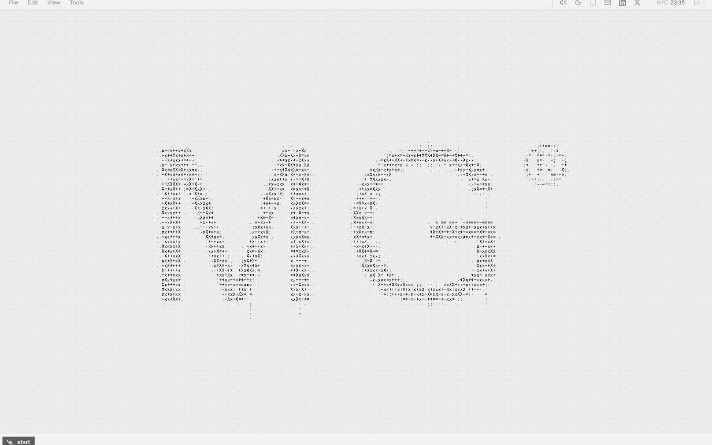
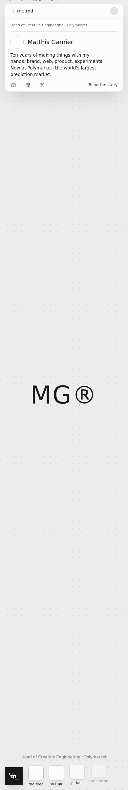

# UI Design System & Master Generation Blueprint: matthisgarnier-com

> **Matthis Garnier · Head of Creative Engineering, Polymarket** (https://matthisgarnier.com) — Matthis Garnier, Head of Creative Engineering at Polymarket, New York. Previously design director at SVZ and Hours Global; founded Cohem...



---

## 1. Executive Visual Persona & Design Archetype

- **Brand Essence & Persona**: **Matthis Garnier · Head of Creative Engineering, Polymarket** (`https://matthisgarnier.com`). Matthis Garnier, Head of Creative Engineering at Polymarket, New York. Previously design director at SVZ and Hours Global; founded Cohem...
- **Visual Archetype**: **Light-Gallery WebGL / Canvas Interactive Experience (`#fcfcfc` / `#ececec`)**.
- **Anti-AI-Slop Differentiators**:
  - **Source-Grounded Chromatic Polarity**: Anchors the viewport in `#fcfcfc` (`var(--g-0)` in `:root`) paired with `#d4d4d4` primary typography and `#ececec` accents.
  - **Extracted Typographic Hierarchy**: Pairs `handFont` for display copy (`Matthis Garnier`) with `handFont Fallback` and `arealMono`.
  - **Calibrated Spatial Grid & Motion**: Combines `640px` container bounds (`gap: 4px`, padding `3px`) with `cubic-bezier(.22,1,.36,1)` easing and Three.js / WebGL Canvas Pipeline.

---

## 2. Spatial Architecture & Modular Grid Mathematics



### Viewport Allocation & Container Geometry
- **Captured Viewport Dimensions**: Desktop `1440×2400px` (`assets/desktop.png`, capped at 2400px multi-section capture), Mobile `390×2400px` (`assets/mobile.png`, capped at 2400px multi-section capture).
- **Master Container Bounds**: `640px` extracted from `matthisgarnier-com` stylesheet.
- **Canvas Lateral Padding & Spacing**: `3px` lateral canvas padding with `4px` grid gap.
- **Border Radius Scale**: `9px`, `6px`, `12px`, `50%`.

### Responsive Breakpoint Architecture
- **Desktop Layout**: Multi-column CSS Grid / Flexbox layout at `1440px` (`max-width: 640px`, `gap: 4px`).
- **Mobile Layout**: Single-column vertical stack at `390px` viewport width with `3px` horizontal padding.
- **Extracted CSS Media Queries**: `@media (min-width:721px)`, `@media (prefers-reduced-motion:reduce)`, `@media (max-width:720px)`, `@media (min-width:1100px)`.

---

## 3. Color System, Materiality & Atmospheric Lighting

### Semantic Palette & Source Grounding
| Semantic Role | Ground-Truth Value | Extracted CSS Source / Selector |
|---|---|---|
| **Primary Canvas Substrate** | `#fcfcfc` | `var(--g-0)` in `:root` |
| **Primary Typography Ink** | `#fafafa` | `var(--g-1)` in `:root` |
| **Elevated Surface / Card Substrate** | `#f3f3f3` | `var(--g-2)` in `:root` |
| **Interactive Accent / Highlight** | `#ececec` | `var(--g-3)` in `:root` |
| **Secondary / Muted Copy** | `#e2e2e2` | `var(--g-4)` in `:root` |
| **Structural Hairline Border** | `#d4d4d4` | `var(--g-5)` in `:root` |
| **Variable Token (`--g-6`)** | `#bcbcbc` | `var(--g-6)` in `:root` |
| **Variable Token (`--g-7`)** | `#8e8e8e` | `var(--g-7)` in `:root` |
| **Variable Token (`--g-8`)** | `#6a6a6a` | `var(--g-8)` in `:root` |
| **Variable Token (`--g-9`)** | `#474747` | `var(--g-9)` in `:root` |
| **Variable Token (`--g-10`)** | `#2a2a2a` | `var(--g-10)` in `:root` |
| **Variable Token (`--g-11`)** | `#181818` | `var(--g-11)` in `:root` |
| **Variable Token (`--g-12`)** | `#0a0a0a` | `var(--g-12)` in `:root` |
| **Variable Token (`--shade`)** | `#00000024` | `var(--shade)` in `:root` |
| **Variable Token (`--shade-deep`)** | `#00000038` | `var(--shade-deep)` in `:root` |
| **Variable Token (`--sticker-paper`)** | `#f7f4ec` | `var(--sticker-paper)` in `:root` |

### Sanitized Root CSS Variables (`ui-ux.md` Ground Truth)
| Variable Name | Extracted Value | Semantic Role |
|---|---|---|
| `--g-0` | `#fcfcfc` | Color / Atmospheric Token |
| `--g-1` | `#fafafa` | Color / Atmospheric Token |
| `--g-2` | `#f3f3f3` | Color / Atmospheric Token |
| `--g-3` | `#ececec` | Color / Atmospheric Token |
| `--g-4` | `#e2e2e2` | Color / Atmospheric Token |
| `--g-5` | `#d4d4d4` | Color / Atmospheric Token |
| `--g-6` | `#bcbcbc` | Color / Atmospheric Token |
| `--g-7` | `#8e8e8e` | Color / Atmospheric Token |
| `--g-8` | `#6a6a6a` | Color / Atmospheric Token |
| `--g-9` | `#474747` | Color / Atmospheric Token |
| `--g-10` | `#2a2a2a` | Color / Atmospheric Token |
| `--g-11` | `#181818` | Color / Atmospheric Token |
| `--g-12` | `#0a0a0a` | Color / Atmospheric Token |
| `--shade` | `#00000024` | Color / Atmospheric Token |
| `--shade-deep` | `#00000038` | Color / Atmospheric Token |
| `--sticker-paper` | `#f7f4ec` | Canvas / Surface Token |

---

## 4. Typographic Scale & Editorial Hierarchy

### Font Family Stacks
- **Display Typography**: `handFont`.
- **Primary Body Stack**: `handFont Fallback`.
- **Technical / Metadata Stack**: `arealMono`.

### Typographic Scale & Rules (Extracted from Stylesheet & Variables)
- **Hero Display (`H1`)**: rule `h1` (`font-size: 18px`, `letter-spacing: 0`, `font-weight: 500`).
- **Section Heading (`H2`)**: rule `h2` (`font-size: 13px`, `line-height: 1.4`, `letter-spacing: 0`, `font-weight: 500`).
- **Body Copy**: CSS variables `--vcr-tv-body: #d9d3c5`; rule `p` (`font-size: 12px`).
- **Metadata & Navigation Labels**: CSS variables `--vcr-tape-label: #efeadf`, `--mono-font: var(--font-areal), system-ui, sans-serif`, `--wm-mono: var(--font-areal-mono)`; rule `.meta` (`font-size: 11px`, `line-height: 1.25`).

---

## 5. Choreographed Motion & Interaction Physics

### Primary Easing Curves
- **Extracted Timing Functions**: `cubic-bezier(.22,1,.36,1)`, `cubic-bezier(.2,1.3,.4,1)`, `cubic-bezier(.2,1.2,.4,1)`.

### Per-Element Transition & Choreography Rules
- **Selector `ta-three=on] .xp nav[data-shortcu...`**: `transition: opacity .16s` extracted from `matthisgarnier-com` stylesheet.
- **Selector `nav[data-shortcuts]>button>span:l...`**: `transition: opacity .14s,transform .18s cubic-bezier(.22,1,.36,1)` extracted from `matthisgarnier-com` stylesheet.
- **Selector `.sticker[data-lift]`**: `transition: filter .16s` extracted from `matthisgarnier-com` stylesheet.
- **Extracted Easing Curve (`cubic-bezier(.22,1,.36,1)`)**: Governs interactive state transitions across `<nav.topbar>` and `<section.story-desk-module__g7DRpa__win>`.
- **Runtime Interaction Engine**: Integrates Three.js / WebGL Canvas Pipeline with `prefers-reduced-motion: reduce` fallback guards.

---

## 6. Component Wireframe & Structural DOM Map

### Visual Layout Schematic (Grounded in `dom.html` — `1440px` Desktop & `390px` Mobile Reflow)
```
┌────────────────────────────────────────────────────────────────────────┐
│ DESKTOP VIEWPORT (1440px) — Matthis Garnier · Head of Creative Enginee │
│ ====================================================================== │
│ [ <nav.topbar>             | Overview · Index · Archive · About · C ]  │
│ ---------------------------------------------------------------------- │
│ | HERO STAGE: <section.story-desk-module__g7DRpa__win>             |   │
│ | H1: Matthis Garnier                                              |   │
│ | Substrate: #fcfcfc    | Ink: #d4d4d4    | Accent: #ececec        |   │
│ ---------------------------------------------------------------------- │
│ | SHOWCASE GRID (<section.story-desk-module) max-w: 640px          |   │
│ | +------------------------------+  +------------------------------+ | │
│ | | Building for an information  |  | Posters                      | | │
│ | +------------------------------+  +------------------------------+ | │
│ ---------------------------------------------------------------------- │
│ | MOBILE VIEWPORT REFLOW (390px) — Single-Column Stack (gap: 4px   ) | │
│ | [<nav.topbar>] -> [<section.story-des] -> [<section.story-des] |     │
│ ---------------------------------------------------------------------- │
│ [ FOOTER (<footer.taskbar>      ) | https://matthisgarnier.com         │
└────────────────────────────────────────────────────────────────────────┘
```

### Granular DOM Region Breakdown
1. **Brand Header & Navigation Bar (<nav.topbar> — `matthisgarnier-com`)**:
   - Landmark `<nav class="topbar">` hosting `Matthis Garnier · Head of Creative E` navigation (`Overview · Index · Archive · About · Contact`), DOM attributes (`data-theme="light"`, `data-three="off"`, `data-precedence="next"`, `data-precedence="next"`), and stylesheet rule `.xp .mecard { width:min(300px,100% - 32px) }`.
2. **Hero Stage & Focal Lead (<section.story-desk-module__g7DRpa__win> — `Matthis Garnier`)**:
   - Landmark `<section class="story-desk-module__g7DRpa__win story-desk-module__g7DRpa__cover">` presenting display lead `Matthis Garnier` and copy excerpt *"NYC 10:07 LA 07:07 PAR 16:07 TUL 10:07 NYC 10:07 LA 07:07 PAR 16:"* over `#fcfcfc` canvas and `#d4d4d4` ink.
3. **Primary Showcase & Content Grid (<section.story-desk-module__g7DRpa__win> — `Building for an information market`)**:
   - Landmark `<section class="story-desk-module__g7DRpa__win story-desk-module__g7DRpa__index">` rendering section `Building for an information market.` with copy *"Head of Creative Engineering at Polymarket"*, asset references (`7ebf22b5a21034f8-s.p.3strvg7o-g5v...`, `ABCArealMonoVariable-s.p.28z6jix4...`, `ABCArealVariable-s.p.0r-_z7ct5is3...`, `DaftFont-s.p.1r6c1opwgow9_.woff2`), and grid rule `button { opacity:.5;border-radius:9px;width:36px;height:36px;padding:0;transition... }`.
4. **Interactive Detail & Feature Matrix (<section.story-desk-module__g7DRpa__win> — `Posters`)**:
   - Landmark `<section class="story-desk-module__g7DRpa__win story-desk-module__g7DRpa__year">` framing `Posters` and `Experiments` (*"Founded Cohem, a creative and consulting studio for small and mid"*) with `#f3f3f3` surface cards, `#ececec` accents, and `button>span:first-child { border-radius:9px;width:36px;height:36px;display:block }`.
5. **Colophon & Global Directory Footer (<footer.taskbar> — `https://matthisgarnier.com`)**:
   - Landmark `<footer class="taskbar">` anchoring `Matthis Garnier · Head of Creati` footer links (`Overview · Index · Archive · About · Contact`), copy *"Finsweet Multidisciplinary Designer"*, and `#d4d4d4` structural dividers.

---

## 7. Master Zero-Shot AI Generation Prompt

```markdown
# Master Zero-Shot Frontend Generation Prompt: matthisgarnier-com (Matthis Garnier · Head of Creative Engineering, Polymarket)

You are a principal frontend architect and design systems engineer. Build a complete, production-ready web application replicating the exact design system, DOM landmarks, typographic hierarchy, color tokens, and motion physics of `matthisgarnier-com` (**Matthis Garnier · Head of Creative Engineering, Polymarket** — `https://matthisgarnier.com`).

### 1. Visual Archetype & Anti-AI-Slop Mandates
- **Archetype**: Light-Gallery WebGL / Canvas Interactive Experience (`#fcfcfc` / `#ececec`).
- **Identity & Domain Context**: Matthis Garnier, Head of Creative Engineering at Polymarket, New York. Previously design director at SVZ and Hours Global; founded Cohem...
- **Primary Substrate**: `#fcfcfc` (`var(--g-0)` in `:root`), **Primary Ink**: `#d4d4d4`, **Accent / Highlight**: `#ececec`.
- **Site-Specific Differentiators**:
  - **Source-Grounded Chromatic Polarity**: Anchors the viewport in `#fcfcfc` (`var(--g-0)` in `:root`) paired with `#d4d4d4` primary typography and `#ececec` accents.
  - **Extracted Typographic Hierarchy**: Pairs `handFont` for display copy (`Matthis Garnier`) with `handFont Fallback` and `arealMono`.
  - **Calibrated Spatial Grid & Motion**: Combines `640px` container bounds (`gap: 4px`, padding `3px`) with `cubic-bezier(.22,1,.36,1)` easing and Three.js / WebGL Canvas Pipeline.

### 2. Ground-Truth CSS Variables (`:root` Token Contract)
Declare and consume these exact custom properties extracted from `matthisgarnier-com` in your global stylesheet:

:root {
  /* Matthis Garnier · Head of Creative Engineering, Polymarket (matthisgarnier-com) — Ground-Truth Extracted CSS Variables */
  --g-0: #fcfcfc; /* Color / Atmospheric Token (matthisgarnier-com) */
  --g-1: #fafafa; /* Color / Atmospheric Token (matthisgarnier-com) */
  --g-2: #f3f3f3; /* Color / Atmospheric Token (matthisgarnier-com) */
  --g-3: #ececec; /* Color / Atmospheric Token (matthisgarnier-com) */
  --g-4: #e2e2e2; /* Color / Atmospheric Token (matthisgarnier-com) */
  --g-5: #d4d4d4; /* Color / Atmospheric Token (matthisgarnier-com) */
  --g-6: #bcbcbc; /* Color / Atmospheric Token (matthisgarnier-com) */
  --g-7: #8e8e8e; /* Color / Atmospheric Token (matthisgarnier-com) */
  --g-8: #6a6a6a; /* Color / Atmospheric Token (matthisgarnier-com) */
  --g-9: #474747; /* Color / Atmospheric Token (matthisgarnier-com) */
  --g-10: #2a2a2a; /* Color / Atmospheric Token (matthisgarnier-com) */
  --g-11: #181818; /* Color / Atmospheric Token (matthisgarnier-com) */
  --g-12: #0a0a0a; /* Color / Atmospheric Token (matthisgarnier-com) */
  --shade: #00000024; /* Color / Atmospheric Token (matthisgarnier-com) */
  --shade-deep: #00000038; /* Color / Atmospheric Token (matthisgarnier-com) */
  --sticker-paper: #f7f4ec; /* Canvas / Surface Token (matthisgarnier-com) */
}

### 3. Semantic Color & Materiality Contract
Map every surface, ink, and border strictly to these source-grounded tokens:
- **Primary Canvas Substrate**: `#fcfcfc` — grounded in `var(--g-0)` in `:root`
- **Primary Typography Ink**: `#fafafa` — grounded in `var(--g-1)` in `:root`
- **Elevated Surface / Card Substrate**: `#f3f3f3` — grounded in `var(--g-2)` in `:root`
- **Interactive Accent / Highlight**: `#ececec` — grounded in `var(--g-3)` in `:root`
- **Secondary / Muted Copy**: `#e2e2e2` — grounded in `var(--g-4)` in `:root`
- **Structural Hairline Border**: `#d4d4d4` — grounded in `var(--g-5)` in `:root`
- **Variable Token (`--g-6`)**: `#bcbcbc` — grounded in `var(--g-6)` in `:root`
- **Variable Token (`--g-7`)**: `#8e8e8e` — grounded in `var(--g-7)` in `:root`
- **Variable Token (`--g-8`)**: `#6a6a6a` — grounded in `var(--g-8)` in `:root`
- **Variable Token (`--g-9`)**: `#474747` — grounded in `var(--g-9)` in `:root`
- **Variable Token (`--g-10`)**: `#2a2a2a` — grounded in `var(--g-10)` in `:root`
- **Variable Token (`--g-11`)**: `#181818` — grounded in `var(--g-11)` in `:root`
- **Variable Token (`--g-12`)**: `#0a0a0a` — grounded in `var(--g-12)` in `:root`
- **Variable Token (`--shade`)**: `#00000024` — grounded in `var(--shade)` in `:root`
- **Variable Token (`--shade-deep`)**: `#00000038` — grounded in `var(--shade-deep)` in `:root`
- **Variable Token (`--sticker-paper`)**: `#f7f4ec` — grounded in `var(--sticker-paper)` in `:root`

### 4. Spatial Grid, Container Bounds & Responsive Breakpoints
- **Desktop Viewport Reference**: `1440×2400px` (capped at 2400px multi-section capture, `1440px` standard desktop width).
- **Mobile Viewport Reference**: `390×2400px` (capped at 2400px multi-section capture, `390px` standard mobile width).
- **Container Max-Width**: `640px` extracted from `matthisgarnier-com` stylesheet
- **Padding & Gutters**: `3px` lateral canvas padding with `4px` grid gap
- **Desktop Grid**: Multi-column CSS Grid / Flexbox layout at `1440px` (`max-width: 640px`, `gap: 4px`)
- **Mobile Adaptation**: Single-column vertical stack at `390px` viewport width with `3px` horizontal padding
- **Media Queries**: `@media (min-width:721px)`, `@media (prefers-reduced-motion:reduce)`, `@media (max-width:720px)`, `@media (min-width:1100px)`
- **Corner Radii**: `9px`, `6px`, `12px`, `50%`

### 5. Typography & Editorial Scale Contract
- **Display Font Stack**: `handFont`
- **Body Font Stack**: `handFont Fallback`
- **Monospace / Technical Font Stack**: `arealMono`
- **H1 Display Rule**: rule `h1` (`font-size: 18px`, `letter-spacing: 0`, `font-weight: 500`)
- **H2 Section Rule**: rule `h2` (`font-size: 13px`, `line-height: 1.4`, `letter-spacing: 0`, `font-weight: 500`)
- **Body Copy Rule**: CSS variables `--vcr-tv-body: #fcfcfc`; rule `p` (`font-size: 12px`)
- **Metadata & Index Rule**: CSS variables `--vcr-tape-label: #fcfcfc`, `--mono-font: var(--font-areal), system-ui, sans-serif`, `--wm-mono: var(--font-areal-mono)`; rule `.meta` (`font-size: 11px`, `line-height: 1.25`)

### 6. Component Hierarchy, Verbatim Copy & Real DOM Landmarks
Scaffold `matthisgarnier-com` (`Matthis Garnier · Head of Creative Engineering, Polymarket`) with these exact structural regions, extracted copy, and CSS rules from `dom.html`:
1. **Brand Header & Navigation Bar (<nav.topbar> — `matthisgarnier-com`)**:
   - DOM & Selectors: Landmark `<nav class="topbar">` hosting `Matthis Garnier · Head of Creative E` navigation (`Overview · Index · Archive · About · Contact`), DOM attributes (`data-theme="light"`, `data-three="off"`, `data-precedence="next"`, `data-precedence="next"`), and stylesheet rule `.xp .mecard { width:min(300px,100% - 32px) }`.
   - Responsive Contract: Header `Brand Header & Navigation Bar (<nav.topbar> — `matthisgarnier-com`)` (`matthisgarnier-com`) adapts across `@media (min-width:721px)`, `@media (prefers-reduced-motion:reduce)`, `@media (max-width:720px)`, `@media (min-width:1100px)` with `cubic-bezier(.22,1,.36,1)`, `cubic-bezier(.2,1.3,.4,1)`, `cubic-bezier(.2,1.2,.4,1)` transitions and links `Overview · Index · Archive · About · Contact`.
2. **Hero Stage & Focal Lead (<section.story-desk-module__g7DRpa__win> — `Matthis Garnier`)**:
   - DOM & Selectors: Landmark `<section class="story-desk-module__g7DRpa__win story-desk-module__g7DRpa__cover">` presenting display lead `Matthis Garnier` and copy excerpt *"NYC 10:07 LA 07:07 PAR 16:07 TUL 10:07 NYC 10:07 LA 07:07 PAR 16:"* over `#fcfcfc` canvas and `#d4d4d4` ink.
   - Responsive Contract: Hero stage (`1440×2400px` desktop / `390×2400px` mobile) sets `#fcfcfc` background with `#d4d4d4` headline `Matthis Garnier`.
3. **Primary Showcase & Content Grid (<section.story-desk-module__g7DRpa__win> — `Building for an information market`)**:
   - DOM & Selectors: Landmark `<section class="story-desk-module__g7DRpa__win story-desk-module__g7DRpa__index">` rendering section `Building for an information market.` with copy *"Head of Creative Engineering at Polymarket"*, asset references (`7ebf22b5a21034f8-s.p.3strvg7o-g5v...`, `ABCArealMonoVariable-s.p.28z6jix4...`, `ABCArealVariable-s.p.0r-_z7ct5is3...`, `DaftFont-s.p.1r6c1opwgow9_.woff2`), and grid rule `button { opacity:.5;border-radius:9px;width:36px;height:36px;padding:0;transition... }`.
   - Responsive Contract: Showcase grid `Primary Showcase & Content Grid (<section.story-desk-module__g7DRpa__win> — `Building for an information market`)` applies Multi-column CSS Grid / Flexbox layout at `1440px` (`max-width: 640px`, `gap: 4px`) on desktop and Single-column vertical stack at `390px` viewport width with `3px` horizontal padding on mobile.
4. **Interactive Detail & Feature Matrix (<section.story-desk-module__g7DRpa__win> — `Posters`)**:
   - DOM & Selectors: Landmark `<section class="story-desk-module__g7DRpa__win story-desk-module__g7DRpa__year">` framing `Posters` and `Experiments` (*"Founded Cohem, a creative and consulting studio for small and mid"*) with `#f3f3f3` surface cards, `#ececec` accents, and `button>span:first-child { border-radius:9px;width:36px;height:36px;display:block }`.
   - Responsive Contract: Detail module `Interactive Detail & Feature Matrix (<section.story-desk-module__g7DRpa__win> — `Posters`)` uses `9px`, `6px`, `12px`, `50%` radii, `#ececec` highlights, and assets (7ebf22b5a21034f8-s.p.3strvg7o-g5v..., ABCArealMonoVariable-s.p.28z6jix4..., ABCArealVariable-s.p.0r-_z7ct5is3...).
5. **Colophon & Global Directory Footer (<footer.taskbar> — `https://matthisgarnier.com`)**:
   - DOM & Selectors: Landmark `<footer class="taskbar">` anchoring `Matthis Garnier · Head of Creati` footer links (`Overview · Index · Archive · About · Contact`), copy *"Finsweet Multidisciplinary Designer"*, and `#d4d4d4` structural dividers.
   - Responsive Contract: Footer `Colophon & Global Directory Footer (<footer.taskbar> — `https://matthisgarnier.com`)` aligns to `640px` extracted from `matthisgarnier-com` stylesheet with `3px` lateral canvas padding with `4px` grid gap and attributes (data-theme="light", data-three="off", data-precedence="next").

#### Verbatim DOM Copy Excerpts (`dom.html`)
- Copy Excerpt 1: *"NYC 10:07 LA 07:07 PAR 16:07 TUL 10:07 NYC 10:07 LA 07:07 PAR 16:07 TUL 10:07"*
- Copy Excerpt 2: *"Head of Creative Engineering at Polymarket"*
- Copy Excerpt 3: *"Founded Cohem, a creative and consulting studio for small and mid-sized businesses..."*
- Copy Excerpt 4: *"Finsweet Multidisciplinary Designer"*

### 7. Motion, Extracted Stylesheet Rules & Interaction Choreography
- **Primary Easing Functions**: `cubic-bezier(.22,1,.36,1)`, `cubic-bezier(.2,1.3,.4,1)`, `cubic-bezier(.2,1.2,.4,1)`
- **Extracted Stylesheet Rules (`matthisgarnier-com`)**:
- `.xp .mecard { width:min(300px,100% - 32px) }`
- `button { opacity:.5;border-radius:9px;width:36px;height:36px;padding:0;transition... }`
- `button>span:first-child { border-radius:9px;width:36px;height:36px;display:block }`
- `button>span:first-child img { width:100%;height:100% }`
- `button:focus-visible>span:last-child { opacity:1;transform:translateY(-50%) }`
- **Per-Selector Transition Rules**:
- **Selector `ta-three=on] .xp nav[data-shortcu...`**: `transition: opacity .16s` extracted from `matthisgarnier-com` stylesheet.
- **Selector `nav[data-shortcuts]>button>span:l...`**: `transition: opacity .14s,transform .18s cubic-bezier(.22,1,.36,1)` extracted from `matthisgarnier-com` stylesheet.
- **Selector `.sticker[data-lift]`**: `transition: filter .16s` extracted from `matthisgarnier-com` stylesheet.
- **Extracted Easing Curve (`cubic-bezier(.22,1,.36,1)`)**: Governs interactive state transitions across `<nav.topbar>` and `<section.story-desk-module__g7DRpa__win>`.
- **Runtime Interaction Engine**: Integrates Three.js / WebGL Canvas Pipeline with `prefers-reduced-motion: reduce` fallback guards.

### 8. Technical Deliverables
- Implement in Next.js (App Router) with TypeScript and Tailwind CSS consuming the `:root` custom properties defined above for `matthisgarnier-com`.
- Reproduce both the `1440px` desktop architecture and `390px` mobile breakpoint transitions, preserving semantic HTML5 landmarks (`<header>`, `<nav>`, `<main>`, `<section>`, `<footer>`) and `prefers-reduced-motion` accessibility guards.
```
