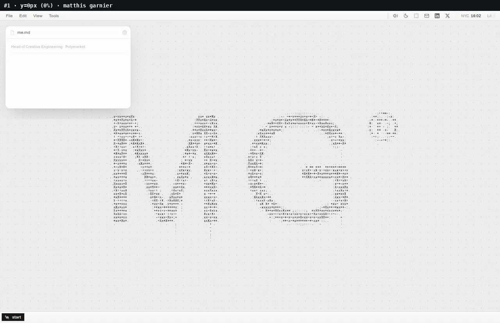
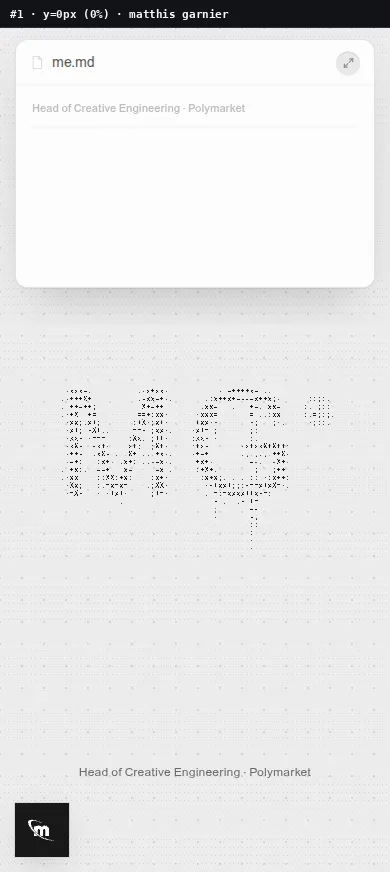

# UI Design System & Master Generation Blueprint: matthisgarnier-com

> **Matthis Garnier · Head of Creative Engineering, Polymarket** (https://matthisgarnier.com) — Matthis Garnier, Head of Creative Engineering at Polymarket, New York. Previously design director at SVZ and Hours Global; founded Cohem...





---

## 1. Executive Visual Persona & Design Archetype

- **Brand Essence & Persona**: **Matthis Garnier · Head of Creative Engineering, Polymarket** (`https://matthisgarnier.com`). Matthis Garnier, Head of Creative Engineering at Polymarket, New York. Previously design director at SVZ and Hours Global; founded Cohem...
- **Final Redirected URL**: [https://www.matthisgarnier.com/](https://www.matthisgarnier.com/)
- **Capture Provenance**: Live browser capture (`tier2_webgl`, HTTP `200`, captured `2026-11-24`).
- **Visual Archetype**: **Light-Gallery WebGL / Canvas Interactive Experience (`#ececec` / `#2c6be7`)**.
- **Anti-AI-Slop Differentiators**:
  - **Live-Computed Chromatic Polarity**: Anchors the viewport in `#ececec` (live computed `body` `background-color` (`computed_styles.json`)) paired with `#181818` primary typography and `#2c6be7` accents.
  - **Grounded Typographic Hierarchy**: Pairs `handFont` for display copy (`matthis garnier`) with `areal` and `arealMono`.
  - **Calibrated Spatial Grid & Motion**: Combines `1267px` container bounds (`gap: 12px`, padding `5px`) with `cubic-bezier(.4,0,1,1)` easing and Three.js / WebGL Canvas Pipeline.

---

## 2. Spatial Architecture & Modular Grid Mathematics

### Viewport Allocation & Container Geometry
- **Captured Journey Filmstrips**: Desktop `1280×828px` (`assets/desktop-journey.webp`, `1` keyframes up to `y=0px` / doc `900px`), Mobile `390×872px` (`assets/mobile-journey.webp`, `1` keyframes).
- **Master Container Bounds**: `1267px` (measured widest bounded `<section>` landmark width on `1440px` desktop).
- **Canvas Lateral Padding & Spacing**: `5px` lateral canvas padding with `12px` grid gap.
- **Border Radius Scale**: `4px`, `.25rem`, `12px`, `2px`.

### Responsive Breakpoint Architecture
- **Desktop Layout**: Multi-column CSS Grid / Flexbox layout at `1440px` (`max-width: 1267px`, `gap: 12px`).
- **Mobile Layout**: Single-column vertical stack at `390px` viewport width with `5px` horizontal padding.
- **Extracted CSS Media Queries**: `@media (min-width:40rem)`, `@media (min-width:48rem)`, `@media (min-width:64rem)`, `@media (min-width:80rem)`.

---

## 3. Color System, Materiality & Atmospheric Lighting

### Semantic Palette & Source Grounding
| Semantic Role | Ground-Truth Value | Extracted Live / CSS Source |
|---|---|---|
| **Primary Canvas Substrate** | `#ececec` | live computed `body` `background-color` (`computed_styles.json`) |
| **Primary Typography Ink** | `#181818` | live computed `h1` `color` (`computed_styles.json`) |
| **Elevated Surface / Card Substrate** | `#fcfcfc` | live computed `section` `background-color` (`computed_styles.json`) |
| **Interactive Accent / Highlight** | `#2c6be7` | `var(--nfl-brand)` in `:root` |
| **Secondary / Muted Copy** | `#19a4dc` | `var(--room-ink-cyan)` in `:root` |
| **Structural Hairline Border** | `#c1c1c1` | `.sc-ball-body { stroke: #c1c1c1 }` |
| **Variable Token (`--g-1`)** | `#fafafa` | `var(--g-1)` in `:root` |
| **Variable Token (`--g-2`)** | `#f3f3f3` | `var(--g-2)` in `:root` |
| **Variable Token (`--g-4`)** | `#e2e2e2` | `var(--g-4)` in `:root` |
| **Variable Token (`--g-5`)** | `#d4d4d4` | `var(--g-5)` in `:root` |
| **Variable Token (`--g-6`)** | `#bcbcbc` | `var(--g-6)` in `:root` |
| **Variable Token (`--g-7`)** | `#8e8e8e` | `var(--g-7)` in `:root` |
| **Variable Token (`--g-8`)** | `#6a6a6a` | `var(--g-8)` in `:root` |
| **Variable Token (`--g-9`)** | `#474747` | `var(--g-9)` in `:root` |
| **Variable Token (`--g-10`)** | `#2a2a2a` | `var(--g-10)` in `:root` |
| **Variable Token (`--g-12`)** | `#0a0a0a` | `var(--g-12)` in `:root` |
| **Variable Token (`--shade`)** | `#000000` | `var(--shade)` in `:root` |
| **Variable Token (`--sticker-paper`)** | `#f7f4ec` | `var(--sticker-paper)` in `:root` |

### Sanitized Root CSS Variables (`ui-ux.md` Ground Truth)
| Variable Name | Extracted Value | Semantic Role |
|---|---|---|
| `--g-0` | `#fcfcfc` | Color / Atmospheric Token |
| `--g-1` | `#fafafa` | Color / Atmospheric Token |
| `--g-2` | `#f3f3f3` | Color / Atmospheric Token |
| `--g-3` | `#ececec` | Color / Atmospheric Token |
| `--g-4` | `#e2e2e2` | Color / Atmospheric Token |
| `--g-5` | `#d4d4d4` | Color / Atmospheric Token |
| `--g-6` | `#bcbcbc` | Color / Atmospheric Token |
| `--g-7` | `#8e8e8e` | Color / Atmospheric Token |
| `--g-8` | `#6a6a6a` | Color / Atmospheric Token |
| `--g-9` | `#474747` | Color / Atmospheric Token |
| `--g-10` | `#2a2a2a` | Color / Atmospheric Token |
| `--g-11` | `#181818` | Color / Atmospheric Token |
| `--g-12` | `#0a0a0a` | Color / Atmospheric Token |
| `--shade` | `#00000024` | Color / Atmospheric Token |
| `--shade-deep` | `#00000038` | Color / Atmospheric Token |
| `--sticker-paper` | `#f7f4ec` | Canvas / Surface Token |

---

## 4. Typographic Scale & Editorial Hierarchy

### Font Family Stacks
- **Display Typography**: `handFont`.
- **Primary Body Stack**: `areal`.
- **Technical / Metadata Stack**: `arealMono`.

### Typographic Scale & Rules (Live Computed & Stylesheet Grounded)
- **Hero Display (`H1`)**: live computed `h1` (`font-size: 205.98px`, `line-height: 175.083px`, `font-weight: 400`); rule `h1` (`font-size: 18px`, `letter-spacing: 0`, `font-weight: 500`).
- **Section Heading (`H2`)**: live computed `h2` (`font-size: 48.96px`, `line-height: 44.064px`, `font-weight: 400`, `letter-spacing: -2.2032px`); rule `h2` (`font-size: 13px`, `line-height: 1.4`, `letter-spacing: 0`, `font-weight: 500`).
- **Body Copy**: live computed `body` (`font-size: 16px`, `line-height: 24px`, `font-weight: 400`); rule `p` (`font-size: clamp(26px,3vw,46px)`, `line-height: 1.15`, `letter-spacing: -.025em`, `font-weight: 500`).
- **Metadata & Navigation Labels**: live computed `nav/a` (`font-size: 12px`, `line-height: 16.2px`, `font-weight: 400`); CSS variables `--mono-font: var(--font-areal), system-ui, sans-serif`, `--font-areal-mono: "arealMono", "arealMono Fallback", ui-monospace, monospace`, `--font-mono: var(--font-areal-mono), ui-monospace, monospace`; rule `.meta` (`font-size: 11px`, `line-height: 1.25`).

---

## 5. Choreographed Motion & Interaction Physics

### Primary Easing Curves
- **Extracted Timing Functions**: `cubic-bezier(.4,0,1,1)`, `cubic-bezier(0,0,.2,1)`, `cubic-bezier(.4,0,.2,1)`.

### Per-Element Transition & Choreography Rules
- **Selector `layer theme`**: `transition: .15s` extracted from `matthisgarnier-com` stylesheet.
- **Selector `.transition`**: `transition: var(--tw-ease,var(--default-transition-timing-function))` extracted from `matthisgarnier-com` stylesheet.
- **Selector `.ease-in`**: `transition: var(--ease-in)` extracted from `matthisgarnier-com` stylesheet.
- **Extracted Easing Curve (`cubic-bezier(.4,0,1,1)`)**: Governs interactive state transitions across `<nav.topbar>` and `<section.story-desk-module__g7DRpa__index>`.
- **Runtime Interaction Engine**: Integrates Three.js / WebGL Canvas Pipeline with `prefers-reduced-motion: reduce` fallback guards.
### Measured Runtime Scroll & Interaction Telemetry (`behavioral_journey_v2`)
- **Scroll Driver Mode**: `wheel` (max document height `900px`, deepest scrollY reached `0px` across `1` desktop keyframes).
- **Detected Scroll / Motion Libraries**: `WebGL/Canvas`.
- **Nav / Drawer Probe**: Tested trigger `File` (diff `3.199`, below state-capture threshold).
- **Hover Physics (`primary_cta` · `me.md`)**: Computed transition `0s` / `ease` (no static color/transform shift captured at rest).
- **Hover Physics (`first_card` · `me.md Head of Creative Engineerin...`)**: Computed transition `0.24s` / `cubic-bezier(0.55, 0, 0.1, 1)` (no static color/transform shift captured at rest).
- **Theme Toggle Probe**: Detected `Switch to dark theme` (no body background diff).

---

## 6. Component Wireframe & Structural DOM Map

### Visual Layout Schematic — Desktop (`1440px`, Grounded in `dom.html` & Landmark Bounding Boxes)
```
┌────────────────────────────────────────────────────────────────────────┐
│ DESKTOP VIEWPORT (1440px) — Matthis Garnier · Head of Creative Enginee │
│ ====================================================================== │
│ [ <nav.topbar> (1440x28px)            | Overview · Index · Archive · ] │
│ ---------------------------------------------------------------------- │
│ | HERO STAGE: <section.story-desk-module__g7DRpa__ (w=1440px)        | │
│ | H1: matthis garnier                                                | │
│ | Substrate: #ececec | Ink: #181818 | Accent: #2c6be7                | │
│ ---------------------------------------------------------------------- │
│ | SHOWCASE GRID (<section.story-desk-module) max-w: 1267px           | │
│ | +------------------------------+  +------------------------------+ | │
│ | | Matthis Garnier              |  | Building for an information  | | │
│ | +------------------------------+  +------------------------------+ | │
│ ---------------------------------------------------------------------- │
│ | DETAIL MODULE (<section.story-desk-module) — questions are everyth | │
│ ---------------------------------------------------------------------- │
│ [ FOOTER (<footer.taskbar>    ) | https://matthisgarnier.com           │
└────────────────────────────────────────────────────────────────────────┘
```

### Visual Layout Schematic — Mobile Reflow (`390px`)
```
┌────────────────────────────────────────────────────────────────────────┐
│ MOBILE VIEWPORT REFLOW (390px) — Single-Column Stack (gap: 12px)       │
│ ====================================================================== │
│ [ HEADER BAR (<nav.topbar>            ) | Compact Menu (390px)         │
│ ---------------------------------------------------------------------- │
│ | HERO STAGE (<section.story-desk-modu) — 390px Vertical Lead        | │
│ | H1: matthis garnier                                                | │
│ ---------------------------------------------------------------------- │
│ | SHOWCASE STACK (<section.story-desk-mo) — 1-Col Stack              | │
│ | [ Item 1: Matthis Garnier                                        ] | │
│ | [ Item 2: Building for an information market.                    ] | │
│ ---------------------------------------------------------------------- │
│ | DETAIL STACK (<section.story-desk-modu) — 1-Col (questions are ever) │
│ ---------------------------------------------------------------------- │
│ [ FOOTER (<footer.taskbar>    ) | Stacked 390px Colophon               │
└────────────────────────────────────────────────────────────────────────┘
```

### Granular DOM Region Breakdown
1. **Brand Header & Navigation Bar (<nav.topbar> — `matthisgarnier-com`)**:
   - Landmark `<nav class="topbar">` (`1440x28px`) hosting `Matthis Garnier · Head of Creative E` navigation (`Overview · Index · Archive · About · Contact`), DOM attributes (`data-theme="light"`, `data-three="off"`, `data-precedence="next"`, `data-precedence="next"`), and stylesheet rule `areal_724eab9-module__J7fCQG__cla... { font-family:areal,areal Fallback,system-ui,sans-serif;font-style:normal }`.
2. **Hero Stage & Focal Lead (<section.story-desk-module__g7DRpa__win> — `matthis garnier`)**:
   - Landmark `<section class="story-desk-module__g7DRpa__win story-desk-module__g7DRpa__cover">` presenting display lead `matthis garnier` and copy excerpt *"NYC 16:01 LA 13:01 PAR 22:01 TUL 16:01 NYC 16:01 LA 13:01 PAR 22:"* over `#ececec` canvas and `#181818` ink.
3. **Primary Showcase & Content Grid (<section.story-desk-module__g7DRpa__index> — `Matthis Garnier`)**:
   - Landmark `<section class="story-desk-module__g7DRpa__win story-desk-module__g7DRpa__index">` rendering section `Matthis Garnier` with copy *"Head of Creative Engineering at Polymarket"*, asset references (`7ebf22b5a21034f8-s.p.3strvg7o-g5v...`, `ABCArealMonoVariable-s.p.28z6jix4...`, `ABCArealVariable-s.p.0r-_z7ct5is3...`, `DaftFont-s.p.1r6c1opwgow9_.woff2`), and grid rule `.areal_724eab9-module__J7fCQG__va... { --font-areal:"areal", "areal Fallback", system-ui, sans-serif }`.
4. **Interactive Detail & Feature Matrix (<section.story-desk-module__g7DRpa__year> — `Building for an information market`)**:
   - Landmark `<section class="story-desk-module__g7DRpa__win story-desk-module__g7DRpa__year">` framing `Building for an information market.` and `questions are everything, on tape` (*"Founded Cohem, a creative and consulting studio for small and mid"*) with `#fcfcfc` surface cards, `#2c6be7` accents, and `lmono_17dd977-module__Rb1R-a__cla... { font-family:arealMono,arealMono Fallback,ui-monospace,monospace;font-sty... }`.
5. **Colophon & Global Directory Footer (<footer.taskbar> — `https://matthisgarnier.com`)**:
   - Landmark `<footer class="taskbar">` anchoring `Matthis Garnier · Head of Creati` footer links (`Overview · Index · Archive · About · Contact`), copy *"Finsweet Multidisciplinary Designer"*, and `#c1c1c1` structural dividers.
### Full Vertical Scroll Sequence (Desktop `1440×900` Keyframes)
- **Step 01** (`y=0px`, `0%`): Active landmark `matthis garnier` · sticky/fixed elements: `4`

---

## 7. Master Zero-Shot AI Generation Prompt

```markdown
# Master Zero-Shot Frontend Generation Prompt: matthisgarnier-com (Matthis Garnier · Head of Creative Engineering, Polymarket)

You are a principal frontend architect and design systems engineer. Build a complete, production-ready web application replicating the exact design system, DOM landmarks, typographic hierarchy, color tokens, and motion physics of `matthisgarnier-com` (**Matthis Garnier · Head of Creative Engineering, Polymarket** — `https://matthisgarnier.com`).

### 1. Visual Archetype & Anti-AI-Slop Mandates
- **Archetype**: Light-Gallery WebGL / Canvas Interactive Experience (`#ececec` / `#2c6be7`).
- **Identity & Domain Context**: Matthis Garnier, Head of Creative Engineering at Polymarket, New York. Previously design director at SVZ and Hours Global; founded Cohem...
- **Primary Substrate**: `#ececec` (live computed `body` `background-color` (`computed_styles.json`)), **Primary Ink**: `#181818`, **Accent / Highlight**: `#2c6be7`.
- **Site-Specific Differentiators**:
  - **Live-Computed Chromatic Polarity**: Anchors the viewport in `#ececec` (live computed `body` `background-color` (`computed_styles.json`)) paired with `#181818` primary typography and `#2c6be7` accents.
  - **Grounded Typographic Hierarchy**: Pairs `handFont` for display copy (`matthis garnier`) with `areal` and `arealMono`.
  - **Calibrated Spatial Grid & Motion**: Combines `1267px` container bounds (`gap: 12px`, padding `5px`) with `cubic-bezier(.4,0,1,1)` easing and Three.js / WebGL Canvas Pipeline.

### 2. Ground-Truth CSS Variables (`:root` Token Contract)
Declare and consume these exact custom properties extracted from `matthisgarnier-com` in your global stylesheet:

:root {
  /* Matthis Garnier · Head of Creative Engineering, Polymarket (matthisgarnier-com) — Live-Grounded CSS Variables */
  --g-0: #fcfcfc; /* Color / Atmospheric Token (matthisgarnier-com) */
  --g-1: #fafafa; /* Color / Atmospheric Token (matthisgarnier-com) */
  --g-2: #f3f3f3; /* Color / Atmospheric Token (matthisgarnier-com) */
  --g-3: #ececec; /* Color / Atmospheric Token (matthisgarnier-com) */
  --g-4: #e2e2e2; /* Color / Atmospheric Token (matthisgarnier-com) */
  --g-5: #d4d4d4; /* Color / Atmospheric Token (matthisgarnier-com) */
  --g-6: #bcbcbc; /* Color / Atmospheric Token (matthisgarnier-com) */
  --g-7: #8e8e8e; /* Color / Atmospheric Token (matthisgarnier-com) */
  --g-8: #6a6a6a; /* Color / Atmospheric Token (matthisgarnier-com) */
  --g-9: #474747; /* Color / Atmospheric Token (matthisgarnier-com) */
  --g-10: #2a2a2a; /* Color / Atmospheric Token (matthisgarnier-com) */
  --g-11: #181818; /* Color / Atmospheric Token (matthisgarnier-com) */
  --g-12: #0a0a0a; /* Color / Atmospheric Token (matthisgarnier-com) */
  --shade: #00000024; /* Color / Atmospheric Token (matthisgarnier-com) */
  --shade-deep: #00000038; /* Color / Atmospheric Token (matthisgarnier-com) */
  --sticker-paper: #f7f4ec; /* Canvas / Surface Token (matthisgarnier-com) */
}

### 3. Semantic Color & Materiality Contract
Map every surface, ink, and border strictly to these source-grounded tokens:
- **Primary Canvas Substrate**: `#ececec` — grounded in live computed `body` `background-color` (`computed_styles.json`)
- **Primary Typography Ink**: `#181818` — grounded in live computed `h1` `color` (`computed_styles.json`)
- **Elevated Surface / Card Substrate**: `#fcfcfc` — grounded in live computed `section` `background-color` (`computed_styles.json`)
- **Interactive Accent / Highlight**: `#2c6be7` — grounded in `var(--nfl-brand)` in `:root`
- **Secondary / Muted Copy**: `#19a4dc` — grounded in `var(--room-ink-cyan)` in `:root`
- **Structural Hairline Border**: `#c1c1c1` — grounded in `.sc-ball-body { stroke: #c1c1c1 }`
- **Variable Token (`--g-1`)**: `#fafafa` — grounded in `var(--g-1)` in `:root`
- **Variable Token (`--g-2`)**: `#f3f3f3` — grounded in `var(--g-2)` in `:root`
- **Variable Token (`--g-4`)**: `#e2e2e2` — grounded in `var(--g-4)` in `:root`
- **Variable Token (`--g-5`)**: `#d4d4d4` — grounded in `var(--g-5)` in `:root`
- **Variable Token (`--g-6`)**: `#bcbcbc` — grounded in `var(--g-6)` in `:root`
- **Variable Token (`--g-7`)**: `#8e8e8e` — grounded in `var(--g-7)` in `:root`
- **Variable Token (`--g-8`)**: `#6a6a6a` — grounded in `var(--g-8)` in `:root`
- **Variable Token (`--g-9`)**: `#474747` — grounded in `var(--g-9)` in `:root`
- **Variable Token (`--g-10`)**: `#2a2a2a` — grounded in `var(--g-10)` in `:root`
- **Variable Token (`--g-12`)**: `#0a0a0a` — grounded in `var(--g-12)` in `:root`
- **Variable Token (`--shade`)**: `#000000` — grounded in `var(--shade)` in `:root`
- **Variable Token (`--sticker-paper`)**: `#f7f4ec` — grounded in `var(--sticker-paper)` in `:root`

### 4. Spatial Grid, Container Bounds & Responsive Breakpoints
- **Desktop Viewport Reference**: `1280×828px` (single-viewport 100vh live capture (900px), `1440px` standard desktop width).
- **Mobile Viewport Reference**: `390×872px` (full-page live capture (872px), `390px` standard mobile width).
- **Container Max-Width**: `1267px` (measured widest bounded `<section>` landmark width on `1440px` desktop)
- **Padding & Gutters**: `5px` lateral canvas padding with `12px` grid gap
- **Desktop Grid**: Multi-column CSS Grid / Flexbox layout at `1440px` (`max-width: 1267px`, `gap: 12px`)
- **Mobile Adaptation**: Single-column vertical stack at `390px` viewport width with `5px` horizontal padding
- **Media Queries**: `@media (min-width:40rem)`, `@media (min-width:48rem)`, `@media (min-width:64rem)`, `@media (min-width:80rem)`
- **Corner Radii**: `4px`, `.25rem`, `12px`, `2px`

### 5. Typography & Editorial Scale Contract
- **Display Font Stack**: `handFont`
- **Body Font Stack**: `areal`
- **Monospace / Technical Font Stack**: `arealMono`
- **H1 Display Rule**: live computed `h1` (`font-size: 205.98px`, `line-height: 175.083px`, `font-weight: 400`); rule `h1` (`font-size: 18px`, `letter-spacing: 0`, `font-weight: 500`)
- **H2 Section Rule**: live computed `h2` (`font-size: 48.96px`, `line-height: 44.064px`, `font-weight: 400`, `letter-spacing: -2.2032px`); rule `h2` (`font-size: 13px`, `line-height: 1.4`, `letter-spacing: 0`, `font-weight: 500`)
- **Body Copy Rule**: live computed `body` (`font-size: 16px`, `line-height: 24px`, `font-weight: 400`); rule `p` (`font-size: clamp(26px,3vw,46px)`, `line-height: 1.15`, `letter-spacing: -.025em`, `font-weight: 500`)
- **Metadata & Index Rule**: live computed `nav/a` (`font-size: 12px`, `line-height: 16.2px`, `font-weight: 400`); CSS variables `--mono-font: var(--font-areal), system-ui, sans-serif`, `--font-areal-mono: "arealMono", "arealMono Fallback", ui-monospace, monospace`, `--font-mono: var(--font-areal-mono), ui-monospace, monospace`; rule `.meta` (`font-size: 11px`, `line-height: 1.25`)

### 6. Component Hierarchy, Verbatim Copy & Real DOM Landmarks
Scaffold `matthisgarnier-com` (`Matthis Garnier · Head of Creative Engineering, Polymarket`) with these exact structural regions, extracted copy, and CSS rules from `dom.html`:
1. **Brand Header & Navigation Bar (<nav.topbar> — `matthisgarnier-com`)**:
   - DOM & Selectors: Landmark `<nav class="topbar">` (`1440x28px`) hosting `Matthis Garnier · Head of Creative E` navigation (`Overview · Index · Archive · About · Contact`), DOM attributes (`data-theme="light"`, `data-three="off"`, `data-precedence="next"`, `data-precedence="next"`), and stylesheet rule `areal_724eab9-module__J7fCQG__cla... { font-family:areal,areal Fallback,system-ui,sans-serif;font-style:normal }`.
   - Responsive Contract: Header `Brand Header & Navigation Bar (<nav.topbar> — `matthisgarnier-com`)` (`matthisgarnier-com`) adapts across `@media (min-width:40rem)`, `@media (min-width:48rem)`, `@media (min-width:64rem)`, `@media (min-width:80rem)` with `cubic-bezier(.4,0,1,1)`, `cubic-bezier(0,0,.2,1)`, `cubic-bezier(.4,0,.2,1)` transitions and links `Overview · Index · Archive · About · Contact`.
2. **Hero Stage & Focal Lead (<section.story-desk-module__g7DRpa__win> — `matthis garnier`)**:
   - DOM & Selectors: Landmark `<section class="story-desk-module__g7DRpa__win story-desk-module__g7DRpa__cover">` presenting display lead `matthis garnier` and copy excerpt *"NYC 16:01 LA 13:01 PAR 22:01 TUL 16:01 NYC 16:01 LA 13:01 PAR 22:"* over `#ececec` canvas and `#181818` ink.
   - Responsive Contract: Hero stage (`1280×828px` desktop / `390×872px` mobile) sets `#ececec` background with `#181818` headline `matthis garnier`.
3. **Primary Showcase & Content Grid (<section.story-desk-module__g7DRpa__index> — `Matthis Garnier`)**:
   - DOM & Selectors: Landmark `<section class="story-desk-module__g7DRpa__win story-desk-module__g7DRpa__index">` rendering section `Matthis Garnier` with copy *"Head of Creative Engineering at Polymarket"*, asset references (`7ebf22b5a21034f8-s.p.3strvg7o-g5v...`, `ABCArealMonoVariable-s.p.28z6jix4...`, `ABCArealVariable-s.p.0r-_z7ct5is3...`, `DaftFont-s.p.1r6c1opwgow9_.woff2`), and grid rule `.areal_724eab9-module__J7fCQG__va... { --font-areal:"areal", "areal Fallback", system-ui, sans-serif }`.
   - Responsive Contract: Showcase grid `Primary Showcase & Content Grid (<section.story-desk-module__g7DRpa__index> — `Matthis Garnier`)` applies Multi-column CSS Grid / Flexbox layout at `1440px` (`max-width: 1267px`, `gap: 12px`) on desktop and Single-column vertical stack at `390px` viewport width with `5px` horizontal padding on mobile.
4. **Interactive Detail & Feature Matrix (<section.story-desk-module__g7DRpa__year> — `Building for an information market`)**:
   - DOM & Selectors: Landmark `<section class="story-desk-module__g7DRpa__win story-desk-module__g7DRpa__year">` framing `Building for an information market.` and `questions are everything, on tape` (*"Founded Cohem, a creative and consulting studio for small and mid"*) with `#fcfcfc` surface cards, `#2c6be7` accents, and `lmono_17dd977-module__Rb1R-a__cla... { font-family:arealMono,arealMono Fallback,ui-monospace,monospace;font-sty... }`.
   - Responsive Contract: Detail module `Interactive Detail & Feature Matrix (<section.story-desk-module__g7DRpa__year> — `Building for an information market`)` uses `4px`, `.25rem`, `12px`, `2px` radii, `#2c6be7` highlights, and assets (7ebf22b5a21034f8-s.p.3strvg7o-g5v..., ABCArealMonoVariable-s.p.28z6jix4..., ABCArealVariable-s.p.0r-_z7ct5is3...).
5. **Colophon & Global Directory Footer (<footer.taskbar> — `https://matthisgarnier.com`)**:
   - DOM & Selectors: Landmark `<footer class="taskbar">` anchoring `Matthis Garnier · Head of Creati` footer links (`Overview · Index · Archive · About · Contact`), copy *"Finsweet Multidisciplinary Designer"*, and `#c1c1c1` structural dividers.
   - Responsive Contract: Footer `Colophon & Global Directory Footer (<footer.taskbar> — `https://matthisgarnier.com`)` aligns to `1267px` (measured widest bounded `<section>` landmark width on `1440px` desktop) with `5px` lateral canvas padding with `12px` grid gap and attributes (data-theme="light", data-three="off", data-precedence="next").

#### Verbatim DOM Copy Excerpts (`dom.html`)
- Copy Excerpt 1: *"NYC 16:01 LA 13:01 PAR 22:01 TUL 16:01 NYC 16:01 LA 13:01 PAR 22:01 TUL 16:01"*
- Copy Excerpt 2: *"Head of Creative Engineering at Polymarket"*
- Copy Excerpt 3: *"Founded Cohem, a creative and consulting studio for small and mid-sized businesses..."*
- Copy Excerpt 4: *"Finsweet Multidisciplinary Designer"*

### 7. Motion, Extracted Stylesheet Rules & Interaction Choreography
- **Primary Easing Functions**: `cubic-bezier(.4,0,1,1)`, `cubic-bezier(0,0,.2,1)`, `cubic-bezier(.4,0,.2,1)`
- **Extracted Stylesheet Rules (`matthisgarnier-com`)**:
- `areal_724eab9-module__J7fCQG__cla... { font-family:areal,areal Fallback,system-ui,sans-serif;font-style:normal }`
- `.areal_724eab9-module__J7fCQG__va... { --font-areal:"areal", "areal Fallback", system-ui, sans-serif }`
- `lmono_17dd977-module__Rb1R-a__cla... { font-family:arealMono,arealMono Fallback,ui-monospace,monospace;font-sty... }`
- `almono_17dd977-module__Rb1R-a__va... { --font-areal-mono:"arealMono", "arealMono Fallback", ui-monospace, monos... }`
- `backdrop { box-sizing:border-box;border:0 solid;margin:0;padding:0 }`
- **Per-Selector Transition Rules**:
- **Selector `layer theme`**: `transition: .15s` extracted from `matthisgarnier-com` stylesheet.
- **Selector `.transition`**: `transition: var(--tw-ease,var(--default-transition-timing-function))` extracted from `matthisgarnier-com` stylesheet.
- **Selector `.ease-in`**: `transition: var(--ease-in)` extracted from `matthisgarnier-com` stylesheet.
- **Extracted Easing Curve (`cubic-bezier(.4,0,1,1)`)**: Governs interactive state transitions across `<nav.topbar>` and `<section.story-desk-module__g7DRpa__index>`.
- **Runtime Interaction Engine**: Integrates Three.js / WebGL Canvas Pipeline with `prefers-reduced-motion: reduce` fallback guards.
### 7b. Full-Page Scroll Choreography, Interactive States & Multi-Page Routes
- **Scroll Mechanics**: Implement `wheel` vertical progression up to `900px` across 1 distinct viewport chapters using WebGL/Canvas.
- **Vertical Chapter Sequence**: matthis garnier (0%).

### 8. Technical Deliverables
- Implement in Next.js (App Router) with TypeScript and Tailwind CSS consuming the `:root` custom properties defined above for `matthisgarnier-com`.
- Reproduce both the `1440px` desktop architecture and `390px` mobile breakpoint transitions, preserving semantic HTML5 landmarks (`<header>`, `<nav>`, `<main>`, `<section>`, `<footer>`) and `prefers-reduced-motion` accessibility guards.
```
---

## 8. Full-Page Scroll Journey, Interactive States & Subpage Inventory

### Desktop Scroll Keyframes (`1440×900` WebP)
| Step | Scroll Y | Progress | Active Landmark / Section | Sticky/Fixed | Visual Asset |
| :---: | :---: | :---: | :--- | :---: | :--- |
| `#01` | `0px` | `0%` | matthis garnier | `4` | [desktop-step-01.webp](assets/desktop-step-01.webp) |

### Mobile Condensed Keyframes (`390×844` WebP)
| Step | Scroll Y | Progress | Active Landmark | Visual Asset |
| :---: | :---: | :---: | :--- | :--- |
| `#01` | `0px` | `0%` | matthis garnier | [mobile-step-01.webp](assets/mobile-step-01.webp) |

