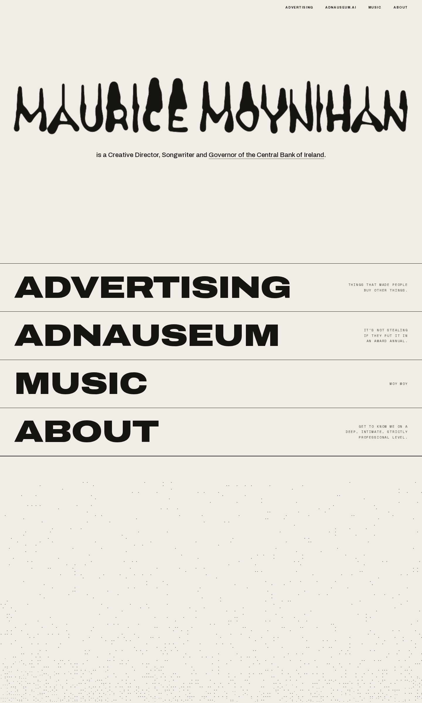
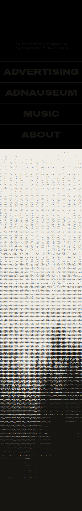

# UI Design System & Master Generation Blueprint: mauricemoynihan-com

> **Maurice Moynihan** (https://mauricemoynihan.com) — Advertising creative director, Melbourne. A portfolio. Some of it won things. It also has an album, which hasn’t.



---

## 1. Executive Visual Persona & Design Archetype

- **Brand Essence & Persona**: **Maurice Moynihan** (`https://mauricemoynihan.com`). Advertising creative director, Melbourne. A portfolio. Some of it won things. It also has an album, which hasn’t.
- **Capture Provenance**: Live browser capture (`tier1_fast`, HTTP `200`, captured `2026-11-23`).
- **Visual Archetype**: **Light-Gallery WebGL / Canvas Interactive Experience (`#efede6` / `#ff0000`)**.
- **Anti-AI-Slop Differentiators**:
  - **Live-Computed Chromatic Polarity**: Anchors the viewport in `#efede6` (live computed `body` `background-color` (`computed_styles.json`)) paired with `#161511` primary typography and `#ff0000` accents.
  - **Grounded Typographic Hierarchy**: Pairs `Archivo` for display copy (`MAURICE MOYNIHAN`) with `Archivo` and `Space Mono`.
  - **Calibrated Spatial Grid & Motion**: Combines `1440px` container bounds (`gap: 16px`, padding `48px`) with `cubic-bezier(.35,.05,.4,1)` easing and Three.js / WebGL Canvas Pipeline.

---

## 2. Spatial Architecture & Modular Grid Mathematics



### Viewport Allocation & Container Geometry
- **Captured Viewport Dimensions**: Desktop `1440×2400px` (`assets/desktop.png`, clamped at 2400px live multi-section capture), Mobile `390×2400px` (`assets/mobile.png`, clamped at 2400px live multi-section capture).
- **Master Container Bounds**: `1440px` (full-bleed `100%` desktop stage measured on `1440px` viewport).
- **Canvas Lateral Padding & Spacing**: `48px` lateral canvas padding with `16px` grid gap.
- **Border Radius Scale**: `2px`, `1px`, `50%`.

### Responsive Breakpoint Architecture
- **Desktop Layout**: Multi-column CSS Grid / Flexbox layout at `1440px` (`max-width: 1440px`, `gap: 16px`).
- **Mobile Layout**: Single-column vertical stack at `390px` viewport width with `48px` horizontal padding.
- **Extracted CSS Media Queries**: `@media (prefers-reduced-motion:reduce)`, `@media (max-height:800px) and (min-width:769px)`, `@media (min-width:769px)`, `@media (max-width:768px)`.

---

## 3. Color System, Materiality & Atmospheric Lighting

### Semantic Palette & Source Grounding
| Semantic Role | Ground-Truth Value | Extracted Live / CSS Source |
|---|---|---|
| **Primary Canvas Substrate** | `#efede6` | live computed `body` `background-color` (`computed_styles.json`) |
| **Primary Typography Ink** | `#161511` | live computed `h1` `color` (`computed_styles.json`) |
| **Elevated Surface / Card Substrate** | `#ffffff` | `var(--paper)` in `:root` |
| **Interactive Accent / Highlight** | `#ff0000` | `.nav a:hover { color: red }` (`#ff0000`) |
| **Secondary / Muted Copy** | `#4c4a43` | `var(--ink-soft)` in `:root` |
| **Structural Hairline Border** | `#a3a19b` | `.about-hero h1 a { border-bottom: #a3a19b }` |
| **Variable Token (`--bone-deep`)** | `#e6e3d9` | `var(--bone-deep)` in `:root` |

### Sanitized Root CSS Variables (`ui-ux.md` Ground Truth)
| Variable Name | Extracted Value | Semantic Role |
|---|---|---|
| `--bone` | `#EFEDE6` | Color / Atmospheric Token |
| `--bone-deep` | `#E6E3D9` | Color / Atmospheric Token |
| `--ink` | `#161511` | Typography Ink Token |
| `--ink-soft` | `#4c4a43` | Typography Ink Token |
| `--red` | `#161511` | Color / Atmospheric Token |
| `--red-deep` | `#161511` | Color / Atmospheric Token |
| `--red-lift` | `#EFEDE6` | Color / Atmospheric Token |
| `--paper` | `#FFFFFF` | Canvas / Surface Token |
| `--sans` | `"Archivo","Helvetica Neue",Helvetica,Arial,sans-serif` | Typography / Scale Token |
| `--mono` | `"Space Mono","Courier New",monospace` | Typography / Scale Token |
| `--serif` | `"Archivo","Helvetica Neue",Helvetica,Arial,sans-serif` | Typography / Scale Token |
| `--pad` | `clamp(1rem, 3.4vw, 3rem)` | Layout / Spatial Grid Token |
| `--hair` | `1.5px solid var(--ink)` | Dimension / Scale Token |
| `--card` | `clamp(7rem,13.2vw,11.5rem)` | Dimension / Scale Token |
| `--shelf-pad` | `clamp(1rem,3vh,2.4rem)` | Layout / Spatial Grid Token |
| `--shelf` | `calc(var(--card) * 1.22 + var(--shelf-pad) + var(--nav-h) + 1.6rem + 1.8vw)` | Dimension / Scale Token |

---

## 4. Typographic Scale & Editorial Hierarchy

### Font Family Stacks
- **Display Typography**: `Archivo`.
- **Primary Body Stack**: `Archivo`.
- **Technical / Metadata Stack**: `Space Mono`.

### Typographic Scale & Rules (Live Computed & Stylesheet Grounded)
- **Hero Display (`H1`)**: live computed `h1` (`font-size: 117.36px`, `line-height: 100.93px`, `font-weight: 900`, `letter-spacing: -4.45968px`); rule `h1` (`font-size: clamp(1.9rem,5.2vw,4.4rem)`, `line-height: 1.02`, `letter-spacing: -.02em`, `font-weight: 900`).
- **Section Heading (`H2`)**: rule `h2` (`font-size: clamp(2rem,7vw,5.2rem)`, `line-height: .92`, `letter-spacing: -.02em`, `font-weight: 900`).
- **Body Copy**: live computed `body` (`font-size: 17px`, `line-height: 26.35px`, `font-weight: 400`); rule `body` (`font-size: 1.0625rem`, `line-height: 1.55`).
- **Metadata & Navigation Labels**: live computed `nav/a` (`font-size: 17px`, `line-height: 26.35px`, `font-weight: 400`); CSS variables `--mono: "Space Mono","Courier New",monospace`.

---

## 5. Choreographed Motion & Interaction Physics

### Primary Easing Curves
- **Extracted Timing Functions**: `cubic-bezier(.35,.05,.4,1)`, `cubic-bezier(.45,0,.25,1)`, `cubic-bezier(.2,.8,.3,1)`.

### Per-Element Transition & Choreography Rules
- **Selector `.skip`**: `transition: top .15s` extracted from `mauricemoynihan-com` stylesheet.
- **Selector `.nav--home`**: `transition: background .18s ease` extracted from `mauricemoynihan-com` stylesheet.
- **Selector `media (prefers-reduced-motion:red...`**: `transition: none` extracted from `mauricemoynihan-com` stylesheet.
- **Extracted Easing Curve (`cubic-bezier(.35,.05,.4,1)`)**: Governs interactive state transitions across `<header.nav>` and `<section.hero:nth(2)>`.
- **Runtime Interaction Engine**: Integrates Three.js / WebGL Canvas Pipeline with `prefers-reduced-motion: reduce` fallback guards.

---

## 6. Component Wireframe & Structural DOM Map

### Visual Layout Schematic — Desktop (`1440px`, Grounded in `dom.html` & Landmark Bounding Boxes)
```
┌────────────────────────────────────────────────────────────────────────┐
│ DESKTOP VIEWPORT (1440px) — Maurice Moynihan                           │
│ ====================================================================== │
│ [ <header.nav> (1440x49px)            | Advertising · adnauseum.ai · ] │
│ ---------------------------------------------------------------------- │
│ | HERO STAGE: <section.hero> (w=1440px)                              | │
│ | H1: MAURICE MOYNIHAN                                               | │
│ | Substrate: #efede6 | Ink: #161511 | Accent: #ff0000                | │
│ ---------------------------------------------------------------------- │
│ | SHOWCASE GRID (<section.hero:nth(2)>) max-w: 1440px                | │
│ | +------------------------------+  +------------------------------+ | │
│ | | Maurice Moynihan             |  | is a Creative Director, Song | | │
│ | +------------------------------+  +------------------------------+ | │
│ ---------------------------------------------------------------------- │
│ | DETAIL MODULE (<section.hero:nth(3)>) — Things that made peop      | │
│ ---------------------------------------------------------------------- │
│ [ FOOTER (<footer.footer>     ) | https://mauricemoynihan.com          │
└────────────────────────────────────────────────────────────────────────┘
```

### Visual Layout Schematic — Mobile Reflow (`390px`)
```
┌────────────────────────────────────────────────────────────────────────┐
│ MOBILE VIEWPORT REFLOW (390px) — Single-Column Stack (gap: 16px)       │
│ ====================================================================== │
│ [ HEADER BAR (<header.nav>            ) | Compact Menu (390px)         │
│ ---------------------------------------------------------------------- │
│ | HERO STAGE (<section.hero>) — 390px Vertical Lead                  | │
│ | H1: MAURICE MOYNIHAN                                               | │
│ ---------------------------------------------------------------------- │
│ | SHOWCASE STACK (<section.hero:nth(2)>) — 1-Col Stack               | │
│ | [ Item 1: Maurice Moynihan                                       ] | │
│ | [ Item 2: is a Creative Director, Songwriter and Governor        ] | │
│ ---------------------------------------------------------------------- │
│ | DETAIL STACK (<section.hero:nth(3)>) — 1-Col (Things that made p)  | │
│ ---------------------------------------------------------------------- │
│ [ FOOTER (<footer.footer>     ) | Stacked 390px Colophon               │
└────────────────────────────────────────────────────────────────────────┘
```

### Granular DOM Region Breakdown
1. **Brand Header & Navigation Bar (<header.nav> — `mauricemoynihan-com`)**:
   - Landmark `<header class="nav nav--home">` (`1440x49px`) hosting `Maurice Moynihan` navigation (`Advertising · adnauseum.ai · Music · About`), DOM attributes (`data-src="assets/koi/koi_a.webp"`, `data-src2="assets/koi/koi_b.webp"`, `data-panel`, `data-ink-top="0.7539"`), and stylesheet rule `html { scroll-behavior:smooth; }`.
2. **Hero Stage & Focal Lead (<section.hero> — `MAURICE MOYNIHAN`)**:
   - Landmark `<section class="hero">` presenting display lead `MAURICE MOYNIHAN` and copy excerpt *"is a Creative Director, Songwriter and Governor of the Central Ba"* over `#efede6` canvas and `#161511` ink.
3. **Primary Showcase & Content Grid (<section.hero:nth(2)> — `Maurice Moynihan`)**:
   - Landmark `<section class="hero">` rendering section `Maurice Moynihan` with copy *"is a Creative Director, Songwriter and Governor of the Central Ba"*, asset references (`apple-touch-icon.png`, `fonts.googleapis.com`, `fonts.gstatic.com`, `css2`), and grid rule `video { max-width:100%;display:block; }`.
4. **Interactive Detail & Feature Matrix (<section.hero:nth(3)> — `is a Creative Director, Songwriter`)**:
   - Landmark `<section class="hero">` framing `is a Creative Director, Songwriter and Governor ` and `Things that made people buy other things.` (*"Things that made people buy other things."*) with `#ffffff` surface cards, `#ff0000` accents, and `selection { background:var(--red);color:var(--bone); }`.
5. **Colophon & Global Directory Footer (<footer.footer> — `https://mauricemoynihan.com`)**:
   - Landmark `<footer class="footer">` anchoring `Maurice Moynihan` footer links (`Advertising · adnauseum.ai · Music · About`), copy *"It's not stealing if they put it in an award annual."*, and `#a3a19b` structural dividers.

---

## 7. Master Zero-Shot AI Generation Prompt

```markdown
# Master Zero-Shot Frontend Generation Prompt: mauricemoynihan-com (Maurice Moynihan)

You are a principal frontend architect and design systems engineer. Build a complete, production-ready web application replicating the exact design system, DOM landmarks, typographic hierarchy, color tokens, and motion physics of `mauricemoynihan-com` (**Maurice Moynihan** — `https://mauricemoynihan.com`).

### 1. Visual Archetype & Anti-AI-Slop Mandates
- **Archetype**: Light-Gallery WebGL / Canvas Interactive Experience (`#efede6` / `#ff0000`).
- **Identity & Domain Context**: Advertising creative director, Melbourne. A portfolio. Some of it won things. It also has an album, which hasn’t.
- **Primary Substrate**: `#efede6` (live computed `body` `background-color` (`computed_styles.json`)), **Primary Ink**: `#161511`, **Accent / Highlight**: `#ff0000`.
- **Site-Specific Differentiators**:
  - **Live-Computed Chromatic Polarity**: Anchors the viewport in `#efede6` (live computed `body` `background-color` (`computed_styles.json`)) paired with `#161511` primary typography and `#ff0000` accents.
  - **Grounded Typographic Hierarchy**: Pairs `Archivo` for display copy (`MAURICE MOYNIHAN`) with `Archivo` and `Space Mono`.
  - **Calibrated Spatial Grid & Motion**: Combines `1440px` container bounds (`gap: 16px`, padding `48px`) with `cubic-bezier(.35,.05,.4,1)` easing and Three.js / WebGL Canvas Pipeline.

### 2. Ground-Truth CSS Variables (`:root` Token Contract)
Declare and consume these exact custom properties extracted from `mauricemoynihan-com` in your global stylesheet:

:root {
  /* Maurice Moynihan (mauricemoynihan-com) — Live-Grounded CSS Variables */
  --bone: #EFEDE6; /* Color / Atmospheric Token (mauricemoynihan-com) */
  --bone-deep: #E6E3D9; /* Color / Atmospheric Token (mauricemoynihan-com) */
  --ink: #161511; /* Typography Ink Token (mauricemoynihan-com) */
  --ink-soft: #4c4a43; /* Typography Ink Token (mauricemoynihan-com) */
  --red: #161511; /* Color / Atmospheric Token (mauricemoynihan-com) */
  --red-deep: #161511; /* Color / Atmospheric Token (mauricemoynihan-com) */
  --red-lift: #EFEDE6; /* Color / Atmospheric Token (mauricemoynihan-com) */
  --paper: #FFFFFF; /* Canvas / Surface Token (mauricemoynihan-com) */
  --sans: "Archivo","Helvetica Neue",Helvetica,Arial,sans-serif; /* Typography / Scale Token (mauricemoynihan-com) */
  --mono: "Space Mono","Courier New",monospace; /* Typography / Scale Token (mauricemoynihan-com) */
  --serif: "Archivo","Helvetica Neue",Helvetica,Arial,sans-serif; /* Typography / Scale Token (mauricemoynihan-com) */
  --pad: clamp(1rem, 3.4vw, 3rem); /* Layout / Spatial Grid Token (mauricemoynihan-com) */
  --hair: 1.5px solid var(--ink); /* Dimension / Scale Token (mauricemoynihan-com) */
  --card: clamp(7rem,13.2vw,11.5rem); /* Dimension / Scale Token (mauricemoynihan-com) */
  --shelf-pad: clamp(1rem,3vh,2.4rem); /* Layout / Spatial Grid Token (mauricemoynihan-com) */
  --shelf: calc(var(--card) * 1.22 + var(--shelf-pad) + var(--nav-h) + 1.6rem + 1.8vw); /* Dimension / Scale Token (mauricemoynihan-com) */
}

### 3. Semantic Color & Materiality Contract
Map every surface, ink, and border strictly to these source-grounded tokens:
- **Primary Canvas Substrate**: `#efede6` — grounded in live computed `body` `background-color` (`computed_styles.json`)
- **Primary Typography Ink**: `#161511` — grounded in live computed `h1` `color` (`computed_styles.json`)
- **Elevated Surface / Card Substrate**: `#ffffff` — grounded in `var(--paper)` in `:root`
- **Interactive Accent / Highlight**: `#ff0000` — grounded in `.nav a:hover { color: red }` (`#ff0000`)
- **Secondary / Muted Copy**: `#4c4a43` — grounded in `var(--ink-soft)` in `:root`
- **Structural Hairline Border**: `#a3a19b` — grounded in `.about-hero h1 a { border-bottom: #a3a19b }`
- **Variable Token (`--bone-deep`)**: `#e6e3d9` — grounded in `var(--bone-deep)` in `:root`

### 4. Spatial Grid, Container Bounds & Responsive Breakpoints
- **Desktop Viewport Reference**: `1440×2400px` (clamped at 2400px live multi-section capture, `1440px` standard desktop width).
- **Mobile Viewport Reference**: `390×2400px` (clamped at 2400px live multi-section capture, `390px` standard mobile width).
- **Container Max-Width**: `1440px` (full-bleed `100%` desktop stage measured on `1440px` viewport)
- **Padding & Gutters**: `48px` lateral canvas padding with `16px` grid gap
- **Desktop Grid**: Multi-column CSS Grid / Flexbox layout at `1440px` (`max-width: 1440px`, `gap: 16px`)
- **Mobile Adaptation**: Single-column vertical stack at `390px` viewport width with `48px` horizontal padding
- **Media Queries**: `@media (prefers-reduced-motion:reduce)`, `@media (max-height:800px) and (min-width:769px)`, `@media (min-width:769px)`, `@media (max-width:768px)`
- **Corner Radii**: `2px`, `1px`, `50%`

### 5. Typography & Editorial Scale Contract
- **Display Font Stack**: `Archivo`
- **Body Font Stack**: `Archivo`
- **Monospace / Technical Font Stack**: `Space Mono`
- **H1 Display Rule**: live computed `h1` (`font-size: 117.36px`, `line-height: 100.93px`, `font-weight: 900`, `letter-spacing: -4.45968px`); rule `h1` (`font-size: clamp(1.9rem,5.2vw,4.4rem)`, `line-height: 1.02`, `letter-spacing: -.02em`, `font-weight: 900`)
- **H2 Section Rule**: rule `h2` (`font-size: clamp(2rem,7vw,5.2rem)`, `line-height: .92`, `letter-spacing: -.02em`, `font-weight: 900`)
- **Body Copy Rule**: live computed `body` (`font-size: 17px`, `line-height: 26.35px`, `font-weight: 400`); rule `body` (`font-size: 1.0625rem`, `line-height: 1.55`)
- **Metadata & Index Rule**: live computed `nav/a` (`font-size: 17px`, `line-height: 26.35px`, `font-weight: 400`); CSS variables `--mono: "Space Mono","Courier New",monospace`

### 6. Component Hierarchy, Verbatim Copy & Real DOM Landmarks
Scaffold `mauricemoynihan-com` (`Maurice Moynihan`) with these exact structural regions, extracted copy, and CSS rules from `dom.html`:
1. **Brand Header & Navigation Bar (<header.nav> — `mauricemoynihan-com`)**:
   - DOM & Selectors: Landmark `<header class="nav nav--home">` (`1440x49px`) hosting `Maurice Moynihan` navigation (`Advertising · adnauseum.ai · Music · About`), DOM attributes (`data-src="assets/koi/koi_a.webp"`, `data-src2="assets/koi/koi_b.webp"`, `data-panel`, `data-ink-top="0.7539"`), and stylesheet rule `html { scroll-behavior:smooth; }`.
   - Responsive Contract: Header `Brand Header & Navigation Bar (<header.nav> — `mauricemoynihan-com`)` (`mauricemoynihan-com`) adapts across `@media (prefers-reduced-motion:reduce)`, `@media (max-height:800px) and (min-width:769px)`, `@media (min-width:769px)`, `@media (max-width:768px)` with `cubic-bezier(.35,.05,.4,1)`, `cubic-bezier(.45,0,.25,1)`, `cubic-bezier(.2,.8,.3,1)` transitions and links `Advertising · adnauseum.ai · Music · About`.
2. **Hero Stage & Focal Lead (<section.hero> — `MAURICE MOYNIHAN`)**:
   - DOM & Selectors: Landmark `<section class="hero">` presenting display lead `MAURICE MOYNIHAN` and copy excerpt *"is a Creative Director, Songwriter and Governor of the Central Ba"* over `#efede6` canvas and `#161511` ink.
   - Responsive Contract: Hero stage (`1440×2400px` desktop / `390×2400px` mobile) sets `#efede6` background with `#161511` headline `MAURICE MOYNIHAN`.
3. **Primary Showcase & Content Grid (<section.hero:nth(2)> — `Maurice Moynihan`)**:
   - DOM & Selectors: Landmark `<section class="hero">` rendering section `Maurice Moynihan` with copy *"is a Creative Director, Songwriter and Governor of the Central Ba"*, asset references (`apple-touch-icon.png`, `fonts.googleapis.com`, `fonts.gstatic.com`, `css2`), and grid rule `video { max-width:100%;display:block; }`.
   - Responsive Contract: Showcase grid `Primary Showcase & Content Grid (<section.hero:nth(2)> — `Maurice Moynihan`)` applies Multi-column CSS Grid / Flexbox layout at `1440px` (`max-width: 1440px`, `gap: 16px`) on desktop and Single-column vertical stack at `390px` viewport width with `48px` horizontal padding on mobile.
4. **Interactive Detail & Feature Matrix (<section.hero:nth(3)> — `is a Creative Director, Songwriter`)**:
   - DOM & Selectors: Landmark `<section class="hero">` framing `is a Creative Director, Songwriter and Governor ` and `Things that made people buy other things.` (*"Things that made people buy other things."*) with `#ffffff` surface cards, `#ff0000` accents, and `selection { background:var(--red);color:var(--bone); }`.
   - Responsive Contract: Detail module `Interactive Detail & Feature Matrix (<section.hero:nth(3)> — `is a Creative Director, Songwriter`)` uses `2px`, `1px`, `50%` radii, `#ff0000` highlights, and assets (apple-touch-icon.png, fonts.googleapis.com, fonts.gstatic.com).
5. **Colophon & Global Directory Footer (<footer.footer> — `https://mauricemoynihan.com`)**:
   - DOM & Selectors: Landmark `<footer class="footer">` anchoring `Maurice Moynihan` footer links (`Advertising · adnauseum.ai · Music · About`), copy *"It's not stealing if they put it in an award annual."*, and `#a3a19b` structural dividers.
   - Responsive Contract: Footer `Colophon & Global Directory Footer (<footer.footer> — `https://mauricemoynihan.com`)` aligns to `1440px` (full-bleed `100%` desktop stage measured on `1440px` viewport) with `48px` lateral canvas padding with `16px` grid gap and attributes (data-src="assets/koi/koi_a.webp", data-src2="assets/koi/koi_b.webp", data-panel).

#### Verbatim DOM Copy Excerpts (`dom.html`)
- Copy Excerpt 1: *"is a Creative Director, Songwriter and Governor of the Central Bank of Ireland."*
- Copy Excerpt 2: *"is a Creative Director, Songwriter and Governor of the Central Bank of Ireland ."*
- Copy Excerpt 3: *"Things that made people buy other things."*
- Copy Excerpt 4: *"It's not stealing if they put it in an award annual."*

### 7. Motion, Extracted Stylesheet Rules & Interaction Choreography
- **Primary Easing Functions**: `cubic-bezier(.35,.05,.4,1)`, `cubic-bezier(.45,0,.25,1)`, `cubic-bezier(.2,.8,.3,1)`
- **Extracted Stylesheet Rules (`mauricemoynihan-com`)**:
- `html { scroll-behavior:smooth; }`
- `video { max-width:100%;display:block; }`
- `selection { background:var(--red);color:var(--bone); }`
- `focus-visible { outline:3px solid var(--red);outline-offset:3px;border-radius:1px; }`
- `.skip:focus { top:.8rem; }`
- **Per-Selector Transition Rules**:
- **Selector `.skip`**: `transition: top .15s` extracted from `mauricemoynihan-com` stylesheet.
- **Selector `.nav--home`**: `transition: background .18s ease` extracted from `mauricemoynihan-com` stylesheet.
- **Selector `media (prefers-reduced-motion:red...`**: `transition: none` extracted from `mauricemoynihan-com` stylesheet.
- **Extracted Easing Curve (`cubic-bezier(.35,.05,.4,1)`)**: Governs interactive state transitions across `<header.nav>` and `<section.hero:nth(2)>`.
- **Runtime Interaction Engine**: Integrates Three.js / WebGL Canvas Pipeline with `prefers-reduced-motion: reduce` fallback guards.

### 8. Technical Deliverables
- Implement in Next.js (App Router) with TypeScript and Tailwind CSS consuming the `:root` custom properties defined above for `mauricemoynihan-com`.
- Reproduce both the `1440px` desktop architecture and `390px` mobile breakpoint transitions, preserving semantic HTML5 landmarks (`<header>`, `<nav>`, `<main>`, `<section>`, `<footer>`) and `prefers-reduced-motion` accessibility guards.
```
