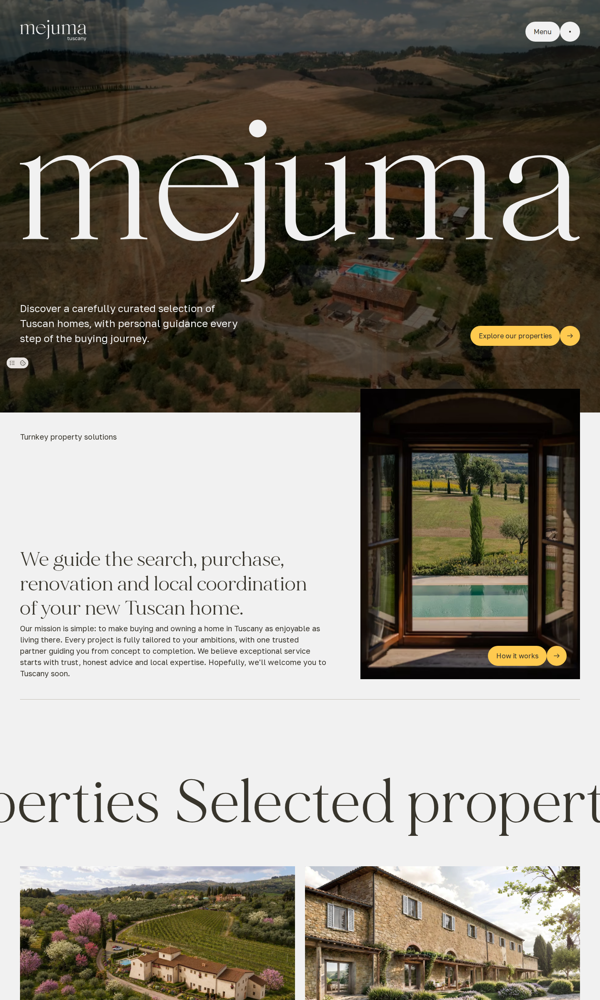
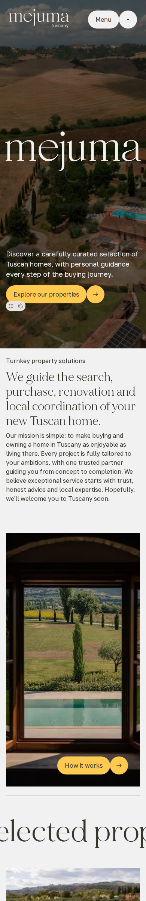

# UI Design System & Master Generation Blueprint: mejuma-tuscany-com

> **Mejuma Tuscany** (https://mejuma-tuscany.com/) — Find your dream home in Tuscany with expert guidance. We handle property search, purchase, renovation & local coordination. Trusted turnk...



---

## 1. Executive Visual Persona & Design Archetype

- **Brand Essence & Persona**: **Mejuma Tuscany** (`https://mejuma-tuscany.com/`). Find your dream home in Tuscany with expert guidance. We handle property search, purchase, renovation & local coordination. Trusted turnk...
- **Final Redirected URL**: [https://www.mejuma-tuscany.com/](https://www.mejuma-tuscany.com/)
- **Capture Provenance**: Live browser capture (`tier1_fast`, HTTP `200`, captured `2026-11-23`).
- **Visual Archetype**: **Light-Substrate Editorial & Modular Grid System (`#f1f1f1` canvas, `#0000ee` ink, `#ffff00` accent)**.
- **Anti-AI-Slop Differentiators**:
  - **Live-Computed Chromatic Polarity**: Anchors the viewport in `#f1f1f1` (live computed `body` `background-color` (`computed_styles.json`)) paired with `#0000ee` primary typography and `#ffff00` accents.
  - **Grounded Typographic Hierarchy**: Pairs `Roxale Story 400` for display copy (`mejuma`) with `Golos Text` and `SFMono-Regular`.
  - **Calibrated Spatial Grid & Motion**: Combines `80rem` container bounds (`gap: 12px`, padding `9px`) with `cubic-bezier(.77,0,.175,1)` easing and Lenis Smooth Scroll (`data-lenis`), GSAP Timeline & ScrollTrigger.

---

## 2. Spatial Architecture & Modular Grid Mathematics



### Viewport Allocation & Container Geometry
- **Captured Viewport Dimensions**: Desktop `1440×2400px` (`assets/desktop.png`, clamped at 2400px live multi-section capture), Mobile `390×2400px` (`assets/mobile.png`, clamped at 2400px live multi-section capture).
- **Master Container Bounds**: `80rem` (non-`@media` desktop container stylesheet rule).
- **Canvas Lateral Padding & Spacing**: `9px` lateral canvas padding with `12px` grid gap.
- **Border Radius Scale**: `3px`, `100%`, `50%`, `.125rem`.

### Responsive Breakpoint Architecture
- **Desktop Layout**: Multi-column CSS Grid / Flexbox layout at `1440px` (`max-width: 80rem`, `gap: 12px`).
- **Mobile Layout**: Single-column vertical stack at `390px` viewport width with `9px` horizontal padding.
- **Extracted CSS Media Queries**: `@media screen and (max-width: 991px)`, `@media screen and (max-width: 767px)`, `@media screen and (max-width: 479px)`, `@media (min-width: 768px)`.

---

## 3. Color System, Materiality & Atmospheric Lighting

### Semantic Palette & Source Grounding
| Semantic Role | Ground-Truth Value | Extracted Live / CSS Source |
|---|---|---|
| **Primary Canvas Substrate** | `#f1f1f1` | live computed `body` `background-color` (`computed_styles.json`) |
| **Primary Typography Ink** | `#0000ee` | live computed `a` `color` (`computed_styles.json`) |
| **Elevated Surface / Card Substrate** | `#e8e4e1` | live computed `button` `background-color` (`computed_styles.json`) |
| **Interactive Accent / Highlight** | `#ffff00` | `.small-cta-base { background-color: yellow }` (`#ffff00`) |
| **Secondary / Muted Copy** | `#38352c` | live computed `body` `color` (`computed_styles.json`) |
| **Structural Hairline Border** | `#e0e0e0` | `var(--cs-color-secondary-border)` in `:root` |
| **Variable Token (`--yellow`)** | `#ffca4f` | `var(--yellow)` in `:root` |
| **Variable Token (`--sand--300`)** | `#c5beb4` | `var(--sand--300)` in `:root` |
| **Variable Token (`--green--600`)** | `#82886e` | `var(--green--600)` in `:root` |

### Sanitized Root CSS Variables (`ui-ux.md` Ground Truth)
| Variable Name | Extracted Value | Semantic Role |
|---|---|---|
| `--sand--50` | `#f1f1f1` | Color / Atmospheric Token |
| `--green--950` | `#38352c` | Color / Atmospheric Token |
| `--yellow` | `#ffca4f` | Color / Atmospheric Token |
| `--sand--300` | `#c5beb4` | Color / Atmospheric Token |
| `--sand--100` | `#e8e4e1` | Color / Atmospheric Token |
| `--green--600` | `#82886e` | Color / Atmospheric Token |
| `--cs-base` | `max(1rem,15px)` | Dimension / Scale Token |
| `--cs-space-1` | `calc(var(--cs-base) * .25)` | Layout / Spatial Grid Token |
| `--cs-space-2` | `calc(var(--cs-base) * .5)` | Layout / Spatial Grid Token |
| `--cs-space-3` | `calc(var(--cs-base) * .75)` | Layout / Spatial Grid Token |
| `--cs-space-4` | `calc(var(--cs-base) * 1)` | Layout / Spatial Grid Token |
| `--cs-space-5` | `calc(var(--cs-base) * 1.25)` | Layout / Spatial Grid Token |
| `--cs-space-6` | `calc(var(--cs-base) * 1.5)` | Layout / Spatial Grid Token |
| `--cs-space-7` | `calc(var(--cs-base) * 1.75)` | Layout / Spatial Grid Token |
| `--cs-space-8` | `calc(var(--cs-base) * 2)` | Layout / Spatial Grid Token |
| `--cs-radius-sm` | `calc(var(--cs-base) * .25)` | Elevation / Border Token |

---

## 4. Typographic Scale & Editorial Hierarchy

### Font Family Stacks
- **Display Typography**: `Roxale Story 400`.
- **Primary Body Stack**: `Golos Text`.
- **Technical / Metadata Stack**: `SFMono-Regular`.

### Typographic Scale & Rules (Live Computed & Stylesheet Grounded)
- **Hero Display (`H1`)**: live computed `h1` (`font-size: 411.948px`, `line-height: 453.143px`, `font-weight: 400`); rule `h1` (`font-size: 2em`).
- **Section Heading (`H2`)**: live computed `h2` (`font-size: 48px`, `line-height: 52.8px`, `font-weight: 400`); rule `h2` (`font-size: 32px`, `line-height: 36px`).
- **Body Copy**: live computed `body` (`font-size: 16px`, `line-height: 24px`, `font-weight: 400`); CSS variables `--cs-font-size-body: calc(var(--cs-base) * .875)`, `--cs-font-size-body-min: 0px`, `--cs-font-weight-body: 400`; rule `body` (`font-size: 14px`, `line-height: 20px`).
- **Metadata & Navigation Labels**: live computed `nav/a` (`font-size: 16px`, `line-height: 24px`, `font-weight: 400`); CSS variables `--cs-font-weight-toggle-label: var(--cs-font-weight-medium)`; rule `small` (`font-size: 80%`).

---

## 5. Choreographed Motion & Interaction Physics

### Primary Easing Curves
- **Extracted Timing Functions**: `cubic-bezier(.77,0,.175,1)`, `cubic-bezier(0.65,0.05,0,1)`, `cubic-bezier(0.65,0.1,0,1)`.

### Per-Element Transition & Choreography Rules
- **Selector `.w-webflow-badge > img`**: `transition: unset` extracted from `mejuma-tuscany-com` stylesheet.
- **Selector `.w-slider-dot`**: `transition: background-color .1s, color .1s` extracted from `mejuma-tuscany-com` stylesheet.
- **Selector `.w-lightbox-control`**: `transition: all .3s` extracted from `mejuma-tuscany-com` stylesheet.
- **Extracted Easing Curve (`cubic-bezier(.77,0,.175,1)`)**: Governs interactive state transitions across `<header.cs-banner__header>` and `<section.wf-golostext-n7-active>`.
- **Runtime Interaction Engine**: Integrates Lenis Smooth Scroll (`data-lenis`), GSAP Timeline & ScrollTrigger, Swiper Touch Carousel Engine, Lottie Vector Animation Player, Barba.js Page Transition Router, Locomotive Scroll Parallax with `prefers-reduced-motion: reduce` fallback guards.

---

## 6. Component Wireframe & Structural DOM Map

### Visual Layout Schematic — Desktop (`1440px`, Grounded in `dom.html` & Landmark Bounding Boxes)
```
┌────────────────────────────────────────────────────────────────────────┐
│ DESKTOP VIEWPORT (1440px) — Mejuma Tuscany                             │
│ ====================================================================== │
│ [ <header.cs-banner__hea (1440px)     | Overview · Index · Archive · ] │
│ ---------------------------------------------------------------------- │
│ | HERO STAGE: <section.js> (w=1440px)                                | │
│ | H1: mejuma                                                         | │
│ | Substrate: #f1f1f1 | Ink: #0000ee | Accent: #ffff00                | │
│ ---------------------------------------------------------------------- │
│ | SHOWCASE GRID (<section.wf-golostext-n7-a) max-w: 80rem            | │
│ | +------------------------------+  +------------------------------+ | │
│ | | m e j u m a                  |  | Explore our properties       | | │
│ | +------------------------------+  +------------------------------+ | │
│ ---------------------------------------------------------------------- │
│ | DETAIL MODULE (<section.wf-golostext-n4-a) — Our mission is simple | │
│ ---------------------------------------------------------------------- │
│ [ FOOTER (<footer.wf-active>  ) | https://mejuma-tuscany.com/          │
└────────────────────────────────────────────────────────────────────────┘
```

### Visual Layout Schematic — Mobile Reflow (`390px`)
```
┌────────────────────────────────────────────────────────────────────────┐
│ MOBILE VIEWPORT REFLOW (390px) — Single-Column Stack (gap: 12px)       │
│ ====================================================================== │
│ [ HEADER BAR (<header.cs-banner__heade) | Compact Menu (390px)         │
│ ---------------------------------------------------------------------- │
│ | HERO STAGE (<section.js>) — 390px Vertical Lead                    | │
│ | H1: mejuma                                                         | │
│ ---------------------------------------------------------------------- │
│ | SHOWCASE STACK (<section.wf-golostext-) — 1-Col Stack              | │
│ | [ Item 1: m e j u m a                                            ] | │
│ | [ Item 2: Explore our properties                                 ] | │
│ ---------------------------------------------------------------------- │
│ | DETAIL STACK (<section.wf-golostext-n4) — 1-Col (Our mission is sim) │
│ ---------------------------------------------------------------------- │
│ [ FOOTER (<footer.wf-active>  ) | Stacked 390px Colophon               │
└────────────────────────────────────────────────────────────────────────┘
```

### Granular DOM Region Breakdown
1. **Brand Header & Navigation Bar (<header.cs-banner__header> — `mejuma-tuscany-com`)**:
   - Landmark `<header class="cs-banner__header">` (`1440px`) hosting `Mejuma Tuscany` navigation (`Overview · Index · Archive · About · Contact`), DOM attributes (`data-wf-domain="www.mejuma-tuscany.com"`, `data-wf-page="6a71d6d6aa3293dbfd19a3b3"`, `data-wf-site="6a71d6d6aa3293dbfd19a3b7"`, `data-scroll-orientation="vertical"`), and stylesheet rule `html { -webkit-text-size-adjust: 100%; -ms-text-size-adjust: 100%; font-family:... }`.
2. **Hero Stage & Focal Lead (<section.js> — `mejuma`)**:
   - Landmark `<section class="js">` presenting display lead `mejuma` and copy excerpt *"Discover a carefully curated selection of Tuscan homes, with pers"* over `#f1f1f1` canvas and `#0000ee` ink.
3. **Primary Showcase & Content Grid (<section.wf-golostext-n7-active> — `m e j u m a`)**:
   - Landmark `<section class="wf-golostext-n7-active">` rendering section `m e j u m a` with copy *"Explore our properties"*, asset references (`cdn.prod.website-files.com`, `mejuma-staging.webflow.shared.777...`, `fonts.googleapis.com`, `fonts.gstatic.com`), and grid rule `body { margin: 0; }`.
4. **Interactive Detail & Feature Matrix (<section.wf-golostext-n4-active> — `Explore our properties`)**:
   - Landmark `<section class="wf-golostext-n4-active">` framing `Explore our properties` and `Our mission is simple: to make buying and owning` (*"Our mission is simple: to make buying and owning a home in Tuscan"*) with `#e8e4e1` surface cards, `#ffff00` accents, and `summary { display: block; }`.
5. **Colophon & Global Directory Footer (<footer.wf-active> — `https://mejuma-tuscany.com/`)**:
   - Landmark `<footer class="wf-active">` anchoring `Mejuma Tuscany` footer links (`Overview · Index · Archive · About · Contact`), copy *"Selected properties"*, and `#e0e0e0` structural dividers.

---

## 7. Master Zero-Shot AI Generation Prompt

```markdown
# Master Zero-Shot Frontend Generation Prompt: mejuma-tuscany-com (Mejuma Tuscany)

You are a principal frontend architect and design systems engineer. Build a complete, production-ready web application replicating the exact design system, DOM landmarks, typographic hierarchy, color tokens, and motion physics of `mejuma-tuscany-com` (**Mejuma Tuscany** — `https://mejuma-tuscany.com/`).

### 1. Visual Archetype & Anti-AI-Slop Mandates
- **Archetype**: Light-Substrate Editorial & Modular Grid System (`#f1f1f1` canvas, `#0000ee` ink, `#ffff00` accent).
- **Identity & Domain Context**: Find your dream home in Tuscany with expert guidance. We handle property search, purchase, renovation & local coordination. Trusted turnk...
- **Primary Substrate**: `#f1f1f1` (live computed `body` `background-color` (`computed_styles.json`)), **Primary Ink**: `#0000ee`, **Accent / Highlight**: `#ffff00`.
- **Site-Specific Differentiators**:
  - **Live-Computed Chromatic Polarity**: Anchors the viewport in `#f1f1f1` (live computed `body` `background-color` (`computed_styles.json`)) paired with `#0000ee` primary typography and `#ffff00` accents.
  - **Grounded Typographic Hierarchy**: Pairs `Roxale Story 400` for display copy (`mejuma`) with `Golos Text` and `SFMono-Regular`.
  - **Calibrated Spatial Grid & Motion**: Combines `80rem` container bounds (`gap: 12px`, padding `9px`) with `cubic-bezier(.77,0,.175,1)` easing and Lenis Smooth Scroll (`data-lenis`), GSAP Timeline & ScrollTrigger.

### 2. Ground-Truth CSS Variables (`:root` Token Contract)
Declare and consume these exact custom properties extracted from `mejuma-tuscany-com` in your global stylesheet:

:root {
  /* Mejuma Tuscany (mejuma-tuscany-com) — Live-Grounded CSS Variables */
  --sand--50: #f1f1f1; /* Color / Atmospheric Token (mejuma-tuscany-com) */
  --green--950: #38352c; /* Color / Atmospheric Token (mejuma-tuscany-com) */
  --yellow: #ffca4f; /* Color / Atmospheric Token (mejuma-tuscany-com) */
  --sand--300: #c5beb4; /* Color / Atmospheric Token (mejuma-tuscany-com) */
  --sand--100: #e8e4e1; /* Color / Atmospheric Token (mejuma-tuscany-com) */
  --green--600: #82886e; /* Color / Atmospheric Token (mejuma-tuscany-com) */
  --cs-base: max(1rem,15px); /* Dimension / Scale Token (mejuma-tuscany-com) */
  --cs-space-1: calc(var(--cs-base) * .25); /* Layout / Spatial Grid Token (mejuma-tuscany-com) */
  --cs-space-2: calc(var(--cs-base) * .5); /* Layout / Spatial Grid Token (mejuma-tuscany-com) */
  --cs-space-3: calc(var(--cs-base) * .75); /* Layout / Spatial Grid Token (mejuma-tuscany-com) */
  --cs-space-4: calc(var(--cs-base) * 1); /* Layout / Spatial Grid Token (mejuma-tuscany-com) */
  --cs-space-5: calc(var(--cs-base) * 1.25); /* Layout / Spatial Grid Token (mejuma-tuscany-com) */
  --cs-space-6: calc(var(--cs-base) * 1.5); /* Layout / Spatial Grid Token (mejuma-tuscany-com) */
  --cs-space-7: calc(var(--cs-base) * 1.75); /* Layout / Spatial Grid Token (mejuma-tuscany-com) */
  --cs-space-8: calc(var(--cs-base) * 2); /* Layout / Spatial Grid Token (mejuma-tuscany-com) */
  --cs-radius-sm: calc(var(--cs-base) * .25); /* Elevation / Border Token (mejuma-tuscany-com) */
}

### 3. Semantic Color & Materiality Contract
Map every surface, ink, and border strictly to these source-grounded tokens:
- **Primary Canvas Substrate**: `#f1f1f1` — grounded in live computed `body` `background-color` (`computed_styles.json`)
- **Primary Typography Ink**: `#0000ee` — grounded in live computed `a` `color` (`computed_styles.json`)
- **Elevated Surface / Card Substrate**: `#e8e4e1` — grounded in live computed `button` `background-color` (`computed_styles.json`)
- **Interactive Accent / Highlight**: `#ffff00` — grounded in `.small-cta-base { background-color: yellow }` (`#ffff00`)
- **Secondary / Muted Copy**: `#38352c` — grounded in live computed `body` `color` (`computed_styles.json`)
- **Structural Hairline Border**: `#e0e0e0` — grounded in `var(--cs-color-secondary-border)` in `:root`
- **Variable Token (`--yellow`)**: `#ffca4f` — grounded in `var(--yellow)` in `:root`
- **Variable Token (`--sand--300`)**: `#c5beb4` — grounded in `var(--sand--300)` in `:root`
- **Variable Token (`--green--600`)**: `#82886e` — grounded in `var(--green--600)` in `:root`

### 4. Spatial Grid, Container Bounds & Responsive Breakpoints
- **Desktop Viewport Reference**: `1440×2400px` (clamped at 2400px live multi-section capture, `1440px` standard desktop width).
- **Mobile Viewport Reference**: `390×2400px` (clamped at 2400px live multi-section capture, `390px` standard mobile width).
- **Container Max-Width**: `80rem` (non-`@media` desktop container stylesheet rule)
- **Padding & Gutters**: `9px` lateral canvas padding with `12px` grid gap
- **Desktop Grid**: Multi-column CSS Grid / Flexbox layout at `1440px` (`max-width: 80rem`, `gap: 12px`)
- **Mobile Adaptation**: Single-column vertical stack at `390px` viewport width with `9px` horizontal padding
- **Media Queries**: `@media screen and (max-width: 991px)`, `@media screen and (max-width: 767px)`, `@media screen and (max-width: 479px)`, `@media (min-width: 768px)`
- **Corner Radii**: `3px`, `100%`, `50%`, `.125rem`

### 5. Typography & Editorial Scale Contract
- **Display Font Stack**: `Roxale Story 400`
- **Body Font Stack**: `Golos Text`
- **Monospace / Technical Font Stack**: `SFMono-Regular`
- **H1 Display Rule**: live computed `h1` (`font-size: 411.948px`, `line-height: 453.143px`, `font-weight: 400`); rule `h1` (`font-size: 2em`)
- **H2 Section Rule**: live computed `h2` (`font-size: 48px`, `line-height: 52.8px`, `font-weight: 400`); rule `h2` (`font-size: 32px`, `line-height: 36px`)
- **Body Copy Rule**: live computed `body` (`font-size: 16px`, `line-height: 24px`, `font-weight: 400`); CSS variables `--cs-font-size-body: calc(var(--cs-base) * .875)`, `--cs-font-size-body-min: 0px`, `--cs-font-weight-body: 400`; rule `body` (`font-size: 14px`, `line-height: 20px`)
- **Metadata & Index Rule**: live computed `nav/a` (`font-size: 16px`, `line-height: 24px`, `font-weight: 400`); CSS variables `--cs-font-weight-toggle-label: var(--cs-font-weight-medium)`; rule `small` (`font-size: 80%`)

### 6. Component Hierarchy, Verbatim Copy & Real DOM Landmarks
Scaffold `mejuma-tuscany-com` (`Mejuma Tuscany`) with these exact structural regions, extracted copy, and CSS rules from `dom.html`:
1. **Brand Header & Navigation Bar (<header.cs-banner__header> — `mejuma-tuscany-com`)**:
   - DOM & Selectors: Landmark `<header class="cs-banner__header">` (`1440px`) hosting `Mejuma Tuscany` navigation (`Overview · Index · Archive · About · Contact`), DOM attributes (`data-wf-domain="www.mejuma-tuscany.com"`, `data-wf-page="6a71d6d6aa3293dbfd19a3b3"`, `data-wf-site="6a71d6d6aa3293dbfd19a3b7"`, `data-scroll-orientation="vertical"`), and stylesheet rule `html { -webkit-text-size-adjust: 100%; -ms-text-size-adjust: 100%; font-family:... }`.
   - Responsive Contract: Header `Brand Header & Navigation Bar (<header.cs-banner__header> — `mejuma-tuscany-com`)` (`mejuma-tuscany-com`) adapts across `@media screen and (max-width: 991px)`, `@media screen and (max-width: 767px)`, `@media screen and (max-width: 479px)`, `@media (min-width: 768px)` with `cubic-bezier(.77,0,.175,1)`, `cubic-bezier(0.65,0.05,0,1)`, `cubic-bezier(0.65,0.1,0,1)` transitions and links `Overview · Index · Archive · About · Contact`.
2. **Hero Stage & Focal Lead (<section.js> — `mejuma`)**:
   - DOM & Selectors: Landmark `<section class="js">` presenting display lead `mejuma` and copy excerpt *"Discover a carefully curated selection of Tuscan homes, with pers"* over `#f1f1f1` canvas and `#0000ee` ink.
   - Responsive Contract: Hero stage (`1440×2400px` desktop / `390×2400px` mobile) sets `#f1f1f1` background with `#0000ee` headline `mejuma`.
3. **Primary Showcase & Content Grid (<section.wf-golostext-n7-active> — `m e j u m a`)**:
   - DOM & Selectors: Landmark `<section class="wf-golostext-n7-active">` rendering section `m e j u m a` with copy *"Explore our properties"*, asset references (`cdn.prod.website-files.com`, `mejuma-staging.webflow.shared.777...`, `fonts.googleapis.com`, `fonts.gstatic.com`), and grid rule `body { margin: 0; }`.
   - Responsive Contract: Showcase grid `Primary Showcase & Content Grid (<section.wf-golostext-n7-active> — `m e j u m a`)` applies Multi-column CSS Grid / Flexbox layout at `1440px` (`max-width: 80rem`, `gap: 12px`) on desktop and Single-column vertical stack at `390px` viewport width with `9px` horizontal padding on mobile.
4. **Interactive Detail & Feature Matrix (<section.wf-golostext-n4-active> — `Explore our properties`)**:
   - DOM & Selectors: Landmark `<section class="wf-golostext-n4-active">` framing `Explore our properties` and `Our mission is simple: to make buying and owning` (*"Our mission is simple: to make buying and owning a home in Tuscan"*) with `#e8e4e1` surface cards, `#ffff00` accents, and `summary { display: block; }`.
   - Responsive Contract: Detail module `Interactive Detail & Feature Matrix (<section.wf-golostext-n4-active> — `Explore our properties`)` uses `3px`, `100%`, `50%`, `.125rem` radii, `#ffff00` highlights, and assets (cdn.prod.website-files.com, mejuma-staging.webflow.shared.777..., fonts.googleapis.com).
5. **Colophon & Global Directory Footer (<footer.wf-active> — `https://mejuma-tuscany.com/`)**:
   - DOM & Selectors: Landmark `<footer class="wf-active">` anchoring `Mejuma Tuscany` footer links (`Overview · Index · Archive · About · Contact`), copy *"Selected properties"*, and `#e0e0e0` structural dividers.
   - Responsive Contract: Footer `Colophon & Global Directory Footer (<footer.wf-active> — `https://mejuma-tuscany.com/`)` aligns to `80rem` (non-`@media` desktop container stylesheet rule) with `9px` lateral canvas padding with `12px` grid gap and attributes (data-wf-domain="www.mejuma-tuscany.com", data-wf-page="6a71d6d6aa3293dbfd19a3b3", data-wf-site="6a71d6d6aa3293dbfd19a3b7").

#### Verbatim DOM Copy Excerpts (`dom.html`)
- Copy Excerpt 1: *"Discover a carefully curated selection of Tuscan homes, with personal guidance eve..."*
- Copy Excerpt 2: *"Explore our properties"*
- Copy Excerpt 3: *"Our mission is simple: to make buying and owning a home in Tuscany as enjoyable as..."*
- Copy Excerpt 4: *"Selected properties"*

### 7. Motion, Extracted Stylesheet Rules & Interaction Choreography
- **Primary Easing Functions**: `cubic-bezier(.77,0,.175,1)`, `cubic-bezier(0.65,0.05,0,1)`, `cubic-bezier(0.65,0.1,0,1)`
- **Extracted Stylesheet Rules (`mejuma-tuscany-com`)**:
- `html { -webkit-text-size-adjust: 100%; -ms-text-size-adjust: 100%; font-family:... }`
- `body { margin: 0; }`
- `summary { display: block; }`
- `video { vertical-align: baseline; display: inline-block; }`
- `template { display: none; }`
- **Per-Selector Transition Rules**:
- **Selector `.w-webflow-badge > img`**: `transition: unset` extracted from `mejuma-tuscany-com` stylesheet.
- **Selector `.w-slider-dot`**: `transition: background-color .1s, color .1s` extracted from `mejuma-tuscany-com` stylesheet.
- **Selector `.w-lightbox-control`**: `transition: all .3s` extracted from `mejuma-tuscany-com` stylesheet.
- **Extracted Easing Curve (`cubic-bezier(.77,0,.175,1)`)**: Governs interactive state transitions across `<header.cs-banner__header>` and `<section.wf-golostext-n7-active>`.
- **Runtime Interaction Engine**: Integrates Lenis Smooth Scroll (`data-lenis`), GSAP Timeline & ScrollTrigger, Swiper Touch Carousel Engine, Lottie Vector Animation Player, Barba.js Page Transition Router, Locomotive Scroll Parallax with `prefers-reduced-motion: reduce` fallback guards.

### 8. Technical Deliverables
- Implement in Next.js (App Router) with TypeScript and Tailwind CSS consuming the `:root` custom properties defined above for `mejuma-tuscany-com`.
- Reproduce both the `1440px` desktop architecture and `390px` mobile breakpoint transitions, preserving semantic HTML5 landmarks (`<header>`, `<nav>`, `<main>`, `<section>`, `<footer>`) and `prefers-reduced-motion` accessibility guards.
```
