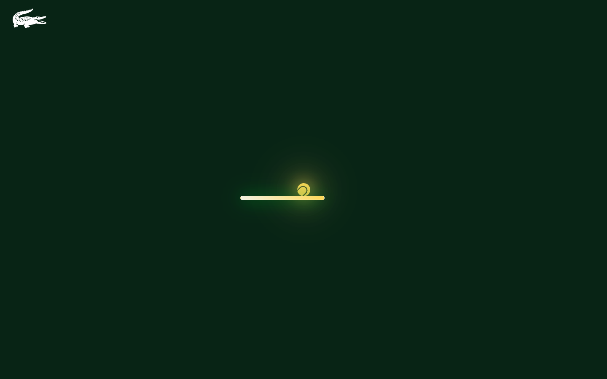
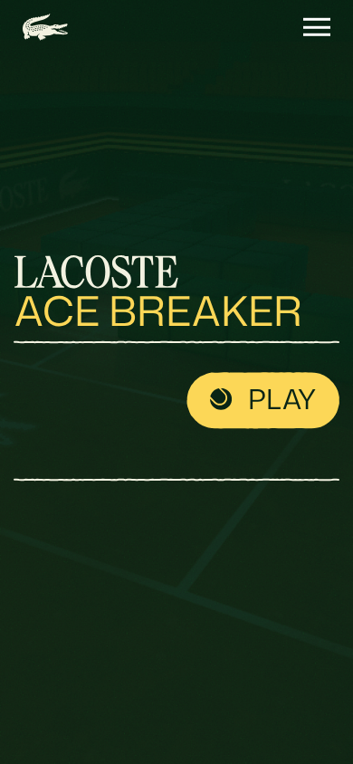

# UI Design System & Master Generation Blueprint: members-play-lacoste-com_ace-breaker-rg

> **Lacoste - Ace breaker** (https://members-play.lacoste.com/ace-breaker-rg) — Play and break as many bricks as you can



---

## 1. Executive Visual Persona & Design Archetype

- **Brand Essence & Persona**: **Lacoste - Ace breaker** (`https://members-play.lacoste.com/ace-breaker-rg`). Play and break as many bricks as you can
- **Visual Archetype**: **Light-Gallery WebGL / Canvas Interactive Experience (`#b762ff` / `#ee5f62`)**.
- **Anti-AI-Slop Differentiators**:
  - **Source-Grounded Chromatic Polarity**: Anchors the viewport in `#b762ff` (`var(--bonus-racket)` in `:root`) paired with `#8eff9b` primary typography and `#ee5f62` accents.
  - **Extracted Typographic Hierarchy**: Pairs `MonaSans` for display copy (`Lacoste - Ace breaker`) with `Arial` and not declared in static CSS (uses primary stack / `ui-monospace`).
  - **Calibrated Spatial Grid & Motion**: Combines `1024px` container bounds (`gap: 20px`, padding `8px`) with `cubic-bezier(.25,.46,.45,.94)` easing and Three.js / WebGL Canvas Pipeline.

---

## 2. Spatial Architecture & Modular Grid Mathematics



### Viewport Allocation & Container Geometry
- **Captured Viewport Dimensions**: Desktop `1440×2400px` (`assets/desktop.png`, capped at 2400px multi-section capture), Mobile `390×2400px` (`assets/mobile.png`, capped at 2400px multi-section capture).
- **Master Container Bounds**: `1024px` extracted from `members-play-lacoste-com_ace-breaker-rg` stylesheet.
- **Canvas Lateral Padding & Spacing**: `8px` lateral canvas padding with `20px` grid gap.
- **Border Radius Scale**: `var(--a07d8100)`, `50%`, `8px`, `30px`.

### Responsive Breakpoint Architecture
- **Desktop Layout**: Multi-column CSS Grid / Flexbox layout at `1440px` (`max-width: 1024px`, `gap: 20px`).
- **Mobile Layout**: Single-column vertical stack at `390px` viewport width with `8px` horizontal padding.
- **Extracted CSS Media Queries**: `@media (min-width: 375px) and (max-width: 1024px)`, `@media (min-width: 1024px) and (max-width: 1900px)`, `@media (min-width: 1901px)`, `@media (max-width: 699px)`.

---

## 3. Color System, Materiality & Atmospheric Lighting

### Semantic Palette & Source Grounding
| Semantic Role | Ground-Truth Value | Extracted CSS Source / Selector |
|---|---|---|
| **Primary Canvas Substrate** | `#b762ff` | `var(--bonus-racket)` in `:root` |
| **Primary Typography Ink** | `#f58c58` | `var(--bonus-multiball)` in `:root` |
| **Elevated Surface / Card Substrate** | `#50caff` | `var(--bonus-defensive-wall)` in `:root` |
| **Interactive Accent / Highlight** | `#ee5f62` | `var(--bonus-powershot)` in `:root` |
| **Secondary / Muted Copy** | `#ffa7f0` | `var(--bonus-heavy-ball)` in `:root` |
| **Structural Hairline Border** | `#8eff9b` | `var(--bonus-smash)` in `:root` |

### Sanitized Root CSS Variables (`ui-ux.md` Ground Truth)
| Variable Name | Extracted Value | Semantic Role |
|---|---|---|
| `--cta-text` | `calc((22.5px) * var(--h-demult, 1))` | Typography Ink Token |
| `--home-title` | `calc((45px) * var(--h-demult, 1))` | Dimension / Scale Token |
| `--prize-title` | `calc((45px) * var(--h-demult, 1))` | Dimension / Scale Token |
| `--prize-text` | `calc((22px) * var(--h-demult, 1))` | Typography Ink Token |
| `--padding-header` | `calc((10px) * var(--h-demult, 1))` | Layout / Spatial Grid Token |
| `--size` | `calc((400px) * var(--h-demult, 1))` | Layout / Spatial Grid Token |
| `--prize-mult` | `calc((24px) * var(--h-demult, 1))` | Dimension / Scale Token |
| `--intro-title` | `calc((30px) * var(--h-demult, 1))` | Dimension / Scale Token |
| `--desc` | `calc((15px) * var(--h-demult, 1))` | Dimension / Scale Token |
| `--bonus-racket` | `#b762ff` | Color / Atmospheric Token |
| `--bonus-multiball` | `#f58c58` | Color / Atmospheric Token |
| `--bonus-defensive-wall` | `#50caff` | Color / Atmospheric Token |
| `--bonus-powershot` | `#ee5f62` | Color / Atmospheric Token |
| `--bonus-heavy-ball` | `#ffa7f0` | Color / Atmospheric Token |
| `--bonus-smash` | `#8eff9b` | Color / Atmospheric Token |
| `--game-size` | `calc((15px) * var(--h-demult, 1))` | Layout / Spatial Grid Token |

---

## 4. Typographic Scale & Editorial Hierarchy

### Font Family Stacks
- **Display Typography**: `MonaSans`.
- **Primary Body Stack**: `Arial`.
- **Technical / Metadata Stack**: not declared in static CSS (uses primary stack / `ui-monospace`).

### Typographic Scale & Rules (Extracted from Stylesheet & Variables)
- **Hero Display (`H1`)**: rule `h1` (`font-size: var(--title)`, `line-height: 1.1`, `letter-spacing: -.06em`).
- **Section Heading (`H2`)**: rule `h2` (`font-size: 1.5em`, `font-weight: bold`).
- **Body Copy**: rule `p` (`font-size: 20px`).
- **Metadata & Navigation Labels**: not explicitly declared on tag in static CSS (stylesheet font-size ladder: `var(--cta-text)`, `1em`, `14px`, `var(--home-title)`, `.4em`).

---

## 5. Choreographed Motion & Interaction Physics

### Primary Easing Curves
- **Extracted Timing Functions**: `cubic-bezier(.25,.46,.45,.94)`, `cubic-bezier(.55,0,.1,1)`, `cubic-bezier(.19,1,.22,1)`.

### Per-Element Transition & Choreography Rules
- **Selector `.base-cta[data-v-bd309550]`**: `transition: border-color .3s cubic-bezier(.25,.46,.45,.94),transform .3s c...` extracted from `members-play-lacoste-com_ace-breaker-rg` stylesheet.
- **Selector `.base-cta.is-result[data-v-bd309550]`**: `transition: border .3s cubic-bezier(.25,.46,.45,.94),transform .3s cubic-b...` extracted from `members-play-lacoste-com_ace-breaker-rg` stylesheet.
- **Selector `.base-cta.is-inv[data-v-bd309550]`**: `transition: border .3s cubic-bezier(.25,.46,.45,.94),transform .3s cubic-b...` extracted from `members-play-lacoste-com_ace-breaker-rg` stylesheet.
- **Extracted Easing Curve (`cubic-bezier(.25,.46,.45,.94)`)**: Governs interactive state transitions across `<header.desktop>` and `<main.ui>`.
- **Runtime Interaction Engine**: Integrates Three.js / WebGL Canvas Pipeline with `prefers-reduced-motion: reduce` fallback guards.

---

## 6. Component Wireframe & Structural DOM Map

### Visual Layout Schematic (Grounded in `dom.html` — `1440px` Desktop & `390px` Mobile Reflow)
```
┌────────────────────────────────────────────────────────────────────────┐
│ DESKTOP VIEWPORT (1440px) — Lacoste - Ace breaker                      │
│ ====================================================================== │
│ [ <header.desktop>         | our 3 partners                         ]  │
│ ---------------------------------------------------------------------- │
│ | HERO STAGE: <main.ui>                                            |   │
│ | H1: Lacoste - Ace breaker                                        |   │
│ | Substrate: #b762ff    | Ink: #8eff9b    | Accent: #ee5f62        |   │
│ ---------------------------------------------------------------------- │
│ | SHOWCASE GRID (<main.ui>                 ) max-w: 1024px         |   │
│ | +------------------------------+  +------------------------------+ | │
│ | | Featured Work & Interactive  |  | Technical Architecture & Nar | | │
│ | +------------------------------+  +------------------------------+ | │
│ ---------------------------------------------------------------------- │
│ | MOBILE VIEWPORT REFLOW (390px) — Single-Column Stack (gap: 20px  ) | │
│ | [<header.desktop>] -> [<main.ui>] -> [<main.ui>] |                   │
│ ---------------------------------------------------------------------- │
│ [ FOOTER (<footer.didomi-popup-o) | https://members-play.lacoste.com/a │
└────────────────────────────────────────────────────────────────────────┘
```

### Granular DOM Region Breakdown
1. **Brand Header & Navigation Bar (<header.desktop> — `members-play-lacoste-com_ace-breaker-rg`)**:
   - Landmark `<header class="desktop">` hosting `Lacoste - Ace breaker` navigation (`our 3 partners`), DOM attributes (`data-nosnippet="true"`, `data-lang-dir="ltr"`, `data-testid="notice"`, `data-v-app`), and stylesheet rule `path { fill:fcd757 }`.
2. **Hero Stage & Focal Lead (<main.ui> — `Lacoste - Ace breaker`)**:
   - Landmark `<main class="ui">` presenting display lead `Lacoste - Ace breaker` and copy excerpt *"With your agreement, we and our 3 partners use cookies or similar"* over `#b762ff` canvas and `#8eff9b` ink.
3. **Primary Showcase & Content Grid (<main.ui> — `Featured Work & Interactive Showca`)**:
   - Landmark `<main class="ui">` rendering section `Featured Work & Interactive Showcase` with copy *"We and our partners process data for the following purposes: Pers"*, asset references (`loader.js`, `favicon.ico`, `favicon_dark.svg`, `favicon_light.svg`), and grid rule `disabled { pointer-events:none;opacity:.5 }`.
4. **Interactive Detail & Feature Matrix (<main.ui> — `Technical Architecture & Narrative`)**:
   - Landmark `<main class="ui">` framing `Technical Architecture & Narrative` and `Global Directory & Contact` (*"We and our partners process data for the following purposes:"*) with `#50caff` surface cards, `#ee5f62` accents, and `hover { background:fff;transform:scale(1.05) }`.
5. **Colophon & Global Directory Footer (<footer.didomi-popup-open> — `https://members-play.lacoste.com/ace-breaker-rg`)**:
   - Landmark `<footer class="didomi-popup-open">` anchoring `Lacoste - Ace breaker` footer links (`our 3 partners`), copy *"Personalised advertising and content, advertising and conten"*, and `#8eff9b` structural dividers.

---

## 7. Master Zero-Shot AI Generation Prompt

```markdown
# Master Zero-Shot Frontend Generation Prompt: members-play-lacoste-com_ace-breaker-rg (Lacoste - Ace breaker)

You are a principal frontend architect and design systems engineer. Build a complete, production-ready web application replicating the exact design system, DOM landmarks, typographic hierarchy, color tokens, and motion physics of `members-play-lacoste-com_ace-breaker-rg` (**Lacoste - Ace breaker** — `https://members-play.lacoste.com/ace-breaker-rg`).

### 1. Visual Archetype & Anti-AI-Slop Mandates
- **Archetype**: Light-Gallery WebGL / Canvas Interactive Experience (`#b762ff` / `#ee5f62`).
- **Identity & Domain Context**: Play and break as many bricks as you can
- **Primary Substrate**: `#b762ff` (`var(--bonus-racket)` in `:root`), **Primary Ink**: `#8eff9b`, **Accent / Highlight**: `#ee5f62`.
- **Site-Specific Differentiators**:
  - **Source-Grounded Chromatic Polarity**: Anchors the viewport in `#b762ff` (`var(--bonus-racket)` in `:root`) paired with `#8eff9b` primary typography and `#ee5f62` accents.
  - **Extracted Typographic Hierarchy**: Pairs `MonaSans` for display copy (`Lacoste - Ace breaker`) with `Arial` and not declared in static CSS (uses primary stack / `ui-monospace`).
  - **Calibrated Spatial Grid & Motion**: Combines `1024px` container bounds (`gap: 20px`, padding `8px`) with `cubic-bezier(.25,.46,.45,.94)` easing and Three.js / WebGL Canvas Pipeline.

### 2. Ground-Truth CSS Variables (`:root` Token Contract)
Declare and consume these exact custom properties extracted from `members-play-lacoste-com_ace-breaker-rg` in your global stylesheet:

:root {
  /* Lacoste - Ace breaker (members-play-lacoste-com_ace-breaker-rg) — Ground-Truth Extracted CSS Variables */
  --cta-text: calc((22.5px) * var(--h-demult, 1)); /* Typography Ink Token (members-play-lacoste-com_ace-breaker-rg) */
  --home-title: calc((45px) * var(--h-demult, 1)); /* Dimension / Scale Token (members-play-lacoste-com_ace-breaker-rg) */
  --prize-title: calc((45px) * var(--h-demult, 1)); /* Dimension / Scale Token (members-play-lacoste-com_ace-breaker-rg) */
  --prize-text: calc((22px) * var(--h-demult, 1)); /* Typography Ink Token (members-play-lacoste-com_ace-breaker-rg) */
  --padding-header: calc((10px) * var(--h-demult, 1)); /* Layout / Spatial Grid Token (members-play-lacoste-com_ace-breaker-rg) */
  --size: calc((400px) * var(--h-demult, 1)); /* Layout / Spatial Grid Token (members-play-lacoste-com_ace-breaker-rg) */
  --prize-mult: calc((24px) * var(--h-demult, 1)); /* Dimension / Scale Token (members-play-lacoste-com_ace-breaker-rg) */
  --intro-title: calc((30px) * var(--h-demult, 1)); /* Dimension / Scale Token (members-play-lacoste-com_ace-breaker-rg) */
  --desc: calc((15px) * var(--h-demult, 1)); /* Dimension / Scale Token (members-play-lacoste-com_ace-breaker-rg) */
  --bonus-racket: #b762ff; /* Color / Atmospheric Token (members-play-lacoste-com_ace-breaker-rg) */
  --bonus-multiball: #f58c58; /* Color / Atmospheric Token (members-play-lacoste-com_ace-breaker-rg) */
  --bonus-defensive-wall: #50caff; /* Color / Atmospheric Token (members-play-lacoste-com_ace-breaker-rg) */
  --bonus-powershot: #ee5f62; /* Color / Atmospheric Token (members-play-lacoste-com_ace-breaker-rg) */
  --bonus-heavy-ball: #ffa7f0; /* Color / Atmospheric Token (members-play-lacoste-com_ace-breaker-rg) */
  --bonus-smash: #8eff9b; /* Color / Atmospheric Token (members-play-lacoste-com_ace-breaker-rg) */
  --game-size: calc((15px) * var(--h-demult, 1)); /* Layout / Spatial Grid Token (members-play-lacoste-com_ace-breaker-rg) */
}

### 3. Semantic Color & Materiality Contract
Map every surface, ink, and border strictly to these source-grounded tokens:
- **Primary Canvas Substrate**: `#b762ff` — grounded in `var(--bonus-racket)` in `:root`
- **Primary Typography Ink**: `#f58c58` — grounded in `var(--bonus-multiball)` in `:root`
- **Elevated Surface / Card Substrate**: `#50caff` — grounded in `var(--bonus-defensive-wall)` in `:root`
- **Interactive Accent / Highlight**: `#ee5f62` — grounded in `var(--bonus-powershot)` in `:root`
- **Secondary / Muted Copy**: `#ffa7f0` — grounded in `var(--bonus-heavy-ball)` in `:root`
- **Structural Hairline Border**: `#8eff9b` — grounded in `var(--bonus-smash)` in `:root`

### 4. Spatial Grid, Container Bounds & Responsive Breakpoints
- **Desktop Viewport Reference**: `1440×2400px` (capped at 2400px multi-section capture, `1440px` standard desktop width).
- **Mobile Viewport Reference**: `390×2400px` (capped at 2400px multi-section capture, `390px` standard mobile width).
- **Container Max-Width**: `1024px` extracted from `members-play-lacoste-com_ace-breaker-rg` stylesheet
- **Padding & Gutters**: `8px` lateral canvas padding with `20px` grid gap
- **Desktop Grid**: Multi-column CSS Grid / Flexbox layout at `1440px` (`max-width: 1024px`, `gap: 20px`)
- **Mobile Adaptation**: Single-column vertical stack at `390px` viewport width with `8px` horizontal padding
- **Media Queries**: `@media (min-width: 375px) and (max-width: 1024px)`, `@media (min-width: 1024px) and (max-width: 1900px)`, `@media (min-width: 1901px)`, `@media (max-width: 699px)`
- **Corner Radii**: `var(--a07d8100)`, `50%`, `8px`, `30px`

### 5. Typography & Editorial Scale Contract
- **Display Font Stack**: `MonaSans`
- **Body Font Stack**: `Arial`
- **Monospace / Technical Font Stack**: not declared in static CSS (uses primary stack / `ui-monospace`)
- **H1 Display Rule**: rule `h1` (`font-size: var(--title)`, `line-height: 1.1`, `letter-spacing: -.06em`)
- **H2 Section Rule**: rule `h2` (`font-size: 1.5em`, `font-weight: bold`)
- **Body Copy Rule**: rule `p` (`font-size: 20px`)
- **Metadata & Index Rule**: not explicitly declared on tag in static CSS (stylesheet font-size ladder: `var(--cta-text)`, `1em`, `14px`, `var(--home-title)`, `.4em`)

### 6. Component Hierarchy, Verbatim Copy & Real DOM Landmarks
Scaffold `members-play-lacoste-com_ace-breaker-rg` (`Lacoste - Ace breaker`) with these exact structural regions, extracted copy, and CSS rules from `dom.html`:
1. **Brand Header & Navigation Bar (<header.desktop> — `members-play-lacoste-com_ace-breaker-rg`)**:
   - DOM & Selectors: Landmark `<header class="desktop">` hosting `Lacoste - Ace breaker` navigation (`our 3 partners`), DOM attributes (`data-nosnippet="true"`, `data-lang-dir="ltr"`, `data-testid="notice"`, `data-v-app`), and stylesheet rule `path { fill:fcd757 }`.
   - Responsive Contract: Header `Brand Header & Navigation Bar (<header.desktop> — `members-play-lacoste-com_ace-breaker-rg`)` (`members-play-lacoste-com_ace-breaker-rg`) adapts across `@media (min-width: 375px) and (max-width: 1024px)`, `@media (min-width: 1024px) and (max-width: 1900px)`, `@media (min-width: 1901px)`, `@media (max-width: 699px)` with `cubic-bezier(.25,.46,.45,.94)`, `cubic-bezier(.55,0,.1,1)`, `cubic-bezier(.19,1,.22,1)` transitions and links `our 3 partners`.
2. **Hero Stage & Focal Lead (<main.ui> — `Lacoste - Ace breaker`)**:
   - DOM & Selectors: Landmark `<main class="ui">` presenting display lead `Lacoste - Ace breaker` and copy excerpt *"With your agreement, we and our 3 partners use cookies or similar"* over `#b762ff` canvas and `#8eff9b` ink.
   - Responsive Contract: Hero stage (`1440×2400px` desktop / `390×2400px` mobile) sets `#b762ff` background with `#8eff9b` headline `Lacoste - Ace breaker`.
3. **Primary Showcase & Content Grid (<main.ui> — `Featured Work & Interactive Showca`)**:
   - DOM & Selectors: Landmark `<main class="ui">` rendering section `Featured Work & Interactive Showcase` with copy *"We and our partners process data for the following purposes: Pers"*, asset references (`loader.js`, `favicon.ico`, `favicon_dark.svg`, `favicon_light.svg`), and grid rule `disabled { pointer-events:none;opacity:.5 }`.
   - Responsive Contract: Showcase grid `Primary Showcase & Content Grid (<main.ui> — `Featured Work & Interactive Showca`)` applies Multi-column CSS Grid / Flexbox layout at `1440px` (`max-width: 1024px`, `gap: 20px`) on desktop and Single-column vertical stack at `390px` viewport width with `8px` horizontal padding on mobile.
4. **Interactive Detail & Feature Matrix (<main.ui> — `Technical Architecture & Narrative`)**:
   - DOM & Selectors: Landmark `<main class="ui">` framing `Technical Architecture & Narrative` and `Global Directory & Contact` (*"We and our partners process data for the following purposes:"*) with `#50caff` surface cards, `#ee5f62` accents, and `hover { background:fff;transform:scale(1.05) }`.
   - Responsive Contract: Detail module `Interactive Detail & Feature Matrix (<main.ui> — `Technical Architecture & Narrative`)` uses `var(--a07d8100)`, `50%`, `8px`, `30px` radii, `#ee5f62` highlights, and assets (loader.js, favicon.ico, favicon_dark.svg).
5. **Colophon & Global Directory Footer (<footer.didomi-popup-open> — `https://members-play.lacoste.com/ace-breaker-rg`)**:
   - DOM & Selectors: Landmark `<footer class="didomi-popup-open">` anchoring `Lacoste - Ace breaker` footer links (`our 3 partners`), copy *"Personalised advertising and content, advertising and conten"*, and `#8eff9b` structural dividers.
   - Responsive Contract: Footer `Colophon & Global Directory Footer (<footer.didomi-popup-open> — `https://members-play.lacoste.com/ace-breaker-rg`)` aligns to `1024px` extracted from `members-play-lacoste-com_ace-breaker-rg` stylesheet with `8px` lateral canvas padding with `20px` grid gap and attributes (data-nosnippet="true", data-lang-dir="ltr", data-testid="notice").

#### Verbatim DOM Copy Excerpts (`dom.html`)
- Copy Excerpt 1: *"With your agreement, we and our 3 partners use cookies or similar technologies to..."*
- Copy Excerpt 2: *"We and our partners process data for the following purposes: Personalised advertis..."*
- Copy Excerpt 3: *"We and our partners process data for the following purposes:"*
- Copy Excerpt 4: *"Personalised advertising and content, advertising and content measurement, audienc..."*

### 7. Motion, Extracted Stylesheet Rules & Interaction Choreography
- **Primary Easing Functions**: `cubic-bezier(.25,.46,.45,.94)`, `cubic-bezier(.55,0,.1,1)`, `cubic-bezier(.19,1,.22,1)`
- **Extracted Stylesheet Rules (`members-play-lacoste-com_ace-breaker-rg`)**:
- `path { fill:fcd757 }`
- `disabled { pointer-events:none;opacity:.5 }`
- `hover { background:fff;transform:scale(1.05) }`
- `strong { color:fcd757 }`
- `.animated-title { font-family:var(--font-title);line-height:1.05;color:f3f2e1;text-transfo... }`
- **Per-Selector Transition Rules**:
- **Selector `.base-cta[data-v-bd309550]`**: `transition: border-color .3s cubic-bezier(.25,.46,.45,.94),transform .3s c...` extracted from `members-play-lacoste-com_ace-breaker-rg` stylesheet.
- **Selector `.base-cta.is-result[data-v-bd309550]`**: `transition: border .3s cubic-bezier(.25,.46,.45,.94),transform .3s cubic-b...` extracted from `members-play-lacoste-com_ace-breaker-rg` stylesheet.
- **Selector `.base-cta.is-inv[data-v-bd309550]`**: `transition: border .3s cubic-bezier(.25,.46,.45,.94),transform .3s cubic-b...` extracted from `members-play-lacoste-com_ace-breaker-rg` stylesheet.
- **Extracted Easing Curve (`cubic-bezier(.25,.46,.45,.94)`)**: Governs interactive state transitions across `<header.desktop>` and `<main.ui>`.
- **Runtime Interaction Engine**: Integrates Three.js / WebGL Canvas Pipeline with `prefers-reduced-motion: reduce` fallback guards.

### 8. Technical Deliverables
- Implement in Next.js (App Router) with TypeScript and Tailwind CSS consuming the `:root` custom properties defined above for `members-play-lacoste-com_ace-breaker-rg`.
- Reproduce both the `1440px` desktop architecture and `390px` mobile breakpoint transitions, preserving semantic HTML5 landmarks (`<header>`, `<nav>`, `<main>`, `<section>`, `<footer>`) and `prefers-reduced-motion` accessibility guards.
```
