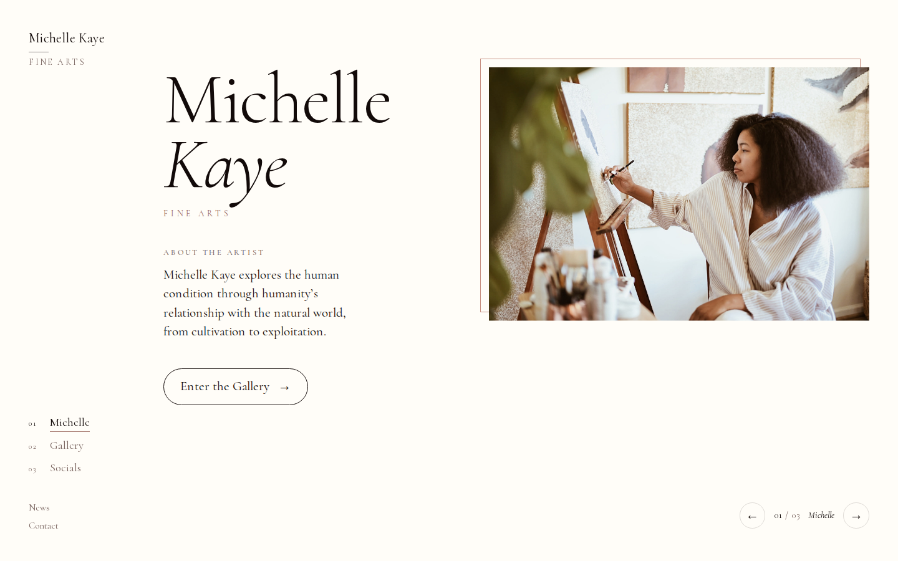
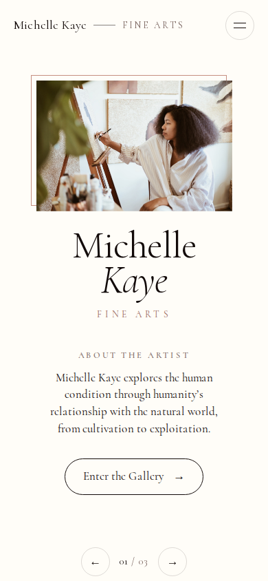

# UI Design System & Master Generation Blueprint: michellekayewashington-com

> **Michelle Kaye — Fine Arts · Contemporary Artist, Charleston SC** (https://michellekayewashington.com/) — Michelle Kaye is a contemporary artist in Charleston, SC, exploring humanity’s relationship with the natural world. See Against the Grain...



---

## 1. Executive Visual Persona & Design Archetype

- **Brand Essence & Persona**: **Michelle Kaye — Fine Arts · Contemporary Artist, Charleston SC** (`https://michellekayewashington.com/`). Michelle Kaye is a contemporary artist in Charleston, SC, exploring humanity’s relationship with the natural world. See Against the Grain...
- **Capture Provenance**: Live browser capture (`tier1_fast`, HTTP `200`, captured `2026-11-23`).
- **Visual Archetype**: **Light-Substrate Editorial & Modular Grid System (`#fffdf8` canvas, `#120a09` ink, `#7a6560` accent)**.
- **Anti-AI-Slop Differentiators**:
  - **Live-Computed Chromatic Polarity**: Anchors the viewport in `#fffdf8` (live computed `body` `background-color` (`computed_styles.json`)) paired with `#120a09` primary typography and `#7a6560` accents.
  - **Grounded Typographic Hierarchy**: Pairs `Cormorant` for display copy (`Michelle Kaye`) with `Cormorant` and not declared in live computed styles (uses primary stack / `ui-monospace`).
  - **Calibrated Spatial Grid & Motion**: Combines `1224px` container bounds (`gap: 40px`, padding `46.08px`) with `cubic-bezier(0.22,1,0.36,1)` easing and Lenis Smooth Scroll (`data-lenis`).

---

## 2. Spatial Architecture & Modular Grid Mathematics



### Viewport Allocation & Container Geometry
- **Captured Viewport Dimensions**: Desktop `1440×900px` (`assets/desktop.png`, single-viewport 100vh live capture (900px)), Mobile `390×844px` (`assets/mobile.png`, single-viewport 100vh live capture (844px)).
- **Master Container Bounds**: `1224px` (measured `<main>` bounding box width within `1440px` desktop viewport).
- **Canvas Lateral Padding & Spacing**: `46.08px` lateral canvas padding with `40px` grid gap.
- **Border Radius Scale**: `50%`, `999px`, `1px`, `4px`.

### Responsive Breakpoint Architecture
- **Desktop Layout**: Multi-column CSS Grid / Flexbox layout at `1440px` (`max-width: 1224px`, `gap: 40px`).
- **Mobile Layout**: Single-column vertical stack at `390px` viewport width with `46.08px` horizontal padding.
- **Extracted CSS Media Queries**: `@media (max-width: 599px)`, `@media (max-height: 480px)`, `@media (prefers-reduced-motion: reduce)`, `@media (max-width: 899px), (max-width: 999px) and (max-height: 5...`.

---

## 3. Color System, Materiality & Atmospheric Lighting

### Semantic Palette & Source Grounding
| Semantic Role | Ground-Truth Value | Extracted Live / CSS Source |
|---|---|---|
| **Primary Canvas Substrate** | `#fffdf8` | live computed `body` `background-color` (`computed_styles.json`) |
| **Primary Typography Ink** | `#120a09` | live computed `h1` `color` (`computed_styles.json`) |
| **Elevated Surface / Card Substrate** | `#f6f0e8` | `var(--paper-2)` in `:root` |
| **Interactive Accent / Highlight** | `#7a6560` | live computed `button` `color` (`computed_styles.json`) |
| **Secondary / Muted Copy** | `#9a675c` | live computed `p` `color` (`computed_styles.json`) |
| **Structural Hairline Border** | `#dedbd7` | `var(--rule)` in `:root` (`rgb(18 10 9 / 14%)`) |
| **Variable Token (`--ink-2`)** | `#2b201d` | `var(--ink-2)` in `:root` |
| **Variable Token (`--rose-2`)** | `#c68f81` | `var(--rose-2)` in `:root` |
| **Variable Token (`--tan`)** | `#b7a397` | `var(--tan)` in `:root` |

### Sanitized Root CSS Variables (`ui-ux.md` Ground Truth)
| Variable Name | Extracted Value | Semantic Role |
|---|---|---|
| `--paper` | `#fffdf8` | Canvas / Surface Token |
| `--paper-2` | `#f6f0e8` | Canvas / Surface Token |
| `--ink` | `#120a09` | Typography Ink Token |
| `--ink-2` | `#2b201d` | Typography Ink Token |
| `--rose` | `#9a675c` | Color / Atmospheric Token |
| `--rose-2` | `#c68f81` | Color / Atmospheric Token |
| `--tan` | `#b7a397` | Color / Atmospheric Token |
| `--rule` | `rgb(18 10 9 / 14%)` | Color / Atmospheric Token |
| `--fg` | `var(--ink)` | Typography Ink Token |
| `--bg` | `var(--paper)` | Canvas / Surface Token |
| `--muted` | `#7a6560` | Color / Atmospheric Token |
| `--nav-w` | `clamp(190px, 15vw, 300px)` | Layout / Spatial Grid Token |
| `--pad` | `clamp(1.25rem, 3.2vw, 4rem)` | Layout / Spatial Grid Token |
| `--ease` | `cubic-bezier(0.22, 1, 0.36, 1)` | Motion / Easing Token |
| `--ease-io` | `cubic-bezier(0.65, 0, 0.35, 1)` | Motion / Easing Token |
| `--serif` | `"Cormorant", Georgia, "Times New Roman", serif` | Typography / Scale Token |

---

## 4. Typographic Scale & Editorial Hierarchy

### Font Family Stacks
- **Display Typography**: `Cormorant`.
- **Primary Body Stack**: `Cormorant`.
- **Technical / Metadata Stack**: not declared in live computed styles (uses primary stack / `ui-monospace`).

### Typographic Scale & Rules (Live Computed & Stylesheet Grounded)
- **Hero Display (`H1`)**: live computed `h1` (`font-size: 115.2px`, `line-height: 103.68px`, `font-weight: 300`, `letter-spacing: -2.304px`).
- **Section Heading (`H2`)**: live computed `h2` (`font-size: 12.48px`, `line-height: 18.096px`, `font-weight: 500`, `letter-spacing: 2.7456px`).
- **Body Copy**: live computed `body` (`font-size: 21px`, `line-height: 30.45px`, `font-weight: 400`); rule `body` (`font-size: clamp(17px, 1.05vw + 10px, 21px)`, `line-height: 1.45`).
- **Metadata & Navigation Labels**: live computed `nav/a` (`font-size: 21px`, `line-height: 30.45px`, `font-weight: 400`).

---

## 5. Choreographed Motion & Interaction Physics

### Primary Easing Curves
- **Extracted Timing Functions**: `cubic-bezier(0.22,1,0.36,1)`, `cubic-bezier(0.65,0,0.35,1)`.

### Per-Element Transition & Choreography Rules
- **Selector `body`**: `transition: background-color 0.9s var(--ease), color 0.9s var(--ease)` extracted from `michellekayewashington-com` stylesheet.
- **Selector `.nav-index a`**: `transition: color 0.3s var(--ease)` extracted from `michellekayewashington-com` stylesheet.
- **Selector `.nav-label::after`**: `transition: transform 0.45s var(--ease)` extracted from `michellekayewashington-com` stylesheet.
- **Extracted Easing Curve (`cubic-bezier(0.22,1,0.36,1)`)**: Governs interactive state transitions across `<header.shell>` and `<section.home:nth(2)>`.
- **Runtime Interaction Engine**: Integrates Lenis Smooth Scroll (`data-lenis`) with `prefers-reduced-motion: reduce` fallback guards.

---

## 6. Component Wireframe & Structural DOM Map

### Visual Layout Schematic — Desktop (`1440px`, Grounded in `dom.html` & Landmark Bounding Boxes)
```
┌────────────────────────────────────────────────────────────────────────┐
│ DESKTOP VIEWPORT (1440px) — Michelle Kaye — Fine Arts · Contemporary A │
│ ====================================================================== │
│ [ <header.shell> (216x900px)          | 01 Michelle · 02 Gallery · 0 ] │
│ ---------------------------------------------------------------------- │
│ | HERO STAGE: <section.home> (w=1224px)                              | │
│ | H1: Michelle Kaye                                                  | │
│ | Substrate: #fffdf8 | Ink: #120a09 | Accent: #7a6560                | │
│ ---------------------------------------------------------------------- │
│ | SHOWCASE GRID (<section.home:nth(2)>) max-w: 1224px                | │
│ | +------------------------------+  +------------------------------+ | │
│ | | About the Artist             |  | Ways to get in touch         | | │
│ | +------------------------------+  +------------------------------+ | │
│ ---------------------------------------------------------------------- │
│ | DETAIL MODULE (<section.home:nth(3)>) — Keep scrolling to the      | │
│ ---------------------------------------------------------------------- │
│ [ FOOTER (<footer.wordmark-nam) | https://michellekayewashington.com/  │
└────────────────────────────────────────────────────────────────────────┘
```

### Visual Layout Schematic — Mobile Reflow (`390px`)
```
┌────────────────────────────────────────────────────────────────────────┐
│ MOBILE VIEWPORT REFLOW (390px) — Single-Column Stack (gap: 40px)       │
│ ====================================================================== │
│ [ HEADER BAR (<header.shell>          ) | Compact Menu (390px)         │
│ ---------------------------------------------------------------------- │
│ | HERO STAGE (<section.home>) — 390px Vertical Lead                  | │
│ | H1: Michelle Kaye                                                  | │
│ ---------------------------------------------------------------------- │
│ | SHOWCASE STACK (<section.home:nth(2)>) — 1-Col Stack               | │
│ | [ Item 1: About the Artist                                       ] | │
│ | [ Item 2: Ways to get in touch                                   ] | │
│ ---------------------------------------------------------------------- │
│ | DETAIL STACK (<section.home:nth(3)>) — 1-Col (Keep scrolling to )  | │
│ ---------------------------------------------------------------------- │
│ [ FOOTER (<footer.wordmark-nam) | Stacked 390px Colophon               │
└────────────────────────────────────────────────────────────────────────┘
```

### Granular DOM Region Breakdown
1. **Brand Header & Navigation Bar (<header.shell> — `michellekayewashington-com`)**:
   - Landmark `<header class="shell">` (`216x900px`) hosting `Michelle Kaye — Fine Arts · Contempo` navigation (`01 Michelle · 02 Gallery · 03 Socials · Charleston Magazine`), DOM attributes (`data-page="index"`, `data-ready="index"`, `data-shell`, `data-nav="index"`), and stylesheet rule `html { --room-title: var(--fg); }`.
2. **Hero Stage & Focal Lead (<section.home> — `Michelle Kaye`)**:
   - Landmark `<section class="home">` presenting display lead `Michelle Kaye` and copy excerpt *"Michelle Kaye explores the human condition through humanity’s rel"* over `#fffdf8` canvas and `#120a09` ink.
3. **Primary Showcase & Content Grid (<section.home:nth(2)> — `About the Artist`)**:
   - Landmark `<section class="home">` rendering section `About the Artist` with copy *"Ways to get in touch"*, asset references (`favicon.ico`, `favicon.svg`, `apple-touch-icon.png`, `site.webmanifest`), and grid rule `after { box-sizing: border-box; }`.
4. **Interactive Detail & Feature Matrix (<section.home:nth(3)> — `Ways to get in touch`)**:
   - Landmark `<section class="home">` framing `Ways to get in touch` and `Keep scrolling to the Gallery` (*"Keep scrolling to the Gallery"*) with `#f6f0e8` surface cards, `#7a6560` accents, and `body { margin: 0; height: 100%; }`.
5. **Colophon & Global Directory Footer (<footer.wordmark-name> — `https://michellekayewashington.com/`)**:
   - Landmark `<footer class="wordmark-name">` anchoring `Michelle Kaye — Fine Arts · Cont` footer links (`01 Michelle · 02 Gallery · 03 Socials · Charleston Magazine`), copy *"Ways to get in touch"*, and `#dedbd7` structural dividers.

---

## 7. Master Zero-Shot AI Generation Prompt

```markdown
# Master Zero-Shot Frontend Generation Prompt: michellekayewashington-com (Michelle Kaye — Fine Arts · Contemporary Artist, Charleston SC)

You are a principal frontend architect and design systems engineer. Build a complete, production-ready web application replicating the exact design system, DOM landmarks, typographic hierarchy, color tokens, and motion physics of `michellekayewashington-com` (**Michelle Kaye — Fine Arts · Contemporary Artist, Charleston SC** — `https://michellekayewashington.com/`).

### 1. Visual Archetype & Anti-AI-Slop Mandates
- **Archetype**: Light-Substrate Editorial & Modular Grid System (`#fffdf8` canvas, `#120a09` ink, `#7a6560` accent).
- **Identity & Domain Context**: Michelle Kaye is a contemporary artist in Charleston, SC, exploring humanity’s relationship with the natural world. See Against the Grain...
- **Primary Substrate**: `#fffdf8` (live computed `body` `background-color` (`computed_styles.json`)), **Primary Ink**: `#120a09`, **Accent / Highlight**: `#7a6560`.
- **Site-Specific Differentiators**:
  - **Live-Computed Chromatic Polarity**: Anchors the viewport in `#fffdf8` (live computed `body` `background-color` (`computed_styles.json`)) paired with `#120a09` primary typography and `#7a6560` accents.
  - **Grounded Typographic Hierarchy**: Pairs `Cormorant` for display copy (`Michelle Kaye`) with `Cormorant` and not declared in live computed styles (uses primary stack / `ui-monospace`).
  - **Calibrated Spatial Grid & Motion**: Combines `1224px` container bounds (`gap: 40px`, padding `46.08px`) with `cubic-bezier(0.22,1,0.36,1)` easing and Lenis Smooth Scroll (`data-lenis`).

### 2. Ground-Truth CSS Variables (`:root` Token Contract)
Declare and consume these exact custom properties extracted from `michellekayewashington-com` in your global stylesheet:

:root {
  /* Michelle Kaye — Fine Arts · Contemporary Artist, Charleston SC (michellekayewashington-com) — Live-Grounded CSS Variables */
  --paper: #fffdf8; /* Canvas / Surface Token (michellekayewashington-com) */
  --paper-2: #f6f0e8; /* Canvas / Surface Token (michellekayewashington-com) */
  --ink: #120a09; /* Typography Ink Token (michellekayewashington-com) */
  --ink-2: #2b201d; /* Typography Ink Token (michellekayewashington-com) */
  --rose: #9a675c; /* Color / Atmospheric Token (michellekayewashington-com) */
  --rose-2: #c68f81; /* Color / Atmospheric Token (michellekayewashington-com) */
  --tan: #b7a397; /* Color / Atmospheric Token (michellekayewashington-com) */
  --rule: rgb(18 10 9 / 14%); /* Color / Atmospheric Token (michellekayewashington-com) */
  --fg: var(--ink); /* Typography Ink Token (michellekayewashington-com) */
  --bg: var(--paper); /* Canvas / Surface Token (michellekayewashington-com) */
  --muted: #7a6560; /* Color / Atmospheric Token (michellekayewashington-com) */
  --nav-w: clamp(190px, 15vw, 300px); /* Layout / Spatial Grid Token (michellekayewashington-com) */
  --pad: clamp(1.25rem, 3.2vw, 4rem); /* Layout / Spatial Grid Token (michellekayewashington-com) */
  --ease: cubic-bezier(0.22, 1, 0.36, 1); /* Motion / Easing Token (michellekayewashington-com) */
  --ease-io: cubic-bezier(0.65, 0, 0.35, 1); /* Motion / Easing Token (michellekayewashington-com) */
  --serif: "Cormorant", Georgia, "Times New Roman", serif; /* Typography / Scale Token (michellekayewashington-com) */
}

### 3. Semantic Color & Materiality Contract
Map every surface, ink, and border strictly to these source-grounded tokens:
- **Primary Canvas Substrate**: `#fffdf8` — grounded in live computed `body` `background-color` (`computed_styles.json`)
- **Primary Typography Ink**: `#120a09` — grounded in live computed `h1` `color` (`computed_styles.json`)
- **Elevated Surface / Card Substrate**: `#f6f0e8` — grounded in `var(--paper-2)` in `:root`
- **Interactive Accent / Highlight**: `#7a6560` — grounded in live computed `button` `color` (`computed_styles.json`)
- **Secondary / Muted Copy**: `#9a675c` — grounded in live computed `p` `color` (`computed_styles.json`)
- **Structural Hairline Border**: `#dedbd7` — grounded in `var(--rule)` in `:root` (`rgb(18 10 9 / 14%)`)
- **Variable Token (`--ink-2`)**: `#2b201d` — grounded in `var(--ink-2)` in `:root`
- **Variable Token (`--rose-2`)**: `#c68f81` — grounded in `var(--rose-2)` in `:root`
- **Variable Token (`--tan`)**: `#b7a397` — grounded in `var(--tan)` in `:root`

### 4. Spatial Grid, Container Bounds & Responsive Breakpoints
- **Desktop Viewport Reference**: `1440×900px` (single-viewport 100vh live capture (900px), `1440px` standard desktop width).
- **Mobile Viewport Reference**: `390×844px` (single-viewport 100vh live capture (844px), `390px` standard mobile width).
- **Container Max-Width**: `1224px` (measured `<main>` bounding box width within `1440px` desktop viewport)
- **Padding & Gutters**: `46.08px` lateral canvas padding with `40px` grid gap
- **Desktop Grid**: Multi-column CSS Grid / Flexbox layout at `1440px` (`max-width: 1224px`, `gap: 40px`)
- **Mobile Adaptation**: Single-column vertical stack at `390px` viewport width with `46.08px` horizontal padding
- **Media Queries**: `@media (max-width: 599px)`, `@media (max-height: 480px)`, `@media (prefers-reduced-motion: reduce)`, `@media (max-width: 899px), (max-width: 999px) and (max-height: 5...`
- **Corner Radii**: `50%`, `999px`, `1px`, `4px`

### 5. Typography & Editorial Scale Contract
- **Display Font Stack**: `Cormorant`
- **Body Font Stack**: `Cormorant`
- **Monospace / Technical Font Stack**: not declared in live computed styles (uses primary stack / `ui-monospace`)
- **H1 Display Rule**: live computed `h1` (`font-size: 115.2px`, `line-height: 103.68px`, `font-weight: 300`, `letter-spacing: -2.304px`)
- **H2 Section Rule**: live computed `h2` (`font-size: 12.48px`, `line-height: 18.096px`, `font-weight: 500`, `letter-spacing: 2.7456px`)
- **Body Copy Rule**: live computed `body` (`font-size: 21px`, `line-height: 30.45px`, `font-weight: 400`); rule `body` (`font-size: clamp(17px, 1.05vw + 10px, 21px)`, `line-height: 1.45`)
- **Metadata & Index Rule**: live computed `nav/a` (`font-size: 21px`, `line-height: 30.45px`, `font-weight: 400`)

### 6. Component Hierarchy, Verbatim Copy & Real DOM Landmarks
Scaffold `michellekayewashington-com` (`Michelle Kaye — Fine Arts · Contemporary Artist, Charleston SC`) with these exact structural regions, extracted copy, and CSS rules from `dom.html`:
1. **Brand Header & Navigation Bar (<header.shell> — `michellekayewashington-com`)**:
   - DOM & Selectors: Landmark `<header class="shell">` (`216x900px`) hosting `Michelle Kaye — Fine Arts · Contempo` navigation (`01 Michelle · 02 Gallery · 03 Socials · Charleston Magazine`), DOM attributes (`data-page="index"`, `data-ready="index"`, `data-shell`, `data-nav="index"`), and stylesheet rule `html { --room-title: var(--fg); }`.
   - Responsive Contract: Header `Brand Header & Navigation Bar (<header.shell> — `michellekayewashington-com`)` (`michellekayewashington-com`) adapts across `@media (max-width: 599px)`, `@media (max-height: 480px)`, `@media (prefers-reduced-motion: reduce)`, `@media (max-width: 899px), (max-width: 999px) and (max-height: 5...` with `cubic-bezier(0.22,1,0.36,1)`, `cubic-bezier(0.65,0,0.35,1)` transitions and links `01 Michelle · 02 Gallery · 03 Socials · Charleston Magazine`.
2. **Hero Stage & Focal Lead (<section.home> — `Michelle Kaye`)**:
   - DOM & Selectors: Landmark `<section class="home">` presenting display lead `Michelle Kaye` and copy excerpt *"Michelle Kaye explores the human condition through humanity’s rel"* over `#fffdf8` canvas and `#120a09` ink.
   - Responsive Contract: Hero stage (`1440×900px` desktop / `390×844px` mobile) sets `#fffdf8` background with `#120a09` headline `Michelle Kaye`.
3. **Primary Showcase & Content Grid (<section.home:nth(2)> — `About the Artist`)**:
   - DOM & Selectors: Landmark `<section class="home">` rendering section `About the Artist` with copy *"Ways to get in touch"*, asset references (`favicon.ico`, `favicon.svg`, `apple-touch-icon.png`, `site.webmanifest`), and grid rule `after { box-sizing: border-box; }`.
   - Responsive Contract: Showcase grid `Primary Showcase & Content Grid (<section.home:nth(2)> — `About the Artist`)` applies Multi-column CSS Grid / Flexbox layout at `1440px` (`max-width: 1224px`, `gap: 40px`) on desktop and Single-column vertical stack at `390px` viewport width with `46.08px` horizontal padding on mobile.
4. **Interactive Detail & Feature Matrix (<section.home:nth(3)> — `Ways to get in touch`)**:
   - DOM & Selectors: Landmark `<section class="home">` framing `Ways to get in touch` and `Keep scrolling to the Gallery` (*"Keep scrolling to the Gallery"*) with `#f6f0e8` surface cards, `#7a6560` accents, and `body { margin: 0; height: 100%; }`.
   - Responsive Contract: Detail module `Interactive Detail & Feature Matrix (<section.home:nth(3)> — `Ways to get in touch`)` uses `50%`, `999px`, `1px`, `4px` radii, `#7a6560` highlights, and assets (favicon.ico, favicon.svg, apple-touch-icon.png).
5. **Colophon & Global Directory Footer (<footer.wordmark-name> — `https://michellekayewashington.com/`)**:
   - DOM & Selectors: Landmark `<footer class="wordmark-name">` anchoring `Michelle Kaye — Fine Arts · Cont` footer links (`01 Michelle · 02 Gallery · 03 Socials · Charleston Magazine`), copy *"Ways to get in touch"*, and `#dedbd7` structural dividers.
   - Responsive Contract: Footer `Colophon & Global Directory Footer (<footer.wordmark-name> — `https://michellekayewashington.com/`)` aligns to `1224px` (measured `<main>` bounding box width within `1440px` desktop viewport) with `46.08px` lateral canvas padding with `40px` grid gap and attributes (data-page="index", data-ready="index", data-shell).

#### Verbatim DOM Copy Excerpts (`dom.html`)
- Copy Excerpt 1: *"Michelle Kaye explores the human condition through humanity’s relationship with th..."*
- Copy Excerpt 2: *"Ways to get in touch"*
- Copy Excerpt 3: *"Keep scrolling to the Gallery"*

### 7. Motion, Extracted Stylesheet Rules & Interaction Choreography
- **Primary Easing Functions**: `cubic-bezier(0.22,1,0.36,1)`, `cubic-bezier(0.65,0,0.35,1)`
- **Extracted Stylesheet Rules (`michellekayewashington-com`)**:
- `html { --room-title: var(--fg); }`
- `after { box-sizing: border-box; }`
- `body { margin: 0; height: 100%; }`
- `img { display: block; max-width: 100%; height: auto; }`
- `button { font: inherit; color: inherit; }`
- **Per-Selector Transition Rules**:
- **Selector `body`**: `transition: background-color 0.9s var(--ease), color 0.9s var(--ease)` extracted from `michellekayewashington-com` stylesheet.
- **Selector `.nav-index a`**: `transition: color 0.3s var(--ease)` extracted from `michellekayewashington-com` stylesheet.
- **Selector `.nav-label::after`**: `transition: transform 0.45s var(--ease)` extracted from `michellekayewashington-com` stylesheet.
- **Extracted Easing Curve (`cubic-bezier(0.22,1,0.36,1)`)**: Governs interactive state transitions across `<header.shell>` and `<section.home:nth(2)>`.
- **Runtime Interaction Engine**: Integrates Lenis Smooth Scroll (`data-lenis`) with `prefers-reduced-motion: reduce` fallback guards.

### 8. Technical Deliverables
- Implement in Next.js (App Router) with TypeScript and Tailwind CSS consuming the `:root` custom properties defined above for `michellekayewashington-com`.
- Reproduce both the `1440px` desktop architecture and `390px` mobile breakpoint transitions, preserving semantic HTML5 landmarks (`<header>`, `<nav>`, `<main>`, `<section>`, `<footer>`) and `prefers-reduced-motion` accessibility guards.
```
