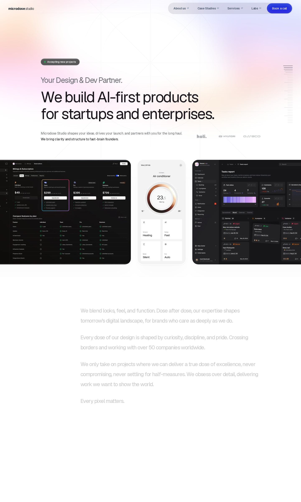
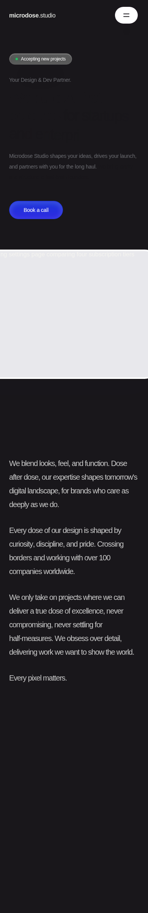

# UI Design System & Master Generation Blueprint: microdose-studio

> **Microdose Studio - Design & Development Agency for Startups** (https://microdose.studio/) — Microdose Studio helps tech startups turn ideas into products through strategy, brand and product design, React/Next.js development, and...



---

## 1. Executive Visual Persona & Design Archetype

- **Brand Essence & Persona**: **Microdose Studio - Design & Development Agency for Startups** (`https://microdose.studio/`). Microdose Studio helps tech startups turn ideas into products through strategy, brand and product design, React/Next.js development, and...
- **Visual Archetype**: **Dark-Substrate WebGL / Canvas Interactive Experience (`#19171b` / `#ffffff`)**.
- **Anti-AI-Slop Differentiators**:
  - **Source-Grounded Chromatic Polarity**: Anchors the viewport in `#19171b` (`var(--color-black)` in `:root`) paired with `#ffffff` primary typography and `#ffffff` accents.
  - **Extracted Typographic Hierarchy**: Pairs `Geist` for display copy (`W e b u i l d A I - f i r s t p r o `) with `Instrument Serif` and not declared in static CSS (uses primary stack / `ui-monospace`).
  - **Calibrated Spatial Grid & Motion**: Combines `1530px` container bounds (`gap: 4px`, padding `195px`) with `cubic-bezier(0.87,0.45,0.33,0.88)` easing and Lenis Smooth Scroll (`data-lenis`), GSAP Timeline & ScrollTrigger.

---

## 2. Spatial Architecture & Modular Grid Mathematics



### Viewport Allocation & Container Geometry
- **Captured Viewport Dimensions**: Desktop `1440×15031px` (`assets/desktop.png`, full-page scroll capture), Mobile `390×2400px` (`assets/mobile.png`, capped at 2400px multi-section capture).
- **Master Container Bounds**: `1530px` extracted from `microdose-studio` stylesheet.
- **Canvas Lateral Padding & Spacing**: `195px` lateral canvas padding with `4px` grid gap.
- **Border Radius Scale**: `var(--radius-pill)`, `6.25rem`, `100px`, `1px`.

### Responsive Breakpoint Architecture
- **Desktop Layout**: Multi-column CSS Grid / Flexbox layout at `1440px` (`max-width: 1530px`, `gap: 4px`).
- **Mobile Layout**: Single-column vertical stack at `390px` viewport width with `195px` horizontal padding.
- **Extracted CSS Media Queries**: `@media (prefers-reduced-motion: reduce)`, `@media (min-width: 768px) and (max-width: 819px)`, `@media (max-width: 1640px)`, `@media (max-width: 1520px)`.

---

## 3. Color System, Materiality & Atmospheric Lighting

### Semantic Palette & Source Grounding
| Semantic Role | Ground-Truth Value | Extracted CSS Source / Selector |
|---|---|---|
| **Primary Canvas Substrate** | `#19171b` | `var(--color-black)` in `:root` |
| **Primary Typography Ink** | `#0c152a` | `var(--color-dark)` in `:root` |
| **Elevated Surface / Card Substrate** | `#6b6c71` | `var(--color-muted)` in `:root` |
| **Interactive Accent / Highlight** | `#ffffff` | `var(--color-white)` in `:root` |
| **Secondary / Muted Copy** | `#121113` | `var(--color-bg-dark)` in `:root` |
| **Structural Hairline Border** | `#e8e8ec` | `var(--color-card-bg)` in `:root` |
| **Variable Token (`--color-blue-start`)** | `#1935d9` | `var(--color-blue-start)` in `:root` |
| **Variable Token (`--color-blue-end`)** | `#2f2be2` | `var(--color-blue-end)` in `:root` |
| **Variable Token (`--color-blue-border`)** | `#1f34c9` | `var(--color-blue-border)` in `:root` |
| **Variable Token (`--color-grey-cool`)** | `#818a94` | `var(--color-grey-cool)` in `:root` |

### Sanitized Root CSS Variables (`ui-ux.md` Ground Truth)
| Variable Name | Extracted Value | Semantic Role |
|---|---|---|
| `--color-black` | `#19171b` | Canvas / Surface Token |
| `--color-dark` | `#0c152a` | Canvas / Surface Token |
| `--color-muted` | `#6b6c71` | Brand / Palette Token |
| `--color-white` | `#ffffff` | Canvas / Surface Token |
| `--color-bg-dark` | `#121113` | Canvas / Surface Token |
| `--color-card-bg` | `#e8e8ec` | Canvas / Surface Token |
| `--color-blue-start` | `#1935d9` | Brand / Palette Token |
| `--color-blue-end` | `#2f2be2` | Brand / Palette Token |
| `--color-blue-border` | `#1f34c9` | Brand / Palette Token |
| `--color-footer-border` | `rgba(116, 84, 84, 0.15)` | Brand / Palette Token |
| `--color-white-50` | `rgba(255, 255, 255, 0.5)` | Canvas / Surface Token |
| `--color-grey-cool` | `#818a94` | Brand / Palette Token |
| `--font-primary` | `'Geist', -apple-system, BlinkMacSystemFont, 'Segoe UI', sans-serif` | Brand / Palette Token |
| `--font-accent` | `'Metal', serif` | Brand / Palette Token |
| `--radius-lg` | `16px` | Elevation / Border Token |
| `--radius-xl` | `24px` | Elevation / Border Token |

---

## 4. Typographic Scale & Editorial Hierarchy

### Font Family Stacks
- **Display Typography**: `Geist`.
- **Primary Body Stack**: `Instrument Serif`.
- **Technical / Metadata Stack**: not declared in static CSS (uses primary stack / `ui-monospace`).

### Typographic Scale & Rules (Extracted from Stylesheet & Variables)
- **Hero Display (`H1`)**: not explicitly declared on tag in static CSS (stylesheet font-size ladder: `20px`, `18px`, `16px`, `14px`, `10px`).
- **Section Heading (`H2`)**: rule `h2` (`font-size: 26px`, `line-height: 42px`, `letter-spacing: -1.56px`, `font-weight: 400`).
- **Body Copy**: rule `body` (`font-weight: 400`).
- **Metadata & Navigation Labels**: not explicitly declared on tag in static CSS (stylesheet font-size ladder: `20px`, `18px`, `16px`, `14px`, `10px`).

---

## 5. Choreographed Motion & Interaction Physics

### Primary Easing Curves
- **Extracted Timing Functions**: `cubic-bezier(0.87,0.45,0.33,0.88)`, `cubic-bezier(0.22,1,0.36,1)`, `cubic-bezier(0.43,0.98,0.87,1)`.

### Per-Element Transition & Choreography Rules
- **Selector `.page-bg--fade`**: `transition: opacity 1.2s ease` extracted from `microdose-studio` stylesheet.
- **Selector `media (prefers-reduced-motion: re...`**: `transition: none` extracted from `microdose-studio` stylesheet.
- **Selector `.nav`**: `transition: background 0.3s` extracted from `microdose-studio` stylesheet.
- **Extracted Easing Curve (`cubic-bezier(0.87,0.45,0.33,0.88)`)**: Governs interactive state transitions across `<nav.nav>` and `<section.portfolio-carousel>`.
- **Runtime Interaction Engine**: Integrates Lenis Smooth Scroll (`data-lenis`), GSAP Timeline & ScrollTrigger, Three.js / WebGL Canvas Pipeline, Lottie Vector Animation Player with `prefers-reduced-motion: reduce` fallback guards.

---

## 6. Component Wireframe & Structural DOM Map

### Visual Layout Schematic (Grounded in `dom.html` — `1440px` Desktop & `390px` Mobile Reflow)
```
┌────────────────────────────────────────────────────────────────────────┐
│ DESKTOP VIEWPORT (1440px) — Microdose Studio - Design & Development Ag │
│ ====================================================================== │
│ [ <nav.nav>                | microdose .studio · About us 01 · Case ]  │
│ ---------------------------------------------------------------------- │
│ | HERO STAGE: <section.hero>                                       |   │
│ | H1: W e b u i l d A I - f i r s t p r o d u c t s f o...         |   │
│ | Substrate: #19171b    | Ink: #ffffff    | Accent: #ffffff        |   │
│ ---------------------------------------------------------------------- │
│ | SHOWCASE GRID (<section.portfolio-carouse) max-w: 1530px         |   │
│ | +------------------------------+  +------------------------------+ | │
│ | | O u r s e l e c t e d p r o  |  | M o b i l e A p p f o r H y  | | │
│ | +------------------------------+  +------------------------------+ | │
│ ---------------------------------------------------------------------- │
│ | MOBILE VIEWPORT REFLOW (390px) — Single-Column Stack (gap: 4px   ) | │
│ | [<nav.nav>] -> [<section.hero>] -> [<section.portfolio] |            │
│ ---------------------------------------------------------------------- │
│ [ FOOTER (<footer.footer>       ) | https://microdose.studio/          │
└────────────────────────────────────────────────────────────────────────┘
```

### Granular DOM Region Breakdown
1. **Brand Header & Navigation Bar (<nav.nav> — `microdose-studio`)**:
   - Landmark `<nav class="nav blur-fade-in">` hosting `Microdose Studio - Design & Developm` navigation (`microdose .studio · About us 01 · Case Studies 02 · Services 03 · Labs 04`), DOM attributes (`data-scroll-indicator="home"`, `data-chrome="nav"`, `data-gt-open="call"`, `data-btn-hover-ready="true"`), and stylesheet rule `after { margin: 0; padding: 0; box-sizing: border-box; }`.
2. **Hero Stage & Focal Lead (<section.hero> — `W e b u i l d A I - f i r s t p r `)**:
   - Landmark `<section class="hero blur-fade-in">` presenting display lead `W e b u i l d A I - f i r s t p r o d u c t s f o...` and copy excerpt *"Accepting new projects"* over `#19171b` canvas and `#ffffff` ink.
3. **Primary Showcase & Content Grid (<section.portfolio-carousel> — `O u r s e l e c t e d p r o j e c `)**:
   - Landmark `<section class="portfolio-carousel">` rendering section `O u r s e l e c t e d p r o j e c t s .` with copy *"Your Design & Dev Partner."*, asset references (`favicon-96x96.png`, `favicon.ico`, `apple-touch-icon.png`, `site.webmanifest`), and grid rule `selection { background-color: var(--color-blue-start); color: var(--color-white); te... }`.
4. **Interactive Detail & Feature Matrix (<section.about> — `M o b i l e A p p f o r H y p e r `)**:
   - Landmark `<section class="about">` framing `M o b i l e A p p f o r H y p e r P e r s o n a l...` and `U n i f y i n g a G l o b a l G T M A n a l y t i...` (*"e n t e r p r i s e s ."*) with `#6b6c71` surface cards, `#ffffff` accents, and `html { -webkit-font-smoothing: antialiased; -moz-osx-font-smoothing: grayscale;... }`.
5. **Colophon & Global Directory Footer (<footer.footer> — `https://microdose.studio/`)**:
   - Landmark `<footer class="footer">` anchoring `Microdose Studio - Design & Deve` footer links (`microdose .studio · About us 01 · Case Studies 02 · Services 03 · Labs 04`), copy *"Microdose Studio shapes your ideas, drives your launch, and "*, and `#e8e8ec` structural dividers.

---

## 7. Master Zero-Shot AI Generation Prompt

```markdown
# Master Zero-Shot Frontend Generation Prompt: microdose-studio (Microdose Studio - Design & Development Agency for Startups)

You are a principal frontend architect and design systems engineer. Build a complete, production-ready web application replicating the exact design system, DOM landmarks, typographic hierarchy, color tokens, and motion physics of `microdose-studio` (**Microdose Studio - Design & Development Agency for Startups** — `https://microdose.studio/`).

### 1. Visual Archetype & Anti-AI-Slop Mandates
- **Archetype**: Dark-Substrate WebGL / Canvas Interactive Experience (`#19171b` / `#ffffff`).
- **Identity & Domain Context**: Microdose Studio helps tech startups turn ideas into products through strategy, brand and product design, React/Next.js development, and...
- **Primary Substrate**: `#19171b` (`var(--color-black)` in `:root`), **Primary Ink**: `#ffffff`, **Accent / Highlight**: `#ffffff`.
- **Site-Specific Differentiators**:
  - **Source-Grounded Chromatic Polarity**: Anchors the viewport in `#19171b` (`var(--color-black)` in `:root`) paired with `#ffffff` primary typography and `#ffffff` accents.
  - **Extracted Typographic Hierarchy**: Pairs `Geist` for display copy (`W e b u i l d A I - f i r s t p r o `) with `Instrument Serif` and not declared in static CSS (uses primary stack / `ui-monospace`).
  - **Calibrated Spatial Grid & Motion**: Combines `1530px` container bounds (`gap: 4px`, padding `195px`) with `cubic-bezier(0.87,0.45,0.33,0.88)` easing and Lenis Smooth Scroll (`data-lenis`), GSAP Timeline & ScrollTrigger.

### 2. Ground-Truth CSS Variables (`:root` Token Contract)
Declare and consume these exact custom properties extracted from `microdose-studio` in your global stylesheet:

:root {
  /* Microdose Studio - Design & Development Agency for Startups (microdose-studio) — Ground-Truth Extracted CSS Variables */
  --color-black: #19171b; /* Canvas / Surface Token (microdose-studio) */
  --color-dark: #0c152a; /* Canvas / Surface Token (microdose-studio) */
  --color-muted: #6b6c71; /* Brand / Palette Token (microdose-studio) */
  --color-white: #ffffff; /* Canvas / Surface Token (microdose-studio) */
  --color-bg-dark: #121113; /* Canvas / Surface Token (microdose-studio) */
  --color-card-bg: #e8e8ec; /* Canvas / Surface Token (microdose-studio) */
  --color-blue-start: #1935d9; /* Brand / Palette Token (microdose-studio) */
  --color-blue-end: #2f2be2; /* Brand / Palette Token (microdose-studio) */
  --color-blue-border: #1f34c9; /* Brand / Palette Token (microdose-studio) */
  --color-footer-border: rgba(116, 84, 84, 0.15); /* Brand / Palette Token (microdose-studio) */
  --color-white-50: rgba(255, 255, 255, 0.5); /* Canvas / Surface Token (microdose-studio) */
  --color-grey-cool: #818a94; /* Brand / Palette Token (microdose-studio) */
  --font-primary: 'Geist', -apple-system, BlinkMacSystemFont, 'Segoe UI', sans-serif; /* Brand / Palette Token (microdose-studio) */
  --font-accent: 'Metal', serif; /* Brand / Palette Token (microdose-studio) */
  --radius-lg: 16px; /* Elevation / Border Token (microdose-studio) */
  --radius-xl: 24px; /* Elevation / Border Token (microdose-studio) */
}

### 3. Semantic Color & Materiality Contract
Map every surface, ink, and border strictly to these source-grounded tokens:
- **Primary Canvas Substrate**: `#19171b` — grounded in `var(--color-black)` in `:root`
- **Primary Typography Ink**: `#0c152a` — grounded in `var(--color-dark)` in `:root`
- **Elevated Surface / Card Substrate**: `#6b6c71` — grounded in `var(--color-muted)` in `:root`
- **Interactive Accent / Highlight**: `#ffffff` — grounded in `var(--color-white)` in `:root`
- **Secondary / Muted Copy**: `#121113` — grounded in `var(--color-bg-dark)` in `:root`
- **Structural Hairline Border**: `#e8e8ec` — grounded in `var(--color-card-bg)` in `:root`
- **Variable Token (`--color-blue-start`)**: `#1935d9` — grounded in `var(--color-blue-start)` in `:root`
- **Variable Token (`--color-blue-end`)**: `#2f2be2` — grounded in `var(--color-blue-end)` in `:root`
- **Variable Token (`--color-blue-border`)**: `#1f34c9` — grounded in `var(--color-blue-border)` in `:root`
- **Variable Token (`--color-grey-cool`)**: `#818a94` — grounded in `var(--color-grey-cool)` in `:root`

### 4. Spatial Grid, Container Bounds & Responsive Breakpoints
- **Desktop Viewport Reference**: `1440×15031px` (full-page scroll capture, `1440px` standard desktop width).
- **Mobile Viewport Reference**: `390×2400px` (capped at 2400px multi-section capture, `390px` standard mobile width).
- **Container Max-Width**: `1530px` extracted from `microdose-studio` stylesheet
- **Padding & Gutters**: `195px` lateral canvas padding with `4px` grid gap
- **Desktop Grid**: Multi-column CSS Grid / Flexbox layout at `1440px` (`max-width: 1530px`, `gap: 4px`)
- **Mobile Adaptation**: Single-column vertical stack at `390px` viewport width with `195px` horizontal padding
- **Media Queries**: `@media (prefers-reduced-motion: reduce)`, `@media (min-width: 768px) and (max-width: 819px)`, `@media (max-width: 1640px)`, `@media (max-width: 1520px)`
- **Corner Radii**: `var(--radius-pill)`, `6.25rem`, `100px`, `1px`

### 5. Typography & Editorial Scale Contract
- **Display Font Stack**: `Geist`
- **Body Font Stack**: `Instrument Serif`
- **Monospace / Technical Font Stack**: not declared in static CSS (uses primary stack / `ui-monospace`)
- **H1 Display Rule**: not explicitly declared on tag in static CSS (stylesheet font-size ladder: `20px`, `18px`, `16px`, `14px`, `10px`)
- **H2 Section Rule**: rule `h2` (`font-size: 26px`, `line-height: 42px`, `letter-spacing: -1.56px`, `font-weight: 400`)
- **Body Copy Rule**: rule `body` (`font-weight: 400`)
- **Metadata & Index Rule**: not explicitly declared on tag in static CSS (stylesheet font-size ladder: `20px`, `18px`, `16px`, `14px`, `10px`)

### 6. Component Hierarchy, Verbatim Copy & Real DOM Landmarks
Scaffold `microdose-studio` (`Microdose Studio - Design & Development Agency for Startups`) with these exact structural regions, extracted copy, and CSS rules from `dom.html`:
1. **Brand Header & Navigation Bar (<nav.nav> — `microdose-studio`)**:
   - DOM & Selectors: Landmark `<nav class="nav blur-fade-in">` hosting `Microdose Studio - Design & Developm` navigation (`microdose .studio · About us 01 · Case Studies 02 · Services 03 · Labs 04`), DOM attributes (`data-scroll-indicator="home"`, `data-chrome="nav"`, `data-gt-open="call"`, `data-btn-hover-ready="true"`), and stylesheet rule `after { margin: 0; padding: 0; box-sizing: border-box; }`.
   - Responsive Contract: Header `Brand Header & Navigation Bar (<nav.nav> — `microdose-studio`)` (`microdose-studio`) adapts across `@media (prefers-reduced-motion: reduce)`, `@media (min-width: 768px) and (max-width: 819px)`, `@media (max-width: 1640px)`, `@media (max-width: 1520px)` with `cubic-bezier(0.87,0.45,0.33,0.88)`, `cubic-bezier(0.22,1,0.36,1)`, `cubic-bezier(0.43,0.98,0.87,1)` transitions and links `microdose .studio · About us 01 · Case Studies 02 · Services 03 · Labs 04`.
2. **Hero Stage & Focal Lead (<section.hero> — `W e b u i l d A I - f i r s t p r `)**:
   - DOM & Selectors: Landmark `<section class="hero blur-fade-in">` presenting display lead `W e b u i l d A I - f i r s t p r o d u c t s f o...` and copy excerpt *"Accepting new projects"* over `#19171b` canvas and `#ffffff` ink.
   - Responsive Contract: Hero stage (`1440×15031px` desktop / `390×2400px` mobile) sets `#19171b` background with `#ffffff` headline `W e b u i l d A I - f i r s t p r o d u c t s f o...`.
3. **Primary Showcase & Content Grid (<section.portfolio-carousel> — `O u r s e l e c t e d p r o j e c `)**:
   - DOM & Selectors: Landmark `<section class="portfolio-carousel">` rendering section `O u r s e l e c t e d p r o j e c t s .` with copy *"Your Design & Dev Partner."*, asset references (`favicon-96x96.png`, `favicon.ico`, `apple-touch-icon.png`, `site.webmanifest`), and grid rule `selection { background-color: var(--color-blue-start); color: var(--color-white); te... }`.
   - Responsive Contract: Showcase grid `Primary Showcase & Content Grid (<section.portfolio-carousel> — `O u r s e l e c t e d p r o j e c `)` applies Multi-column CSS Grid / Flexbox layout at `1440px` (`max-width: 1530px`, `gap: 4px`) on desktop and Single-column vertical stack at `390px` viewport width with `195px` horizontal padding on mobile.
4. **Interactive Detail & Feature Matrix (<section.about> — `M o b i l e A p p f o r H y p e r `)**:
   - DOM & Selectors: Landmark `<section class="about">` framing `M o b i l e A p p f o r H y p e r P e r s o n a l...` and `U n i f y i n g a G l o b a l G T M A n a l y t i...` (*"e n t e r p r i s e s ."*) with `#6b6c71` surface cards, `#ffffff` accents, and `html { -webkit-font-smoothing: antialiased; -moz-osx-font-smoothing: grayscale;... }`.
   - Responsive Contract: Detail module `Interactive Detail & Feature Matrix (<section.about> — `M o b i l e A p p f o r H y p e r `)` uses `var(--radius-pill)`, `6.25rem`, `100px`, `1px` radii, `#ffffff` highlights, and assets (favicon-96x96.png, favicon.ico, apple-touch-icon.png).
5. **Colophon & Global Directory Footer (<footer.footer> — `https://microdose.studio/`)**:
   - DOM & Selectors: Landmark `<footer class="footer">` anchoring `Microdose Studio - Design & Deve` footer links (`microdose .studio · About us 01 · Case Studies 02 · Services 03 · Labs 04`), copy *"Microdose Studio shapes your ideas, drives your launch, and "*, and `#e8e8ec` structural dividers.
   - Responsive Contract: Footer `Colophon & Global Directory Footer (<footer.footer> — `https://microdose.studio/`)` aligns to `1530px` extracted from `microdose-studio` stylesheet with `195px` lateral canvas padding with `4px` grid gap and attributes (data-scroll-indicator="home", data-chrome="nav", data-gt-open="call").

#### Verbatim DOM Copy Excerpts (`dom.html`)
- Copy Excerpt 1: *"Accepting new projects"*
- Copy Excerpt 2: *"Your Design & Dev Partner."*
- Copy Excerpt 3: *"e n t e r p r i s e s ."*
- Copy Excerpt 4: *"Microdose Studio shapes your ideas, drives your launch, and partners with you for..."*

### 7. Motion, Extracted Stylesheet Rules & Interaction Choreography
- **Primary Easing Functions**: `cubic-bezier(0.87,0.45,0.33,0.88)`, `cubic-bezier(0.22,1,0.36,1)`, `cubic-bezier(0.43,0.98,0.87,1)`
- **Extracted Stylesheet Rules (`microdose-studio`)**:
- `after { margin: 0; padding: 0; box-sizing: border-box; }`
- `selection { background-color: var(--color-blue-start); color: var(--color-white); te... }`
- `html { -webkit-font-smoothing: antialiased; -moz-osx-font-smoothing: grayscale;... }`
- `html::-webkit-scrollbar { display: none; }`
- `.blur-fade-in { opacity: 0; }`
- **Per-Selector Transition Rules**:
- **Selector `.page-bg--fade`**: `transition: opacity 1.2s ease` extracted from `microdose-studio` stylesheet.
- **Selector `media (prefers-reduced-motion: re...`**: `transition: none` extracted from `microdose-studio` stylesheet.
- **Selector `.nav`**: `transition: background 0.3s` extracted from `microdose-studio` stylesheet.
- **Extracted Easing Curve (`cubic-bezier(0.87,0.45,0.33,0.88)`)**: Governs interactive state transitions across `<nav.nav>` and `<section.portfolio-carousel>`.
- **Runtime Interaction Engine**: Integrates Lenis Smooth Scroll (`data-lenis`), GSAP Timeline & ScrollTrigger, Three.js / WebGL Canvas Pipeline, Lottie Vector Animation Player with `prefers-reduced-motion: reduce` fallback guards.

### 8. Technical Deliverables
- Implement in Next.js (App Router) with TypeScript and Tailwind CSS consuming the `:root` custom properties defined above for `microdose-studio`.
- Reproduce both the `1440px` desktop architecture and `390px` mobile breakpoint transitions, preserving semantic HTML5 landmarks (`<header>`, `<nav>`, `<main>`, `<section>`, `<footer>`) and `prefers-reduced-motion` accessibility guards.
```
