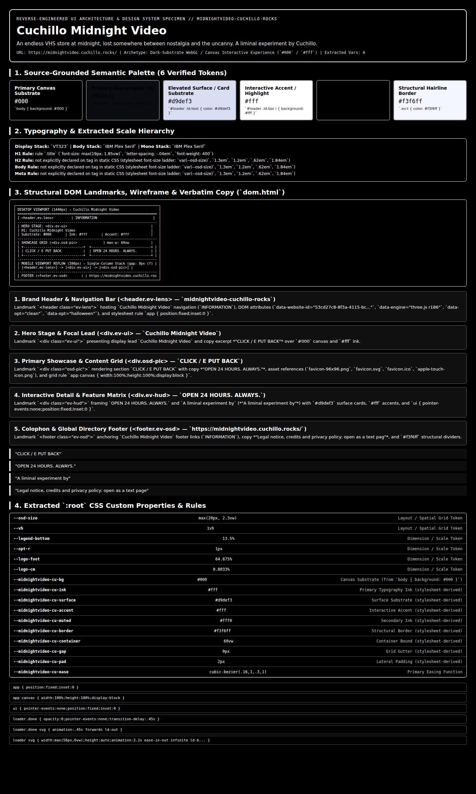
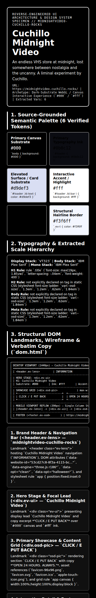

# UI Design System & Master Generation Blueprint: midnightvideo-cuchillo-rocks

> **Cuchillo Midnight Video** (https://midnightvideo.cuchillo.rocks/) — An endless VHS store at midnight, lost somewhere between nostalgia and the uncanny. A liminal experiment by Cuchillo.



---

## 1. Executive Visual Persona & Design Archetype

- **Brand Essence & Persona**: **Cuchillo Midnight Video** (`https://midnightvideo.cuchillo.rocks/`). An endless VHS store at midnight, lost somewhere between nostalgia and the uncanny. A liminal experiment by Cuchillo.
- **Visual Archetype**: **Dark-Substrate WebGL / Canvas Interactive Experience (`#000` / `#fff`)**.
- **Anti-AI-Slop Differentiators**:
  - **Source-Grounded Chromatic Polarity**: Anchors the viewport in `#000` (`body { background: #000 }`) paired with `#fff` primary typography and `#fff` accents.
  - **Extracted Typographic Hierarchy**: Pairs `VT323` for display copy (`Cuchillo Midnight Video`) with `IBM Plex Serif` and `IBM Plex Serif`.
  - **Calibrated Spatial Grid & Motion**: Combines `60vw` container bounds (`gap: 0px (flush layout)`, padding `2px`) with `cubic-bezier(.16,1,.3,1)` easing and Three.js / WebGL Canvas Pipeline.

---

## 2. Spatial Architecture & Modular Grid Mathematics



### Viewport Allocation & Container Geometry
- **Captured Viewport Dimensions**: Desktop `1440×2400px` (`assets/desktop.png`, capped at 2400px multi-section capture), Mobile `390×2400px` (`assets/mobile.png`, capped at 2400px multi-section capture).
- **Master Container Bounds**: `60vw` extracted from `midnightvideo-cuchillo-rocks` stylesheet.
- **Canvas Lateral Padding & Spacing**: `2px` lateral canvas padding with `0px (flush layout)` grid gap.
- **Border Radius Scale**: `50%`, `2px`, `var(--opt-r)`, `18%`.

### Responsive Breakpoint Architecture
- **Desktop Layout**: Multi-column CSS Grid / Flexbox layout at `1440px` (`max-width: 60vw`, `gap: 0px (flush layout)`).
- **Mobile Layout**: Single-column vertical stack at `390px` viewport width with `2px` horizontal padding.
- **Extracted CSS Media Queries**: `@media (prefers-reduced-motion:reduce)`, `@media (min-width: 1260px)`, `@media (prefers-reduced-motion: reduce)`, `@media (max-height: 760px)`.

---

## 3. Color System, Materiality & Atmospheric Lighting

### Semantic Palette & Source Grounding
| Semantic Role | Ground-Truth Value | Extracted CSS Source / Selector |
|---|---|---|
| **Primary Canvas Substrate** | `#000` | `body { background: #000 }` |
| **Primary Typography Ink** | `#0b0c12` | `#loader { background: #0b0c12 }` |
| **Elevated Surface / Card Substrate** | `#d9def3` | `#loader .ld-text { color: #d9def3 }` |
| **Interactive Accent / Highlight** | `#fff` | `#loader .ld-bar i { background: #fff }` |
| **Secondary / Muted Copy** | `#fff0` | `#loader .ld-bar:after { background: #fff0 }` |
| **Structural Hairline Border** | `#f3f6ff` | `.ev-t { color: #f3f6ff }` |

### Sanitized Root CSS Variables (`ui-ux.md` Ground Truth)
| Variable Name | Extracted Value | Semantic Role |
|---|---|---|
| `--osd-size` | `max(20px, 2.3vw)` | Layout / Spatial Grid Token |
| `--vh` | `1vh` | Layout / Spatial Grid Token |
| `--legend-bottom` | `13.5%` | Dimension / Scale Token |
| `--opt-r` | `1px` | Dimension / Scale Token |
| `--logo-foot` | `64.875%` | Dimension / Scale Token |
| `--logo-cm` | `0.8033%` | Dimension / Scale Token |
| `--midnightvideo-cu-bg` | `#000` | Canvas Substrate (from `body { background: #000 }`) |
| `--midnightvideo-cu-ink` | `#fff` | Primary Typography Ink (stylesheet-derived) |
| `--midnightvideo-cu-surface` | `#d9def3` | Surface Substrate (stylesheet-derived) |
| `--midnightvideo-cu-accent` | `#fff` | Interactive Accent (stylesheet-derived) |
| `--midnightvideo-cu-muted` | `#fff0` | Secondary Ink (stylesheet-derived) |
| `--midnightvideo-cu-border` | `#f3f6ff` | Structural Border (stylesheet-derived) |
| `--midnightvideo-cu-container` | `60vw` | Container Bound (stylesheet-derived) |
| `--midnightvideo-cu-gap` | `0px` | Grid Gutter (stylesheet-derived) |
| `--midnightvideo-cu-pad` | `2px` | Lateral Padding (stylesheet-derived) |
| `--midnightvideo-cu-ease` | `cubic-bezier(.16,1,.3,1)` | Primary Easing Function |

---

## 4. Typographic Scale & Editorial Hierarchy

### Font Family Stacks
- **Display Typography**: `VT323`.
- **Primary Body Stack**: `IBM Plex Serif`.
- **Technical / Metadata Stack**: `IBM Plex Serif`.

### Typographic Scale & Rules (Extracted from Stylesheet & Variables)
- **Hero Display (`H1`)**: rule `.title` (`font-size: max(19px, 1.85vw)`, `letter-spacing: -.04em`, `font-weight: 400`).
- **Section Heading (`H2`)**: not explicitly declared on tag in static CSS (stylesheet font-size ladder: `var(--osd-size)`, `1.3em`, `1.2em`, `.62em`, `1.84em`).
- **Body Copy**: not explicitly declared on tag in static CSS (stylesheet font-size ladder: `var(--osd-size)`, `1.3em`, `1.2em`, `.62em`, `1.84em`).
- **Metadata & Navigation Labels**: not explicitly declared on tag in static CSS (stylesheet font-size ladder: `var(--osd-size)`, `1.3em`, `1.2em`, `.62em`, `1.84em`).

---

## 5. Choreographed Motion & Interaction Physics

### Primary Easing Curves
- **Extracted Timing Functions**: `cubic-bezier(.16,1,.3,1)`, `cubic-bezier(.7,0,.84,0)`, `cubic-bezier(.2,.8,.2,1)`.

### Per-Element Transition & Choreography Rules
- **Selector `#loader`**: `transition: opacity .9s` extracted from `midnightvideo-cuchillo-rocks` stylesheet.
- **Selector `#loader>*`**: `transition: opacity .45s` extracted from `midnightvideo-cuchillo-rocks` stylesheet.
- **Selector `#loader .ld-bar i`**: `transition: transform .5s` extracted from `midnightvideo-cuchillo-rocks` stylesheet.
- **Extracted Easing Curve (`cubic-bezier(.16,1,.3,1)`)**: Governs interactive state transitions across `<header.ev-lens>` and `<div.osd-pic>`.
- **Runtime Interaction Engine**: Integrates Three.js / WebGL Canvas Pipeline with `prefers-reduced-motion: reduce` fallback guards.

---

## 6. Component Wireframe & Structural DOM Map

### Visual Layout Schematic (Grounded in `dom.html` — `1440px` Desktop & `390px` Mobile Reflow)
```
┌────────────────────────────────────────────────────────────────────────┐
│ DESKTOP VIEWPORT (1440px) — Cuchillo Midnight Video                    │
│ ====================================================================== │
│ [ <header.ev-lens>         | INFORMATION                            ]  │
│ ---------------------------------------------------------------------- │
│ | HERO STAGE: <div.ev-ui>                                          |   │
│ | H1: Cuchillo Midnight Video                                      |   │
│ | Substrate: #000       | Ink: #fff       | Accent: #fff           |   │
│ ---------------------------------------------------------------------- │
│ | SHOWCASE GRID (<div.osd-pic>             ) max-w: 60vw           |   │
│ | +------------------------------+  +------------------------------+ | │
│ | | CLICK / E PUT BACK           |  | OPEN 24 HOURS. ALWAYS.       | | │
│ | +------------------------------+  +------------------------------+ | │
│ ---------------------------------------------------------------------- │
│ | MOBILE VIEWPORT REFLOW (390px) — Single-Column Stack (gap: 0px (f) | │
│ | [<header.ev-lens>] -> [<div.ev-ui>] -> [<div.osd-pic>] |             │
│ ---------------------------------------------------------------------- │
│ [ FOOTER (<footer.ev-osd>       ) | https://midnightvideo.cuchillo.roc │
└────────────────────────────────────────────────────────────────────────┘
```

### Granular DOM Region Breakdown
1. **Brand Header & Navigation Bar (<header.ev-lens> — `midnightvideo-cuchillo-rocks`)**:
   - Landmark `<header class="ev-lens">` hosting `Cuchillo Midnight Video` navigation (`INFORMATION`), DOM attributes (`data-website-id="53cd27c8-8f3a-4115-bc..."`, `data-engine="three.js r186"`, `data-opt="clean"`, `data-opt="halloween"`), and stylesheet rule `app { position:fixed;inset:0 }`.
2. **Hero Stage & Focal Lead (<div.ev-ui> — `Cuchillo Midnight Video`)**:
   - Landmark `<div class="ev-ui">` presenting display lead `Cuchillo Midnight Video` and copy excerpt *"CLICK / E PUT BACK"* over `#000` canvas and `#fff` ink.
3. **Primary Showcase & Content Grid (<div.osd-pic> — `CLICK / E PUT BACK`)**:
   - Landmark `<div class="osd-pic">` rendering section `CLICK / E PUT BACK` with copy *"OPEN 24 HOURS. ALWAYS."*, asset references (`favicon-96x96.png`, `favicon.svg`, `favicon.ico`, `apple-touch-icon.png`), and grid rule `app canvas { width:100%;height:100%;display:block }`.
4. **Interactive Detail & Feature Matrix (<div.ev-hud> — `OPEN 24 HOURS. ALWAYS.`)**:
   - Landmark `<div class="ev-hud">` framing `OPEN 24 HOURS. ALWAYS.` and `A liminal experiment by` (*"A liminal experiment by"*) with `#d9def3` surface cards, `#fff` accents, and `ui { pointer-events:none;position:fixed;inset:0 }`.
5. **Colophon & Global Directory Footer (<footer.ev-osd> — `https://midnightvideo.cuchillo.rocks/`)**:
   - Landmark `<footer class="ev-osd">` anchoring `Cuchillo Midnight Video` footer links (`INFORMATION`), copy *"Legal notice, credits and privacy policy: open as a text pag"*, and `#f3f6ff` structural dividers.

---

## 7. Master Zero-Shot AI Generation Prompt

```markdown
# Master Zero-Shot Frontend Generation Prompt: midnightvideo-cuchillo-rocks (Cuchillo Midnight Video)

You are a principal frontend architect and design systems engineer. Build a complete, production-ready web application replicating the exact design system, DOM landmarks, typographic hierarchy, color tokens, and motion physics of `midnightvideo-cuchillo-rocks` (**Cuchillo Midnight Video** — `https://midnightvideo.cuchillo.rocks/`).

### 1. Visual Archetype & Anti-AI-Slop Mandates
- **Archetype**: Dark-Substrate WebGL / Canvas Interactive Experience (`#000` / `#fff`).
- **Identity & Domain Context**: An endless VHS store at midnight, lost somewhere between nostalgia and the uncanny. A liminal experiment by Cuchillo.
- **Primary Substrate**: `#000` (`body { background: #000 }`), **Primary Ink**: `#fff`, **Accent / Highlight**: `#fff`.
- **Site-Specific Differentiators**:
  - **Source-Grounded Chromatic Polarity**: Anchors the viewport in `#000` (`body { background: #000 }`) paired with `#fff` primary typography and `#fff` accents.
  - **Extracted Typographic Hierarchy**: Pairs `VT323` for display copy (`Cuchillo Midnight Video`) with `IBM Plex Serif` and `IBM Plex Serif`.
  - **Calibrated Spatial Grid & Motion**: Combines `60vw` container bounds (`gap: 0px (flush layout)`, padding `2px`) with `cubic-bezier(.16,1,.3,1)` easing and Three.js / WebGL Canvas Pipeline.

### 2. Ground-Truth CSS Variables (`:root` Token Contract)
Declare and consume these exact custom properties extracted from `midnightvideo-cuchillo-rocks` in your global stylesheet:

:root {
  /* Cuchillo Midnight Video (midnightvideo-cuchillo-rocks) — Ground-Truth Extracted CSS Variables */
  --osd-size: max(20px, 2.3vw); /* Layout / Spatial Grid Token (midnightvideo-cuchillo-rocks) */
  --vh: 1vh; /* Layout / Spatial Grid Token (midnightvideo-cuchillo-rocks) */
  --legend-bottom: 13.5%; /* Dimension / Scale Token (midnightvideo-cuchillo-rocks) */
  --opt-r: 1px; /* Dimension / Scale Token (midnightvideo-cuchillo-rocks) */
  --logo-foot: 64.875%; /* Dimension / Scale Token (midnightvideo-cuchillo-rocks) */
  --logo-cm: 0.8033%; /* Dimension / Scale Token (midnightvideo-cuchillo-rocks) */
  --midnightvideo-cu-bg: #000; /* Canvas Substrate (from `body { background: #000 }`) (midnightvideo-cuchillo-rocks) */
  --midnightvideo-cu-ink: #fff; /* Primary Typography Ink (stylesheet-derived) (midnightvideo-cuchillo-rocks) */
  --midnightvideo-cu-surface: #d9def3; /* Surface Substrate (stylesheet-derived) (midnightvideo-cuchillo-rocks) */
  --midnightvideo-cu-accent: #fff; /* Interactive Accent (stylesheet-derived) (midnightvideo-cuchillo-rocks) */
  --midnightvideo-cu-muted: #fff0; /* Secondary Ink (stylesheet-derived) (midnightvideo-cuchillo-rocks) */
  --midnightvideo-cu-border: #f3f6ff; /* Structural Border (stylesheet-derived) (midnightvideo-cuchillo-rocks) */
  --midnightvideo-cu-container: 60vw; /* Container Bound (stylesheet-derived) (midnightvideo-cuchillo-rocks) */
  --midnightvideo-cu-gap: 0px; /* Grid Gutter (stylesheet-derived) (midnightvideo-cuchillo-rocks) */
  --midnightvideo-cu-pad: 2px; /* Lateral Padding (stylesheet-derived) (midnightvideo-cuchillo-rocks) */
  --midnightvideo-cu-ease: cubic-bezier(.16,1,.3,1); /* Primary Easing Function (midnightvideo-cuchillo-rocks) */
}

### 3. Semantic Color & Materiality Contract
Map every surface, ink, and border strictly to these source-grounded tokens:
- **Primary Canvas Substrate**: `#000` — grounded in `body { background: #000 }`
- **Primary Typography Ink**: `#0b0c12` — grounded in `#loader { background: #0b0c12 }`
- **Elevated Surface / Card Substrate**: `#d9def3` — grounded in `#loader .ld-text { color: #d9def3 }`
- **Interactive Accent / Highlight**: `#fff` — grounded in `#loader .ld-bar i { background: #fff }`
- **Secondary / Muted Copy**: `#fff0` — grounded in `#loader .ld-bar:after { background: #fff0 }`
- **Structural Hairline Border**: `#f3f6ff` — grounded in `.ev-t { color: #f3f6ff }`

### 4. Spatial Grid, Container Bounds & Responsive Breakpoints
- **Desktop Viewport Reference**: `1440×2400px` (capped at 2400px multi-section capture, `1440px` standard desktop width).
- **Mobile Viewport Reference**: `390×2400px` (capped at 2400px multi-section capture, `390px` standard mobile width).
- **Container Max-Width**: `60vw` extracted from `midnightvideo-cuchillo-rocks` stylesheet
- **Padding & Gutters**: `2px` lateral canvas padding with `0px (flush layout)` grid gap
- **Desktop Grid**: Multi-column CSS Grid / Flexbox layout at `1440px` (`max-width: 60vw`, `gap: 0px (flush layout)`)
- **Mobile Adaptation**: Single-column vertical stack at `390px` viewport width with `2px` horizontal padding
- **Media Queries**: `@media (prefers-reduced-motion:reduce)`, `@media (min-width: 1260px)`, `@media (prefers-reduced-motion: reduce)`, `@media (max-height: 760px)`
- **Corner Radii**: `50%`, `2px`, `var(--opt-r)`, `18%`

### 5. Typography & Editorial Scale Contract
- **Display Font Stack**: `VT323`
- **Body Font Stack**: `IBM Plex Serif`
- **Monospace / Technical Font Stack**: `IBM Plex Serif`
- **H1 Display Rule**: rule `.title` (`font-size: max(19px, 1.85vw)`, `letter-spacing: -.04em`, `font-weight: 400`)
- **H2 Section Rule**: not explicitly declared on tag in static CSS (stylesheet font-size ladder: `var(--osd-size)`, `1.3em`, `1.2em`, `.62em`, `1.84em`)
- **Body Copy Rule**: not explicitly declared on tag in static CSS (stylesheet font-size ladder: `var(--osd-size)`, `1.3em`, `1.2em`, `.62em`, `1.84em`)
- **Metadata & Index Rule**: not explicitly declared on tag in static CSS (stylesheet font-size ladder: `var(--osd-size)`, `1.3em`, `1.2em`, `.62em`, `1.84em`)

### 6. Component Hierarchy, Verbatim Copy & Real DOM Landmarks
Scaffold `midnightvideo-cuchillo-rocks` (`Cuchillo Midnight Video`) with these exact structural regions, extracted copy, and CSS rules from `dom.html`:
1. **Brand Header & Navigation Bar (<header.ev-lens> — `midnightvideo-cuchillo-rocks`)**:
   - DOM & Selectors: Landmark `<header class="ev-lens">` hosting `Cuchillo Midnight Video` navigation (`INFORMATION`), DOM attributes (`data-website-id="53cd27c8-8f3a-4115-bc..."`, `data-engine="three.js r186"`, `data-opt="clean"`, `data-opt="halloween"`), and stylesheet rule `app { position:fixed;inset:0 }`.
   - Responsive Contract: Header `Brand Header & Navigation Bar (<header.ev-lens> — `midnightvideo-cuchillo-rocks`)` (`midnightvideo-cuchillo-rocks`) adapts across `@media (prefers-reduced-motion:reduce)`, `@media (min-width: 1260px)`, `@media (prefers-reduced-motion: reduce)`, `@media (max-height: 760px)` with `cubic-bezier(.16,1,.3,1)`, `cubic-bezier(.7,0,.84,0)`, `cubic-bezier(.2,.8,.2,1)` transitions and links `INFORMATION`.
2. **Hero Stage & Focal Lead (<div.ev-ui> — `Cuchillo Midnight Video`)**:
   - DOM & Selectors: Landmark `<div class="ev-ui">` presenting display lead `Cuchillo Midnight Video` and copy excerpt *"CLICK / E PUT BACK"* over `#000` canvas and `#fff` ink.
   - Responsive Contract: Hero stage (`1440×2400px` desktop / `390×2400px` mobile) sets `#000` background with `#fff` headline `Cuchillo Midnight Video`.
3. **Primary Showcase & Content Grid (<div.osd-pic> — `CLICK / E PUT BACK`)**:
   - DOM & Selectors: Landmark `<div class="osd-pic">` rendering section `CLICK / E PUT BACK` with copy *"OPEN 24 HOURS. ALWAYS."*, asset references (`favicon-96x96.png`, `favicon.svg`, `favicon.ico`, `apple-touch-icon.png`), and grid rule `app canvas { width:100%;height:100%;display:block }`.
   - Responsive Contract: Showcase grid `Primary Showcase & Content Grid (<div.osd-pic> — `CLICK / E PUT BACK`)` applies Multi-column CSS Grid / Flexbox layout at `1440px` (`max-width: 60vw`, `gap: 0px (flush layout)`) on desktop and Single-column vertical stack at `390px` viewport width with `2px` horizontal padding on mobile.
4. **Interactive Detail & Feature Matrix (<div.ev-hud> — `OPEN 24 HOURS. ALWAYS.`)**:
   - DOM & Selectors: Landmark `<div class="ev-hud">` framing `OPEN 24 HOURS. ALWAYS.` and `A liminal experiment by` (*"A liminal experiment by"*) with `#d9def3` surface cards, `#fff` accents, and `ui { pointer-events:none;position:fixed;inset:0 }`.
   - Responsive Contract: Detail module `Interactive Detail & Feature Matrix (<div.ev-hud> — `OPEN 24 HOURS. ALWAYS.`)` uses `50%`, `2px`, `var(--opt-r)`, `18%` radii, `#fff` highlights, and assets (favicon-96x96.png, favicon.svg, favicon.ico).
5. **Colophon & Global Directory Footer (<footer.ev-osd> — `https://midnightvideo.cuchillo.rocks/`)**:
   - DOM & Selectors: Landmark `<footer class="ev-osd">` anchoring `Cuchillo Midnight Video` footer links (`INFORMATION`), copy *"Legal notice, credits and privacy policy: open as a text pag"*, and `#f3f6ff` structural dividers.
   - Responsive Contract: Footer `Colophon & Global Directory Footer (<footer.ev-osd> — `https://midnightvideo.cuchillo.rocks/`)` aligns to `60vw` extracted from `midnightvideo-cuchillo-rocks` stylesheet with `2px` lateral canvas padding with `0px (flush layout)` grid gap and attributes (data-website-id="53cd27c8-8f3a-4115-bc...", data-engine="three.js r186", data-opt="clean").

#### Verbatim DOM Copy Excerpts (`dom.html`)
- Copy Excerpt 1: *"CLICK / E PUT BACK"*
- Copy Excerpt 2: *"OPEN 24 HOURS. ALWAYS."*
- Copy Excerpt 3: *"A liminal experiment by"*
- Copy Excerpt 4: *"Legal notice, credits and privacy policy: open as a text page"*

### 7. Motion, Extracted Stylesheet Rules & Interaction Choreography
- **Primary Easing Functions**: `cubic-bezier(.16,1,.3,1)`, `cubic-bezier(.7,0,.84,0)`, `cubic-bezier(.2,.8,.2,1)`
- **Extracted Stylesheet Rules (`midnightvideo-cuchillo-rocks`)**:
- `app { position:fixed;inset:0 }`
- `app canvas { width:100%;height:100%;display:block }`
- `ui { pointer-events:none;position:fixed;inset:0 }`
- `loader.done { opacity:0;pointer-events:none;transition-delay:.45s }`
- `loader.done svg { animation:.45s forwards ld-out }`
- **Per-Selector Transition Rules**:
- **Selector `#loader`**: `transition: opacity .9s` extracted from `midnightvideo-cuchillo-rocks` stylesheet.
- **Selector `#loader>*`**: `transition: opacity .45s` extracted from `midnightvideo-cuchillo-rocks` stylesheet.
- **Selector `#loader .ld-bar i`**: `transition: transform .5s` extracted from `midnightvideo-cuchillo-rocks` stylesheet.
- **Extracted Easing Curve (`cubic-bezier(.16,1,.3,1)`)**: Governs interactive state transitions across `<header.ev-lens>` and `<div.osd-pic>`.
- **Runtime Interaction Engine**: Integrates Three.js / WebGL Canvas Pipeline with `prefers-reduced-motion: reduce` fallback guards.

### 8. Technical Deliverables
- Implement in Next.js (App Router) with TypeScript and Tailwind CSS consuming the `:root` custom properties defined above for `midnightvideo-cuchillo-rocks`.
- Reproduce both the `1440px` desktop architecture and `390px` mobile breakpoint transitions, preserving semantic HTML5 landmarks (`<header>`, `<nav>`, `<main>`, `<section>`, `<footer>`) and `prefers-reduced-motion` accessibility guards.
```
