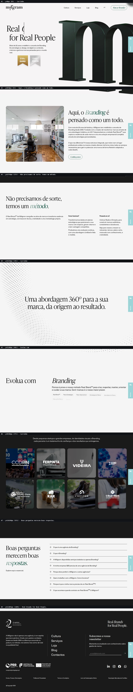

# UI Design System & Master Generation Blueprint: miligram-pt

> **Miligram Brand Agency** (https://miligram.pt) — Somos uma agência de Branding, Design e Marketing Digital em Portugal. Criamos marcas, websites e experiências digitais que fazem negócio...




---

## 1. Executive Visual Persona & Design Archetype

- **Brand Essence & Persona**: **Miligram Brand Agency** (`https://miligram.pt`). Somos uma agência de Branding, Design e Marketing Digital em Portugal. Criamos marcas, websites e experiências digitais que fazem negócio...
- **Capture Provenance**: Live browser capture (`tier1_fast`, HTTP `200`, captured `2026-11-24`).
- **Visual Archetype**: **Light-Substrate Editorial & Modular Grid System (`#f5f4f4` canvas, `#1a1a1a` ink, `#ff0000` accent)**.
- **Anti-AI-Slop Differentiators**:
  - **Live-Computed Chromatic Polarity**: Anchors the viewport in `#f5f4f4` (live computed `body` `background-color` (`computed_styles.json`)) paired with `#1a1a1a` primary typography and `#ff0000` accents.
  - **Grounded Typographic Hierarchy**: Pairs `ivypresto-headline` for display copy (`Real Brands Content Photos Videos De`) with `neue-haas-unica`.
  - **Calibrated Spatial Grid & Motion**: Combines `1312px` container bounds (`gap: 3px`, padding `10px`) with `cubic-bezier(0.65,0,0.35,1)` easing and Lenis Smooth Scroll (`data-lenis`), GSAP Timeline & ScrollTrigger.

---

## 2. Spatial Architecture & Modular Grid Mathematics

### Viewport Allocation & Container Geometry
- **Captured Journey Filmstrips**: Desktop `1280×6624px` (`assets/desktop-journey.webp`, `8` keyframes up to `y=11005px` / doc `11905px`), Mobile `390×2616px` (`assets/mobile-journey.webp`, `3` keyframes).
- **Master Container Bounds**: `1312px` (measured widest bounded `<section>` landmark width on `1440px` desktop).
- **Canvas Lateral Padding & Spacing**: `10px` lateral canvas padding with `3px` grid gap.
- **Border Radius Scale**: `100px`, `3px`, `50%`, `20px`.

### Responsive Breakpoint Architecture
- **Desktop Layout**: Multi-column CSS Grid / Flexbox layout at `1440px` (`max-width: 1312px`, `gap: 3px`).
- **Mobile Layout**: Single-column vertical stack at `390px` viewport width with `10px` horizontal padding.
- **Extracted CSS Media Queries**: `@media (prefers-reduced-motion: reduce)`, `@media screen and (max-width: 768px) and (min-width: 446px)`, `@media screen and (max-width: 446px)`, `@media (max-width:1024px)`.

---

## 3. Color System, Materiality & Atmospheric Lighting

### Semantic Palette & Source Grounding
| Semantic Role | Ground-Truth Value | Extracted Live / CSS Source |
|---|---|---|
| **Primary Canvas Substrate** | `#f5f4f4` | live computed `body` `background-color` (`computed_styles.json`) |
| **Primary Typography Ink** | `#1a1a1a` | live computed `main` `color` (`computed_styles.json`) |
| **Elevated Surface / Card Substrate** | `#ffffff` | `var(--wc-content-bg)` in `:root` |
| **Interactive Accent / Highlight** | `#ff0000` | `.woocommerce a.remove { color: red }` (`#ff0000`) |
| **Secondary / Muted Copy** | `#767676` | `var(--wc-subtext)` in `:root` |
| **Structural Hairline Border** | `#d5d8dc` | `var(--n-accordion-border-color)` in `:root` |
| **Variable Token (`--woocommerce`)** | `#720eec` | `var(--woocommerce)` in `:root` |
| **Variable Token (`--wc-green`)** | `#007518` | `var(--wc-green)` in `:root` |
| **Variable Token (`--wc-red`)** | `#aa0000` | `var(--wc-red)` in `:root` |
| **Variable Token (`--wc-orange`)** | `#ffba00` | `var(--wc-orange)` in `:root` |
| **Variable Token (`--wc-blue`)** | `#2ea2cc` | `var(--wc-blue)` in `:root` |
| **Variable Token (`--wc-primary-text`)** | `#fcfbfe` | `var(--wc-primary-text)` in `:root` |
| **Variable Token (`--wc-secondary`)** | `#e9e6ed` | `var(--wc-secondary)` in `:root` |
| **Variable Token (`--wc-secondary-text`)** | `#515151` | `var(--wc-secondary-text)` in `:root` |
| **Variable Token (`--wc-highlight`)** | `#958e09` | `var(--wc-highlight)` in `:root` |

### Sanitized Root CSS Variables (`ui-ux.md` Ground Truth)
| Variable Name | Extracted Value | Semantic Role |
|---|---|---|
| `--woocommerce` | `#720eec` | Color / Atmospheric Token |
| `--wc-green` | `#007518` | Color / Atmospheric Token |
| `--wc-red` | `#a00` | Color / Atmospheric Token |
| `--wc-orange` | `#ffba00` | Color / Atmospheric Token |
| `--wc-blue` | `#2ea2cc` | Color / Atmospheric Token |
| `--wc-primary` | `#720eec` | Brand / Palette Token |
| `--wc-primary-text` | `#fcfbfe` | Typography Ink Token |
| `--wc-secondary` | `#e9e6ed` | Brand / Palette Token |
| `--wc-secondary-text` | `#515151` | Typography Ink Token |
| `--wc-highlight` | `#958e09` | Canvas / Surface Token |
| `--wc-highligh-text` | `white` | Typography Ink Token |
| `--wc-content-bg` | `#fff` | Canvas / Surface Token |
| `--wc-subtext` | `#767676` | Typography Ink Token |
| `--wc-form-border-color` | `rgba(32, 7, 7, 0.8)` | Brand / Palette Token |
| `--wc-form-border-radius` | `4px` | Elevation / Border Token |
| `--wc-form-border-width` | `1px` | Layout / Spatial Grid Token |

---

## 4. Typographic Scale & Editorial Hierarchy

### Font Family Stacks
- **Display Typography**: `ivypresto-headline`.
- **Primary Body Stack**: `neue-haas-unica`.
- **Technical / Metadata Stack**: not declared in live computed styles (uses primary stack / `ui-monospace`).

### Typographic Scale & Rules (Live Computed & Stylesheet Grounded)
- **Hero Display (`H1`)**: CSS variables `--page-title-display: block`, `--display: flex`; rule `h1` (`font-size: 86px`, `line-height: 1.1em`, `font-weight: 300`).
- **Section Heading (`H2`)**: live computed `h2` (`font-size: 64px`, `line-height: 70.4px`, `font-weight: 300`, `letter-spacing: -0.2px`); rule `h2` (`font-size: 64px`).
- **Body Copy**: live computed `body` (`font-size: 18px`, `line-height: 25.2px`, `font-weight: 400`, `letter-spacing: -0.2px`); rule `body` (`font-size: 62.5%`).
- **Metadata & Navigation Labels**: live computed `nav/a` (`font-size: 18px`, `line-height: 25.2px`, `font-weight: 400`, `letter-spacing: -0.2px`); CSS variables `--e-global-typography-text-letter-spacing: -0.2px`, `--e-global-typography-f3906fe-letter-spacing: -0.2px`, `--e-global-typography-e59e9b9-letter-spacing: -0.2px`; rule `small` (`font-size: 15px`).

---

## 5. Choreographed Motion & Interaction Physics

### Primary Easing Curves
- **Extracted Timing Functions**: `cubic-bezier(0.65,0,0.35,1)`, `cubic-bezier(.795,-.035,0,1)`, `cubic-bezier(0.22,1,0.36,1)`.

### Per-Element Transition & Choreography Rules
- **Selector `on .e-n-accordion-item-title-icon...`**: `transition: transform 0.4s cubic-bezier(0.65,0,0.35,1), opacity 0.3s ease` extracted from `miligram-pt` stylesheet.
- **Selector `ment-6884a37 .e-n-accordion-item-...`**: `transition: none !important` extracted from `miligram-pt` stylesheet.
- **Selector `media (prefers-reduced-motion: re...`**: `transition: none` extracted from `miligram-pt` stylesheet.
- **Extracted Easing Curve (`cubic-bezier(0.65,0,0.35,1)`)**: Governs interactive state transitions across `<header.elementor>` and `<section.miligram-evolua>`.
- **Runtime Interaction Engine**: Integrates Lenis Smooth Scroll (`data-lenis`), GSAP Timeline & ScrollTrigger, Three.js / WebGL Canvas Pipeline, Swiper Touch Carousel Engine, Lottie Vector Animation Player with `prefers-reduced-motion: reduce` fallback guards.
### Measured Runtime Scroll & Interaction Telemetry (`behavioral_journey_v2`)
- **Scroll Driver Mode**: `native` (max document height `11905px`, deepest scrollY reached `11005px` across `8` desktop keyframes).
- **Detected Scroll / Motion Libraries**: `Lenis`, `GSAP/ScrollTrigger`.
- **Nav / Drawer Probe**: Tested trigger `PT` (diff `3.774`, below state-capture threshold).
- **Interactive Control Probe (`accordion` · `O que é uma agência de Branding?`)**: Triggered visual diff `5.118` (attr `false -> true`, captured in `assets/state-interactive.webp`).
- **Route Transition Architecture**: First internal navigation (`/blog/`) measured as `direct` in `8935ms`.

---

## 6. Component Wireframe & Structural DOM Map

### Visual Layout Schematic — Desktop (`1440px`, Grounded in `dom.html` & Landmark Bounding Boxes)
```
┌────────────────────────────────────────────────────────────────────────┐
│ DESKTOP VIEWPORT (1440px) — Miligram Brand Agency                      │
│ ====================================================================== │
│ [ <header.elementor> (1440x0px)       | Cultura · Serviços · Loja ·  ] │
│ ---------------------------------------------------------------------- │
│ | HERO STAGE: <section.home> (w=1440px)                              | │
│ | H1: Real Brands Content Photos Videos Design Websites              | │
│ | Substrate: #f5f4f4 | Ink: #1a1a1a | Accent: #ff0000                | │
│ ---------------------------------------------------------------------- │
│ | SHOWCASE GRID (<section.miligram-evolua>) max-w: 1312px            | │
│ | +------------------------------+  +------------------------------+ | │
│ | | for Real People              |  | Aqui, o Branding é pensado c | | │
│ | +------------------------------+  +------------------------------+ | │
│ ---------------------------------------------------------------------- │
│ | DETAIL MODULE (<article.miligram-evolua__) — Não precisamos de sor | │
│ ---------------------------------------------------------------------- │
│ [ FOOTER (<footer.elementor>  ) | https://miligram.pt                  │
└────────────────────────────────────────────────────────────────────────┘
```

### Visual Layout Schematic — Mobile Reflow (`390px`)
```
┌────────────────────────────────────────────────────────────────────────┐
│ MOBILE VIEWPORT REFLOW (390px) — Single-Column Stack (gap: 3px)        │
│ ====================================================================== │
│ [ HEADER BAR (<header.elementor>      ) | Compact Menu (390px)         │
│ ---------------------------------------------------------------------- │
│ | HERO STAGE (<section.home>) — 390px Vertical Lead                  | │
│ | H1: Real Brands Content Photos Videos Design Websites              | │
│ ---------------------------------------------------------------------- │
│ | SHOWCASE STACK (<section.miligram-evol) — 1-Col Stack              | │
│ | [ Item 1: for Real People                                        ] | │
│ | [ Item 2: Aqui, o Branding é pensado como um todo.               ] | │
│ ---------------------------------------------------------------------- │
│ | DETAIL STACK (<article.miligram-evolua) — 1-Col (Não precisamos de ) │
│ ---------------------------------------------------------------------- │
│ [ FOOTER (<footer.elementor>  ) | Stacked 390px Colophon               │
└────────────────────────────────────────────────────────────────────────┘
```

### Granular DOM Region Breakdown
1. **Brand Header & Navigation Bar (<header.elementor> — `miligram-pt`)**:
   - Landmark `<header class="elementor elementor-282">` (`1440x0px`) hosting `Miligram Brand Agency` navigation (`Cultura · Serviços · Loja · Blog · PT`), DOM attributes (`data-wp-strategy="defer"`, `data-wp-strategy="defer"`, `data-wp-strategy="defer"`, `data-wp-strategy="defer"`), and stylesheet rule `html.lenis body { height:auto }`.
2. **Hero Stage & Focal Lead (<section.home> — `Real Brands Content Photos Videos `)**:
   - Landmark `<section class="home">` presenting display lead `Real Brands Content Photos Videos Design Websites` and copy excerpt *"O carrinho está vazio."* over `#f5f4f4` canvas and `#1a1a1a` ink.
3. **Primary Showcase & Content Grid (<section.miligram-evolua> — `for Real People`)**:
   - Landmark `<section class="miligram-evolua">` rendering section `for Real People` with copy *"Brands Content Photos Videos Design Websites"*, asset references (`insight.min.js`, `oaiq.min.js`, `1509416_miligram.pt.js`, `gcm.min.js`), and grid rule `.lenis.lenis-stopped { overflow:clip }`.
4. **Interactive Detail & Feature Matrix (<article.miligram-evolua__block> — `Aqui, o Branding é pensado como um`)**:
   - Landmark `<article class="miligram-evolua__block">` framing `Aqui, o Branding é pensado como um todo.` and `Não precisamos de sorte, temos um método .` (*"Mais de 20 anos a redefinir o conceito de Branding. Da estratégia"*) with `#ffffff` surface cards, `#ff0000` accents, and `.lenis.lenis-smooth iframe { pointer-events:none }`.
5. **Colophon & Global Directory Footer (<footer.elementor> — `https://miligram.pt`)**:
   - Landmark `<footer class="elementor elementor-371">` anchoring `Miligram Brand Agency` footer links (`Cultura · Serviços · Loja · Blog · PT`), copy *"Com mais de 20 anos de história, a Miligram tem redefinido o"*, and `#d5d8dc` structural dividers.
### Full Vertical Scroll Sequence (Desktop `1440×900` Keyframes)
- **Step 01** (`y=0px`, `0%`): Active landmark `Carrinho` · sticky/fixed elements: `2`
- **Step 02** (`y=850px`, `8%`): Active landmark `Aqui, o Branding é pensado como um todo.` · sticky/fixed elements: `1`
- **Step 03** (`y=2550px`, `23%`): Active landmark `Não precisamos de sorte, temos um método.` · sticky/fixed elements: `1`
- **Step 04** (`y=4250px`, `39%`): Active landmark `Carrinho` · sticky/fixed elements: `1`
- **Step 05** (`y=5100px`, `46%`): Active landmark `Evolua com` · sticky/fixed elements: `2`
- **Step 06** (`y=8500px`, `77%`): Active landmark `Carrinho` · sticky/fixed elements: `1`
- **Step 07** (`y=10200px`, `93%`): Active landmark `Boas perguntas merecem boas respostas.` · sticky/fixed elements: `1`
- **Step 08** (`y=11005px`, `100%`): Active landmark `Real Brands for Real People.` · sticky/fixed elements: `1`

### Multi-Page Internal Route Map
- **Listing Route (`/blog/`)**: `https://miligram.pt/blog/` — H1: `Blog`, scrollHeight `3229px`, transition `direct` (`8935ms`)
- **Other Route (`/cultura/`)**: `https://miligram.pt/cultura/` — H1: `Miligram, um espírito que perdura.`, scrollHeight `7196px`, transition `direct` (`3584ms`)

---

## 7. Master Zero-Shot AI Generation Prompt

```markdown
# Master Zero-Shot Frontend Generation Prompt: miligram-pt (Miligram Brand Agency)

You are a principal frontend architect and design systems engineer. Build a complete, production-ready web application replicating the exact design system, DOM landmarks, typographic hierarchy, color tokens, and motion physics of `miligram-pt` (**Miligram Brand Agency** — `https://miligram.pt`).

### 1. Visual Archetype & Anti-AI-Slop Mandates
- **Archetype**: Light-Substrate Editorial & Modular Grid System (`#f5f4f4` canvas, `#1a1a1a` ink, `#ff0000` accent).
- **Identity & Domain Context**: Somos uma agência de Branding, Design e Marketing Digital em Portugal. Criamos marcas, websites e experiências digitais que fazem negócio...
- **Primary Substrate**: `#f5f4f4` (live computed `body` `background-color` (`computed_styles.json`)), **Primary Ink**: `#1a1a1a`, **Accent / Highlight**: `#ff0000`.
- **Site-Specific Differentiators**:
  - **Live-Computed Chromatic Polarity**: Anchors the viewport in `#f5f4f4` (live computed `body` `background-color` (`computed_styles.json`)) paired with `#1a1a1a` primary typography and `#ff0000` accents.
  - **Grounded Typographic Hierarchy**: Pairs `ivypresto-headline` for display copy (`Real Brands Content Photos Videos De`) with `neue-haas-unica`.
  - **Calibrated Spatial Grid & Motion**: Combines `1312px` container bounds (`gap: 3px`, padding `10px`) with `cubic-bezier(0.65,0,0.35,1)` easing and Lenis Smooth Scroll (`data-lenis`), GSAP Timeline & ScrollTrigger.

### 2. Ground-Truth CSS Variables (`:root` Token Contract)
Declare and consume these exact custom properties extracted from `miligram-pt` in your global stylesheet:

:root {
  /* Miligram Brand Agency (miligram-pt) — Live-Grounded CSS Variables */
  --woocommerce: #720eec; /* Color / Atmospheric Token (miligram-pt) */
  --wc-green: #007518; /* Color / Atmospheric Token (miligram-pt) */
  --wc-red: #a00; /* Color / Atmospheric Token (miligram-pt) */
  --wc-orange: #ffba00; /* Color / Atmospheric Token (miligram-pt) */
  --wc-blue: #2ea2cc; /* Color / Atmospheric Token (miligram-pt) */
  --wc-primary: #720eec; /* Brand / Palette Token (miligram-pt) */
  --wc-primary-text: #fcfbfe; /* Typography Ink Token (miligram-pt) */
  --wc-secondary: #e9e6ed; /* Brand / Palette Token (miligram-pt) */
  --wc-secondary-text: #515151; /* Typography Ink Token (miligram-pt) */
  --wc-highlight: #958e09; /* Canvas / Surface Token (miligram-pt) */
  --wc-highligh-text: white; /* Typography Ink Token (miligram-pt) */
  --wc-content-bg: #fff; /* Canvas / Surface Token (miligram-pt) */
  --wc-subtext: #767676; /* Typography Ink Token (miligram-pt) */
  --wc-form-border-color: rgba(32, 7, 7, 0.8); /* Brand / Palette Token (miligram-pt) */
  --wc-form-border-radius: 4px; /* Elevation / Border Token (miligram-pt) */
  --wc-form-border-width: 1px; /* Layout / Spatial Grid Token (miligram-pt) */
}

### 3. Semantic Color & Materiality Contract
Map every surface, ink, and border strictly to these source-grounded tokens:
- **Primary Canvas Substrate**: `#f5f4f4` — grounded in live computed `body` `background-color` (`computed_styles.json`)
- **Primary Typography Ink**: `#1a1a1a` — grounded in live computed `main` `color` (`computed_styles.json`)
- **Elevated Surface / Card Substrate**: `#ffffff` — grounded in `var(--wc-content-bg)` in `:root`
- **Interactive Accent / Highlight**: `#ff0000` — grounded in `.woocommerce a.remove { color: red }` (`#ff0000`)
- **Secondary / Muted Copy**: `#767676` — grounded in `var(--wc-subtext)` in `:root`
- **Structural Hairline Border**: `#d5d8dc` — grounded in `var(--n-accordion-border-color)` in `:root`
- **Variable Token (`--woocommerce`)**: `#720eec` — grounded in `var(--woocommerce)` in `:root`
- **Variable Token (`--wc-green`)**: `#007518` — grounded in `var(--wc-green)` in `:root`
- **Variable Token (`--wc-red`)**: `#aa0000` — grounded in `var(--wc-red)` in `:root`
- **Variable Token (`--wc-orange`)**: `#ffba00` — grounded in `var(--wc-orange)` in `:root`
- **Variable Token (`--wc-blue`)**: `#2ea2cc` — grounded in `var(--wc-blue)` in `:root`
- **Variable Token (`--wc-primary-text`)**: `#fcfbfe` — grounded in `var(--wc-primary-text)` in `:root`
- **Variable Token (`--wc-secondary`)**: `#e9e6ed` — grounded in `var(--wc-secondary)` in `:root`
- **Variable Token (`--wc-secondary-text`)**: `#515151` — grounded in `var(--wc-secondary-text)` in `:root`
- **Variable Token (`--wc-highlight`)**: `#958e09` — grounded in `var(--wc-highlight)` in `:root`

### 4. Spatial Grid, Container Bounds & Responsive Breakpoints
- **Desktop Viewport Reference**: `1280×6624px` (multi-frame vertical journey filmstrip (6624px), `1440px` standard desktop width).
- **Mobile Viewport Reference**: `390×2616px` (multi-frame vertical journey filmstrip (2616px), `390px` standard mobile width).
- **Container Max-Width**: `1312px` (measured widest bounded `<section>` landmark width on `1440px` desktop)
- **Padding & Gutters**: `10px` lateral canvas padding with `3px` grid gap
- **Desktop Grid**: Multi-column CSS Grid / Flexbox layout at `1440px` (`max-width: 1312px`, `gap: 3px`)
- **Mobile Adaptation**: Single-column vertical stack at `390px` viewport width with `10px` horizontal padding
- **Media Queries**: `@media (prefers-reduced-motion: reduce)`, `@media screen and (max-width: 768px) and (min-width: 446px)`, `@media screen and (max-width: 446px)`, `@media (max-width:1024px)`
- **Corner Radii**: `100px`, `3px`, `50%`, `20px`

### 5. Typography & Editorial Scale Contract
- **Display Font Stack**: `ivypresto-headline`
- **Body Font Stack**: `neue-haas-unica`
- **Monospace / Technical Font Stack**: not declared in live computed styles (uses primary stack / `ui-monospace`)
- **H1 Display Rule**: CSS variables `--page-title-display: block`, `--display: flex`; rule `h1` (`font-size: 86px`, `line-height: 1.1em`, `font-weight: 300`)
- **H2 Section Rule**: live computed `h2` (`font-size: 64px`, `line-height: 70.4px`, `font-weight: 300`, `letter-spacing: -0.2px`); rule `h2` (`font-size: 64px`)
- **Body Copy Rule**: live computed `body` (`font-size: 18px`, `line-height: 25.2px`, `font-weight: 400`, `letter-spacing: -0.2px`); rule `body` (`font-size: 62.5%`)
- **Metadata & Index Rule**: live computed `nav/a` (`font-size: 18px`, `line-height: 25.2px`, `font-weight: 400`, `letter-spacing: -0.2px`); CSS variables `--e-global-typography-text-letter-spacing: -0.2px`, `--e-global-typography-f3906fe-letter-spacing: -0.2px`, `--e-global-typography-e59e9b9-letter-spacing: -0.2px`; rule `small` (`font-size: 15px`)

### 6. Component Hierarchy, Verbatim Copy & Real DOM Landmarks
Scaffold `miligram-pt` (`Miligram Brand Agency`) with these exact structural regions, extracted copy, and CSS rules from `dom.html`:
1. **Brand Header & Navigation Bar (<header.elementor> — `miligram-pt`)**:
   - DOM & Selectors: Landmark `<header class="elementor elementor-282">` (`1440x0px`) hosting `Miligram Brand Agency` navigation (`Cultura · Serviços · Loja · Blog · PT`), DOM attributes (`data-wp-strategy="defer"`, `data-wp-strategy="defer"`, `data-wp-strategy="defer"`, `data-wp-strategy="defer"`), and stylesheet rule `html.lenis body { height:auto }`.
   - Responsive Contract: Header `Brand Header & Navigation Bar (<header.elementor> — `miligram-pt`)` (`miligram-pt`) adapts across `@media (prefers-reduced-motion: reduce)`, `@media screen and (max-width: 768px) and (min-width: 446px)`, `@media screen and (max-width: 446px)`, `@media (max-width:1024px)` with `cubic-bezier(0.65,0,0.35,1)`, `cubic-bezier(.795,-.035,0,1)`, `cubic-bezier(0.22,1,0.36,1)` transitions and links `Cultura · Serviços · Loja · Blog · PT`.
2. **Hero Stage & Focal Lead (<section.home> — `Real Brands Content Photos Videos `)**:
   - DOM & Selectors: Landmark `<section class="home">` presenting display lead `Real Brands Content Photos Videos Design Websites` and copy excerpt *"O carrinho está vazio."* over `#f5f4f4` canvas and `#1a1a1a` ink.
   - Responsive Contract: Hero stage (`1280×6624px` desktop / `390×2616px` mobile) sets `#f5f4f4` background with `#1a1a1a` headline `Real Brands Content Photos Videos Design Websites`.
3. **Primary Showcase & Content Grid (<section.miligram-evolua> — `for Real People`)**:
   - DOM & Selectors: Landmark `<section class="miligram-evolua">` rendering section `for Real People` with copy *"Brands Content Photos Videos Design Websites"*, asset references (`insight.min.js`, `oaiq.min.js`, `1509416_miligram.pt.js`, `gcm.min.js`), and grid rule `.lenis.lenis-stopped { overflow:clip }`.
   - Responsive Contract: Showcase grid `Primary Showcase & Content Grid (<section.miligram-evolua> — `for Real People`)` applies Multi-column CSS Grid / Flexbox layout at `1440px` (`max-width: 1312px`, `gap: 3px`) on desktop and Single-column vertical stack at `390px` viewport width with `10px` horizontal padding on mobile.
4. **Interactive Detail & Feature Matrix (<article.miligram-evolua__block> — `Aqui, o Branding é pensado como um`)**:
   - DOM & Selectors: Landmark `<article class="miligram-evolua__block">` framing `Aqui, o Branding é pensado como um todo.` and `Não precisamos de sorte, temos um método .` (*"Mais de 20 anos a redefinir o conceito de Branding. Da estratégia"*) with `#ffffff` surface cards, `#ff0000` accents, and `.lenis.lenis-smooth iframe { pointer-events:none }`.
   - Responsive Contract: Detail module `Interactive Detail & Feature Matrix (<article.miligram-evolua__block> — `Aqui, o Branding é pensado como um`)` uses `100px`, `3px`, `50%`, `20px` radii, `#ff0000` highlights, and assets (insight.min.js, oaiq.min.js, 1509416_miligram.pt.js).
5. **Colophon & Global Directory Footer (<footer.elementor> — `https://miligram.pt`)**:
   - DOM & Selectors: Landmark `<footer class="elementor elementor-371">` anchoring `Miligram Brand Agency` footer links (`Cultura · Serviços · Loja · Blog · PT`), copy *"Com mais de 20 anos de história, a Miligram tem redefinido o"*, and `#d5d8dc` structural dividers.
   - Responsive Contract: Footer `Colophon & Global Directory Footer (<footer.elementor> — `https://miligram.pt`)` aligns to `1312px` (measured widest bounded `<section>` landmark width on `1440px` desktop) with `10px` lateral canvas padding with `3px` grid gap and attributes (data-wp-strategy="defer", data-wp-strategy="defer", data-wp-strategy="defer").

#### Verbatim DOM Copy Excerpts (`dom.html`)
- Copy Excerpt 1: *"O carrinho está vazio."*
- Copy Excerpt 2: *"Brands Content Photos Videos Design Websites"*
- Copy Excerpt 3: *"Mais de 20 anos a redefinir o conceito de Branding. Da estratégia ao design, do di..."*
- Copy Excerpt 4: *"Com mais de 20 anos de história, a Miligram tem redefinido o conceito de Branding..."*

### 7. Motion, Extracted Stylesheet Rules & Interaction Choreography
- **Primary Easing Functions**: `cubic-bezier(0.65,0,0.35,1)`, `cubic-bezier(.795,-.035,0,1)`, `cubic-bezier(0.22,1,0.36,1)`
- **Extracted Stylesheet Rules (`miligram-pt`)**:
- `html.lenis body { height:auto }`
- `.lenis.lenis-stopped { overflow:clip }`
- `.lenis.lenis-smooth iframe { pointer-events:none }`
- `.tk-neue-haas-unica { font-family: "neue-haas-unica",sans-serif; }`
- `.tk-ivypresto-headline { font-family: "ivypresto-headline",serif; }`
- **Per-Selector Transition Rules**:
- **Selector `on .e-n-accordion-item-title-icon...`**: `transition: transform 0.4s cubic-bezier(0.65,0,0.35,1), opacity 0.3s ease` extracted from `miligram-pt` stylesheet.
- **Selector `ment-6884a37 .e-n-accordion-item-...`**: `transition: none !important` extracted from `miligram-pt` stylesheet.
- **Selector `media (prefers-reduced-motion: re...`**: `transition: none` extracted from `miligram-pt` stylesheet.
- **Extracted Easing Curve (`cubic-bezier(0.65,0,0.35,1)`)**: Governs interactive state transitions across `<header.elementor>` and `<section.miligram-evolua>`.
- **Runtime Interaction Engine**: Integrates Lenis Smooth Scroll (`data-lenis`), GSAP Timeline & ScrollTrigger, Three.js / WebGL Canvas Pipeline, Swiper Touch Carousel Engine, Lottie Vector Animation Player with `prefers-reduced-motion: reduce` fallback guards.
### 7b. Full-Page Scroll Choreography, Interactive States & Multi-Page Routes
- **Scroll Mechanics**: Implement `native` vertical progression up to `11905px` across 8 distinct viewport chapters using Lenis, GSAP/ScrollTrigger.
- **Vertical Chapter Sequence**: Carrinho (0%) -> Aqui, o Branding é pensado... (8%) -> Não precisamos de sorte, te... (23%) -> Carrinho (39%) -> Evolua com (46%) -> Carrinho (77%) -> Boas perguntas merecem boas... (93%) -> Real Brands for Real People. (100%).
- **Multi-Page Routes**: Scaffold internal routes `/blog/` (listing, direct), `/cultura/` (other, direct) sharing the global header/footer shell and design tokens.

### 8. Technical Deliverables
- Implement in Next.js (App Router) with TypeScript and Tailwind CSS consuming the `:root` custom properties defined above for `miligram-pt`.
- Reproduce both the `1440px` desktop architecture and `390px` mobile breakpoint transitions, preserving semantic HTML5 landmarks (`<header>`, `<nav>`, `<main>`, `<section>`, `<footer>`) and `prefers-reduced-motion` accessibility guards.
```
---

## 8. Full-Page Scroll Journey, Interactive States & Subpage Inventory

### Desktop Scroll Keyframes (`1440×900` WebP)
| Step | Scroll Y | Progress | Active Landmark / Section | Sticky/Fixed | Visual Asset |
| :---: | :---: | :---: | :--- | :---: | :--- |
| `#01` | `0px` | `0%` | Carrinho | `2` | [desktop-step-01.webp](assets/desktop-step-01.webp) |
| `#02` | `850px` | `8%` | Aqui, o Branding é pensado como um todo. | `1` | [desktop-step-02.webp](assets/desktop-step-02.webp) |
| `#03` | `2550px` | `23%` | Não precisamos de sorte, temos um método. | `1` | [desktop-step-03.webp](assets/desktop-step-03.webp) |
| `#04` | `4250px` | `39%` | Carrinho | `1` | [desktop-step-04.webp](assets/desktop-step-04.webp) |
| `#05` | `5100px` | `46%` | Evolua com | `2` | [desktop-step-05.webp](assets/desktop-step-05.webp) |
| `#06` | `8500px` | `77%` | Carrinho | `1` | [desktop-step-06.webp](assets/desktop-step-06.webp) |
| `#07` | `10200px` | `93%` | Boas perguntas merecem boas respostas. | `1` | [desktop-step-07.webp](assets/desktop-step-07.webp) |
| `#08` | `11005px` | `100%` | Real Brands for Real People. | `1` | [desktop-step-08.webp](assets/desktop-step-08.webp) |

### Mobile Condensed Keyframes (`390×844` WebP)
| Step | Scroll Y | Progress | Active Landmark | Visual Asset |
| :---: | :---: | :---: | :--- | :--- |
| `#01` | `0px` | `0%` | for Real People | [mobile-step-01.webp](assets/mobile-step-01.webp) |
| `#02` | `3067px` | `50%` | Carrinho | [mobile-step-02.webp](assets/mobile-step-02.webp) |
| `#03` | `6134px` | `100%` | Carrinho | [mobile-step-03.webp](assets/mobile-step-03.webp) |

### Interactive UI State Captures (`1440×900` WebP)
| State Type | Trigger / Observation | Visual Asset |
| :--- | :--- | :--- |
| `interactive_control` | Control `accordion` (`O que é uma agência de Branding?`, diff `5.118`) | [state-interactive.webp](assets/state-interactive.webp) |

### Internal Subpage Filmstrips (`1080px` Wide WebP)
| # | Template | Route URL | H1 / Title | Scroll Height | Transition | Filmstrip Asset |
| :-: | :---: | :--- | :--- | :---: | :---: | :--- |
| `1` | `listing` | `https://miligram.pt/blog/` | Blog | `3229px` | `direct` (`8935ms`) | [subpage-01-blog.webp](assets/subpage-01-blog.webp) |
| `2` | `other` | `https://miligram.pt/cultura/` | Miligram, um espírito que perdura. | `7196px` | `direct` (`3584ms`) | [subpage-02-cultura.webp](assets/subpage-02-cultura.webp) |

