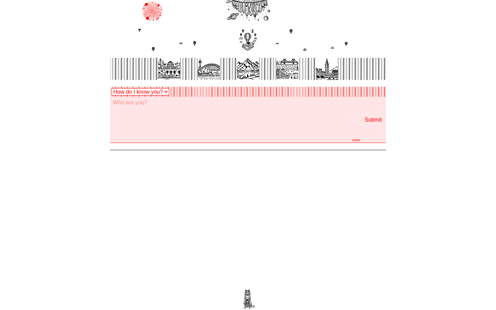
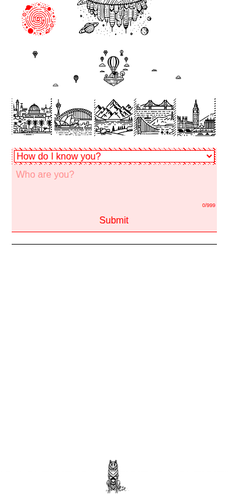

# UI Design System & Master Generation Blueprint: milky-solar

> **Earth** (https://milky.solar) — Follow Wolfs journeys on Earth, navigating eternal cycles of conflict and transformation.



---

## 1. Executive Visual Persona & Design Archetype

- **Brand Essence & Persona**: **Earth** (`https://milky.solar`). Follow Wolfs journeys on Earth, navigating eternal cycles of conflict and transformation.
- **Capture Provenance**: Live browser capture (`tier1_fast`, HTTP `200`, captured `2026-11-23`).
- **Visual Archetype**: **Light-Substrate Editorial & Modular Grid System (`#ffffff` canvas, `#000000` ink, `#ff0000` accent)**.
- **Anti-AI-Slop Differentiators**:
  - **Live-Computed Chromatic Polarity**: Anchors the viewport in `#ffffff` (live computed `body` `background-color` (`computed_styles.json`)) paired with `#000000` primary typography and `#ff0000` accents.
  - **Grounded Typographic Hierarchy**: Pairs `system-ui, -apple-system, sans-serif` (live computed system stack) for display copy (`Earth`) with `system-ui, -apple-system, sans-serif` (live computed system stack) and not declared in live computed styles (uses primary stack / `ui-monospace`).
  - **Calibrated Spatial Grid & Motion**: Combines `1440px` container bounds (`gap: 0px (flush layout)`, padding `4px`) with `cubic-bezier(0.25,0.1,0.25,1)` easing.

---

## 2. Spatial Architecture & Modular Grid Mathematics



### Viewport Allocation & Container Geometry
- **Captured Viewport Dimensions**: Desktop `1440×900px` (`assets/desktop.png`, single-viewport 100vh live capture (900px)), Mobile `390×844px` (`assets/mobile.png`, single-viewport 100vh live capture (844px)).
- **Master Container Bounds**: `1440px` (full-bleed `100%` viewport stage).
- **Canvas Lateral Padding & Spacing**: `4px` lateral canvas padding with `0px (flush layout)` grid gap.
- **Border Radius Scale**: `1px`.

### Responsive Breakpoint Architecture
- **Desktop Layout**: Multi-column CSS Grid / Flexbox layout at `1440px` (`max-width: 1440px`, `gap: 0px (flush layout)`).
- **Mobile Layout**: Single-column vertical stack at `390px` viewport width with `4px` horizontal padding.
- **Extracted CSS Media Queries**: `@media (max-width: 890px)`, `@media (max-width: 600px)`, `@media (max-width: 320px)`.

---

## 3. Color System, Materiality & Atmospheric Lighting

### Semantic Palette & Source Grounding
| Semantic Role | Ground-Truth Value | Extracted Live / CSS Source |
|---|---|---|
| **Primary Canvas Substrate** | `#ffffff` | live computed `body` `background-color` (`computed_styles.json`) |
| **Primary Typography Ink** | `#000000` | live computed `main` `color` (`computed_styles.json`) |
| **Elevated Surface / Card Substrate** | `#ff0000` | `select option:checked { background-color: red }` (`#ff0000`) |
| **Interactive Accent / Highlight** | `#ff0000` | live computed `button` `color` (`computed_styles.json`) |
| **Secondary / Muted Copy** | `#ff0000` | `.footer-container a { color: red }` (`#ff0000`) |
| **Structural Hairline Border** | `#000000` | `footer { border-top: #000000 }` |

### Sanitized Root CSS Variables (`ui-ux.md` Ground Truth)
| Variable Name | Extracted Value | Semantic Role |
|---|---|---|
| `--milky-solar-bg` | `#ffffff` | Canvas Substrate (from live computed `body` `background-color` (`computed_styles.json`)) |
| `--milky-solar-ink` | `#000000` | Primary Typography Ink (computed-derived) |
| `--milky-solar-surface` | `#ff0000` | Surface Substrate (computed-derived) |
| `--milky-solar-accent` | `#ff0000` | Interactive Accent (computed-derived) |
| `--milky-solar-muted` | `#ff0000` | Secondary Ink (computed-derived) |
| `--milky-solar-border` | `#000000` | Structural Border (computed-derived) |
| `--milky-solar-container` | `1440px` | Container Bound (computed-derived) |
| `--milky-solar-gap` | `0px` | Grid Gutter (computed-derived) |
| `--milky-solar-pad` | `4px` | Lateral Padding (computed-derived) |
| `--milky-solar-ease` | `cubic-bezier(0.25,0.1,0.25,1)` | Primary Easing Function |
| `--milky-solar-radius` | `1px` | Corner Radius (computed-derived) |
| `--milky-solar-fs-base` | `16px` | Observed Font Size Token |

---

## 4. Typographic Scale & Editorial Hierarchy

### Font Family Stacks
- **Display Typography**: `system-ui, -apple-system, sans-serif` (live computed system stack).
- **Primary Body Stack**: `system-ui, -apple-system, sans-serif` (live computed system stack).
- **Technical / Metadata Stack**: not declared in live computed styles (uses primary stack / `ui-monospace`).

### Typographic Scale & Rules (Live Computed & Stylesheet Grounded)
- **Hero Display (`H1`)**: observed font-size ladder: `16px`, `13.3333px`.
- **Section Heading (`H2`)**: observed font-size ladder: `16px`, `13.3333px`.
- **Body Copy**: live computed `body` (`font-size: 16px`, `line-height: normal`, `font-weight: 400`).
- **Metadata & Navigation Labels**: live computed `nav/a` (`font-size: 13.3333px`, `line-height: normal`, `font-weight: 400`).

---

## 5. Choreographed Motion & Interaction Physics

### Primary Easing Curves
- **Extracted Timing Functions**: `cubic-bezier(0.25,0.1,0.25,1)`.

### Per-Element Transition & Choreography Rules
- **Selector `#user-submit`**: `transition: 0.2s` extracted from `milky-solar` stylesheet.
- **Standard CSS Easing (`cubic-bezier(0.25,0.1,0.25,1)`)**: Default timing curve (no custom `cubic-bezier()` declared in captured CSS).
- **State & Hover Choreography**: Opacity and transform transitions on `<main.empty-space>` and `<main.float-up>` interactive targets.

---

## 6. Component Wireframe & Structural DOM Map

### Visual Layout Schematic — Desktop (`1440px`, Grounded in `dom.html` & Landmark Bounding Boxes)
```
┌────────────────────────────────────────────────────────────────────────┐
│ DESKTOP VIEWPORT (1440px) — Earth                                      │
│ ====================================================================== │
│ [ <header.button> (800x415px)         | Overview · Index · Archive · ] │
│ ---------------------------------------------------------------------- │
│ | HERO STAGE: <main.empty-space> (w=800px)                           | │
│ | H1: Earth                                                          | │
│ | Substrate: #ffffff | Ink: #000000 | Accent: #ff0000                | │
│ ---------------------------------------------------------------------- │
│ | SHOWCASE GRID (<main.float-up>) max-w: 1440px                      | │
│ | +------------------------------+  +------------------------------+ | │
│ | | Featured Work & Interactive  |  | Technical Architecture & Nar | | │
│ | +------------------------------+  +------------------------------+ | │
│ ---------------------------------------------------------------------- │
│ | DETAIL MODULE (<main.balloon>) — Global Directory & Co             | │
│ ---------------------------------------------------------------------- │
│ [ FOOTER (<footer.float-down> ) | https://milky.solar                  │
└────────────────────────────────────────────────────────────────────────┘
```

### Visual Layout Schematic — Mobile Reflow (`390px`)
```
┌────────────────────────────────────────────────────────────────────────┐
│ MOBILE VIEWPORT REFLOW (390px) — Single-Column Stack (gap: 0px (flu)   │
│ ====================================================================== │
│ [ HEADER BAR (<header.button>         ) | Compact Menu (390px)         │
│ ---------------------------------------------------------------------- │
│ | HERO STAGE (<main.empty-space>) — 390px Vertical Lead              | │
│ | H1: Earth                                                          | │
│ ---------------------------------------------------------------------- │
│ | SHOWCASE STACK (<main.float-up>) — 1-Col Stack                     | │
│ | [ Item 1: Featured Work & Interactive Showcase                   ] | │
│ | [ Item 2: Technical Architecture & Narrative                     ] | │
│ ---------------------------------------------------------------------- │
│ | DETAIL STACK (<main.balloon>) — 1-Col (Global Directory &)         | │
│ ---------------------------------------------------------------------- │
│ [ FOOTER (<footer.float-down> ) | Stacked 390px Colophon               │
└────────────────────────────────────────────────────────────────────────┘
```

### Granular DOM Region Breakdown
1. **Brand Header & Navigation Bar (<header.button> — `milky-solar`)**:
   - Landmark `<header class="button">` (`800x415px`) hosting `Earth` navigation (`Overview · Index · Archive · About · Contact`), DOM attributes (`data-scenario="new"`, `data-scenario="otherworld"`, `data-scenario="random"`, `data-scenario="israel"`), and stylesheet rule `body { background-color: white; color: black; width: 800px; text-align: center;... }`.
2. **Hero Stage & Focal Lead (<main.empty-space> — `Earth`)**:
   - Landmark `<main class="empty-space">` presenting display lead `Earth` and copy excerpt *"Follow Wolfs journeys on Earth, navigating eternal cycles of conf"* over `#ffffff` canvas and `#000000` ink.
3. **Primary Showcase & Content Grid (<main.float-up> — `Featured Work & Interactive Showca`)**:
   - Landmark `<main class="float-up">` rendering section `Featured Work & Interactive Showcase` with copy *"Earth"*, asset references (`milky.solar`, `Logo.ico`, `Logo.svg`, `Logo.jpg`), and grid rule `header { width: 100%; }`.
4. **Interactive Detail & Feature Matrix (<main.balloon> — `Technical Architecture & Narrative`)**:
   - Landmark `<main class="balloon">` framing `Technical Architecture & Narrative` and `Global Directory & Contact` (*"Featured Work & Interactive Showcase"*) with `#ff0000` surface cards, `#ff0000` accents, and `main { margin-bottom: 20px; }`.
5. **Colophon & Global Directory Footer (<footer.float-down> — `https://milky.solar`)**:
   - Landmark `<footer class="float-down">` anchoring `Earth` footer links (`Overview · Index · Archive · About · Contact`), copy *"Technical Architecture & Narrative"*, and `#000000` structural dividers.

---

## 7. Master Zero-Shot AI Generation Prompt

```markdown
# Master Zero-Shot Frontend Generation Prompt: milky-solar (Earth)

You are a principal frontend architect and design systems engineer. Build a complete, production-ready web application replicating the exact design system, DOM landmarks, typographic hierarchy, color tokens, and motion physics of `milky-solar` (**Earth** — `https://milky.solar`).

### 1. Visual Archetype & Anti-AI-Slop Mandates
- **Archetype**: Light-Substrate Editorial & Modular Grid System (`#ffffff` canvas, `#000000` ink, `#ff0000` accent).
- **Identity & Domain Context**: Follow Wolfs journeys on Earth, navigating eternal cycles of conflict and transformation.
- **Primary Substrate**: `#ffffff` (live computed `body` `background-color` (`computed_styles.json`)), **Primary Ink**: `#000000`, **Accent / Highlight**: `#ff0000`.
- **Site-Specific Differentiators**:
  - **Live-Computed Chromatic Polarity**: Anchors the viewport in `#ffffff` (live computed `body` `background-color` (`computed_styles.json`)) paired with `#000000` primary typography and `#ff0000` accents.
  - **Grounded Typographic Hierarchy**: Pairs `system-ui, -apple-system, sans-serif` (live computed system stack) for display copy (`Earth`) with `system-ui, -apple-system, sans-serif` (live computed system stack) and not declared in live computed styles (uses primary stack / `ui-monospace`).
  - **Calibrated Spatial Grid & Motion**: Combines `1440px` container bounds (`gap: 0px (flush layout)`, padding `4px`) with `cubic-bezier(0.25,0.1,0.25,1)` easing.

### 2. Ground-Truth CSS Variables (`:root` Token Contract)
Declare and consume these exact custom properties extracted from `milky-solar` in your global stylesheet:

:root {
  /* Earth (milky-solar) — Live-Grounded CSS Variables */
  --milky-solar-bg: #ffffff; /* Canvas Substrate (from live computed `body` `background-color` (`computed_styles.json`)) (milky-solar) */
  --milky-solar-ink: #000000; /* Primary Typography Ink (computed-derived) (milky-solar) */
  --milky-solar-surface: #ff0000; /* Surface Substrate (computed-derived) (milky-solar) */
  --milky-solar-accent: #ff0000; /* Interactive Accent (computed-derived) (milky-solar) */
  --milky-solar-muted: #ff0000; /* Secondary Ink (computed-derived) (milky-solar) */
  --milky-solar-border: #000000; /* Structural Border (computed-derived) (milky-solar) */
  --milky-solar-container: 1440px; /* Container Bound (computed-derived) (milky-solar) */
  --milky-solar-gap: 0px; /* Grid Gutter (computed-derived) (milky-solar) */
  --milky-solar-pad: 4px; /* Lateral Padding (computed-derived) (milky-solar) */
  --milky-solar-ease: cubic-bezier(0.25,0.1,0.25,1); /* Primary Easing Function (milky-solar) */
  --milky-solar-radius: 1px; /* Corner Radius (computed-derived) (milky-solar) */
  --milky-solar-fs-base: 16px; /* Observed Font Size Token (milky-solar) */
}

### 3. Semantic Color & Materiality Contract
Map every surface, ink, and border strictly to these source-grounded tokens:
- **Primary Canvas Substrate**: `#ffffff` — grounded in live computed `body` `background-color` (`computed_styles.json`)
- **Primary Typography Ink**: `#000000` — grounded in live computed `main` `color` (`computed_styles.json`)
- **Elevated Surface / Card Substrate**: `#ff0000` — grounded in `select option:checked { background-color: red }` (`#ff0000`)
- **Interactive Accent / Highlight**: `#ff0000` — grounded in live computed `button` `color` (`computed_styles.json`)
- **Secondary / Muted Copy**: `#ff0000` — grounded in `.footer-container a { color: red }` (`#ff0000`)
- **Structural Hairline Border**: `#000000` — grounded in `footer { border-top: #000000 }`

### 4. Spatial Grid, Container Bounds & Responsive Breakpoints
- **Desktop Viewport Reference**: `1440×900px` (single-viewport 100vh live capture (900px), `1440px` standard desktop width).
- **Mobile Viewport Reference**: `390×844px` (single-viewport 100vh live capture (844px), `390px` standard mobile width).
- **Container Max-Width**: `1440px` (full-bleed `100%` viewport stage)
- **Padding & Gutters**: `4px` lateral canvas padding with `0px (flush layout)` grid gap
- **Desktop Grid**: Multi-column CSS Grid / Flexbox layout at `1440px` (`max-width: 1440px`, `gap: 0px (flush layout)`)
- **Mobile Adaptation**: Single-column vertical stack at `390px` viewport width with `4px` horizontal padding
- **Media Queries**: `@media (max-width: 890px)`, `@media (max-width: 600px)`, `@media (max-width: 320px)`
- **Corner Radii**: `1px`

### 5. Typography & Editorial Scale Contract
- **Display Font Stack**: `system-ui, -apple-system, sans-serif` (live computed system stack)
- **Body Font Stack**: `system-ui, -apple-system, sans-serif` (live computed system stack)
- **Monospace / Technical Font Stack**: not declared in live computed styles (uses primary stack / `ui-monospace`)
- **H1 Display Rule**: observed font-size ladder: `16px`, `13.3333px`
- **H2 Section Rule**: observed font-size ladder: `16px`, `13.3333px`
- **Body Copy Rule**: live computed `body` (`font-size: 16px`, `line-height: normal`, `font-weight: 400`)
- **Metadata & Index Rule**: live computed `nav/a` (`font-size: 13.3333px`, `line-height: normal`, `font-weight: 400`)

### 6. Component Hierarchy, Verbatim Copy & Real DOM Landmarks
Scaffold `milky-solar` (`Earth`) with these exact structural regions, extracted copy, and CSS rules from `dom.html`:
1. **Brand Header & Navigation Bar (<header.button> — `milky-solar`)**:
   - DOM & Selectors: Landmark `<header class="button">` (`800x415px`) hosting `Earth` navigation (`Overview · Index · Archive · About · Contact`), DOM attributes (`data-scenario="new"`, `data-scenario="otherworld"`, `data-scenario="random"`, `data-scenario="israel"`), and stylesheet rule `body { background-color: white; color: black; width: 800px; text-align: center;... }`.
   - Responsive Contract: Header `Brand Header & Navigation Bar (<header.button> — `milky-solar`)` (`milky-solar`) adapts across `@media (max-width: 890px)`, `@media (max-width: 600px)`, `@media (max-width: 320px)` with `cubic-bezier(0.25,0.1,0.25,1)` transitions and links `Overview · Index · Archive · About · Contact`.
2. **Hero Stage & Focal Lead (<main.empty-space> — `Earth`)**:
   - DOM & Selectors: Landmark `<main class="empty-space">` presenting display lead `Earth` and copy excerpt *"Follow Wolfs journeys on Earth, navigating eternal cycles of conf"* over `#ffffff` canvas and `#000000` ink.
   - Responsive Contract: Hero stage (`1440×900px` desktop / `390×844px` mobile) sets `#ffffff` background with `#000000` headline `Earth`.
3. **Primary Showcase & Content Grid (<main.float-up> — `Featured Work & Interactive Showca`)**:
   - DOM & Selectors: Landmark `<main class="float-up">` rendering section `Featured Work & Interactive Showcase` with copy *"Earth"*, asset references (`milky.solar`, `Logo.ico`, `Logo.svg`, `Logo.jpg`), and grid rule `header { width: 100%; }`.
   - Responsive Contract: Showcase grid `Primary Showcase & Content Grid (<main.float-up> — `Featured Work & Interactive Showca`)` applies Multi-column CSS Grid / Flexbox layout at `1440px` (`max-width: 1440px`, `gap: 0px (flush layout)`) on desktop and Single-column vertical stack at `390px` viewport width with `4px` horizontal padding on mobile.
4. **Interactive Detail & Feature Matrix (<main.balloon> — `Technical Architecture & Narrative`)**:
   - DOM & Selectors: Landmark `<main class="balloon">` framing `Technical Architecture & Narrative` and `Global Directory & Contact` (*"Featured Work & Interactive Showcase"*) with `#ff0000` surface cards, `#ff0000` accents, and `main { margin-bottom: 20px; }`.
   - Responsive Contract: Detail module `Interactive Detail & Feature Matrix (<main.balloon> — `Technical Architecture & Narrative`)` uses `1px` radii, `#ff0000` highlights, and assets (milky.solar, Logo.ico, Logo.svg).
5. **Colophon & Global Directory Footer (<footer.float-down> — `https://milky.solar`)**:
   - DOM & Selectors: Landmark `<footer class="float-down">` anchoring `Earth` footer links (`Overview · Index · Archive · About · Contact`), copy *"Technical Architecture & Narrative"*, and `#000000` structural dividers.
   - Responsive Contract: Footer `Colophon & Global Directory Footer (<footer.float-down> — `https://milky.solar`)` aligns to `1440px` (full-bleed `100%` viewport stage) with `4px` lateral canvas padding with `0px (flush layout)` grid gap and attributes (data-scenario="new", data-scenario="otherworld", data-scenario="random").

#### Verbatim DOM Copy Excerpts (`dom.html`)
- Lead Copy: *"Follow Wolfs journeys on Earth, navigating eternal cycles of conflict and transformation."*

### 7. Motion, Extracted Stylesheet Rules & Interaction Choreography
- **Primary Easing Functions**: `cubic-bezier(0.25,0.1,0.25,1)`
- **Extracted Stylesheet Rules (`milky-solar`)**:
- `body { background-color: white; color: black; width: 800px; text-align: center;... }`
- `header { width: 100%; }`
- `main { margin-bottom: 20px; }`
- `footer { border-top: 1px solid black; padding-top: 10px; margin-bottom: 62px; }`
- `select option { background-color: white; color: red; }`
- **Per-Selector Transition Rules**:
- **Selector `#user-submit`**: `transition: 0.2s` extracted from `milky-solar` stylesheet.
- **Standard CSS Easing (`cubic-bezier(0.25,0.1,0.25,1)`)**: Default timing curve (no custom `cubic-bezier()` declared in captured CSS).
- **State & Hover Choreography**: Opacity and transform transitions on `<main.empty-space>` and `<main.float-up>` interactive targets.

### 8. Technical Deliverables
- Implement in Next.js (App Router) with TypeScript and Tailwind CSS consuming the `:root` custom properties defined above for `milky-solar`.
- Reproduce both the `1440px` desktop architecture and `390px` mobile breakpoint transitions, preserving semantic HTML5 landmarks (`<header>`, `<nav>`, `<main>`, `<section>`, `<footer>`) and `prefers-reduced-motion` accessibility guards.
```
