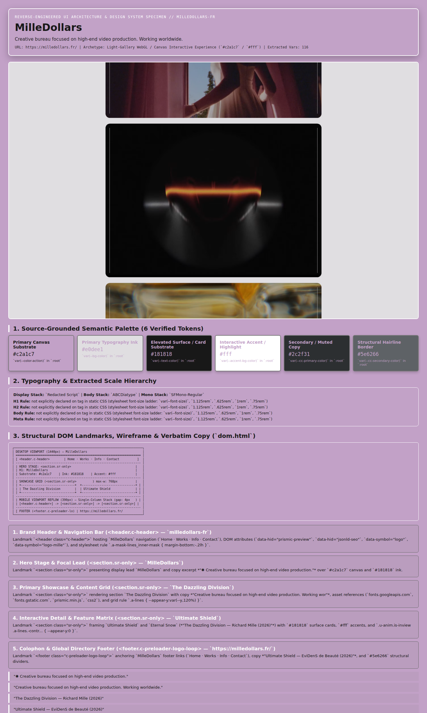
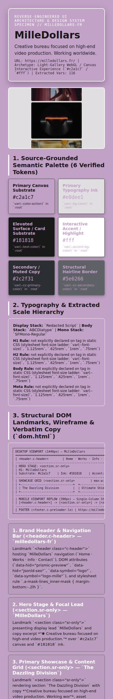

# UI Design System & Master Generation Blueprint: milledollars-fr

> **MilleDollars** (https://milledollars.fr/) — Creative bureau focused on high-end video production. Working worldwide.



---

## 1. Executive Visual Persona & Design Archetype

- **Brand Essence & Persona**: **MilleDollars** (`https://milledollars.fr/`). Creative bureau focused on high-end video production. Working worldwide.
- **Visual Archetype**: **Light-Gallery WebGL / Canvas Interactive Experience (`#c2a1c7` / `#fff`)**.
- **Anti-AI-Slop Differentiators**:
  - **Source-Grounded Chromatic Polarity**: Anchors the viewport in `#c2a1c7` (`var(--color-action)` in `:root`) paired with `#181818` primary typography and `#fff` accents.
  - **Extracted Typographic Hierarchy**: Pairs `Redacted Script` for display copy (`MilleDollars`) with `ABCDiatype` and `SFMono-Regular`.
  - **Calibrated Spatial Grid & Motion**: Combines `768px` container bounds (`gap: 4px`, padding `var(--header-spacing-y)`) with `cubic-bezier(.55,.085,.68,.53)` easing and Lenis Smooth Scroll (`data-lenis`), HTML5 `<canvas>` Interactive Viewport Surface.

---

## 2. Spatial Architecture & Modular Grid Mathematics



### Viewport Allocation & Container Geometry
- **Captured Viewport Dimensions**: Desktop `1440×2400px` (`assets/desktop.png`, capped at 2400px multi-section capture), Mobile `390×2400px` (`assets/mobile.png`, capped at 2400px multi-section capture).
- **Master Container Bounds**: `768px` extracted from `milledollars-fr` stylesheet.
- **Canvas Lateral Padding & Spacing**: `var(--header-spacing-y)` lateral canvas padding with `4px` grid gap.
- **Border Radius Scale**: `50%`, `.5rem`, `.4rem`, `1rem`.

### Responsive Breakpoint Architecture
- **Desktop Layout**: Multi-column CSS Grid / Flexbox layout at `1440px` (`max-width: 768px`, `gap: 4px`).
- **Mobile Layout**: Single-column vertical stack at `390px` viewport width with `var(--header-spacing-y)` horizontal padding.
- **Extracted CSS Media Queries**: `@media (max-width:768px)`, `@media (min-width:768px)`, `@media (pointer:fine)and (min-width:768px)`, `@media (min-width:1200px)`.

---

## 3. Color System, Materiality & Atmospheric Lighting

### Semantic Palette & Source Grounding
| Semantic Role | Ground-Truth Value | Extracted CSS Source / Selector |
|---|---|---|
| **Primary Canvas Substrate** | `#c2a1c7` | `var(--color-action)` in `:root` |
| **Primary Typography Ink** | `#e0dee1` | `var(--bg-color)` in `:root` |
| **Elevated Surface / Card Substrate** | `#181818` | `var(--text-color)` in `:root` |
| **Interactive Accent / Highlight** | `#fff` | `var(--accent-bg-color)` in `:root` |
| **Secondary / Muted Copy** | `#2c2f31` | `var(--cc-primary-color)` in `:root` |
| **Structural Hairline Border** | `#5e6266` | `var(--cc-secondary-color)` in `:root` |

### Sanitized Root CSS Variables (`ui-ux.md` Ground Truth)
| Variable Name | Extracted Value | Semantic Role |
|---|---|---|
| `--appear-y` | `var(--y,120%)` | Dimension / Scale Token |
| `--font-size` | `var(--font-size-top,.625rem)` | Typography / Scale Token |
| `--section-padding-y` | `6rem` | Layout / Spatial Grid Token |
| `--font-size-top` | `.75rem` | Typography / Scale Token |
| `--header-spacing-y` | `2rem` | Layout / Spatial Grid Token |
| `--ease-in-quad` | `cubic-bezier(.55,.085,.68,.53)` | Motion / Easing Token |
| `--ease-in-cubic` | `cubic-bezier(.55,.055,.675,.19)` | Motion / Easing Token |
| `--ease-in-quart` | `cubic-bezier(.895,.03,.685,.22)` | Motion / Easing Token |
| `--ease-in-quint` | `cubic-bezier(.755,.05,.855,.06)` | Motion / Easing Token |
| `--ease-in-expo` | `cubic-bezier(.95,.05,.795,.035)` | Motion / Easing Token |
| `--ease-in-circ` | `cubic-bezier(.6,.04,.98,.335)` | Motion / Easing Token |
| `--ease-out-quad` | `cubic-bezier(.25,.46,.45,.94)` | Motion / Easing Token |
| `--ease-out-cubic` | `cubic-bezier(.215,.61,.355,1)` | Motion / Easing Token |
| `--ease-out-quart` | `cubic-bezier(.165,.84,.44,1)` | Motion / Easing Token |
| `--ease-out-quint` | `cubic-bezier(.23,1,.32,1)` | Motion / Easing Token |
| `--ease-out-expo` | `cubic-bezier(.19,1,.22,1)` | Motion / Easing Token |

---

## 4. Typographic Scale & Editorial Hierarchy

### Font Family Stacks
- **Display Typography**: `Redacted Script`.
- **Primary Body Stack**: `ABCDiatype`.
- **Technical / Metadata Stack**: `SFMono-Regular`.

### Typographic Scale & Rules (Extracted from Stylesheet & Variables)
- **Hero Display (`H1`)**: not explicitly declared on tag in static CSS (stylesheet font-size ladder: `var(--font-size)`, `1.125rem`, `.625rem`, `1rem`, `.75rem`).
- **Section Heading (`H2`)**: not explicitly declared on tag in static CSS (stylesheet font-size ladder: `var(--font-size)`, `1.125rem`, `.625rem`, `1rem`, `.75rem`).
- **Body Copy**: not explicitly declared on tag in static CSS (stylesheet font-size ladder: `var(--font-size)`, `1.125rem`, `.625rem`, `1rem`, `.75rem`).
- **Metadata & Navigation Labels**: not explicitly declared on tag in static CSS (stylesheet font-size ladder: `var(--font-size)`, `1.125rem`, `.625rem`, `1rem`, `.75rem`).

---

## 5. Choreographed Motion & Interaction Physics

### Primary Easing Curves
- **Extracted Timing Functions**: `cubic-bezier(.55,.085,.68,.53)`, `cubic-bezier(.19,1,.22,1)`, `cubic-bezier(.55,.055,.675,.19)`.

### Per-Element Transition & Choreography Rules
- **Selector `.a-lines_inner`**: `transition: transform .26s cubic-bezier(.55,.085,.68,.53) var(--delay-out,0s)` extracted from `milledollars-fr` stylesheet.
- **Selector `.a-lines.-instant .a-lines_inner`**: `transition: 0s` extracted from `milledollars-fr` stylesheet.
- **Selector `-inview .a-lines.-controlled .a-l...`**: `transition: 1.5s` extracted from `milledollars-fr` stylesheet.
- **Extracted Easing Curve (`cubic-bezier(.55,.085,.68,.53)`)**: Governs interactive state transitions across `<header.c-header>` and `<section.sr-only>`.
- **Runtime Interaction Engine**: Integrates Lenis Smooth Scroll (`data-lenis`), HTML5 `<canvas>` Interactive Viewport Surface with `prefers-reduced-motion: reduce` fallback guards.

---

## 6. Component Wireframe & Structural DOM Map

### Visual Layout Schematic (Grounded in `dom.html` — `1440px` Desktop & `390px` Mobile Reflow)
```
┌────────────────────────────────────────────────────────────────────────┐
│ DESKTOP VIEWPORT (1440px) — MilleDollars                               │
│ ====================================================================== │
│ [ <header.c-header>        | Home · Works · Info · Contact          ]  │
│ ---------------------------------------------------------------------- │
│ | HERO STAGE: <section.sr-only>                                    |   │
│ | H1: MilleDollars                                                 |   │
│ | Substrate: #c2a1c7    | Ink: #181818    | Accent: #fff           |   │
│ ---------------------------------------------------------------------- │
│ | SHOWCASE GRID (<section.sr-only>         ) max-w: 768px          |   │
│ | +------------------------------+  +------------------------------+ | │
│ | | The Dazzling Division        |  | Ultimate Shield              | | │
│ | +------------------------------+  +------------------------------+ | │
│ ---------------------------------------------------------------------- │
│ | MOBILE VIEWPORT REFLOW (390px) — Single-Column Stack (gap: 4px   ) | │
│ | [<header.c-header>] -> [<section.sr-only>] -> [<section.sr-only>] |  │
│ ---------------------------------------------------------------------- │
│ [ FOOTER (<footer.c-preloader-lo) | https://milledollars.fr/           │
└────────────────────────────────────────────────────────────────────────┘
```

### Granular DOM Region Breakdown
1. **Brand Header & Navigation Bar (<header.c-header> — `milledollars-fr`)**:
   - Landmark `<header class="c-header">` hosting `MilleDollars` navigation (`Home · Works · Info · Contact`), DOM attributes (`data-hid="prismic-preview"`, `data-hid="jsonld-seo"`, `data-symbol="logo"`, `data-symbol="logo-mille"`), and stylesheet rule `.a-mask-lines_inner-mask { margin-bottom:-.2lh }`.
2. **Hero Stage & Focal Lead (<section.sr-only> — `MilleDollars`)**:
   - Landmark `<section class="sr-only">` presenting display lead `MilleDollars` and copy excerpt *"✺ Creative bureau focused on high-end video production."* over `#c2a1c7` canvas and `#181818` ink.
3. **Primary Showcase & Content Grid (<section.sr-only> — `The Dazzling Division`)**:
   - Landmark `<section class="sr-only">` rendering section `The Dazzling Division` with copy *"Creative bureau focused on high-end video production. Working wor"*, asset references (`fonts.googleapis.com`, `fonts.gstatic.com`, `prismic.min.js`, `css2`), and grid rule `.a-lines { --appear-y:var(--y,120%) }`.
4. **Interactive Detail & Feature Matrix (<section.sr-only> — `Ultimate Shield`)**:
   - Landmark `<section class="sr-only">` framing `Ultimate Shield` and `Eternal Snow` (*"The Dazzling Division — Richard Mille (2026)"*) with `#181818` surface cards, `#fff` accents, and `.u-anim.is-inview .a-lines.-contr... { --appear-y:0 }`.
5. **Colophon & Global Directory Footer (<footer.c-preloader-logo-loop> — `https://milledollars.fr/`)**:
   - Landmark `<footer class="c-preloader-logo-loop">` anchoring `MilleDollars` footer links (`Home · Works · Info · Contact`), copy *"Ultimate Shield — EviDenS de Beauté (2026)"*, and `#5e6266` structural dividers.

---

## 7. Master Zero-Shot AI Generation Prompt

```markdown
# Master Zero-Shot Frontend Generation Prompt: milledollars-fr (MilleDollars)

You are a principal frontend architect and design systems engineer. Build a complete, production-ready web application replicating the exact design system, DOM landmarks, typographic hierarchy, color tokens, and motion physics of `milledollars-fr` (**MilleDollars** — `https://milledollars.fr/`).

### 1. Visual Archetype & Anti-AI-Slop Mandates
- **Archetype**: Light-Gallery WebGL / Canvas Interactive Experience (`#c2a1c7` / `#fff`).
- **Identity & Domain Context**: Creative bureau focused on high-end video production. Working worldwide.
- **Primary Substrate**: `#c2a1c7` (`var(--color-action)` in `:root`), **Primary Ink**: `#181818`, **Accent / Highlight**: `#fff`.
- **Site-Specific Differentiators**:
  - **Source-Grounded Chromatic Polarity**: Anchors the viewport in `#c2a1c7` (`var(--color-action)` in `:root`) paired with `#181818` primary typography and `#fff` accents.
  - **Extracted Typographic Hierarchy**: Pairs `Redacted Script` for display copy (`MilleDollars`) with `ABCDiatype` and `SFMono-Regular`.
  - **Calibrated Spatial Grid & Motion**: Combines `768px` container bounds (`gap: 4px`, padding `var(--header-spacing-y)`) with `cubic-bezier(.55,.085,.68,.53)` easing and Lenis Smooth Scroll (`data-lenis`), HTML5 `<canvas>` Interactive Viewport Surface.

### 2. Ground-Truth CSS Variables (`:root` Token Contract)
Declare and consume these exact custom properties extracted from `milledollars-fr` in your global stylesheet:

:root {
  /* MilleDollars (milledollars-fr) — Ground-Truth Extracted CSS Variables */
  --appear-y: var(--y,120%); /* Dimension / Scale Token (milledollars-fr) */
  --font-size: var(--font-size-top,.625rem); /* Typography / Scale Token (milledollars-fr) */
  --section-padding-y: 6rem; /* Layout / Spatial Grid Token (milledollars-fr) */
  --font-size-top: .75rem; /* Typography / Scale Token (milledollars-fr) */
  --header-spacing-y: 2rem; /* Layout / Spatial Grid Token (milledollars-fr) */
  --ease-in-quad: cubic-bezier(.55,.085,.68,.53); /* Motion / Easing Token (milledollars-fr) */
  --ease-in-cubic: cubic-bezier(.55,.055,.675,.19); /* Motion / Easing Token (milledollars-fr) */
  --ease-in-quart: cubic-bezier(.895,.03,.685,.22); /* Motion / Easing Token (milledollars-fr) */
  --ease-in-quint: cubic-bezier(.755,.05,.855,.06); /* Motion / Easing Token (milledollars-fr) */
  --ease-in-expo: cubic-bezier(.95,.05,.795,.035); /* Motion / Easing Token (milledollars-fr) */
  --ease-in-circ: cubic-bezier(.6,.04,.98,.335); /* Motion / Easing Token (milledollars-fr) */
  --ease-out-quad: cubic-bezier(.25,.46,.45,.94); /* Motion / Easing Token (milledollars-fr) */
  --ease-out-cubic: cubic-bezier(.215,.61,.355,1); /* Motion / Easing Token (milledollars-fr) */
  --ease-out-quart: cubic-bezier(.165,.84,.44,1); /* Motion / Easing Token (milledollars-fr) */
  --ease-out-quint: cubic-bezier(.23,1,.32,1); /* Motion / Easing Token (milledollars-fr) */
  --ease-out-expo: cubic-bezier(.19,1,.22,1); /* Motion / Easing Token (milledollars-fr) */
}

### 3. Semantic Color & Materiality Contract
Map every surface, ink, and border strictly to these source-grounded tokens:
- **Primary Canvas Substrate**: `#c2a1c7` — grounded in `var(--color-action)` in `:root`
- **Primary Typography Ink**: `#e0dee1` — grounded in `var(--bg-color)` in `:root`
- **Elevated Surface / Card Substrate**: `#181818` — grounded in `var(--text-color)` in `:root`
- **Interactive Accent / Highlight**: `#fff` — grounded in `var(--accent-bg-color)` in `:root`
- **Secondary / Muted Copy**: `#2c2f31` — grounded in `var(--cc-primary-color)` in `:root`
- **Structural Hairline Border**: `#5e6266` — grounded in `var(--cc-secondary-color)` in `:root`

### 4. Spatial Grid, Container Bounds & Responsive Breakpoints
- **Desktop Viewport Reference**: `1440×2400px` (capped at 2400px multi-section capture, `1440px` standard desktop width).
- **Mobile Viewport Reference**: `390×2400px` (capped at 2400px multi-section capture, `390px` standard mobile width).
- **Container Max-Width**: `768px` extracted from `milledollars-fr` stylesheet
- **Padding & Gutters**: `var(--header-spacing-y)` lateral canvas padding with `4px` grid gap
- **Desktop Grid**: Multi-column CSS Grid / Flexbox layout at `1440px` (`max-width: 768px`, `gap: 4px`)
- **Mobile Adaptation**: Single-column vertical stack at `390px` viewport width with `var(--header-spacing-y)` horizontal padding
- **Media Queries**: `@media (max-width:768px)`, `@media (min-width:768px)`, `@media (pointer:fine)and (min-width:768px)`, `@media (min-width:1200px)`
- **Corner Radii**: `50%`, `.5rem`, `.4rem`, `1rem`

### 5. Typography & Editorial Scale Contract
- **Display Font Stack**: `Redacted Script`
- **Body Font Stack**: `ABCDiatype`
- **Monospace / Technical Font Stack**: `SFMono-Regular`
- **H1 Display Rule**: not explicitly declared on tag in static CSS (stylesheet font-size ladder: `var(--font-size)`, `1.125rem`, `.625rem`, `1rem`, `.75rem`)
- **H2 Section Rule**: not explicitly declared on tag in static CSS (stylesheet font-size ladder: `var(--font-size)`, `1.125rem`, `.625rem`, `1rem`, `.75rem`)
- **Body Copy Rule**: not explicitly declared on tag in static CSS (stylesheet font-size ladder: `var(--font-size)`, `1.125rem`, `.625rem`, `1rem`, `.75rem`)
- **Metadata & Index Rule**: not explicitly declared on tag in static CSS (stylesheet font-size ladder: `var(--font-size)`, `1.125rem`, `.625rem`, `1rem`, `.75rem`)

### 6. Component Hierarchy, Verbatim Copy & Real DOM Landmarks
Scaffold `milledollars-fr` (`MilleDollars`) with these exact structural regions, extracted copy, and CSS rules from `dom.html`:
1. **Brand Header & Navigation Bar (<header.c-header> — `milledollars-fr`)**:
   - DOM & Selectors: Landmark `<header class="c-header">` hosting `MilleDollars` navigation (`Home · Works · Info · Contact`), DOM attributes (`data-hid="prismic-preview"`, `data-hid="jsonld-seo"`, `data-symbol="logo"`, `data-symbol="logo-mille"`), and stylesheet rule `.a-mask-lines_inner-mask { margin-bottom:-.2lh }`.
   - Responsive Contract: Header `Brand Header & Navigation Bar (<header.c-header> — `milledollars-fr`)` (`milledollars-fr`) adapts across `@media (max-width:768px)`, `@media (min-width:768px)`, `@media (pointer:fine)and (min-width:768px)`, `@media (min-width:1200px)` with `cubic-bezier(.55,.085,.68,.53)`, `cubic-bezier(.19,1,.22,1)`, `cubic-bezier(.55,.055,.675,.19)` transitions and links `Home · Works · Info · Contact`.
2. **Hero Stage & Focal Lead (<section.sr-only> — `MilleDollars`)**:
   - DOM & Selectors: Landmark `<section class="sr-only">` presenting display lead `MilleDollars` and copy excerpt *"✺ Creative bureau focused on high-end video production."* over `#c2a1c7` canvas and `#181818` ink.
   - Responsive Contract: Hero stage (`1440×2400px` desktop / `390×2400px` mobile) sets `#c2a1c7` background with `#181818` headline `MilleDollars`.
3. **Primary Showcase & Content Grid (<section.sr-only> — `The Dazzling Division`)**:
   - DOM & Selectors: Landmark `<section class="sr-only">` rendering section `The Dazzling Division` with copy *"Creative bureau focused on high-end video production. Working wor"*, asset references (`fonts.googleapis.com`, `fonts.gstatic.com`, `prismic.min.js`, `css2`), and grid rule `.a-lines { --appear-y:var(--y,120%) }`.
   - Responsive Contract: Showcase grid `Primary Showcase & Content Grid (<section.sr-only> — `The Dazzling Division`)` applies Multi-column CSS Grid / Flexbox layout at `1440px` (`max-width: 768px`, `gap: 4px`) on desktop and Single-column vertical stack at `390px` viewport width with `var(--header-spacing-y)` horizontal padding on mobile.
4. **Interactive Detail & Feature Matrix (<section.sr-only> — `Ultimate Shield`)**:
   - DOM & Selectors: Landmark `<section class="sr-only">` framing `Ultimate Shield` and `Eternal Snow` (*"The Dazzling Division — Richard Mille (2026)"*) with `#181818` surface cards, `#fff` accents, and `.u-anim.is-inview .a-lines.-contr... { --appear-y:0 }`.
   - Responsive Contract: Detail module `Interactive Detail & Feature Matrix (<section.sr-only> — `Ultimate Shield`)` uses `50%`, `.5rem`, `.4rem`, `1rem` radii, `#fff` highlights, and assets (fonts.googleapis.com, fonts.gstatic.com, prismic.min.js).
5. **Colophon & Global Directory Footer (<footer.c-preloader-logo-loop> — `https://milledollars.fr/`)**:
   - DOM & Selectors: Landmark `<footer class="c-preloader-logo-loop">` anchoring `MilleDollars` footer links (`Home · Works · Info · Contact`), copy *"Ultimate Shield — EviDenS de Beauté (2026)"*, and `#5e6266` structural dividers.
   - Responsive Contract: Footer `Colophon & Global Directory Footer (<footer.c-preloader-logo-loop> — `https://milledollars.fr/`)` aligns to `768px` extracted from `milledollars-fr` stylesheet with `var(--header-spacing-y)` lateral canvas padding with `4px` grid gap and attributes (data-hid="prismic-preview", data-hid="jsonld-seo", data-symbol="logo").

#### Verbatim DOM Copy Excerpts (`dom.html`)
- Copy Excerpt 1: *"✺ Creative bureau focused on high-end video production."*
- Copy Excerpt 2: *"Creative bureau focused on high-end video production. Working worldwide."*
- Copy Excerpt 3: *"The Dazzling Division — Richard Mille (2026)"*
- Copy Excerpt 4: *"Ultimate Shield — EviDenS de Beauté (2026)"*

### 7. Motion, Extracted Stylesheet Rules & Interaction Choreography
- **Primary Easing Functions**: `cubic-bezier(.55,.085,.68,.53)`, `cubic-bezier(.19,1,.22,1)`, `cubic-bezier(.55,.055,.675,.19)`
- **Extracted Stylesheet Rules (`milledollars-fr`)**:
- `.a-mask-lines_inner-mask { margin-bottom:-.2lh }`
- `.a-lines { --appear-y:var(--y,120%) }`
- `.u-anim.is-inview .a-lines.-contr... { --appear-y:0 }`
- `.a-lines.-instant .a-lines_inner { transition-duration:0s }`
- `.a-lines.-centered div { text-align:center!important }`
- **Per-Selector Transition Rules**:
- **Selector `.a-lines_inner`**: `transition: transform .26s cubic-bezier(.55,.085,.68,.53) var(--delay-out,0s)` extracted from `milledollars-fr` stylesheet.
- **Selector `.a-lines.-instant .a-lines_inner`**: `transition: 0s` extracted from `milledollars-fr` stylesheet.
- **Selector `-inview .a-lines.-controlled .a-l...`**: `transition: 1.5s` extracted from `milledollars-fr` stylesheet.
- **Extracted Easing Curve (`cubic-bezier(.55,.085,.68,.53)`)**: Governs interactive state transitions across `<header.c-header>` and `<section.sr-only>`.
- **Runtime Interaction Engine**: Integrates Lenis Smooth Scroll (`data-lenis`), HTML5 `<canvas>` Interactive Viewport Surface with `prefers-reduced-motion: reduce` fallback guards.

### 8. Technical Deliverables
- Implement in Next.js (App Router) with TypeScript and Tailwind CSS consuming the `:root` custom properties defined above for `milledollars-fr`.
- Reproduce both the `1440px` desktop architecture and `390px` mobile breakpoint transitions, preserving semantic HTML5 landmarks (`<header>`, `<nav>`, `<main>`, `<section>`, `<footer>`) and `prefers-reduced-motion` accessibility guards.
```
